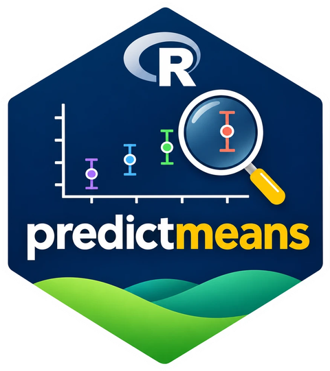
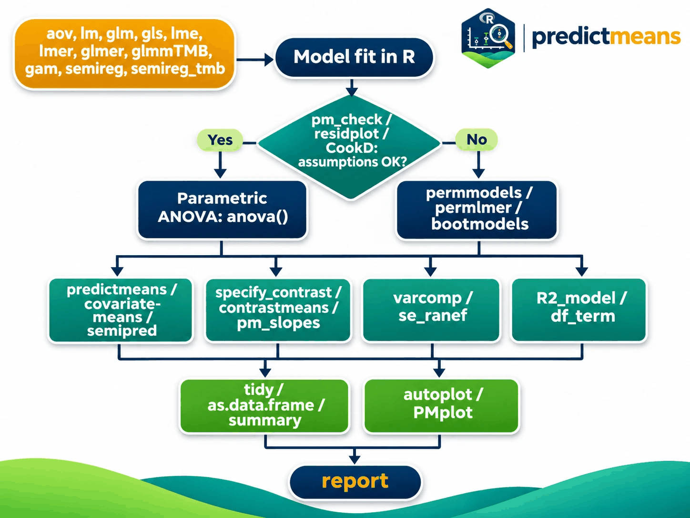

# predictmeans 

Predicted (least-squares) means, standard errors, LSDs, pairwise comparisons and
contrasts for linear, generalized linear and mixed models — `aov`, `lm`, `glm`, `gls`,
`lme`, `lmer`, `glmer`, `glmmTMB`, `gam` and semiparametric `semireg` models — with
Kenward–Roger, Satterthwaite or containment degrees of freedom, permutation and bootstrap
tests, R² for mixed models and diagnostics.

## Why predictmeans

- **Defaults chosen on evidence**: Kenward–Roger df and adjusted SEs for REML `lmer`;
  permutation p-values (b + 1)/(B + 1); `aov` with `Error()` analysed by strata (SEs
  from stratum mean squares, as Genstat); means over empty cells average the observed
  cells with equal weight, with a warning.
- **Checked against outside references** in the tests: real SAS PROC MIXED and Genstat
  runs, pbkrtest, `nlme::lme` and emmeans.
- **Robust**: works across model classes; stops with a clear message rather than
  return a silently wrong answer.
- **Advice from the data**: one line on what to do when this fit needs it (empty cells,
  singular fit, small df, ...); `advice(x)` reads it, `options(predictmeans.advice = FALSE)`
  turns it off.
- **Reproducible**: resampling results are identical for any `ncore`.

## Workflow



## Installation

```r
install.packages("predictmeans")                       # CRAN
# remotes::install_github("dongwenluo/predictmeans")    # development version
```

## Example

```r
library(predictmeans)
Oats <- as.data.frame(nlme::Oats)
Oats$nitro <- factor(Oats$nitro)
fm <- lmer(yield ~ nitro * Variety + (1 | Block/Variety), data = Oats)

pm <- predictmeans(fm, "nitro:Variety", atvar = "Variety", adj = "tukey")
pm$means     # one row per mean: estimate, std.error, df, conf.low, conf.high, group, n, ...
pm$pairs     # one row per comparison: estimate, std.error, df, statistic, p.value, p.adj, ...
ggplot2::autoplot(pm)
```

Every `predictmeans()` result has three stable data frames, `means`, `pairs` and
`settings`, with fixed column names; `as.data.frame()`, `tidy()`, `coef()` and `vcov()`
work on it.

## Main functions

| Task | Function |
|---|---|
| Means and pairwise comparisons | `predictmeans()`, `covariatemeans()` |
| Contrasts | `specify_contrast()`, `contrast_family()`, `contrastmeans()` |
| Joint tests (slices) and slopes | `pm_joint()`, `pm_slopes()` |
| Resampling tests | `permmodels()`, `permlmer()`, `bootmodels()` |
| Semiparametric models | `semireg()`, `semireg_tmb()`, `semipred()` |
| R², variance components, diagnostics | `R2_model()`, `varcomp()`, `pm_check()`, `residplot()`, `CookD()` |
| Reference grid / K matrix | `Kmatrix()` |

## Documentation

The [package website](https://dongwenluo.github.io/predictmeans/) has the help pages
and vignettes: getting started; contrasts, joint tests and slopes; link and response
scale; permutation and bootstrap tests; smooth curves in mixed models; missing cells and
non-estimable means; R² for mixed models; and migrating from version 1.x.

For AI assistants and scripted use, a compact description of the result tables, the
defaults and common recipes is installed with the package:
`system.file("llms-context.md", package = "predictmeans")`
([on GitHub](https://github.com/dongwenluo/predictmeans/blob/main/inst/llms-context.md)).
