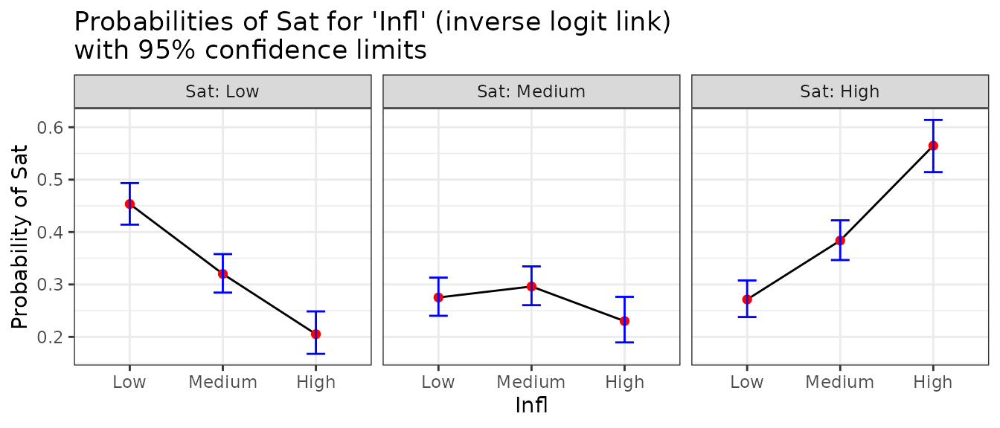

# Ordinal and categorical responses

``` r

library(predictmeans)
library(ggplot2)
```

A response that is a class (a rating 1 to 5, low/medium/high
satisfaction, a colour) has no single mean.
[`predictmeans()`](https://dongwenluo.github.io/predictmeans/reference/predictmeans.md)
gives means on the scale each model has, and the class probabilities on
request.

| model | fitted by | means (default) | other `mean_type` |
|----|----|----|----|
| cumulative link, parallel slopes | [`MASS::polr`](https://rdrr.io/pkg/MASS/man/polr.html), [`ordinal::clm`](https://rdrr.io/pkg/ordinal/man/clm.html), [`ordinal::clmm`](https://rdrr.io/pkg/ordinal/man/clmm.html), `VGAM::vglm(cumulative / propodds / acat / cratio / sratio, parallel = TRUE)` | the latent scale: one mean per level | `"prob"` and `"mean_class"` add a table of class probabilities or the mean class |
| multinomial, or slopes that are not parallel | [`nnet::multinom`](https://rdrr.io/pkg/nnet/man/multinom.html), `VGAM::vglm(multinomial)`, `vglm(..., parallel = FALSE)` | `"prob"`: each class probability, compared within its class | `"prob_diff"`, `"link"`, `"mean_class"` (ordinal families) |

All tests are z tests (these models have no dispersion to estimate),
except `clmm`, which uses the inner-outer df of other mixed models.

## Parallel slopes: one latent scale

The wine data (`ordinal`): bitterness rated 1 to 5 by 9 judges, at two
temperatures and with or without contact.

``` r

data(wine, package = "ordinal")
m <- ordinal::clm(rating ~ temp + contact, data = wine)
pm <- predictmeans(m, "temp:contact", pairwise = TRUE)
summary(pm)
```

    ## Predicted means for 'temp:contact' (clm model; df: asymptotic (z))
    ## Confidence limits: 95%
    ## Scale: latent mean of rating (logit); differences are log odds ratios of a higher class, the same at every cut point; class probabilities: mean_type = "prob"
    ## 
    ##  temp contact estimate std.error  df conf.low conf.high group
    ##  cold      no  -2.0949    0.4682 Inf  -3.0125   -1.1773   A  
    ##  cold     yes  -0.5671    0.3974 Inf  -1.3460    0.2117    B 
    ##  warm      no   0.4082    0.3983 Inf  -0.3724    1.1888    B 
    ##  warm     yes   1.9360    0.4400 Inf   1.0735    2.7984     C
    ## 
    ## 6 pairwise comparisons.
    ## SED: min 0.4766, mean 0.5713, max 0.7765
    ## LSD (5%): min 0.9342, mean 1.12, max 1.522 (they differ: use each pair's p-value or LSD)
    ## p-values: z tests, adjusted by 'none'.
    ## Means sharing a letter are not significantly different at the 5% level.
    ## Comparison intervals: mean +/- 1.313 SE (81.1% intervals); means differ at the 5% level when these do not overlap (the SEDs differ: approximate, but every pair here agrees with its test). The 95% confidence limits are not for comparing means.
    ## 
    ## Advice:
    ## i 6 pairs tested without adjustment: some will be significant by chance. If
    ##   they are a family, use adj = "holm" (any design) or "tukey"/"mvt" (all
    ##   pairs).

The means are on the latent scale, x’b minus the mean cut point
(emmeans’ `mode = "latent"`). A difference of 2.5 between warm and cold
is a log odds ratio: at every cut point the odds of a higher rating are
exp(2.5) = 12 times larger when warm. The same model by `polr()` or
`vglm(propodds)` gives the same means.

The class probabilities of each mean:

``` r

pp <- predictmeans(m, "temp:contact", mean_type = "prob")
head(pp$probs, 5)
```

    ##   temp contact class   estimate  std.error    conf.low  conf.high
    ## 1 cold      no     1 0.20679013 0.08481920 0.086441084 0.41802603
    ## 2 cold      no     2 0.57064970 0.08683884 0.398871093 0.72694468
    ## 3 cold      no     3 0.19229094 0.06388672 0.096094192 0.34773992
    ## 4 cold      no     4 0.02361882 0.01380264 0.007429029 0.07251284
    ## 5 cold      no     5 0.00665041 0.00482850 0.001595527 0.02728234

``` r

predictmeans(m, "temp:contact", mean_type = "mean_class")$probs
```

    ##   temp contact estimate std.error conf.low conf.high
    ## 1 cold      no 2.052690 0.1499310 1.785946  2.371337
    ## 2 cold     yes 2.670937 0.1660160 2.357106  3.002357
    ## 3 warm      no 3.108557 0.1809520 2.754205  3.456202
    ## 4 warm     yes 3.848147 0.1849167 3.455278  4.174685

The mean class scores the classes 1, 2, 3, … as equally spaced; the
advice says so.

### Judges as random effects

``` r

mm <- ordinal::clmm(rating ~ temp + contact + (1 | judge), data = wine)
pmm <- predictmeans(mm, "temp", mean_type = "prob")
pmm$means[, c("temp", "estimate", "std.error", "df")]
```

    ##   temp  estimate std.error df
    ## 1 cold -1.634307 0.5470773 58
    ## 2 warm  1.428689 0.5315314 58

``` r

advice(pmm)$text
```

    ## [1] "The class probabilities are at the latent means, which average over (or fix) contact: not averages of the probabilities in each cell (as emmeans gives). Include contact in 'modelterm' for the probabilities of each cell."                                                                     
    ## [2] "The class probabilities are for a typical subject (random effects at 0; random-effect SD 1.1 on the latent scale): averaged over subjects they are less extreme. Population-average probabilities are not yet available; the comparisons on the latent scale (the pairs) hold for every subject."

The means are for a typical judge (random effects at 0), and so are the
class probabilities: averaged over judges they are less extreme. The df
are inner-outer: with few judges, z tests reject a true null too often
(11% at the 5% level with 6 clusters in a simulation).

## Multinomial and non-parallel fits: class probabilities

Satisfaction with housing
([`MASS::housing`](https://rdrr.io/pkg/MASS/man/housing.html), counts in
`Freq`):

``` r

data(housing, package = "MASS")
mh <- nnet::multinom(Sat ~ Infl + Type + Cont, weights = Freq, data = housing, trace = FALSE)
ph <- predictmeans(mh, "Infl", pairwise = TRUE)
summary(ph)
```

    ## Predicted means for 'Infl' (multinom model; df: asymptotic (z))
    ## Confidence limits: 95%
    ## Scale: logit of the probability of each class of Sat (column 'Sat'), back-transformed in 'response'; pairs within a class: log odds ratios of that class against all the others (not the model's coefficients, which compare classes with the reference class)
    ## 
    ##    Infl    Sat response.std.error estimate std.error  df conf.low conf.high
    ##     Low    Low            0.02028  -0.1866   0.08182 Inf -0.34693  -0.02619
    ##  Medium    Low            0.01876  -0.7533   0.08622 Inf -0.92226  -0.58430
    ##    High    Low            0.02065  -1.3542   0.12664 Inf -1.60240  -1.10597
    ##     Low Medium            0.01860  -0.9686   0.09327 Inf -1.15145  -0.78582
    ##  Medium Medium            0.01889  -0.8658   0.09064 Inf -1.04345  -0.68813
    ##    High Medium            0.02219  -1.2082   0.12529 Inf -1.45370  -0.96259
    ##     Low   High            0.01781  -0.9878   0.09008 Inf -1.16431  -0.81122
    ##  Medium   High            0.01937  -0.4736   0.08192 Inf -0.63417  -0.31305
    ##    High   High            0.02550   0.2606   0.10373 Inf  0.05729   0.46392
    ##  response response.conf.low response.conf.high group
    ##    0.4535            0.4141             0.4935   A  
    ##    0.3201            0.2845             0.3579    B 
    ##    0.2052            0.1676             0.2486     C
    ##    0.2752            0.2402             0.3131    AB
    ##    0.2961            0.2605             0.3344    A 
    ##    0.2300            0.1894             0.2764     B
    ##    0.2714            0.2379             0.3076   A  
    ##    0.3838            0.3466             0.4224    B 
    ##    0.5648            0.5143             0.6139     C
    ## 
    ## 9 pairwise comparisons within each level of Sat.
    ## SED: min 0.1131, mean 0.1345, max 0.1521
    ## LSD (5%): min 0.2217, mean 0.2636, max 0.2982 (they differ: use each pair's p-value or LSD)
    ## p-values: z tests, adjusted by 'none'.
    ## Means sharing a letter are not significantly different at the 5% level within each level of Sat.
    ## Comparison intervals: mean +/- 1.347 SE (82.2% intervals); means differ at the 5% level when these do not overlap (the SEDs differ: approximate, but every pair here agrees with its test). The 95% confidence limits are not for comparing means.
    ## Back-transformed by the inverse link: 'response' is the probability of the class, averaged over the other factors on the response scale.
    ## 
    ## Advice:
    ## i 9 pairs tested without adjustment: some will be significant by chance. If
    ##   they are a family, use adj = "holm" (any design) or "tukey"/"mvt" (all
    ##   pairs).
    ## i The class probabilities average those of each cell over Type, Cont on the
    ##   probability scale (as emmeans' mode = "prob"; equal weights), not the
    ##   probabilities at an average linear predictor.

Each class probability is a mean; the class (`Sat`) is a factor of the
means, and the pairs are within each class. By default the probabilities
are compared on the logit scale, as a binomial glm: the limits stay
inside 0 to 1, and a pair is the odds ratio of that class against all
the others (not the model’s coefficients, which compare classes with the
reference class). With two classes the results are those of the binomial
glm.

``` r

autoplot(ph, scale = "response")
```



Differences of probabilities, as emmeans’ `mode = "prob"`:

``` r

pd <- predictmeans(mh, "Infl", mean_type = "prob_diff")
head(pd$pairs[, c("level1", "level2", "by", "estimate", "std.error", "p.value")], 3)
```

    ##       level1     level2  by  estimate  std.error      p.value
    ## 1    Low:Low Medium:Low Low 0.1333877 0.02629866 3.935871e-07
    ## 2    Low:Low   High:Low Low 0.2483074 0.02808884 9.565552e-19
    ## 3 Medium:Low   High:Low Low 0.1149197 0.02685399 1.873753e-05

For two means these differences sum to zero over the classes. Near 0 or
1 they are less exact than the logit-scale tests; the advice says so
when it applies.

The model’s own linear predictors (`mean_type = "link"`) give exact Wald
tests on the model scale, but for a multinomial model each depends on
the reference class.

A non-parallel cumulative fit (the effect of influence differs between
cut points) gives the same tables, and also the mean class:

``` r

vh <- VGAM::vglm(Sat ~ Infl + Type + Cont, VGAM::cumulative(parallel = FALSE ~ Infl), weights = Freq,
                 data = housing)
predictmeans(vh, "Infl", mean_type = "mean_class")$means
```

    ##     Infl estimate  std.error  df conf.low conf.high comparison.low
    ## 1    Low 1.814062 0.03353481 Inf 1.748335  1.879789       1.769153
    ## 2 Medium 2.063884 0.03365839 Inf 1.997915  2.129853       2.018809
    ## 3   High 2.361506 0.04105265 Inf 2.281044  2.441968       2.306528
    ##   comparison.high  n estimable
    ## 1        1.858972 24      TRUE
    ## 2        2.108959 24      TRUE
    ## 3        2.416483 24      TRUE

## Things predictmeans checks

- **Averaging over other factors.** Class probabilities are averaged
  over the other factors on the probability scale (the share of each
  class over their levels), as emmeans. For parallel models the latent
  means are averaged instead and then turned into probabilities.
- **Separation.** A class with no observations at some level puts its
  probability at 0, where the standard errors are not usable; a caution
  names the classes and levels.
- **Crossing curves.** In non-parallel cumulative fits the cumulative
  curves can cross, giving negative probabilities at some levels or
  covariate values. Means that use such a point are NA, with a caution;
  the other means are kept.
- **Aggregated counts.** With `weights = "proportional"` the factor
  combinations are weighted by their number of cases (the sums of `Freq`
  here), so aggregated data and one row per case agree.
- **Not available.** `trans`, `bias_adjust`, `vcov` and `permlist` stop
  for these models, and
  [`contrastmeans()`](https://dongwenluo.github.io/predictmeans/reference/contrastmeans.md),
  [`covariatemeans()`](https://dongwenluo.github.io/predictmeans/reference/covariatemeans.md),
  [`residplot()`](https://dongwenluo.github.io/predictmeans/reference/residplot.md)
  and others stop for multinomial and non-parallel fits.

## Checks

- Latent means, pairs and class probabilities equal emmeans to 1e-6
  (`polr`, `clm`, `clmm`).
- `clm` and `vglm` against SAS PROC LOGISTIC and GLIMMIX (logit, probit,
  cloglog, adjacent-category; class probabilities to 4e-7).
- `multinom` class probabilities, SEs and both kinds of pairs equal
  emmeans to 1e-8; `vglm(multinomial)` equals `multinom`; non-parallel
  `cumulative`, `cratio` and `sratio` equal
  [`predict()`](https://rdrr.io/r/stats/predict.html) with SEs by a
  numerical delta method.

The tests are in `tests/testthat/test-ordinal.R`, `test-ordinal-sas.R`
and `test-categorical.R`.
