# Overview of predictmeans

``` r

library(tidyverse)
library(predictmeans)
library(HRW)
library(gridExtra)
library(car)
library(DT)
library(gt)
library(knitr)

data(copper, package = "predictmeans")

DT_df <- function(df){
  require(DT)
  stopifnot(is.data.frame(df))
  
  df |>
    DT::datatable(
      extensions = 'Buttons',
      options = list(
        dom = 'Blfrtip', # set DOM
        buttons = c('csv'),
        lengthMenu = list(
          c(10, 20, -1), # declare values
          c(10, 20, "All") # declare titles
        ), # end of lengthMenu customization
        pageLength = 10
      ), rownames= FALSE)
}
```

## **Outline**

- Motivation

- Overview

- Examples

- Future Plan

## **Motivation**

- **Mixed Effects Models:** Essential for statistical analysis (e.g.,
  split-plot experiments, repeated measurements, meta-analysis).
  However, popular R packages like ‘nlme’ and ‘lme4’ only provide model
  effects and ANOVA outputs, lacking further inference (predicted means,
  multiple comparisons, confidence intervals).

- **Permutation Tests:** Ideal for small sample sizes, non-normal
  distributions, or when parametric test assumptions are unmet. They
  offer robust and flexible hypothesis testing in such scenarios.

- **Semiparametric Regression:** Combines parametric and non-parametric
  effects for predictive variables. Widely valuable across astronomy,
  biology, medicine, economics, and finance applications.

- **Package ‘predictmeans’:** Offers diagnostic and inference functions
  for various models (‘aov’, ‘lm’, ‘glm’, etc.). Inferences include
  predicted means, standard errors, contrasts, multiple comparisons,
  permutation tests, adjusted R-square, and graphical representations.
  <https://cran.r-project.org/web/packages/predictmeans/index.html>.

## **Overview**

### **Main Functions Flowchart**


### Contents


## Example_1 Split-plot Design (Oats data)

In the split-plot design shown here, the treatments are three varieties
of oats (Victory, Golden rain and Marvellous) and four levels of
nitrogen (0, 0.2, 0.4 and 0.6 cwt). As it is feasible to work with
smaller plots for fertiliser than for varieties, the six blocks were
initially split into three whole-plots and then each whole-plot was
split into four subplots. The varieties were allocated (at random) to
the whole-plots within each block, and the nitrogen levels (at random)
to the subplots within each whole-plot. In a randomized-block design, we
have a hierarchical structure with blocks and then plots within blocks.

### Data Info

- Structure
- Plot

``` r

data(Oats, package="nlme")
Oats$Block <- factor(Oats$Block, levels=unique(Oats$Block), ordered = TRUE)
Oats <- data.frame(Oats)
str(Oats)
```

    ## 'data.frame':    72 obs. of  4 variables:
    ##  $ Block  : Ord.factor w/ 6 levels "I"<"II"<"III"<..: 1 1 1 1 1 1 1 1 1 1 ...
    ##  $ Variety: Factor w/ 3 levels "Golden Rain",..: 3 3 3 3 1 1 1 1 2 2 ...
    ##  $ nitro  : num  0 0.2 0.4 0.6 0 0.2 0.4 0.6 0 0.2 ...
    ##  $ yield  : num  111 130 157 174 117 114 161 141 105 140 ...

``` r

Oats %>% 
  ggplot(aes(x=nitro, y=yield, col=Variety))+
  geom_point(size=2)+
  geom_line(linewidth=1)+
  facet_wrap(vars(Block))+
  theme_bw(9)
```

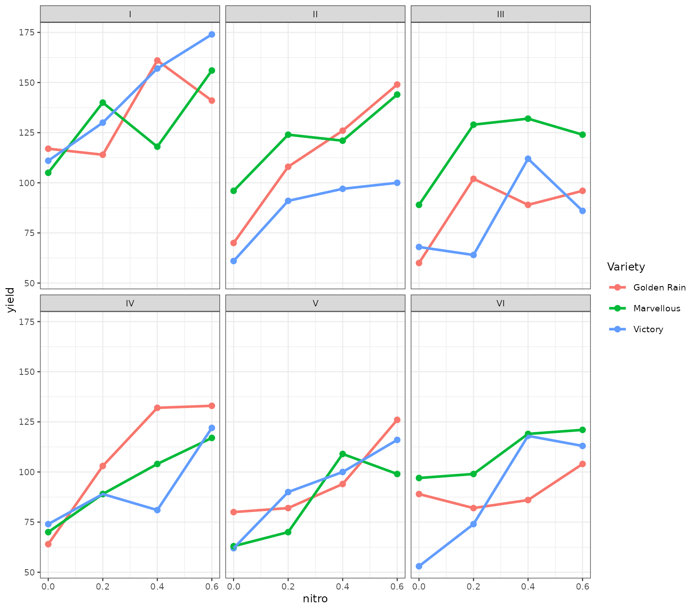

### Modelling

- Model
- Residual Plot
- Highlights
- Test

``` r

Oats$nitro <- factor(Oats$nitro)
Oats$Whole_plot <- Oats$Variety
mod <- lmer(yield ~ nitro*Variety+(1|Block/Whole_plot), data=Oats)
summary(mod, corr=FALSE)
```

    ## Linear mixed model fit by REML. t-tests use Satterthwaite's method [
    ## lmerModLmerTest]
    ## Formula: yield ~ nitro * Variety + (1 | Block/Whole_plot)
    ##    Data: Oats
    ## 
    ## REML criterion at convergence: 529
    ## 
    ## Scaled residuals: 
    ##      Min       1Q   Median       3Q      Max 
    ## -1.81301 -0.56145  0.01758  0.63865  1.57034 
    ## 
    ## Random effects:
    ##  Groups           Name        Variance Std.Dev.
    ##  Whole_plot:Block (Intercept) 106.1    10.30   
    ##  Block            (Intercept) 214.5    14.65   
    ##  Residual                     177.1    13.31   
    ## Number of obs: 72, groups:  Whole_plot:Block, 18; Block, 6
    ## 
    ## Fixed effects:
    ##                            Estimate Std. Error      df t value Pr(>|t|)    
    ## (Intercept)                 80.0000     9.1070 16.0816   8.784 1.55e-07 ***
    ## nitro0.2                    18.5000     7.6829 45.0000   2.408   0.0202 *  
    ## nitro0.4                    34.6667     7.6829 45.0000   4.512 4.58e-05 ***
    ## nitro0.6                    44.8333     7.6829 45.0000   5.835 5.48e-07 ***
    ## VarietyMarvellous            6.6667     9.7150 30.2308   0.686   0.4978    
    ## VarietyVictory              -8.5000     9.7150 30.2308  -0.875   0.3885    
    ## nitro0.2:VarietyMarvellous   3.3333    10.8653 45.0000   0.307   0.7604    
    ## nitro0.4:VarietyMarvellous  -4.1667    10.8653 45.0000  -0.383   0.7032    
    ## nitro0.6:VarietyMarvellous  -4.6667    10.8653 45.0000  -0.430   0.6696    
    ## nitro0.2:VarietyVictory     -0.3333    10.8653 45.0000  -0.031   0.9757    
    ## nitro0.4:VarietyVictory      4.6667    10.8653 45.0000   0.430   0.6696    
    ## nitro0.6:VarietyVictory      2.1667    10.8653 45.0000   0.199   0.8428    
    ## ---
    ## Signif. codes:  0 '***' 0.001 '**' 0.01 '*' 0.05 '.' 0.1 ' ' 1

``` r

residplot(mod, group="nitro")  # id=TRUE
```

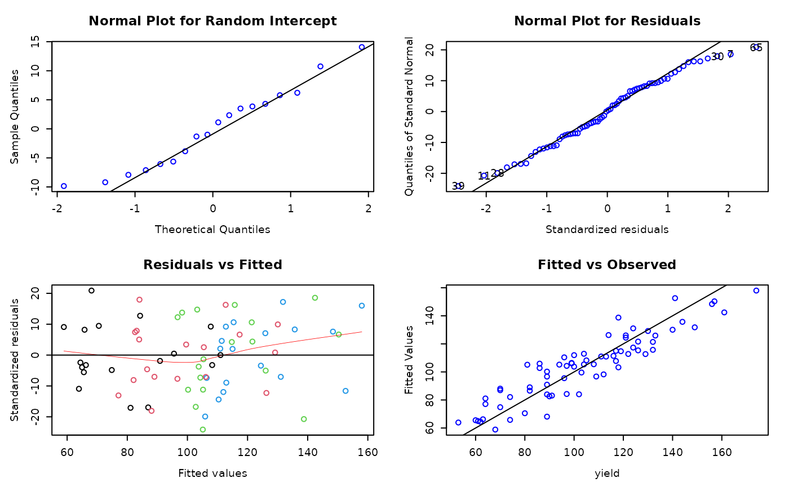

Options in function ‘residplot’:

- **{id=TRUE}** is useful to identify any outliers.

- **{group=“nitro”}** is useful to identify variation pattern along
  ‘nitro’ groups.

``` r

#perform shapiro-wilk test
shapiro.test(resid(mod))
```

    ## 
    ##  Shapiro-Wilk normality test
    ## 
    ## data:  resid(mod)
    ## W = 0.97896, p-value = 0.2698

``` r

#perform bartlett test
bartlett.test(yield ~ interaction(nitro:Variety), data = Oats)
```

    ## 
    ##  Bartlett test of homogeneity of variances
    ## 
    ## data:  yield by interaction(nitro:Variety)
    ## Bartlett's K-squared = 9.182, df = 11, p-value = 0.6051

``` r

#perform levene test 
car::leveneTest(yield ~ nitro:Variety, data = Oats)
```

    ## Levene's Test for Homogeneity of Variance (center = median)
    ##       Df F value Pr(>F)
    ## group 11   0.766 0.6716
    ##       60

### ANOVA and $`R^2`$

- **ANOVA**

``` r

kable(anova(mod))
```

|               |     Sum Sq |   Mean Sq | NumDF |    DenDF |   F value |   Pr(\>F) |
|:--------------|-----------:|----------:|------:|---------:|----------:|----------:|
| nitro         | 20020.5001 | 6673.5000 |     3 | 45.00004 | 37.685704 | 0.0000000 |
| Variety       |   526.0575 |  263.0288 |     2 | 10.00002 |  1.485341 | 0.2723866 |
| nitro:Variety |   321.7500 |   53.6250 |     6 | 45.00004 |  0.302824 | 0.9321985 |

- **$`R^2`$**

``` r

R2_glmm(mod)
```

    ## # Adjusted R2 for Mixed Models

    ##            Total            Fixed           Random Whole_plot:Block 
    ##         "75.81%"         "37.19%"         "38.63%"         "13.87%" 
    ##            Block 
    ##         "24.75%"

### Predicted Means

#### Predicted Means for “nitro”

- Mean Table
- Mean Plot
- p-value Table & Plot

``` r

predm_out <- predictmeans(mod, "nitro", meandecr=TRUE, bar=TRUE, adj="BH", prtplt=FALSE)
print(predm_out[1:4])
```

    ## $`Predicted Means`
    ## nitro
    ##        0      0.2      0.4      0.6 
    ##  79.3889  98.8889 114.2222 123.3889 
    ## 
    ## $`Standard Error of Means`
    ## All means have the same SE 
    ##                    7.17475 
    ## 
    ## $`Standard Error of Differences`
    ##  Max.SED  Min.SED Aveg.SED 
    ## 4.435752 4.435752 4.435752 
    ## 
    ## $LSD
    ##  Max.LSD  Min.LSD Aveg.LSD 
    ##  8.93406  8.93406  8.93406 
    ## attr(,"Significant level")
    ## [1] 0.05
    ## attr(,"Degree of freedom")
    ## [1] 45

``` r

gt(predm_out$mean_table$Table, 
   caption = "Group: Letter-based representation of pairwise comparisons at significant level '0.05'")
```

| nitro | Mean     | SE      | Df   | LL(95%)  | UL(95%)  | LetterGrp |
|-------|----------|---------|------|----------|----------|-----------|
| 0.6   | 123.3889 | 7.17475 | 6.79 | 106.3163 | 140.4614 | A         |
| 0.4   | 114.2222 | 7.17475 | 6.79 | 97.1497  | 131.2948 | B         |
| 0.2   | 98.8889  | 7.17475 | 6.79 | 81.8163  | 115.9614 | C         |
| 0     | 79.3889  | 7.17475 | 6.79 | 62.3163  | 96.4614  | D         |

Group: Letter-based representation of pairwise comparisons at
significant level '0.05' {.table .gt_table
quarto-disable-processing="false" quarto-bootstrap="false"}

``` r

predm_out$predictmeansPlot$meanPlot
```

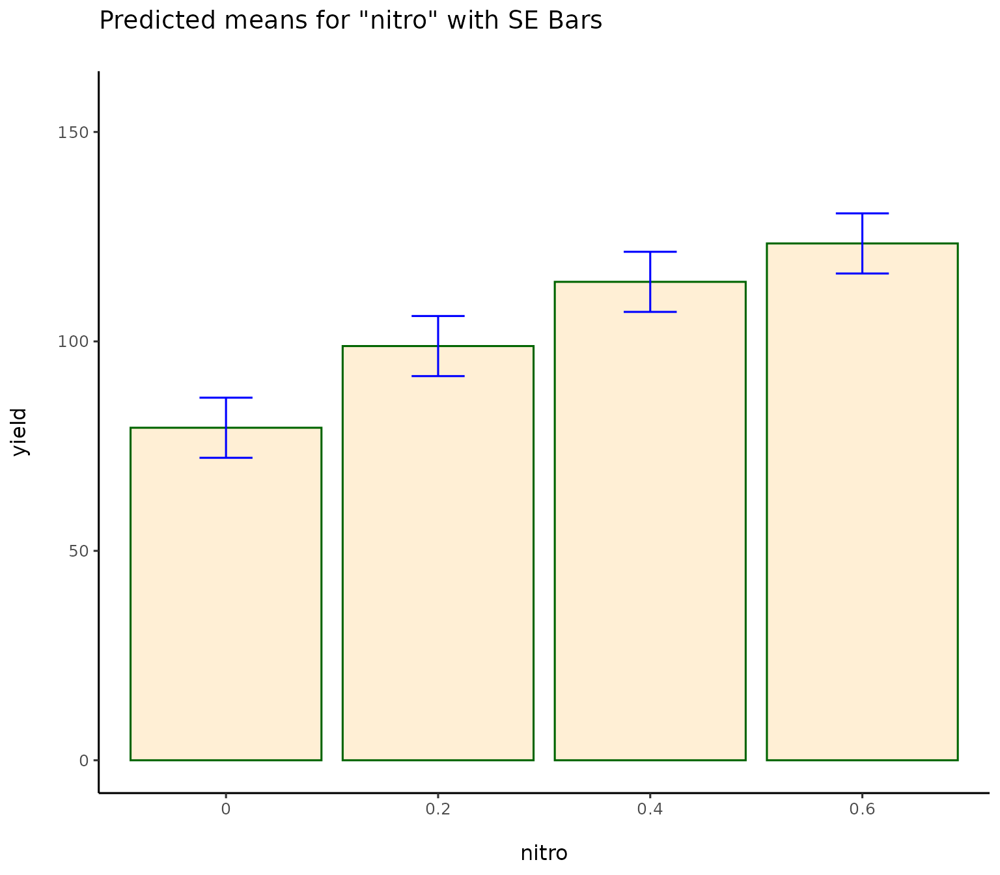

``` r

predm_out$predictmeansPlot$ciPlot
```

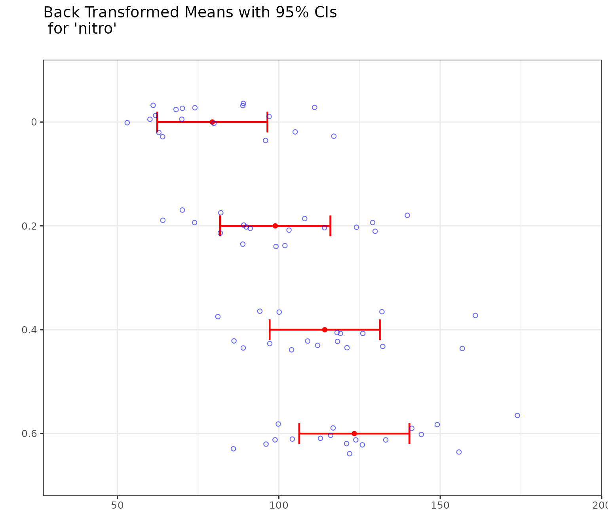

``` r

predm_out$predictmeansBarPlot
```


``` r

gt(data.frame(predm_out$`Pairwise p-value`, check.names=FALSE), 
   rownames_to_stub=TRUE, 
   caption = "The matrix has t-value above the diagonal, p-value (adjusted by 'BH' method) below the diagonal") %>% 
  cols_width(everything() ~ px(130))
```

|     | 0     | 0.2     | 0.4     | 0.6     |
|-----|-------|---------|---------|---------|
| 0   | 1e+00 | -4.3961 | -7.8529 | -9.9194 |
| 0.2 | 1e-04 | 1.0000  | -3.4568 | -5.5233 |
| 0.4 | 0e+00 | 0.0014  | 1.0000  | -2.0665 |
| 0.6 | 0e+00 | 0.0000  | 0.0446  | 1.0000  |

The matrix has t-value above the diagonal, p-value (adjusted by 'BH'
method) below the diagonal {.table .gt_table
style="table-layout:fixed;width:0px;" quarto-disable-processing="false"
quarto-bootstrap="false"}

``` r

PMplot(predm_out$p_valueMatrix)
```

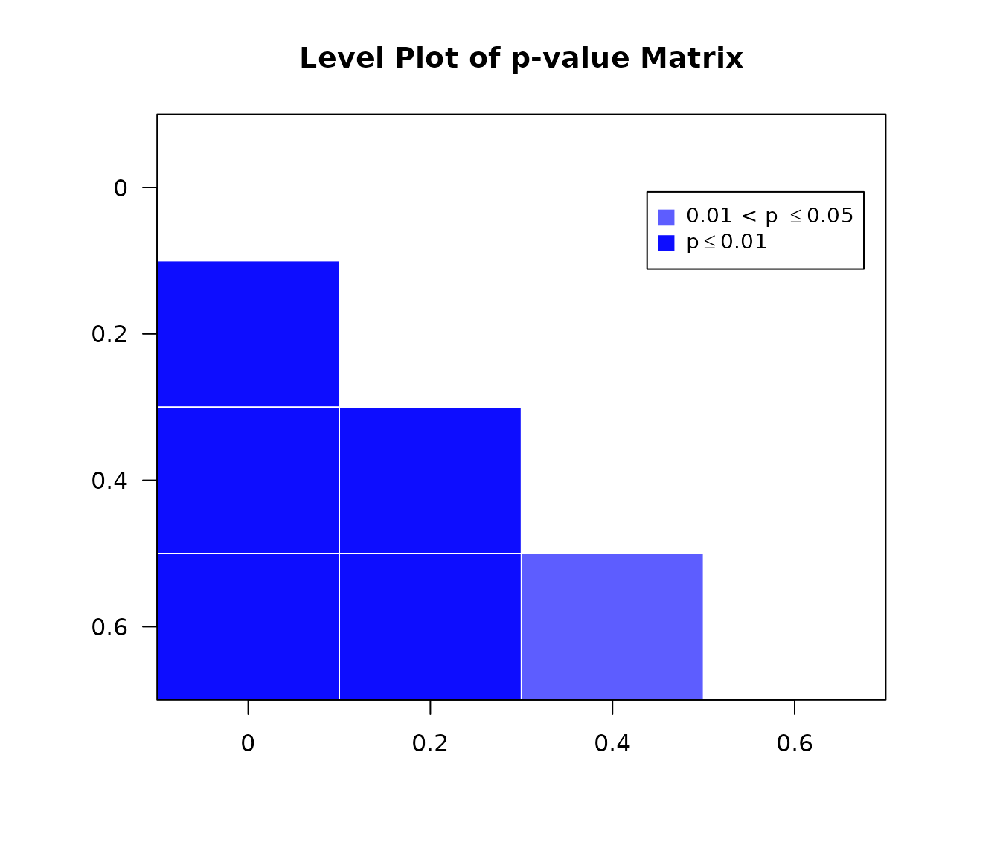

#### Predicted Means for “nitro:Variety”

- Mean Table
- Mean Plot
- p-value Table & Plot

``` r

predm_out <- predictmeans(mod, "nitro:Variety", meandecr=TRUE, bar=TRUE, adj="BH", prtplt=FALSE)
print(predm_out[1:4])
```

    ## $`Predicted Means`
    ##       Variety Golden Rain Marvellous  Victory
    ## nitro                                        
    ## 0                 80.0000    86.6667  71.5000
    ## 0.2               98.5000   108.5000  89.6667
    ## 0.4              114.6667   117.1667 110.8333
    ## 0.6              124.8333   126.8333 118.5000
    ## 
    ## $`Standard Error of Means`
    ## All means have the same SE 
    ##                    9.10701 
    ## 
    ## $`Standard Error of Differences`
    ##  Max.SED  Min.SED Aveg.SED 
    ## 9.715020 7.682948 9.160819 
    ## attr(,"For the Same Level of Factor")
    ##            nitro  Variety
    ## Aveg.SED 9.71502 7.682948
    ## Min.SED  9.71502 7.682948
    ## Max.SED  9.71502 7.682948
    ## 
    ## $LSD
    ##  Max.LSD  Min.LSD Aveg.LSD 
    ## 19.56706 15.47425 18.45084 
    ## attr(,"For the Same Level of Factor")
    ##             nitro  Variety
    ## Aveg.LSD 19.56706 15.47425
    ## Min.LSD  19.56706 15.47425
    ## Max.LSD  19.56706 15.47425
    ## attr(,"Significant level")
    ## [1] 0.05
    ## attr(,"Degree of freedom")
    ## [1] 45

``` r

gt(predm_out$mean_table$Table, 
   caption = "Group: Letter-based representation of pairwise comparisons at significant level '0.05'")
```

| nitro | Variety     | Mean     | SE      | Df    | LL(95%)  | UL(95%)  | LetterGrp |
|-------|-------------|----------|---------|-------|----------|----------|-----------|
| 0.6   | Marvellous  | 126.8333 | 9.10701 | 16.08 | 107.5351 | 146.1315 | A         |
| 0.6   | Golden Rain | 124.8333 | 9.10701 | 16.08 | 105.5351 | 144.1315 | AB        |
| 0.6   | Victory     | 118.5000 | 9.10701 | 16.08 | 99.2018  | 137.7982 | ABC       |
| 0.4   | Marvellous  | 117.1667 | 9.10701 | 16.08 | 97.8685  | 136.4649 | ABC       |
| 0.4   | Golden Rain | 114.6667 | 9.10701 | 16.08 | 95.3685  | 133.9649 | ABC       |
| 0.4   | Victory     | 110.8333 | 9.10701 | 16.08 | 91.5351  | 130.1315 | ABC       |
| 0.2   | Marvellous  | 108.5000 | 9.10701 | 16.08 | 89.2018  | 127.7982 | BCD       |
| 0.2   | Golden Rain | 98.5000  | 9.10701 | 16.08 | 79.2018  | 117.7982 | CDE       |
| 0.2   | Victory     | 89.6667  | 9.10701 | 16.08 | 70.3685  | 108.9649 | DEF       |
| 0     | Marvellous  | 86.6667  | 9.10701 | 16.08 | 67.3685  | 105.9649 | EFG       |
| 0     | Golden Rain | 80.0000  | 9.10701 | 16.08 | 60.7018  | 99.2982  | FG        |
| 0     | Victory     | 71.5000  | 9.10701 | 16.08 | 52.2018  | 90.7982  | G         |

Group: Letter-based representation of pairwise comparisons at
significant level '0.05' {.table .gt_table
quarto-disable-processing="false" quarto-bootstrap="false"}

``` r

predm_out$predictmeansPlot$meanPlot
```

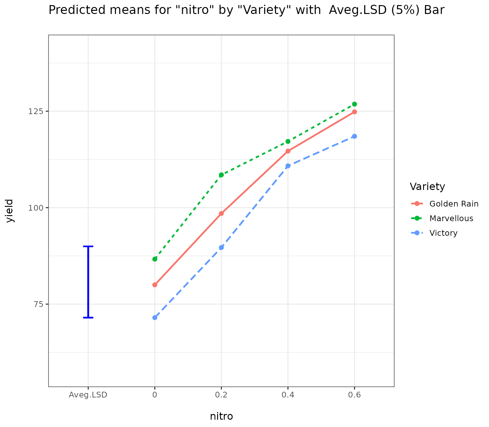

``` r

predm_out$predictmeansPlot$ciPlot
```

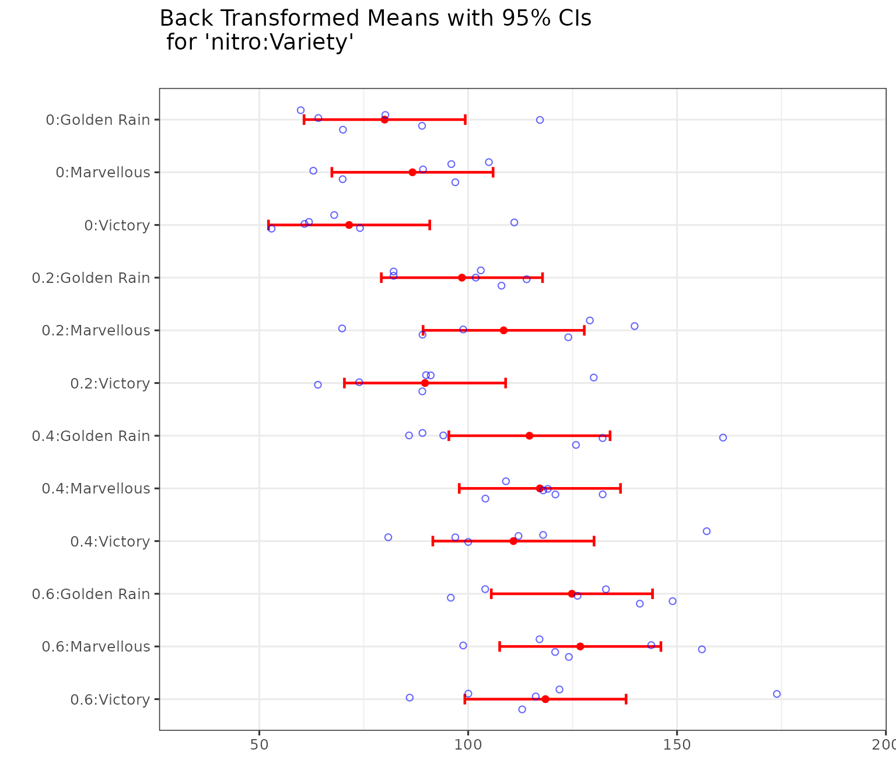

``` r

predm_out$predictmeansBarPlot
```

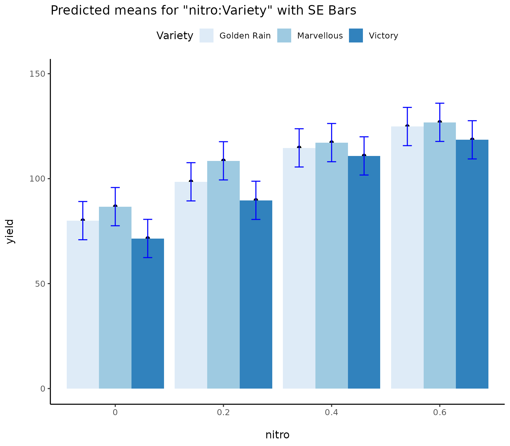

``` r

gt(data.frame(predm_out$`Pairwise p-value`, check.names=FALSE), 
   rownames_to_stub=TRUE,
   caption = "The matrix has t-value above the diagonal, p-value (adjusted by 'BH' method) below the diagonal") %>% 
  cols_width(everything() ~ px(130))
```

|  | 0:Golden Rain | 0:Marvellous | 0:Victory | 0.2:Golden Rain | 0.2:Marvellous | 0.2:Victory | 0.4:Golden Rain | 0.4:Marvellous | 0.4:Victory | 0.6:Golden Rain | 0.6:Marvellous | 0.6:Victory |
|----|----|----|----|----|----|----|----|----|----|----|----|----|
| 0:Golden Rain | 1.0000 | -0.6862 | 0.8749 | -2.4079 | -2.9336 | -0.9950 | -4.5122 | -3.8257 | -3.1738 | -5.8354 | -4.8207 | -3.9629 |
| 0:Marvellous | 0.5867 | 1.0000 | 1.5612 | -1.2180 | -2.8418 | -0.3088 | -2.8821 | -3.9698 | -2.4876 | -3.9286 | -5.2280 | -3.2767 |
| 0:Victory | 0.4838 | 0.2127 | 1.0000 | -2.7792 | -3.8085 | -2.3645 | -4.4433 | -4.7006 | -5.1196 | -5.4898 | -5.6956 | -6.1174 |
| 0.2:Golden Rain | 0.0430 | 0.3338 | 0.0219 | 1.0000 | -1.0293 | 0.9092 | -2.1042 | -1.9214 | -1.2695 | -3.4275 | -2.9164 | -2.0587 |
| 0.2:Marvellous | 0.0185 | 0.0185 | 0.0025 | 0.4196 | 1.0000 | 1.9386 | -0.6348 | -1.1280 | -0.2402 | -1.6812 | -2.3862 | -1.0293 |
| 0.2:Victory | 0.4240 | 0.8086 | 0.0449 | 0.4701 | 0.1136 | 1.0000 | -2.5733 | -2.8307 | -2.7550 | -3.6198 | -3.8257 | -3.7529 |
| 0.4:Golden Rain | 0.0004 | 0.0190 | 0.0007 | 0.0795 | 0.5933 | 0.0346 | 1.0000 | -0.2573 | 0.3946 | -1.3233 | -1.2524 | -0.3946 |
| 0.4:Marvellous | 0.0025 | 0.0015 | 0.0004 | 0.1144 | 0.3725 | 0.0206 | 0.8367 | 1.0000 | 0.6519 | -0.7892 | -1.2582 | -0.1372 |
| 0.4:Victory | 0.0108 | 0.0409 | 0.0001 | 0.3222 | 0.8372 | 0.0206 | 0.7530 | 0.5910 | 1.0000 | -1.4411 | -1.6469 | -0.9979 |
| 0.6:Golden Rain | 0.0000 | 0.0023 | 0.0001 | 0.0046 | 0.1789 | 0.0039 | 0.3024 | 0.5234 | 0.2573 | 1.0000 | -0.2059 | 0.6519 |
| 0.6:Marvellous | 0.0004 | 0.0001 | 0.0001 | 0.0185 | 0.0439 | 0.0025 | 0.3227 | 0.3222 | 0.1860 | 0.8512 | 1.0000 | 0.8578 |
| 0.6:Victory | 0.0023 | 0.0087 | 0.0000 | 0.0910 | 0.4196 | 0.0024 | 0.7530 | 0.8917 | 0.4240 | 0.5910 | 0.4862 | 1.0000 |

The matrix has t-value above the diagonal, p-value (adjusted by 'BH'
method) below the diagonal {.table .gt_table
style="table-layout:fixed;width:0px;" quarto-disable-processing="false"
quarto-bootstrap="false"}

``` r

PMplot(predm_out$p_valueMatrix)
```

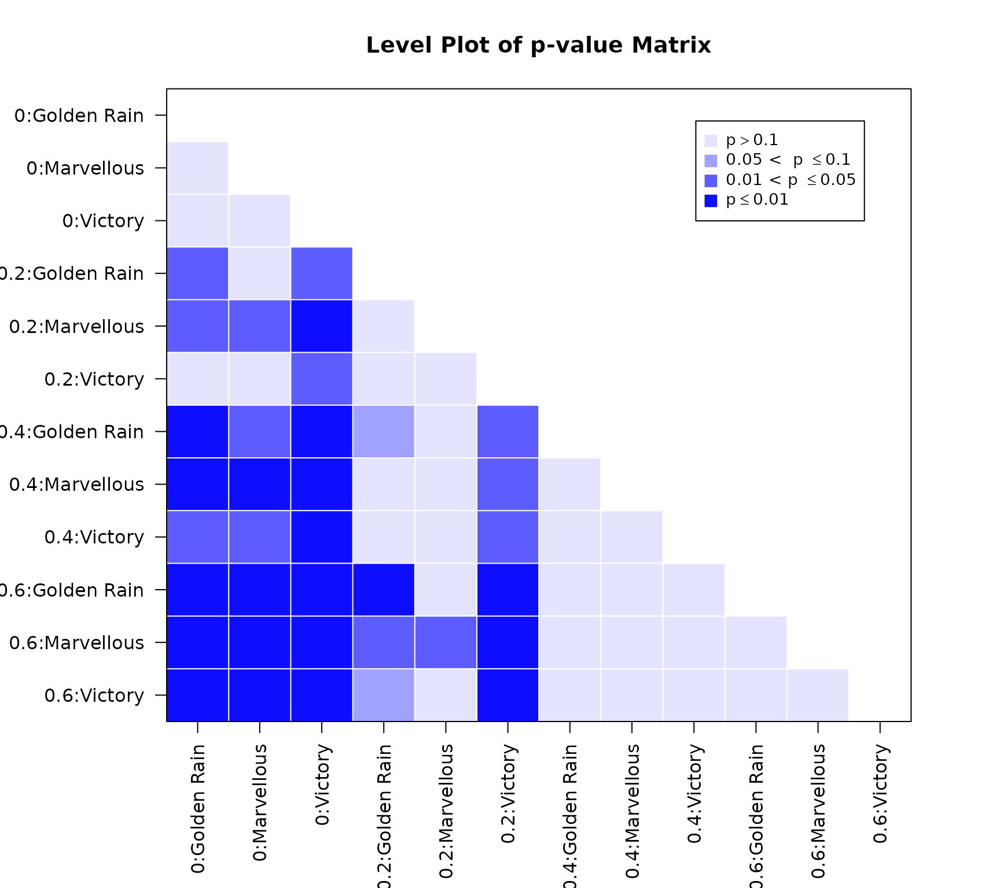

#### Highlights

Options in function ‘predictmens’:

- **{pair=TRUE}** is for multiple comparison without p-value adjusted
  (‘adj’ has default value ‘none’).

- **{adj=“BH”}** is for multiple comparison with p-value adjusted by
  “BH” method (‘pair’ with be TRUE automatically when ‘adj’ is not
  none).

- **{bar=TRUE}** is for producing bar chart.

- **{meandecr=TRUE}** is for descending means in ‘mean_table’.

- **{meandecr=FALSE}** is for ascending means in ‘mean_table’.

- **Pairwise LSD** is available only when adj=‘none’ or ‘bonferroni’.

### Permutation Test

- For Model Term
- For Multiple Comparisons
- For Contrasts

``` r

# Permutation Test for model terms
system.time(
  permlme <- permmodels(model=mod, nperm=999)
)
```

    ## 
    ## Coefficients of (fixed) effects:
    ##                            Estimate Std. Error      df t value Pr(>|t|)
    ## (Intercept)                 80.0000     9.1070 16.0816  8.7844   0.0000
    ## nitro0.2                    18.5000     7.6829 45.0000  2.4079   0.0202
    ## nitro0.4                    34.6667     7.6829 45.0000  4.5122   0.0000
    ## nitro0.6                    44.8333     7.6829 45.0000  5.8354   0.0000
    ## VarietyMarvellous            6.6667     9.7150 30.2308  0.6862   0.4978
    ## VarietyVictory              -8.5000     9.7150 30.2308 -0.8749   0.3885
    ## nitro0.2:VarietyMarvellous   3.3333    10.8653 45.0000  0.3068   0.7604
    ## nitro0.4:VarietyMarvellous  -4.1667    10.8653 45.0000 -0.3835   0.7032
    ## nitro0.6:VarietyMarvellous  -4.6667    10.8653 45.0000 -0.4295   0.6696
    ## nitro0.2:VarietyVictory     -0.3333    10.8653 45.0000 -0.0307   0.9757
    ## nitro0.4:VarietyVictory      4.6667    10.8653 45.0000  0.4295   0.6696
    ## nitro0.6:VarietyVictory      2.1667    10.8653 45.0000  0.1994   0.8428
    ##                            Perm_p_value
    ## (Intercept)                          NA
    ## nitro0.2                          0.021
    ## nitro0.4                          0.001
    ## nitro0.6                          0.001
    ## VarietyMarvellous                 0.505
    ## VarietyVictory                    0.396
    ## nitro0.2:VarietyMarvellous        0.768
    ## nitro0.4:VarietyMarvellous        0.727
    ## nitro0.6:VarietyMarvellous        0.689
    ## nitro0.2:VarietyVictory           0.968
    ## nitro0.4:VarietyVictory           0.674
    ## nitro0.6:VarietyVictory           0.845
    ## 
    ## Note: Perm_p_value of t test is obtained using '999' permutations.
    ## 
    ## ANOVA:
    ##                   Sum Sq   Mean Sq NumDF DenDF F value Pr(>F) Perm_p_value
    ## nitro         20020.5001 6673.5000     3    45 37.6857 0.0000        0.001
    ## Variety         526.0575  263.0288     2    10  1.4853 0.2724        0.258
    ## nitro:Variety   321.7500   53.6250     6    45  0.3028 0.9322        0.931
    ## 
    ## Note: Perm_p_value of F test is obtained using '999' permutations.

    ##    user  system elapsed 
    ##  11.470   0.710   4.487

``` r

# Permutation Test for multiple comparisons
predictmeans(model=mod, modelterm="nitro:Variety", atvar="Variety", adj="BH", permlist=permlme, plot=FALSE)
```

    ## $`Predicted Means`
    ##       Variety Golden Rain Marvellous  Victory
    ## nitro                                        
    ## 0                 80.0000    86.6667  71.5000
    ## 0.2               98.5000   108.5000  89.6667
    ## 0.4              114.6667   117.1667 110.8333
    ## 0.6              124.8333   126.8333 118.5000
    ## 
    ## $`Standard Error of Means`
    ## All means have the same SE 
    ##                    9.10701 
    ## 
    ## $`Standard Error of Differences`
    ##  Max.SED  Min.SED Aveg.SED 
    ## 9.715020 7.682948 9.160819 
    ## attr(,"For the Same Level of Factor")
    ##            nitro  Variety
    ## Aveg.SED 9.71502 7.682948
    ## Min.SED  9.71502 7.682948
    ## Max.SED  9.71502 7.682948
    ## 
    ## $`Approximated LSD`
    ##  Max.LSD  Min.LSD Aveg.LSD 
    ## 19.43004 15.36590 18.32164 
    ## attr(,"For the Same Level of Factor")
    ##             nitro Variety
    ## Aveg.LSD 19.43004 15.3659
    ## Min.LSD  19.43004 15.3659
    ## Max.LSD  19.43004 15.3659
    ## attr(,"Note")
    ## [1] "This is a approximate LSD (i.e. 2*SED) at 0.05 level."
    ## 
    ## $`Pairwise '999' times permuted p-value (adjusted by 'BH' method)`
    ## [1] "For variable 'nitro' at each level of 'Variety'"
    ## 
    ## $`Golden Rain`
    ##     0      0.2    0.4   0.6 Group
    ## 0   1                       A    
    ## 0.2 0.0315 1                 B   
    ## 0.4 0.002  0.0528 1          BC  
    ## 0.6 0.002  0.002  0.194 1     C  
    ## 
    ## $Marvellous
    ##     0     0.2   0.4   0.6 Group
    ## 0   1                     A    
    ## 0.2 0.018 1                B   
    ## 0.4 0.003 0.262 1          BC  
    ## 0.6 0.003 0.03  0.262 1     C  
    ## 
    ## $Victory
    ##     0      0.2   0.4 0.6 Group
    ## 0   1                    A    
    ## 0.2 0.0264 1              B   
    ## 0.4 0.002  0.009 1         C  
    ## 0.6 0.002  0.002 0.3 1     C  
    ## 
    ## $mean_table
    ## $mean_table$Table
    ##        Variety nitro     Mean      SE Df  LL(95%)  UL(95%) LetterGrp
    ## 1  Golden Rain     0  80.0000 9.10701 NA  61.7860  98.2140       A  
    ## 4  Golden Rain   0.2  98.5000 9.10701 NA  80.2860 116.7140        B 
    ## 7  Golden Rain   0.4 114.6667 9.10701 NA  96.4526 132.8807        BC
    ## 10 Golden Rain   0.6 124.8333 9.10701 NA 106.6193 143.0474         C
    ## 2   Marvellous     0  86.6667 9.10701 NA  68.4526 104.8807       A  
    ## 5   Marvellous   0.2 108.5000 9.10701 NA  90.2860 126.7140        B 
    ## 8   Marvellous   0.4 117.1667 9.10701 NA  98.9526 135.3807        BC
    ## 11  Marvellous   0.6 126.8333 9.10701 NA 108.6193 145.0474         C
    ## 3      Victory     0  71.5000 9.10701 NA  53.2860  89.7140       A  
    ## 6      Victory   0.2  89.6667 9.10701 NA  71.4526 107.8807        B 
    ## 9      Victory   0.4 110.8333 9.10701 NA  92.6193 129.0474         C
    ## 12     Victory   0.6 118.5000 9.10701 NA 100.2860 136.7140         C
    ## 
    ## $mean_table$Note
    ## [1] "Letter-based representation of pairwise comparisons at significant level '0.05' at each level of Variety"

``` r

# Permutation Test for specified contrasts
cm <- rbind(c(-1, 0, 1, 0, 0, 0, 0, 0, 0, 0, 0, 0),
            c(0, 0, 1, 0, 0, 0, 0, -1, 0, 0, 0, 0))
contrastmeans(model=mod, modelterm="nitro:Variety", ctrmatrix=cm, permlist=permlme)
```

    ## $`The t tests of the specified contrasts`
    ##      Estimate Std. Error t value Permuted Pr(>|t|)
    ## [1,]  -8.5000      9.715 -0.8749             0.396
    ## [2,] -45.6667      9.715 -4.7006             0.001
    ## attr(,"Note")
    ## [1] "The permuted p-value is obtained using '999' permutations."
    ## 
    ## $K
    ##      0:Golden Rain 0:Marvellous 0:Victory 0.2:Golden Rain 0.2:Marvellous
    ## [1,]            -1            0         1               0              0
    ## [2,]             0            0         1               0              0
    ##      0.2:Victory 0.4:Golden Rain 0.4:Marvellous 0.4:Victory 0.6:Golden Rain
    ## [1,]           0               0              0           0               0
    ## [2,]           0               0             -1           0               0
    ##      0.6:Marvellous 0.6:Victory
    ## [1,]              0           0
    ## [2,]              0           0

## Example_2 Repeated Measurements (ATP data)

ATP containing data from an experiment to study the effects of
preserving liquids on the enzyme content of dog hearts. There were 23
hearts and two treatment factors, A and B, each at two levels.
Measurements were made of ATP as a percentage of total enzyme in the
heart, at one and two hourly intervals during a twelve hour period
following initial preservation.

### Data Info

- Structure
- Plot

``` r

data(ATP, package="predictmeans")
ATP$time.v <- as.numeric(as.character(ATP$time))
str(ATP)
```

    ## 'data.frame':    230 obs. of  6 variables:
    ##  $ heart : Factor w/ 23 levels "1","2","3","4",..: 1 1 1 1 1 1 1 1 1 1 ...
    ##  $ time  : Factor w/ 10 levels "0","1","2","3",..: 1 2 3 4 5 6 7 8 9 10 ...
    ##  $ A     : Factor w/ 2 levels "1","2": 1 1 1 1 1 1 1 1 1 1 ...
    ##  $ B     : Factor w/ 2 levels "1","2": 1 1 1 1 1 1 1 1 1 1 ...
    ##  $ ATP   : num  85.5 74.6 84.2 84 78.4 ...
    ##  $ time.v: num  0 1 2 3 4 5 6 8 10 12 ...

``` r

ATP %>% 
  ggplot(aes(x=time.v, y=ATP, col=A:B))+
  geom_point(size=2)+
  geom_line(linewidth=1)+
  facet_wrap(vars(heart))
```

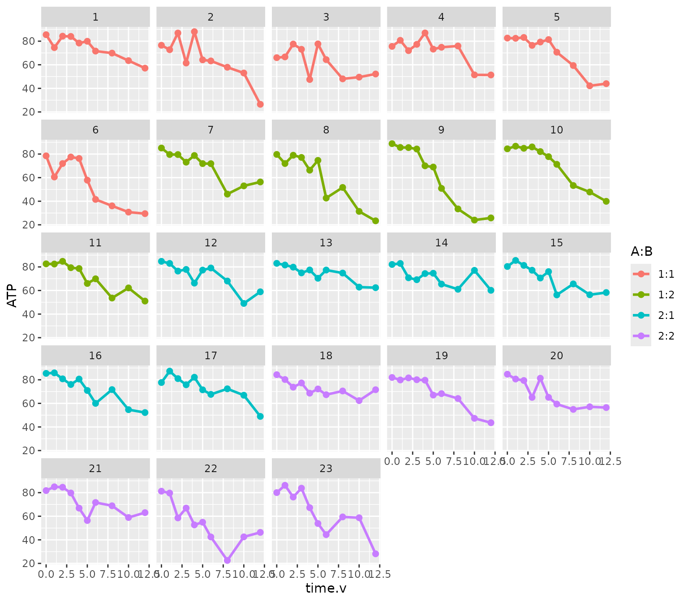

``` r

ATP %>% 
  ggplot(aes(x=time.v, y=ATP, col=A:B))+
  geom_point()+
  geom_smooth()+
  facet_grid(vars(A), vars(B))
```

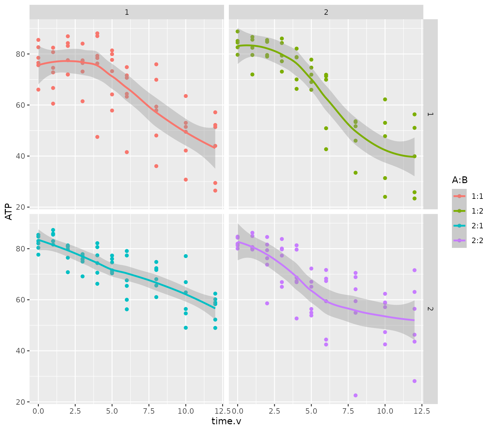

### Modelling

- Model
- Residual Plot
- Test

``` r

mod <- lmer(ATP^1.5 ~ A*B*time+(1| heart), ATP)
summary(mod)
```

    ## Linear mixed model fit by REML. t-tests use Satterthwaite's method [
    ## lmerModLmerTest]
    ## Formula: ATP^1.5 ~ A * B * time + (1 | heart)
    ##    Data: ATP
    ## 
    ## REML criterion at convergence: 2343.3
    ## 
    ## Scaled residuals: 
    ##     Min      1Q  Median      3Q     Max 
    ## -3.3597 -0.5614  0.0328  0.5417  2.2817 
    ## 
    ## Random effects:
    ##  Groups   Name        Variance Std.Dev.
    ##  heart    (Intercept) 3181     56.40   
    ##  Residual             7830     88.49   
    ## Number of obs: 230, groups:  heart, 23
    ## 
    ## Fixed effects:
    ##              Estimate Std. Error       df t value Pr(>|t|)    
    ## (Intercept)   683.499     42.840  108.492  15.955  < 2e-16 ***
    ## A2             62.365     60.584  108.492   1.029  0.30559    
    ## B2             88.640     63.541  108.492   1.395  0.16587    
    ## time1         -57.830     51.088  171.000  -1.132  0.25924    
    ## time2          24.225     51.088  171.000   0.474  0.63597    
    ## time3         -32.107     51.088  171.000  -0.628  0.53053    
    ## time4         -11.443     51.088  171.000  -0.224  0.82303    
    ## time5         -64.479     51.088  171.000  -1.262  0.20862    
    ## time6        -161.028     51.088  171.000  -3.152  0.00192 ** 
    ## time8        -234.509     51.088  171.000  -4.590 8.54e-06 ***
    ## time10       -341.140     51.088  171.000  -6.678 3.27e-10 ***
    ## time12       -389.370     51.088  171.000  -7.622 1.65e-12 ***
    ## A2:B2         -87.113     87.795  108.492  -0.992  0.32329    
    ## A2:time1       87.231     72.249  171.000   1.207  0.22896    
    ## A2:time2      -75.813     72.249  171.000  -1.049  0.29551    
    ## A2:time3      -61.827     72.249  171.000  -0.856  0.39334    
    ## A2:time4      -80.532     72.249  171.000  -1.115  0.26657    
    ## A2:time5      -51.438     72.249  171.000  -0.712  0.47746    
    ## A2:time6      -25.510     72.249  171.000  -0.353  0.72446    
    ## A2:time8       61.754     72.249  171.000   0.855  0.39389    
    ## A2:time10      77.537     72.249  171.000   1.073  0.28470    
    ## A2:time12      72.968     72.249  171.000   1.010  0.31394    
    ## B2:time1       19.313     75.776  171.000   0.255  0.79913    
    ## B2:time2      -43.417     75.776  171.000  -0.573  0.56742    
    ## B2:time3      -23.798     75.776  171.000  -0.314  0.75386    
    ## B2:time4     -107.394     75.776  171.000  -1.417  0.15823    
    ## B2:time5      -97.768     75.776  171.000  -1.290  0.19871    
    ## B2:time6     -123.565     75.776  171.000  -1.631  0.10480    
    ## B2:time8     -205.764     75.776  171.000  -2.715  0.00730 ** 
    ## B2:time10    -130.902     75.776  171.000  -1.727  0.08588 .  
    ## B2:time12    -125.918     75.776  171.000  -1.662  0.09840 .  
    ## A2:B2:time1   -54.138    104.699  171.000  -0.517  0.60576    
    ## A2:B2:time2     9.391    104.699  171.000   0.090  0.92864    
    ## A2:B2:time3    28.233    104.699  171.000   0.270  0.78775    
    ## A2:B2:time4    34.318    104.699  171.000   0.328  0.74348    
    ## A2:B2:time5   -48.078    104.699  171.000  -0.459  0.64667    
    ## A2:B2:time6    21.689    104.699  171.000   0.207  0.83614    
    ## A2:B2:time8    72.676    104.699  171.000   0.694  0.48853    
    ## A2:B2:time10   51.990    104.699  171.000   0.497  0.62013    
    ## A2:B2:time12   75.359    104.699  171.000   0.720  0.47265    
    ## ---
    ## Signif. codes:  0 '***' 0.001 '**' 0.01 '*' 0.05 '.' 0.1 ' ' 1

``` r

residplot(mod, group="A") 
```

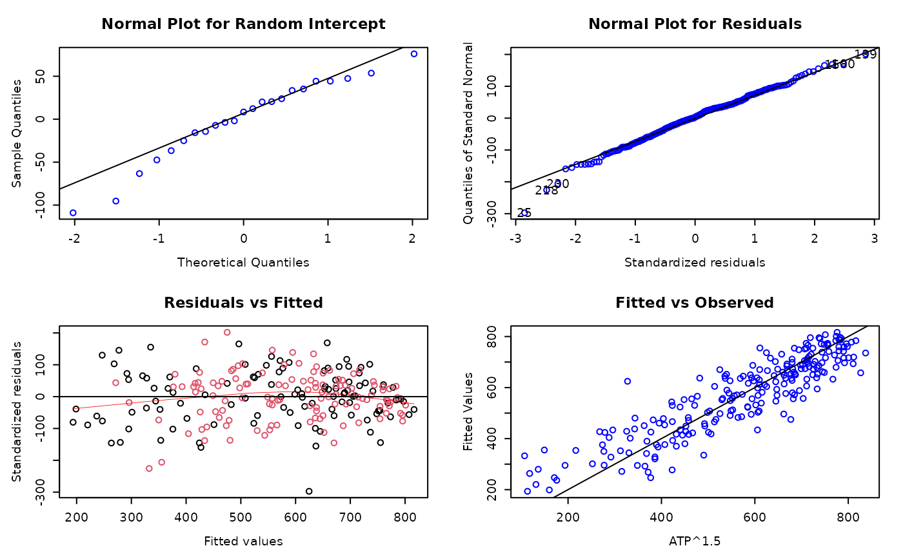

``` r

#perform shapiro-wilk test
shapiro.test(resid(mod))
```

    ## 
    ##  Shapiro-Wilk normality test
    ## 
    ## data:  resid(mod)
    ## W = 0.99105, p-value = 0.1704

``` r

#perform bartlett test
bartlett.test((ATP)^1.5 ~ interaction(A, B), data = ATP)
```

    ## 
    ##  Bartlett test of homogeneity of variances
    ## 
    ## data:  (ATP)^1.5 by interaction(A, B)
    ## Bartlett's K-squared = 16.015, df = 3, p-value = 0.001126

``` r

#perform levene test
car::leveneTest((ATP)^1.5 ~ A:B, data = ATP)
```

    ## Levene's Test for Homogeneity of Variance (center = median)
    ##        Df F value   Pr(>F)   
    ## group   3  4.4718 0.004506 **
    ##       226                    
    ## ---
    ## Signif. codes:  0 '***' 0.001 '**' 0.01 '*' 0.05 '.' 0.1 ' ' 1

### ANOVA and $`R^2`$

- **ANOVA**

``` r

kable(anova(mod))
```

|          |      Sum Sq |    Mean Sq | NumDF | DenDF |    F value |   Pr(\>F) |
|:---------|------------:|-----------:|------:|------:|-----------:|----------:|
| A        |    9372.542 |   9372.542 |     1 |    19 |  1.1970159 | 0.2875959 |
| B        |    9666.108 |   9666.108 |     1 |    19 |  1.2345088 | 0.2803950 |
| time     | 4338231.562 | 482025.729 |     9 |   171 | 61.5620077 | 0.0000000 |
| A:B      |   13034.579 |  13034.579 |     1 |    19 |  1.6647138 | 0.2124504 |
| A:time   |  299791.243 |  33310.138 |     9 |   171 |  4.2542106 | 0.0000540 |
| B:time   |  168897.036 |  18766.337 |     9 |   171 |  2.3967463 | 0.0139325 |
| A:B:time |   25392.525 |   2821.392 |     9 |   171 |  0.3603346 | 0.9522486 |

- **$`R^2`$**

``` r

R2_glmm(mod)
```

    ## # Adjusted R2 for Mixed Models

    ##    Total    Fixed   Random    heart 
    ## "74.28%" "64.23%" "10.04%" "10.04%"

### Predicted Means

#### Predicted Means for “A:time”

- Mean Table
- Mean Plot
- p-value Table

``` r

predm_out <- predictmeans(mod, "A:time", 
                          atvar="time", adj="BH", bar=TRUE, 
                          trans=function(x) x^(1/1.5), 
                          prtplt=FALSE)
print(predm_out[1:4])
```

    ## $`Predicted Means`
    ##      A        1        2
    ## time                    
    ## 0      727.8193 746.6278
    ## 1      679.6465 758.6166
    ## 2      730.3360 678.0270
    ## 3      683.8131 654.9116
    ## 4      662.6791 618.1147
    ## 5      614.4566 557.7880
    ## 6      505.0087 509.1520
    ## 8      390.4279 507.3286
    ## 10     321.2284 443.5690
    ## 12     275.4907 404.9472
    ## 
    ## $`Standard Error of Means`
    ##      A        1        2
    ## time                    
    ## 0      31.77063 30.29210
    ## 1      31.77063 30.29210
    ## 2      31.77063 30.29210
    ## 3      31.77063 30.29210
    ## 4      31.77063 30.29210
    ## 5      31.77063 30.29210
    ## 6      31.77063 30.29210
    ## 8      31.77063 30.29210
    ## 10     31.77063 30.29210
    ## 12     31.77063 30.29210
    ## 
    ## $`Standard Error of Differences`
    ##  Max.SED  Min.SED Aveg.SED 
    ## 43.89743 36.12460 40.63316 
    ## attr(,"For the Same Level of Factor")
    ##                A     time
    ## Aveg.SED 37.0062 43.89743
    ## Min.SED  36.1246 43.89743
    ## Max.SED  37.8878 43.89743
    ## 
    ## $LSD
    ##  Max.LSD  Min.LSD Aveg.LSD 
    ## 86.65062 71.30758 80.20718 
    ## attr(,"For the Same Level of Factor")
    ##                 A     time
    ## Aveg.LSD 73.04780 86.65062
    ## Min.LSD  71.30758 86.65062
    ## Max.LSD  74.78802 86.65062
    ## attr(,"Significant level")
    ## [1] 0.05
    ## attr(,"Degree of freedom")
    ## [1] 171

``` r

gt(predm_out$mean_table$Table, 
   caption = "Group: Letter-based representation of pairwise comparisons at significant level '0.05' at each 'time'")
```

| time | A | Mean | SE | Df | LL(95%) | UL(95%) | Bk_Mean | Bk_LL(95%) | Bk_UL(95%) | LetterGrp |
|----|----|----|----|----|----|----|----|----|----|----|
| 0 | 1 | 727.8193 | 31.77063 | 108.49 | 664.8476 | 790.7910 | 80.9125 | 76.1754 | 85.5148 | A |
| 0 | 2 | 746.6278 | 30.29210 | 108.49 | 686.5867 | 806.6689 | 82.3006 | 77.8270 | 86.6557 | A |
| 1 | 1 | 679.6465 | 31.77063 | 108.49 | 616.6748 | 742.6181 | 77.3016 | 72.4498 | 82.0056 | A |
| 1 | 2 | 758.6166 | 30.29210 | 108.49 | 698.5755 | 818.6577 | 83.1792 | 78.7304 | 87.5121 | A |
| 2 | 1 | 730.3360 | 31.77063 | 108.49 | 667.3643 | 793.3077 | 81.0989 | 76.3675 | 85.6961 | A |
| 2 | 2 | 678.0270 | 30.29210 | 108.49 | 617.9859 | 738.0681 | 77.1788 | 72.5525 | 81.6703 | A |
| 3 | 1 | 683.8131 | 31.77063 | 108.49 | 620.8414 | 746.7848 | 77.6173 | 72.7758 | 82.3121 | A |
| 3 | 2 | 654.9116 | 30.29210 | 108.49 | 594.8705 | 714.9527 | 75.4145 | 70.7318 | 79.9561 | A |
| 4 | 1 | 662.6791 | 31.77063 | 108.49 | 599.7074 | 725.6508 | 76.0097 | 71.1147 | 80.7517 | A |
| 4 | 2 | 618.1147 | 30.29210 | 108.49 | 558.0736 | 678.1559 | 72.5626 | 67.7841 | 77.1886 | A |
| 5 | 1 | 614.4566 | 31.77063 | 108.49 | 551.4849 | 677.4282 | 72.2760 | 67.2495 | 77.1333 | A |
| 5 | 2 | 557.7880 | 30.29210 | 108.49 | 497.7469 | 617.8292 | 67.7609 | 62.8067 | 72.5402 | A |
| 6 | 1 | 505.0087 | 31.77063 | 108.49 | 442.0370 | 567.9804 | 63.4161 | 58.0282 | 68.5839 | A |
| 6 | 2 | 509.1520 | 30.29210 | 108.49 | 449.1108 | 569.1931 | 63.7624 | 58.6456 | 68.6815 | A |
| 8 | 1 | 390.4279 | 31.77063 | 108.49 | 327.4562 | 453.3996 | 53.4188 | 47.5082 | 59.0184 | A |
| 8 | 2 | 507.3286 | 30.29210 | 108.49 | 447.2875 | 567.3697 | 63.6101 | 58.4868 | 68.5347 | B |
| 10 | 1 | 321.2284 | 31.77063 | 108.49 | 258.2568 | 384.2001 | 46.9039 | 40.5541 | 52.8492 | A |
| 10 | 2 | 443.5690 | 30.29210 | 108.49 | 383.5278 | 503.6101 | 58.1622 | 52.7875 | 63.2989 | B |
| 12 | 1 | 275.4907 | 31.77063 | 108.49 | 212.5190 | 338.4623 | 42.3387 | 35.6122 | 48.5669 | A |
| 12 | 2 | 404.9472 | 30.29210 | 108.49 | 344.9061 | 464.9884 | 54.7351 | 49.1814 | 60.0198 | B |

Group: Letter-based representation of pairwise comparisons at
significant level '0.05' at each 'time' {.table .gt_table
quarto-disable-processing="false" quarto-bootstrap="false"}

``` r

predm_out$predictmeansPlot$meanPlot
```

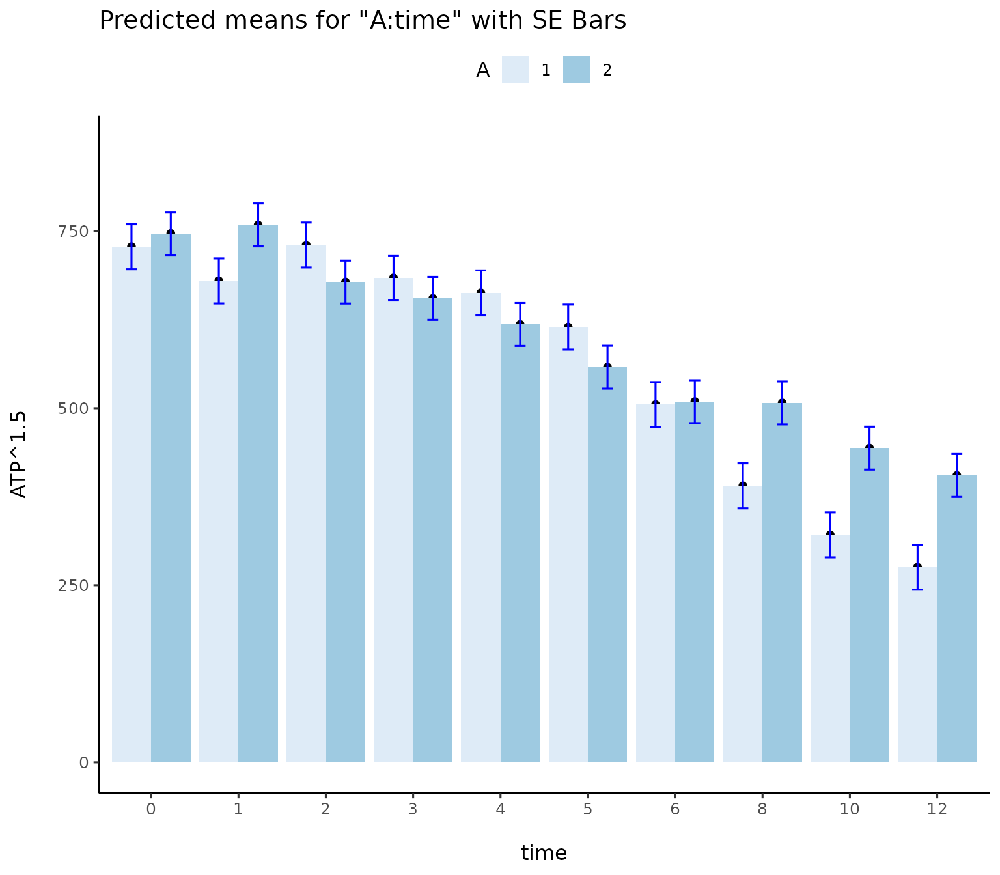

``` r

predm_out$predictmeansPlot$ciPlot
```

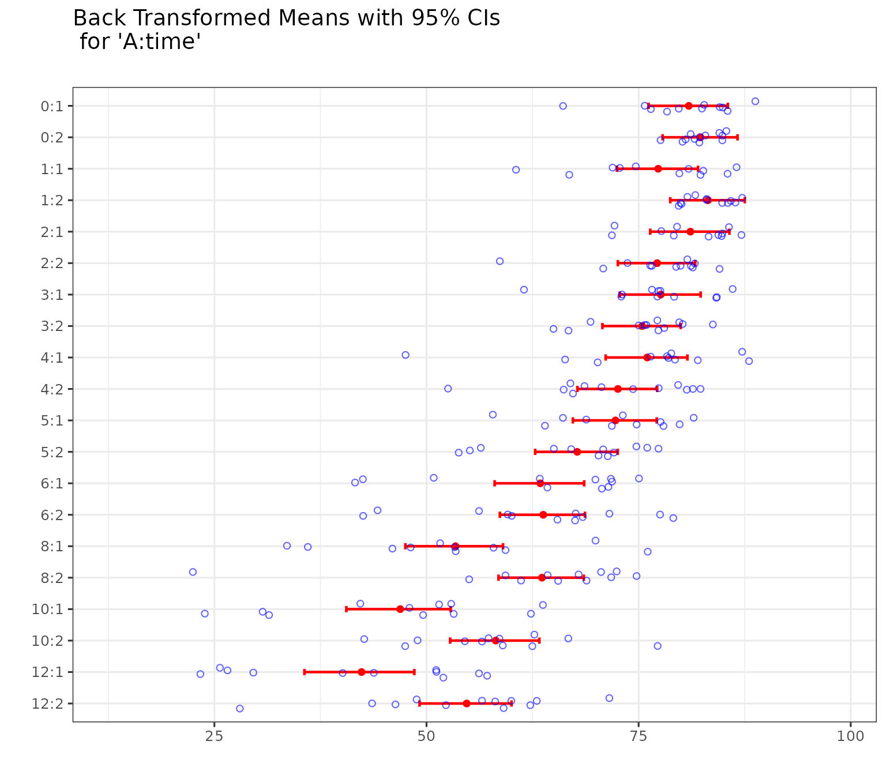

``` r

predm_out$predictmeansBarPlot
```


- **Pairwise p-value matrix has p-value (adjusted by ‘BH’ method) below
  the diagonal at each ‘time’**

``` r

for (i in 6:15){
  if (i==1) {
    cat(paste("\n", predm_out[[i]], "\n\n", sp=""))
  }else{
    print(names(predm_out[i]))
    print(gt(as.data.frame.matrix(predm_out[[i]], check.names=FALSE), 
             rownames_to_stub = TRUE))
  }
}
```

\[1\] “0”

|     | 1      | 2   | Group |
|-----|--------|-----|-------|
| 1   | 1      |     | A     |
| 2   | 0.6692 | 1   | A     |

\[1\] “1”

|     | 1      | 2   | Group |
|-----|--------|-----|-------|
| 1   | 1      |     | A     |
| 2   | 0.0748 | 1   | A     |

\[1\] “2”

|     | 1     | 2   | Group |
|-----|-------|-----|-------|
| 1   | 1     |     | A     |
| 2   | 0.236 | 1   | A     |

\[1\] “3”

|     | 1      | 2   | Group |
|-----|--------|-----|-------|
| 1   | 1      |     | A     |
| 2   | 0.5117 | 1   | A     |

\[1\] “4”

|     | 1      | 2   | Group |
|-----|--------|-----|-------|
| 1   | 1      |     | A     |
| 2   | 0.3123 | 1   | A     |

\[1\] “5”

|     | 1      | 2   | Group |
|-----|--------|-----|-------|
| 1   | 1      |     | A     |
| 2   | 0.1995 | 1   | A     |

\[1\] “6”

|     | 1     | 2   | Group |
|-----|-------|-----|-------|
| 1   | 1     |     | A     |
| 2   | 0.925 | 1   | A     |

\[1\] “8”

|     | 1      | 2   | Group |
|-----|--------|-----|-------|
| 1   | 1      |     | A     |
| 2   | 0.0089 | 1   | B     |

\[1\] “10”

|     | 1      | 2   | Group |
|-----|--------|-----|-------|
| 1   | 1      |     | A     |
| 2   | 0.0063 | 1   | B     |

\[1\] “12”

|     | 1      | 2   | Group |
|-----|--------|-----|-------|
| 1   | 1      |     | A     |
| 2   | 0.0039 | 1   | B     |

#### Predicted Means for “B:time”

- Mean Table
- Mean Plot
- p-value Table

``` r

predm_out <- predictmeans(mod, "B:time", 
                          atvar="time", adj="BH", bar=TRUE, 
                          trans=function(x) x^(1/1.5), 
                          prtplt=FALSE)
print(predm_out[1:4])
```

    ## $`Predicted Means`
    ##      B        1        2
    ## time                    
    ## 0      714.6817 759.7654
    ## 1      700.4676 737.7955
    ## 2      701.0004 707.3625
    ## 3      651.6610 687.0637
    ## 4      662.9725 617.8213
    ## 5      624.4836 547.7609
    ## 6      540.8985 473.2621
    ## 8      511.0495 386.7070
    ## 10     412.3104 352.4870
    ## 12     361.7963 318.6416
    ## 
    ## $`Standard Error of Means`
    ##      B        1        2
    ## time                    
    ## 0      30.29210 31.77063
    ## 1      30.29210 31.77063
    ## 2      30.29210 31.77063
    ## 3      30.29210 31.77063
    ## 4      30.29210 31.77063
    ## 5      30.29210 31.77063
    ## 6      30.29210 31.77063
    ## 8      30.29210 31.77063
    ## 10     30.29210 31.77063
    ## 12     30.29210 31.77063
    ## 
    ## $`Standard Error of Differences`
    ##  Max.SED  Min.SED Aveg.SED 
    ## 43.89743 36.12460 40.63316 
    ## attr(,"For the Same Level of Factor")
    ##                B     time
    ## Aveg.SED 37.0062 43.89743
    ## Min.SED  36.1246 43.89743
    ## Max.SED  37.8878 43.89743
    ## 
    ## $LSD
    ##  Max.LSD  Min.LSD Aveg.LSD 
    ## 86.65062 71.30758 80.20718 
    ## attr(,"For the Same Level of Factor")
    ##                 B     time
    ## Aveg.LSD 73.04780 86.65062
    ## Min.LSD  71.30758 86.65062
    ## Max.LSD  74.78802 86.65062
    ## attr(,"Significant level")
    ## [1] 0.05
    ## attr(,"Degree of freedom")
    ## [1] 171

``` r

gt(predm_out$mean_table$Table, 
   caption = "Group: Letter-based representation of pairwise comparisons at significant level '0.05' at each 'time'")
```

| time | B | Mean | SE | Df | LL(95%) | UL(95%) | Bk_Mean | Bk_LL(95%) | Bk_UL(95%) | LetterGrp |
|----|----|----|----|----|----|----|----|----|----|----|
| 0 | 1 | 714.6817 | 30.29210 | 108.49 | 654.6406 | 774.7228 | 79.9359 | 75.3937 | 84.3524 | A |
| 0 | 2 | 759.7654 | 31.77063 | 108.49 | 696.7938 | 822.7371 | 83.2632 | 78.5964 | 87.8026 | A |
| 1 | 1 | 700.4676 | 30.29210 | 108.49 | 640.4265 | 760.5087 | 78.8725 | 74.2984 | 83.3175 | A |
| 1 | 2 | 737.7955 | 31.77063 | 108.49 | 674.8238 | 800.7672 | 81.6502 | 76.9355 | 86.2325 | A |
| 2 | 1 | 701.0004 | 30.29210 | 108.49 | 640.9593 | 761.0416 | 78.9124 | 74.3396 | 83.3564 | A |
| 2 | 2 | 707.3625 | 31.77063 | 108.49 | 644.3909 | 770.3342 | 79.3892 | 74.6047 | 84.0336 | A |
| 3 | 1 | 651.6610 | 30.29210 | 108.49 | 591.6199 | 711.7022 | 75.1648 | 70.4739 | 79.7136 | A |
| 3 | 2 | 687.0637 | 31.77063 | 108.49 | 624.0920 | 750.0353 | 77.8630 | 73.0296 | 82.5508 | A |
| 4 | 1 | 662.9725 | 30.29210 | 108.49 | 602.9314 | 723.0137 | 76.0321 | 71.3694 | 80.5560 | A |
| 4 | 2 | 617.8213 | 31.77063 | 108.49 | 554.8497 | 680.7930 | 72.5396 | 67.5228 | 77.3886 | A |
| 5 | 1 | 624.4836 | 30.29210 | 108.49 | 564.4425 | 684.5248 | 73.0602 | 68.2988 | 77.6711 | A |
| 5 | 2 | 547.7609 | 31.77063 | 108.49 | 484.7893 | 610.7326 | 66.9464 | 61.7119 | 71.9837 | A |
| 6 | 1 | 540.8985 | 30.29210 | 108.49 | 480.8574 | 600.9396 | 66.3861 | 61.3777 | 71.2121 | A |
| 6 | 2 | 473.2621 | 31.77063 | 108.49 | 410.2905 | 536.2338 | 60.7297 | 55.2155 | 66.0039 | A |
| 8 | 1 | 511.0495 | 30.29210 | 108.49 | 451.0084 | 571.0907 | 63.9208 | 58.8107 | 68.8341 | A |
| 8 | 2 | 386.7070 | 31.77063 | 108.49 | 323.7353 | 449.6787 | 53.0788 | 47.1477 | 58.6951 | B |
| 10 | 1 | 412.3104 | 30.29210 | 108.49 | 352.2692 | 472.3515 | 55.3966 | 49.8789 | 60.6518 | A |
| 10 | 2 | 352.4870 | 31.77063 | 108.49 | 289.5154 | 415.4587 | 49.8994 | 43.7637 | 55.6782 | A |
| 12 | 1 | 361.7963 | 30.29210 | 108.49 | 301.7552 | 421.8375 | 50.7742 | 44.9887 | 56.2467 | A |
| 12 | 2 | 318.6416 | 31.77063 | 108.49 | 255.6699 | 381.6132 | 46.6518 | 40.2828 | 52.6117 | A |

Group: Letter-based representation of pairwise comparisons at
significant level '0.05' at each 'time' {.table .gt_table
quarto-disable-processing="false" quarto-bootstrap="false"}

``` r

predm_out$predictmeansPlot$meanPlot
```

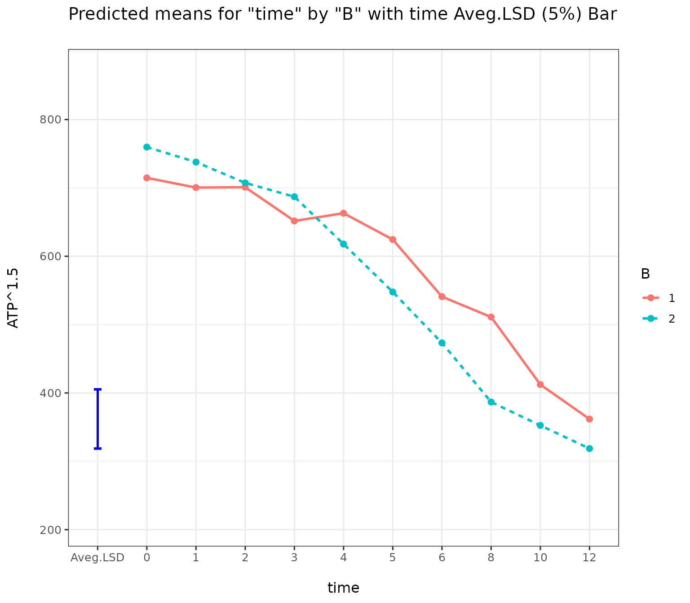

``` r

predm_out$predictmeansPlot$ciPlot
```

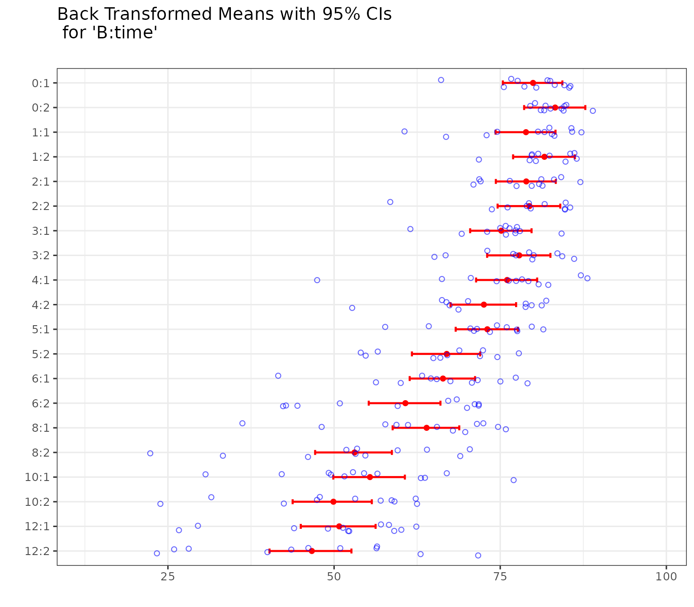

``` r

predm_out$predictmeansBarPlot
```

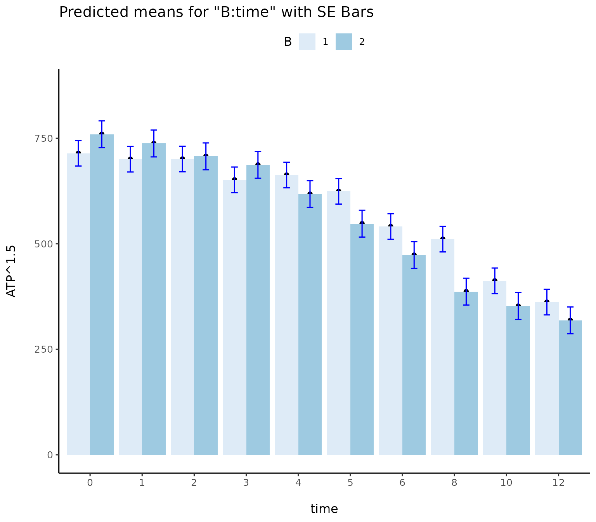

- **Pairwise p-value matrix has p-value (adjusted by ‘BH’ method) below
  the diagonal at each ‘time’**

``` r

for (i in 6:15){
  if (i==1) {
    cat(paste("\n", predm_out[[i]], "\n\n", sp=""))
  }else{
    print(names(predm_out[i]))
    print(gt(as.data.frame.matrix(predm_out[[i]], check.names=FALSE),
             rownames_to_stub = TRUE))
  }
}
```

\[1\] “0”

|     | 1      | 2   | Group |
|-----|--------|-----|-------|
| 1   | 1      |     | A     |
| 2   | 0.3067 | 1   | A     |

\[1\] “1”

|     | 1     | 2   | Group |
|-----|-------|-----|-------|
| 1   | 1     |     | A     |
| 2   | 0.397 | 1   | A     |

\[1\] “2”

|     | 1     | 2   | Group |
|-----|-------|-----|-------|
| 1   | 1     |     | A     |
| 2   | 0.885 | 1   | A     |

\[1\] “3”

|     | 1      | 2   | Group |
|-----|--------|-----|-------|
| 1   | 1      |     | A     |
| 2   | 0.4217 | 1   | A     |

\[1\] “4”

|     | 1     | 2   | Group |
|-----|-------|-----|-------|
| 1   | 1     |     | A     |
| 2   | 0.306 | 1   | A     |

\[1\] “5”

|     | 1      | 2   | Group |
|-----|--------|-----|-------|
| 1   | 1      |     | A     |
| 2   | 0.0833 | 1   | A     |

\[1\] “6”

|     | 1      | 2   | Group |
|-----|--------|-----|-------|
| 1   | 1      |     | A     |
| 2   | 0.1263 | 1   | A     |

\[1\] “8”

|     | 1      | 2   | Group |
|-----|--------|-----|-------|
| 1   | 1      |     | A     |
| 2   | 0.0055 | 1   | B     |

\[1\] “10”

|     | 1      | 2   | Group |
|-----|--------|-----|-------|
| 1   | 1      |     | A     |
| 2   | 0.1758 | 1   | A     |

\[1\] “12”

|     | 1      | 2   | Group |
|-----|--------|-----|-------|
| 1   | 1      |     | A     |
| 2   | 0.3278 | 1   | A     |

#### Predicted Means for “A:B:time”

- Mean Table
- Mean Plot
- p-value Table
- p-value Plot

``` r

predm_out <- predictmeans(mod, "A:B:time", 
                          atvar="time", adj="BH", 
                          trans=function(x) x^(1/1.5), 
                          prtplt=FALSE)
print(predm_out[1:4])
```

    ## $`Predicted Means`
    ##      A        1                 2         
    ##      B        1        2        1        2
    ## time                                      
    ## 0      683.4993 772.1393 745.8641 747.3915
    ## 1      625.6698 733.6232 775.2654 741.9678
    ## 2      707.7245 752.9475 694.2764 661.7776
    ## 3      651.3920 716.2343 651.9301 657.8931
    ## 4      672.0561 653.3022 653.8890 582.3405
    ## 5      619.0203 609.8928 629.9470 485.6291
    ## 6      522.4710 487.5464 559.3260 458.9779
    ## 8      448.9900 331.8658 573.1090 441.5482
    ## 10     342.3595 300.0973 482.2612 404.8767
    ## 12     294.1297 256.8516 429.4629 380.4315
    ## 
    ## $`Standard Error of Means`
    ##      A        1                 2         
    ##      B        1        2        1        2
    ## time                                      
    ## 0      42.83950 46.92832 42.83950 42.83950
    ## 1      42.83950 46.92832 42.83950 42.83950
    ## 2      42.83950 46.92832 42.83950 42.83950
    ## 3      42.83950 46.92832 42.83950 42.83950
    ## 4      42.83950 46.92832 42.83950 42.83950
    ## 5      42.83950 46.92832 42.83950 42.83950
    ## 6      42.83950 46.92832 42.83950 42.83950
    ## 8      42.83950 46.92832 42.83950 42.83950
    ## 10     42.83950 46.92832 42.83950 42.83950
    ## 12     42.83950 46.92832 42.83950 42.83950
    ## 
    ## $`Standard Error of Differences`
    ##  Max.SED  Min.SED Aveg.SED 
    ## 63.54125 51.08791 59.81139 
    ## attr(,"For the Same Level of Factor")
    ##                 A        B     time
    ## Aveg.SED 57.44156 57.44156 62.06273
    ## Min.SED  51.08791 51.08791 60.58421
    ## Max.SED  63.54125 63.54125 63.54125
    ## 
    ## $LSD
    ##  Max.LSD  Min.LSD Aveg.LSD 
    ## 125.4262 100.8441 118.0637 
    ## attr(,"For the Same Level of Factor")
    ##                 A        B     time
    ## Aveg.LSD 113.3859 113.3859 122.5077
    ## Min.LSD  100.8441 100.8441 119.5892
    ## Max.LSD  125.4262 125.4262 125.4262
    ## attr(,"Significant level")
    ## [1] 0.05
    ## attr(,"Degree of freedom")
    ## [1] 171

``` r

gt(predm_out$mean_table$Table, 
   caption = "Group: Letter-based representation of pairwise comparisons at significant level '0.05' at each 'time'")
```

| time | A | B | Mean | SE | Df | LL(95%) | UL(95%) | Bk_Mean | Bk_LL(95%) | Bk_UL(95%) | LetterGrp |
|----|----|----|----|----|----|----|----|----|----|----|----|
| 0 | 1 | 1 | 683.4993 | 42.83950 | 108.49 | 598.5883 | 768.4103 | 77.5935 | 71.0262 | 83.8936 | A |
| 0 | 1 | 2 | 772.1393 | 46.92832 | 108.49 | 679.1240 | 865.1546 | 84.1648 | 77.2620 | 90.7951 | A |
| 0 | 2 | 1 | 745.8641 | 42.83950 | 108.49 | 660.9531 | 830.7751 | 82.2444 | 75.8776 | 88.3736 | A |
| 0 | 2 | 2 | 747.3915 | 42.83950 | 108.49 | 662.4805 | 832.3025 | 82.3567 | 75.9945 | 88.4818 | A |
| 1 | 1 | 1 | 625.6698 | 42.83950 | 108.49 | 540.7588 | 710.5808 | 73.1527 | 66.3747 | 79.6298 | A |
| 1 | 1 | 2 | 733.6232 | 46.92832 | 108.49 | 640.6079 | 826.6385 | 81.3421 | 74.3124 | 88.0800 | A |
| 1 | 2 | 1 | 775.2654 | 42.83950 | 108.49 | 690.3544 | 860.1764 | 84.3918 | 78.1115 | 90.4465 | A |
| 1 | 2 | 2 | 741.9678 | 42.83950 | 108.49 | 657.0568 | 826.8788 | 81.9578 | 75.5791 | 88.0970 | A |
| 2 | 1 | 1 | 707.7245 | 42.83950 | 108.49 | 622.8135 | 792.6355 | 79.4163 | 72.9299 | 85.6477 | A |
| 2 | 1 | 2 | 752.9475 | 46.92832 | 108.49 | 659.9322 | 845.9628 | 82.7643 | 75.7995 | 89.4474 | A |
| 2 | 2 | 1 | 694.2764 | 42.83950 | 108.49 | 609.3654 | 779.1874 | 78.4070 | 71.8762 | 84.6762 | A |
| 2 | 2 | 2 | 661.7776 | 42.83950 | 108.49 | 576.8666 | 746.6886 | 75.9407 | 69.2974 | 82.3050 | A |
| 3 | 1 | 1 | 651.3920 | 42.83950 | 108.49 | 566.4810 | 736.3029 | 75.1441 | 68.4632 | 81.5401 | A |
| 3 | 1 | 2 | 716.2343 | 46.92832 | 108.49 | 623.2190 | 809.2496 | 80.0516 | 72.9615 | 86.8404 | A |
| 3 | 2 | 1 | 651.9301 | 42.83950 | 108.49 | 567.0192 | 736.8411 | 75.1855 | 68.5065 | 81.5798 | A |
| 3 | 2 | 2 | 657.8931 | 42.83950 | 108.49 | 572.9821 | 742.8040 | 75.6433 | 68.9860 | 82.0193 | A |
| 4 | 1 | 1 | 672.0561 | 42.83950 | 108.49 | 587.1451 | 756.9671 | 76.7250 | 70.1181 | 83.0586 | A |
| 4 | 1 | 2 | 653.3022 | 46.92832 | 108.49 | 560.2868 | 746.3175 | 75.2909 | 67.9632 | 82.2777 | A |
| 4 | 2 | 1 | 653.8890 | 42.83950 | 108.49 | 568.9780 | 738.7999 | 75.3360 | 68.6642 | 81.7243 | A |
| 4 | 2 | 2 | 582.3405 | 42.83950 | 108.49 | 497.4295 | 667.2515 | 69.7351 | 62.7800 | 76.3589 | A |
| 5 | 1 | 1 | 619.0203 | 42.83950 | 108.49 | 534.1093 | 703.9313 | 72.6334 | 65.8294 | 79.1323 | A |
| 5 | 1 | 2 | 609.8928 | 46.92832 | 108.49 | 516.8775 | 702.9081 | 71.9177 | 64.4058 | 79.0556 | A |
| 5 | 2 | 1 | 629.9470 | 42.83950 | 108.49 | 545.0360 | 714.8580 | 73.4857 | 66.7242 | 79.9490 | A |
| 5 | 2 | 2 | 485.6291 | 42.83950 | 108.49 | 400.7181 | 570.5401 | 61.7831 | 54.3533 | 68.7898 | A |
| 6 | 1 | 1 | 522.4710 | 42.83950 | 108.49 | 437.5600 | 607.3819 | 64.8696 | 57.6357 | 71.7202 | A |
| 6 | 1 | 2 | 487.5464 | 46.92832 | 108.49 | 394.5311 | 580.5617 | 61.9456 | 53.7924 | 69.5930 | A |
| 6 | 2 | 1 | 559.3260 | 42.83950 | 108.49 | 474.4151 | 644.2370 | 67.8854 | 60.8283 | 74.5928 | A |
| 6 | 2 | 2 | 458.9779 | 42.83950 | 108.49 | 374.0669 | 543.8888 | 59.5015 | 51.9158 | 66.6306 | A |
| 8 | 1 | 1 | 448.9900 | 42.83950 | 108.49 | 364.0791 | 533.9010 | 58.6351 | 50.9875 | 65.8123 | AB |
| 8 | 1 | 2 | 331.8658 | 46.92832 | 108.49 | 238.8504 | 424.8811 | 47.9338 | 38.4962 | 56.5169 | A |
| 8 | 2 | 1 | 573.1090 | 42.83950 | 108.49 | 488.1980 | 658.0200 | 68.9961 | 62.0008 | 75.6530 | B |
| 8 | 2 | 2 | 441.5482 | 42.83950 | 108.49 | 356.6372 | 526.4592 | 57.9854 | 50.2903 | 65.1993 | AB |
| 10 | 1 | 1 | 342.3595 | 42.83950 | 108.49 | 257.4486 | 427.2705 | 48.9390 | 40.4694 | 56.7286 | AB |
| 10 | 1 | 2 | 300.0973 | 46.92832 | 108.49 | 207.0820 | 393.1126 | 44.8237 | 35.0022 | 53.6634 | A |
| 10 | 2 | 1 | 482.2612 | 42.83950 | 108.49 | 397.3502 | 567.1722 | 61.4971 | 54.0483 | 68.5188 | B |
| 10 | 2 | 2 | 404.8767 | 42.83950 | 108.49 | 319.9657 | 489.7877 | 54.7287 | 46.7809 | 62.1353 | AB |
| 12 | 1 | 1 | 294.1297 | 42.83950 | 108.49 | 209.2187 | 379.0407 | 44.2275 | 35.2425 | 52.3750 | AB |
| 12 | 1 | 2 | 256.8516 | 46.92832 | 108.49 | 163.8363 | 349.8669 | 40.4068 | 29.9415 | 49.6518 | A |
| 12 | 2 | 1 | 429.4629 | 42.83950 | 108.49 | 344.5520 | 514.3739 | 56.9225 | 49.1477 | 64.1977 | B |
| 12 | 2 | 2 | 380.4315 | 42.83950 | 108.49 | 295.5205 | 465.3425 | 52.5030 | 44.3668 | 60.0503 | AB |

Group: Letter-based representation of pairwise comparisons at
significant level '0.05' at each 'time' {.table .gt_table
quarto-disable-processing="false" quarto-bootstrap="false"}

``` r

predm_out$predictmeansPlot$meanPlot
```

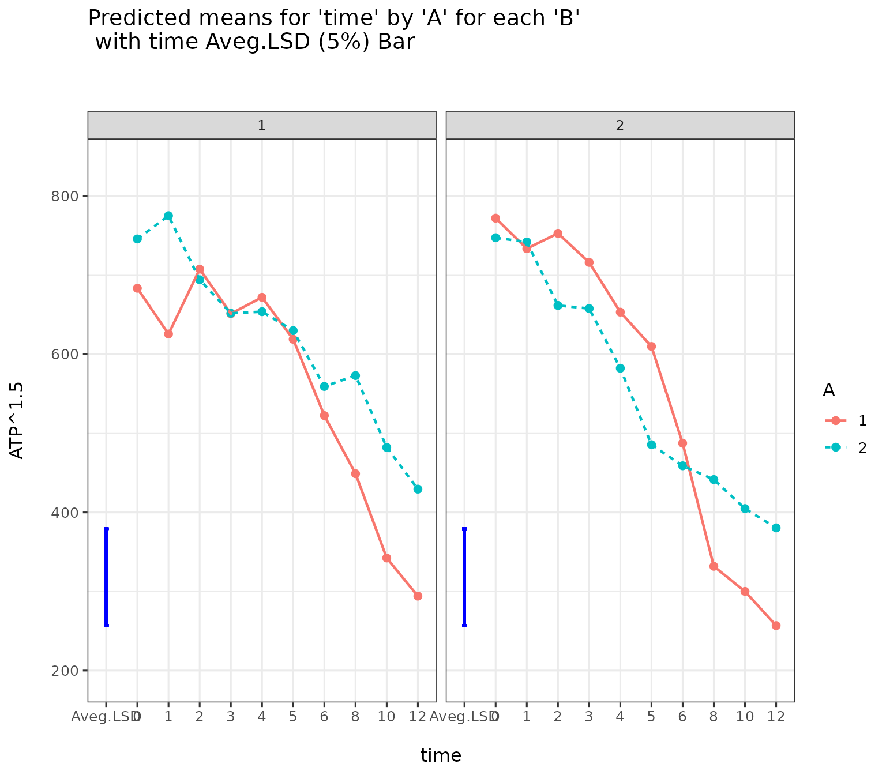

``` r

predm_out$predictmeansPlot$ciPlot
```

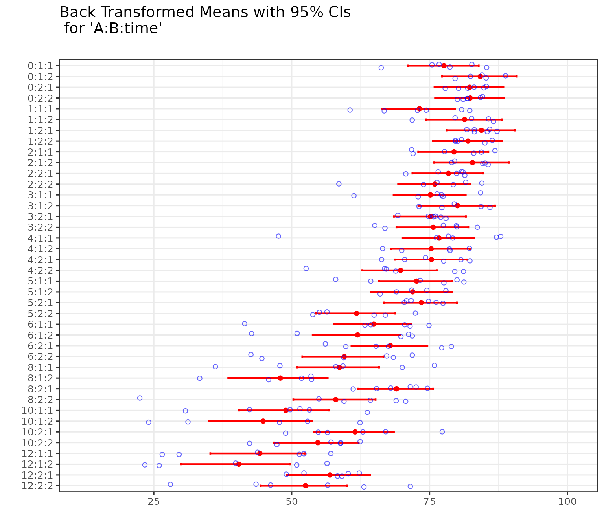

- **Pairwise p-value matrix has p-value (adjusted by ‘BH’ method) below
  the diagonal at each ‘time’**

``` r

for (i in 6:15){
  if (i==1) {
    cat(paste("\n", predm_out[[i]], "\n\n", sp=""))
  }else{
    print(names(predm_out[i]))
    print(gt(as.data.frame.matrix(predm_out[[i]], check.names=FALSE),
             rownames_to_stub = TRUE))
  }
}
```

\[1\] “0”

|       | 1 : 1  | 1 : 2  | 2 : 1  | 2 : 2 | Group |
|-------|--------|--------|--------|-------|-------|
| 1 : 1 | 1      |        |        |       | A     |
| 1 : 2 | 0.6112 | 1      |        |       | A     |
| 2 : 1 | 0.6112 | 0.8372 | 1      |       | A     |
| 2 : 2 | 0.6112 | 0.8372 | 0.9799 | 1     | A     |

\[1\] “1”

|       | 1 : 1  | 1 : 2  | 2 : 1  | 2 : 2 | Group |
|-------|--------|--------|--------|-------|-------|
| 1 : 1 | 1      |        |        |       | A     |
| 1 : 2 | 0.1844 | 1      |        |       | A     |
| 2 : 1 | 0.0906 | 0.7005 | 1      |       | A     |
| 2 : 2 | 0.1726 | 0.8958 | 0.7005 | 1     | A     |

\[1\] “2”

|       | 1 : 1  | 1 : 2  | 2 : 1  | 2 : 2 | Group |
|-------|--------|--------|--------|-------|-------|
| 1 : 1 | 1      |        |        |       | A     |
| 1 : 2 | 0.7113 | 1      |        |       | A     |
| 2 : 1 | 0.8248 | 0.7113 | 1      |       | A     |
| 2 : 2 | 0.7113 | 0.7113 | 0.7113 | 1     | A     |

\[1\] “3”

|       | 1 : 1  | 1 : 2  | 2 : 1  | 2 : 2 | Group |
|-------|--------|--------|--------|-------|-------|
| 1 : 1 | 1      |        |        |       | A     |
| 1 : 2 | 0.7211 | 1      |        |       | A     |
| 2 : 1 | 0.9929 | 0.7211 | 1      |       | A     |
| 2 : 2 | 0.9929 | 0.7211 | 0.9929 | 1     | A     |

\[1\] “4”

|       | 1 : 1  | 1 : 2  | 2 : 1  | 2 : 2 | Group |
|-------|--------|--------|--------|-------|-------|
| 1 : 1 | 1      |        |        |       | A     |
| 1 : 2 | 0.9221 | 1      |        |       | A     |
| 2 : 1 | 0.9221 | 0.9926 | 1      |       | A     |
| 2 : 2 | 0.5331 | 0.5331 | 0.5331 | 1     | A     |

\[1\] “5”

|       | 1 : 1  | 1 : 2  | 2 : 1  | 2 : 2 | Group |
|-------|--------|--------|--------|-------|-------|
| 1 : 1 | 1      |        |        |       | A     |
| 1 : 2 | 0.886  | 1      |        |       | A     |
| 2 : 1 | 0.886  | 0.886  | 1      |       | A     |
| 2 : 2 | 0.0894 | 0.1062 | 0.0894 | 1     | A     |

\[1\] “6”

|       | 1 : 1  | 1 : 2  | 2 : 1  | 2 : 2 | Group |
|-------|--------|--------|--------|-------|-------|
| 1 : 1 | 1      |        |        |       | A     |
| 1 : 2 | 0.6539 | 1      |        |       | A     |
| 2 : 1 | 0.6539 | 0.5939 | 1      |       | A     |
| 2 : 2 | 0.5939 | 0.6539 | 0.5939 | 1     | A     |

\[1\] “8”

|       | 1 : 1  | 1 : 2  | 2 : 1  | 2 : 2 | Group |
|-------|--------|--------|--------|-------|-------|
| 1 : 1 | 1      |        |        |       | AB    |
| 1 : 2 | 0.102  | 1      |        |       | A     |
| 2 : 1 | 0.0858 | 0.0015 | 1      |       | B     |
| 2 : 2 | 0.9025 | 0.1046 | 0.0858 | 1     | AB    |

\[1\] “10”

|       | 1 : 1  | 1 : 2  | 2 : 1  | 2 : 2 | Group |
|-------|--------|--------|--------|-------|-------|
| 1 : 1 | 1      |        |        |       | AB    |
| 1 : 2 | 0.5074 | 1      |        |       | A     |
| 2 : 1 | 0.0685 | 0.0299 | 1      |       | B     |
| 2 : 2 | 0.3653 | 0.2041 | 0.3063 | 1     | AB    |

\[1\] “12”

|       | 1 : 1  | 1 : 2  | 2 : 1  | 2 : 2 | Group |
|-------|--------|--------|--------|-------|-------|
| 1 : 1 | 1      |        |        |       | AB    |
| 1 : 2 | 0.5586 | 1      |        |       | A     |
| 2 : 1 | 0.0826 | 0.0461 | 1      |       | B     |
| 2 : 2 | 0.2358 | 0.1088 | 0.5041 | 1     | AB    |

``` r

PMplot(predm_out$p_valueMatrix)
```


#### Highlights

Options in function ‘predictmens’:

- **{atvar=“time”}** sets multiple comparison within each level of
  ‘time’, it also infects the mean_table and mean plots arrangement.
  When ‘atvar’ is not NULL ‘pair’ turns to be TRUE automatically. Please
  try to see any effects for ‘atvar=c(“A”, “B”)’ or ‘atvar=c(“B”, “A”)’.

- **{trans=function(x) x^(1/1.5)}** is a function for back
  transformation e.g. ‘trans=exp’ for log, ‘trans=function(x) x^2’ for
  sqrt.

- For any GLM, the function produces associated back transformation
  automatically.

## Example_3 GLM with Covariate (Drug data)

Comparison of the effectiveness of three analgesic drugs to a standard
drug, morphine (Finney, Probit analysis, 3rd Edition 1971, p.103). 14
groups of mice were tested for response to the drugs at a range of
doses. N is total number of mice in each group, R is number responding.

### Data Info

- Structure
- Summary

``` r

data(Drug, package="predictmeans")
str(Drug)
```

    ## 'data.frame':    14 obs. of  5 variables:
    ##  $ Drug     : Factor w/ 4 levels "Morphine","Amidone",..: 1 1 1 2 2 2 3 3 3 4 ...
    ##  $ Dose     : num  1.5 3 6 1.5 3 6 0.75 1.5 3 5 ...
    ##  $ N        : int  103 120 123 60 110 100 90 80 90 60 ...
    ##  $ R        : int  19 53 83 14 54 81 31 54 80 13 ...
    ##  $ log10Dose: num  0.176 0.477 0.778 0.176 0.477 ...

``` r

summary(Drug)
```

    ##           Drug        Dose              N                R        
    ##  Morphine   :3   Min.   : 0.750   Min.   : 60.00   Min.   :13.00  
    ##  Amidone    :3   1st Qu.: 1.875   1st Qu.: 65.00   1st Qu.:28.00  
    ##  Phenadoxone:3   Median : 4.000   Median : 90.00   Median :48.50  
    ##  Pethidine  :5   Mean   : 5.982   Mean   : 87.93   Mean   :45.71  
    ##                  3rd Qu.: 7.125   3rd Qu.:102.25   3rd Qu.:54.75  
    ##                  Max.   :20.000   Max.   :123.00   Max.   :83.00  
    ##    log10Dose      
    ##  Min.   :-0.1249  
    ##  1st Qu.: 0.2513  
    ##  Median : 0.5880  
    ##  Mean   : 0.6030  
    ##  3rd Qu.: 0.8508  
    ##  Max.   : 1.3010

### Modelling

- Model
- Residual Plot

``` r

mod <- glm(cbind(R, N-R) ~ log10Dose*Drug, 
           family=binomial(link = "probit"), 
           data=Drug)
summary(mod)
```

    ## 
    ## Call:
    ## glm(formula = cbind(R, N - R) ~ log10Dose * Drug, family = binomial(link = "probit"), 
    ##     data = Drug)
    ## 
    ## Coefficients:
    ##                            Estimate Std. Error z value Pr(>|z|)    
    ## (Intercept)               -1.254871   0.170986  -7.339 2.15e-13 ***
    ## log10Dose                  2.225955   0.304133   7.319 2.50e-13 ***
    ## DrugAmidone               -0.005815   0.271686  -0.021  0.98292    
    ## DrugPhenadoxone            1.204624   0.197057   6.113 9.77e-10 ***
    ## DrugPethidine             -1.193860   0.401933  -2.970  0.00298 ** 
    ## log10Dose:DrugAmidone      0.474973   0.485376   0.979  0.32779    
    ## log10Dose:DrugPhenadoxone  0.479825   0.475453   1.009  0.31288    
    ## log10Dose:DrugPethidine    0.134316   0.463691   0.290  0.77207    
    ## ---
    ## Signif. codes:  0 '***' 0.001 '**' 0.01 '*' 0.05 '.' 0.1 ' ' 1
    ## 
    ## (Dispersion parameter for binomial family taken to be 1)
    ## 
    ##     Null deviance: 249.9579  on 13  degrees of freedom
    ## Residual deviance:   2.3344  on  6  degrees of freedom
    ## AIC: 83.556
    ## 
    ## Number of Fisher Scoring iterations: 3

``` r

residplot(mod) 
```

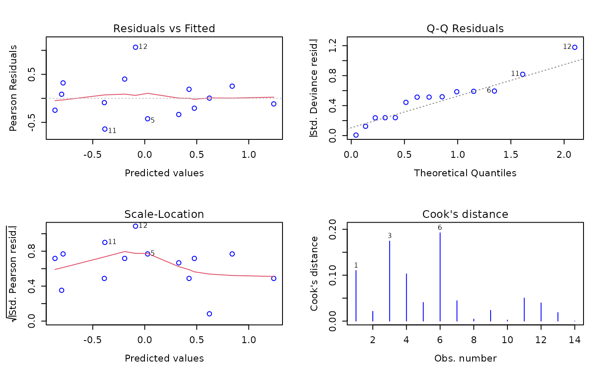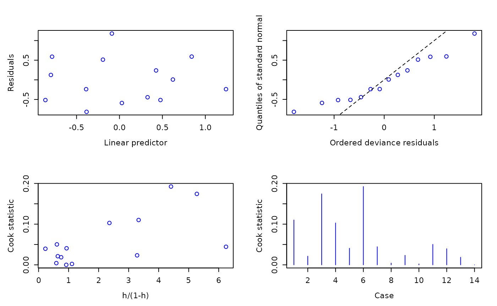

### ANOVA

``` r

kable(car::Anova(mod))
```

|                |   LR Chisq |  Df | Pr(\>Chisq) |
|:---------------|-----------:|----:|------------:|
| log10Dose      | 221.822660 |   1 |   0.0000000 |
| Drug           | 206.682057 |   3 |   0.0000000 |
| log10Dose:Drug |   1.533629 |   3 |   0.6745307 |

### Covariate Means

#### Predicted Means for “Treatment”

- Mean Table
- Mean Plot

``` r

covariate_out <- covariatemeans(model=mod, modelterm="Drug", covariate="log10Dose",
                                level = 0.166, # get 83.4% CI
                                newwd = TRUE) 
covariate_out$pltdf %>%
  select(Drug, xvar, Mean, ses, LL, UL) %>% 
  mutate_if(is.numeric, round, digits = 4) %>% 
  rename(log10Dose=xvar, Probability=Mean) %>% 
  arrange(log10Dose, Drug) %>% 
  group_by(log10Dose) %>% 
  mutate(Letter=ci_mcp(LL, UL)) %>%  # get multi-compare letter
  ungroup() %>% 
  DT_df()
```

``` r

covariatemeans(model=mod, modelterm="Drug", covariate="log10Dose", 
               level = 0.166, trellis = FALSE)
```

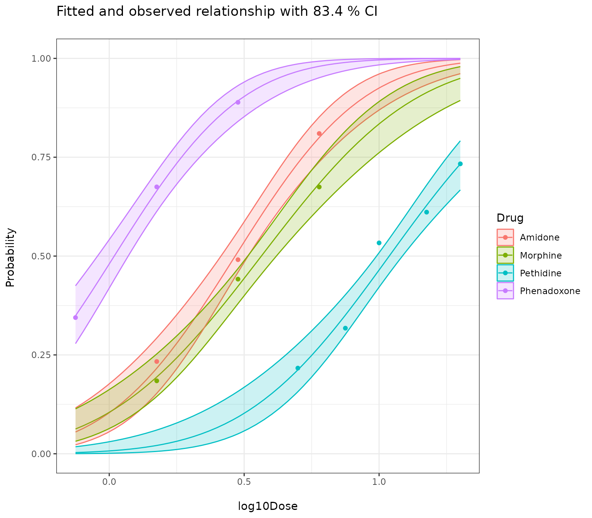

``` r

covariatemeans(model=mod, modelterm="Drug", covariate="log10Dose", 
               level = 0.166, trans=I, trellis = FALSE, ci=F)
```

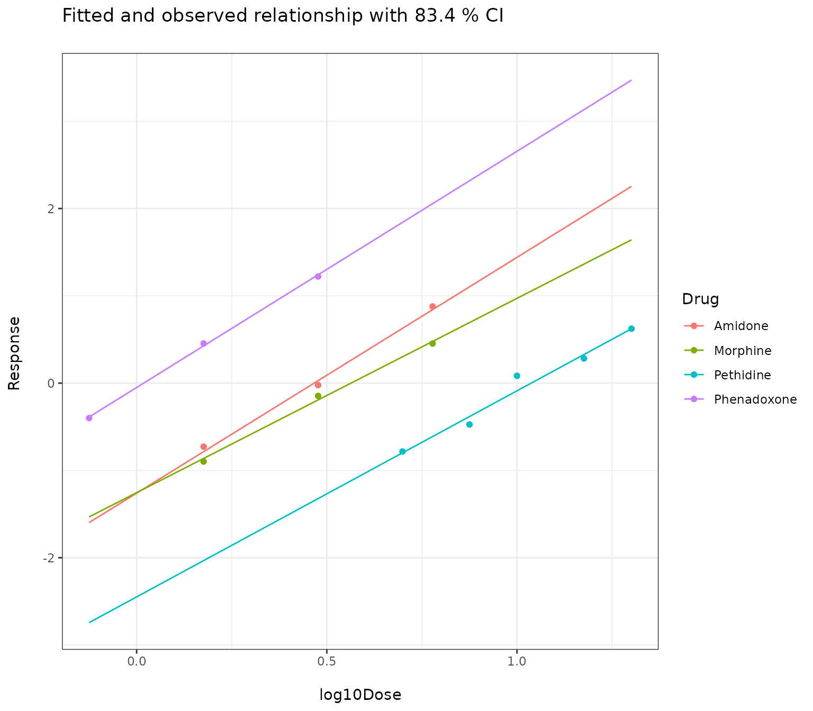

### Highlights

Options in function ‘covariatemeans’:

- **{level = 0.166}** produces 83.4% confidence interval (CI) for
  predicted means. If a straightforward multiple comparison between
  predicted means is not feasible, an alternative method involves
  utilizing predicted means with 83.4% CIs. When the CIs of two
  predicted means overlap, the associated means are not significantly
  different at the 0.05 level; otherwise, they are considered
  significant. The function **‘ci_mcp(LL, UL)’** is used to produce
  indicating letters.

**DT_df** is a function for producing data table in html with ‘CSV’
download button. To download the whole data, you need to select ‘All’
entries.

## Example_4 Semiparametric Regression with Group (WarsawApts data)

‘WarsawApts’ is a subset of the data set ‘apartments’ in the R package
PBImisc. This dataset contains the prices of the apartments which were
sold in Warsaw, Poland, during the calendar years 2007 to 2009.

### Data Info

- Structure
- Plot

``` r

data(WarsawApts, package="HRW")
WarsawApts$district <- factor(WarsawApts$district)
names(WarsawApts)[c(6)] <- c("apartment.price")
str(WarsawApts)
```

    ## 'data.frame':    409 obs. of  6 variables:
    ##  $ surface          : num  20 27 28 28 30 32 32 36 36 37 ...
    ##  $ district         : Factor w/ 4 levels "Mokotow","Srodmiescie",..: 2 3 1 1 2 1 2 3 3 1 ...
    ##  $ n.rooms          : int  1 1 1 2 1 2 1 2 2 2 ...
    ##  $ floor            : int  7 1 1 4 1 3 7 6 5 7 ...
    ##  $ construction.date: int  1970 1962 1950 1968 1952 2007 1961 1965 1968 1972 ...
    ##  $ apartment.price  : num  95.2 117.4 114.3 114.3 93.8 ...

``` r

ggplot(WarsawApts, aes(x=construction.date, y=apartment.price, color=district))+
  geom_point(size=1.6)+
  theme_bw(15)
```

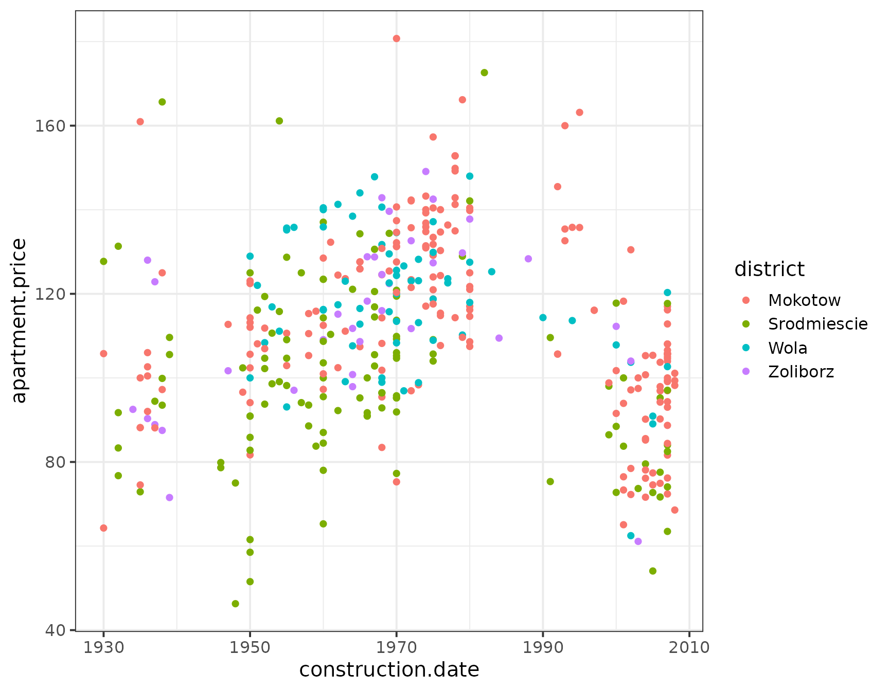

### Smooth without Group

- Model
- Residual Plot

``` r

mod1 <- semireg(apartment.price ~ construction.date,
                smoothZ=list(
                  grp=smZ(construction.date, k=25) 
                ), # Use of a O'Sullivan spline with 25 knots 
                  #  to model the non-linear relationship
                data = WarsawApts)
```

    ## Linear mixed model fit by REML ['semerLmerTest']
    ## Formula: apartment.price ~ construction.date + (1 | grp)
    ##    Data: WarsawApts
    ## REML criterion at convergence: 3544.905
    ## Random effects:
    ##  Groups   Name        Std.Dev.
    ##  grp      (Intercept)  1.191  
    ##  Residual             17.812  
    ## Number of obs: 409, groups:  grp, 27
    ## Fixed Effects:
    ##       (Intercept)  construction.date  
    ##         109.38694            0.06692

``` r

residplot(mod1$semer)  
```

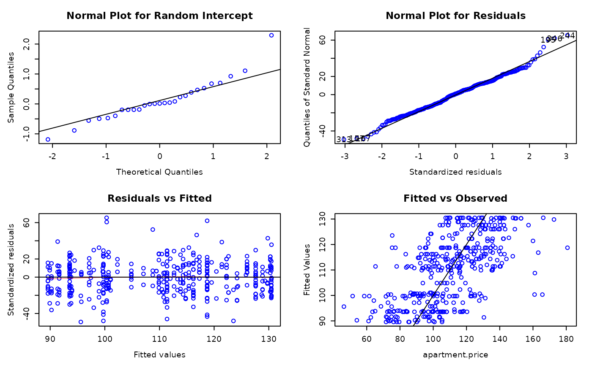

### ANOVA, RANOVA and $`R^2`$

- **ANOVA**

``` r

kable(anova(mod1$semer))
```

|                   |   Sum Sq |  Mean Sq | NumDF |    DenDF |  F value |   Pr(\>F) |
|:------------------|---------:|---------:|------:|---------:|---------:|----------:|
| construction.date | 500.9997 | 500.9997 |     1 | 1871.012 | 1.579118 | 0.2090447 |

- **RANOVA**

``` r

kable(ranova(mod1$semer))
```

|            | npar |    logLik |      AIC |     LRT |  Df | Pr(\>Chisq) |
|:-----------|-----:|----------:|---------:|--------:|----:|------------:|
|            |    4 | -1772.452 | 3552.905 |      NA |  NA |          NA |
| (1 \| grp) |    3 | -1844.882 | 3695.763 | 144.859 |   1 |           0 |

- **$`R^2`$**

``` r

R2_glmm(mod1$semer)
```

    ## # Adjusted R2 for Mixed Models

    ##    Total    Fixed   Random      grp 
    ## "86.14%"  "0.03%" "86.11%" "86.11%"

### Prediction

- Predict Table
- Predict Plot

``` r

pred_out1 <- semipred(mod1, covariate="construction.date", prt=FALSE)
DT_df(pred_out1$pred_df %>% 
        mutate_if(is.numeric, round, digits = 4))
```

``` r

pred_out1$plt
```

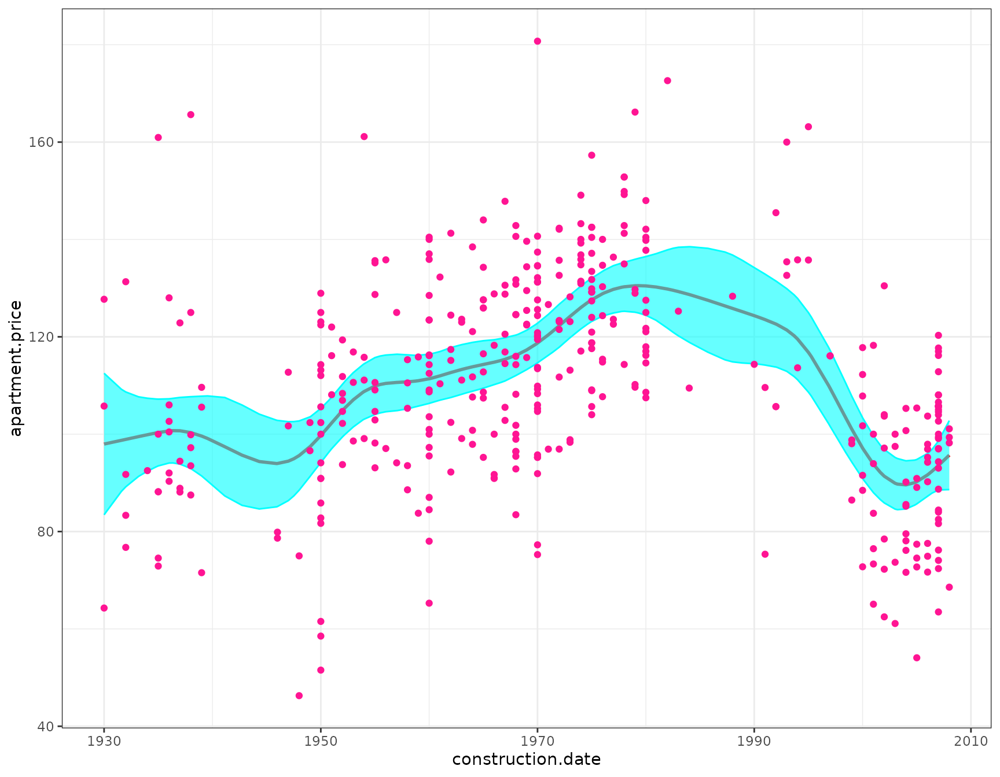

### Smooth with Group

- Model
- Residual Plot

``` r

mod2 <- semireg(apartment.price ~ construction.date*district, 
                smoothZ=list(
                  grp=smZ(construction.date, k=10, 
                            by = district, group=TRUE)
                  ),
                data=WarsawApts)
```

    ## Linear mixed model fit by REML ['semerLmerTest']
    ## Formula: apartment.price ~ construction.date * district + (1 | grp.Mokotow) +  
    ##     (1 | grp.Srodmiescie) + (1 | grp.Wola) + (1 | grp.Zoliborz)
    ##    Data: WarsawApts
    ## REML criterion at convergence: 3503.051
    ## Random effects:
    ##  Groups          Name        Std.Dev.
    ##  grp.Mokotow     (Intercept)  1.0611 
    ##  grp.Srodmiescie (Intercept)  1.9011 
    ##  grp.Wola        (Intercept)  0.1683 
    ##  grp.Zoliborz    (Intercept)  0.5886 
    ##  Residual                    16.6236 
    ## Number of obs: 409, groups:  
    ## grp.Mokotow, 12; grp.Srodmiescie, 12; grp.Wola, 12; grp.Zoliborz, 12
    ## Fixed Effects:
    ##                           (Intercept)                      construction.date  
    ##                             110.32765                                0.09294  
    ##                   districtSrodmiescie                           districtWola  
    ##                              -9.57830                                3.41275  
    ##                      districtZoliborz  construction.date:districtSrodmiescie  
    ##                              -5.32032                               -0.23493  
    ##        construction.date:districtWola     construction.date:districtZoliborz  
    ##                              -0.34619                               -0.18149

``` r

residplot(mod2$semer, group="district")  
```

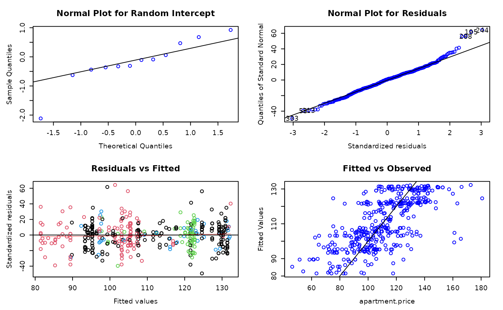

### ANOVA, RANOVA and $`R^2`$

- **ANOVA**

``` r

kable(anova(mod2$semer))
```

|  | Sum Sq | Mean Sq | NumDF | DenDF | F value | Pr(\>F) |
|:---|---:|---:|---:|---:|---:|---:|
| construction.date | 448.0818 | 448.0818 | 1 | 2331.884 | 1.621460 | 0.2030152 |
| district | 4444.3130 | 1481.4377 | 3 | 2832.228 | 5.360836 | 0.0011129 |
| construction.date:district | 1582.3870 | 527.4623 | 3 | 1983.796 | 1.908713 | 0.1260932 |

- **RANOVA**

``` r

kable(ranova(mod2$semer))
```

|                        | npar |    logLik |      AIC |       LRT |  Df | Pr(\>Chisq) |
|:-----------------------|-----:|----------:|---------:|----------:|----:|------------:|
|                        |   13 | -1751.525 | 3529.051 |        NA |  NA |          NA |
| (1 \| grp.Mokotow)     |   12 | -1800.940 | 3625.880 | 98.829583 |   1 |   0.0000000 |
| (1 \| grp.Srodmiescie) |   12 | -1761.894 | 3547.788 | 20.737475 |   1 |   0.0000053 |
| (1 \| grp.Wola)        |   12 | -1752.495 | 3528.990 |  1.939841 |   1 |   0.1636858 |
| (1 \| grp.Zoliborz)    |   12 | -1760.028 | 3544.055 | 17.004627 |   1 |   0.0000373 |

- **$`R^2`$**

``` r

R2_glmm(mod2$semer)
```

    ## # Adjusted R2 for Mixed Models

    ##           Total           Fixed          Random     grp.Mokotow grp.Srodmiescie 
    ##        "89.98%"         "0.69%"        "89.29%"        "31.79%"        "55.41%" 
    ##        grp.Wola    grp.Zoliborz 
    ##         "0.27%"         "1.81%"

### Prediction with Group

- Predict Table
- Predict Plot
- Contrast Table
- Contrast Plot

``` r

pred_out2_1 <- semipred(mod2, "district", "construction.date", prt=FALSE)
DT_df(pred_out2_1$pred_df %>% 
        mutate_if(is.numeric, round, digits = 4))
```

``` r

pred_out2_1$plt
```

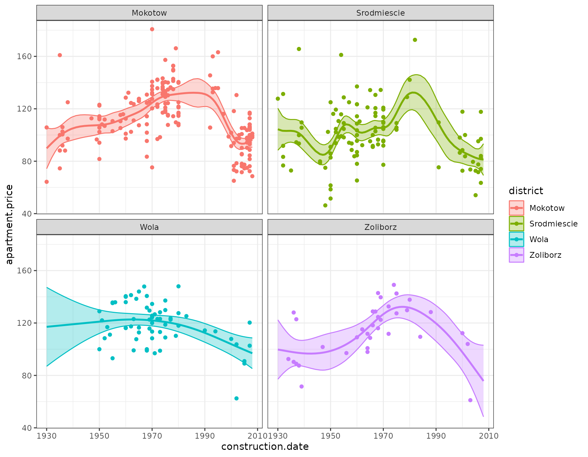

Mean Contrast table for District ‘Mokotow’ vs ‘Srodmiescie’

``` r

pred_out2_2 <- semipred(mod2, "district", "construction.date", contr=c('Mokotow', 'Srodmiescie'), prt=FALSE)
pred_out2_2$pred_df %>% 
  mutate(P_value=ifelse(LL*UL > 0, "p-value < 0.05", "p-value > 0.05")) %>% 
  mutate_if(is.numeric, round, digits = 4) %>% 
  DT_df()
```

``` r

pred_out2_2$plt
```

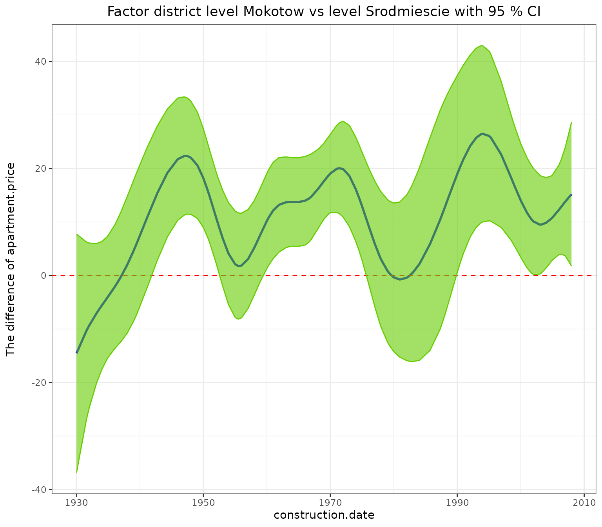

## Example_5 Semiparametric Regression with Multiple Covariates (Caschool data)

A data is collected from 420 schools in United States cross-section from
1998-1999, including county, grade span of district, percent qualifying
for CalWORKS, computer per student, district average income, average
math score.

### Data Info

- Structure
- Summary

``` r

data(Caschool, package="Ecdat")
Caschool <- Caschool %>% 
  select(county, grspan, calwpct, compstu, avginc, mathscr) %>% 
  mutate(log.avginc = log(Caschool$avginc))
str(Caschool)
```

    ## 'data.frame':    420 obs. of  7 variables:
    ##  $ county    : Factor w/ 45 levels "Alameda","Butte",..: 1 2 2 2 2 6 29 11 6 25 ...
    ##  $ grspan    : Factor w/ 2 levels "KK-06","KK-08": 2 2 2 2 2 2 2 2 2 1 ...
    ##  $ calwpct   : num  0.51 15.42 55.03 36.48 33.11 ...
    ##  $ compstu   : num  0.344 0.421 0.109 0.35 0.128 ...
    ##  $ avginc    : num  22.69 9.82 8.98 8.98 9.08 ...
    ##  $ mathscr   : num  690 662 651 644 640 ...
    ##  $ log.avginc: num  3.12 2.28 2.19 2.19 2.21 ...

``` r

summary(Caschool)
```

    ##          county      grspan       calwpct          compstu       
    ##  Sonoma     : 29   KK-06: 61   Min.   : 0.000   Min.   :0.00000  
    ##  Kern       : 27   KK-08:359   1st Qu.: 4.395   1st Qu.:0.09377  
    ##  Los Angeles: 27               Median :10.520   Median :0.12546  
    ##  Tulare     : 24               Mean   :13.246   Mean   :0.13593  
    ##  San Diego  : 21               3rd Qu.:18.981   3rd Qu.:0.16447  
    ##  Santa Clara: 20               Max.   :78.994   Max.   :0.42083  
    ##  (Other)    :272                                                 
    ##      avginc          mathscr        log.avginc   
    ##  Min.   : 5.335   Min.   :605.4   Min.   :1.674  
    ##  1st Qu.:10.639   1st Qu.:639.4   1st Qu.:2.365  
    ##  Median :13.728   Median :652.4   Median :2.619  
    ##  Mean   :15.317   Mean   :653.3   Mean   :2.645  
    ##  3rd Qu.:17.629   3rd Qu.:665.8   3rd Qu.:2.870  
    ##  Max.   :55.328   Max.   :709.5   Max.   :4.013  
    ## 

### Smooth Modelling

- Model
- Residual Plot

``` r

mod <- semireg_tmb(mathscr ~ calwpct+ log.avginc+ compstu+(1|county)+(1|grspan),
                          smoothZ=list(
                            cal_grp=smZ(calwpct, k=12),  
                            avg_grp=smZ(log.avginc, k=5),
                            comp_grp=smZ(compstu, k=12)
                          ), 
                          data=Caschool)
```

    ## Formula:          
    ## mathscr ~ calwpct + log.avginc + compstu + (1 | county) + (1 |  
    ##     grspan) + (1 | cal_grp) + (1 | avg_grp) + (1 | comp_grp)
    ## Data: Caschool
    ##       AIC       BIC    logLik -2*log(L)  df.resid 
    ##  3233.449  3273.851 -1606.724  3213.449       410 
    ## Random-effects (co)variances:
    ## 
    ## Conditional model:
    ##  Groups   Name        Std.Dev. 
    ##  county   (Intercept) 5.816e+00
    ##  grspan   (Intercept) 1.458e-03
    ##  cal_grp  (Intercept) 2.096e-01
    ##  avg_grp  (Intercept) 2.704e+01
    ##  comp_grp (Intercept) 1.454e+02
    ##  Residual             1.016e+01
    ## 
    ## Number of obs: 420 / Conditional model: county, 45; grspan, 2; cal_grp, 14; avg_grp, 7; comp_grp, 14
    ## 
    ## Dispersion estimate for gaussian family (sigma^2):  103 
    ## 
    ## Fixed Effects:
    ## 
    ## Conditional model:
    ## (Intercept)      calwpct   log.avginc      compstu  
    ##     594.493       -0.491       24.694       18.010

``` r

residplot(mod$semer)  
```

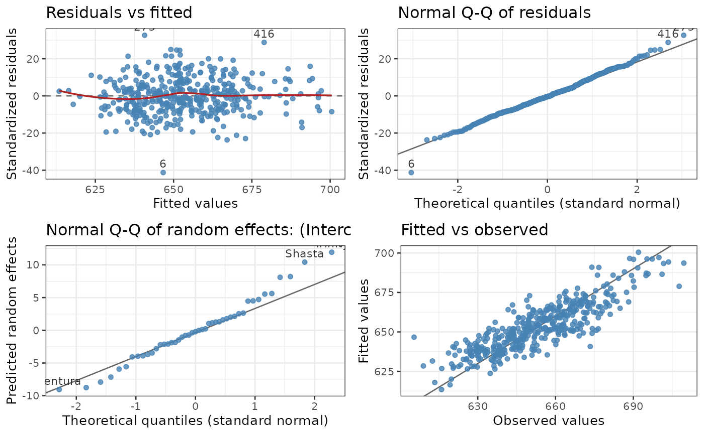

### ANOVA and $`R^2`$

- **ANOVA**

``` r

kable(Anova(mod$semer))
```

|            |     Chisq |  Df | Pr(\>Chisq) |
|:-----------|----------:|----:|------------:|
| calwpct    | 35.440286 |   1 |   0.0000000 |
| log.avginc | 91.867929 |   1 |   0.0000000 |
| compstu    |  1.858846 |   1 |   0.1727581 |

- **$`R^2`$**

``` r

R2_glmm(mod$semer)
```

    ## # Adjusted R2 for Mixed Models

    ##    Total    Fixed   Random   county   grspan  cal_grp  avg_grp comp_grp 
    ## "72.42%" "51.35%" "21.06%"  "8.74%"     "0%"  "8.98%"  "2.84%"  "0.51%"

### Prediction

- calwpct
- log.avginc
- compstu
- Joint Plot

``` r

pred_out1 <- semipred(mod, covariate = "calwpct", prt=FALSE)
DT_df(pred_out1$pred_df %>% 
        mutate_if(is.numeric, round, digits = 4))
```

``` r

pred_out1$plt
```

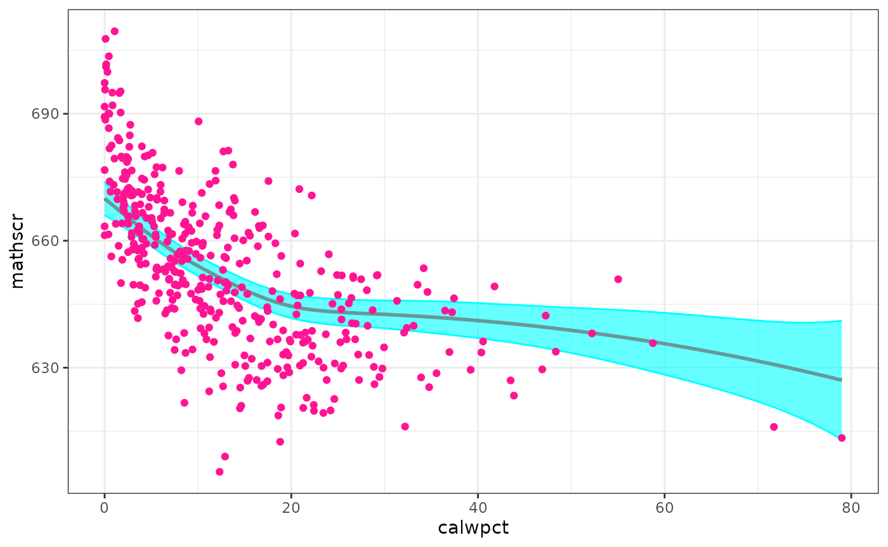

``` r

pred_out2 <- semipred(mod, covariate = "log.avginc", prt=FALSE)
DT_df(pred_out2$pred_df %>% 
        mutate_if(is.numeric, round, digits = 4))
```

``` r

pred_out2$plt
```

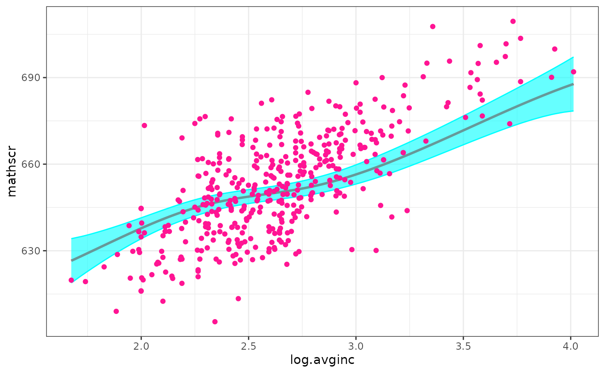

``` r

pred_out3 <- semipred(mod, covariate = "compstu", prt=FALSE)
DT_df(pred_out3$pred_df %>% 
        mutate_if(is.numeric, round, digits = 4))
```

``` r

pred_out3$plt
```

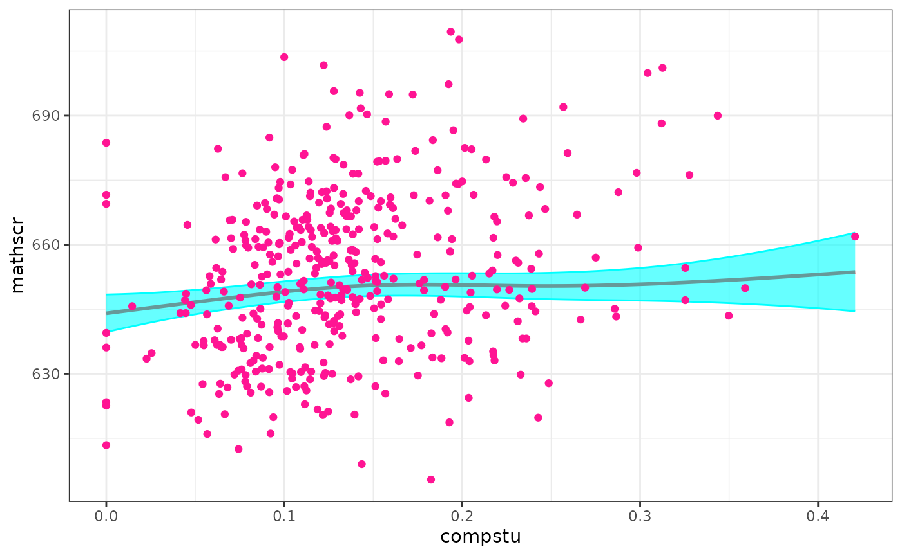

``` r

gridExtra::grid.arrange(pred_out1$plt, pred_out2$plt, pred_out3$plt, nrow = 1)
```

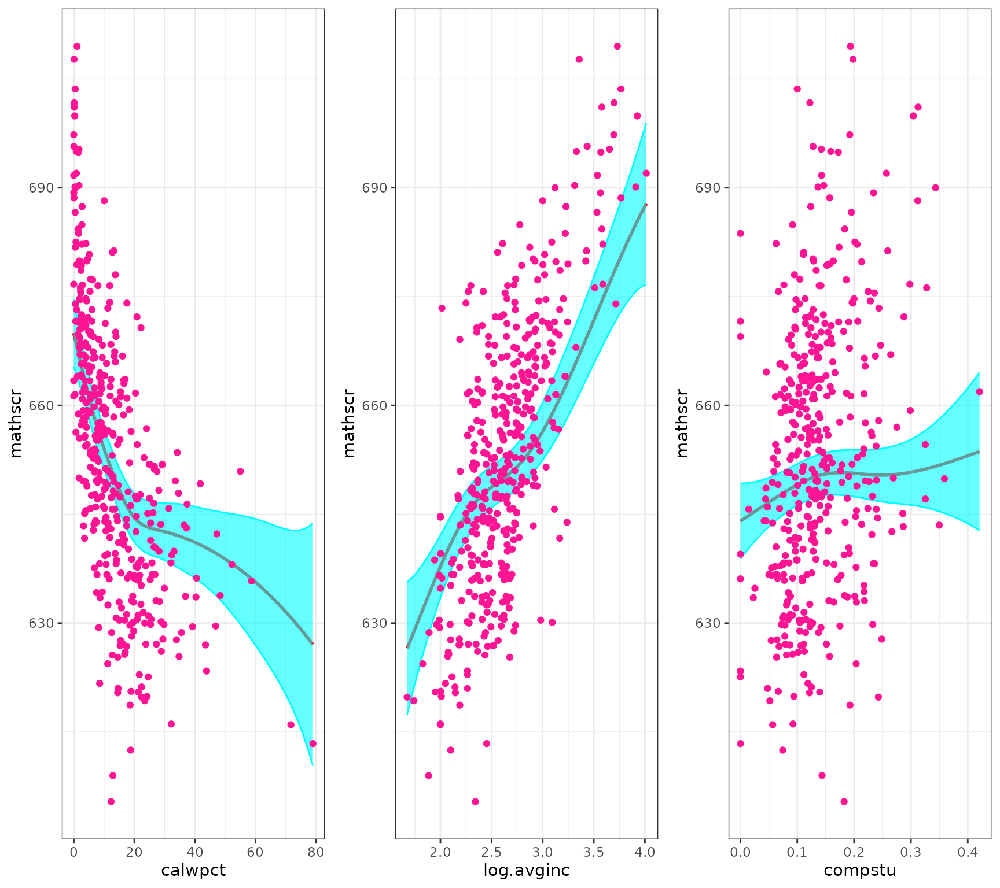

## Example_6 Semiparametric Regression with Binomial Distribution (indonRespir data)

Indonesian Children’s Health Study of respiratory infections for a
cohort of 275 Indonesian children. The data are longitudinal with each
child having between 1 and 6 repeated measurements.

### Data Info

- Structure
- Summary

``` r

data(indonRespir, package="HRW")
indonRespir[, c(1,5)] <- lapply(indonRespir[, c(1,5)], factor)
indonRespir$sex <- indonRespir$female
levels(indonRespir$sex) <- c("male", "female")
str(indonRespir)
```

    ## 'data.frame':    1200 obs. of  13 variables:
    ##  $ idnum      : Factor w/ 275 levels "1","2","3","4",..: 1 1 1 1 1 1 2 2 2 2 ...
    ##  $ respirInfec: int  0 0 0 0 1 0 0 0 0 0 ...
    ##  $ age        : num  5.58 5.83 6.08 6.33 6.58 ...
    ##  $ vitAdefic  : int  0 0 0 0 0 0 0 0 0 0 ...
    ##  $ female     : Factor w/ 2 levels "0","1": 1 1 1 1 1 1 2 2 2 2 ...
    ##  $ height     : int  -3 -3 -2 -2 -2 -3 2 0 -1 -2 ...
    ##  $ stunted    : int  0 0 0 0 0 0 0 0 0 0 ...
    ##  $ visit2     : int  0 1 0 0 0 0 0 1 0 0 ...
    ##  $ visit3     : int  0 0 1 0 0 0 0 0 1 0 ...
    ##  $ visit4     : int  0 0 0 1 0 0 0 0 0 1 ...
    ##  $ visit5     : int  0 0 0 0 1 0 0 0 0 0 ...
    ##  $ visit6     : int  0 0 0 0 0 1 0 0 0 0 ...
    ##  $ sex        : Factor w/ 2 levels "male","female": 1 1 1 1 1 1 2 2 2 2 ...

``` r

summary(indonRespir)
```

    ##      idnum       respirInfec           age           vitAdefic       female 
    ##  1      :   6   Min.   :0.00000   Min.   :0.3333   Min.   :0.00000   0:708  
    ##  2      :   6   1st Qu.:0.00000   1st Qu.:1.7500   1st Qu.:0.00000   1:492  
    ##  3      :   6   Median :0.00000   Median :3.2500   Median :0.00000          
    ##  5      :   6   Mean   :0.08917   Mean   :3.2669   Mean   :0.04583          
    ##  10     :   6   3rd Qu.:0.00000   3rd Qu.:4.5833   3rd Qu.:0.00000          
    ##  11     :   6   Max.   :1.00000   Max.   :7.1667   Max.   :1.00000          
    ##  (Other):1164                                                               
    ##      height            stunted           visit2           visit3      
    ##  Min.   :-23.0000   Min.   :0.0000   Min.   :0.0000   Min.   :0.0000  
    ##  1st Qu.: -3.0000   1st Qu.:0.0000   1st Qu.:0.0000   1st Qu.:0.0000  
    ##  Median :  1.0000   Median :0.0000   Median :0.0000   Median :0.0000  
    ##  Mean   :  0.9058   Mean   :0.1233   Mean   :0.1783   Mean   :0.1475  
    ##  3rd Qu.:  4.0000   3rd Qu.:0.0000   3rd Qu.:0.0000   3rd Qu.:0.0000  
    ##  Max.   : 25.0000   Max.   :1.0000   Max.   :1.0000   Max.   :1.0000  
    ##                                                                       
    ##      visit4           visit5           visit6           sex     
    ##  Min.   :0.0000   Min.   :0.0000   Min.   :0.0000   male  :708  
    ##  1st Qu.:0.0000   1st Qu.:0.0000   1st Qu.:0.0000   female:492  
    ##  Median :0.0000   Median :0.0000   Median :0.0000               
    ##  Mean   :0.1525   Mean   :0.1625   Mean   :0.1675               
    ##  3rd Qu.:0.0000   3rd Qu.:0.0000   3rd Qu.:0.0000               
    ##  Max.   :1.0000   Max.   :1.0000   Max.   :1.0000               
    ## 

### Smooth without Group

- Model
- Residual Plot

``` r

mod1 <- semireg_tmb(respirInfec ~ age+vitAdefic + sex + height + stunted + 
                      visit2 + visit3 + visit4  + visit5 + visit6+(1|idnum),
                             smoothZ=list(
                               grp=smZ(age, k=25)
                             ),
                             family = binomial,
                             data = indonRespir)
```

    ## Formula:          
    ## respirInfec ~ age + vitAdefic + sex + height + stunted + visit2 +  
    ##     visit3 + visit4 + visit5 + visit6 + (1 | idnum) + (1 | grp)
    ## Data: indonRespir
    ##       AIC       BIC    logLik -2*log(L)  df.resid 
    ##  673.0182  739.1892 -323.5091  647.0182      1187 
    ## Random-effects (co)variances:
    ## 
    ## Conditional model:
    ##  Groups Name        Std.Dev.
    ##  idnum  (Intercept) 0.8353  
    ##  grp    (Intercept) 0.4430  
    ## 
    ## Number of obs: 1200 / Conditional model: idnum, 275; grp, 27
    ## 
    ## Fixed Effects:
    ## 
    ## Conditional model:
    ## (Intercept)          age    vitAdefic    sexfemale       height      stunted  
    ##   -0.856632    -0.514185     0.655032    -0.509131    -0.033262     0.460009  
    ##      visit2       visit3       visit4       visit5       visit6  
    ##   -1.109010    -0.570409    -1.274438     0.477829    -0.002891

``` r

residplot(mod1$semer)  
```

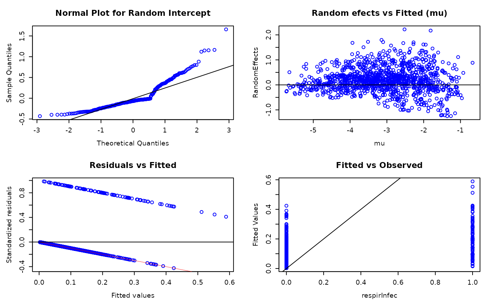

### ANOVA and $`R^2`$

- **ANOVA**

``` r

kable(car::Anova(mod1$semer))
```

|           |      Chisq |  Df | Pr(\>Chisq) |
|:----------|-----------:|----:|------------:|
| age       | 15.5042755 |   1 |   0.0000823 |
| vitAdefic |  1.7004790 |   1 |   0.1922253 |
| sex       |  3.6344414 |   1 |   0.0565956 |
| height    |  1.4757295 |   1 |   0.2244439 |
| stunted   |  0.9710527 |   1 |   0.3244178 |
| visit2    |  7.8003972 |   1 |   0.0052235 |
| visit3    |  2.2951131 |   1 |   0.1297818 |
| visit4    |  7.6878903 |   1 |   0.0055593 |
| visit5    |  2.0929208 |   1 |   0.1479829 |
| visit6    |  0.0000626 |   1 |   0.9936854 |

- **$`R^2`$**

``` r

R2_glmm(mod1$semer)
```

    ## # Adjusted R2 for Mixed Models

    ##    Total    Fixed   Random    idnum      grp 
    ##  "33.8%" "17.33%" "16.47%" "13.99%"  "2.48%"

### Prediction

- Predict Table
- Predict Plot

``` r

pred_out1 <- semipred(mod1, "age", "age", prt=FALSE)
DT_df(pred_out1$pred_df %>% 
        mutate_if(is.numeric, round, digits = 4))
```

``` r

pred_out1$plt+
  geom_rug(data = subset(indonRespir, respirInfec==0), sides = "b", col="deeppink")+
  geom_rug(data = subset(indonRespir, respirInfec==1), sides = "t", col="deeppink")+
  ylim(0, 0.18)
```

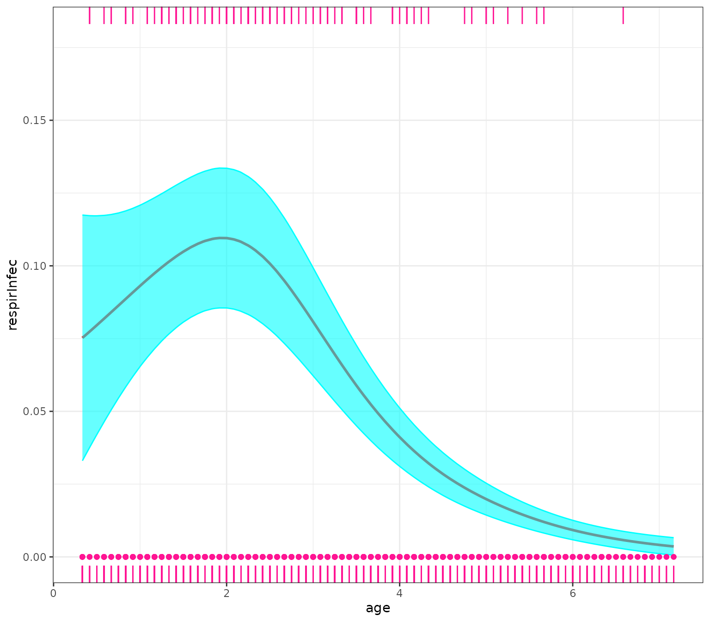

### Smooth with Group

- Model
- Residual Plot

``` r

mod2 <- semireg_tmb(respirInfec ~ age+vitAdefic + sex + height + stunted + 
                      visit2 + visit3 + visit4  + visit5 + visit6+(1|idnum),
                smoothZ=list(
                  grp=smZ(age, k=25, by=sex, group=TRUE)
                ),
                family = binomial,
                data = indonRespir)
```

    ## Formula:          
    ## respirInfec ~ age + vitAdefic + sex + height + stunted + visit2 +  
    ##     visit3 + visit4 + visit5 + visit6 + (1 | idnum) + (1 | grp.male) +  
    ##     (1 | grp.female)
    ## Data: indonRespir
    ##       AIC       BIC    logLik -2*log(L)  df.resid 
    ##  673.6117  744.8728 -322.8058  645.6117      1186 
    ## Random-effects (co)variances:
    ## 
    ## Conditional model:
    ##  Groups     Name        Std.Dev. 
    ##  idnum      (Intercept) 8.548e-01
    ##  grp.male   (Intercept) 5.633e-01
    ##  grp.female (Intercept) 6.932e-05
    ## 
    ## Number of obs: 1200 / Conditional model: idnum, 275; grp.male, 27; grp.female, 27
    ## 
    ## Fixed Effects:
    ## 
    ## Conditional model:
    ## (Intercept)          age    vitAdefic    sexfemale       height      stunted  
    ##    -0.90721     -0.52553      0.62490     -0.26799     -0.03518      0.46107  
    ##      visit2       visit3       visit4       visit5       visit6  
    ##    -1.09504     -0.53393     -1.22544      0.53412      0.06265

``` r

residplot(mod2$semer)  
```

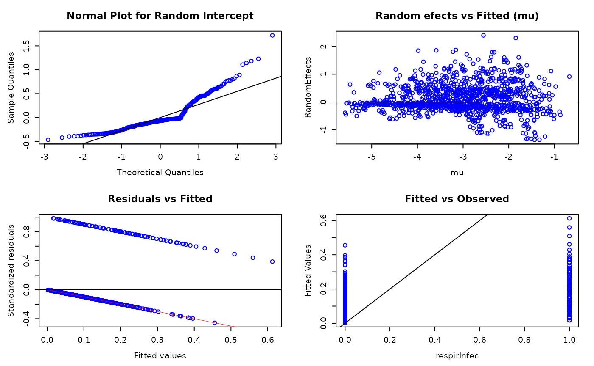

### ANOVA and $`R^2`$

- **ANOVA**

``` r

kable(Anova(mod2$semer))
```

|           |      Chisq |  Df | Pr(\>Chisq) |
|:----------|-----------:|----:|------------:|
| age       | 20.0274492 |   1 |   0.0000076 |
| vitAdefic |  1.5265392 |   1 |   0.2166326 |
| sex       |  0.9017615 |   1 |   0.3423098 |
| height    |  1.6630360 |   1 |   0.1971939 |
| stunted   |  0.9686910 |   1 |   0.3250069 |
| visit2    |  7.5723914 |   1 |   0.0059269 |
| visit3    |  2.0072509 |   1 |   0.1565488 |
| visit4    |  7.1443814 |   1 |   0.0075199 |
| visit5    |  2.6819018 |   1 |   0.1014945 |
| visit6    |  0.0305583 |   1 |   0.8612294 |

- **$`R^2`$**

``` r

R2_glmm(mod2$semer)
```

    ## # Adjusted R2 for Mixed Models

    ##      Total      Fixed     Random      idnum   grp.male grp.female 
    ##   "34.21%"      "17%"   "17.21%"   "14.57%"    "2.64%"       "0%"

### Prediction with Group

- Predict Table
- Predict Plot
- Contrast Table
- Contrast Plot

``` r

pred_out2_1 <- semipred(mod2, "sex", "age", prt=FALSE)
DT_df(pred_out2_1$pred_df %>% 
        mutate_if(is.numeric, round, digits = 4))
```

``` r

pred_out2_1$plt+
  geom_rug(data = subset(indonRespir, respirInfec==0), sides = "b", col="deeppink") +
  geom_rug(data = subset(indonRespir, respirInfec==1), sides = "t", col="deeppink")+
  ylim(0, 0.24)
```

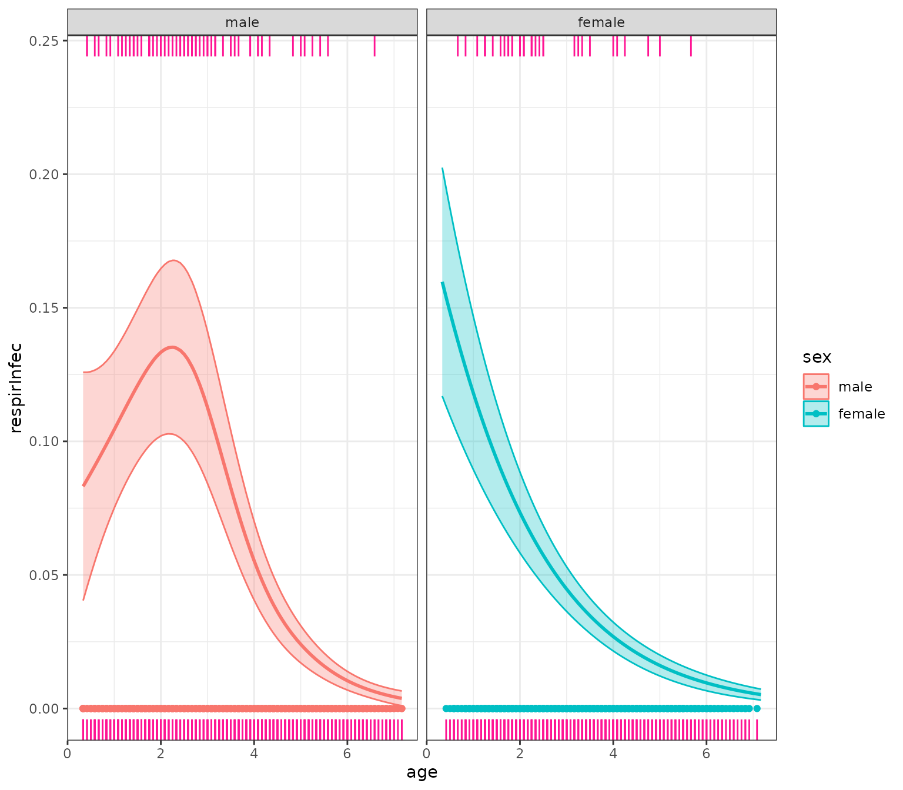

Mean Contrast table for Sex ‘male’ vs ‘female’

``` r

pred_out2_2 <- semipred(mod2, "sex", "age", contr=c('male', 'female'), prt=FALSE)
pred_out2_2$pred_df %>% 
  mutate(P_value=ifelse(LL*UL > 0, "p-value < 0.05", "p-value > 0.05")) %>%
  mutate_if(is.numeric, round, digits = 4) %>% 
  DT_df()
```

``` r

pred_out2_2$plt
```

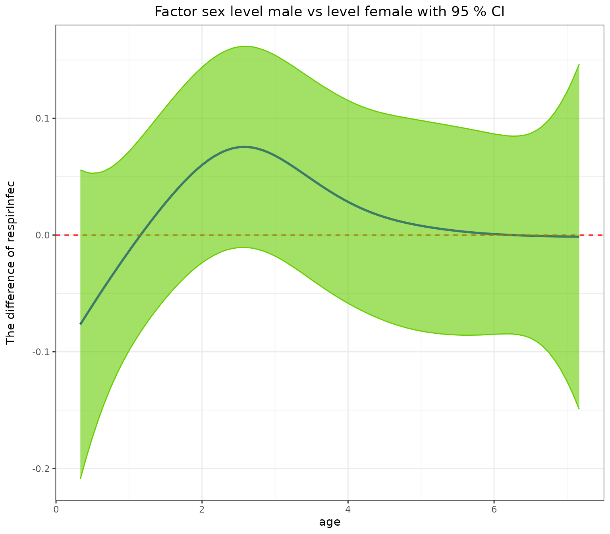

## Example_7 Semiparametric Regression with Negtive Binomial Distribution (ragweed data)

The ragweed data frame has data on ragweed levels and meteorological
variables for 334 days in Kalamazoo, Michigan, U.S.A.

### Data Info

- Structure
- Summary

``` r

data(ragweed, package="HRW")
ragweed$year <- factor(ragweed$year)
str(ragweed)
```

    ## 'data.frame':    334 obs. of  7 variables:
    ##  $ pollenCount        : int  7 7 2 5 4 0 0 0 13 62 ...
    ##  $ year               : Factor w/ 4 levels "1991","1992",..: 1 1 1 1 1 1 1 1 1 1 ...
    ##  $ dayInSeason        : int  1 2 3 4 5 6 7 8 9 10 ...
    ##  $ temperature        : num  72.4 67.1 68.5 73.4 80.5 ...
    ##  $ temperatureResidual: num  0.649 -4.796 -3.521 1.207 8.14 ...
    ##  $ rain               : int  1 0 1 1 1 1 1 1 1 1 ...
    ##  $ windSpeed          : num  10.4 9.4 8.2 11.8 7.2 7.8 5.4 10.2 5.3 8.8 ...

``` r

summary(ragweed)
```

    ##   pollenCount       year     dayInSeason     temperature    temperatureResidual
    ##  Min.   :  0.00   1991:92   Min.   : 1.00   Min.   :37.31   Min.   :-13.98210  
    ##  1st Qu.:  1.00   1992:81   1st Qu.:22.00   1st Qu.:55.47   1st Qu.: -4.31318  
    ##  Median :  9.00   1993:87   Median :43.50   Median :64.66   Median : -0.05665  
    ##  Mean   : 44.45   1994:74   Mean   :43.29   Mean   :63.29   Mean   :  0.01246  
    ##  3rd Qu.: 56.00             3rd Qu.:64.00   3rd Qu.:71.89   3rd Qu.:  4.16160  
    ##  Max.   :440.00             Max.   :92.00   Max.   :84.33   Max.   : 16.43900  
    ##       rain          windSpeed     
    ##  Min.   :0.0000   Min.   : 0.000  
    ##  1st Qu.:1.0000   1st Qu.: 6.850  
    ##  Median :1.0000   Median : 9.200  
    ##  Mean   :0.8982   Mean   : 8.865  
    ##  3rd Qu.:1.0000   3rd Qu.:10.800  
    ##  Max.   :1.0000   Max.   :17.800

### Smooth Modelling

- Model
- Residual Plot

``` r

mod <- semireg_tmb(pollenCount ~ rain+year+temperatureResidual+dayInSeason+windSpeed,
                   smoothZ=list(
                     s_day=smZ(dayInSeason, by=year, group=TRUE),
                     s_temp=smZ(temperatureResidual),
                     s_wind=smZ(windSpeed)
                   ),
                   family = nbinom1,
                   data=ragweed)
```

    ## Formula:          
    ## pollenCount ~ rain + year + temperatureResidual + dayInSeason +  
    ##     windSpeed + (1 | s_day.1991) + (1 | s_day.1992) + (1 | s_day.1993) +  
    ##     (1 | s_day.1994) + (1 | s_temp) + (1 | s_wind)
    ## Data: ragweed
    ##       AIC       BIC    logLik -2*log(L)  df.resid 
    ##  2367.406  2424.574 -1168.703  2337.406       319 
    ## Random-effects (co)variances:
    ## 
    ## Conditional model:
    ##  Groups     Name        Std.Dev. 
    ##  s_day.1991 (Intercept) 4.476e-02
    ##  s_day.1992 (Intercept) 4.826e-02
    ##  s_day.1993 (Intercept) 4.073e-02
    ##  s_day.1994 (Intercept) 3.614e-02
    ##  s_temp     (Intercept) 2.264e-07
    ##  s_wind     (Intercept) 4.796e-06
    ## 
    ## Number of obs: 334 / Conditional model: s_day.1991, 8; s_day.1992, 8; s_day.1993, 8; s_day.1994, 8; s_temp, 8; s_wind, 8
    ## 
    ## Dispersion parameter for nbinom1 family (): 11.1 
    ## 
    ## Fixed Effects:
    ## 
    ## Conditional model:
    ##         (Intercept)                 rain             year1992  
    ##             2.18616              0.79800              0.34493  
    ##            year1993             year1994  temperatureResidual  
    ##            -0.10079              0.04793              0.04768  
    ##         dayInSeason            windSpeed  
    ##            -0.03125              0.08007

``` r

residplot(mod$semer)  
```

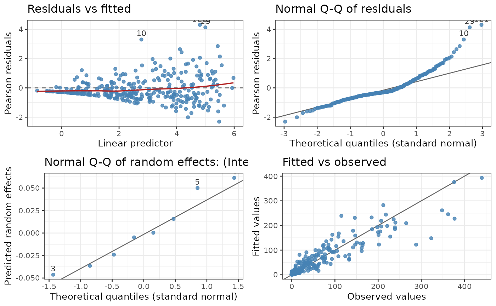

### ANOVA and $`R^2`$

- **ANOVA**

``` r

kable(car::Anova(mod$semer))
```

|                     |     Chisq |  Df | Pr(\>Chisq) |
|:--------------------|----------:|----:|------------:|
| rain                | 28.697489 |   1 |   0.0000001 |
| year                |  6.902495 |   3 |   0.0750714 |
| temperatureResidual | 70.281585 |   1 |   0.0000000 |
| dayInSeason         | 34.539924 |   1 |   0.0000000 |
| windSpeed           | 76.531043 |   1 |   0.0000000 |

- **$`R^2`$**

``` r

R2_glmm(mod$semer)
```

    ## # Adjusted R2 for Mixed Models

    ##      Total      Fixed     Random s_day.1991 s_day.1992 s_day.1993 s_day.1994 
    ##    "1.37%"    "0.22%"    "1.15%"    "0.34%"    "0.35%"    "0.26%"    "0.19%" 
    ##     s_temp     s_wind 
    ##       "0%"       "0%"

### Prediction by Day in Season

- Predict Table
- Predict Plot

``` r

pred_out1_1 <- semipred(mod, "year", "dayInSeason", sm_term="s_day", prt=FALSE)
DT_df(pred_out1_1$pred_df %>% 
        mutate_if(is.numeric, round, digits = 4))
```

``` r

pred_out1_1$plt
```

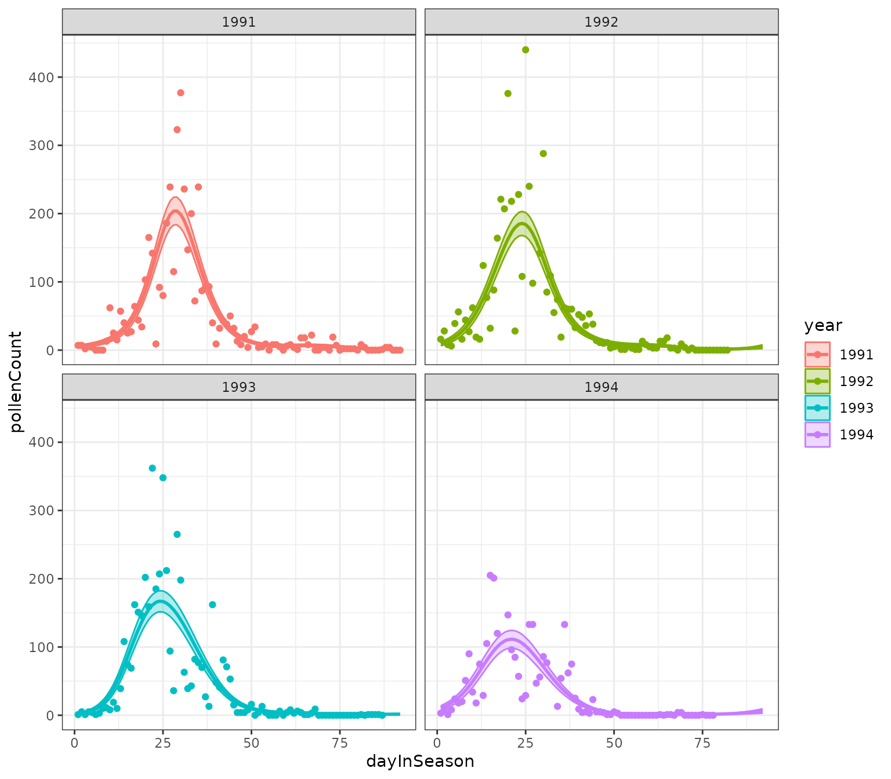

## Example_8 Semiparametric Regression with Spatial Smooth (copper data)

Data copper records the copper grade quality associated with various
sampling points’ X, Y, and Z coordinates within a designated area.

### Data Info

- Structure
- Summary
- Data

``` r

str(copper)
```

    ## 'data.frame':    439 obs. of  4 variables:
    ##  $ xcoord: int  220 220 220 220 220 220 220 220 220 270 ...
    ##  $ ycoord: int  625 625 625 625 625 625 625 625 625 625 ...
    ##  $ zcoord: int  122 117 112 107 102 97 92 87 82 122 ...
    ##  $ grade : num  1.34 0.98 1.29 1.18 1.1 0.46 1.18 0.96 1.27 0.64 ...

``` r

summary(copper)
```

    ##      xcoord          ycoord          zcoord          grade      
    ##  Min.   : 65.0   Min.   :220.0   Min.   : 77.0   Min.   :0.370  
    ##  1st Qu.:365.0   1st Qu.:320.0   1st Qu.: 87.0   1st Qu.:0.740  
    ##  Median :465.0   Median :425.0   Median :102.0   Median :0.970  
    ##  Mean   :469.5   Mean   :427.8   Mean   :100.4   Mean   :1.058  
    ##  3rd Qu.:610.0   3rd Qu.:525.0   3rd Qu.:112.0   3rd Qu.:1.245  
    ##  Max.   :665.0   Max.   :625.0   Max.   :122.0   Max.   :3.200

``` r

DT_df(copper)
```

### Modelling

- Model
- Residual Plot

``` r

mod <- semireg(log(grade) ~ (xcoord+ycoord+zcoord)^2,
                smoothZ=list(
                  grp_z=smZ(zcoord),
                  grp_geo=smZ(cbind(xcoord, ycoord), type="Ztps")
                  ), 
                data=copper)
```

    ## Linear mixed model fit by REML ['semerLmerTest']
    ## Formula: log(grade) ~ (xcoord + ycoord + zcoord)^2 + (1 | grp_z) + (1 |  
    ##     grp_geo)
    ##    Data: copper
    ## REML criterion at convergence: 318.4061
    ## Random effects:
    ##  Groups   Name        Std.Dev.
    ##  grp_geo  (Intercept) 0.001134
    ##  grp_z    (Intercept) 0.016245
    ##  Residual             0.289394
    ## Number of obs: 439, groups:  grp_geo, 36; grp_z, 8
    ## Fixed Effects:
    ##   (Intercept)         xcoord         ycoord         zcoord  xcoord:ycoord  
    ##     3.085e-03     -1.736e-03     -2.446e-05      2.503e-03     -2.455e-06  
    ## xcoord:zcoord  ycoord:zcoord  
    ##    -1.394e-05     -4.048e-05  
    ## fit warnings:
    ## Some predictor variables are on very different scales: consider rescaling. 
    ## You may also use (g)lmerControl(autoscale = TRUE) to improve numerical stability.

``` r

residplot(mod$semer)  
```

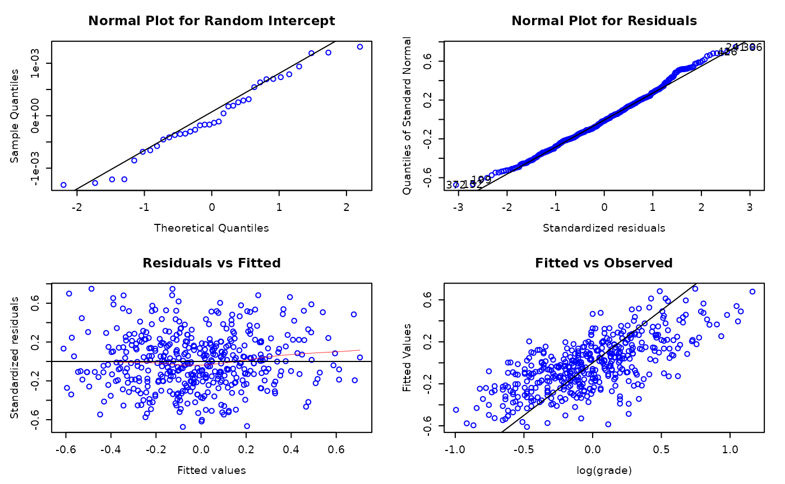

### ANOVA, RANOVA and $`R^2`$

- **ANOVA**

``` r

kable(anova(mod$semer))
```

|               |    Sum Sq |   Mean Sq | NumDF |        DenDF |    F value |   Pr(\>F) |
|:--------------|----------:|----------:|------:|-------------:|-----------:|----------:|
| xcoord        | 0.0156795 | 0.0156795 |     1 | 2.470299e+09 |  0.1872199 | 0.6652406 |
| ycoord        | 0.0000031 | 0.0000031 |     1 | 1.562426e+09 |  0.0000373 | 0.9951299 |
| zcoord        | 0.4661558 | 0.4661558 |     1 | 1.058437e+03 |  5.5661053 | 0.0184923 |
| xcoord:ycoord | 0.0238179 | 0.0238179 |     1 | 1.185519e+06 |  0.2843958 | 0.5938345 |
| xcoord:zcoord | 0.3288001 | 0.3288001 |     1 | 9.410342e+02 |  3.9260174 | 0.0478351 |
| ycoord:zcoord | 2.1794256 | 2.1794256 |     1 | 8.707645e+02 | 26.0232999 | 0.0000004 |

- **RANOVA**

``` r

kable(ranova(mod$semer))
```

|                | npar |    logLik |      AIC |      LRT |  Df | Pr(\>Chisq) |
|:---------------|-----:|----------:|---------:|---------:|----:|------------:|
|                |   10 | -159.2031 | 338.4061 |       NA |  NA |          NA |
| (1 \| grp_z)   |    9 | -199.6525 | 417.3050 | 80.89885 |   1 |           0 |
| (1 \| grp_geo) |    9 | -207.6783 | 433.3567 | 96.95054 |   1 |           0 |

- **$`R^2`$**

``` r

R2_glmm(mod$semer)
```

    ## # Adjusted R2 for Mixed Models

    ##      Total      Fixed     Random    grp_geo      grp_z 
    ##    "79.2%" "-135.63%"  "214.83%"  "196.83%"      "18%"

The negative $`R^2`$ indictates we may fit the model with intercept
only.

``` r

mod <- semireg(log(grade) ~ 1,
                smoothZ=list(
                  grp_z=smZ(zcoord),
                  grp_geo=smZ(cbind(xcoord, ycoord), type="Ztps")
                  ), 
                data=copper)
```

    ## Linear mixed model fit by REML ['semerLmerTest']
    ## Formula: log(grade) ~ 1 + (1 | grp_z) + (1 | grp_geo)
    ##    Data: copper
    ## REML criterion at convergence: 255.1183
    ## Random effects:
    ##  Groups   Name        Std.Dev. 
    ##  grp_geo  (Intercept) 0.0009664
    ##  grp_z    (Intercept) 0.0159935
    ##  Residual             0.3009139
    ## Number of obs: 439, groups:  grp_geo, 36; grp_z, 8
    ## Fixed Effects:
    ## (Intercept)  
    ##      0.1598

``` r

R2_glmm(mod$semer)
```

    ## # Adjusted R2 for Mixed Models

    ##    Total    Fixed   Random  grp_geo    grp_z 
    ## "87.71%"     "0%" "87.71%" "78.17%"  "9.54%"

### Semiparametric prediction

- Z Table
- Z Plot
- X, Y Table
- X, Y 2D Plot
- X, Y 3D Plot

``` r

pred_out1 <- semipred(mod, covariate="zcoord", trans=exp, prt=FALSE)
DT_df(pred_out1$pred_df %>% 
        mutate_if(is.numeric, round, digits = 4))
```

``` r

pred_out1$plt
```

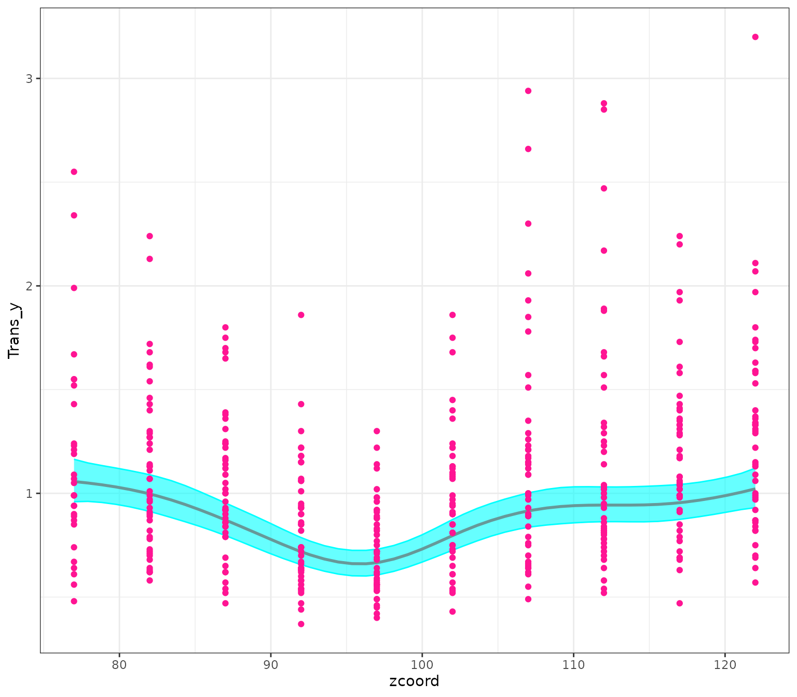

``` r

pred_out2 <- semipred(mod, covariate=c("xcoord", "ycoord"), trans=exp, point = TRUE, prt=FALSE)
DT_df(pred_out2$pred_df %>% 
        mutate_if(is.numeric, round, digits = 4))
```

``` r

pred_out2$plt
```

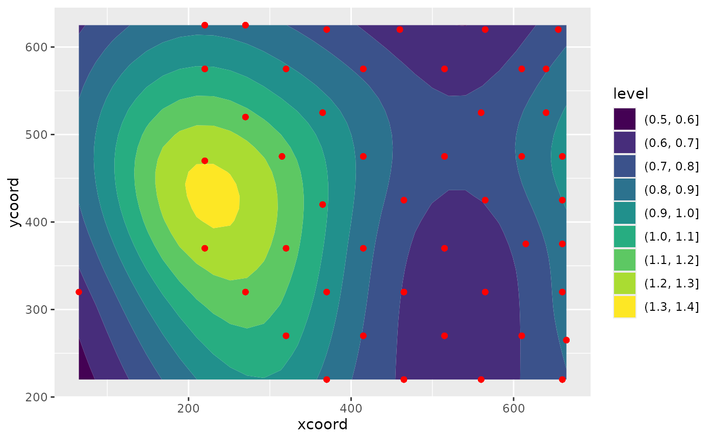

``` r

pred_out3 <- semipred(mod, covariate=c("xcoord", "ycoord"), threeD = TRUE, point=FALSE, trans=exp, prt=FALSE)
pred_out3$plt
```

## **Future Plan**

- Extend **‘predictmeans’** to more popular models in R,

- Build a comprehensive Shiny App based on **‘predictmeans’**,

- Make functions in **‘predictmeans’** working properly for **glmmTMB**
  model with a complex variance-covariance structure.

## **Reference**

- Benjamini, Y., and Hochberg, Y. (1995). Controlling the false
  discovery rate: a practical and powerful approach to multiple testing.
  Journal of the Royal Statistical Society Series B, 57, 289–300.
  <doi:10.1111/j.2517-6161.1995.tb02031.x>.
  <https://www.jstor.org/stable/2346101>.

- Cave, V. (2021). Confidence tricks: the 83.4% confidence interval for
  comparing means. <https://vsni.co.uk/blogs/confidence_trick>.

- Douglas Bates, Martin Maechler, Ben Bolker, Steve Walker (2015).
  Fitting Linear Mixed-Effects Models Using lme4. Journal of Statistical
  Software, 67(1), 1-48. <doi:10.18637/jss.v067.i01>.

- Harezlak J., Ruppert, D. & Wand, M.P. (2018). Semiparametric
  Regression with R. Springer; ISBN: 978-1-4939-8851-8.

- Luo, D., Ganesh, S., & Koolaard, J. (2022). Predictmeans: calculate
  predicted means for linear models \[R package version 1.0.8\].
  <https://CRAN.R-project.org/package=predictmeans>.

- Piepho HP. An adjusted coefficient of determination (R2 ) for
  generalized linear mixed models in one go. Biom J. 2023
  Oct;65(7):e2200290. doi: 10.1002/bimj.202200290. Epub 2023 May 1.
  PMID: 37127864.

- R Core Team (2022). R: A language and environment for statistical
  computing. R Foundation for Statistical Computing, Vienna, Austria.
  URL <https://www.R-project.org/>.
