# Overview of predictmeans

Code

``` r

library(tidyverse)
library(predictmeans)
library(lmerTest)   # t tests in summary(); predictmeans alone gives anova() F tests for lmer fits
library(HRW)
library(gridExtra)
library(car)
library(DT)
library(gt)
library(knitr)

data(copper, package = "predictmeans")

# an HTML table with a CSV download button (choose 'All' entries to download every row)
DT_df <- function(df){
  stopifnot(is.data.frame(df))
  
  df |>
    DT::datatable(
      extensions = 'Buttons',
      options = list(
        dom = 'Blfrtip', # set DOM
        buttons = c('csv'),
        lengthMenu = list(
          c(10, 20, -1), # declare values
          c(10, 20, "All") # declare titles
        ), # end of lengthMenu customization
        pageLength = 10
      ), rownames= FALSE)
}
```

## **Motivation**

- **Mixed-effects models** are needed for split-plot experiments,
  repeated measurements, meta-analysis and many other designs. The
  packages that fit them (‘nlme’, ‘lme4’, ‘glmmTMB’) give the model
  coefficients and an ANOVA table, but not the inference a study usually
  reports: predicted means, their standard errors, confidence intervals
  and multiple comparisons.

- **Permutation tests** need no distributional assumption: they suit
  small samples and data that are not normal, where the assumptions of
  parametric tests are in doubt.

- **Semiparametric regression** combines parametric terms with smooth
  curves and surfaces, for relationships whose shape is not known in
  advance. It is used widely, from biology and medicine to economics.

- **predictmeans** provides diagnostics and inference for models fitted
  by `aov`, `lm`, `glm`, `gls`, `lme`, `lmer`, `glmer`, `glmmTMB` and
  `gam`, and its own semiparametric models
  ([`semireg()`](https://dongwenluo.github.io/predictmeans/reference/semireg.md)):
  predicted means with standard errors and confidence intervals,
  contrasts, multiple comparisons, permutation tests, adjusted
  R-squared, and plots. Its defaults are chosen on the statistical
  evidence (e.g. Kenward-Roger degrees of freedom for REML fits), its
  results are checked against SAS and Genstat in the package tests, and
  it adds a one-line note when this fit and data call for care
  ([`advice()`](https://dongwenluo.github.io/predictmeans/reference/advice.md)).
  <https://CRAN.R-project.org/package=predictmeans>

## **Overview**

### **Main Functions Flowchart**

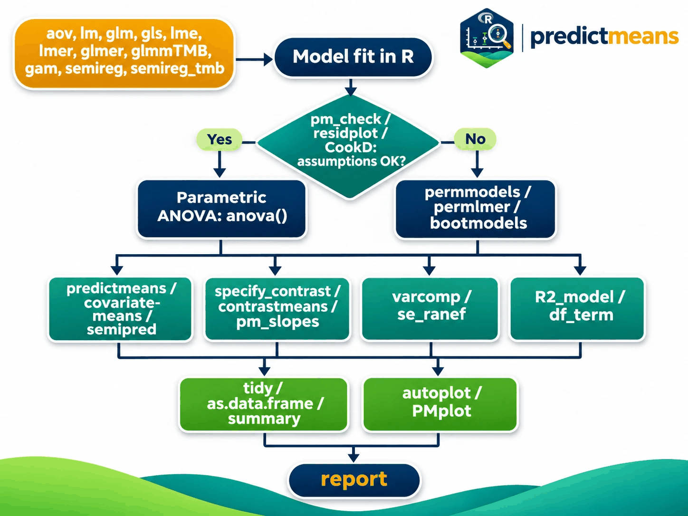

The workflow of predictmeans

## Example 1: split-plot design (Oats data)

The treatments are three oat varieties (Victory, Golden Rain and
Marvellous) and four rates of nitrogen (0, 0.2, 0.4 and 0.6 cwt per
acre). Fertiliser can be applied to smaller plots than a variety can be
sown in, so each of the six blocks was split into three whole plots, and
each whole plot into four subplots. The varieties were randomized to the
whole plots within each block, and the nitrogen rates to the subplots
within each whole plot. The model therefore has two error strata:
blocks, and whole plots within blocks.

### Data Info

- Structure
- Plot

Code

``` r

data(Oats, package="nlme")
Oats$Block <- factor(Oats$Block, levels=unique(Oats$Block), ordered = TRUE)
Oats <- data.frame(Oats)
str(Oats)
```

    ## 'data.frame':    72 obs. of  4 variables:
    ##  $ Block  : Ord.factor w/ 6 levels "I"<"II"<"III"<..: 1 1 1 1 1 1 1 1 1 1 ...
    ##  $ Variety: Factor w/ 3 levels "Golden Rain",..: 3 3 3 3 1 1 1 1 2 2 ...
    ##  $ nitro  : num  0 0.2 0.4 0.6 0 0.2 0.4 0.6 0 0.2 ...
    ##  $ yield  : num  111 130 157 174 117 114 161 141 105 140 ...

Code

``` r

Oats %>% 
  ggplot(aes(x=nitro, y=yield, col=Variety))+
  geom_point(size=2)+
  geom_line(linewidth=1)+
  facet_wrap(vars(Block))+
  theme_bw(9)
```

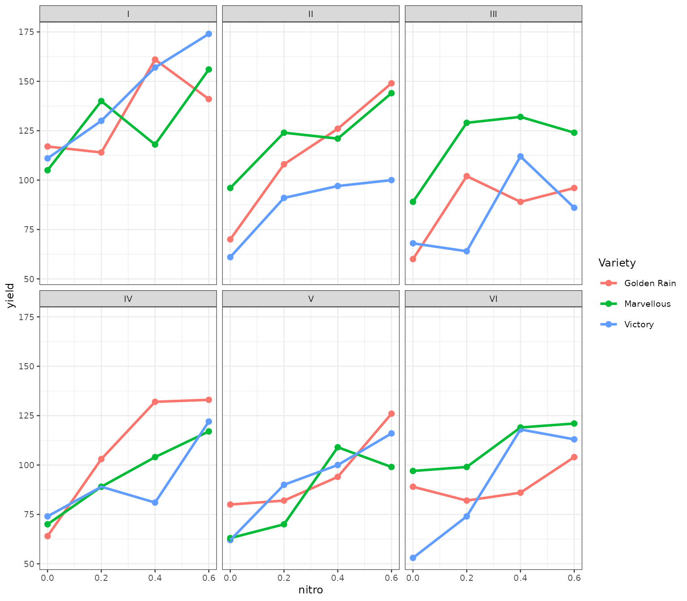

### Modelling

- Model
- Residual Plot
- Highlights
- Test

Code

``` r

Oats$nitro <- factor(Oats$nitro)
Oats$Whole_plot <- Oats$Variety
mod <- lmer(yield ~ nitro*Variety+(1|Block/Whole_plot), data=Oats)
summary(mod, corr=FALSE)
```

    ## Linear mixed model fit by REML. t-tests use Satterthwaite's method [
    ## lmerModLmerTest]
    ## Formula: yield ~ nitro * Variety + (1 | Block/Whole_plot)
    ##    Data: Oats
    ## 
    ## REML criterion at convergence: 529
    ## 
    ## Scaled residuals: 
    ##      Min       1Q   Median       3Q      Max 
    ## -1.81301 -0.56145  0.01758  0.63865  1.57034 
    ## 
    ## Random effects:
    ##  Groups           Name        Variance Std.Dev.
    ##  Whole_plot:Block (Intercept) 106.1    10.30   
    ##  Block            (Intercept) 214.5    14.65   
    ##  Residual                     177.1    13.31   
    ## Number of obs: 72, groups:  Whole_plot:Block, 18; Block, 6
    ## 
    ## Fixed effects:
    ##                            Estimate Std. Error      df t value Pr(>|t|)    
    ## (Intercept)                 80.0000     9.1070 16.0816   8.784 1.55e-07 ***
    ## nitro0.2                    18.5000     7.6829 45.0000   2.408   0.0202 *  
    ## nitro0.4                    34.6667     7.6829 45.0000   4.512 4.58e-05 ***
    ## nitro0.6                    44.8333     7.6829 45.0000   5.835 5.48e-07 ***
    ## VarietyMarvellous            6.6667     9.7150 30.2308   0.686   0.4978    
    ## VarietyVictory              -8.5000     9.7150 30.2308  -0.875   0.3885    
    ## nitro0.2:VarietyMarvellous   3.3333    10.8653 45.0000   0.307   0.7604    
    ## nitro0.4:VarietyMarvellous  -4.1667    10.8653 45.0000  -0.383   0.7032    
    ## nitro0.6:VarietyMarvellous  -4.6667    10.8653 45.0000  -0.430   0.6696    
    ## nitro0.2:VarietyVictory     -0.3333    10.8653 45.0000  -0.031   0.9757    
    ## nitro0.4:VarietyVictory      4.6667    10.8653 45.0000   0.430   0.6696    
    ## nitro0.6:VarietyVictory      2.1667    10.8653 45.0000   0.199   0.8428    
    ## ---
    ## Signif. codes:  0 '***' 0.001 '**' 0.01 '*' 0.05 '.' 0.1 ' ' 1

Code

``` r

residplot(mod, group = "nitro")
```

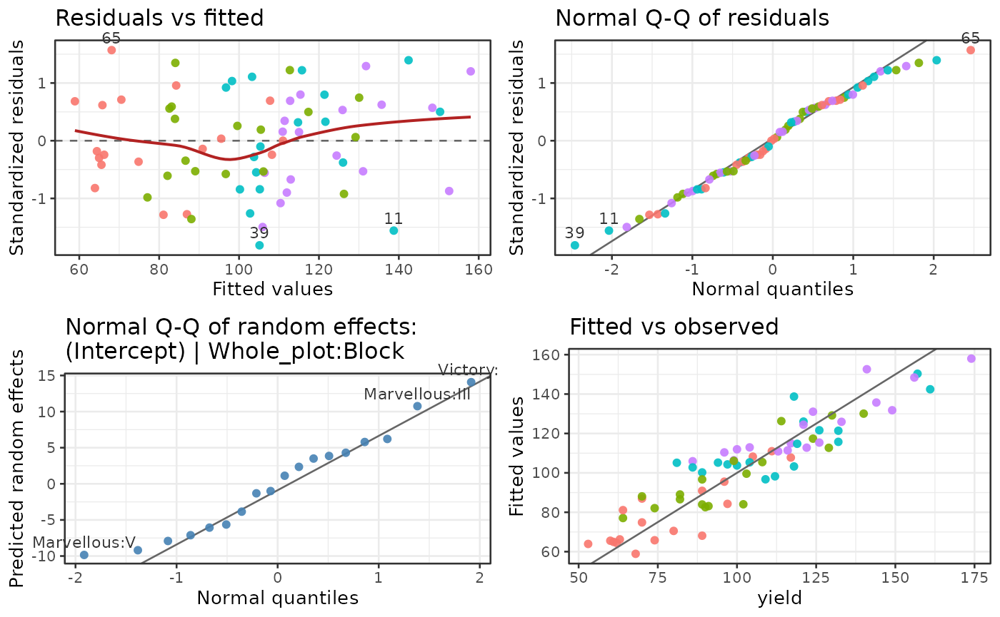

Options of
[`residplot()`](https://dongwenluo.github.io/predictmeans/reference/residplot.md):

- `id = 3` (the default) labels the three most extreme points with their
  row numbers in the data, so outliers can be found;
  `interactive = TRUE` shows every point’s row on hover.

- `group = "nitro"` colours the points by nitrogen rate, to show whether
  the spread differs between groups.

Formal tests of the assumptions, for reference; with small samples they
have little power, and with large ones they flag departures too small to
matter, so read them with the plots. `pm_check(mod)` gives a table of
checks with advice.

Code

``` r

# Shapiro-Wilk test of normality of the residuals
shapiro.test(resid(mod))
```

    ## 
    ##  Shapiro-Wilk normality test
    ## 
    ## data:  resid(mod)
    ## W = 0.97896, p-value = 0.2698

Code

``` r

# Bartlett and Levene tests of equal variance across treatment combinations
bartlett.test(yield ~ interaction(nitro, Variety), data = Oats)
```

    ## 
    ##  Bartlett test of homogeneity of variances
    ## 
    ## data:  yield by interaction(nitro, Variety)
    ## Bartlett's K-squared = 9.182, df = 11, p-value = 0.6051

Code

``` r

car::leveneTest(yield ~ nitro:Variety, data = Oats)
```

    ## Levene's Test for Homogeneity of Variance (center = median)
    ##       Df F value Pr(>F)
    ## group 11   0.766 0.6716
    ##       60

### ANOVA and $`R^2`$

- **ANOVA**

Code

``` r

kable(anova(mod))
```

|               |     Sum Sq |   Mean Sq | NumDF |    DenDF |   F value |   Pr(\>F) |
|:--------------|-----------:|----------:|------:|---------:|----------:|----------:|
| nitro         | 20020.5001 | 6673.5000 |     3 | 45.00004 | 37.685704 | 0.0000000 |
| Variety       |   526.0575 |  263.0288 |     2 | 10.00002 |  1.485341 | 0.2723866 |
| nitro:Variety |   321.7500 |   53.6250 |     6 | 45.00004 |  0.302824 | 0.9321985 |

- **$`R^2`$**

Code

``` r

R2_model(mod)
```

    ## # Adjusted R2 for mixed models (Piepho)
    ##            Total            Fixed           Random Whole_plot:Block 
    ##           75.81%           37.19%           38.63%           13.87% 
    ##            Block 
    ##           24.75%

### Predicted Means

#### Predicted Means for “nitro”

- Mean Table
- Mean Plot
- p-value Table & Plot

Code

``` r

predm_out <- predictmeans(mod, "nitro", meandecr=TRUE, adj="BH")
predm_out
```

    ## $`Predicted Means`
    ## nitro
    ##        0      0.2      0.4      0.6 
    ##  79.3889  98.8889 114.2222 123.3889 
    ## 
    ## $`Standard Error of Means`
    ## All means have the same SE 
    ##                    7.17475 
    ## 
    ## $`Standard Error of Differences`
    ##  Max.SED  Min.SED Aveg.SED 
    ## 4.435752 4.435752 4.435752 
    ## 
    ## $LSD
    ##  Max.LSD  Min.LSD Aveg.LSD 
    ##  8.93406  8.93406  8.93406 
    ## attr(,"Significant level")
    ## [1] 0.05
    ## attr(,"Degree of freedom")
    ## [1] 45
    ## attr(,"Note")
    ## [1] "These LSDs are not adjusted: 'BH' is a step-wise method and has no critical value for all pairs. Use the adjusted p-values for the comparisons."
    ## attr(,"equal")
    ## [1] TRUE
    ## 
    ## $`Pairwise p-value`
    ##          0     0.2     0.4     0.6
    ## 0   1.0000 -4.3961 -7.8529 -9.9194
    ## 0.2 0.0001  1.0000 -3.4568 -5.5233
    ## 0.4 0.0000  0.0014  1.0000 -2.0665
    ## 0.6 0.0000  0.0000  0.0446  1.0000
    ## attr(,"Note")
    ## [1] "The matrix has t-value above the diagonal, p-value (adjusted by 'BH' method) below the diagonal"
    ## 
    ## $mean_table
    ## $mean_table$Table
    ##   nitro     Mean      SE   Df  LL(95%)  UL(95%) LetterGrp
    ## 4   0.6 123.3889 7.17475 6.79 106.3163 140.4614      A   
    ## 3   0.4 114.2222 7.17475 6.79  97.1497 131.2948       B  
    ## 2   0.2  98.8889 7.17475 6.79  81.8163 115.9614        C 
    ## 1     0  79.3889 7.17475 6.79  62.3163  96.4614         D
    ## 
    ## $mean_table$Note
    ## [1] "Letter-based representation of pairwise comparisons at significant level '0.05'"

Code

``` r

gt(predm_out$mean_table$Table, 
   caption = "Means sharing a letter are not significantly different (BH-adjusted p-values, 5% level)")
```

| nitro | Mean     | SE      | Df   | LL(95%)  | UL(95%)  | LetterGrp |
|-------|----------|---------|------|----------|----------|-----------|
| 0.6   | 123.3889 | 7.17475 | 6.79 | 106.3163 | 140.4614 | A         |
| 0.4   | 114.2222 | 7.17475 | 6.79 | 97.1497  | 131.2948 | B         |
| 0.2   | 98.8889  | 7.17475 | 6.79 | 81.8163  | 115.9614 | C         |
| 0     | 79.3889  | 7.17475 | 6.79 | 62.3163  | 96.4614  | D         |

Means sharing a letter are not significantly different (BH-adjusted
p-values, 5% level) {.table .gt_table quarto-disable-processing="false"
quarto-bootstrap="false"}

Code

``` r

autoplot(predm_out)
```

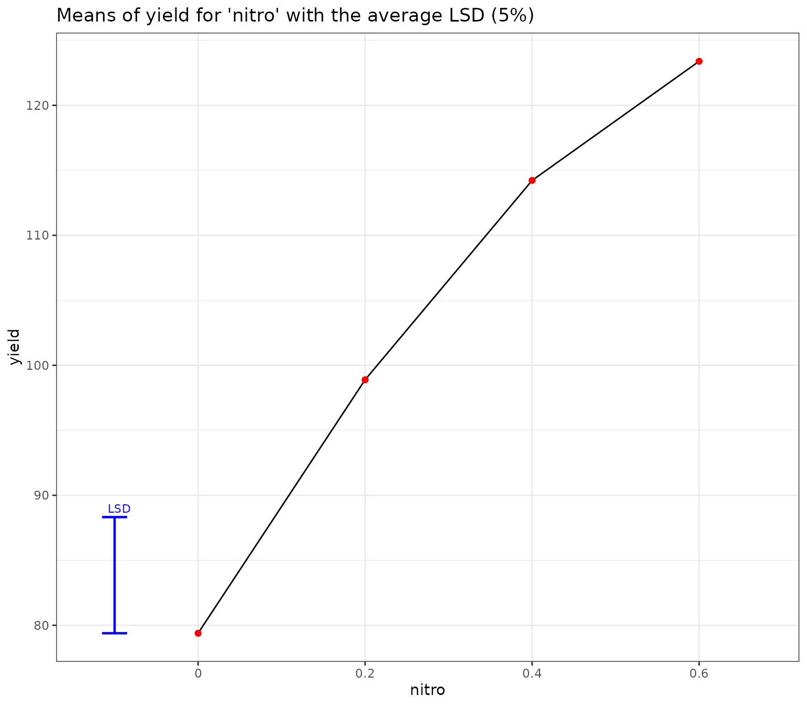

Code

``` r

autoplot(predm_out, type = "ci", data = TRUE)
```

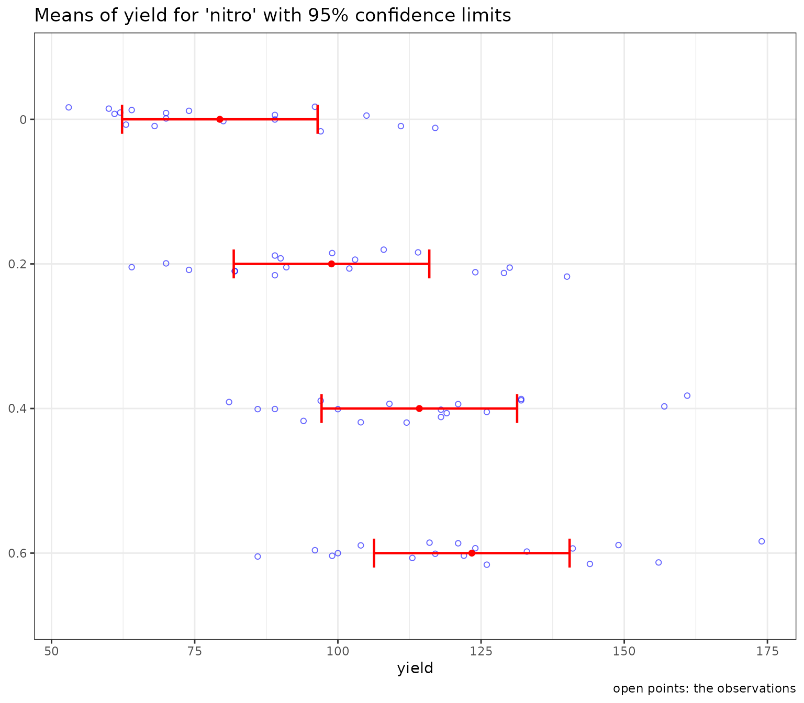

Code

``` r

autoplot(predm_out, type = "bar")
```

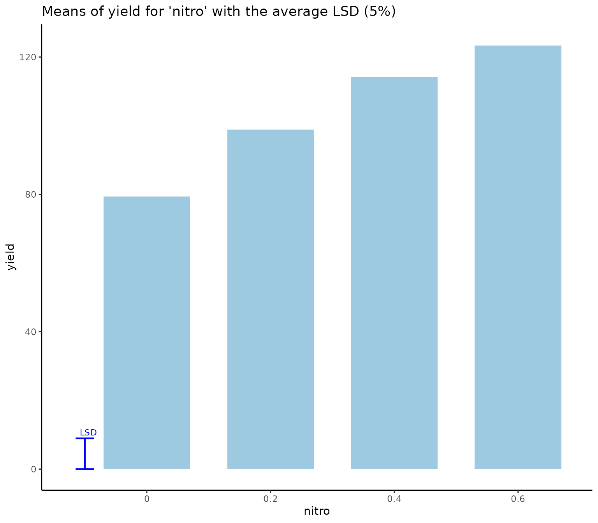

Code

``` r

gt(data.frame(predm_out$`Pairwise p-value`, check.names=FALSE), 
   rownames_to_stub=TRUE, 
   caption = "t values above the diagonal; BH-adjusted p-values below") %>% 
  cols_width(everything() ~ px(130))
```

|     | 0     | 0.2     | 0.4     | 0.6     |
|-----|-------|---------|---------|---------|
| 0   | 1e+00 | -4.3961 | -7.8529 | -9.9194 |
| 0.2 | 1e-04 | 1.0000  | -3.4568 | -5.5233 |
| 0.4 | 0e+00 | 0.0014  | 1.0000  | -2.0665 |
| 0.6 | 0e+00 | 0.0000  | 0.0446  | 1.0000  |

t values above the diagonal; BH-adjusted p-values below {.table
.gt_table style="table-layout:fixed;width:0px;"
quarto-disable-processing="false" quarto-bootstrap="false"}

Code

``` r

PMplot(predm_out$p_valueMatrix)
```

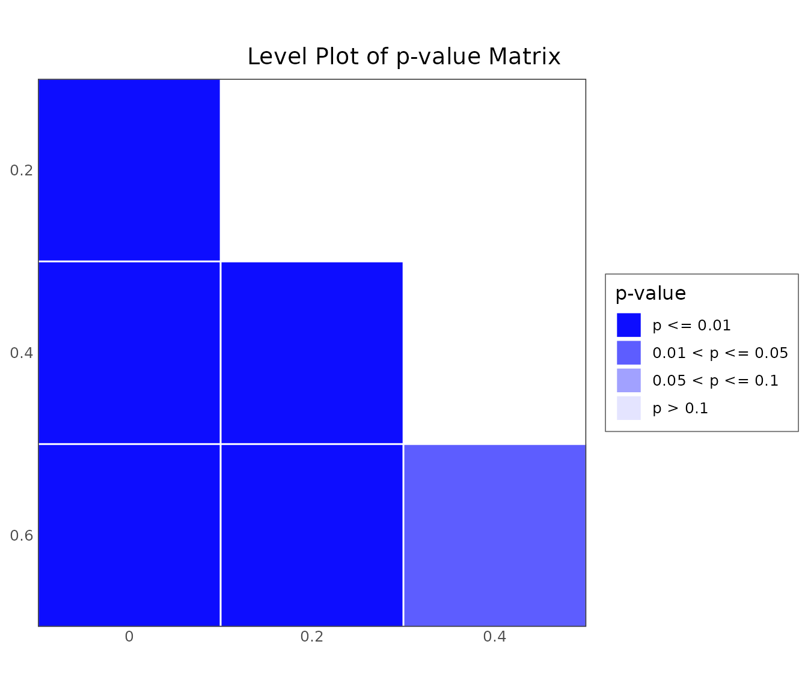

#### Predicted Means for “nitro:Variety”

- Mean Table
- Mean Plot
- p-value Table & Plot

Code

``` r

predm_out <- predictmeans(mod, "nitro:Variety", meandecr=TRUE, adj="BH")
predm_out
```

    ## $`Predicted Means`
    ##       Variety Golden Rain Marvellous  Victory
    ## nitro                                        
    ## 0                 80.0000    86.6667  71.5000
    ## 0.2               98.5000   108.5000  89.6667
    ## 0.4              114.6667   117.1667 110.8333
    ## 0.6              124.8333   126.8333 118.5000
    ## 
    ## $`Standard Error of Means`
    ## All means have the same SE 
    ##                    9.10701 
    ## 
    ## $`Standard Error of Differences`
    ##  Max.SED  Min.SED Aveg.SED 
    ## 9.715020 7.682948 9.160819 
    ## attr(,"For the Same Level of Factor")
    ##            nitro  Variety
    ## Aveg.SED 9.71502 7.682948
    ## Min.SED  9.71502 7.682948
    ## Max.SED  9.71502 7.682948
    ## 
    ## $LSD
    ##  Max.LSD  Min.LSD Aveg.LSD 
    ## 19.56705 15.47425 18.45083 
    ## attr(,"For the Same Level of Factor")
    ##             nitro  Variety
    ## Aveg.LSD 19.56705 15.47425
    ## Min.LSD  19.56705 15.47425
    ## Max.LSD  19.56705 15.47425
    ## attr(,"Significant level")
    ## [1] 0.05
    ## attr(,"Degree of freedom")
    ## [1] 45
    ## attr(,"Note")
    ## [1] "These LSDs are not adjusted: 'BH' is a step-wise method and has no critical value for all pairs. Use the adjusted p-values for the comparisons. The LSDs differ between pairs (15.47 to 19.57): no single LSD tests every pair; use the p-values, or each pair's LSD (pairs$lsd)."
    ## attr(,"equal")
    ## [1] FALSE
    ## 
    ## $`Pairwise p-value`
    ##                 0:Golden Rain 0:Marvellous 0:Victory 0.2:Golden Rain
    ## 0:Golden Rain          1.0000      -0.6862    0.8749         -2.4079
    ## 0:Marvellous           0.5867       1.0000    1.5612         -1.2180
    ## 0:Victory              0.4838       0.2127    1.0000         -2.7792
    ## 0.2:Golden Rain        0.0430       0.3338    0.0219          1.0000
    ## 0.2:Marvellous         0.0185       0.0185    0.0025          0.4196
    ## 0.2:Victory            0.4240       0.8086    0.0449          0.4701
    ## 0.4:Golden Rain        0.0004       0.0190    0.0007          0.0795
    ## 0.4:Marvellous         0.0025       0.0015    0.0004          0.1144
    ## 0.4:Victory            0.0108       0.0409    0.0001          0.3222
    ## 0.6:Golden Rain        0.0000       0.0023    0.0001          0.0046
    ## 0.6:Marvellous         0.0004       0.0001    0.0001          0.0185
    ## 0.6:Victory            0.0023       0.0087    0.0000          0.0910
    ##                 0.2:Marvellous 0.2:Victory 0.4:Golden Rain 0.4:Marvellous
    ## 0:Golden Rain          -2.9336     -0.9950         -4.5122        -3.8257
    ## 0:Marvellous           -2.8418     -0.3088         -2.8821        -3.9698
    ## 0:Victory              -3.8085     -2.3645         -4.4433        -4.7006
    ## 0.2:Golden Rain        -1.0293      0.9092         -2.1042        -1.9214
    ## 0.2:Marvellous          1.0000      1.9386         -0.6348        -1.1280
    ## 0.2:Victory             0.1136      1.0000         -2.5733        -2.8307
    ## 0.4:Golden Rain         0.5933      0.0346          1.0000        -0.2573
    ## 0.4:Marvellous          0.3725      0.0206          0.8367         1.0000
    ## 0.4:Victory             0.8372      0.0206          0.7530         0.5910
    ## 0.6:Golden Rain         0.1789      0.0039          0.3024         0.5234
    ## 0.6:Marvellous          0.0439      0.0025          0.3227         0.3222
    ## 0.6:Victory             0.4196      0.0024          0.7530         0.8917
    ##                 0.4:Victory 0.6:Golden Rain 0.6:Marvellous 0.6:Victory
    ## 0:Golden Rain       -3.1738         -5.8354        -4.8207     -3.9629
    ## 0:Marvellous        -2.4876         -3.9286        -5.2280     -3.2767
    ## 0:Victory           -5.1196         -5.4898        -5.6956     -6.1174
    ## 0.2:Golden Rain     -1.2695         -3.4275        -2.9164     -2.0587
    ## 0.2:Marvellous      -0.2402         -1.6812        -2.3862     -1.0293
    ## 0.2:Victory         -2.7550         -3.6198        -3.8257     -3.7529
    ## 0.4:Golden Rain      0.3946         -1.3233        -1.2524     -0.3946
    ## 0.4:Marvellous       0.6519         -0.7892        -1.2582     -0.1372
    ## 0.4:Victory          1.0000         -1.4411        -1.6469     -0.9979
    ## 0.6:Golden Rain      0.2573          1.0000        -0.2059      0.6519
    ## 0.6:Marvellous       0.1860          0.8512         1.0000      0.8578
    ## 0.6:Victory          0.4240          0.5910         0.4862      1.0000
    ## attr(,"Note")
    ## [1] "The matrix has t-value above the diagonal, p-value (adjusted by 'BH' method) below the diagonal"
    ## 
    ## $mean_table
    ## $mean_table$Table
    ##    nitro     Variety     Mean      SE    Df  LL(95%)  UL(95%) LetterGrp
    ## 11   0.6  Marvellous 126.8333 9.10701 16.08 107.5351 146.1315   A      
    ## 10   0.6 Golden Rain 124.8333 9.10701 16.08 105.5351 144.1315   AB     
    ## 12   0.6     Victory 118.5000 9.10701 16.08  99.2018 137.7982   ABC    
    ## 8    0.4  Marvellous 117.1667 9.10701 16.08  97.8685 136.4649   ABC    
    ## 7    0.4 Golden Rain 114.6667 9.10701 16.08  95.3685 133.9649   ABC    
    ## 9    0.4     Victory 110.8333 9.10701 16.08  91.5351 130.1315   ABC    
    ## 5    0.2  Marvellous 108.5000 9.10701 16.08  89.2018 127.7982    BCD   
    ## 4    0.2 Golden Rain  98.5000 9.10701 16.08  79.2018 117.7982     CDE  
    ## 6    0.2     Victory  89.6667 9.10701 16.08  70.3685 108.9649      DEF 
    ## 2      0  Marvellous  86.6667 9.10701 16.08  67.3685 105.9649       EFG
    ## 1      0 Golden Rain  80.0000 9.10701 16.08  60.7018  99.2982        FG
    ## 3      0     Victory  71.5000 9.10701 16.08  52.2018  90.7982         G
    ## 
    ## $mean_table$Note
    ## [1] "Letter-based representation of pairwise comparisons at significant level '0.05'"

Code

``` r

gt(predm_out$mean_table$Table, 
   caption = "Means sharing a letter are not significantly different (BH-adjusted p-values, 5% level)")
```

| nitro | Variety     | Mean     | SE      | Df    | LL(95%)  | UL(95%)  | LetterGrp |
|-------|-------------|----------|---------|-------|----------|----------|-----------|
| 0.6   | Marvellous  | 126.8333 | 9.10701 | 16.08 | 107.5351 | 146.1315 | A         |
| 0.6   | Golden Rain | 124.8333 | 9.10701 | 16.08 | 105.5351 | 144.1315 | AB        |
| 0.6   | Victory     | 118.5000 | 9.10701 | 16.08 | 99.2018  | 137.7982 | ABC       |
| 0.4   | Marvellous  | 117.1667 | 9.10701 | 16.08 | 97.8685  | 136.4649 | ABC       |
| 0.4   | Golden Rain | 114.6667 | 9.10701 | 16.08 | 95.3685  | 133.9649 | ABC       |
| 0.4   | Victory     | 110.8333 | 9.10701 | 16.08 | 91.5351  | 130.1315 | ABC       |
| 0.2   | Marvellous  | 108.5000 | 9.10701 | 16.08 | 89.2018  | 127.7982 | BCD       |
| 0.2   | Golden Rain | 98.5000  | 9.10701 | 16.08 | 79.2018  | 117.7982 | CDE       |
| 0.2   | Victory     | 89.6667  | 9.10701 | 16.08 | 70.3685  | 108.9649 | DEF       |
| 0     | Marvellous  | 86.6667  | 9.10701 | 16.08 | 67.3685  | 105.9649 | EFG       |
| 0     | Golden Rain | 80.0000  | 9.10701 | 16.08 | 60.7018  | 99.2982  | FG        |
| 0     | Victory     | 71.5000  | 9.10701 | 16.08 | 52.2018  | 90.7982  | G         |

Means sharing a letter are not significantly different (BH-adjusted
p-values, 5% level) {.table .gt_table quarto-disable-processing="false"
quarto-bootstrap="false"}

Code

``` r

autoplot(predm_out)
```

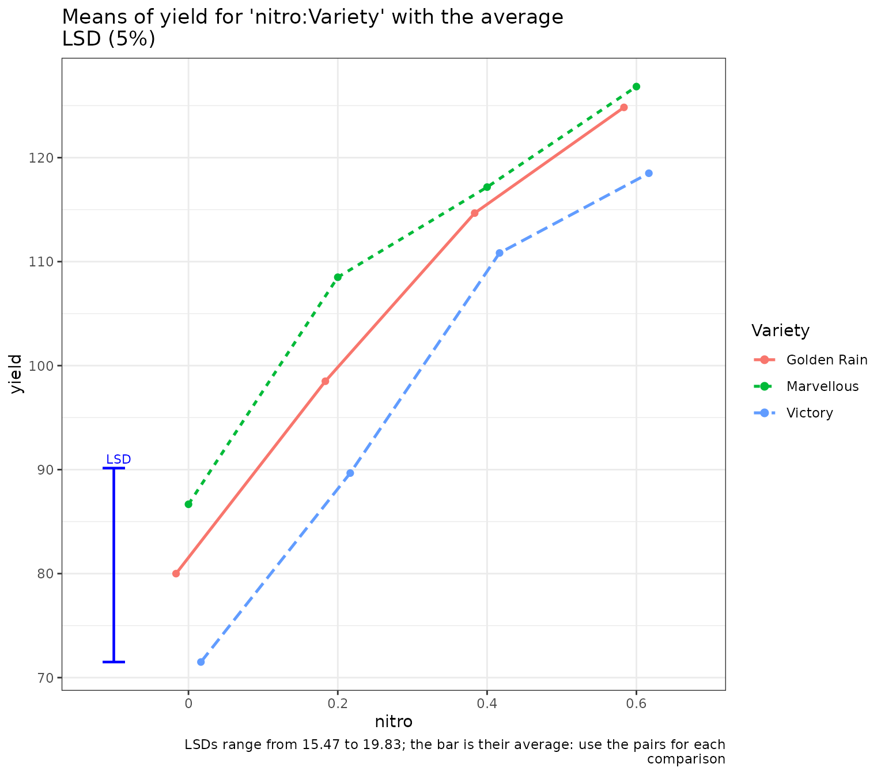

Code

``` r

autoplot(predm_out, type = "ci", data = TRUE)
```

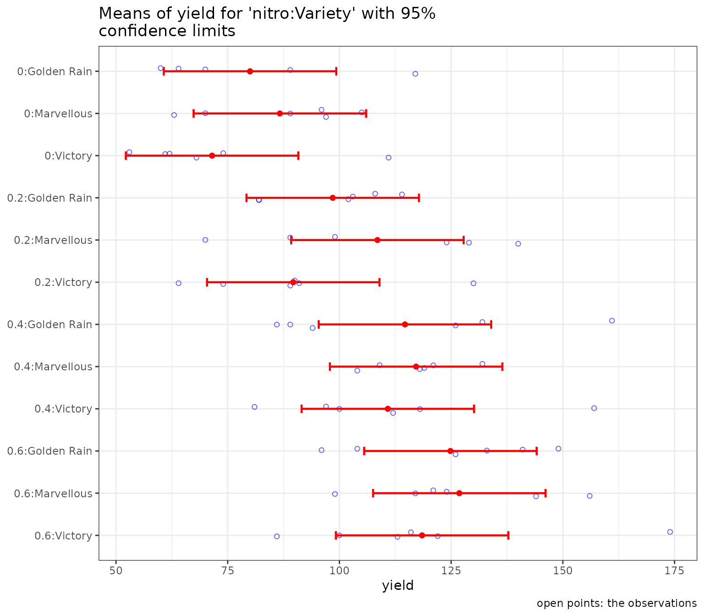

Code

``` r

autoplot(predm_out, type = "bar")
```

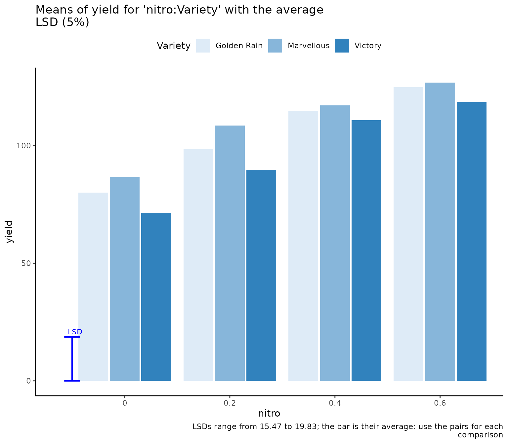

Code

``` r

gt(data.frame(predm_out$`Pairwise p-value`, check.names=FALSE), 
   rownames_to_stub=TRUE,
   caption = "t values above the diagonal; BH-adjusted p-values below") %>% 
  cols_width(everything() ~ px(130))
```

|  | 0:Golden Rain | 0:Marvellous | 0:Victory | 0.2:Golden Rain | 0.2:Marvellous | 0.2:Victory | 0.4:Golden Rain | 0.4:Marvellous | 0.4:Victory | 0.6:Golden Rain | 0.6:Marvellous | 0.6:Victory |
|----|----|----|----|----|----|----|----|----|----|----|----|----|
| 0:Golden Rain | 1.0000 | -0.6862 | 0.8749 | -2.4079 | -2.9336 | -0.9950 | -4.5122 | -3.8257 | -3.1738 | -5.8354 | -4.8207 | -3.9629 |
| 0:Marvellous | 0.5867 | 1.0000 | 1.5612 | -1.2180 | -2.8418 | -0.3088 | -2.8821 | -3.9698 | -2.4876 | -3.9286 | -5.2280 | -3.2767 |
| 0:Victory | 0.4838 | 0.2127 | 1.0000 | -2.7792 | -3.8085 | -2.3645 | -4.4433 | -4.7006 | -5.1196 | -5.4898 | -5.6956 | -6.1174 |
| 0.2:Golden Rain | 0.0430 | 0.3338 | 0.0219 | 1.0000 | -1.0293 | 0.9092 | -2.1042 | -1.9214 | -1.2695 | -3.4275 | -2.9164 | -2.0587 |
| 0.2:Marvellous | 0.0185 | 0.0185 | 0.0025 | 0.4196 | 1.0000 | 1.9386 | -0.6348 | -1.1280 | -0.2402 | -1.6812 | -2.3862 | -1.0293 |
| 0.2:Victory | 0.4240 | 0.8086 | 0.0449 | 0.4701 | 0.1136 | 1.0000 | -2.5733 | -2.8307 | -2.7550 | -3.6198 | -3.8257 | -3.7529 |
| 0.4:Golden Rain | 0.0004 | 0.0190 | 0.0007 | 0.0795 | 0.5933 | 0.0346 | 1.0000 | -0.2573 | 0.3946 | -1.3233 | -1.2524 | -0.3946 |
| 0.4:Marvellous | 0.0025 | 0.0015 | 0.0004 | 0.1144 | 0.3725 | 0.0206 | 0.8367 | 1.0000 | 0.6519 | -0.7892 | -1.2582 | -0.1372 |
| 0.4:Victory | 0.0108 | 0.0409 | 0.0001 | 0.3222 | 0.8372 | 0.0206 | 0.7530 | 0.5910 | 1.0000 | -1.4411 | -1.6469 | -0.9979 |
| 0.6:Golden Rain | 0.0000 | 0.0023 | 0.0001 | 0.0046 | 0.1789 | 0.0039 | 0.3024 | 0.5234 | 0.2573 | 1.0000 | -0.2059 | 0.6519 |
| 0.6:Marvellous | 0.0004 | 0.0001 | 0.0001 | 0.0185 | 0.0439 | 0.0025 | 0.3227 | 0.3222 | 0.1860 | 0.8512 | 1.0000 | 0.8578 |
| 0.6:Victory | 0.0023 | 0.0087 | 0.0000 | 0.0910 | 0.4196 | 0.0024 | 0.7530 | 0.8917 | 0.4240 | 0.5910 | 0.4862 | 1.0000 |

t values above the diagonal; BH-adjusted p-values below {.table
.gt_table style="table-layout:fixed;width:0px;"
quarto-disable-processing="false" quarto-bootstrap="false"}

Code

``` r

PMplot(predm_out$p_valueMatrix)
```

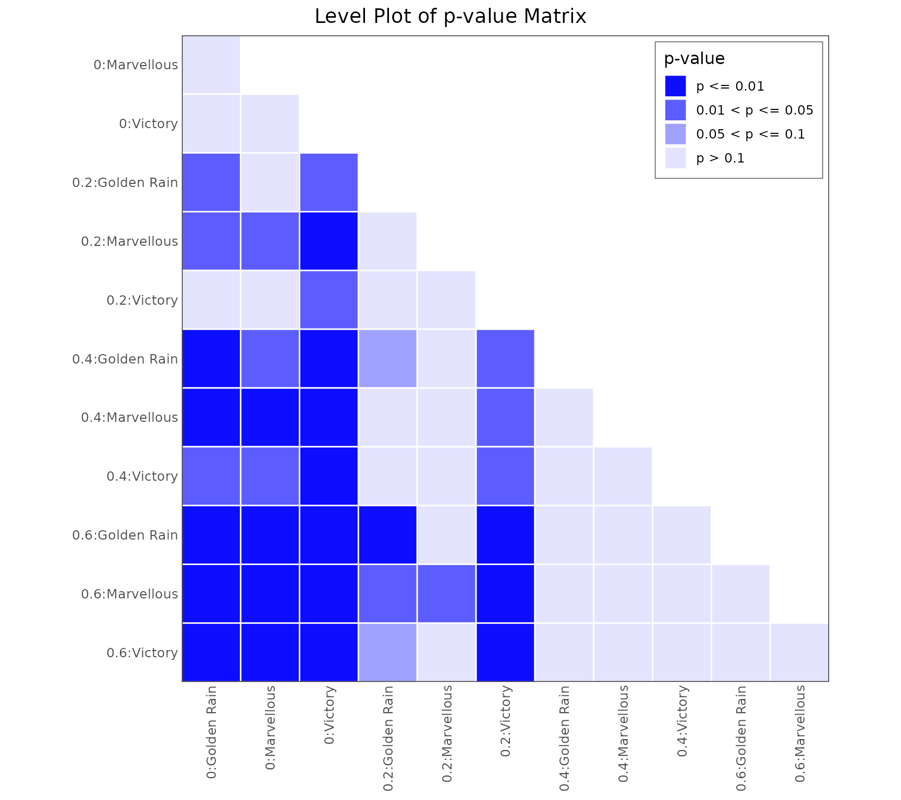

#### Highlights

Options of
[`predictmeans()`](https://dongwenluo.github.io/predictmeans/reference/predictmeans.md):

- `pairwise = TRUE` compares every pair of means with unadjusted
  p-values (`adj = "none"`, the default).

- `adj = "BH"` compares the pairs with p-values adjusted by the
  Benjamini-Hochberg method (false discovery rate); any `adj` other than
  `"none"` turns the comparisons on. `"tukey"`, `"holm"`, `"bonferroni"`
  and others are available.

- `meandecr = TRUE` sorts `mean_table` by decreasing mean, `FALSE` by
  increasing mean.

- Plots are drawn from the result: `autoplot(predm_out)` (means with one
  LSD bar), `type = "bar"`, `type = "ci"` (each mean with its confidence
  limits; `data = TRUE` adds the observations) and `type = "pvalue"`.
  `plot(predm_out)` draws the first.

- The LSD is the least significant difference at the chosen adjustment;
  when the standard errors of the differences are not all equal it is
  shown as a range.

### Permutation Test

- For Model Term
- For Multiple Comparisons
- For Contrasts

Code

``` r

# permutation tests of the model terms (999 permutations; the seed makes them repeatable)
permlme <- permmodels(model = mod, nperm = 999, seed = 3581)
permlme
```

    ## 
    ## Coefficients of (fixed) effects:
    ##                            Estimate Std. Error t value Perm_p_value
    ## (Intercept)                 80.0000     9.1070  8.7844           NA
    ## nitro0.2                    18.5000     7.6829  2.4079        0.025
    ## nitro0.4                    34.6667     7.6829  4.5122        0.001
    ## nitro0.6                    44.8333     7.6829  5.8354        0.001
    ## VarietyMarvellous            6.6667     9.7150  0.6862        0.513
    ## VarietyVictory              -8.5000     9.7150 -0.8749        0.402
    ## nitro0.2:VarietyMarvellous   3.3333    10.8653  0.3068        0.772
    ## nitro0.4:VarietyMarvellous  -4.1667    10.8653 -0.3835        0.702
    ## nitro0.6:VarietyMarvellous  -4.6667    10.8653 -0.4295        0.667
    ## nitro0.2:VarietyVictory     -0.3333    10.8653 -0.0307        0.972
    ## nitro0.4:VarietyVictory      4.6667    10.8653  0.4295        0.656
    ## nitro0.6:VarietyVictory      2.1667    10.8653  0.1994        0.827
    ## 
    ## Note: Perm_p_value of t test is obtained using '999' Freedman-Lane permutations. The smallest attainable p-value is 1/(999 + 1) = 0.001.
    ## 
    ## ANOVA:
    ## Type I F tests (Freedman-Lane permutations; the model refitted to each permuted data set)
    ##               Df F value Perm_p_value
    ## nitro          3 37.6857        0.001
    ## Variety        2  1.4853        0.265
    ## nitro:Variety  6  0.3028        0.938
    ## 
    ## Note: Perm_p_value of F test is obtained using '999' Freedman-Lane permutations. The smallest attainable p-value is 1/(999 + 1) = 0.001.

Code

``` r

# permutation p-values for the pairwise comparisons of nitrogen within each variety
predictmeans(model = mod, modelterm = "nitro:Variety", atvar = "Variety", adj = "BH", permlist = permlme)
```

    ## $`Predicted Means`
    ##       Variety Golden Rain Marvellous  Victory
    ## nitro                                        
    ## 0                 80.0000    86.6667  71.5000
    ## 0.2               98.5000   108.5000  89.6667
    ## 0.4              114.6667   117.1667 110.8333
    ## 0.6              124.8333   126.8333 118.5000
    ## 
    ## $`Standard Error of Means`
    ## All means have the same SE 
    ##                    9.10701 
    ## 
    ## $`Standard Error of Differences`
    ##  Max.SED  Min.SED Aveg.SED 
    ## 9.715020 7.682948 9.160819 
    ## attr(,"For the Same Level of Factor")
    ##            nitro  Variety
    ## Aveg.SED 9.71502 7.682948
    ## Min.SED  9.71502 7.682948
    ## Max.SED  9.71502 7.682948
    ## 
    ## $`Approximated LSD`
    ##  Max.LSD  Min.LSD Aveg.LSD 
    ## 19.43004 15.36590 18.32164 
    ## attr(,"For the Same Level of Factor")
    ##             nitro Variety
    ## Aveg.LSD 19.43004 15.3659
    ## Min.LSD  19.43004 15.3659
    ## Max.LSD  19.43004 15.3659
    ## attr(,"Note")
    ## [1] "This is a approximate LSD (i.e. 2*SED) at 0.05 level."
    ## 
    ## $`Pairwise '999' times permuted p-value (adjusted by 'BH' method)`
    ## [1] "For variable 'nitro' at each level of 'Variety'"
    ## 
    ## $`Golden Rain`
    ##     0     0.2   0.4   0.6 Group
    ## 0   1                     A    
    ## 0.2 0.042 1                B   
    ## 0.4 0.003 0.048 1           C  
    ## 0.6 0.003 0.008 0.198 1     C  
    ## 
    ## $Marvellous
    ##     0     0.2    0.4   0.6 Group
    ## 0   1                      A    
    ## 0.2 0.018 1                 B   
    ## 0.4 0.003 0.269  1          BC  
    ## 0.6 0.003 0.0345 0.269 1     C  
    ## 
    ## $Victory
    ##     0     0.2   0.4   0.6 Group
    ## 0   1                     A    
    ## 0.2 0.024 1                B   
    ## 0.4 0.002 0.015 1           C  
    ## 0.6 0.002 0.002 0.315 1     C  
    ## 
    ## $mean_table
    ## $mean_table$Table
    ##        Variety nitro     Mean      SE Df  LL(95%)  UL(95%) LetterGrp
    ## 1  Golden Rain     0  80.0000 9.10701 NA  60.7019  99.2981       A  
    ## 4  Golden Rain   0.2  98.5000 9.10701 NA  79.2019 117.7981        B 
    ## 7  Golden Rain   0.4 114.6667 9.10701 NA  95.3686 133.9647         C
    ## 10 Golden Rain   0.6 124.8333 9.10701 NA 105.5353 144.1314         C
    ## 2   Marvellous     0  86.6667 9.10701 NA  67.3686 105.9647       A  
    ## 5   Marvellous   0.2 108.5000 9.10701 NA  89.2019 127.7981        B 
    ## 8   Marvellous   0.4 117.1667 9.10701 NA  97.8686 136.4647        BC
    ## 11  Marvellous   0.6 126.8333 9.10701 NA 107.5353 146.1314         C
    ## 3      Victory     0  71.5000 9.10701 NA  52.2019  90.7981       A  
    ## 6      Victory   0.2  89.6667 9.10701 NA  70.3686 108.9647        B 
    ## 9      Victory   0.4 110.8333 9.10701 NA  91.5353 130.1314         C
    ## 12     Victory   0.6 118.5000 9.10701 NA  99.2019 137.7981         C
    ## 
    ## $mean_table$Note
    ## [1] "Letter-based representation of pairwise comparisons at significant level '0.05' at each level of Variety"

Code

``` r

# permutation p-values for two contrasts of the 12 nitro:Variety means
cm <- rbind(c(-1, 0, 1, 0, 0, 0, 0, 0, 0, 0, 0, 0),
            c(0, 0, 1, 0, 0, 0, 0, -1, 0, 0, 0, 0))
contrastmeans(model=mod, modelterm="nitro:Variety", ctrmatrix=cm, permlist=permlme)
```

    ## Contrasts of 'nitro:Variety' (95% limits; p.adj: none; 999 permutations)
    ##    contrast estimate std.error df statistic p.value p.adj conf.low conf.high
    ##  contrast 1    -8.50     9.715 NA   -0.8749   0.403 0.403   -28.92     11.92
    ##  contrast 2   -45.67     9.715 NA   -4.7006   0.001 0.001   -66.30    -25.03

## Example 2: repeated measurements (ATP data)

The ATP data come from an experiment on the effect of preserving liquids
on the enzyme content of dog hearts. Twenty-three hearts were assigned
to the combinations of two treatment factors, A and B, each with two
levels. ATP, as a percentage of the total enzyme in the heart, was
measured at one- and two-hour intervals over the twelve hours after
preservation.

### Data Info

- Structure
- Plot

Code

``` r

data(ATP, package="predictmeans")
ATP$time.v <- as.numeric(as.character(ATP$time))
str(ATP)
```

    ## 'data.frame':    230 obs. of  6 variables:
    ##  $ heart : Factor w/ 23 levels "1","2","3","4",..: 1 1 1 1 1 1 1 1 1 1 ...
    ##  $ time  : Factor w/ 10 levels "0","1","2","3",..: 1 2 3 4 5 6 7 8 9 10 ...
    ##  $ A     : Factor w/ 2 levels "1","2": 1 1 1 1 1 1 1 1 1 1 ...
    ##  $ B     : Factor w/ 2 levels "1","2": 1 1 1 1 1 1 1 1 1 1 ...
    ##  $ ATP   : num  85.5 74.6 84.2 84 78.4 ...
    ##  $ time.v: num  0 1 2 3 4 5 6 8 10 12 ...

Code

``` r

ATP %>% 
  ggplot(aes(x=time.v, y=ATP, col=A:B))+
  geom_point(size=2)+
  geom_line(linewidth=1)+
  facet_wrap(vars(heart))
```


Code

``` r

ATP %>% 
  ggplot(aes(x=time.v, y=ATP, col=A:B))+
  geom_point()+
  geom_smooth()+
  facet_grid(vars(A), vars(B))
```

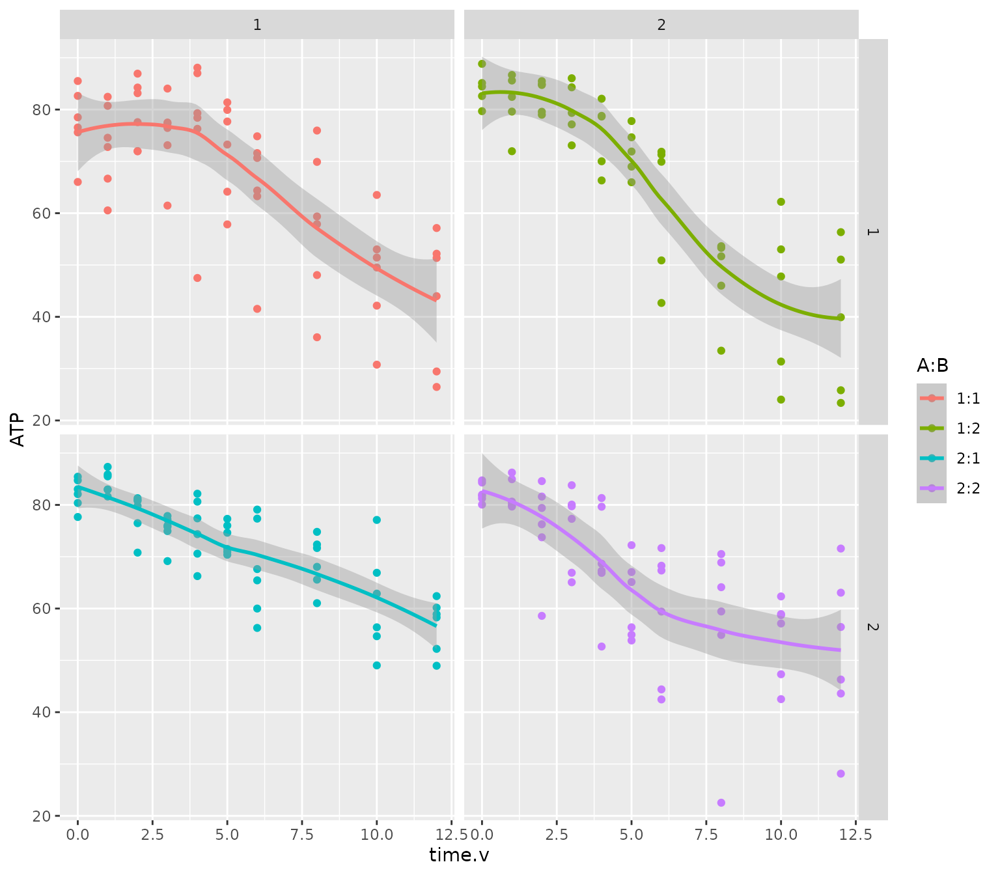

### Modelling

- Model
- Residual Plot
- Test

Code

``` r

mod <- lmer(ATP^1.5 ~ A*B*time+(1| heart), ATP)
summary(mod)
```

    ## Linear mixed model fit by REML. t-tests use Satterthwaite's method [
    ## lmerModLmerTest]
    ## Formula: ATP^1.5 ~ A * B * time + (1 | heart)
    ##    Data: ATP
    ## 
    ## REML criterion at convergence: 2343.3
    ## 
    ## Scaled residuals: 
    ##     Min      1Q  Median      3Q     Max 
    ## -3.3597 -0.5614  0.0328  0.5417  2.2817 
    ## 
    ## Random effects:
    ##  Groups   Name        Variance Std.Dev.
    ##  heart    (Intercept) 3181     56.40   
    ##  Residual             7830     88.49   
    ## Number of obs: 230, groups:  heart, 23
    ## 
    ## Fixed effects:
    ##              Estimate Std. Error       df t value Pr(>|t|)    
    ## (Intercept)   683.499     42.840  108.492  15.955  < 2e-16 ***
    ## A2             62.365     60.584  108.492   1.029  0.30559    
    ## B2             88.640     63.541  108.492   1.395  0.16587    
    ## time1         -57.830     51.088  171.000  -1.132  0.25924    
    ## time2          24.225     51.088  171.000   0.474  0.63597    
    ## time3         -32.107     51.088  171.000  -0.628  0.53053    
    ## time4         -11.443     51.088  171.000  -0.224  0.82303    
    ## time5         -64.479     51.088  171.000  -1.262  0.20862    
    ## time6        -161.028     51.088  171.000  -3.152  0.00192 ** 
    ## time8        -234.509     51.088  171.000  -4.590 8.54e-06 ***
    ## time10       -341.140     51.088  171.000  -6.678 3.27e-10 ***
    ## time12       -389.370     51.088  171.000  -7.622 1.65e-12 ***
    ## A2:B2         -87.113     87.795  108.492  -0.992  0.32329    
    ## A2:time1       87.231     72.249  171.000   1.207  0.22896    
    ## A2:time2      -75.813     72.249  171.000  -1.049  0.29551    
    ## A2:time3      -61.827     72.249  171.000  -0.856  0.39334    
    ## A2:time4      -80.532     72.249  171.000  -1.115  0.26657    
    ## A2:time5      -51.438     72.249  171.000  -0.712  0.47746    
    ## A2:time6      -25.510     72.249  171.000  -0.353  0.72446    
    ## A2:time8       61.754     72.249  171.000   0.855  0.39389    
    ## A2:time10      77.537     72.249  171.000   1.073  0.28470    
    ## A2:time12      72.968     72.249  171.000   1.010  0.31394    
    ## B2:time1       19.313     75.776  171.000   0.255  0.79913    
    ## B2:time2      -43.417     75.776  171.000  -0.573  0.56742    
    ## B2:time3      -23.798     75.776  171.000  -0.314  0.75386    
    ## B2:time4     -107.394     75.776  171.000  -1.417  0.15823    
    ## B2:time5      -97.768     75.776  171.000  -1.290  0.19871    
    ## B2:time6     -123.565     75.776  171.000  -1.631  0.10480    
    ## B2:time8     -205.764     75.776  171.000  -2.715  0.00730 ** 
    ## B2:time10    -130.902     75.776  171.000  -1.727  0.08588 .  
    ## B2:time12    -125.918     75.776  171.000  -1.662  0.09840 .  
    ## A2:B2:time1   -54.138    104.699  171.000  -0.517  0.60576    
    ## A2:B2:time2     9.391    104.699  171.000   0.090  0.92864    
    ## A2:B2:time3    28.233    104.699  171.000   0.270  0.78775    
    ## A2:B2:time4    34.318    104.699  171.000   0.328  0.74348    
    ## A2:B2:time5   -48.078    104.699  171.000  -0.459  0.64667    
    ## A2:B2:time6    21.689    104.699  171.000   0.207  0.83614    
    ## A2:B2:time8    72.676    104.699  171.000   0.694  0.48853    
    ## A2:B2:time10   51.990    104.699  171.000   0.497  0.62013    
    ## A2:B2:time12   75.359    104.699  171.000   0.720  0.47265    
    ## ---
    ## Signif. codes:  0 '***' 0.001 '**' 0.01 '*' 0.05 '.' 0.1 ' ' 1

Code

``` r

residplot(mod, group = "A")
```

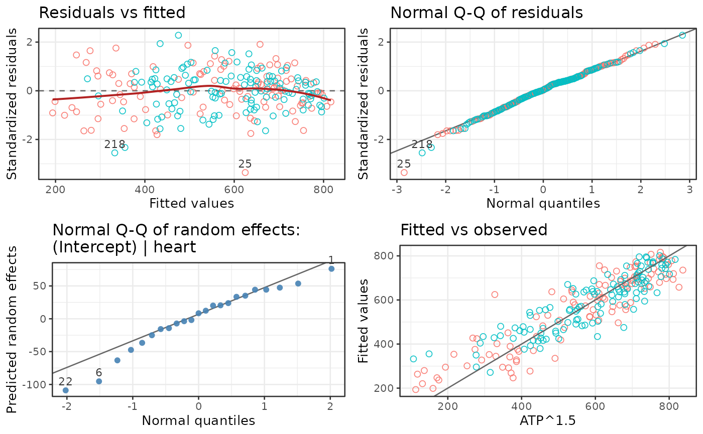

Code

``` r

# Shapiro-Wilk test of normality of the residuals
shapiro.test(resid(mod))
```

    ## 
    ##  Shapiro-Wilk normality test
    ## 
    ## data:  resid(mod)
    ## W = 0.99105, p-value = 0.1704

Code

``` r

# Bartlett and Levene tests of equal variance across the A:B groups
bartlett.test(ATP^1.5 ~ interaction(A, B), data = ATP)
```

    ## 
    ##  Bartlett test of homogeneity of variances
    ## 
    ## data:  ATP^1.5 by interaction(A, B)
    ## Bartlett's K-squared = 16.015, df = 3, p-value = 0.001126

Code

``` r

car::leveneTest(ATP^1.5 ~ A:B, data = ATP)
```

    ## Levene's Test for Homogeneity of Variance (center = median)
    ##        Df F value   Pr(>F)   
    ## group   3  4.4718 0.004506 **
    ##       226                    
    ## ---
    ## Signif. codes:  0 '***' 0.001 '**' 0.01 '*' 0.05 '.' 0.1 ' ' 1

### ANOVA and $`R^2`$

- **ANOVA**

Code

``` r

kable(anova(mod))
```

|          |      Sum Sq |    Mean Sq | NumDF | DenDF |    F value |   Pr(\>F) |
|:---------|------------:|-----------:|------:|------:|-----------:|----------:|
| A        |    9372.542 |   9372.542 |     1 |    19 |  1.1970159 | 0.2875959 |
| B        |    9666.108 |   9666.108 |     1 |    19 |  1.2345088 | 0.2803950 |
| time     | 4338231.562 | 482025.729 |     9 |   171 | 61.5620077 | 0.0000000 |
| A:B      |   13034.579 |  13034.579 |     1 |    19 |  1.6647138 | 0.2124504 |
| A:time   |  299791.243 |  33310.138 |     9 |   171 |  4.2542106 | 0.0000540 |
| B:time   |  168897.036 |  18766.337 |     9 |   171 |  2.3967463 | 0.0139325 |
| A:B:time |   25392.525 |   2821.392 |     9 |   171 |  0.3603346 | 0.9522486 |

- **$`R^2`$**

Code

``` r

R2_model(mod)
```

    ## # Adjusted R2 for mixed models (Piepho)
    ##  Total  Fixed Random  heart 
    ## 74.28% 64.23% 10.04% 10.04%

### Predicted Means

#### Predicted Means for “A:time”

- Mean Table
- Mean Plot
- Pairwise Comparisons

Code

``` r

predm_out <- predictmeans(mod, "A:time", 
                          atvar="time", adj="BH", 
                          trans=function(x) x^(1/1.5))
predm_out
```

    ## $`Predicted Means`
    ##      A        1        2
    ## time                    
    ## 0      727.8193 746.6278
    ## 1      679.6465 758.6166
    ## 2      730.3360 678.0270
    ## 3      683.8131 654.9116
    ## 4      662.6791 618.1147
    ## 5      614.4566 557.7880
    ## 6      505.0087 509.1520
    ## 8      390.4279 507.3286
    ## 10     321.2284 443.5690
    ## 12     275.4907 404.9472
    ## 
    ## $`Standard Error of Means`
    ##      A        1        2
    ## time                    
    ## 0      31.77063 30.29210
    ## 1      31.77063 30.29210
    ## 2      31.77063 30.29210
    ## 3      31.77063 30.29210
    ## 4      31.77063 30.29210
    ## 5      31.77063 30.29210
    ## 6      31.77063 30.29210
    ## 8      31.77063 30.29210
    ## 10     31.77063 30.29210
    ## 12     31.77063 30.29210
    ## 
    ## $`Standard Error of Differences`
    ##  Max.SED  Min.SED Aveg.SED 
    ## 43.89743 36.12460 40.63316 
    ## attr(,"For the Same Level of Factor")
    ##                A     time
    ## Aveg.SED 37.0062 43.89743
    ## Min.SED  36.1246 43.89743
    ## Max.SED  37.8878 43.89743
    ## 
    ## $LSD
    ##  Max.LSD  Min.LSD Aveg.LSD 
    ## 87.00785 87.00785 87.00785 
    ## attr(,"For the Same Level of Factor")
    ##                 A     time
    ## Aveg.LSD 73.04780 86.65062
    ## Min.LSD  71.30758 86.65062
    ## Max.LSD  74.78802 86.65062
    ## attr(,"Significant level")
    ## [1] 0.05
    ## attr(,"Degree of freedom")
    ## [1] 108.49
    ## attr(,"Note")
    ## [1] "These LSDs are not adjusted: 'BH' is a step-wise method and has no critical value for all pairs. Use the adjusted p-values for the comparisons."
    ## attr(,"Within levels of atvar")
    ##    by pairs  min.SED  max.SED     crit  min.LSD aveg.LSD  max.LSD
    ## 1   0     1 43.89743 43.89743 1.982072 87.00785 87.00785 87.00785
    ## 2   1     1 43.89743 43.89743 1.982072 87.00785 87.00785 87.00785
    ## 3   2     1 43.89743 43.89743 1.982072 87.00785 87.00785 87.00785
    ## 4   3     1 43.89743 43.89743 1.982072 87.00785 87.00785 87.00785
    ## 5   4     1 43.89743 43.89743 1.982072 87.00785 87.00785 87.00785
    ## 6   5     1 43.89743 43.89743 1.982072 87.00785 87.00785 87.00785
    ## 7   6     1 43.89743 43.89743 1.982072 87.00785 87.00785 87.00785
    ## 8   8     1 43.89743 43.89743 1.982072 87.00785 87.00785 87.00785
    ## 9  10     1 43.89743 43.89743 1.982072 87.00785 87.00785 87.00785
    ## 10 12     1 43.89743 43.89743 1.982072 87.00785 87.00785 87.00785
    ## attr(,"equal")
    ## [1] TRUE
    ## 
    ## $`Pairwise comparison p-value (adjusted by 'BH' method)`
    ## [1] "For variable 'A' at each level of 'time'"
    ## 
    ## $`0`
    ##   1      2 Group
    ## 1 1        A    
    ## 2 0.6692 1 A    
    ## 
    ## $`1`
    ##   1      2 Group
    ## 1 1        A    
    ## 2 0.0748 1 A    
    ## 
    ## $`2`
    ##   1     2 Group
    ## 1 1       A    
    ## 2 0.236 1 A    
    ## 
    ## $`3`
    ##   1      2 Group
    ## 1 1        A    
    ## 2 0.5117 1 A    
    ## 
    ## $`4`
    ##   1      2 Group
    ## 1 1        A    
    ## 2 0.3123 1 A    
    ## 
    ## $`5`
    ##   1      2 Group
    ## 1 1        A    
    ## 2 0.1995 1 A    
    ## 
    ## $`6`
    ##   1     2 Group
    ## 1 1       A    
    ## 2 0.925 1 A    
    ## 
    ## $`8`
    ##   1      2 Group
    ## 1 1        A    
    ## 2 0.0089 1  B   
    ## 
    ## $`10`
    ##   1      2 Group
    ## 1 1        A    
    ## 2 0.0063 1  B   
    ## 
    ## $`12`
    ##   1      2 Group
    ## 1 1        A    
    ## 2 0.0039 1  B   
    ## 
    ## $mean_table
    ## $mean_table$Table
    ##    time A     Mean       SE     Df  LL(95%)  UL(95%) Bk_Mean Bk_LL(95%)
    ## 1     0 1 727.8193 31.77063 108.49 664.8476 790.7910 80.9125    76.1754
    ## 11    0 2 746.6278 30.29210 108.49 686.5867 806.6689 82.3006    77.8270
    ## 2     1 1 679.6465 31.77063 108.49 616.6748 742.6181 77.3016    72.4498
    ## 12    1 2 758.6166 30.29210 108.49 698.5755 818.6577 83.1792    78.7304
    ## 3     2 1 730.3360 31.77063 108.49 667.3643 793.3077 81.0989    76.3675
    ## 13    2 2 678.0270 30.29210 108.49 617.9859 738.0681 77.1788    72.5525
    ## 4     3 1 683.8131 31.77063 108.49 620.8414 746.7848 77.6173    72.7758
    ## 14    3 2 654.9116 30.29210 108.49 594.8705 714.9527 75.4145    70.7318
    ## 5     4 1 662.6791 31.77063 108.49 599.7074 725.6508 76.0097    71.1147
    ## 15    4 2 618.1147 30.29210 108.49 558.0736 678.1559 72.5626    67.7841
    ## 6     5 1 614.4566 31.77063 108.49 551.4849 677.4282 72.2760    67.2495
    ## 16    5 2 557.7880 30.29210 108.49 497.7469 617.8292 67.7609    62.8067
    ## 7     6 1 505.0087 31.77063 108.49 442.0370 567.9804 63.4161    58.0282
    ## 17    6 2 509.1520 30.29210 108.49 449.1108 569.1931 63.7624    58.6456
    ## 8     8 1 390.4279 31.77063 108.49 327.4562 453.3996 53.4188    47.5082
    ## 18    8 2 507.3286 30.29210 108.49 447.2875 567.3697 63.6101    58.4868
    ## 9    10 1 321.2284 31.77063 108.49 258.2568 384.2001 46.9039    40.5541
    ## 19   10 2 443.5690 30.29210 108.49 383.5278 503.6101 58.1622    52.7875
    ## 10   12 1 275.4907 31.77063 108.49 212.5190 338.4623 42.3387    35.6122
    ## 20   12 2 404.9472 30.29210 108.49 344.9061 464.9884 54.7351    49.1814
    ##    Bk_UL(95%) LetterGrp
    ## 1     85.5148         A
    ## 11    86.6557         A
    ## 2     82.0056         A
    ## 12    87.5121         A
    ## 3     85.6961         A
    ## 13    81.6703         A
    ## 4     82.3121         A
    ## 14    79.9561         A
    ## 5     80.7517         A
    ## 15    77.1886         A
    ## 6     77.1333         A
    ## 16    72.5402         A
    ## 7     68.5839         A
    ## 17    68.6815         A
    ## 8     59.0184        A 
    ## 18    68.5347         B
    ## 9     52.8492        A 
    ## 19    63.2989         B
    ## 10    48.5669        A 
    ## 20    60.0198         B
    ## 
    ## $mean_table$Note
    ## [1] "Letter-based representation of pairwise comparisons at significant level '0.05' at each level of time"

Code

``` r

gt(predm_out$mean_table$Table, 
   caption = "Within each time, means sharing a letter are not significantly different (BH-adjusted p-values, 5% level)")
```

| time | A | Mean | SE | Df | LL(95%) | UL(95%) | Bk_Mean | Bk_LL(95%) | Bk_UL(95%) | LetterGrp |
|----|----|----|----|----|----|----|----|----|----|----|
| 0 | 1 | 727.8193 | 31.77063 | 108.49 | 664.8476 | 790.7910 | 80.9125 | 76.1754 | 85.5148 | A |
| 0 | 2 | 746.6278 | 30.29210 | 108.49 | 686.5867 | 806.6689 | 82.3006 | 77.8270 | 86.6557 | A |
| 1 | 1 | 679.6465 | 31.77063 | 108.49 | 616.6748 | 742.6181 | 77.3016 | 72.4498 | 82.0056 | A |
| 1 | 2 | 758.6166 | 30.29210 | 108.49 | 698.5755 | 818.6577 | 83.1792 | 78.7304 | 87.5121 | A |
| 2 | 1 | 730.3360 | 31.77063 | 108.49 | 667.3643 | 793.3077 | 81.0989 | 76.3675 | 85.6961 | A |
| 2 | 2 | 678.0270 | 30.29210 | 108.49 | 617.9859 | 738.0681 | 77.1788 | 72.5525 | 81.6703 | A |
| 3 | 1 | 683.8131 | 31.77063 | 108.49 | 620.8414 | 746.7848 | 77.6173 | 72.7758 | 82.3121 | A |
| 3 | 2 | 654.9116 | 30.29210 | 108.49 | 594.8705 | 714.9527 | 75.4145 | 70.7318 | 79.9561 | A |
| 4 | 1 | 662.6791 | 31.77063 | 108.49 | 599.7074 | 725.6508 | 76.0097 | 71.1147 | 80.7517 | A |
| 4 | 2 | 618.1147 | 30.29210 | 108.49 | 558.0736 | 678.1559 | 72.5626 | 67.7841 | 77.1886 | A |
| 5 | 1 | 614.4566 | 31.77063 | 108.49 | 551.4849 | 677.4282 | 72.2760 | 67.2495 | 77.1333 | A |
| 5 | 2 | 557.7880 | 30.29210 | 108.49 | 497.7469 | 617.8292 | 67.7609 | 62.8067 | 72.5402 | A |
| 6 | 1 | 505.0087 | 31.77063 | 108.49 | 442.0370 | 567.9804 | 63.4161 | 58.0282 | 68.5839 | A |
| 6 | 2 | 509.1520 | 30.29210 | 108.49 | 449.1108 | 569.1931 | 63.7624 | 58.6456 | 68.6815 | A |
| 8 | 1 | 390.4279 | 31.77063 | 108.49 | 327.4562 | 453.3996 | 53.4188 | 47.5082 | 59.0184 | A |
| 8 | 2 | 507.3286 | 30.29210 | 108.49 | 447.2875 | 567.3697 | 63.6101 | 58.4868 | 68.5347 | B |
| 10 | 1 | 321.2284 | 31.77063 | 108.49 | 258.2568 | 384.2001 | 46.9039 | 40.5541 | 52.8492 | A |
| 10 | 2 | 443.5690 | 30.29210 | 108.49 | 383.5278 | 503.6101 | 58.1622 | 52.7875 | 63.2989 | B |
| 12 | 1 | 275.4907 | 31.77063 | 108.49 | 212.5190 | 338.4623 | 42.3387 | 35.6122 | 48.5669 | A |
| 12 | 2 | 404.9472 | 30.29210 | 108.49 | 344.9061 | 464.9884 | 54.7351 | 49.1814 | 60.0198 | B |

Within each time, means sharing a letter are not significantly different
(BH-adjusted p-values, 5% level) {.table .gt_table
quarto-disable-processing="false" quarto-bootstrap="false"}

Code

``` r

autoplot(predm_out)
```

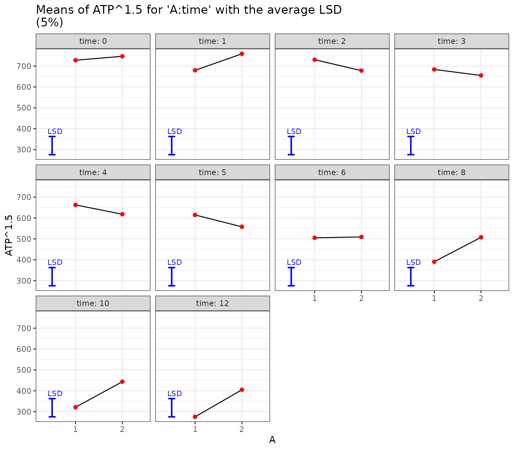

Code

``` r

autoplot(predm_out, type = "ci", data = TRUE)
```

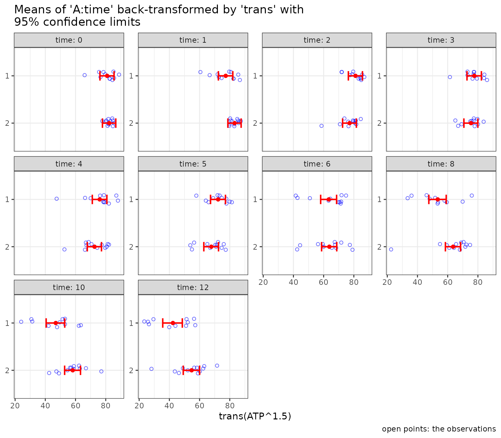

Code

``` r

autoplot(predm_out, type = "bar")
```

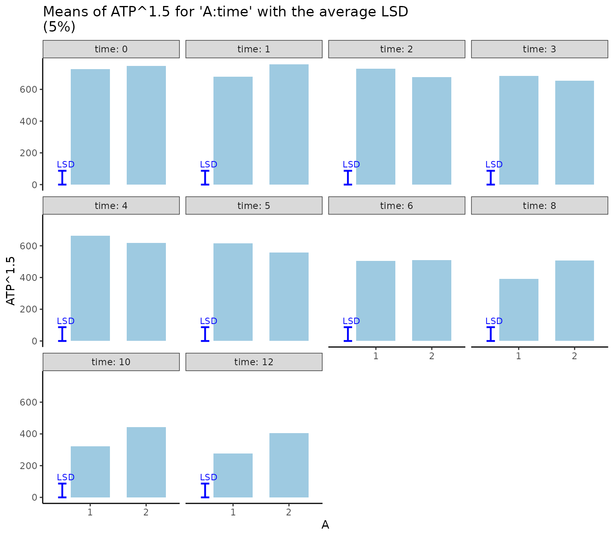

The pairwise comparisons within each time, one row per pair (`by` is the
time; `p.adj` is BH-adjusted within each time):

Code

``` r

as.data.frame(predm_out, what = "pairs") %>%
  select(by, level1, level2, estimate, std.error, df, p.value, p.adj) %>%
  mutate(across(where(is.numeric), ~ round(.x, 4))) %>%
  DT_df()
```

#### Predicted Means for “B:time”

- Mean Table
- Mean Plot
- Pairwise Comparisons

Code

``` r

predm_out <- predictmeans(mod, "B:time", 
                          atvar="time", adj="BH", 
                          trans=function(x) x^(1/1.5))
predm_out
```

    ## $`Predicted Means`
    ##      B        1        2
    ## time                    
    ## 0      714.6817 759.7654
    ## 1      700.4676 737.7955
    ## 2      701.0004 707.3625
    ## 3      651.6610 687.0637
    ## 4      662.9725 617.8213
    ## 5      624.4836 547.7609
    ## 6      540.8985 473.2621
    ## 8      511.0495 386.7070
    ## 10     412.3104 352.4870
    ## 12     361.7963 318.6416
    ## 
    ## $`Standard Error of Means`
    ##      B        1        2
    ## time                    
    ## 0      30.29210 31.77063
    ## 1      30.29210 31.77063
    ## 2      30.29210 31.77063
    ## 3      30.29210 31.77063
    ## 4      30.29210 31.77063
    ## 5      30.29210 31.77063
    ## 6      30.29210 31.77063
    ## 8      30.29210 31.77063
    ## 10     30.29210 31.77063
    ## 12     30.29210 31.77063
    ## 
    ## $`Standard Error of Differences`
    ##  Max.SED  Min.SED Aveg.SED 
    ## 43.89743 36.12460 40.63316 
    ## attr(,"For the Same Level of Factor")
    ##                B     time
    ## Aveg.SED 37.0062 43.89743
    ## Min.SED  36.1246 43.89743
    ## Max.SED  37.8878 43.89743
    ## 
    ## $LSD
    ##  Max.LSD  Min.LSD Aveg.LSD 
    ## 87.00785 87.00785 87.00785 
    ## attr(,"For the Same Level of Factor")
    ##                 B     time
    ## Aveg.LSD 73.04780 86.65062
    ## Min.LSD  71.30758 86.65062
    ## Max.LSD  74.78802 86.65062
    ## attr(,"Significant level")
    ## [1] 0.05
    ## attr(,"Degree of freedom")
    ## [1] 108.49
    ## attr(,"Note")
    ## [1] "These LSDs are not adjusted: 'BH' is a step-wise method and has no critical value for all pairs. Use the adjusted p-values for the comparisons."
    ## attr(,"Within levels of atvar")
    ##    by pairs  min.SED  max.SED     crit  min.LSD aveg.LSD  max.LSD
    ## 1   0     1 43.89743 43.89743 1.982072 87.00785 87.00785 87.00785
    ## 2   1     1 43.89743 43.89743 1.982072 87.00785 87.00785 87.00785
    ## 3   2     1 43.89743 43.89743 1.982072 87.00785 87.00785 87.00785
    ## 4   3     1 43.89743 43.89743 1.982072 87.00785 87.00785 87.00785
    ## 5   4     1 43.89743 43.89743 1.982072 87.00785 87.00785 87.00785
    ## 6   5     1 43.89743 43.89743 1.982072 87.00785 87.00785 87.00785
    ## 7   6     1 43.89743 43.89743 1.982072 87.00785 87.00785 87.00785
    ## 8   8     1 43.89743 43.89743 1.982072 87.00785 87.00785 87.00785
    ## 9  10     1 43.89743 43.89743 1.982072 87.00785 87.00785 87.00785
    ## 10 12     1 43.89743 43.89743 1.982072 87.00785 87.00785 87.00785
    ## attr(,"equal")
    ## [1] TRUE
    ## 
    ## $`Pairwise comparison p-value (adjusted by 'BH' method)`
    ## [1] "For variable 'B' at each level of 'time'"
    ## 
    ## $`0`
    ##   1      2 Group
    ## 1 1        A    
    ## 2 0.3067 1 A    
    ## 
    ## $`1`
    ##   1     2 Group
    ## 1 1       A    
    ## 2 0.397 1 A    
    ## 
    ## $`2`
    ##   1     2 Group
    ## 1 1       A    
    ## 2 0.885 1 A    
    ## 
    ## $`3`
    ##   1      2 Group
    ## 1 1        A    
    ## 2 0.4217 1 A    
    ## 
    ## $`4`
    ##   1     2 Group
    ## 1 1       A    
    ## 2 0.306 1 A    
    ## 
    ## $`5`
    ##   1      2 Group
    ## 1 1        A    
    ## 2 0.0833 1 A    
    ## 
    ## $`6`
    ##   1      2 Group
    ## 1 1        A    
    ## 2 0.1263 1 A    
    ## 
    ## $`8`
    ##   1      2 Group
    ## 1 1        A    
    ## 2 0.0055 1  B   
    ## 
    ## $`10`
    ##   1      2 Group
    ## 1 1        A    
    ## 2 0.1758 1 A    
    ## 
    ## $`12`
    ##   1      2 Group
    ## 1 1        A    
    ## 2 0.3278 1 A    
    ## 
    ## $mean_table
    ## $mean_table$Table
    ##    time B     Mean       SE     Df  LL(95%)  UL(95%) Bk_Mean Bk_LL(95%)
    ## 1     0 1 714.6817 30.29210 108.49 654.6406 774.7228 79.9359    75.3937
    ## 11    0 2 759.7654 31.77063 108.49 696.7938 822.7371 83.2632    78.5964
    ## 2     1 1 700.4676 30.29210 108.49 640.4265 760.5087 78.8725    74.2984
    ## 12    1 2 737.7955 31.77063 108.49 674.8238 800.7672 81.6502    76.9355
    ## 3     2 1 701.0004 30.29210 108.49 640.9593 761.0416 78.9124    74.3396
    ## 13    2 2 707.3625 31.77063 108.49 644.3909 770.3342 79.3892    74.6047
    ## 4     3 1 651.6610 30.29210 108.49 591.6199 711.7022 75.1648    70.4739
    ## 14    3 2 687.0637 31.77063 108.49 624.0920 750.0353 77.8630    73.0296
    ## 5     4 1 662.9725 30.29210 108.49 602.9314 723.0137 76.0321    71.3694
    ## 15    4 2 617.8213 31.77063 108.49 554.8497 680.7930 72.5396    67.5228
    ## 6     5 1 624.4836 30.29210 108.49 564.4425 684.5248 73.0602    68.2988
    ## 16    5 2 547.7609 31.77063 108.49 484.7893 610.7326 66.9464    61.7119
    ## 7     6 1 540.8985 30.29210 108.49 480.8574 600.9396 66.3861    61.3777
    ## 17    6 2 473.2621 31.77063 108.49 410.2905 536.2338 60.7297    55.2155
    ## 8     8 1 511.0495 30.29210 108.49 451.0084 571.0907 63.9208    58.8107
    ## 18    8 2 386.7070 31.77063 108.49 323.7353 449.6787 53.0788    47.1477
    ## 9    10 1 412.3104 30.29210 108.49 352.2692 472.3515 55.3966    49.8789
    ## 19   10 2 352.4870 31.77063 108.49 289.5154 415.4587 49.8994    43.7637
    ## 10   12 1 361.7963 30.29210 108.49 301.7552 421.8375 50.7742    44.9887
    ## 20   12 2 318.6416 31.77063 108.49 255.6699 381.6132 46.6518    40.2828
    ##    Bk_UL(95%) LetterGrp
    ## 1     84.3524         A
    ## 11    87.8026         A
    ## 2     83.3175         A
    ## 12    86.2325         A
    ## 3     83.3564         A
    ## 13    84.0336         A
    ## 4     79.7136         A
    ## 14    82.5508         A
    ## 5     80.5560         A
    ## 15    77.3886         A
    ## 6     77.6711         A
    ## 16    71.9837         A
    ## 7     71.2121         A
    ## 17    66.0039         A
    ## 8     68.8341        A 
    ## 18    58.6951         B
    ## 9     60.6518         A
    ## 19    55.6782         A
    ## 10    56.2467         A
    ## 20    52.6117         A
    ## 
    ## $mean_table$Note
    ## [1] "Letter-based representation of pairwise comparisons at significant level '0.05' at each level of time"

Code

``` r

gt(predm_out$mean_table$Table, 
   caption = "Within each time, means sharing a letter are not significantly different (BH-adjusted p-values, 5% level)")
```

| time | B | Mean | SE | Df | LL(95%) | UL(95%) | Bk_Mean | Bk_LL(95%) | Bk_UL(95%) | LetterGrp |
|----|----|----|----|----|----|----|----|----|----|----|
| 0 | 1 | 714.6817 | 30.29210 | 108.49 | 654.6406 | 774.7228 | 79.9359 | 75.3937 | 84.3524 | A |
| 0 | 2 | 759.7654 | 31.77063 | 108.49 | 696.7938 | 822.7371 | 83.2632 | 78.5964 | 87.8026 | A |
| 1 | 1 | 700.4676 | 30.29210 | 108.49 | 640.4265 | 760.5087 | 78.8725 | 74.2984 | 83.3175 | A |
| 1 | 2 | 737.7955 | 31.77063 | 108.49 | 674.8238 | 800.7672 | 81.6502 | 76.9355 | 86.2325 | A |
| 2 | 1 | 701.0004 | 30.29210 | 108.49 | 640.9593 | 761.0416 | 78.9124 | 74.3396 | 83.3564 | A |
| 2 | 2 | 707.3625 | 31.77063 | 108.49 | 644.3909 | 770.3342 | 79.3892 | 74.6047 | 84.0336 | A |
| 3 | 1 | 651.6610 | 30.29210 | 108.49 | 591.6199 | 711.7022 | 75.1648 | 70.4739 | 79.7136 | A |
| 3 | 2 | 687.0637 | 31.77063 | 108.49 | 624.0920 | 750.0353 | 77.8630 | 73.0296 | 82.5508 | A |
| 4 | 1 | 662.9725 | 30.29210 | 108.49 | 602.9314 | 723.0137 | 76.0321 | 71.3694 | 80.5560 | A |
| 4 | 2 | 617.8213 | 31.77063 | 108.49 | 554.8497 | 680.7930 | 72.5396 | 67.5228 | 77.3886 | A |
| 5 | 1 | 624.4836 | 30.29210 | 108.49 | 564.4425 | 684.5248 | 73.0602 | 68.2988 | 77.6711 | A |
| 5 | 2 | 547.7609 | 31.77063 | 108.49 | 484.7893 | 610.7326 | 66.9464 | 61.7119 | 71.9837 | A |
| 6 | 1 | 540.8985 | 30.29210 | 108.49 | 480.8574 | 600.9396 | 66.3861 | 61.3777 | 71.2121 | A |
| 6 | 2 | 473.2621 | 31.77063 | 108.49 | 410.2905 | 536.2338 | 60.7297 | 55.2155 | 66.0039 | A |
| 8 | 1 | 511.0495 | 30.29210 | 108.49 | 451.0084 | 571.0907 | 63.9208 | 58.8107 | 68.8341 | A |
| 8 | 2 | 386.7070 | 31.77063 | 108.49 | 323.7353 | 449.6787 | 53.0788 | 47.1477 | 58.6951 | B |
| 10 | 1 | 412.3104 | 30.29210 | 108.49 | 352.2692 | 472.3515 | 55.3966 | 49.8789 | 60.6518 | A |
| 10 | 2 | 352.4870 | 31.77063 | 108.49 | 289.5154 | 415.4587 | 49.8994 | 43.7637 | 55.6782 | A |
| 12 | 1 | 361.7963 | 30.29210 | 108.49 | 301.7552 | 421.8375 | 50.7742 | 44.9887 | 56.2467 | A |
| 12 | 2 | 318.6416 | 31.77063 | 108.49 | 255.6699 | 381.6132 | 46.6518 | 40.2828 | 52.6117 | A |

Within each time, means sharing a letter are not significantly different
(BH-adjusted p-values, 5% level) {.table .gt_table
quarto-disable-processing="false" quarto-bootstrap="false"}

Code

``` r

autoplot(predm_out)
```

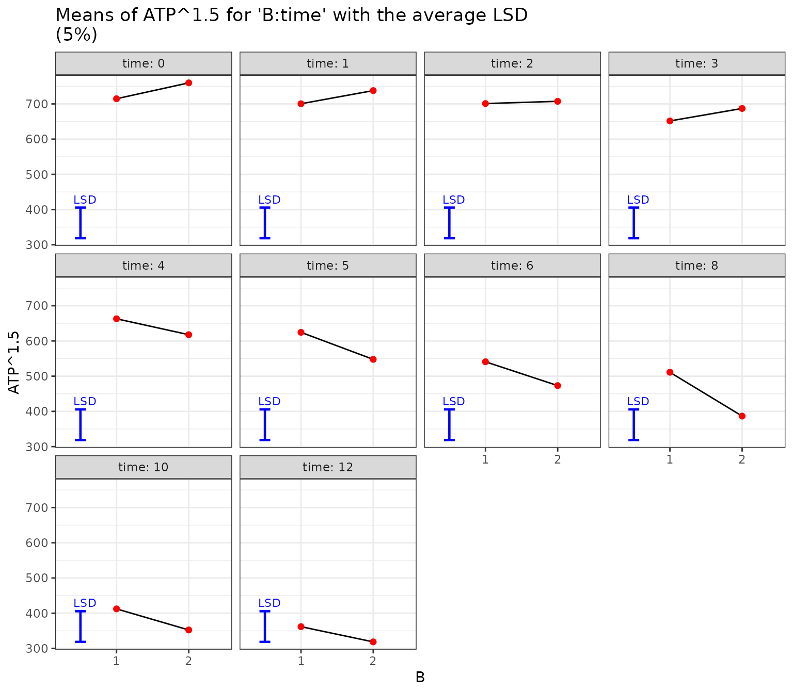

Code

``` r

autoplot(predm_out, type = "ci", data = TRUE)
```

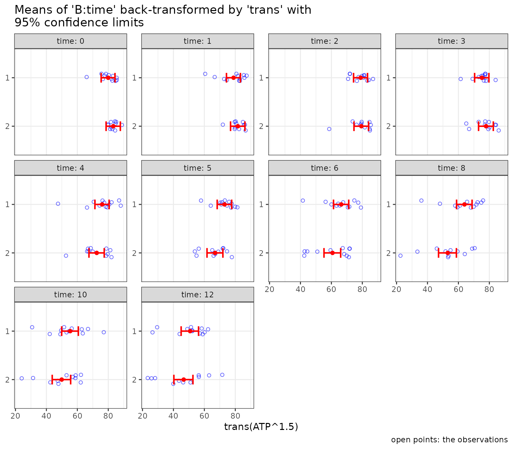

Code

``` r

autoplot(predm_out, type = "bar")
```

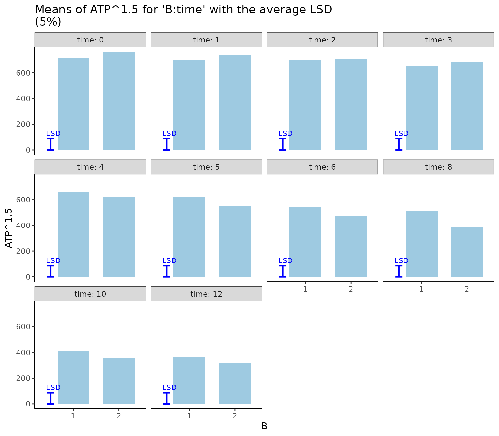

The pairwise comparisons within each time, one row per pair (`by` is the
time; `p.adj` is BH-adjusted within each time):

Code

``` r

as.data.frame(predm_out, what = "pairs") %>%
  select(by, level1, level2, estimate, std.error, df, p.value, p.adj) %>%
  mutate(across(where(is.numeric), ~ round(.x, 4))) %>%
  DT_df()
```

#### Predicted Means for “A:B:time”

- Mean Table
- Mean Plot
- Pairwise Comparisons
- p-value Plot

Code

``` r

predm_out <- predictmeans(mod, "A:B:time", 
                          atvar="time", adj="BH", 
                          trans=function(x) x^(1/1.5))
predm_out
```

    ## $`Predicted Means`
    ##      A        1                 2         
    ##      B        1        2        1        2
    ## time                                      
    ## 0      683.4993 772.1393 745.8641 747.3915
    ## 1      625.6698 733.6232 775.2654 741.9678
    ## 2      707.7245 752.9475 694.2764 661.7776
    ## 3      651.3920 716.2343 651.9301 657.8931
    ## 4      672.0561 653.3022 653.8890 582.3405
    ## 5      619.0203 609.8928 629.9470 485.6291
    ## 6      522.4710 487.5464 559.3260 458.9779
    ## 8      448.9900 331.8658 573.1090 441.5482
    ## 10     342.3595 300.0973 482.2612 404.8767
    ## 12     294.1297 256.8516 429.4629 380.4315
    ## 
    ## $`Standard Error of Means`
    ##      A        1                 2         
    ##      B        1        2        1        2
    ## time                                      
    ## 0      42.83950 46.92832 42.83950 42.83950
    ## 1      42.83950 46.92832 42.83950 42.83950
    ## 2      42.83950 46.92832 42.83950 42.83950
    ## 3      42.83950 46.92832 42.83950 42.83950
    ## 4      42.83950 46.92832 42.83950 42.83950
    ## 5      42.83950 46.92832 42.83950 42.83950
    ## 6      42.83950 46.92832 42.83950 42.83950
    ## 8      42.83950 46.92832 42.83950 42.83950
    ## 10     42.83950 46.92832 42.83950 42.83950
    ## 12     42.83950 46.92832 42.83950 42.83950
    ## 
    ## $`Standard Error of Differences`
    ##  Max.SED  Min.SED Aveg.SED 
    ## 63.54125 51.08791 59.81139 
    ## attr(,"For the Same Level of Factor")
    ##                 A        B     time
    ## Aveg.SED 57.44156 57.44156 62.06273
    ## Min.SED  51.08791 51.08791 60.58421
    ## Max.SED  63.54125 63.54125 63.54125
    ## 
    ## $LSD
    ##  Max.LSD  Min.LSD Aveg.LSD 
    ## 125.9433 120.0822 123.0128 
    ## attr(,"For the Same Level of Factor")
    ##                 A        B     time
    ## Aveg.LSD 113.3859 113.3859 122.5077
    ## Min.LSD  100.8441 100.8441 119.5892
    ## Max.LSD  125.4262 125.4262 125.4262
    ## attr(,"Significant level")
    ## [1] 0.05
    ## attr(,"Degree of freedom")
    ## [1] 108.49
    ## attr(,"Note")
    ## [1] "These LSDs are not adjusted: 'BH' is a step-wise method and has no critical value for all pairs. Use the adjusted p-values for the comparisons. The LSDs differ between pairs (120.1 to 125.9): no single LSD tests every pair; use the p-values, or each pair's LSD (pairs$lsd)."
    ## attr(,"Within levels of atvar")
    ##    by pairs  min.SED  max.SED     crit  min.LSD aveg.LSD  max.LSD
    ## 1   0     6 60.58421 63.54125 1.982072 120.0822 123.0128 125.9433
    ## 2   1     6 60.58421 63.54125 1.982072 120.0822 123.0128 125.9433
    ## 3   2     6 60.58421 63.54125 1.982072 120.0822 123.0128 125.9433
    ## 4   3     6 60.58421 63.54125 1.982072 120.0822 123.0128 125.9433
    ## 5   4     6 60.58421 63.54125 1.982072 120.0822 123.0128 125.9433
    ## 6   5     6 60.58421 63.54125 1.982072 120.0822 123.0128 125.9433
    ## 7   6     6 60.58421 63.54125 1.982072 120.0822 123.0128 125.9433
    ## 8   8     6 60.58421 63.54125 1.982072 120.0822 123.0128 125.9433
    ## 9  10     6 60.58421 63.54125 1.982072 120.0822 123.0128 125.9433
    ## 10 12     6 60.58421 63.54125 1.982072 120.0822 123.0128 125.9433
    ## attr(,"equal")
    ## [1] FALSE
    ## 
    ## $`Pairwise comparison p-value (adjusted by 'BH' method)`
    ## [1] "For variable 'A and B' at each level of 'time'"
    ## 
    ## $`0`
    ##       1 : 1  1 : 2  2 : 1  2 : 2 Group
    ## 1 : 1 1                          A    
    ## 1 : 2 0.6112 1                   A    
    ## 2 : 1 0.6112 0.8372 1            A    
    ## 2 : 2 0.6112 0.8372 0.9799 1     A    
    ## 
    ## $`1`
    ##       1 : 1  1 : 2  2 : 1  2 : 2 Group
    ## 1 : 1 1                          A    
    ## 1 : 2 0.1844 1                   A    
    ## 2 : 1 0.0906 0.7005 1            A    
    ## 2 : 2 0.1726 0.8958 0.7005 1     A    
    ## 
    ## $`2`
    ##       1 : 1  1 : 2  2 : 1  2 : 2 Group
    ## 1 : 1 1                          A    
    ## 1 : 2 0.7113 1                   A    
    ## 2 : 1 0.8248 0.7113 1            A    
    ## 2 : 2 0.7113 0.7113 0.7113 1     A    
    ## 
    ## $`3`
    ##       1 : 1  1 : 2  2 : 1  2 : 2 Group
    ## 1 : 1 1                          A    
    ## 1 : 2 0.7211 1                   A    
    ## 2 : 1 0.9929 0.7211 1            A    
    ## 2 : 2 0.9929 0.7211 0.9929 1     A    
    ## 
    ## $`4`
    ##       1 : 1  1 : 2  2 : 1  2 : 2 Group
    ## 1 : 1 1                          A    
    ## 1 : 2 0.9221 1                   A    
    ## 2 : 1 0.9221 0.9926 1            A    
    ## 2 : 2 0.5331 0.5331 0.5331 1     A    
    ## 
    ## $`5`
    ##       1 : 1  1 : 2  2 : 1  2 : 2 Group
    ## 1 : 1 1                          A    
    ## 1 : 2 0.886  1                   A    
    ## 2 : 1 0.886  0.886  1            A    
    ## 2 : 2 0.0894 0.1062 0.0894 1     A    
    ## 
    ## $`6`
    ##       1 : 1  1 : 2  2 : 1  2 : 2 Group
    ## 1 : 1 1                          A    
    ## 1 : 2 0.6539 1                   A    
    ## 2 : 1 0.6539 0.5939 1            A    
    ## 2 : 2 0.5939 0.6539 0.5939 1     A    
    ## 
    ## $`8`
    ##       1 : 1  1 : 2  2 : 1  2 : 2 Group
    ## 1 : 1 1                          AB   
    ## 1 : 2 0.102  1                   A    
    ## 2 : 1 0.0858 0.0015 1             B   
    ## 2 : 2 0.9025 0.1046 0.0858 1     AB   
    ## 
    ## $`10`
    ##       1 : 1  1 : 2  2 : 1  2 : 2 Group
    ## 1 : 1 1                          AB   
    ## 1 : 2 0.5074 1                   A    
    ## 2 : 1 0.0685 0.0299 1             B   
    ## 2 : 2 0.3653 0.2041 0.3063 1     AB   
    ## 
    ## $`12`
    ##       1 : 1  1 : 2  2 : 1  2 : 2 Group
    ## 1 : 1 1                          AB   
    ## 1 : 2 0.5586 1                   A    
    ## 2 : 1 0.0826 0.0461 1             B   
    ## 2 : 2 0.2358 0.1088 0.5041 1     AB   
    ## 
    ## $mean_table
    ## $mean_table$Table
    ##    time A B     Mean       SE     Df  LL(95%)  UL(95%) Bk_Mean Bk_LL(95%)
    ## 1     0 1 1 683.4993 42.83950 108.49 598.5883 768.4103 77.5935    71.0262
    ## 11    0 1 2 772.1393 46.92832 108.49 679.1240 865.1546 84.1648    77.2620
    ## 21    0 2 1 745.8641 42.83950 108.49 660.9531 830.7751 82.2444    75.8776
    ## 31    0 2 2 747.3915 42.83950 108.49 662.4805 832.3025 82.3567    75.9945
    ## 2     1 1 1 625.6698 42.83950 108.49 540.7588 710.5808 73.1527    66.3747
    ## 12    1 1 2 733.6232 46.92832 108.49 640.6079 826.6385 81.3421    74.3124
    ## 22    1 2 1 775.2654 42.83950 108.49 690.3544 860.1764 84.3918    78.1115
    ## 32    1 2 2 741.9678 42.83950 108.49 657.0568 826.8788 81.9578    75.5791
    ## 3     2 1 1 707.7245 42.83950 108.49 622.8135 792.6355 79.4163    72.9299
    ## 13    2 1 2 752.9475 46.92832 108.49 659.9322 845.9628 82.7643    75.7995
    ## 23    2 2 1 694.2764 42.83950 108.49 609.3654 779.1874 78.4070    71.8762
    ## 33    2 2 2 661.7776 42.83950 108.49 576.8666 746.6886 75.9407    69.2974
    ## 4     3 1 1 651.3920 42.83950 108.49 566.4810 736.3029 75.1441    68.4632
    ## 14    3 1 2 716.2343 46.92832 108.49 623.2190 809.2496 80.0516    72.9615
    ## 24    3 2 1 651.9301 42.83950 108.49 567.0192 736.8411 75.1855    68.5065
    ## 34    3 2 2 657.8931 42.83950 108.49 572.9821 742.8040 75.6433    68.9860
    ## 5     4 1 1 672.0561 42.83950 108.49 587.1451 756.9671 76.7250    70.1181
    ## 15    4 1 2 653.3022 46.92832 108.49 560.2868 746.3175 75.2909    67.9632
    ## 25    4 2 1 653.8890 42.83950 108.49 568.9780 738.7999 75.3360    68.6642
    ## 35    4 2 2 582.3405 42.83950 108.49 497.4295 667.2515 69.7351    62.7800
    ## 6     5 1 1 619.0203 42.83950 108.49 534.1093 703.9313 72.6334    65.8294
    ## 16    5 1 2 609.8928 46.92832 108.49 516.8775 702.9081 71.9177    64.4058
    ## 26    5 2 1 629.9470 42.83950 108.49 545.0360 714.8580 73.4857    66.7242
    ## 36    5 2 2 485.6291 42.83950 108.49 400.7181 570.5401 61.7831    54.3533
    ## 7     6 1 1 522.4710 42.83950 108.49 437.5600 607.3819 64.8696    57.6357
    ## 17    6 1 2 487.5464 46.92832 108.49 394.5311 580.5617 61.9456    53.7924
    ## 27    6 2 1 559.3260 42.83950 108.49 474.4151 644.2370 67.8854    60.8283
    ## 37    6 2 2 458.9779 42.83950 108.49 374.0669 543.8888 59.5015    51.9158
    ## 8     8 1 1 448.9900 42.83950 108.49 364.0791 533.9010 58.6351    50.9875
    ## 18    8 1 2 331.8658 46.92832 108.49 238.8504 424.8811 47.9338    38.4962
    ## 28    8 2 1 573.1090 42.83950 108.49 488.1980 658.0200 68.9961    62.0008
    ## 38    8 2 2 441.5482 42.83950 108.49 356.6372 526.4592 57.9854    50.2903
    ## 9    10 1 1 342.3595 42.83950 108.49 257.4486 427.2705 48.9390    40.4694
    ## 19   10 1 2 300.0973 46.92832 108.49 207.0820 393.1126 44.8237    35.0022
    ## 29   10 2 1 482.2612 42.83950 108.49 397.3502 567.1722 61.4971    54.0483
    ## 39   10 2 2 404.8767 42.83950 108.49 319.9657 489.7877 54.7287    46.7809
    ## 10   12 1 1 294.1297 42.83950 108.49 209.2187 379.0407 44.2275    35.2425
    ## 20   12 1 2 256.8516 46.92832 108.49 163.8363 349.8669 40.4068    29.9415
    ## 30   12 2 1 429.4629 42.83950 108.49 344.5520 514.3739 56.9225    49.1477
    ## 40   12 2 2 380.4315 42.83950 108.49 295.5205 465.3425 52.5030    44.3668
    ##    Bk_UL(95%) LetterGrp
    ## 1     83.8936         A
    ## 11    90.7951         A
    ## 21    88.3736         A
    ## 31    88.4818         A
    ## 2     79.6298         A
    ## 12    88.0800         A
    ## 22    90.4465         A
    ## 32    88.0970         A
    ## 3     85.6477         A
    ## 13    89.4474         A
    ## 23    84.6762         A
    ## 33    82.3050         A
    ## 4     81.5401         A
    ## 14    86.8404         A
    ## 24    81.5798         A
    ## 34    82.0193         A
    ## 5     83.0586         A
    ## 15    82.2777         A
    ## 25    81.7243         A
    ## 35    76.3589         A
    ## 6     79.1323         A
    ## 16    79.0556         A
    ## 26    79.9490         A
    ## 36    68.7898         A
    ## 7     71.7202         A
    ## 17    69.5930         A
    ## 27    74.5928         A
    ## 37    66.6306         A
    ## 8     65.8123        AB
    ## 18    56.5169        A 
    ## 28    75.6530         B
    ## 38    65.1993        AB
    ## 9     56.7286        AB
    ## 19    53.6634        A 
    ## 29    68.5188         B
    ## 39    62.1353        AB
    ## 10    52.3750        AB
    ## 20    49.6518        A 
    ## 30    64.1977         B
    ## 40    60.0503        AB
    ## 
    ## $mean_table$Note
    ## [1] "Letter-based representation of pairwise comparisons at significant level '0.05' at each level of time"

Code

``` r

gt(predm_out$mean_table$Table, 
   caption = "Within each time, means sharing a letter are not significantly different (BH-adjusted p-values, 5% level)")
```

| time | A | B | Mean | SE | Df | LL(95%) | UL(95%) | Bk_Mean | Bk_LL(95%) | Bk_UL(95%) | LetterGrp |
|----|----|----|----|----|----|----|----|----|----|----|----|
| 0 | 1 | 1 | 683.4993 | 42.83950 | 108.49 | 598.5883 | 768.4103 | 77.5935 | 71.0262 | 83.8936 | A |
| 0 | 1 | 2 | 772.1393 | 46.92832 | 108.49 | 679.1240 | 865.1546 | 84.1648 | 77.2620 | 90.7951 | A |
| 0 | 2 | 1 | 745.8641 | 42.83950 | 108.49 | 660.9531 | 830.7751 | 82.2444 | 75.8776 | 88.3736 | A |
| 0 | 2 | 2 | 747.3915 | 42.83950 | 108.49 | 662.4805 | 832.3025 | 82.3567 | 75.9945 | 88.4818 | A |
| 1 | 1 | 1 | 625.6698 | 42.83950 | 108.49 | 540.7588 | 710.5808 | 73.1527 | 66.3747 | 79.6298 | A |
| 1 | 1 | 2 | 733.6232 | 46.92832 | 108.49 | 640.6079 | 826.6385 | 81.3421 | 74.3124 | 88.0800 | A |
| 1 | 2 | 1 | 775.2654 | 42.83950 | 108.49 | 690.3544 | 860.1764 | 84.3918 | 78.1115 | 90.4465 | A |
| 1 | 2 | 2 | 741.9678 | 42.83950 | 108.49 | 657.0568 | 826.8788 | 81.9578 | 75.5791 | 88.0970 | A |
| 2 | 1 | 1 | 707.7245 | 42.83950 | 108.49 | 622.8135 | 792.6355 | 79.4163 | 72.9299 | 85.6477 | A |
| 2 | 1 | 2 | 752.9475 | 46.92832 | 108.49 | 659.9322 | 845.9628 | 82.7643 | 75.7995 | 89.4474 | A |
| 2 | 2 | 1 | 694.2764 | 42.83950 | 108.49 | 609.3654 | 779.1874 | 78.4070 | 71.8762 | 84.6762 | A |
| 2 | 2 | 2 | 661.7776 | 42.83950 | 108.49 | 576.8666 | 746.6886 | 75.9407 | 69.2974 | 82.3050 | A |
| 3 | 1 | 1 | 651.3920 | 42.83950 | 108.49 | 566.4810 | 736.3029 | 75.1441 | 68.4632 | 81.5401 | A |
| 3 | 1 | 2 | 716.2343 | 46.92832 | 108.49 | 623.2190 | 809.2496 | 80.0516 | 72.9615 | 86.8404 | A |
| 3 | 2 | 1 | 651.9301 | 42.83950 | 108.49 | 567.0192 | 736.8411 | 75.1855 | 68.5065 | 81.5798 | A |
| 3 | 2 | 2 | 657.8931 | 42.83950 | 108.49 | 572.9821 | 742.8040 | 75.6433 | 68.9860 | 82.0193 | A |
| 4 | 1 | 1 | 672.0561 | 42.83950 | 108.49 | 587.1451 | 756.9671 | 76.7250 | 70.1181 | 83.0586 | A |
| 4 | 1 | 2 | 653.3022 | 46.92832 | 108.49 | 560.2868 | 746.3175 | 75.2909 | 67.9632 | 82.2777 | A |
| 4 | 2 | 1 | 653.8890 | 42.83950 | 108.49 | 568.9780 | 738.7999 | 75.3360 | 68.6642 | 81.7243 | A |
| 4 | 2 | 2 | 582.3405 | 42.83950 | 108.49 | 497.4295 | 667.2515 | 69.7351 | 62.7800 | 76.3589 | A |
| 5 | 1 | 1 | 619.0203 | 42.83950 | 108.49 | 534.1093 | 703.9313 | 72.6334 | 65.8294 | 79.1323 | A |
| 5 | 1 | 2 | 609.8928 | 46.92832 | 108.49 | 516.8775 | 702.9081 | 71.9177 | 64.4058 | 79.0556 | A |
| 5 | 2 | 1 | 629.9470 | 42.83950 | 108.49 | 545.0360 | 714.8580 | 73.4857 | 66.7242 | 79.9490 | A |
| 5 | 2 | 2 | 485.6291 | 42.83950 | 108.49 | 400.7181 | 570.5401 | 61.7831 | 54.3533 | 68.7898 | A |
| 6 | 1 | 1 | 522.4710 | 42.83950 | 108.49 | 437.5600 | 607.3819 | 64.8696 | 57.6357 | 71.7202 | A |
| 6 | 1 | 2 | 487.5464 | 46.92832 | 108.49 | 394.5311 | 580.5617 | 61.9456 | 53.7924 | 69.5930 | A |
| 6 | 2 | 1 | 559.3260 | 42.83950 | 108.49 | 474.4151 | 644.2370 | 67.8854 | 60.8283 | 74.5928 | A |
| 6 | 2 | 2 | 458.9779 | 42.83950 | 108.49 | 374.0669 | 543.8888 | 59.5015 | 51.9158 | 66.6306 | A |
| 8 | 1 | 1 | 448.9900 | 42.83950 | 108.49 | 364.0791 | 533.9010 | 58.6351 | 50.9875 | 65.8123 | AB |
| 8 | 1 | 2 | 331.8658 | 46.92832 | 108.49 | 238.8504 | 424.8811 | 47.9338 | 38.4962 | 56.5169 | A |
| 8 | 2 | 1 | 573.1090 | 42.83950 | 108.49 | 488.1980 | 658.0200 | 68.9961 | 62.0008 | 75.6530 | B |
| 8 | 2 | 2 | 441.5482 | 42.83950 | 108.49 | 356.6372 | 526.4592 | 57.9854 | 50.2903 | 65.1993 | AB |
| 10 | 1 | 1 | 342.3595 | 42.83950 | 108.49 | 257.4486 | 427.2705 | 48.9390 | 40.4694 | 56.7286 | AB |
| 10 | 1 | 2 | 300.0973 | 46.92832 | 108.49 | 207.0820 | 393.1126 | 44.8237 | 35.0022 | 53.6634 | A |
| 10 | 2 | 1 | 482.2612 | 42.83950 | 108.49 | 397.3502 | 567.1722 | 61.4971 | 54.0483 | 68.5188 | B |
| 10 | 2 | 2 | 404.8767 | 42.83950 | 108.49 | 319.9657 | 489.7877 | 54.7287 | 46.7809 | 62.1353 | AB |
| 12 | 1 | 1 | 294.1297 | 42.83950 | 108.49 | 209.2187 | 379.0407 | 44.2275 | 35.2425 | 52.3750 | AB |
| 12 | 1 | 2 | 256.8516 | 46.92832 | 108.49 | 163.8363 | 349.8669 | 40.4068 | 29.9415 | 49.6518 | A |
| 12 | 2 | 1 | 429.4629 | 42.83950 | 108.49 | 344.5520 | 514.3739 | 56.9225 | 49.1477 | 64.1977 | B |
| 12 | 2 | 2 | 380.4315 | 42.83950 | 108.49 | 295.5205 | 465.3425 | 52.5030 | 44.3668 | 60.0503 | AB |

Within each time, means sharing a letter are not significantly different
(BH-adjusted p-values, 5% level) {.table .gt_table
quarto-disable-processing="false" quarto-bootstrap="false"}

Code

``` r

autoplot(predm_out)
```

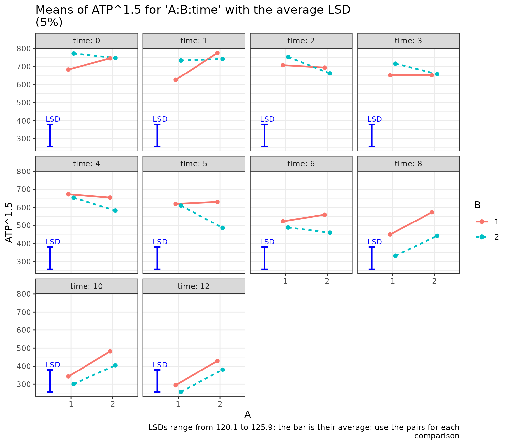

Code

``` r

autoplot(predm_out, type = "ci", data = TRUE)
```

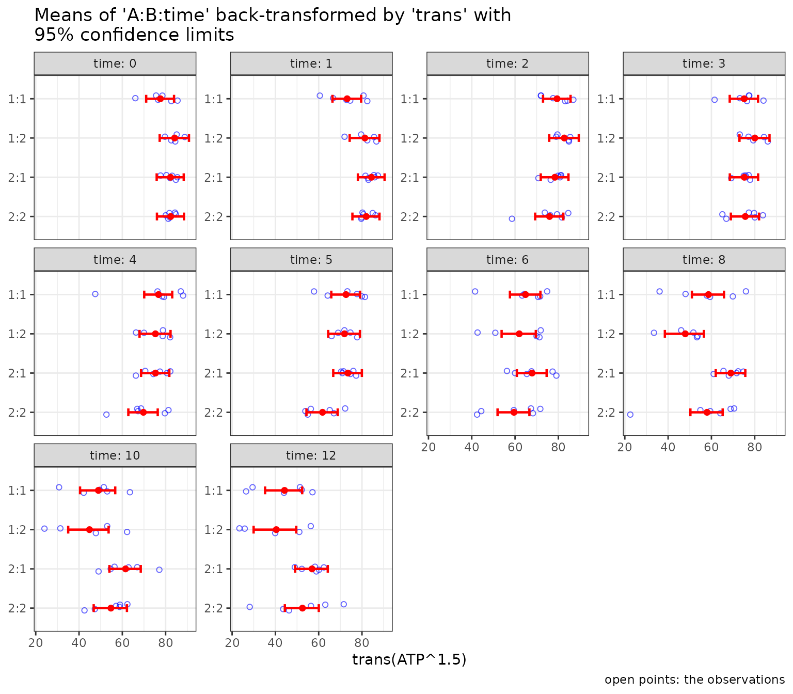

The pairwise comparisons within each time, one row per pair (`by` is the
time; `p.adj` is BH-adjusted within each time):

Code

``` r

as.data.frame(predm_out, what = "pairs") %>%
  select(by, level1, level2, estimate, std.error, df, p.value, p.adj) %>%
  mutate(across(where(is.numeric), ~ round(.x, 4))) %>%
  DT_df()
```

Code

``` r

PMplot(predm_out$p_valueMatrix)
```

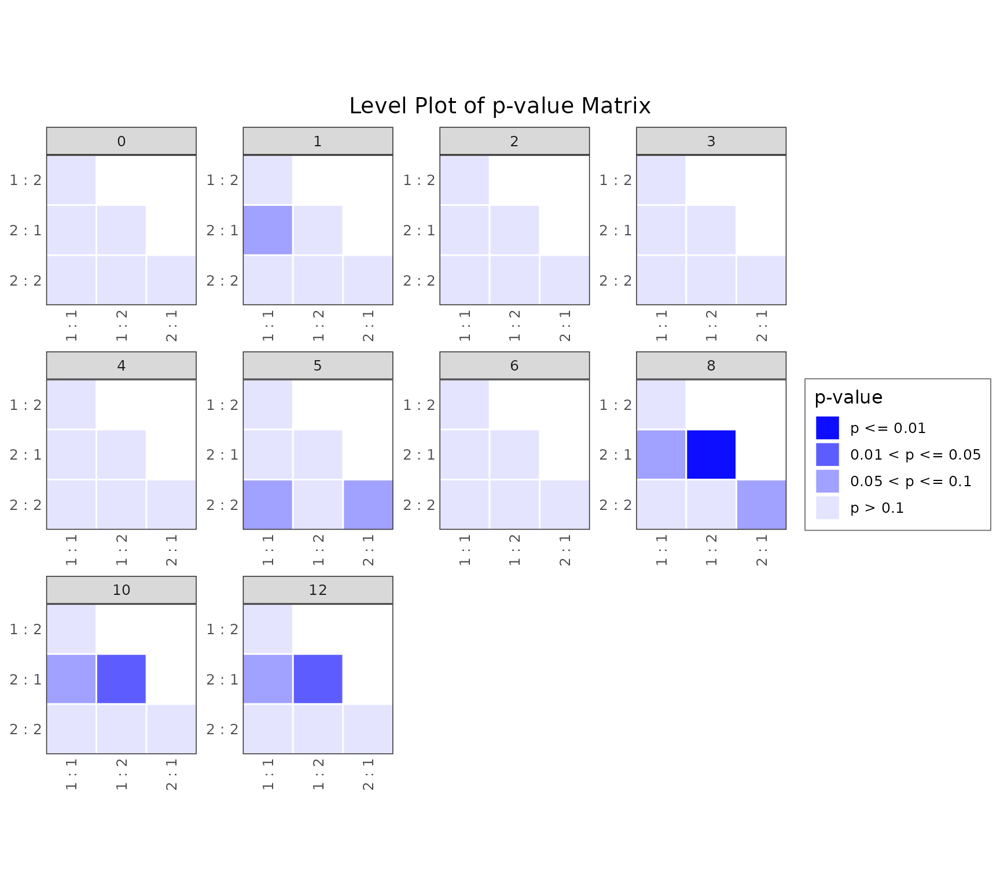

#### Highlights

Options of
[`predictmeans()`](https://dongwenluo.github.io/predictmeans/reference/predictmeans.md):

- `atvar = "time"` compares the means only within each time, and the
  p-values are adjusted within each time. It also arranges `mean_table`
  and the plots by time (one panel per time). Giving `atvar` turns the
  comparisons on. Try `atvar = c("A", "B")` or `atvar = c("B", "A")`
  with `"A:B:time"` to see the effect.

- `trans = function(x) x^(1/1.5)` back-transforms the means of the
  transformed response `ATP^1.5` to the ATP scale (e.g. `trans = exp`
  after [`log()`](https://rdrr.io/r/base/Log.html),
  `trans = function(x) x^2` after
  [`sqrt()`](https://rdrr.io/r/base/MathFun.html)). For a response
  transformed in the model formula, such as `log(y)` or `sqrt(y)`, and
  for any GLM, the back-transformation is found automatically.

## Example 3: a GLM with a covariate (Drug data)

The effectiveness of three analgesic drugs was compared with that of a
standard drug, morphine (Finney, *Probit Analysis*, 3rd edition, 1971,
p. 103). Fourteen groups of mice were given the drugs at a range of
doses; `N` is the number of mice in each group and `R` the number that
responded.

### Data Info

- Structure
- Summary

Code

``` r

data(Drug, package="predictmeans")
str(Drug)
```

    ## 'data.frame':    14 obs. of  5 variables:
    ##  $ Drug     : Factor w/ 4 levels "Morphine","Amidone",..: 1 1 1 2 2 2 3 3 3 4 ...
    ##  $ Dose     : num  1.5 3 6 1.5 3 6 0.75 1.5 3 5 ...
    ##  $ N        : int  103 120 123 60 110 100 90 80 90 60 ...
    ##  $ R        : int  19 53 83 14 54 81 31 54 80 13 ...
    ##  $ log10Dose: num  0.176 0.477 0.778 0.176 0.477 ...

Code

``` r

summary(Drug)
```

    ##           Drug        Dose              N                R        
    ##  Morphine   :3   Min.   : 0.750   Min.   : 60.00   Min.   :13.00  
    ##  Amidone    :3   1st Qu.: 1.875   1st Qu.: 65.00   1st Qu.:28.00  
    ##  Phenadoxone:3   Median : 4.000   Median : 90.00   Median :48.50  
    ##  Pethidine  :5   Mean   : 5.982   Mean   : 87.93   Mean   :45.71  
    ##                  3rd Qu.: 7.125   3rd Qu.:102.25   3rd Qu.:54.75  
    ##                  Max.   :20.000   Max.   :123.00   Max.   :83.00  
    ##    log10Dose      
    ##  Min.   :-0.1249  
    ##  1st Qu.: 0.2513  
    ##  Median : 0.5880  
    ##  Mean   : 0.6030  
    ##  3rd Qu.: 0.8508  
    ##  Max.   : 1.3010

### Modelling

- Model
- Residual Plot

Code

``` r

mod <- glm(cbind(R, N-R) ~ log10Dose*Drug, 
           family=binomial(link = "probit"), 
           data=Drug)
summary(mod)
```

    ## 
    ## Call:
    ## glm(formula = cbind(R, N - R) ~ log10Dose * Drug, family = binomial(link = "probit"), 
    ##     data = Drug)
    ## 
    ## Coefficients:
    ##                            Estimate Std. Error z value Pr(>|z|)    
    ## (Intercept)               -1.254871   0.170986  -7.339 2.15e-13 ***
    ## log10Dose                  2.225955   0.304133   7.319 2.50e-13 ***
    ## DrugAmidone               -0.005815   0.271686  -0.021  0.98292    
    ## DrugPhenadoxone            1.204624   0.197057   6.113 9.77e-10 ***
    ## DrugPethidine             -1.193860   0.401933  -2.970  0.00298 ** 
    ## log10Dose:DrugAmidone      0.474973   0.485376   0.979  0.32779    
    ## log10Dose:DrugPhenadoxone  0.479825   0.475453   1.009  0.31288    
    ## log10Dose:DrugPethidine    0.134316   0.463691   0.290  0.77207    
    ## ---
    ## Signif. codes:  0 '***' 0.001 '**' 0.01 '*' 0.05 '.' 0.1 ' ' 1
    ## 
    ## (Dispersion parameter for binomial family taken to be 1)
    ## 
    ##     Null deviance: 249.9579  on 13  degrees of freedom
    ## Residual deviance:   2.3344  on  6  degrees of freedom
    ## AIC: 83.556
    ## 
    ## Number of Fisher Scoring iterations: 3

Code

``` r

residplot(mod) 
```

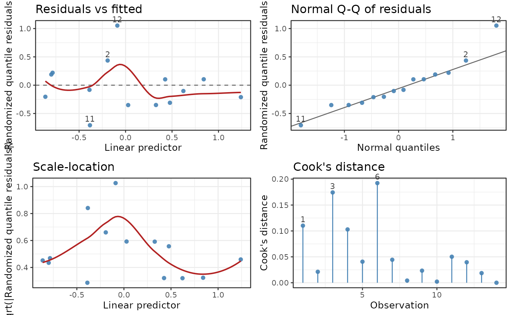

### ANOVA

Code

``` r

kable(car::Anova(mod))
```

|                |   LR Chisq |  Df | Pr(\>Chisq) |
|:---------------|-----------:|----:|------------:|
| log10Dose      | 221.822660 |   1 |   0.0000000 |
| Drug           | 206.682057 |   3 |   0.0000000 |
| log10Dose:Drug |   1.533629 |   3 |   0.6745307 |

### Covariate Means

#### Predicted Probabilities for “Drug”

- Mean Table
- Mean Plot

Code

``` r

covariate_out <- covariatemeans(model=mod, modelterm="Drug", covariate="log10Dose")
as.data.frame(covariate_out) %>%
  select(Drug, log10Dose, response, std.error, response.conf.low, response.conf.high) %>% 
  mutate_if(is.numeric, round, digits = 4) %>% 
  rename(Probability=response, LL=response.conf.low, UL=response.conf.high) %>% 
  arrange(log10Dose, Drug) %>% 
  DT_df()
```

Letters for the drugs at a single dose come from comparison intervals,
whose overlap agrees with the pairwise tests (the overlap of 95% or
83.4% confidence intervals does not; Cave, 2021):

Code

``` r

predictmeans(mod, "Drug", covariate = c(log10Dose = 1), pairwise = TRUE, letter_ci = TRUE)$mean_table
```

    ## $Table
    ##          Drug    Mean      SE  Df LL(86.5%) UL(86.5%) Bk_Mean Bk_LL(86.5%)
    ## 1    Morphine  0.9711 0.16486 Inf    0.7246    1.2176  0.8342       0.7657
    ## 2     Amidone  1.4402 0.20103 Inf    1.1397    1.7408  0.9251       0.8728
    ## 3 Phenadoxone  2.6555 0.33079 Inf    2.1610    3.1501  0.9960       0.9847
    ## 4   Pethidine -0.0885 0.06973 Inf   -0.1927    0.0158  0.4648       0.4236
    ##   Bk_UL(86.5%) LetterGrp
    ## 1       0.8883       A  
    ## 2       0.9591       A  
    ## 3       0.9992        B 
    ## 4       0.5063         C
    ## 
    ## $Note
    ## [1] "Letter-based representation of pairwise comparisons by overlap of the comparison intervals (LL, UL: mean +/- 1.495 SE, 86.5% intervals): two means differ at significant level '0.05' when their intervals do not overlap (the SEDs differ: approximate, but every pair here agrees with its test)"

Code

``` r

# one panel per drug (the default)
autoplot(covariate_out)
```

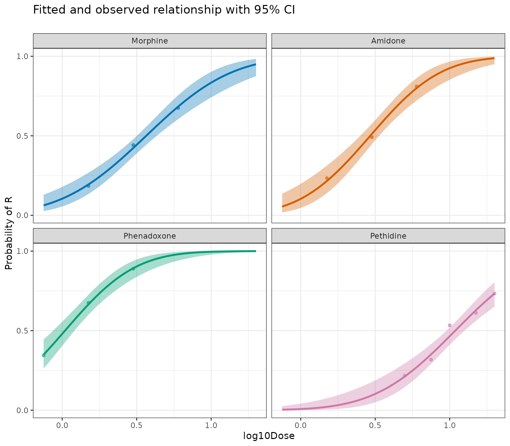

Code

``` r

# all drugs in one panel
autoplot(covariate_out, panel = character(0))
```

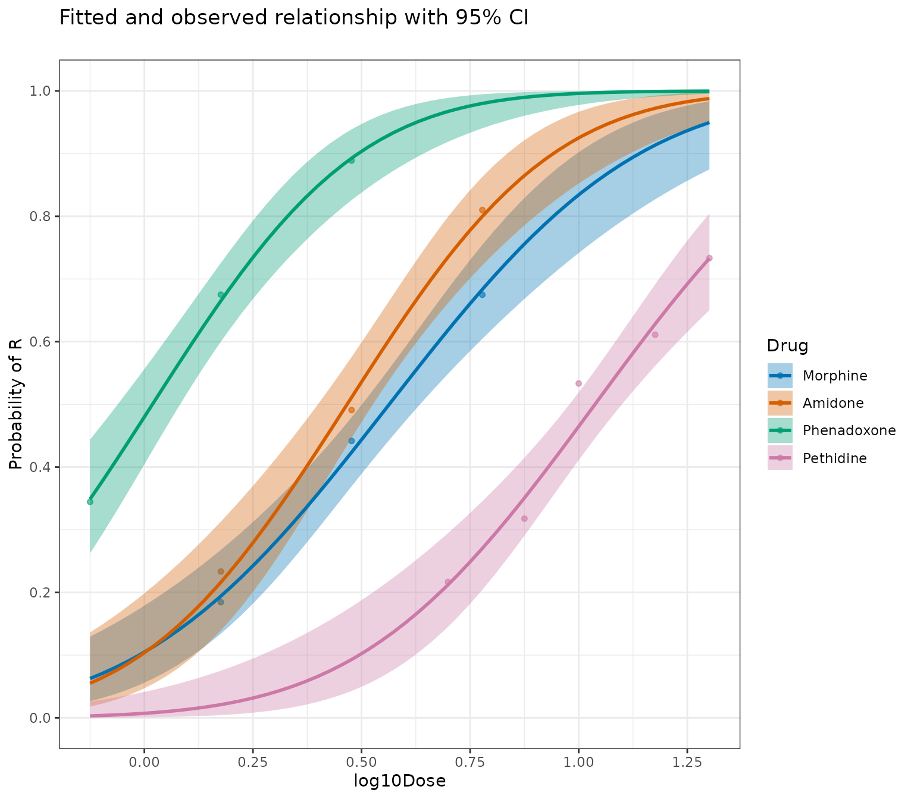

Code

``` r

# on the probit (model) scale, without the bands
autoplot(covariate_out, scale = "model", panel = character(0), interval = "none")
```

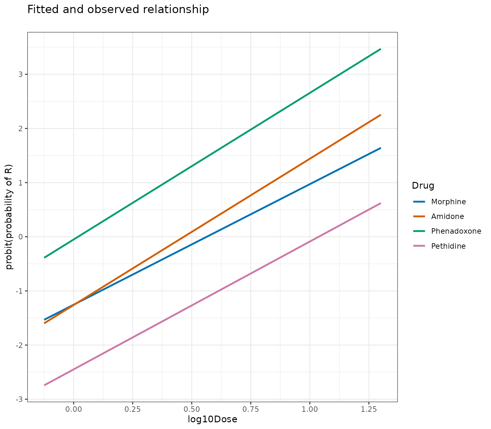

### Highlights

Options of
[`covariatemeans()`](https://dongwenluo.github.io/predictmeans/reference/covariatemeans.md):

- The plots are drawn from the result by
  [`autoplot()`](https://ggplot2.tidyverse.org/reference/autoplot.html):
  `panel` and `group` choose which factor makes the panels and which the
  colours, `scale = "model"` shows the probit scale, and
  `interval = "none"` drops the bands.

- The confidence bands are for each line on its own: whether two bands
  overlap is not a test of the two drugs.
  `predictmeans(mod, "Drug", covariate = c(log10Dose = ), letter_ci = TRUE)`
  gives letters at a dose that agree with the pairwise tests, and
  `contr = c("Morphine", "Amidone")` in
  [`covariatemeans()`](https://dongwenluo.github.io/predictmeans/reference/covariatemeans.md)
  gives the difference of two drugs along the dose with its band.

`DT_df()` (defined at the top of this article) shows a data frame as an
HTML table with a CSV download button; choose ‘All’ entries to download
every row.

## Example 4: semiparametric regression with groups (WarsawApts data)

`WarsawApts` (package HRW) is a subset of the data set `apartments` in
the package PBImisc: the prices of apartments sold in Warsaw, Poland,
from 2007 to 2009, with their construction dates and districts.

### Data Info

- Structure
- Plot

Code

``` r

data(WarsawApts, package="HRW")
WarsawApts$district <- factor(WarsawApts$district)
names(WarsawApts)[c(6)] <- c("apartment.price")
str(WarsawApts)
```

    ## 'data.frame':    409 obs. of  6 variables:
    ##  $ surface          : num  20 27 28 28 30 32 32 36 36 37 ...
    ##  $ district         : Factor w/ 4 levels "Mokotow","Srodmiescie",..: 2 3 1 1 2 1 2 3 3 1 ...
    ##  $ n.rooms          : int  1 1 1 2 1 2 1 2 2 2 ...
    ##  $ floor            : int  7 1 1 4 1 3 7 6 5 7 ...
    ##  $ construction.date: int  1970 1962 1950 1968 1952 2007 1961 1965 1968 1972 ...
    ##  $ apartment.price  : num  95.2 117.4 114.3 114.3 93.8 ...

Code

``` r

ggplot(WarsawApts, aes(x=construction.date, y=apartment.price, color=district))+
  geom_point(size=1.6)+
  theme_bw(15)
```

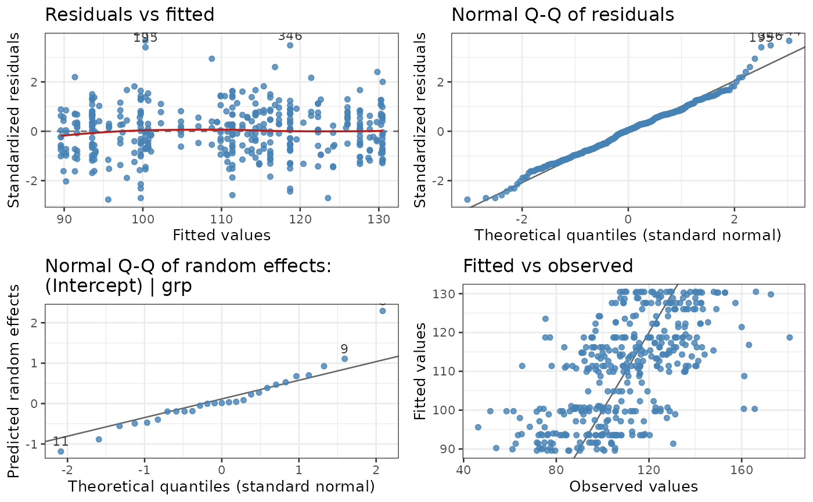

### Smooth without Group

- Model
- Residual Plot

Code

``` r

# an O'Sullivan spline with 25 interior knots for the non-linear relationship;
# its straight line (construction.date) is added to the fixed effects
mod1 <- semireg(apartment.price ~ s(construction.date, bs = "os", k = 25),
                data = WarsawApts)
```

Code

``` r

residplot(mod1$semer)  
```

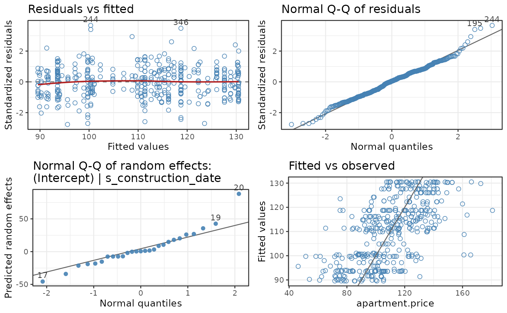

### ANOVA, Smooth Tests and $`R^2`$

- **ANOVA**

Code

``` r

kable(anova(mod1$semer))
```

|                   |         F |  Df |  Df.res |   Pr(\>F) |
|:------------------|----------:|----:|--------:|----------:|
| (Intercept)       | 0.0427881 |   1 | 149.228 | 0.8364068 |
| construction.date | 1.4569482 |   1 | 149.742 | 0.2293196 |

- **Tests of the smooth terms**

Code

``` r

kable(anova(mod1)$smooth)
```

| term | variance | logLik | logLik.without | LRT | p.value | test |
|:---|---:|---:|---:|---:|---:|:---|
| s_construction_date | 2098.633 | -1772.452 | -1844.882 | 144.859 | 1e-04 | exact restricted LRT (10000 simulations) |

- **$`R^2`$**

Code

``` r

R2_model(mod1$semer)
```

    ## # Adjusted R2 for mixed models (Piepho)
    ##               Total               Fixed              Random s_construction_date 
    ##              86.14%               0.03%              86.11%              86.11%

### Prediction

- Predict Table
- Predict Plot

Code

``` r

pred_out1 <- semipred(mod1, covariate="construction.date")
DT_df(pred_out1$pred_df %>% 
        mutate_if(is.numeric, round, digits = 4))
```

Code

``` r

autoplot(pred_out1)
```

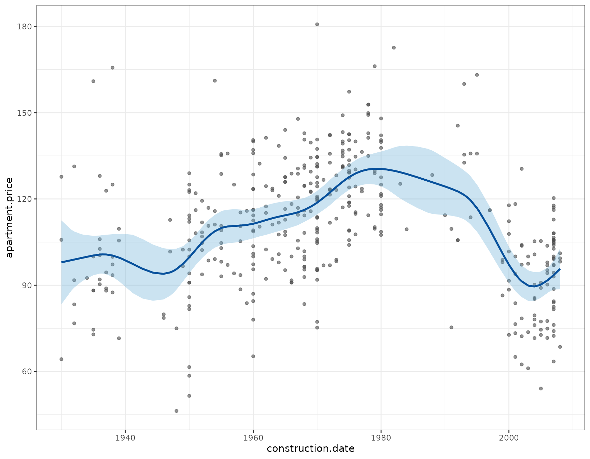

### Smooth with Group

- Model
- Residual Plot

Code

``` r

# a curve per district, each with its own smoothing variance; district and the
# district slopes (district + district:construction.date) are added automatically
mod2 <- semireg(apartment.price ~ s(construction.date, by = district, bs = "os", k = 10),
                data = WarsawApts)
```

Code

``` r

residplot(mod2$semer, group="district")  
```

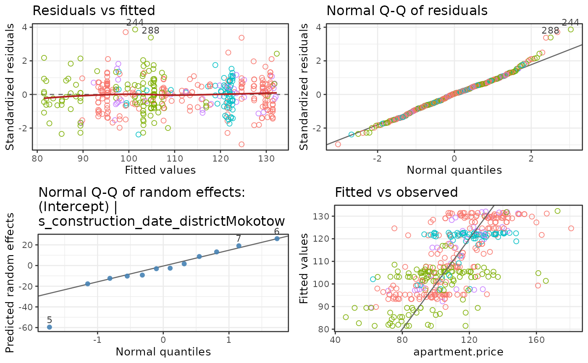

### ANOVA, Smooth Tests and $`R^2`$

- **ANOVA**

Code

``` r

kable(anova(mod2$semer))
```

|                            |        F |  Df |   Df.res |   Pr(\>F) |
|:---------------------------|---------:|----:|---------:|----------:|
| (Intercept)                | 3.387549 |   1 | 15.38809 | 0.0850560 |
| district                   | 1.548635 |   3 | 19.12871 | 0.2343749 |
| district:construction.date | 1.219447 |   4 | 26.47655 | 0.3261956 |

- **Tests of the smooth terms**

Code

``` r

kable(anova(mod2)$smooth)
```

| term | variance | logLik | logLik.without | LRT | p.value | test |
|:---|---:|---:|---:|---:|---:|:---|
| s_construction_date_districtMokotow | 893.678898 | -1751.525 | -1800.940 | 98.829583 | 0.0000000 | 0.5 chi2(0) + 0.5 chi2(1) |
| s_construction_date_districtSrodmiescie | 1612.747676 | -1751.525 | -1761.894 | 20.737475 | 0.0000026 | 0.5 chi2(0) + 0.5 chi2(1) |
| s_construction_date_districtWola | 8.240899 | -1751.525 | -1752.495 | 1.939841 | 0.0818429 | 0.5 chi2(0) + 0.5 chi2(1) |
| s_construction_date_districtZoliborz | 51.291075 | -1751.525 | -1760.028 | 17.004627 | 0.0000186 | 0.5 chi2(0) + 0.5 chi2(1) |

- **$`R^2`$**

Code

``` r

R2_model(mod2$semer)
```

    ## # Adjusted R2 for mixed models (Piepho)
    ##                                   Total                                   Fixed 
    ##                                  89.98%                                   0.69% 
    ##                                  Random     s_construction_date_districtMokotow 
    ##                                  89.29%                                  31.79% 
    ## s_construction_date_districtSrodmiescie        s_construction_date_districtWola 
    ##                                  55.41%                                   0.27% 
    ##    s_construction_date_districtZoliborz 
    ##                                   1.81%

### Prediction with Group

- Predict Table
- Predict Plot
- Contrast Table
- Contrast Plot

Code

``` r

pred_out2_1 <- semipred(mod2, "district", "construction.date")
DT_df(pred_out2_1$pred_df %>% 
        mutate_if(is.numeric, round, digits = 4))
```

Code

``` r

autoplot(pred_out2_1)
```

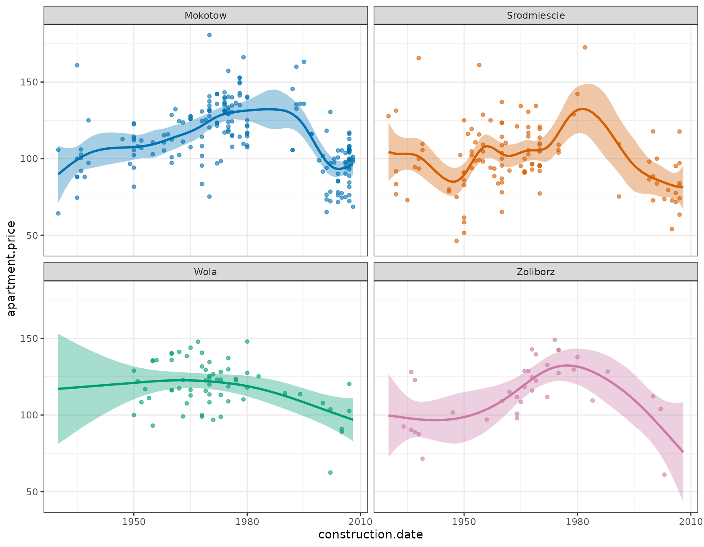

Code

``` r

# all districts in one panel
autoplot(pred_out2_1, panel = character(0), data = FALSE)
```

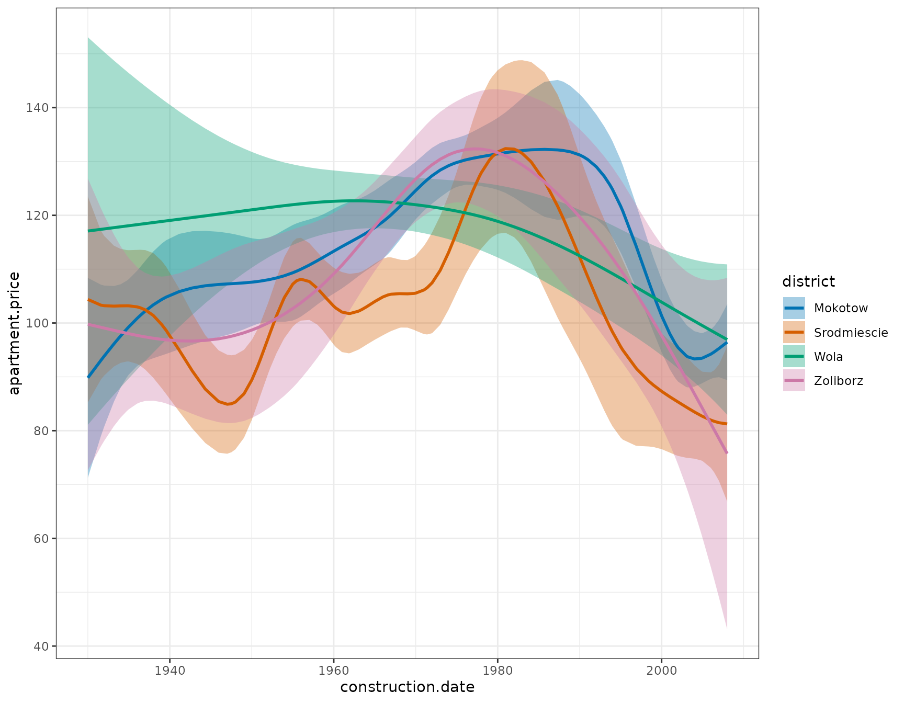

The difference between the districts Mokotow and Srodmiescie along the
construction date, with its 95% confidence band (`significant` marks the
dates where the band excludes zero):

Code

``` r

pred_out2_2 <- semipred(mod2, "district", "construction.date", contr=c('Mokotow', 'Srodmiescie'))
as.data.frame(pred_out2_2, what = "pairs") %>% 
  mutate(across(where(is.numeric), ~ round(.x, 4))) %>% 
  DT_df()
```

Code

``` r

autoplot(pred_out2_2)
```

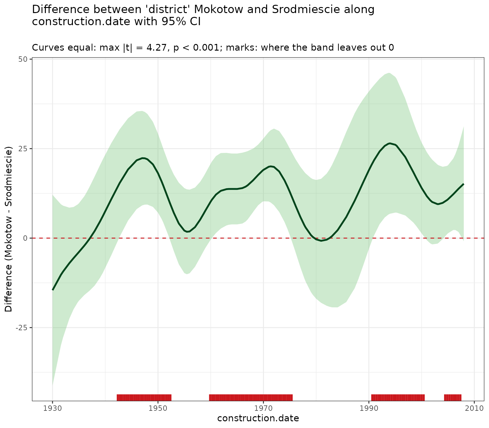

## Example 5: semiparametric regression with several covariates (Caschool data)

The `Caschool` data are a cross-section of 420 Californian school
districts in 1998-1999: county, grade span of the district, percentage
of pupils qualifying for CalWORKs (income assistance), computers per
student, average district income and average mathematics score.

### Data Info

- Structure
- Summary

Code

``` r

data(Caschool, package="predictmeans")
Caschool <- Caschool %>% 
  select(county, grspan, calwpct, compstu, avginc, mathscr) %>% 
  mutate(log.avginc = log(Caschool$avginc))
str(Caschool)
```

    ## 'data.frame':    420 obs. of  7 variables:
    ##  $ county    : Factor w/ 45 levels "Alameda","Butte",..: 1 2 2 2 2 6 29 11 6 25 ...
    ##  $ grspan    : Factor w/ 2 levels "KK-06","KK-08": 2 2 2 2 2 2 2 2 2 1 ...
    ##  $ calwpct   : num  0.51 15.42 55.03 36.48 33.11 ...
    ##  $ compstu   : num  0.344 0.421 0.109 0.35 0.128 ...
    ##  $ avginc    : num  22.69 9.82 8.98 8.98 9.08 ...
    ##  $ mathscr   : num  690 662 651 644 640 ...
    ##  $ log.avginc: num  3.12 2.28 2.19 2.19 2.21 ...

Code

``` r

summary(Caschool)
```

    ##          county      grspan       calwpct          compstu       
    ##  Sonoma     : 29   KK-06: 61   Min.   : 0.000   Min.   :0.00000  
    ##  Kern       : 27   KK-08:359   1st Qu.: 4.395   1st Qu.:0.09377  
    ##  Los Angeles: 27               Median :10.520   Median :0.12546  
    ##  Tulare     : 24               Mean   :13.246   Mean   :0.13593  
    ##  San Diego  : 21               3rd Qu.:18.981   3rd Qu.:0.16447  
    ##  Santa Clara: 20               Max.   :78.994   Max.   :0.42083  
    ##  (Other)    :272                                                 
    ##      avginc          mathscr        log.avginc   
    ##  Min.   : 5.335   Min.   :605.4   Min.   :1.674  
    ##  1st Qu.:10.639   1st Qu.:639.4   1st Qu.:2.365  
    ##  Median :13.728   Median :652.4   Median :2.619  
    ##  Mean   :15.317   Mean   :653.3   Mean   :2.645  
    ##  3rd Qu.:17.629   3rd Qu.:665.8   3rd Qu.:2.870  
    ##  Max.   :55.328   Max.   :709.5   Max.   :4.013  
    ## 

### Smooth Modelling

- Model
- Residual Plot

Code

``` r

mod <- semireg_tmb(mathscr ~ s(calwpct, bs = "os", k = 12) + s(log.avginc, bs = "os", k = 5) +
                     s(compstu, bs = "os", k = 12) + (1 | county) + (1 | grspan),
                   data = Caschool)
```

Code

``` r

residplot(mod$semer)  
```

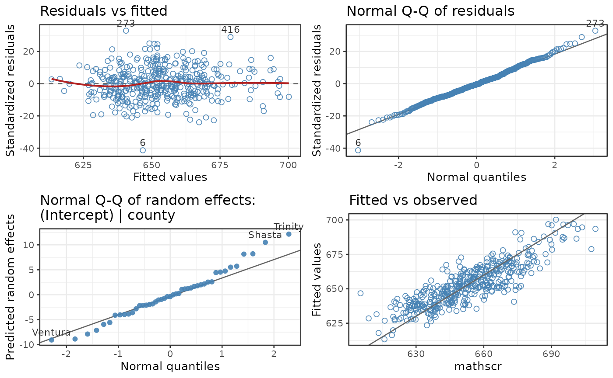

### ANOVA and $`R^2`$

- **ANOVA**

Code

``` r

kable(Anova(mod$semer))
```

|            |     Chisq |  Df | Pr(\>Chisq) |
|:-----------|----------:|----:|------------:|
| calwpct    | 35.005795 |   1 |   0.0000000 |
| log.avginc | 90.020820 |   1 |   0.0000000 |
| compstu    |  1.896853 |   1 |   0.1684309 |

- **$`R^2`$**

Code

``` r

R2_model(mod$semer)
```

    ## # Adjusted R2 for mixed models (Piepho)
    ##        Total        Fixed       Random       county       grspan    s_calwpct 
    ##       72.60%       50.87%       21.73%        8.90%        0.03%        9.12% 
    ## s_log_avginc    s_compstu 
    ##        2.97%        0.72%

### Prediction

- calwpct
- log.avginc
- compstu
- Joint Plot

Code

``` r

pred_out1 <- semipred(mod, covariate = "calwpct")
DT_df(pred_out1$pred_df %>% 
        mutate_if(is.numeric, round, digits = 4))
```

Code

``` r

autoplot(pred_out1)
```

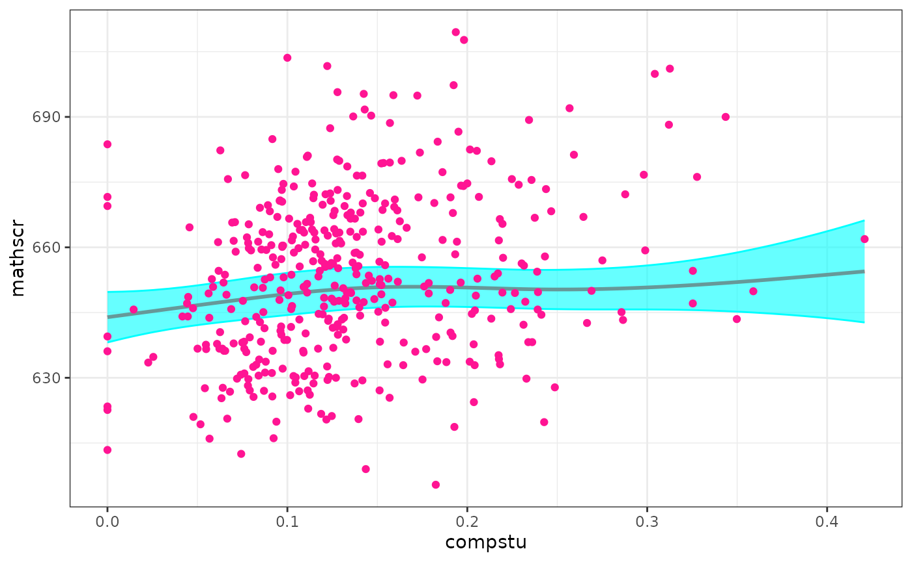

Code

``` r

pred_out2 <- semipred(mod, covariate = "log.avginc")
DT_df(pred_out2$pred_df %>% 
        mutate_if(is.numeric, round, digits = 4))
```

Code

``` r

autoplot(pred_out2)
```


Code

``` r

pred_out3 <- semipred(mod, covariate = "compstu")
DT_df(pred_out3$pred_df %>% 
        mutate_if(is.numeric, round, digits = 4))
```

Code

``` r

autoplot(pred_out3)
```

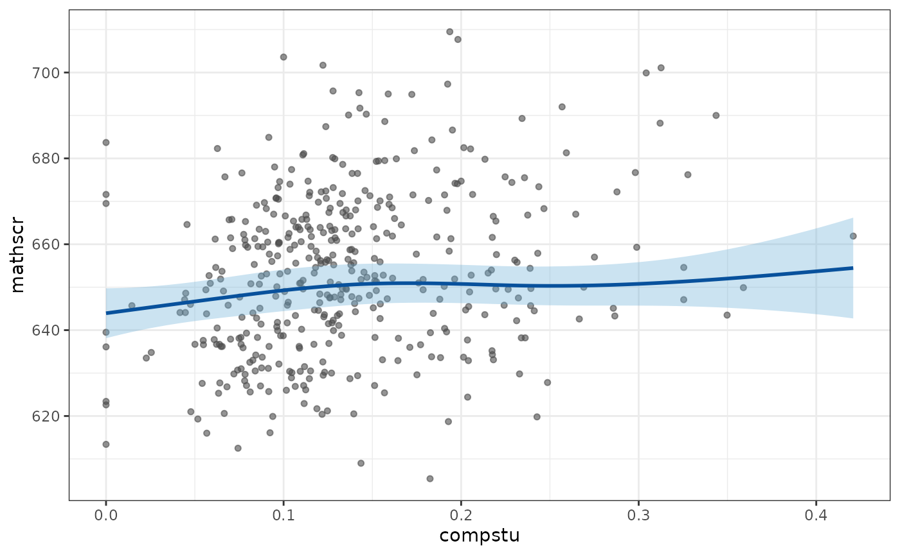

Code

``` r

gridExtra::grid.arrange(autoplot(pred_out1), autoplot(pred_out2), autoplot(pred_out3), nrow = 1)
```

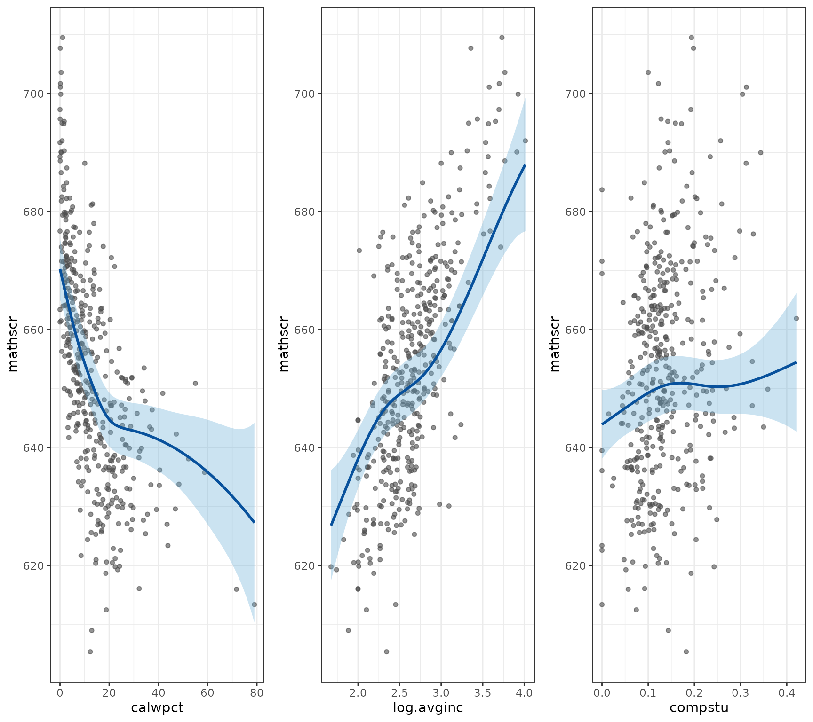

## Example 6: semiparametric regression with a binary response (indonRespir data)

The Indonesian Children’s Health Study followed a cohort of 275 children
for respiratory infections. The data are longitudinal: each child was
examined between one and six times. The curves below are the probability
of infection for a typical child (random effect zero); the pink ticks
mark the ages of the children without (bottom) and with (top) an
infection.

### Data Info

- Structure
- Summary

Code

``` r

data(indonRespir, package="HRW")
indonRespir[, c(1,5)] <- lapply(indonRespir[, c(1,5)], factor)
indonRespir$sex <- indonRespir$female
levels(indonRespir$sex) <- c("male", "female")
str(indonRespir)
```

    ## 'data.frame':    1200 obs. of  13 variables:
    ##  $ idnum      : Factor w/ 275 levels "1","2","3","4",..: 1 1 1 1 1 1 2 2 2 2 ...
    ##  $ respirInfec: int  0 0 0 0 1 0 0 0 0 0 ...
    ##  $ age        : num  5.58 5.83 6.08 6.33 6.58 ...
    ##  $ vitAdefic  : int  0 0 0 0 0 0 0 0 0 0 ...
    ##  $ female     : Factor w/ 2 levels "0","1": 1 1 1 1 1 1 2 2 2 2 ...
    ##  $ height     : int  -3 -3 -2 -2 -2 -3 2 0 -1 -2 ...
    ##  $ stunted    : int  0 0 0 0 0 0 0 0 0 0 ...
    ##  $ visit2     : int  0 1 0 0 0 0 0 1 0 0 ...
    ##  $ visit3     : int  0 0 1 0 0 0 0 0 1 0 ...
    ##  $ visit4     : int  0 0 0 1 0 0 0 0 0 1 ...
    ##  $ visit5     : int  0 0 0 0 1 0 0 0 0 0 ...
    ##  $ visit6     : int  0 0 0 0 0 1 0 0 0 0 ...
    ##  $ sex        : Factor w/ 2 levels "male","female": 1 1 1 1 1 1 2 2 2 2 ...

Code

``` r

summary(indonRespir)
```

    ##      idnum       respirInfec           age           vitAdefic       female 
    ##  1      :   6   Min.   :0.00000   Min.   :0.3333   Min.   :0.00000   0:708  
    ##  2      :   6   1st Qu.:0.00000   1st Qu.:1.7500   1st Qu.:0.00000   1:492  
    ##  3      :   6   Median :0.00000   Median :3.2500   Median :0.00000          
    ##  5      :   6   Mean   :0.08917   Mean   :3.2669   Mean   :0.04583          
    ##  10     :   6   3rd Qu.:0.00000   3rd Qu.:4.5833   3rd Qu.:0.00000          
    ##  11     :   6   Max.   :1.00000   Max.   :7.1667   Max.   :1.00000          
    ##  (Other):1164                                                               
    ##      height            stunted           visit2           visit3      
    ##  Min.   :-23.0000   Min.   :0.0000   Min.   :0.0000   Min.   :0.0000  
    ##  1st Qu.: -3.0000   1st Qu.:0.0000   1st Qu.:0.0000   1st Qu.:0.0000  
    ##  Median :  1.0000   Median :0.0000   Median :0.0000   Median :0.0000  
    ##  Mean   :  0.9058   Mean   :0.1233   Mean   :0.1783   Mean   :0.1475  
    ##  3rd Qu.:  4.0000   3rd Qu.:0.0000   3rd Qu.:0.0000   3rd Qu.:0.0000  
    ##  Max.   : 25.0000   Max.   :1.0000   Max.   :1.0000   Max.   :1.0000  
    ##                                                                       
    ##      visit4           visit5           visit6           sex     
    ##  Min.   :0.0000   Min.   :0.0000   Min.   :0.0000   male  :708  
    ##  1st Qu.:0.0000   1st Qu.:0.0000   1st Qu.:0.0000   female:492  
    ##  Median :0.0000   Median :0.0000   Median :0.0000               
    ##  Mean   :0.1525   Mean   :0.1625   Mean   :0.1675               
    ##  3rd Qu.:0.0000   3rd Qu.:0.0000   3rd Qu.:0.0000               
    ##  Max.   :1.0000   Max.   :1.0000   Max.   :1.0000               
    ## 

### Smooth without Group

- Model
- Residual Plot

Code

``` r

mod1 <- semireg_tmb(respirInfec ~ s(age, bs = "os", k = 25) + vitAdefic + sex + height + stunted +
                      visit2 + visit3 + visit4 + visit5 + visit6 + (1 | idnum),
                    family = binomial, data = indonRespir)
```

Code

``` r

residplot(mod1$semer)  
```

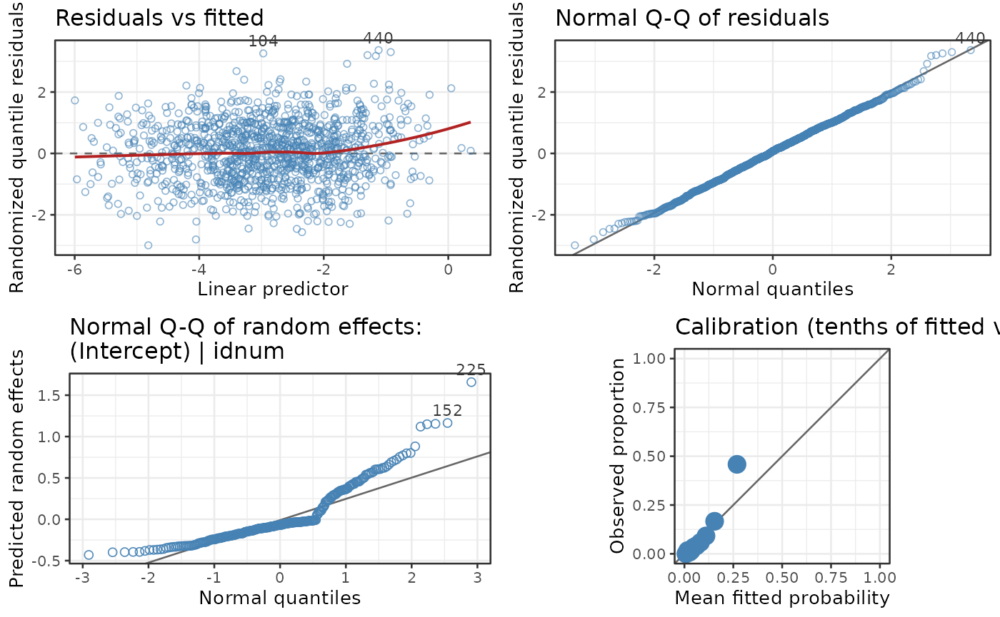

### ANOVA and $`R^2`$

- **ANOVA**

Code

``` r

kable(car::Anova(mod1$semer))
```

|           |      Chisq |  Df | Pr(\>Chisq) |
|:----------|-----------:|----:|------------:|
| vitAdefic |  1.7004525 |   1 |   0.1922288 |
| sex       |  3.6344237 |   1 |   0.0565962 |
| height    |  1.4758603 |   1 |   0.2244233 |
| stunted   |  0.9708859 |   1 |   0.3244593 |
| visit2    |  7.8007540 |   1 |   0.0052224 |
| visit3    |  2.2953732 |   1 |   0.1297600 |
| visit4    |  7.6881957 |   1 |   0.0055583 |
| visit5    |  2.0926505 |   1 |   0.1480091 |
| visit6    |  0.0000633 |   1 |   0.9936497 |
| age       | 15.5045938 |   1 |   0.0000823 |

- **$`R^2`$**

Code

``` r

R2_model(mod1$semer)
```

    ## # Adjusted R2 for mixed models (Piepho)
    ##  Total  Fixed Random  idnum  s_age 
    ## 33.80% 17.33% 16.47% 13.99%  2.48% 
    ## 
    ## Advice:
    ## i For a non-gaussian model the R2 is on the link (latent) scale: not
    ##   comparable with an lm R2 or across families and links; use it to compare
    ##   models of the same family.

### Prediction

- Predict Table
- Predict Plot

Code

``` r

pred_out1 <- semipred(mod1, covariate = "age")
DT_df(pred_out1$pred_df %>% 
        mutate_if(is.numeric, round, digits = 4))
```

Code

``` r

autoplot(pred_out1, data = FALSE) +
  geom_rug(data = subset(indonRespir, respirInfec==0), sides = "b", col="deeppink")+
  geom_rug(data = subset(indonRespir, respirInfec==1), sides = "t", col="deeppink")+
  coord_cartesian(ylim = c(0, 0.18))
```

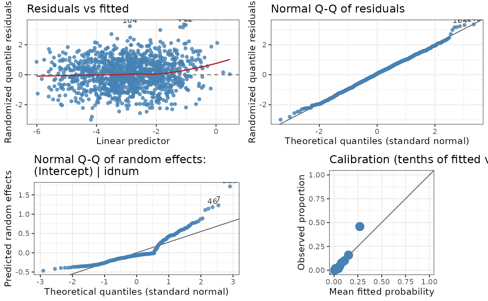

### Smooth with Group

- Model
- Residual Plot

Code

``` r

# a curve of age for each sex (sex and sex:age are added to the fixed effects)
mod2 <- semireg_tmb(respirInfec ~ s(age, by = sex, bs = "os", k = 25) + vitAdefic + height + stunted +
                      visit2 + visit3 + visit4 + visit5 + visit6 + (1 | idnum),
                    family = binomial, data = indonRespir)
```

Code

``` r

residplot(mod2$semer)  
```

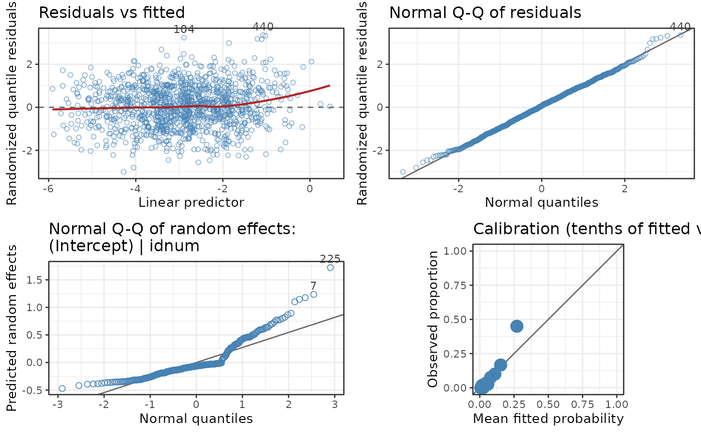

### ANOVA and $`R^2`$

- **ANOVA**

Code

``` r

kable(Anova(mod2$semer))
```

|           |      Chisq |  Df | Pr(\>Chisq) |
|:----------|-----------:|----:|------------:|
| vitAdefic |  1.5282678 |   1 |   0.2163726 |
| height    |  1.6518437 |   1 |   0.1987082 |
| stunted   |  0.9757535 |   1 |   0.3232495 |
| visit2    |  7.5616474 |   1 |   0.0059623 |
| visit3    |  1.9898132 |   1 |   0.1583604 |
| visit4    |  7.0981395 |   1 |   0.0077164 |
| visit5    |  2.7020790 |   1 |   0.1002175 |
| visit6    |  0.0332517 |   1 |   0.8553077 |
| sex       |  0.8920972 |   1 |   0.3449096 |
| sex:age   | 20.0324865 |   2 |   0.0000447 |

- **$`R^2`$**

Code

``` r

R2_model(mod2$semer)
```

    ## # Adjusted R2 for mixed models (Piepho)
    ##           Total           Fixed          Random           idnum   s_age_sexmale 
    ##          33.67%          16.27%          17.40%          14.70%           2.70% 
    ## s_age_sexfemale 
    ##           0.00% 
    ## 
    ## Advice:
    ## i For a non-gaussian model the R2 is on the link (latent) scale: not
    ##   comparable with an lm R2 or across families and links; use it to compare
    ##   models of the same family.

### Prediction with Group

- Predict Table
- Predict Plot
- Contrast Table
- Contrast Plot

Code

``` r

pred_out2_1 <- semipred(mod2, "sex", "age")
DT_df(pred_out2_1$pred_df %>% 
        mutate_if(is.numeric, round, digits = 4))
```

Code

``` r

autoplot(pred_out2_1, data = FALSE) +
  geom_rug(data = subset(indonRespir, respirInfec==0), sides = "b", col="deeppink") +
  geom_rug(data = subset(indonRespir, respirInfec==1), sides = "t", col="deeppink")+
  coord_cartesian(ylim = c(0, 0.24))
```

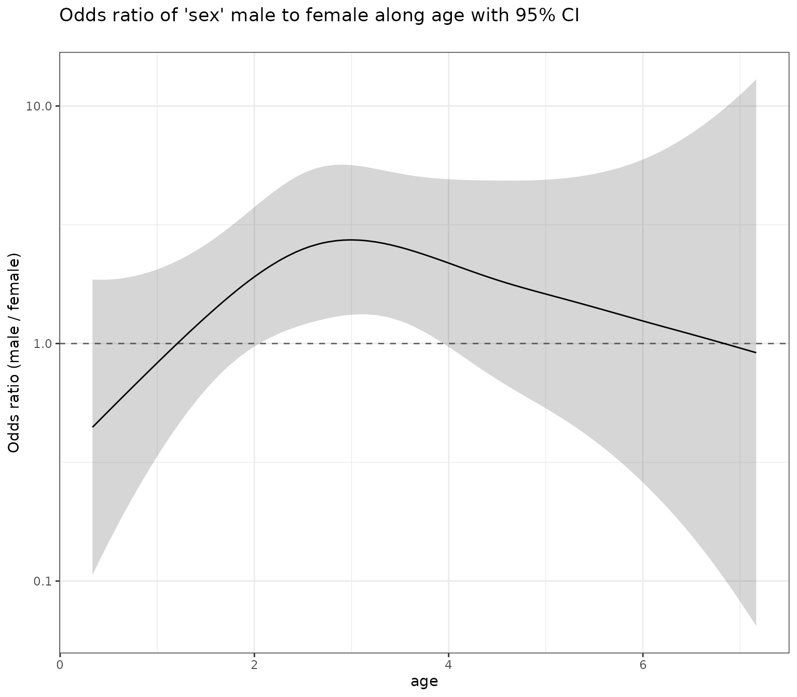

The difference in the probability of infection between boys and girls
along age, with its 95% confidence band:

Code

``` r

pred_out2_2 <- semipred(mod2, "sex", "age", contr=c('male', 'female'))
as.data.frame(pred_out2_2, what = "pairs") %>% 
  mutate(across(where(is.numeric), ~ round(.x, 4))) %>% 
  DT_df()
```

Code

``` r

autoplot(pred_out2_2)
```

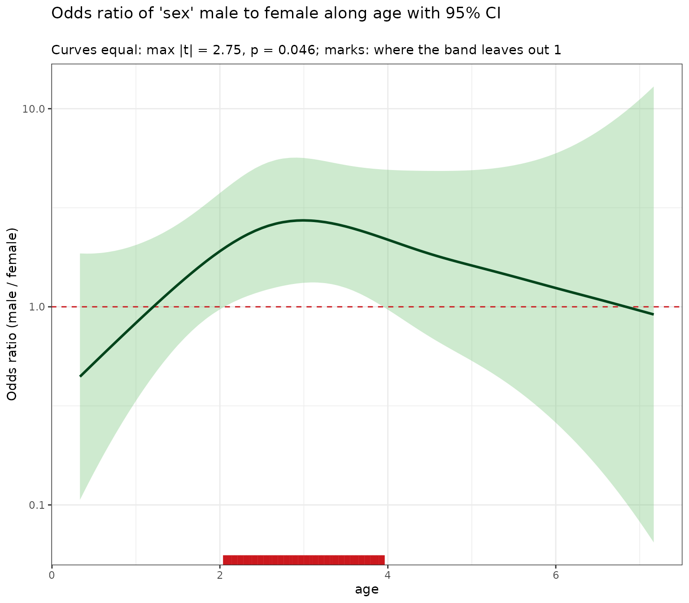

## Example 7: semiparametric regression with a negative binomial response (ragweed data)

The `ragweed` data (package HRW) give daily ragweed pollen counts and
weather measurements for 334 days in Kalamazoo, Michigan, USA, over four
years. The counts are overdispersed, so a negative binomial model is
used.

### Data Info

- Structure
- Summary

Code

``` r

data(ragweed, package="HRW")
ragweed$year <- factor(ragweed$year)
str(ragweed)
```

    ## 'data.frame':    334 obs. of  7 variables:
    ##  $ pollenCount        : int  7 7 2 5 4 0 0 0 13 62 ...
    ##  $ year               : Factor w/ 4 levels "1991","1992",..: 1 1 1 1 1 1 1 1 1 1 ...
    ##  $ dayInSeason        : int  1 2 3 4 5 6 7 8 9 10 ...
    ##  $ temperature        : num  72.4 67.1 68.5 73.4 80.5 ...
    ##  $ temperatureResidual: num  0.649 -4.796 -3.521 1.207 8.14 ...
    ##  $ rain               : int  1 0 1 1 1 1 1 1 1 1 ...
    ##  $ windSpeed          : num  10.4 9.4 8.2 11.8 7.2 7.8 5.4 10.2 5.3 8.8 ...

Code

``` r

summary(ragweed)
```

    ##   pollenCount       year     dayInSeason     temperature    temperatureResidual
    ##  Min.   :  0.00   1991:92   Min.   : 1.00   Min.   :37.31   Min.   :-13.98210  
    ##  1st Qu.:  1.00   1992:81   1st Qu.:22.00   1st Qu.:55.47   1st Qu.: -4.31318  
    ##  Median :  9.00   1993:87   Median :43.50   Median :64.66   Median : -0.05665  
    ##  Mean   : 44.45   1994:74   Mean   :43.29   Mean   :63.29   Mean   :  0.01246  
    ##  3rd Qu.: 56.00             3rd Qu.:64.00   3rd Qu.:71.89   3rd Qu.:  4.16160  
    ##  Max.   :440.00             Max.   :92.00   Max.   :84.33   Max.   : 16.43900  
    ##       rain          windSpeed     
    ##  Min.   :0.0000   Min.   : 0.000  
    ##  1st Qu.:1.0000   1st Qu.: 6.850  
    ##  Median :1.0000   Median : 9.200  
    ##  Mean   :0.8982   Mean   : 8.865  
    ##  3rd Qu.:1.0000   3rd Qu.:10.800  
    ##  Max.   :1.0000   Max.   :17.800

### Smooth Modelling

- Model
- Residual Plot

Code

``` r

# a seasonal curve for each year (with year and year:dayInSeason as fixed terms),
# and curves in temperature and wind speed
mod <- semireg_tmb(pollenCount ~ rain + s(dayInSeason, by = year, bs = "os") +
                     s(temperatureResidual, bs = "os") + s(windSpeed, bs = "os"),
                   family = nbinom1, data = ragweed)
```

Code

``` r

residplot(mod$semer)  
```

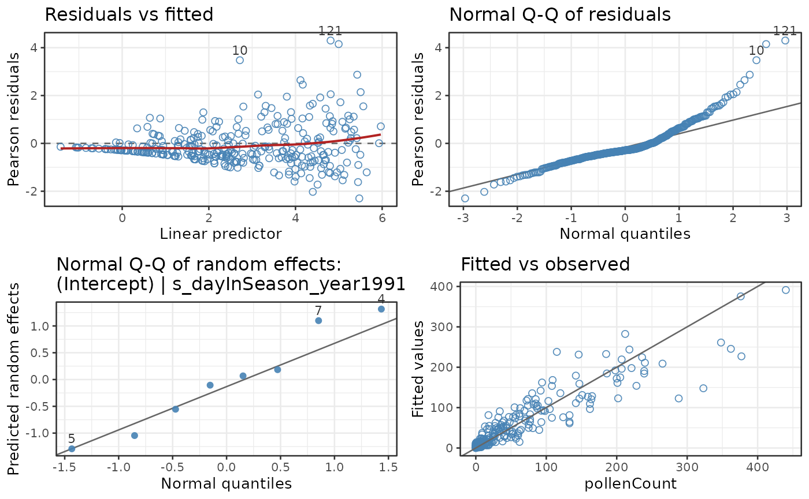

### ANOVA and $`R^2`$

- **ANOVA**

Code

``` r

kable(car::Anova(mod$semer))
```

|                     |    Chisq |  Df | Pr(\>Chisq) |
|:--------------------|---------:|----:|------------:|
| rain                | 29.05128 |   1 |     1.0e-07 |
| year                | 25.70815 |   3 |     1.1e-05 |
| temperatureResidual | 72.10172 |   1 |     0.0e+00 |
| windSpeed           | 76.13483 |   1 |     0.0e+00 |
| year:dayInSeason    | 45.61101 |   4 |     0.0e+00 |

- **$`R^2`$**

Code

``` r

R2_model(mod$semer)
```

    ## # Adjusted R2 for mixed models (Piepho)
    ##                  Total                  Fixed                 Random 
    ##                 60.26%                 16.37%                 43.89% 
    ## s_dayInSeason_year1991 s_dayInSeason_year1992 s_dayInSeason_year1993 
    ##                 13.61%                 11.43%                 12.32% 
    ## s_dayInSeason_year1994  s_temperatureResidual            s_windSpeed 
    ##                  6.53%                  0.00%                  0.00% 
    ## 
    ## Advice:
    ## i For a non-gaussian model the R2 is on the link (latent) scale: not
    ##   comparable with an lm R2 or across families and links; use it to compare
    ##   models of the same family.

### Prediction by Day in Season

- Predict Table
- Predict Plot

Code

``` r

pred_out1_1 <- semipred(mod, "year", "dayInSeason")   # other covariates at their means
DT_df(pred_out1_1$pred_df %>% 
        mutate_if(is.numeric, round, digits = 4))
```

Code

``` r

autoplot(pred_out1_1, data = FALSE)
```

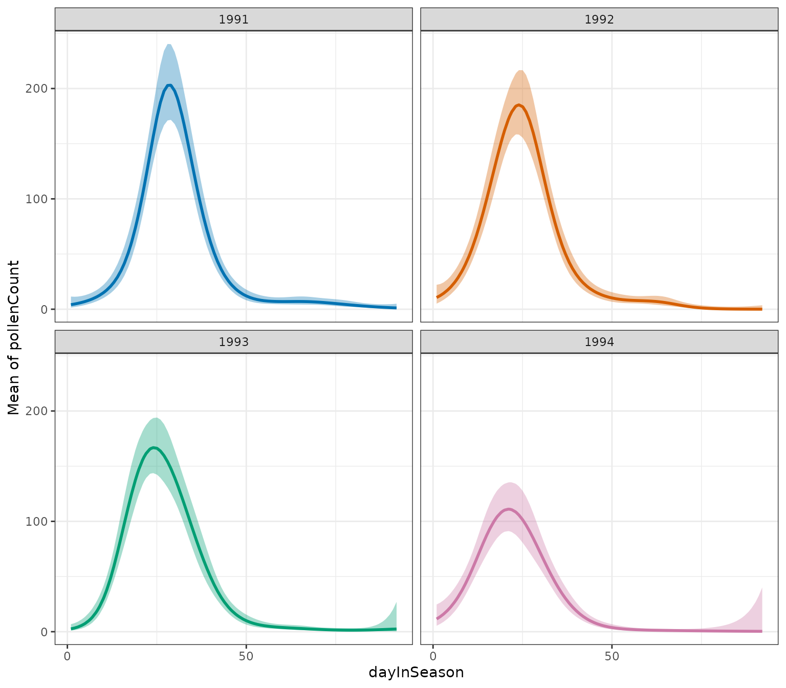

## Example 8: semiparametric regression with a spatial surface (copper data)

The `copper` data give the copper grade of ore samples with the X, Y and
Z coordinates of each sampling point in a mining area. The model has a
curve in depth and a surface over the plane, on the log scale; the
predictions are back-transformed with `trans = exp` (medians on the
grade scale).

### Data Info

- Structure
- Summary
- Data

Code

``` r

str(copper)
```

    ## 'data.frame':    439 obs. of  4 variables:
    ##  $ xcoord: int  220 220 220 220 220 220 220 220 220 270 ...
    ##  $ ycoord: int  625 625 625 625 625 625 625 625 625 625 ...
    ##  $ zcoord: int  122 117 112 107 102 97 92 87 82 122 ...
    ##  $ grade : num  1.34 0.98 1.29 1.18 1.1 0.46 1.18 0.96 1.27 0.64 ...

Code

``` r

summary(copper)
```

    ##      xcoord          ycoord          zcoord          grade      
    ##  Min.   : 65.0   Min.   :220.0   Min.   : 77.0   Min.   :0.370  
    ##  1st Qu.:365.0   1st Qu.:320.0   1st Qu.: 87.0   1st Qu.:0.740  
    ##  Median :465.0   Median :425.0   Median :102.0   Median :0.970  
    ##  Mean   :469.5   Mean   :427.8   Mean   :100.4   Mean   :1.058  
    ##  3rd Qu.:610.0   3rd Qu.:525.0   3rd Qu.:112.0   3rd Qu.:1.245  
    ##  Max.   :665.0   Max.   :625.0   Max.   :122.0   Max.   :3.200

Code

``` r

DT_df(copper)
```

### Modelling

- Model
- Residual Plot

Code

``` r

# an O'Sullivan spline in depth, a thin-plate surface over the plane (their linear
# terms are added to the fixed effects), and the pairwise interactions of the coordinates
mod <- semireg(log(grade) ~ s(zcoord, bs = "os") + s(xcoord, ycoord, bs = "ztps", k = 6) +
                 xcoord:ycoord + xcoord:zcoord + ycoord:zcoord,
               data = copper)
```

Code

``` r

residplot(mod$semer)  
```

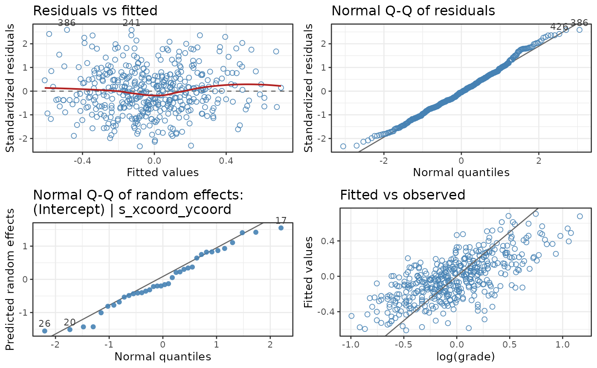

### ANOVA, Smooth Tests and $`R^2`$

- **ANOVA**

Code

``` r

kable(anova(mod$semer))
```

|               |          F |  Df |    Df.res |   Pr(\>F) |
|:--------------|-----------:|----:|----------:|----------:|
| (Intercept)   |  0.8534314 |   1 |  14.25096 | 0.3709616 |
| zcoord        | 26.5094686 |   1 | 417.28577 | 0.0000004 |
| xcoord        |  0.0247375 |   1 |  13.95960 | 0.8772752 |
| ycoord        |  1.4111370 |   1 |  14.17006 | 0.2543982 |
| xcoord:ycoord |  0.2820408 |   1 |  15.46128 | 0.6029130 |
| xcoord:zcoord |  3.9173411 |   1 | 416.02554 | 0.0484493 |
| ycoord:zcoord | 25.9679209 |   1 | 413.16877 | 0.0000005 |

- **Tests of the smooth terms**

Code

``` r

kable(anova(mod)$smooth)
```

| term | variance | logLik | logLik.without | LRT | p.value | test |
|:---|---:|---:|---:|---:|---:|:---|
| s_zcoord | 0.0789849 | -159.2031 | -199.6525 | 80.89885 | 0 | 0.5 chi2(0) + 0.5 chi2(1) |
| s_xcoord_ycoord | 1.7857080 | -159.2031 | -207.6783 | 96.95054 | 0 | 0.5 chi2(0) + 0.5 chi2(1) |

- **$`R^2`$**

Code

``` r

R2_model(mod$semer)
```

    ## # Adjusted R2 for mixed models (Piepho)
    ##           Total           Fixed          Random s_xcoord_ycoord        s_zcoord 
    ##          79.20%        -135.63%         214.83%         196.83%          18.00%

### Semiparametric prediction

- Z Table
- Z Plot
- X, Y Table
- X, Y 2D Plot
- X, Y 3D Plot

Code

``` r

pred_out1 <- semipred(mod, covariate="zcoord", trans=exp)
DT_df(pred_out1$pred_df %>% 
        mutate_if(is.numeric, round, digits = 4))
```

Code

``` r

autoplot(pred_out1)
```

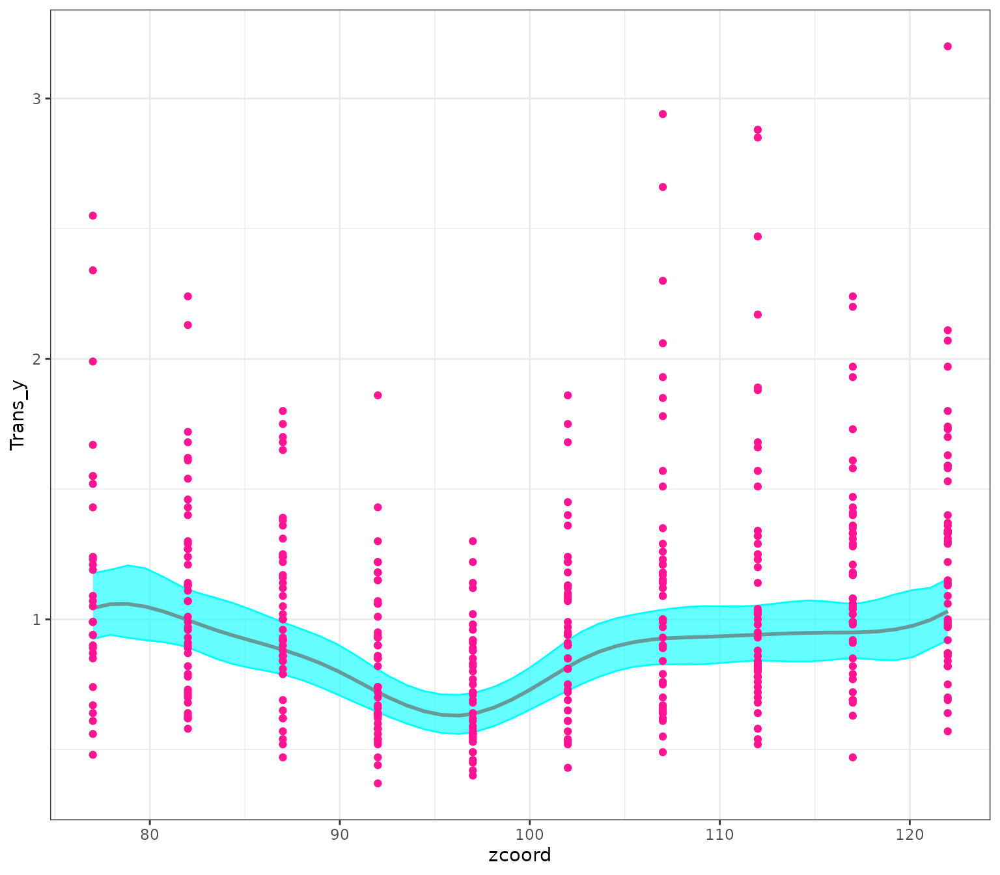

Code

``` r

pred_out2 <- semipred(mod, covariate = c("xcoord", "ycoord"), trans = exp)
DT_df(pred_out2$pred_df %>% 
        mutate_if(is.numeric, round, digits = 4))
```

Code

``` r

autoplot(pred_out2)
```

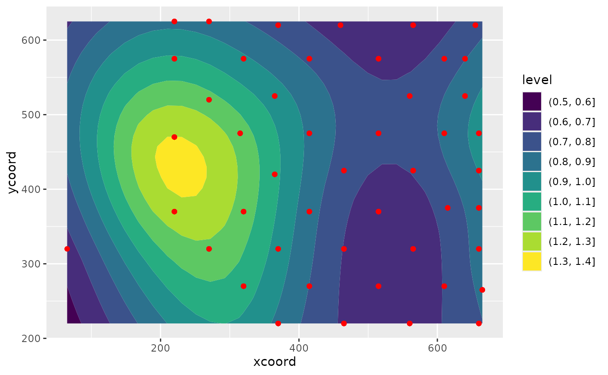

Code

``` r

# the same surface in 3-D (plotly; drag to rotate)
autoplot(pred_out2, type = "3d", data = FALSE)
```

## **References**

- Benjamini, Y., and Hochberg, Y. (1995). Controlling the false
  discovery rate: a practical and powerful approach to multiple testing.
  Journal of the Royal Statistical Society Series B, 57, 289–300.
  <https://doi.org/10.1111/j.2517-6161.1995.tb02031.x>.
  <https://www.jstor.org/stable/2346101>.

- Cave, V. (2021). Confidence tricks: the 83.4% confidence interval for
  comparing means. <https://vsni.co.uk/blogs/confidence_trick>.

- Douglas Bates, Martin Maechler, Ben Bolker, Steve Walker (2015).
  Fitting Linear Mixed-Effects Models Using lme4. Journal of Statistical
  Software, 67(1), 1-48. <https://doi.org/10.18637/jss.v067.i01>.

- Harezlak J., Ruppert, D. & Wand, M.P. (2018). Semiparametric
  Regression with R. Springer; ISBN: 978-1-4939-8851-8.

- Kenward, M. G., and Roger, J. H. (1997). Small sample inference for
  fixed effects from restricted maximum likelihood. Biometrics, 53,
  983-997. <https://doi.org/10.2307/2533558>.

- Luo, D., Ganesh, S., and Koolaard, J. predictmeans: predicted means
  for linear and semiparametric models. R package.
  <https://CRAN.R-project.org/package=predictmeans>.

- Piepho, H.-P. (2023). An adjusted coefficient of determination (R2)
  for generalized linear mixed models in one go. Biometrical Journal,
  65(7), e2200290. <https://doi.org/10.1002/bimj.202200290>.

- R Core Team (2025). R: A language and environment for statistical
  computing. R Foundation for Statistical Computing, Vienna, Austria.
  URL <https://www.R-project.org/>.
