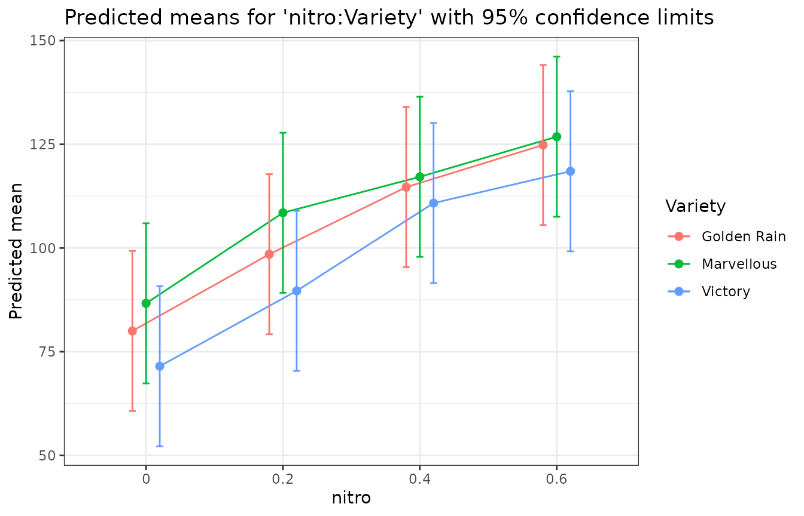
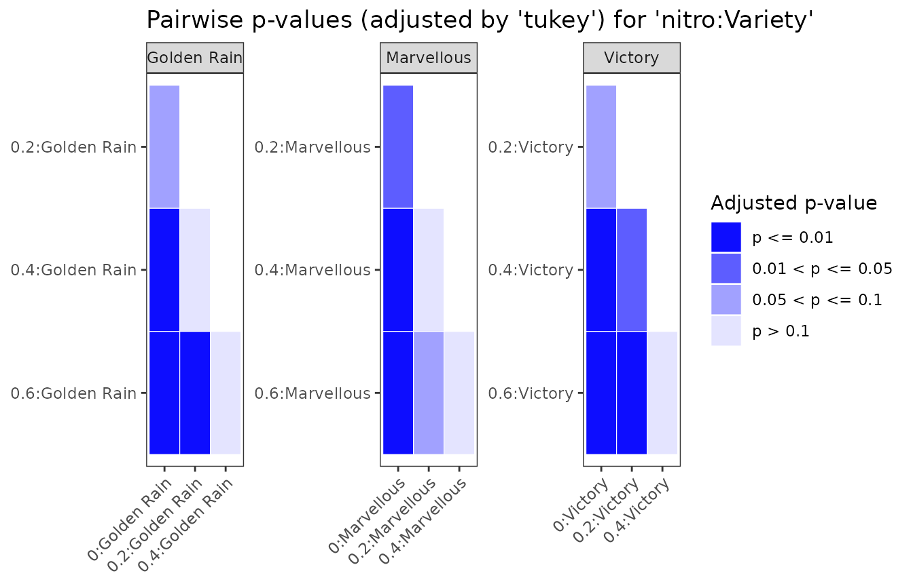

# Getting started with predictmeans

predictmeans gives predicted (least-squares) means, standard errors,
LSDs and pairwise comparisons for `lm`, `glm`, `aov`, `gls`, `lme`,
`lmer`, `glmer`, `glmmTMB` and `gam` models, with Kenward–Roger or
Satterthwaite degrees of freedom for mixed models, and permutation
tests.

## A split-plot experiment

The oats data (Yates 1935) are a split plot: three varieties on whole
plots within six blocks, four nitrogen levels on subplots.

``` r

library(predictmeans)
Oats <- as.data.frame(nlme::Oats)
Oats$nitro <- factor(Oats$nitro)
fm <- lmer(yield ~ nitro * Variety + (1 | Block/Variety), data = Oats)
```

## Predicted means and pairwise comparisons

``` r

pm <- predictmeans(fm, "nitro:Variety", atvar = "Variety", adj = "tukey",
                   plot = FALSE, prtnum = FALSE)
summary(pm)
#> Predicted means for 'nitro:Variety' (lmerModLmerTest model; df: Kenward-Roger, Kenward-Roger adjusted SEs)
#> Confidence limits: 95%
#> 
#>  nitro     Variety estimate std.error    df conf.low conf.high group
#>      0 Golden Rain    80.00     9.107 16.08    60.70      99.3   A  
#>      0  Marvellous    86.67     9.107 16.08    67.37     106.0    A 
#>      0     Victory    71.50     9.107 16.08    52.20      90.8    A 
#>    0.2 Golden Rain    98.50     9.107 16.08    79.20     117.8   AB 
#>    0.2  Marvellous   108.50     9.107 16.08    89.20     127.8     B
#>    0.2     Victory    89.67     9.107 16.08    70.37     109.0    A 
#>    0.4 Golden Rain   114.67     9.107 16.08    95.37     134.0    BC
#>    0.4  Marvellous   117.17     9.107 16.08    97.87     136.5     B
#>    0.4     Victory   110.83     9.107 16.08    91.54     130.1     B
#>    0.6 Golden Rain   124.83     9.107 16.08   105.53     144.1     C
#>    0.6  Marvellous   126.83     9.107 16.08   107.53     146.1     B
#>    0.6     Victory   118.50     9.107 16.08    99.20     137.8     B
#> 
#> 18 pairwise comparisons within each level of Variety.
#> SED: min 7.683, mean 7.683, max 7.683
#> LSD (5%): min 15.47, mean 15.47, max 15.47
#> p-values: t tests, adjusted by 'tukey'.
#> Means sharing a letter are not significantly different at the 5% level within each level of Variety.
```

`atvar = "Variety"` compares the nitrogen levels within each variety,
with Tukey adjustment within each variety.

## Tables to work with

Every result carries three stable tables: `means`, `pairs` and
`settings`. They are plain data frames, so they are easy to filter, join
or export.

``` r

head(pm$means)
#>   nitro     Variety  estimate std.error       df conf.low conf.high group n
#> 1     0 Golden Rain  80.00000   9.10701 16.08186 60.70198  99.29802   A   6
#> 2     0  Marvellous  86.66667   9.10701 16.08186 67.36865 105.96468    A  6
#> 3     0     Victory  71.50000   9.10701 16.08186 52.20198  90.79802    A  6
#> 4   0.2 Golden Rain  98.50000   9.10701 16.08186 79.20198 117.79802   AB  6
#> 5   0.2  Marvellous 108.50000   9.10701 16.08186 89.20198 127.79802     B 6
#> 6   0.2     Victory  89.66667   9.10701 16.08186 70.36865 108.96468    A  6
#>   estimable
#> 1      TRUE
#> 2      TRUE
#> 3      TRUE
#> 4      TRUE
#> 5      TRUE
#> 6      TRUE
head(pm$pairs)
#>          level1          level2          by   estimate std.error       df
#> 1 0:Golden Rain    0:Marvellous        <NA>  -6.666667  9.715020 30.23076
#> 2 0:Golden Rain       0:Victory        <NA>   8.500000  9.715020 30.23076
#> 3  0:Marvellous       0:Victory        <NA>  15.166667  9.715020 30.23076
#> 4 0:Golden Rain 0.2:Golden Rain Golden Rain -18.500000  7.682948 45.00000
#> 5  0:Marvellous 0.2:Golden Rain        <NA> -11.833333  9.715020 30.23076
#> 6     0:Victory 0.2:Golden Rain        <NA> -27.000000  9.715020 30.23076
#>    statistic     p.value      p.adj      lsd p.method
#> 1 -0.6862226 0.497802553         NA 19.83437    tukey
#> 2  0.8749338 0.388508430         NA 19.83437    tukey
#> 3  1.5611564 0.128895708         NA 19.83437    tukey
#> 4 -2.4079299 0.020203579 0.09004252 15.47425    tukey
#> 5 -1.2180451 0.232628352         NA 19.83437    tukey
#> 6 -2.7792016 0.009281366         NA 19.83437    tukey
```

The same tables come from
[`as.data.frame()`](https://rdrr.io/r/base/as.data.frame.html) or, with
the generics package, `tidy()`:

``` r

head(as.data.frame(pm, what = "pairs"), 3)
#>          level1       level2   by  estimate std.error       df  statistic
#> 1 0:Golden Rain 0:Marvellous <NA> -6.666667   9.71502 30.23076 -0.6862226
#> 2 0:Golden Rain    0:Victory <NA>  8.500000   9.71502 30.23076  0.8749338
#> 3  0:Marvellous    0:Victory <NA> 15.166667   9.71502 30.23076  1.5611564
#>     p.value p.adj      lsd p.method
#> 1 0.4978026    NA 19.83437    tukey
#> 2 0.3885084    NA 19.83437    tukey
#> 3 0.1288957    NA 19.83437    tukey
```

## Plots

``` r

ggplot2::autoplot(pm)
```



``` r

ggplot2::autoplot(pm, type = "pvalue")
```



[`predictmeans()`](https://dongwenluo.github.io/predictmeans/reference/predictmeans.md)
still draws its classic plots when `plot = TRUE` (the default);
`which.plots` chooses among the means, bar, p-value and back-transformed
plots.

## Degrees of freedom and standard errors

For REML `lmer` fits the default is Kenward–Roger: adjusted standard
errors and Kenward–Roger df, as SAS `DDFM=KR` and emmeans give. Other
choices:

``` r

# Satterthwaite df
pm_s <- predictmeans(fm, "Variety", df_method = "Satterthwaite", plot = FALSE, prtnum = FALSE)
# SAS DDFM=CONTAIN (containment) df, with unadjusted standard errors
pm_c <- predictmeans(fm, "Variety", df_method = "containment", plot = FALSE, prtnum = FALSE)
rbind(Satterthwaite = pm_s$means$df[1], containment = pm_c$means$df[1])
#>                    [,1]
#> Satterthwaite  8.868755
#> containment   10.000000
```

## Averaging over other factors

Means of a main effect average over the other factors in the model.
`weights` chooses how: `"equal"` (the default), `"proportional"` (as SAS
`LSMEANS / OM`), `"outer"`, `"cells"` or `"flat"`, with the same
definitions as emmeans.

``` r

predictmeans(fm, "nitro", weights = "proportional", plot = FALSE, prtnum = FALSE)$means
#>   nitro  estimate std.error      df  conf.low conf.high  n estimable
#> 1     0  79.38889  7.174754 6.79202  62.31741  96.46037 18      TRUE
#> 2   0.2  98.88889  7.174754 6.79202  81.81741 115.96037 18      TRUE
#> 3   0.4 114.22222  7.174754 6.79202  97.15074 131.29370 18      TRUE
#> 4   0.6 123.38889  7.174754 6.79202 106.31741 140.46037 18      TRUE
```

## Custom contrasts

[`specify_contrast()`](https://dongwenluo.github.io/predictmeans/reference/specify_contrast.md)
writes contrasts by the names of the means;
[`contrastmeans()`](https://dongwenluo.github.io/predictmeans/reference/contrastmeans.md)
tests them.

``` r

cm <- specify_contrast(Kmatrix(fm, "nitro:Variety"),
  N_effect_Victory = `0.6:Victory` - `0:Victory`,
  N_effect_Victory_vs_others = (`0.6:Victory` - `0:Victory`) -
    ((`0.6:Golden Rain` - `0:Golden Rain`) + (`0.6:Marvellous` - `0:Marvellous`)) / 2)
contrastmeans(fm, "nitro:Variety", ctrmatrix = cm)
#> $`The t tests of the specified contrasts`
#>                            Estimate Std. Error t value df Pr(>|t|)
#> N_effect_Victory               47.0     7.6829  6.1174 45   0.0000
#> N_effect_Victory_vs_others      4.5     9.4097  0.4782 45   0.6348
#> attr(,"Note")
#> [1] "The p-value is adjusted by 'none' method, if p-value = 0 means p-value < 0.0001."
#> 
#> $K
#>                            0:Golden Rain 0:Marvellous 0:Victory 0.2:Golden Rain
#> N_effect_Victory                     0.0          0.0        -1               0
#> N_effect_Victory_vs_others           0.5          0.5        -1               0
#>                            0.2:Marvellous 0.2:Victory 0.4:Golden Rain
#> N_effect_Victory                        0           0               0
#> N_effect_Victory_vs_others              0           0               0
#>                            0.4:Marvellous 0.4:Victory 0.6:Golden Rain
#> N_effect_Victory                        0           0             0.0
#> N_effect_Victory_vs_others              0           0            -0.5
#>                            0.6:Marvellous 0.6:Victory
#> N_effect_Victory                      0.0           1
#> N_effect_Victory_vs_others           -0.5           1
```

## Models with covariates

[`Kmatrix()`](https://dongwenluo.github.io/predictmeans/reference/Kmatrix.md)
builds the reference grid behind every mean. Covariates are set to their
means by default (`cov_reduce` changes that), and may enter the model
through transformations such as
[`poly()`](https://rdrr.io/r/stats/poly.html), `ns()`,
[`log()`](https://rdrr.io/r/base/Log.html) or smooth terms of a `gam`.

``` r

data(Drug)
fm_glm <- glm(cbind(R, N - R) ~ Drug + log10Dose, family = binomial, data = Drug)
predictmeans(fm_glm, "Drug", pairwise = TRUE, plot = FALSE, prtnum = FALSE)$means
#>          Drug log10Dose   estimate std.error df   conf.low  conf.high  response
#> 1    Morphine  0.603011  0.1739917 0.1223041  9 -0.1026794  0.4506629 0.5433885
#> 2     Amidone  0.603011  0.5660805 0.1370736  9  0.2559986  0.8761625 0.6378583
#> 3 Phenadoxone  0.603011  2.4185555 0.2045918  9  1.9557367  2.8813742 0.9182314
#> 4   Pethidine  0.603011 -1.7574624 0.1693986  9 -2.1406687 -1.3742560 0.1471084
#>   response.conf.low response.conf.high group n estimable
#> 1         0.4743527          0.6107968   A   3      TRUE
#> 2         0.5636524          0.7060264   A   3      TRUE
#> 3         0.8760708          0.9469180    B  3      TRUE
#> 4         0.1052064          0.2019331     C 5      TRUE
```

For a glm the means are also given on the response scale (here
probabilities).

## More

- [`vignette("R2_glmm", package = "predictmeans")`](https://dongwenluo.github.io/predictmeans/articles/R2_glmm.md):
  adjusted R² for mixed models.
- [`vignette("migrating", package = "predictmeans")`](https://dongwenluo.github.io/predictmeans/articles/migrating.md):
  what changed from version 1.x.
- [`?permmodels`](https://dongwenluo.github.io/predictmeans/reference/permmodels.md):
  permutation tests for mixed models; pass the result to
  `predictmeans(permlist = )` for permutation p-values of pairwise
  comparisons.
- [`?semireg`](https://dongwenluo.github.io/predictmeans/reference/semireg.md),
  [`?semipred`](https://dongwenluo.github.io/predictmeans/reference/semipred.md):
  semiparametric regression.
