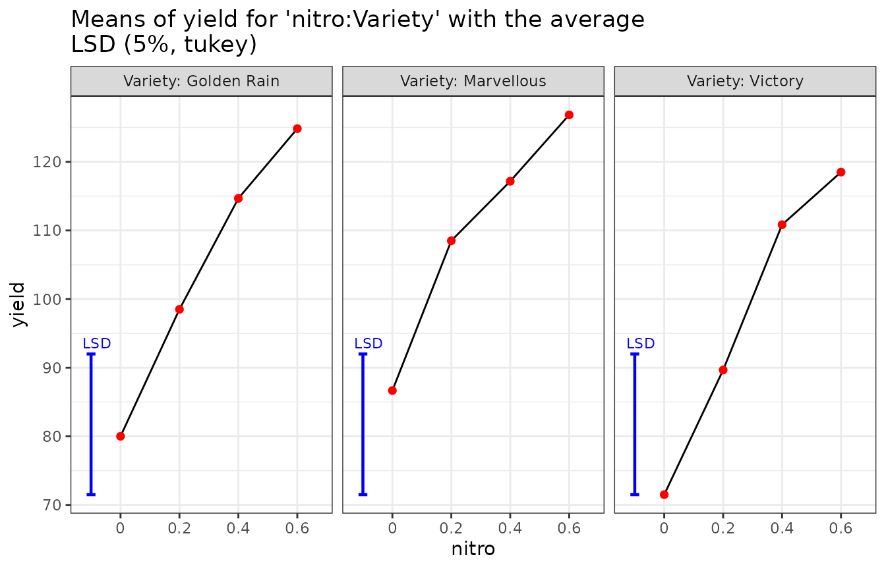
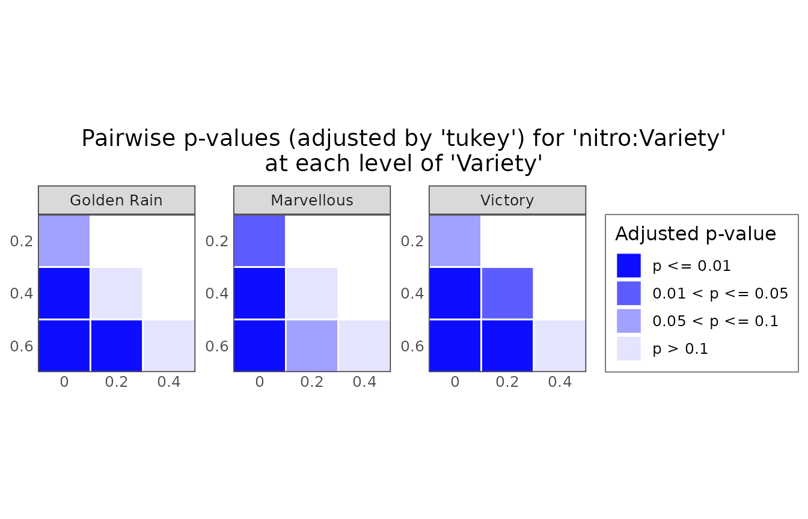
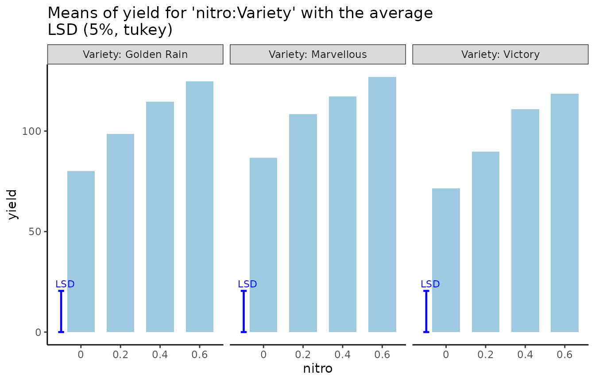
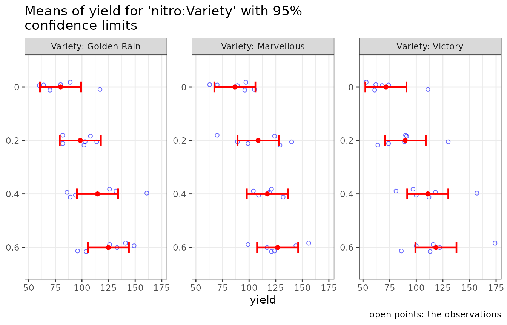

# Getting started with predictmeans

predictmeans gives predicted (least-squares) means, standard errors,
LSDs and pairwise comparisons for `lm`, `glm`, `aov`, `gls`, `lme`,
`lmer`, `glmer`, `glmmTMB` and `gam` models, with Kenward–Roger or
Satterthwaite degrees of freedom for mixed models, and permutation
tests.


## Why predictmeans

- **Defaults chosen on evidence** (simulation, literature):
  Kenward–Roger df and adjusted SEs for REML `lmer` fits; permutation
  p-values $`(b+1)/(B+1)`$; `aov` with `Error()` analysed by strata,
  with SEs from the stratum mean squares (as Genstat); means over empty
  cells averaged with equal weight over the observed cells, with a
  warning naming them.
- **Checked against outside references** in the package tests: real SAS
  PROC MIXED and Genstat runs
  ([`vignette("sas")`](https://dongwenluo.github.io/predictmeans/articles/sas.md)),
  pbkrtest, [`nlme::lme`](https://rdrr.io/pkg/nlme/man/lme.html) and
  emmeans.
- **Robust across model classes**: when a result cannot be computed
  correctly, the function stops with a message saying why, rather than
  returning a wrong number.
- **Advice from the data**: when this fit needs a caution (empty cells,
  singular fit, small df, …), the result says so in one line with what
  to do; read it with `advice(x)`, turn it off with
  `options(predictmeans.advice = FALSE)`.
- **Reproducible**: permutation and bootstrap results are identical for
  any `ncore`.

## A split-plot experiment

The oats data (Yates 1935) are a split plot: three varieties on whole
plots within six blocks, four nitrogen levels on subplots.

``` r

library(predictmeans)
Oats <- as.data.frame(nlme::Oats)
Oats$nitro <- factor(Oats$nitro)
fm <- lmer(yield ~ nitro * Variety + (1 | Block/Variety), data = Oats)
```

## Predicted means and pairwise comparisons

``` r

pm <- predictmeans(fm, "nitro:Variety", atvar = "Variety", adj = "tukey")
summary(pm)
#> Predicted means for 'nitro:Variety' (lmerMod model; df: Kenward-Roger, Kenward-Roger adjusted SEs)
#> Confidence limits: 95%
#> 
#>  nitro     Variety estimate std.error    df conf.low conf.high group
#>      0 Golden Rain    80.00     9.107 16.08    60.70      99.3   A  
#>    0.2 Golden Rain    98.50     9.107 16.08    79.20     117.8   AB 
#>    0.4 Golden Rain   114.67     9.107 16.08    95.37     134.0    BC
#>    0.6 Golden Rain   124.83     9.107 16.08   105.53     144.1     C
#>      0  Marvellous    86.67     9.107 16.08    67.37     106.0    A 
#>    0.2  Marvellous   108.50     9.107 16.08    89.20     127.8     B
#>    0.4  Marvellous   117.17     9.107 16.08    97.87     136.5     B
#>    0.6  Marvellous   126.83     9.107 16.08   107.53     146.1     B
#>      0     Victory    71.50     9.107 16.08    52.20      90.8    A 
#>    0.2     Victory    89.67     9.107 16.08    70.37     109.0    A 
#>    0.4     Victory   110.83     9.107 16.08    91.54     130.1     B
#>    0.6     Victory   118.50     9.107 16.08    99.20     137.8     B
#> 
#> 18 pairwise comparisons within each level of Variety.
#> SED: min 7.683, mean 7.683, max 7.683
#> LSD (5%, tukey): 20.5 (equal for all pairs)
#> p-values: t tests, adjusted by 'tukey'.
#> Means sharing a letter are not significantly different at the 5% level within each level of Variety.
#> Comparison intervals: mean +/- 1.125 SE (72.3% intervals); means differ at the 5% level when these do not overlap. The 95% confidence limits are not for comparing means.
```

`atvar = "Variety"` compares the nitrogen levels within each variety,
with Tukey adjustment within each variety.

## Tables to work with

Every result carries three stable tables: `means`, `pairs` and
`settings`. They are plain data frames, so they are easy to filter, join
or export.

``` r

head(pm$means)
#>   nitro     Variety  estimate std.error       df  conf.low conf.high
#> 1     0 Golden Rain  80.00000   9.10701 16.08144  60.70194  99.29806
#> 2   0.2 Golden Rain  98.50000   9.10701 16.08144  79.20194 117.79806
#> 3   0.4 Golden Rain 114.66667   9.10701 16.08144  95.36861 133.96472
#> 4   0.6 Golden Rain 124.83333   9.10701 16.08144 105.53528 144.13139
#> 5     0  Marvellous  86.66667   9.10701 16.08144  67.36861 105.96472
#> 6   0.2  Marvellous 108.50000   9.10701 16.08144  89.20194 127.79806
#>   comparison.low comparison.high group n estimable
#> 1       69.75210        90.24790   A   6      TRUE
#> 2       88.25210       108.74790   AB  6      TRUE
#> 3      104.41877       124.91456    BC 6      TRUE
#> 4      114.58544       135.08123     C 6      TRUE
#> 5       76.41877        96.91456    A  6      TRUE
#> 6       98.25210       118.74790     B 6      TRUE
head(pm$pairs)
#>            level1          level2          by  estimate std.error       df
#> 1   0:Golden Rain 0.2:Golden Rain Golden Rain -18.50000  7.682948 45.00014
#> 2   0:Golden Rain 0.4:Golden Rain Golden Rain -34.66667  7.682948 45.00014
#> 3   0:Golden Rain 0.6:Golden Rain Golden Rain -44.83333  7.682948 45.00014
#> 4 0.2:Golden Rain 0.4:Golden Rain Golden Rain -16.16667  7.682948 45.00014
#> 5 0.2:Golden Rain 0.6:Golden Rain Golden Rain -26.33333  7.682948 45.00014
#> 6 0.4:Golden Rain 0.6:Golden Rain Golden Rain -10.16667  7.682948 45.00014
#>   statistic      p.value        p.adj  conf.low   conf.high      lsd
#> 1 -2.407930 2.020357e-02 9.004248e-02 -33.97425  -3.0257499 15.47425
#> 2 -4.512157 4.576126e-05 2.600347e-04 -50.14092 -19.1924165 15.47425
#> 3 -5.835434 5.476774e-07 3.213104e-06 -60.30758 -29.3590832 15.47425
#> 4 -2.104227 4.097729e-02 1.673400e-01 -31.64092  -0.6924165 15.47425
#> 5 -3.427504 1.312508e-03 6.939258e-03 -41.80758 -10.8590832 15.47425
#> 6 -1.323277 1.924277e-01 5.532559e-01 -25.64092   5.3075835 15.47425
#>   adj.conf.low adj.conf.high p.method
#> 1    -38.99579      1.995794    tukey
#> 2    -55.16246    -14.170873    tukey
#> 3    -65.32913    -24.337540    tukey
#> 4    -36.66246      4.329127    tukey
#> 5    -46.82913     -5.837540    tukey
#> 6    -30.66246     10.329127    tukey
```

The same tables come from
[`as.data.frame()`](https://rdrr.io/r/base/as.data.frame.html) or, with
the generics package, `tidy()`:

``` r

head(as.data.frame(pm, what = "pairs"), 3)
#>          level1          level2          by  estimate std.error       df
#> 1 0:Golden Rain 0.2:Golden Rain Golden Rain -18.50000  7.682948 45.00014
#> 2 0:Golden Rain 0.4:Golden Rain Golden Rain -34.66667  7.682948 45.00014
#> 3 0:Golden Rain 0.6:Golden Rain Golden Rain -44.83333  7.682948 45.00014
#>   statistic      p.value        p.adj  conf.low conf.high      lsd adj.conf.low
#> 1 -2.407930 2.020357e-02 9.004248e-02 -33.97425  -3.02575 15.47425    -38.99579
#> 2 -4.512157 4.576126e-05 2.600347e-04 -50.14092 -19.19242 15.47425    -55.16246
#> 3 -5.835434 5.476774e-07 3.213104e-06 -60.30758 -29.35908 15.47425    -65.32913
#>   adj.conf.high p.method
#> 1      1.995794    tukey
#> 2    -14.170873    tukey
#> 3    -24.337540    tukey
```

## Plots

``` r

ggplot2::autoplot(pm)
```



``` r

ggplot2::autoplot(pm, type = "pvalue")
```



[`autoplot()`](https://ggplot2.tidyverse.org/reference/autoplot.html)
draws every plot from the result
([`predictmeans()`](https://dongwenluo.github.io/predictmeans/reference/predictmeans.md)
draws none): the means with one average LSD bar (the default),
`type = "bar"`, `type = "ci"` (each mean with its confidence limits; on
the response scale when the means are back-transformed) and
`type = "pvalue"`. `data = TRUE` adds the observations; `x`, `group` and
`panel` place the factors; with `atvar` each level is a panel with its
own LSD.

``` r

ggplot2::autoplot(pm, type = "bar")
```



``` r

ggplot2::autoplot(pm, type = "ci", data = TRUE)
```



## Degrees of freedom and standard errors

`df_method = "auto"` (the default) chooses the df by the model:

| Model | Default df | Other choices of `df_method` |
|----|----|----|
| REML `lmer`, `lme`, `gls` | Kenward–Roger, with adjusted SEs (as SAS `DDFM=KR`) | `"Satterthwaite"`, `"containment"`, `"between-within"`, `"KR-expected"`, `"KR-average"` |
| ML `lmer`, `lme`, `gls` | Satterthwaite, from the ML likelihood | `"containment"`, `"between-within"` |
| `glmer`, `glmmTMB` | `"inner-outer"`: the df of the grouping level at which each effect varies | `"containment"`, `"between-within"` (`glmer`), `"residual"` |
| `glm`, `gam`: Poisson, binomial, negative binomial | none: z tests (`"asymptotic (z)"`), as emmeans and SAS GLIMMIX | `"residual"` (t tests, as 1.x) |
| `lm`; `glm`, `gam` with an estimated dispersion (Gaussian, Gamma, quasi-) | residual df |  |
| `aov` with `Error()` | by strata, Satterthwaite’s df across strata |  |

`settings$df_method` of the result says which was used. For the split
plot (a REML `lmer` fit) the default gives Kenward–Roger SEs and df.
Other choices:

``` r

# Satterthwaite df
pm_s <- predictmeans(fm, "Variety", df_method = "Satterthwaite")
# SAS DDFM=CONTAIN (containment) df, with unadjusted standard errors
pm_c <- predictmeans(fm, "Variety", df_method = "containment")
rbind(Satterthwaite = pm_s$means$df[1], containment = pm_c$means$df[1])
#>                    [,1]
#> Satterthwaite  8.868755
#> containment   10.000000
```

`df_method = "between-within"` gives SAS’s `DDFM=BETWITHIN` df.
Kenward–Roger uses the observed information of the variance parameters,
as SAS does; `"KR-expected"` uses the expected information, as pbkrtest
and emmeans. The two agree in balanced designs; with missing values only
the observed information is valid, and in simulations it kept the 5%
level where the expected one rejected 8.5% of true hypotheses.
`"KR-average"` uses the average information of Genstat’s REML and gives
Genstat’s df (with `vcov_adjust = FALSE`, also its SEDs). For `lme` and
`gls` models with correlation or variance structures, `"Satterthwaite"`,
`"Kenward-Roger"`, `"KR-expected"` and `"KR-average"` are available too.
[`vignette("sas", package = "predictmeans")`](https://dongwenluo.github.io/predictmeans/articles/sas.md)
shows how each matches SAS PROC MIXED.

ML fits get Satterthwaite df because Kenward–Roger’s adjustment is
derived for REML. For Poisson, binomial and negative binomial `glm` fits
the dispersion is known, so there are no residual df to use: in
simulations, t tests on the residual df rejected 0.3–4.5% of true
hypotheses at the 5% level, and z tests 3.6–5.7%.

Before reading the means, check the model:
[`pm_check()`](https://dongwenluo.github.io/predictmeans/reference/pm_check.md)
and
[`residplot()`](https://dongwenluo.github.io/predictmeans/reference/residplot.md),
in
[`vignette("checking", package = "predictmeans")`](https://dongwenluo.github.io/predictmeans/articles/checking.md).

## Averaging over other factors

Means of a main effect average over the other factors in the model.
`weights` chooses how: `"equal"` (the default), `"proportional"` (as SAS
`LSMEANS / OM`), `"outer"`, `"cells"` or `"flat"`, with the same
definitions as emmeans.

``` r

predictmeans(fm, "nitro", weights = "proportional")$means
#>   nitro  estimate std.error       df  conf.low conf.high comparison.low
#> 1     0  79.38889  7.174754 6.791824  62.31730  96.46047       74.92186
#> 2   0.2  98.88889  7.174754 6.791824  81.81730 115.96047       94.42186
#> 3   0.4 114.22222  7.174754 6.791824  97.15064 131.29381      109.75519
#> 4   0.6 123.38889  7.174754 6.791824 106.31730 140.46047      118.92186
#>   comparison.high  n estimable
#> 1        83.85592 18      TRUE
#> 2       103.35592 18      TRUE
#> 3       118.68925 18      TRUE
#> 4       127.85592 18      TRUE
```

## Custom contrasts

[`specify_contrast()`](https://dongwenluo.github.io/predictmeans/reference/specify_contrast.md)
writes contrasts by the names of the means;
[`contrastmeans()`](https://dongwenluo.github.io/predictmeans/reference/contrastmeans.md)
tests them.

``` r

cm <- specify_contrast(Kmatrix(fm, "nitro:Variety"),
  N_effect_Victory = `0.6:Victory` - `0:Victory`,
  N_effect_Victory_vs_others = (`0.6:Victory` - `0:Victory`) -
    ((`0.6:Golden Rain` - `0:Golden Rain`) + (`0.6:Marvellous` - `0:Marvellous`)) / 2)
contrastmeans(fm, "nitro:Variety", ctrmatrix = cm)
#> Contrasts of 'nitro:Variety' (95% limits; p.adj: none; Kenward-Roger df)
#>                    contrast estimate std.error df statistic   p.value     p.adj
#>            N_effect_Victory     47.0     7.683 45    6.1174 2.090e-07 2.090e-07
#>  N_effect_Victory_vs_others      4.5     9.410 45    0.4782 6.348e-01 6.348e-01
#>  conf.low conf.high
#>     31.53     62.47
#>    -14.45     23.45
```

## Models with covariates

[`Kmatrix()`](https://dongwenluo.github.io/predictmeans/reference/Kmatrix.md)
builds the reference grid behind every mean. Covariates are set to their
means by default (`cov_reduce` changes that), and may enter the model
through transformations such as
[`poly()`](https://rdrr.io/r/stats/poly.html), `ns()`,
[`log()`](https://rdrr.io/r/base/Log.html) or smooth terms of a `gam`.

``` r

data(Drug)
fm_glm <- glm(cbind(R, N - R) ~ Drug + log10Dose, family = binomial, data = Drug)
predictmeans(fm_glm, "Drug", pairwise = TRUE)$means
#>          Drug log10Dose   estimate std.error  df    conf.low  conf.high
#> 1    Morphine  0.603011  0.1739917 0.1223041 Inf -0.06571997  0.4137034
#> 2     Amidone  0.603011  0.5660805 0.1370736 Inf  0.29742128  0.8347398
#> 3 Phenadoxone  0.603011  2.4185555 0.2045918 Inf  2.01756299  2.8195480
#> 4   Pethidine  0.603011 -1.7574624 0.1693986 Inf -2.08947760 -1.4254471
#>   comparison.low comparison.high  response response.std.error response.conf.low
#> 1    -0.00369742       0.3516809 0.5433885         0.03034579         0.4835759
#> 2     0.36693366       0.7652274 0.6378583         0.03166332         0.5738120
#> 3     2.12131502       2.7157960 0.9182314         0.01536127         0.8826288
#> 4    -2.00357261      -1.5113521 0.1471084         0.02125403         0.1101238
#>   response.conf.high group n estimable
#> 1          0.6019756  A    3      TRUE
#> 2          0.6973562   B   3      TRUE
#> 3          0.9437231    C  3      TRUE
#> 4          0.1938091     D 5      TRUE
```

For a glm the means are also given on the response scale (here
probabilities); see
[`vignette("response-scale")`](https://dongwenluo.github.io/predictmeans/articles/response-scale.md).

## More

- [`vignette("checking", package = "predictmeans")`](https://dongwenluo.github.io/predictmeans/articles/checking.md):
  checking the model with
  [`pm_check()`](https://dongwenluo.github.io/predictmeans/reference/pm_check.md)
  and
  [`residplot()`](https://dongwenluo.github.io/predictmeans/reference/residplot.md).
- [`vignette("contrasts", package = "predictmeans")`](https://dongwenluo.github.io/predictmeans/articles/contrasts.md):
  other adjustments for multiple testing, comparisons with a control,
  trends, joint tests (slices) and slopes.
- [`vignette("response-scale", package = "predictmeans")`](https://dongwenluo.github.io/predictmeans/articles/response-scale.md):
  GLMs, GLMMs and transformed responses: means and standard errors on
  the response scale, ratios and odds ratios.
- [`vignette("missing-cells", package = "predictmeans")`](https://dongwenluo.github.io/predictmeans/articles/missing-cells.md):
  empty cells, confounded factors and means that cannot be estimated.
- [`vignette("R2_glmm", package = "predictmeans")`](https://dongwenluo.github.io/predictmeans/articles/R2_glmm.md):
  adjusted R² for mixed models.
- [`vignette("migrating", package = "predictmeans")`](https://dongwenluo.github.io/predictmeans/articles/migrating.md):
  what changed from version 1.x.
- [`vignette("resampling", package = "predictmeans")`](https://dongwenluo.github.io/predictmeans/articles/resampling.md):
  permutation and parametric bootstrap tests
  ([`permmodels()`](https://dongwenluo.github.io/predictmeans/reference/permmodels.md),
  [`permlmer()`](https://dongwenluo.github.io/predictmeans/reference/permlmer.md),
  [`permindex()`](https://dongwenluo.github.io/predictmeans/reference/permindex.md),
  [`bootmodels()`](https://dongwenluo.github.io/predictmeans/reference/bootmodels.md))
  for linear, generalized linear and mixed models, also for pairwise
  comparisons and contrasts through `permlist`.
- [`vignette("smooth", package = "predictmeans")`](https://dongwenluo.github.io/predictmeans/articles/smooth.md):
  smooth curves in mixed models
  ([`semireg()`](https://dongwenluo.github.io/predictmeans/reference/semireg.md),
  [`semipred()`](https://dongwenluo.github.io/predictmeans/reference/semipred.md)),
  with simultaneous confidence bands.
