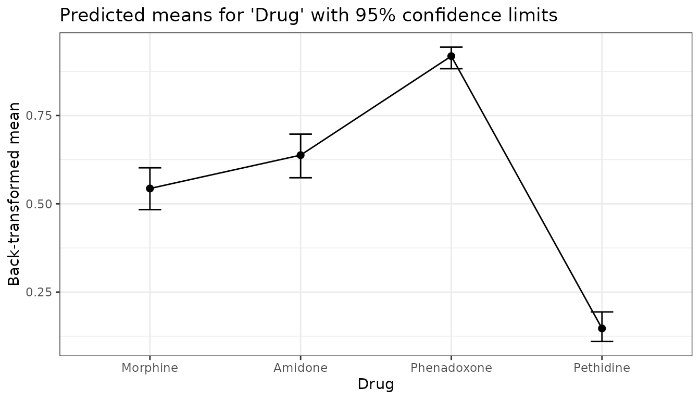

# Link and response scale

For generalized linear (mixed) models, and for models of a transformed
response such as `log(y)`, the means are estimated on the scale of the
model, the *link scale*, and then back-transformed to the scale of the
data, the *response scale*. predictmeans does the tests on the link
scale, where the model is linear, and reports both scales:

- `means`: `estimate`, `std.error`, `conf.low`, `conf.high` on the link
  scale, and `response`, `response.std.error`, `response.conf.low`,
  `response.conf.high` on the response scale;
- `pairs`: differences on the link scale and, for a log link (or
  `trans = exp`), the **ratio** of the two means with its confidence
  limits; for a logit link, the **odds ratio**.

The response-scale standard error comes from the delta method, as
emmeans gives with `type = "response"`. The confidence limits are the
back-transformed link-scale limits, so they are not symmetric around the
mean.

``` r

library(predictmeans)
```

## Binomial GLM: probabilities and odds ratios

The `Drug` data give the number of mice responding (`R`) out of `N` for
four drugs at several doses.

``` r

data(Drug)
fm_drug <- glm(cbind(R, N - R) ~ Drug + log10Dose, family = binomial, data = Drug)
pm_drug <- predictmeans(fm_drug, "Drug", pairwise = TRUE, plot = FALSE, prtnum = FALSE)
pm_drug$means[, c("Drug", "estimate", "response", "response.std.error",
                  "response.conf.low", "response.conf.high")]
#>          Drug   estimate  response response.std.error response.conf.low
#> 1    Morphine  0.1739917 0.5433885         0.03034579         0.4835759
#> 2     Amidone  0.5660805 0.6378583         0.03166332         0.5738120
#> 3 Phenadoxone  2.4185555 0.9182314         0.01536127         0.8826288
#> 4   Pethidine -1.7574624 0.1471084         0.02125403         0.1101238
#>   response.conf.high
#> 1          0.6019756
#> 2          0.6973562
#> 3          0.9437231
#> 4          0.1938091
```

`estimate` is the log odds of a response at the mean log dose;
`response` is the probability. The comparisons are tested on the
log-odds scale, and each difference is the log of an odds ratio:

``` r

pm_drug$pairs[, c("level1", "level2", "estimate", "p.value",
                  "odds.ratio", "odds.ratio.conf.low", "odds.ratio.conf.high")]
#>        level1      level2   estimate      p.value odds.ratio
#> 1    Morphine     Amidone -0.3920888 2.951890e-02  0.6756441
#> 2    Morphine Phenadoxone -2.2445638 9.302021e-24  0.1059738
#> 3     Amidone Phenadoxone -1.8524750 6.799382e-16  0.1568485
#> 4    Morphine   Pethidine  1.9314541 4.069093e-18  6.8995356
#> 5     Amidone   Pethidine  2.3235429 2.042589e-23 10.2117898
#> 6 Phenadoxone   Pethidine  4.1760179 2.573901e-37 65.1060753
#>   odds.ratio.conf.low odds.ratio.conf.high
#> 1          0.47465285            0.9617449
#> 2          0.06840188            0.1641832
#> 3          0.10004256            0.2459098
#> 4          4.46008846           10.6732394
#> 5          6.46763307           16.1234642
#> 6         34.28884136          123.6204222
```

``` r

ggplot2::autoplot(pm_drug, type = "response")
```



## Poisson GLMM: counts and rate ratios

Egg counts of individual females, in containers within populations; the
innermost random effect (one level per female) models overdispersion.

``` r

data(Poisson_ind)
fm_egg <- glmer(Egg ~ Treatment + Habitat + (1 | Population/Container/individual),
                family = poisson, data = Poisson_ind)
pm_egg <- predictmeans(fm_egg, "Treatment", pairwise = TRUE, plot = FALSE, prtnum = FALSE)
pm_egg$means[, c("Treatment", "estimate", "response", "response.std.error",
                 "response.conf.low", "response.conf.high")]
#>   Treatment estimate response response.std.error response.conf.low
#> 1       Exp 1.790814 5.994327          0.9834990          4.341871
#> 2      Cont 1.282368 3.605166          0.5965019          2.604225
#>   response.conf.high
#> 1           8.275686
#> 2           4.990820
pm_egg$pairs[, c("level1", "level2", "p.value", "ratio", "ratio.conf.low", "ratio.conf.high")]
#>   level1 level2     p.value    ratio ratio.conf.low ratio.conf.high
#> 1    Exp   Cont 1.59407e-21 1.662705        1.50571        1.836069
```

The `ratio` is the expected count under `Exp` divided by that under
`Cont`.

For a GLMM the back-transformed mean is the response of a *typical*
unit, one whose random effects are all zero. With a log link this is
smaller than the average count over all units, which is
`exp(estimate + v/2)`, `v` being the total variance of the random
effects. Ratios are the same on both definitions, which is one reason to
report them.

`bias_adjust = TRUE` gives that population mean instead (to second
order, as emmeans’ `bias.adjust`), with the random-effect variance as
default `sigma`; `average = "response"` averages the back-transformed
cells over the other factors (here Habitat), rather than
back-transforming the average on the link scale:

``` r

pm_pop <- predictmeans(fm_egg, "Treatment", bias_adjust = TRUE, average = "response",
                       plot = FALSE, prtnum = FALSE)
pm_pop$means[, c("Treatment", "response", "response.std.error")]
#>   Treatment response response.std.error
#> 1       Exp 7.282088          1.1947757
#> 2      Cont 4.379663          0.7246387
pm_pop$settings[c("bias_adjust", "average")]
#> $bias_adjust
#> [1] 0.6532427
#> 
#> $average
#> [1] "response"
```

## A transformed response: `trans = exp`

When the response is transformed before modelling, give the
back-transformation with `trans` (and `transOff` for, e.g.,
`log(y + 1)`). Differences of log means are logs of ratios of geometric
means:

``` r

data(Body_length)
fm_len <- lmer(log(BodyL) ~ Treatment + Habitat + Sex + (1 | Population/Container),
               data = Body_length)
pm_len <- predictmeans(fm_len, "Treatment", pairwise = TRUE, trans = exp,
                       plot = FALSE, prtnum = FALSE)
pm_len$means[, c("Treatment", "estimate", "response", "response.std.error")]
#>   Treatment estimate response response.std.error
#> 1      Cont 2.621319 13.75386          0.3655397
#> 2       Exp 2.644563 14.07730          0.3741359
pm_len$pairs[, c("level1", "level2", "p.value", "ratio", "ratio.conf.low", "ratio.conf.high")]
#>   level1 level2      p.value    ratio ratio.conf.low ratio.conf.high
#> 1   Cont    Exp 9.949753e-06 0.977024      0.9670482       0.9871028
```

## Binomial GLMM: odds ratio and R²

The `Clinical` data give the number of favourable responses out of the
patients in each treatment group at each of eight clinics.

``` r

data(Clinical)
fm_clin <- glmer(cbind(Favorable, Total - Favorable) ~ Treatment + (1 | Clinic),
                 family = binomial, data = Clinical)
pm_clin <- predictmeans(fm_clin, "Treatment", pairwise = TRUE, plot = FALSE, prtnum = FALSE)
pm_clin$means[, c("Treatment", "response", "response.conf.low", "response.conf.high")]
#>   Treatment  response response.conf.low response.conf.high
#> 1   control 0.2321034        0.07559056          0.5276915
#> 2      drug 0.3873968        0.14775968          0.6975684
pm_clin$pairs[, c("level1", "level2", "p.value", "odds.ratio",
                  "odds.ratio.conf.low", "odds.ratio.conf.high")]
#>    level1 level2    p.value odds.ratio odds.ratio.conf.low odds.ratio.conf.high
#> 1 control   drug 0.04362228  0.4779715            0.234923            0.9724753
```

[`R2_model()`](https://dongwenluo.github.io/predictmeans/reference/R2_model.md)
gives the share of the variance explained, as numbers: Piepho’s R² (the
default, also printed by
[`R2_glmm()`](https://dongwenluo.github.io/predictmeans/reference/R2_glmm.md))
or Nakagawa and Schielzeth’s marginal and conditional R².

``` r

R2_model(fm_clin)
#> # Adjusted R2 for mixed models (Piepho)
#>  Total  Fixed Random Clinic 
#> 75.71%  4.77% 70.94% 70.94%
R2_model(fm_clin, method = "nakagawa")
#> # R2 for mixed models (Nakagawa and Schielzeth)
#>    Marginal Conditional 
#>       2.71%      38.70%
```

The two need not agree. For counts out of totals, as here, Piepho’s R²
takes the residual variance from the model’s working weights: with up to
37 patients per group a proportion is measured precisely, so the random
clinic effects explain most of the rest. Nakagawa’s R² uses the variance
of the latent scale of a single yes/no response, π²/3 for the logit
link, whatever the group sizes. For binary (0/1) data both use the same
latent variance.

## More

- [`vignette("R2_glmm", package = "predictmeans")`](https://dongwenluo.github.io/predictmeans/articles/R2_glmm.md):
  adjusted R² for mixed models.
- [`vignette("contrasts", package = "predictmeans")`](https://dongwenluo.github.io/predictmeans/articles/contrasts.md):
  contrasts, joint tests and slopes; they are on the link scale too.
- [`?predictmeans`](https://dongwenluo.github.io/predictmeans/reference/predictmeans.md)
  (arguments `trans`, `transOff`, `count`),
  [`?R2_model`](https://dongwenluo.github.io/predictmeans/reference/R2_model.md).
