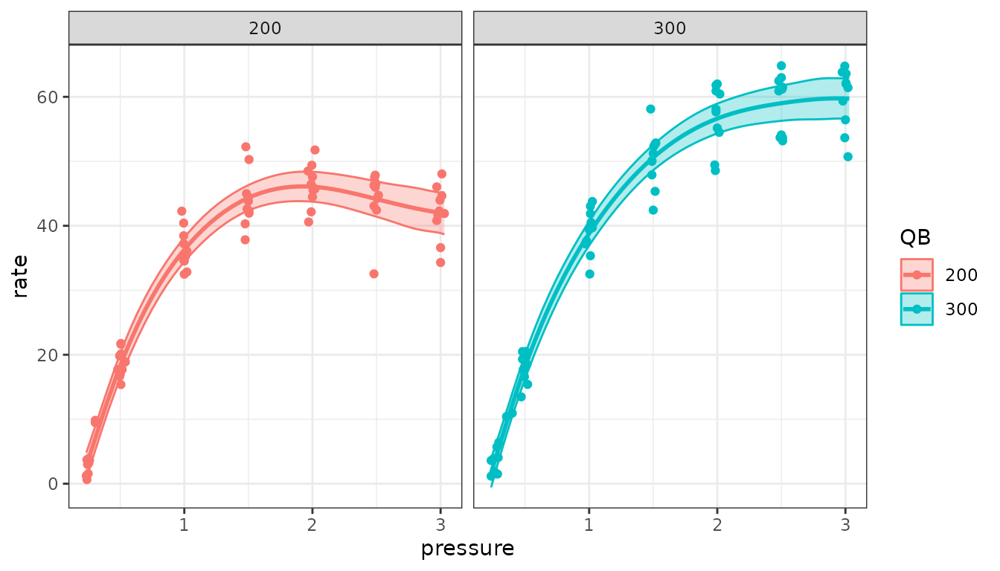
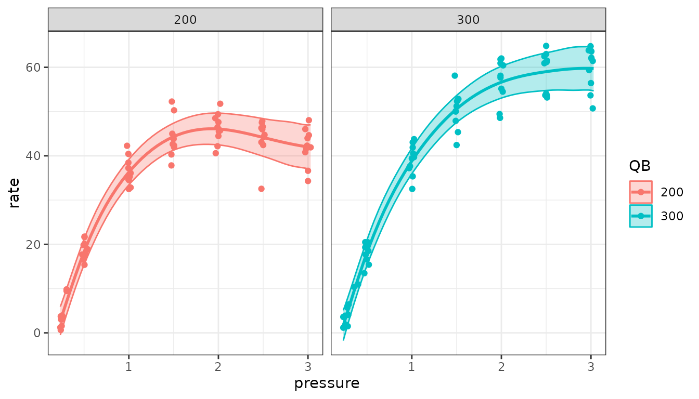
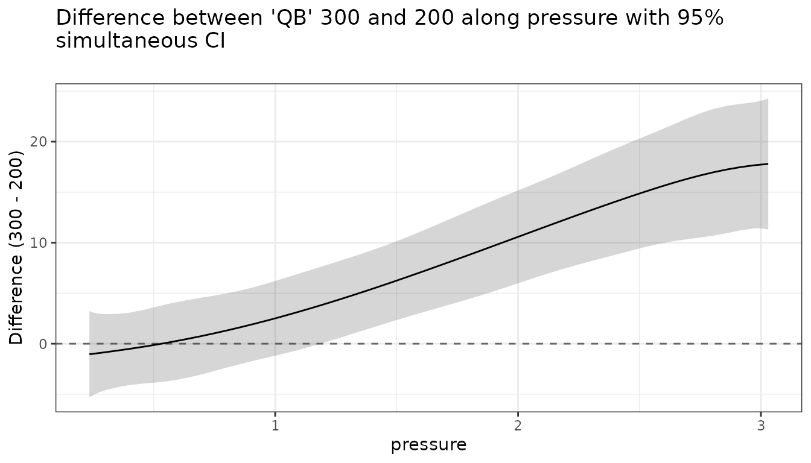
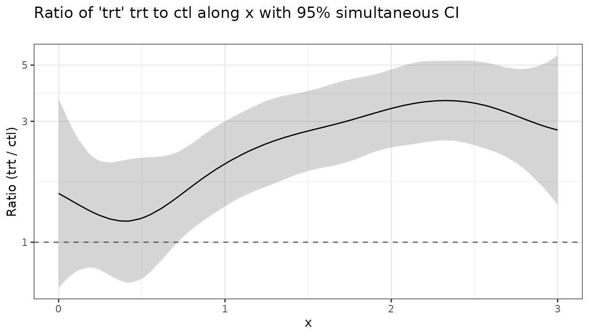
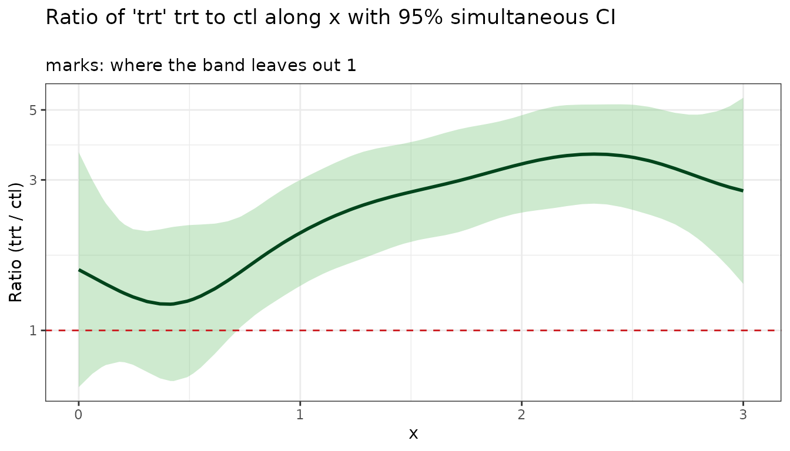

# Smooth curves in mixed models

When a response changes with a covariate along a curve whose shape is
not known,
[`semireg()`](https://dongwenluo.github.io/predictmeans/reference/semireg.md)
fits it as a penalized spline inside a linear or generalized linear
mixed model (Ruppert, Wand and Carroll 2003). The spline’s wiggly part
is a random effect, so the amount of smoothing is estimated by REML
along with the other variance components, and the usual mixed-model
tools apply. Smooths are written in the model formula, as for
[`mgcv::gam()`](https://rdrr.io/pkg/mgcv/man/gam.html), next to fixed
and lme4 random terms.
[`semipred()`](https://dongwenluo.github.io/predictmeans/reference/semipred.md)
predicts the curves with confidence bands;
[`predictmeans()`](https://dongwenluo.github.io/predictmeans/reference/predictmeans.md)
gives means and comparisons of factor levels with the smooth included.

## Data and model

The `Dialyzer` data (package nlme) give the ultrafiltration rate of 20
dialyzers at seven transmembrane pressures, at two blood flow rates
(`QB`, 200 or 300 dl/min).

``` r

library(predictmeans)
data(Dialyzer, package = "nlme")
Dialyzer <- as.data.frame(Dialyzer)
```

The rate rises with pressure and levels off. The model has a curve for
each blood flow rate, `s(pressure, by = QB)`, and a random intercept and
slope for each dialyzer:

``` r

fm <- semireg(rate ~ s(pressure, by = QB, bs = "os", k = 4) + (pressure | Subject),
              data = Dialyzer, prt = FALSE)
```

`bs = "os"` is the O’Sullivan penalized spline (Wand and Ormerod 2008)
with `k` interior knots; any mgcv basis can be used instead (the default
is a thin plate spline). Each curve is split into a straight line, whose
terms (`QB + QB:pressure`) are added to the fixed effects automatically,
and a smooth departure from it, a block of random effects with its own
variance.

| Written | Meaning |
|----|----|
| `s(x)` | one curve |
| `s(x, by = f)` | a curve per level of `f`, a variance each (`id = 1`: one shared) |
| `s(x, by = z)`, `z` numeric | varying coefficient |
| `s(x, f)` | common curve + a deviation curve per level of `f` |
| `s(x, f1*f2)` | common curve + deviations for `f1`, `f2`, `f1:f2`, a variance each |
| `s(x1, x2)`, `s(x1, x2, bs = "ztps")` | surface |
| `(s(x, k = 10) \| g)` | random curve per subject: `(x \| g)` + a spline deviation |

[`?semireg`](https://dongwenluo.github.io/predictmeans/reference/semireg.md)
has the full table. `anova(fm)` gives the tests of the fixed effects
(Type III, Kenward-Roger df) and, for each smooth term, the likelihood
ratio test of its variance being zero: a significant smooth term means
the curve is not a straight line.

``` r

anova(fm)
#> Analysis of Deviance Table (Type III Wald F tests with Kenward-Roger df)
#> 
#> Response: rate
#>                    F Df Df.res    Pr(>F)    
#> (Intercept) 212.0332  1 19.128 8.354e-12 ***
#> QB            7.4995  1 19.128     0.013 *  
#> QB:pressure 850.3842  2 19.129 < 2.2e-16 ***
#> ---
#> Signif. codes:  0 '***' 0.001 '**' 0.01 '*' 0.05 '.' 0.1 ' ' 1
#> 
#> Smooth terms: likelihood ratio tests of variance = 0 (the curve is its straight-line part);
#> p-values halved for the boundary (chi-square 0:1)
#>              term variance logLik logLik.without   LRT p.value
#>  s_pressure_QB200    28.92 -355.6         -476.4 241.5  <2e-16
#>  s_pressure_QB300    24.53 -355.6         -468.3 225.3  <2e-16
```

## Curves with confidence bands

``` r

cur <- semipred(fm, "QB", "pressure", prt = FALSE)
head(cur$pred_df)
#>    QB pressure        SE     rate        LL       UL
#> 1 200    0.235 1.0383074 2.720144 0.6850986 4.755189
#> 2 200    0.240 1.0224163 3.029839 1.0259401 5.033738
#> 3 200    0.245 1.0080322 3.339669 1.3639617 5.315375
#> 4 200    0.250 0.9950291 3.649587 1.6993659 5.599808
#> 5 200    0.255 0.9832854 3.959550 2.0323462 5.886754
#> 6 200    0.260 0.9726852 4.269514 2.3630858 6.175942
cur$plt
```



The band is pointwise: at each pressure it covers the true curve with
95% probability (`level = 0.05`). Before version 2.0 these limits were
90% limits; `level = 0.1` gives them.

A **simultaneous** band covers the whole curve at once with 95%
probability, so it is wider. Use it to judge the shape of the curve over
its whole range:

``` r

sim <- semipred(fm, "QB", "pressure", simultaneous = TRUE, prt = FALSE)
crit <- (sim$pred_df$UL - sim$pred_df$rate) / sim$pred_df$SE
c(pointwise = qnorm(0.975), simultaneous = crit[1])
#>    pointwise simultaneous 
#>     1.959964     2.953853
sim$plt
```



The critical value comes from 10,000 draws of the estimates’
distribution, with a fixed seed, so the band is the same each time.

## Where do the curves differ?

`contr` gives the difference between two curves, here 300 minus 200
dl/min, with its band. Where a simultaneous band excludes zero, the
curves differ, with the error rate controlled over the whole range of
pressures. Here the higher blood flow rate gives a higher
ultrafiltration rate from a pressure of about 1.2 upwards:

``` r

dif <- semipred(fm, "QB", "pressure", contr = c(2, 1), simultaneous = TRUE, prt = FALSE)
dif$plt
```



## Means of factor levels

[`predictmeans()`](https://dongwenluo.github.io/predictmeans/reference/predictmeans.md)
accepts a
[`semireg()`](https://dongwenluo.github.io/predictmeans/reference/semireg.md)
fit. The means of the blood flow rates include the smooth (as
[`semipred()`](https://dongwenluo.github.io/predictmeans/reference/semipred.md)
gives at the same pressure), at the mean pressure or at values given by
name:

``` r

predictmeans(fm, "QB")
#> Predicted means of 'QB' from a semireg model (smooth terms included)
#> 
#>   QB estimate std.error    df conf.low conf.high group
#>  200    44.66    0.9740 29.44    42.66     46.65    A 
#>  300    51.21    0.9723 29.24    49.22     53.20     B
#> 
#> Pairwise comparisons (t tests, Satterthwaite df; p.adj: none)
#> 
#>  level1 level2 estimate std.error    df statistic   p.value     p.adj p.method
#>     200    300   -6.557     1.376 29.36    -4.764 4.749e-05 4.749e-05        t
predictmeans(fm, "QB", covariate = c(pressure = 1))$means
#>    QB estimate std.error       df conf.low conf.high group
#> 1 200 36.30263 0.9244804 36.51477 34.42861  38.17664     A
#> 2 300 38.81293 0.9262667 36.68683 36.93559  40.69026     A
```

For gaussian fits the tests are t tests with Satterthwaite df (next
section); for generalized fits they are normal-based, as in
[`semipred()`](https://dongwenluo.github.io/predictmeans/reference/semipred.md).

## What predictmeans adds

A smoothing program
([`mgcv::gam()`](https://rdrr.io/pkg/mgcv/man/gam.html), gamm4) fits
these models too. predictmeans adds the mixed-model inference around
them.

**Means at a covariate value in a designed experiment.** Three
treatments on the whole plots of six blocks, measured at eleven times; a
curve over time for each treatment. The treatment means at time 5
include the curves’ random coefficients, and their comparisons rest on
the whole-plot variation, so they have far fewer degrees of freedom than
the 180 residual df. predictmeans gives them Satterthwaite df for the
combination of fixed and smooth coefficients (as SAS does for estimates
that involve random effects); normal-based tests would reject a true
null hypothesis too often (`dev/sim-semireg-df.R` in the package
sources).

``` r

set.seed(11)
sp <- expand.grid(t = 0:10, A = factor(c("a1", "a2", "a3")), Block = factor(1:6))
sp$y <- 2 + sin(sp$t/2) + c(0, 0.5, 1)[sp$A]*sp$t/10 + rnorm(6, 0, 0.5)[sp$Block] +
  rnorm(18, 0, 0.4)[interaction(sp$Block, sp$A)] + rnorm(nrow(sp), 0, 0.3)
fsp <- semireg(y ~ s(t, by = A, bs = "os", k = 6) + (1 | Block) + (1 | Block:A),
               data = sp, prt = FALSE)
pm <- predictmeans(fsp, "A", covariate = c(t = 5), pairwise = TRUE)
pm$means
#>    A estimate std.error       df conf.low conf.high group
#> 1 a1 2.353834 0.2423023 8.655220 1.802361  2.905306     A
#> 2 a2 2.415646 0.2431558 8.777611 1.863457  2.967834     A
#> 3 a3 2.695334 0.2426143 8.699969 2.143604  3.247064     A
pm$pairs[c("level1", "level2", "estimate", "std.error", "df", "p.value")]
#>   level1 level2    estimate std.error       df   p.value
#> 1     a1     a2 -0.06181205 0.1991743 17.56558 0.7599533
#> 2     a1     a3 -0.34150024 0.1985129 17.33696 0.1031776
#> 3     a2     a3 -0.27968819 0.1995537 17.69918 0.1783368
```

The smooth terms are written in the formula: `s(t, by = A)` adds the
fixed terms `A + A:t` (the straight lines) itself.

**Which differences between curves are needed?** In `s(x, f1*f2)` the
curves are a common curve plus deviation curves for `f1`, `f2` and
`f1:f2`, each with its own variance.
[`anova()`](https://rdrr.io/r/stats/anova.html) tests each variance (the
likelihood ratio, halved for the boundary) and
[`varcomp()`](https://dongwenluo.github.io/predictmeans/reference/varcomp.md)
shows their sizes. Here the shapes differ by `f1` only:

``` r

set.seed(1)
dd <- expand.grid(x = seq(0, 1, length = 25), f1 = factor(c("p", "q")),
                  f2 = factor(c("u", "v", "w")), rep = 1:4)
dd$id <- interaction(dd$f1, dd$f2, dd$rep)
dd$y <- sin(2*pi*dd$x) + (dd$f1 == "q")*1.5*sin(pi*dd$x)^2 +
  rnorm(nlevels(dd$id), 0, 0.2)[dd$id] + rnorm(nrow(dd), 0, 0.25)
fx <- semireg(y ~ s(x, f1*f2, bs = "os", k = 8) + (1 | id), data = dd, prt = FALSE)
anova(fx)$smooth[c("term", "variance", "LRT", "p.value")]
#>        term     variance        LRT      p.value
#> 1       s_x 0.3163539389  5.7060123 8.453451e-03
#> 2    s_x_f1 0.0927799765 26.9861474 1.024594e-07
#> 3    s_x_f2 0.0000000000  0.0000000 5.000000e-01
#> 4 s_x_f1_f2 0.0002386318  0.1328028 3.577718e-01
```

The test is conservative: in 200 simulated data sets like these, with no
`f2` or `f1:f2` differences, it rejected at the 5% level in 1-3% of
them, and it found the `f1` difference in all (`dev/sim-semireg-lrt.R`).
[`permlmer()`](https://dongwenluo.github.io/predictmeans/reference/permlmer.md)
on `fx$semer` gives a permutation test when a level closer to 5%
matters.

**Counts: rate ratios between curves.**
[`semireg_tmb()`](https://dongwenluo.github.io/predictmeans/reference/semireg_tmb.md)
fits the same smooths with glmmTMB, so a negative binomial with zero
inflation is available. `contr` gives the difference of two curves on
the log scale and as a ratio, with a simultaneous band and the ranges
where the ratio differs from 1:

``` r

set.seed(5)
cn <- expand.grid(x = seq(0, 3, length = 30), trt = factor(c("ctl", "trt")), site = factor(1:8))
cn$y <- rnbinom(nrow(cn), size = 3,
                mu = exp(1 + sin(cn$x) + (cn$trt == "trt")*0.5*cn$x + rnorm(8, 0, 0.3)[cn$site]))
cn$y[runif(nrow(cn)) < 0.1] <- 0
fc <- semireg_tmb(y ~ s(x, by = trt, bs = "os", k = 6) + (1 | site), ziformula = ~ 1,
                  family = glmmTMB::nbinom2, data = cn, prt = FALSE)
rr <- semipred(fc, "trt", "x", contr = c("trt", "ctl"), band = "simultaneous", prt = FALSE)
attr(rr$pred_df, "significant")
#>        from to direction
#> 1 0.7241379  3         >
rr$plt
```



**Subject-specific curves.** `(s(age, k = 10) | idnum)` gives each
subject a random straight line, `(age | idnum)`, and a random spline
deviation with one variance for all subjects (Durban et al. 2005). The
heights of 28 black boys of the Indiana growth study, in the package’s
data, fitted as in Harezlak, Ruppert and Wand (2018, section 9.2); the
fit is the same as that of their
[`nlme::lme()`](https://rdrr.io/pkg/nlme/man/lme.html) code:

``` r

gi <- read.table(system.file("extdata", "semireg", "growthIndiana.txt", package = "predictmeans"),
                 header = TRUE)
gb <- subset(gi, male == 1 & black == 1)
gb$idnum <- factor(gb$idnum)
fg <- semireg(height ~ s(age, bs = "os", k = 20, xt = list(range = c(5.5, 20))) +
                (s(age, k = 10, xt = list(range = c(5.5, 20))) | idnum), data = gb, prt = FALSE)
logLik(fg$semer)
#> 'log Lik.' -935.7451 (df=8)
semipred(fg, "age", "age", prt = FALSE)$plt
```



The population curve leaves out the subjects’ curves; `anova(fg)` would
test whether they are needed beyond straight lines.

## From the `smoothZ` form

Code written for 1.x, with the smooths in `smoothZ = list(smZ(...))` and
their straight lines written in the formula, still runs and gives the
same fits. The formula form gives the same model and adds the fixed
terms itself:

| 1.x | 2.0 |
|----|----|
| `y ~ x, smoothZ = list(sm = smZ(x, k = 10))` | `y ~ s(x, bs = "os", k = 10)` |
| `y ~ x*f, smoothZ = list(sm = smZ(x, k = 10, by = f, group = TRUE))` | `y ~ s(x, by = f, bs = "os", k = 10)` |
| `y ~ x*f, smoothZ = list(sm = smZ(x, k = 10, by = f))` | `y ~ s(x, by = f, bs = "os", k = 10, id = 1)` |
| `y ~ x1 + x2, smoothZ = list(sm = smZ(cbind(x1, x2), type = "Ztps"))` | `y ~ s(x1, x2, bs = "ztps")` |
| `smZ(x, intKnots = kn, range.x = r)` | `s(x, bs = "os", xt = list(knots = kn, range = r))` |

Smooths are given either in the formula or in `smoothZ`, not both. Other
changes since 1.x: the optimizer is `nloptwrap`
(`control = lmerControl(optimizer = "bobyqa")` gives 1.x’s),
[`semipred()`](https://dongwenluo.github.io/predictmeans/reference/semipred.md)
limits are 95% (1.x: 90%), `anova(fit)` replaces lmerTest, and
generalized fits include the uncertainty of the smoothing parameters in
their bands.

## More

- [`?semireg`](https://dongwenluo.github.io/predictmeans/reference/semireg.md),
  [`?semipred`](https://dongwenluo.github.io/predictmeans/reference/semipred.md),
  [`?smZ`](https://dongwenluo.github.io/predictmeans/reference/smZ.md);
  [`semireg_tmb()`](https://dongwenluo.github.io/predictmeans/reference/semireg_tmb.md)
  fits the same models with glmmTMB, which also allows negative binomial
  and other families.
- The worked examples on the package website use larger data sets
  (apartment prices, school scores, respiratory infections, pollen
  counts and a spatial smooth of copper grades).

## References

Durban, M., Harezlak, J., Wand, M. P. and Carroll, R. J. (2005). Simple
fitting of subject-specific curves for longitudinal data. *Statistics in
Medicine*, 24, 1153-1167.

Harezlak, J., Ruppert, D. and Wand, M. P. (2018). *Semiparametric
Regression with R*. Springer.

Ruppert, D., Wand, M. P. and Carroll, R. J. (2003). *Semiparametric
Regression*. Cambridge University Press.

Wand, M. P. and Ormerod, J. T. (2008). On semiparametric regression with
O’Sullivan penalized splines. *Australian and New Zealand Journal of
Statistics*, 50, 179-198.
