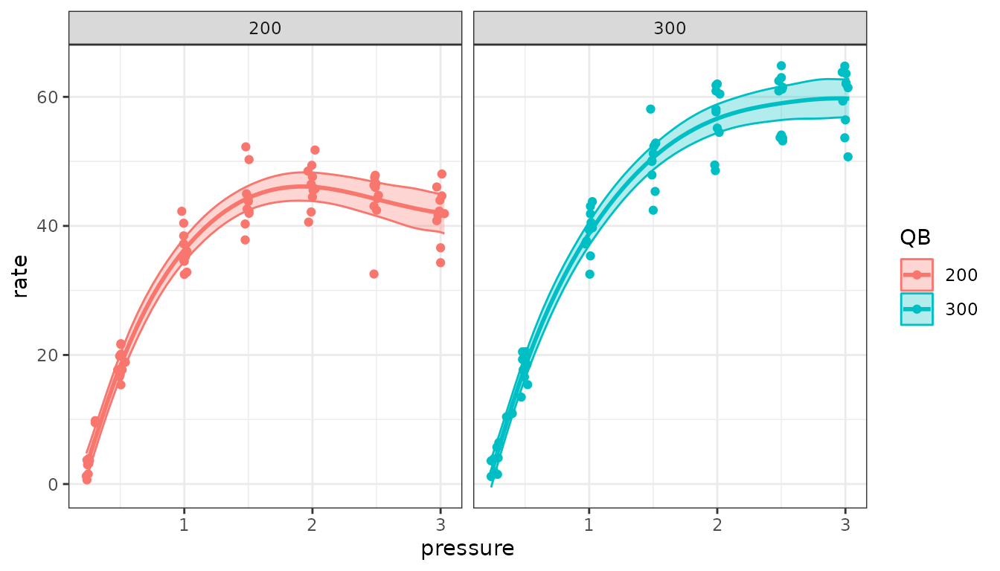
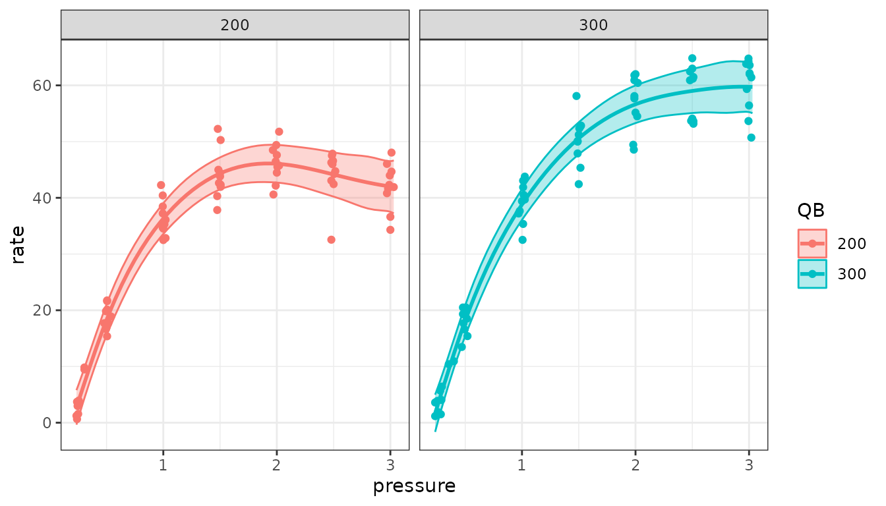
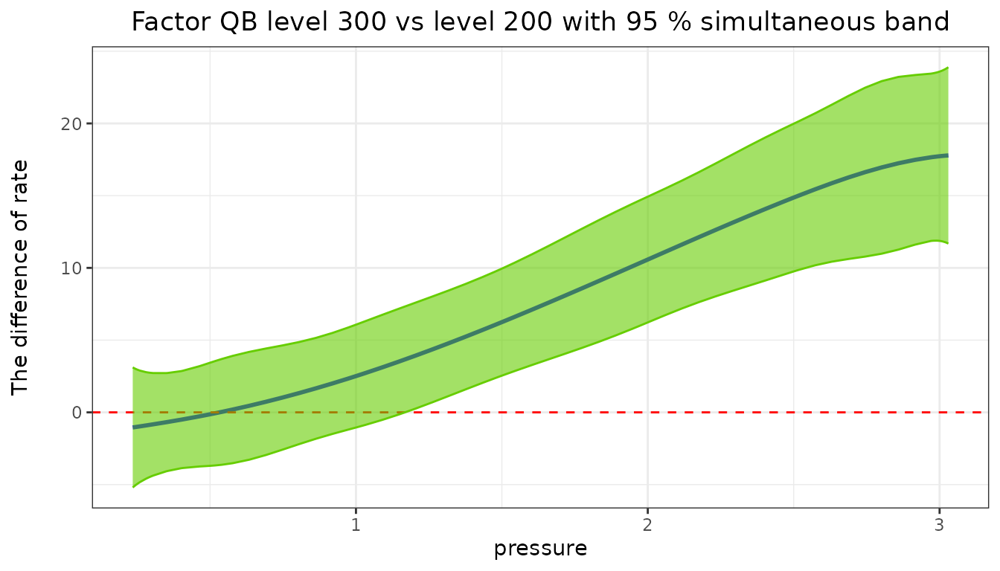

# Smooth curves in mixed models

When a response changes with a covariate along a curve whose shape is
not known,
[`semireg()`](https://dongwenluo.github.io/predictmeans/reference/semireg.md)
fits it as a penalized spline inside a linear or generalized linear
mixed model (Ruppert, Wand and Carroll 2003). The spline’s wiggly part
is a random effect, so the amount of smoothing is estimated by REML
along with the other variance components, and the usual mixed-model
tools apply.
[`semipred()`](https://dongwenluo.github.io/predictmeans/reference/semipred.md)
predicts the curves with confidence bands;
[`predictmeans()`](https://dongwenluo.github.io/predictmeans/reference/predictmeans.md)
gives means and comparisons of factor levels with the smooth included.

## Data and model

The `Dialyzer` data (package nlme) give the ultrafiltration rate of 20
dialyzers at seven transmembrane pressures, at two blood flow rates
(`QB`, 200 or 300 dl/min).

``` r

library(predictmeans)
data(Dialyzer, package = "nlme")
Dialyzer <- as.data.frame(Dialyzer)
```

The rate rises with pressure and levels off. The model has a linear
trend for each blood flow rate, a smooth departure from it for each rate
(`smZ(..., by = QB, group = TRUE)`), and a random intercept and slope
for each dialyzer:

``` r

fm <- semireg(rate ~ pressure * QB + (pressure | Subject),
              smoothZ = list(qb = smZ(pressure, k = 4, by = QB, group = TRUE)),
              data = Dialyzer, prt = FALSE)
```

`k` is the number of interior knots of the spline. `fm$semer` is the
fitted mixed model, so the usual tests apply.
[`ranova()`](https://rdrr.io/pkg/lmerTest/man/ranova.html) tests the
random terms, including the smooth: a significant smooth term means the
curve is not a straight line.

``` r

ranova(fm$semer)
#> ANOVA-like table for random-effects: Single term deletions
#> 
#> Model:
#> rate ~ pressure * QB + (pressure | Subject) + (1 | qb.200) + (1 | qb.300)
#>                                  npar  logLik     AIC    LRT Df Pr(>Chisq)    
#> <none>                             10 -355.62  731.25                         
#> pressure in (pressure | Subject)    8 -505.22 1026.45 299.20  2  < 2.2e-16 ***
#> (1 | qb.200)                        9 -476.39  970.78 241.53  1  < 2.2e-16 ***
#> (1 | qb.300)                        9 -468.27  954.54 225.29  1  < 2.2e-16 ***
#> ---
#> Signif. codes:  0 '***' 0.001 '**' 0.01 '*' 0.05 '.' 0.1 ' ' 1
```

## Curves with confidence bands

``` r

cur <- semipred(fm, "QB", "pressure", prt = FALSE)
head(cur$pred_df)
#>    QB pressure        SE     rate        LL       UL
#> 1 200    0.235 1.0383106 2.720145 0.6850933 4.755196
#> 2 200    0.240 1.0224196 3.029840 1.0259346 5.033746
#> 3 200    0.245 1.0080356 3.339669 1.3639559 5.315383
#> 4 200    0.250 0.9950326 3.649588 1.6993598 5.599816
#> 5 200    0.255 0.9832890 3.959551 2.0323399 5.886762
#> 6 200    0.260 0.9726889 4.269514 2.3630792 6.175950
cur$plt
```



The band is pointwise: at each pressure it covers the true curve with
95% probability (`level = 0.05`). Before version 2.0 these limits were
90% limits; `level = 0.1` gives them.

A **simultaneous** band covers the whole curve at once with 95%
probability, so it is wider. Use it to judge the shape of the curve over
its whole range:

``` r

sim <- semipred(fm, "QB", "pressure", simultaneous = TRUE, prt = FALSE)
crit <- (sim$pred_df$UL - sim$pred_df$rate) / sim$pred_df$SE
c(pointwise = qnorm(0.975), simultaneous = crit[1])
#>    pointwise simultaneous 
#>     1.959964     2.957617
sim$plt
```



The critical value comes from 10,000 draws of the estimates’
distribution, with a fixed seed, so the band is the same each time.

## Where do the curves differ?

`contr` gives the difference between two curves, here 300 minus 200
dl/min, with its band. Where a simultaneous band excludes zero, the
curves differ, with the error rate controlled over the whole range of
pressures. Here the higher blood flow rate gives a higher
ultrafiltration rate from a pressure of about 1.2 upwards:

``` r

dif <- semipred(fm, "QB", "pressure", contr = c(2, 1), simultaneous = TRUE, prt = FALSE)
dif$plt
```



## Means of factor levels

[`predictmeans()`](https://dongwenluo.github.io/predictmeans/reference/predictmeans.md)
accepts a
[`semireg()`](https://dongwenluo.github.io/predictmeans/reference/semireg.md)
fit. The means of the blood flow rates include the smooth (as
[`semipred()`](https://dongwenluo.github.io/predictmeans/reference/semipred.md)
gives at the same pressure), at the mean pressure or at values given by
name:

``` r

predictmeans(fm, "QB")
#> Predicted means of 'QB' from a semireg model (smooth terms included)
#> 
#>   QB estimate std.error  df conf.low conf.high group
#>  200    44.66    0.9740 Inf    42.75     46.56    A 
#>  300    51.21    0.9723 Inf    49.31     53.12     B
#> 
#> Pairwise comparisons (normal-based; p.adj: none)
#> 
#>  level1 level2 estimate std.error  df statistic   p.value     p.adj p.method
#>     200    300   -6.557     1.376 Inf    -4.764 1.894e-06 1.894e-06        z
predictmeans(fm, "QB", covariate = c(pressure = 1))$means
#>    QB estimate std.error  df conf.low conf.high group
#> 1 200 36.30263 0.9244857 Inf 34.49067  38.11459     A
#> 2 300 38.81293 0.9262721 Inf 36.99747  40.62839     A
```

The tests are normal-based, as in
[`semipred()`](https://dongwenluo.github.io/predictmeans/reference/semipred.md).

## More

- [`?semireg`](https://dongwenluo.github.io/predictmeans/reference/semireg.md),
  [`?semipred`](https://dongwenluo.github.io/predictmeans/reference/semipred.md),
  [`?smZ`](https://dongwenluo.github.io/predictmeans/reference/smZ.md);
  [`semireg_tmb()`](https://dongwenluo.github.io/predictmeans/reference/semireg_tmb.md)
  fits the same models with glmmTMB, which also allows negative binomial
  and other families.
- The worked examples on the package website use larger data sets
  (apartment prices, school scores, respiratory infections, pollen
  counts and a spatial smooth of copper grades).

## References

Ruppert, D., Wand, M. P. and Carroll, R. J. (2003). *Semiparametric
Regression*. Cambridge University Press.
