# Smooth curves in mixed models

When a response changes with a covariate along a curve whose shape is
not known,
[`semireg()`](https://dongwenluo.github.io/predictmeans/reference/semireg.md)
fits it as a penalized spline inside a linear or generalized linear
mixed model (Ruppert, Wand and Carroll 2003). The spline’s wiggly part
is a random effect, so the amount of smoothing is estimated by REML
along with the other variance components, and the usual mixed-model
tools apply. Smooths are written in the model formula, as for
[`mgcv::gam()`](https://rdrr.io/pkg/mgcv/man/gam.html), next to fixed
and lme4 random terms.
[`semipred()`](https://dongwenluo.github.io/predictmeans/reference/semipred.md)
predicts the curves with confidence bands;
[`predictmeans()`](https://dongwenluo.github.io/predictmeans/reference/predictmeans.md)
gives means and comparisons of factor levels with the smooth included.

## Data and model

The `Dialyzer` data (package nlme) give the ultrafiltration rate of 20
dialyzers at seven transmembrane pressures, at two blood flow rates
(`QB`, 200 or 300 dl/min).

``` r

library(predictmeans)
library(ggplot2)      # autoplot()
data(Dialyzer, package = "nlme")
Dialyzer <- as.data.frame(Dialyzer)
```

The rate rises with pressure and levels off. The model has a curve for
each blood flow rate, `s(pressure, by = QB)`, and a random intercept and
slope for each dialyzer:

``` r

fm <- semireg(rate ~ s(pressure, by = QB, bs = "os", k = 4) + (pressure | Subject),
              data = Dialyzer)
```

`bs = "os"` is the O’Sullivan penalized spline (Wand and Ormerod 2008)
with `k` interior knots; any mgcv basis can be used instead (the default
is a thin plate spline). Each curve is split into a straight line, whose
terms (`QB + QB:pressure`) are added to the fixed effects automatically,
and a smooth departure from it, a block of random effects with its own
variance.

| Written | Meaning |
|----|----|
| `s(x)` | one curve |
| `s(x, by = f)` | a curve per level of `f`, a variance each (`id = 1`: one shared) |
| `s(x, by = z)`, `z` numeric | varying coefficient |
| `s(x, f)` | common curve + a deviation curve per level of `f` |
| `s(x, f1*f2)` | common curve + deviations for `f1`, `f2`, `f1:f2`, a variance each |
| `s(x1, x2)`, `s(x1, x2, bs = "ztps")` | surface |
| `t2(x1, x2)` | tensor-product surface (covariates on different scales), a variance per penalty; `te()` is fitted as `t2()` |
| `s(x, bs = "user", xt = list(basis = f))` | a basis of your own, `f(x)` (checked before the fit) |
| `(s(x, k = 10) \| g)` | random curve per subject: `(x \| g)` + a spline deviation |

[`?semireg`](https://dongwenluo.github.io/predictmeans/reference/semireg.md)
has the full table. `anova(fm)` gives the tests of the fixed effects
(Type III, Kenward-Roger df) and, for each smooth term, the likelihood
ratio test of its variance being zero: a significant smooth term means
the curve is not a straight line.

``` r

anova(fm)
#> Analysis of Deviance Table (Type III Wald F tests with Kenward-Roger df)
#> 
#> Response: rate
#> 
#> Advice:
#> ! A numeric covariate is in an interaction: Type III tests of the other
#>   terms are at covariate = 0; centre the covariate if 0 is not a meaningful
#>   value.
#> 
#>                    F Df Df.res    Pr(>F)    
#> (Intercept) 212.1021  1 19.141 8.241e-12 ***
#> QB            7.5018  1 19.141   0.01299 *  
#> QB:pressure 850.4323  2 19.131 < 2.2e-16 ***
#> ---
#> Signif. codes:  0 '***' 0.001 '**' 0.01 '*' 0.05 '.' 0.1 ' ' 1
#> 
#> Smooth terms: likelihood ratio tests of variance = 0 (the curve is its straight-line part);
#> reference: exact restricted LRT for the only random effect of a gaussian fit, otherwise 0.5 chi2(0) + 0.5 chi2(1)
#>              term variance logLik logLik.without   LRT p.value
#>  s_pressure_QB200    28.92 -355.6         -476.4 241.5  <2e-16
#>  s_pressure_QB300    24.53 -355.6         -468.3 225.3  <2e-16
#>                       test
#>  0.5 chi2(0) + 0.5 chi2(1)
#>  0.5 chi2(0) + 0.5 chi2(1)
```

## Curves with confidence bands

``` r

cur <- semipred(fm, "QB", "pressure")
cur
#> Curves of 'QB' along pressure
#> 95% limits; Satterthwaite (fixed + smooth coefficients) df
#>   QB pressure estimate std.error    df conf.low conf.high
#>  200    0.235    2.720    1.0382 40.55   0.6227     4.818
#>  200    0.240    3.030    1.0223 38.65   0.9614     5.098
#>  200    0.245    3.340    1.0079 36.97   1.2973     5.382
#>  200    0.250    3.650    0.9949 35.49   1.6308     5.668
#>  200    0.255    3.960    0.9832 34.19   1.9619     5.957
#>  200    0.260    4.270    0.9726 33.04   2.2909     6.248
#>  200    0.280    5.508    0.9395 29.69   3.5889     7.428
#>  200    0.285    5.818    0.9331 29.09   3.9096     7.726
#>  200    0.290    6.127    0.9273 28.56   4.2289     8.025
#>  200    0.292    6.253    0.9251 28.36   4.3589     8.147
#> ... 220 more rows: as.data.frame(x) gives the table.
#> autoplot(x) draws the plot (layouts: ?autoplot.pm_curves).
autoplot(cur)
```

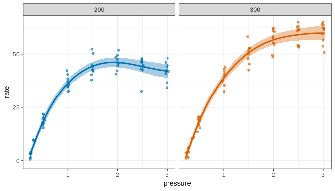

plot of chunk unnamed-chunk-5

The result prints a summary and holds its tables in the layout of
[`predictmeans()`](https://dongwenluo.github.io/predictmeans/reference/predictmeans.md):
`as.data.frame(cur)` (or `cur$means`) has `estimate`, `std.error`, `df`,
`conf.low` and `conf.high` with the pressure under its own name. Nothing
is drawn unless asked
([`autoplot()`](https://ggplot2.tidyverse.org/reference/autoplot.html)
as here, or `plot = TRUE`). The 1.x table is still in `cur$pred_df`.

The band is pointwise: at each pressure it covers the true curve with
95% probability (`level = 0.05`). Before version 2.0 these limits were
90% limits; `level = 0.1` gives them. They are t limits with the
Satterthwaite df of each point (column `df`), from the variance
components of the design (here the dialyzers) and the residual.

A **simultaneous** band covers the whole curve at once with 95%
probability, so it is wider. Use it to judge the shape of the curve over
its whole range:

``` r

sim <- semipred(fm, "QB", "pressure", band = "simultaneous")
p <- sim$means
head(data.frame(pressure = p$pressure, df = p$df, pointwise = qt(0.975, p$df),
                simultaneous = (p$adj.conf.high - p$estimate) / p$std.error))
#>   pressure       df pointwise simultaneous
#> 1    0.235 40.55229  2.020218     3.086001
#> 2    0.240 38.64948  2.023278     3.095321
#> 3    0.245 36.96916  2.026250     3.104397
#> 4    0.250 35.48841  2.029110     3.113152
#> 5    0.255 34.18547  2.031838     3.121524
#> 6    0.260 33.04013  2.034421     3.129465
autoplot(sim)
```

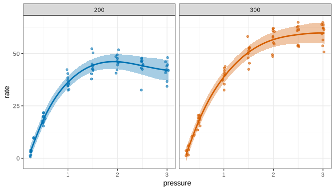

plot of chunk unnamed-chunk-6

The critical values come from 10,000 draws of the estimates’
distribution (a multivariate t), with a fixed seed, so the band is the
same each time. In the table the pointwise limits stay in
`conf.low`/`conf.high` and the simultaneous band is in
`adj.conf.low`/`adj.conf.high`, as the adjusted limits of
[`predictmeans()`](https://dongwenluo.github.io/predictmeans/reference/predictmeans.md).

## Where do the curves differ?

`contr` gives the difference between two curves, here 300 minus 200
dl/min, with its band. Where a simultaneous band excludes zero, the
curves differ, with the error rate controlled over the whole range of
pressures. Here the higher blood flow rate gives a higher
ultrafiltration rate from a pressure of about 1.2 upwards:

``` r

dif <- semipred(fm, "QB", "pressure", contr = c(2, 1), band = "simultaneous")
dif$significant
#>       from   to direction
#> 1 1.204694 3.03         >
autoplot(dif)
```

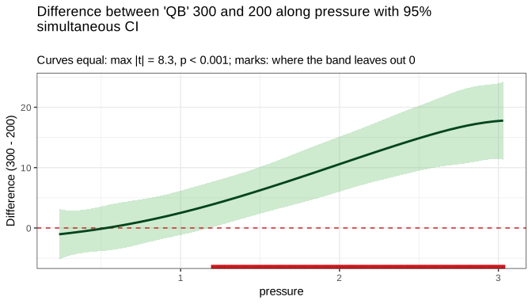

plot of chunk unnamed-chunk-7

`as.data.frame(dif)` has the difference at each pressure in the columns
of `predictmeans()$pairs`, with `p.adj`: the share of the simulated
maxima at least as large, below 0.05 exactly where the simultaneous band
leaves out zero.

## Which smooths: `sm_term`

By default the curves use every smooth of the fit. `sm_term` picks some:
a term as written in the formula, a smooth as labelled, a covariate (all
its smooths) or a block name (`names(fm$u_lst)`). `settings$sm_term`
records the blocks used:

``` r

semipred(fm, "QB", "pressure", sm_term = "s(pressure, by = QB)")$settings$sm_term
#> [1] "s_pressure_QB200" "s_pressure_QB300"
semipred(fm, "QB", "pressure", sm_term = "s(pressure):QB300")$settings$sm_term
#> [1] "s_pressure_QB300"
```

A smooth of another covariate adds a constant to the curves; the
result’s advice says so (see the additive model below).

## Slopes and curvature: `deriv`

`deriv = 1` gives the slope of each curve along the covariate,
`deriv = 2` its curvature, with the same bands and df. Where the band
lies above zero the rate still rises with pressure; the ranges are
printed with the result and kept in `significant` (here with a
simultaneous band, which holds over the whole range at once). The table
`slp$slopes` adds the t test of slope = 0:

``` r

slp <- semipred(fm, "QB", "pressure", deriv = 1, band = "simultaneous")
slp$significant
#>   level  from       to direction
#> 1   200 0.235 1.661020       > 0
#> 2   300 0.235 2.060306       > 0
autoplot(slp)
```

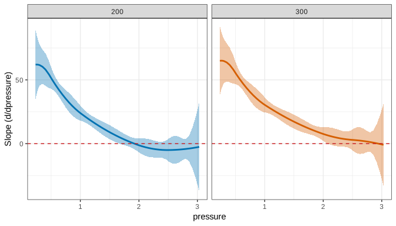

plot of chunk unnamed-chunk-9

`contr` with `deriv` compares the slopes of two curves. The derivatives
are those of the whole fitted curve (fixed and smooth parts), for any
basis, and for the O’Sullivan basis equal the exact derivatives of the
basis (`ZOSull(drv = )`). For generalized models they are on the link
scale. In a simulation (`dev/sim-semipred-deriv.R` in the package
sources) their bands covered the true slope and curvature 0.97-1.00 at
the 95% level.

## Means of factor levels

[`predictmeans()`](https://dongwenluo.github.io/predictmeans/reference/predictmeans.md)
accepts a
[`semireg()`](https://dongwenluo.github.io/predictmeans/reference/semireg.md)
fit. The means of the blood flow rates include the smooth (as
[`semipred()`](https://dongwenluo.github.io/predictmeans/reference/semipred.md)
gives at the same pressure), at the mean pressure or at values given by
name:

``` r

predictmeans(fm, "QB")
#> Predicted means of 'QB' from a semireg model (smooth terms included)
#> 
#>   QB estimate std.error    df conf.low conf.high group
#>  200    44.66    0.9740 29.46    42.66     46.65    A 
#>  300    51.21    0.9723 29.27    49.22     53.20     B
#> 
#> Pairwise comparisons (t tests, Satterthwaite df; p.adj: none)
#> 
#>  level1 level2 estimate std.error    df statistic   p.value     p.adj conf.low
#>     200    300   -6.557     1.376 29.36    -4.764 4.748e-05 4.748e-05    -9.37
#>  conf.high   lsd p.method
#>     -3.744 2.813        t
predictmeans(fm, "QB", covariate = c(pressure = 1))$means
#>    QB estimate std.error       df conf.low conf.high group
#> 1 200 36.30263 0.9244460 36.55883 34.42876  38.17650     A
#> 2 300 38.81292 0.9262326 36.80822 36.93587  40.68998     A
```

For gaussian fits the tests are t tests with Satterthwaite df (next
section), and
[`semipred()`](https://dongwenluo.github.io/predictmeans/reference/semipred.md)
uses the same df for its bands (column `df`); generalized fits get the
df of the design’s strata, as GLMMs do (normal-based when the model has
no random term besides the smooths).

## What predictmeans adds

A smoothing program
([`mgcv::gam()`](https://rdrr.io/pkg/mgcv/man/gam.html), gamm4) fits
these models too. predictmeans adds the mixed-model inference around
them.

**Means at a covariate value in a designed experiment.** Three
treatments on the whole plots of six blocks, measured at eleven times; a
curve over time for each treatment. The treatment means at time 5
include the curves’ random coefficients, and their comparisons rest on
the whole-plot variation, so they have far fewer degrees of freedom than
the 180 residual df. predictmeans gives them Satterthwaite df for the
combination of fixed and smooth coefficients (as SAS does for estimates
that involve random effects), from the variance components of the design
with the smoothing parameters held at their estimates; normal-based
tests would reject a true null hypothesis too often
(`dev/sim-semireg-df.R` in the package sources), and normal bands of the
curves cover 0.91 instead of 0.95 (`dev/sim-semipred-df.R`).

``` r

set.seed(11)
sp <- expand.grid(t = 0:10, A = factor(c("a1", "a2", "a3")), Block = factor(1:6))
sp$y <- 2 + sin(sp$t/2) + c(0, 0.5, 1)[sp$A]*sp$t/10 + rnorm(6, 0, 0.5)[sp$Block] +
  rnorm(18, 0, 0.4)[interaction(sp$Block, sp$A)] + rnorm(nrow(sp), 0, 0.3)
fsp <- semireg(y ~ s(t, by = A, bs = "os", k = 6) + (1 | Block) + (1 | Block:A),
               data = sp)
pm <- predictmeans(fsp, "A", covariate = c(t = 5), pairwise = TRUE)
pm$means
#>    A estimate std.error       df conf.low conf.high group
#> 1 a1 2.353834 0.2423023 8.659082 1.802401  2.905267     A
#> 2 a2 2.415646 0.2431558 8.781221 1.863493  2.967798     A
#> 3 a3 2.695334 0.2426143 8.703586 2.143640  3.247028     A
pm$pairs[c("level1", "level2", "estimate", "std.error", "df", "p.value")]
#>   level1 level2    estimate std.error       df   p.value
#> 1     a1     a2 -0.06181205 0.1991743 17.61641 0.7599429
#> 2     a1     a3 -0.34150024 0.1985129 17.38920 0.1031244
#> 3     a2     a3 -0.27968819 0.1995537 17.74765 0.1782902
```

The smooth terms are written in the formula: `s(t, by = A)` adds the
fixed terms `A + A:t` (the straight lines) itself.

**Which differences between curves are needed?** In `s(x, f1*f2)` the
curves are a common curve plus deviation curves for `f1`, `f2` and
`f1:f2`, each with its own variance.
[`anova()`](https://rdrr.io/r/stats/anova.html) tests each variance (the
likelihood ratio against its boundary distribution, as
`varcomp(fit, test = TRUE)`) and
[`varcomp()`](https://dongwenluo.github.io/predictmeans/reference/varcomp.md)
shows their sizes. Here the shapes differ by `f1` only:

``` r

set.seed(1)
dd <- expand.grid(x = seq(0, 1, length = 25), f1 = factor(c("p", "q")),
                  f2 = factor(c("u", "v", "w")), rep = 1:4)
dd$id <- interaction(dd$f1, dd$f2, dd$rep)
dd$y <- sin(2*pi*dd$x) + (dd$f1 == "q")*1.5*sin(pi*dd$x)^2 +
  rnorm(nlevels(dd$id), 0, 0.2)[dd$id] + rnorm(nrow(dd), 0, 0.25)
fx <- semireg(y ~ s(x, f1*f2, bs = "os", k = 8) + (1 | id), data = dd)
anova(fx)$smooth[c("term", "variance", "LRT", "p.value")]
#>        term     variance        LRT      p.value
#> 1       s_x 0.3163464627  5.7060123 8.453451e-03
#> 2    s_x_f1 0.0927804876 26.9861474 1.024594e-07
#> 3    s_x_f2 0.0000000000  0.0000000 1.000000e+00
#> 4 s_x_f1_f2 0.0002386152  0.1328028 3.577718e-01
```

The curves of all six combinations are computed at once;
[`autoplot()`](https://ggplot2.tidyverse.org/reference/autoplot.html)
chooses the layout without computing again: by default the first factor
colours the curves and the second makes the panels; `group` and `panel`
swap them, and two panel factors give a grid:

``` r

c2 <- semipred(fx, "f1:f2", "x")
autoplot(c2)
```

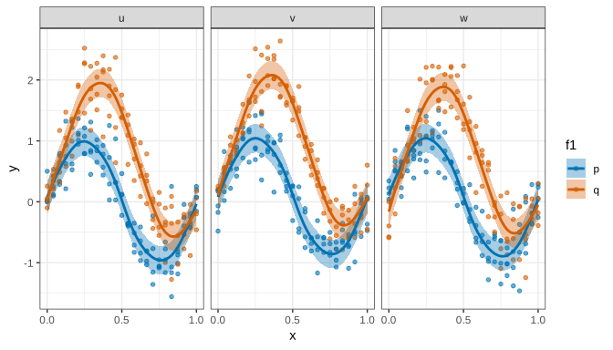

plot of chunk unnamed-chunk-13

``` r

autoplot(c2, group = "f2", panel = "f1", data = FALSE)
```

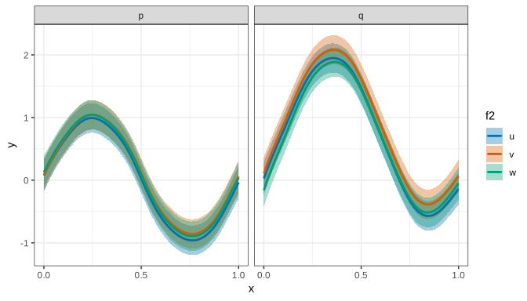

plot of chunk unnamed-chunk-13

The test is conservative: in 200 simulated data sets like these, with no
`f2` or `f1:f2` differences, it rejected at the 5% level in 1-3% of
them, and it found the `f1` difference in all (`dev/sim-semireg-lrt.R`).
[`permlmer()`](https://dongwenluo.github.io/predictmeans/reference/permlmer.md)
on `fx$semer` gives a permutation test when a level closer to 5%
matters.

**Counts: rate ratios between curves.**
[`semireg_tmb()`](https://dongwenluo.github.io/predictmeans/reference/semireg_tmb.md)
fits the same smooths with glmmTMB, so a negative binomial with zero
inflation is available. `contr` gives the difference of two curves on
the log scale and as a ratio, with a simultaneous band and the ranges
where the ratio differs from 1:

``` r

set.seed(5)
cn <- expand.grid(x = seq(0, 3, length = 30), trt = factor(c("ctl", "trt")), site = factor(1:8))
cn$y <- rnbinom(nrow(cn), size = 3,
                mu = exp(1 + sin(cn$x) + (cn$trt == "trt")*0.5*cn$x + rnorm(8, 0, 0.3)[cn$site]))
cn$y[runif(nrow(cn)) < 0.1] <- 0
fc <- semireg_tmb(y ~ s(x, by = trt, bs = "os", k = 6) + (1 | site), ziformula = ~ 1,
                  family = glmmTMB::nbinom2, data = cn)
rr <- semipred(fc, "trt", "x", contr = c("trt", "ctl"), band = "simultaneous")
rr$significant
#>        from to direction
#> 1 0.7241379  3         >
autoplot(rr)
```

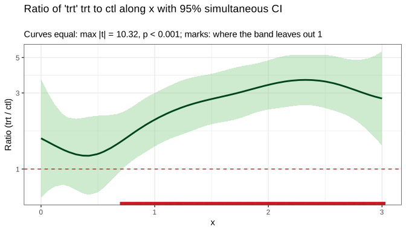

plot of chunk unnamed-chunk-14

**Subject-specific curves.** `(s(age, k = 10) | idnum)` gives each
subject a random straight line, `(age | idnum)`, and a random spline
deviation with one variance for all subjects (Durban et al. 2005). The
heights of 28 black boys of the Indiana growth study
(`data(growthIndiana)`), fitted as in Harezlak, Ruppert and Wand (2018,
section 9.2); the fit is the same as that of their
[`nlme::lme()`](https://rdrr.io/pkg/nlme/man/lme.html) code:

``` r

data(growthIndiana)
gb <- subset(growthIndiana, male == 1 & black == 1)
gb$idnum <- factor(gb$idnum)
fg <- semireg(height ~ s(age, bs = "os", k = 20, xt = list(range = c(5.5, 20))) +
                (s(age, k = 10, xt = list(range = c(5.5, 20))) | idnum), data = gb)
logLik(fg$semer)
#> 'log Lik.' -935.7451 (df=8)
autoplot(semipred(fg, "age", "age"))
```

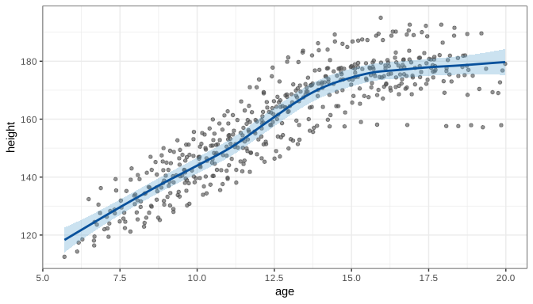

plot of chunk unnamed-chunk-15

The population curve leaves out the subjects’ curves; `anova(fg)` would
test whether they are needed beyond straight lines.

## More situations

Each example below is complete; the data are simulated unless named.

**Several smooths and a varying coefficient.** An additive model with a
curve in `x1`, and an effect of `z` that changes smoothly with `x2`
(`by = z`, a numeric variable):

``` r

set.seed(2)
da <- data.frame(x1 = runif(200), x2 = runif(200), z = rnorm(200))
da$y <- sin(3*da$x1) + da$z*sin(2*pi*da$x2) + rnorm(200, 0, 0.3)
fa <- semireg(y ~ s(x1, bs = "os") + s(x2, by = z, bs = "os"), data = da)
anova(fa)$smooth[c("term", "variance", "LRT", "p.value")]
#>     term   variance      LRT      p.value
#> 1   s_x1 0.03875716 122.8299 7.596575e-29
#> 2 s_x2_z 0.33715120 188.0839 4.164359e-43
autoplot(semipred(fa, covariate = "x1"))
```

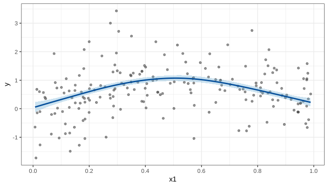

plot of chunk unnamed-chunk-16

``` r

autoplot(semipred(fa, covariate = "x1", sm_term = "x1"))
```


plot of chunk unnamed-chunk-16

The first curve includes `s(x2, by = z)` as a constant (its advice says
so); with `sm_term = "x1"` it is the smooth of `x1` alone.

**A surface.** Copper grade over a mining area (`data(copper)`): a
thin-plate surface over the plane (`bs = "ztps"`) and a curve in depth,
on the log scale, back-transformed for the plots:

``` r

data(copper)
fcu <- semireg(log(grade) ~ s(zcoord, bs = "os") + s(xcoord, ycoord, bs = "ztps", k = 6),
               data = copper)
autoplot(semipred(fcu, covariate = c("xcoord", "ycoord"), trans = exp))
```

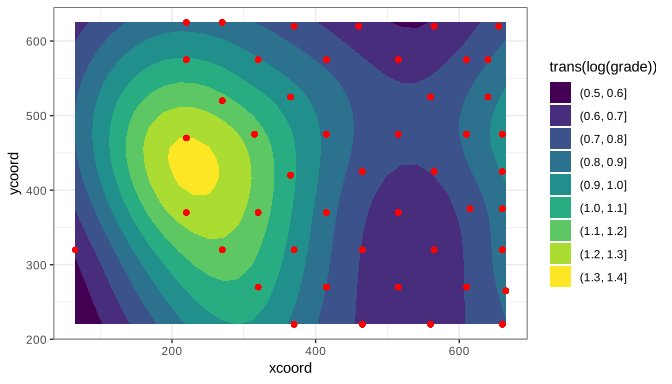

plot of chunk unnamed-chunk-17

**Binary responses.** The probability of a response over `x` for two
groups, with a random effect of cluster; `contr` gives the log odds
ratio of the curves and the odds ratio:

``` r

set.seed(4)
db <- expand.grid(x = seq(0, 1, length = 25), g = factor(c("a", "b")), cl = factor(1:12))
db$y <- rbinom(nrow(db), 1, plogis(-1 + 2*sin(pi*db$x) + 0.8*(db$g == "b")*db$x +
                                     rnorm(12, 0, 0.5)[db$cl]))
fbin <- semireg(y ~ s(x, by = g, bs = "os", k = 6) + (1 | cl), family = binomial,
                data = db)
autoplot(semipred(fbin, "g", "x"))
```

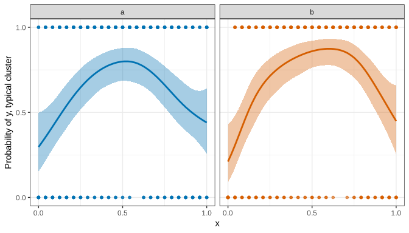

plot of chunk unnamed-chunk-18

``` r

head(as.data.frame(semipred(fbin, "g", "x", contr = c("b", "a")))[
  c("x", "odds.ratio", "odds.ratio.conf.low", "odds.ratio.conf.high")])
#>            x odds.ratio odds.ratio.conf.low odds.ratio.conf.high
#> 1 0.00000000  0.6344880           0.1771507             2.272501
#> 2 0.02040816  0.7155785           0.2424612             2.111895
#> 3 0.04081633  0.8015901           0.3171198             2.026196
#> 4 0.04166667  0.8052554           0.3203585             2.024096
#> 5 0.06122449  0.8906503           0.3951402             2.007535
#> 6 0.08163265  0.9802133           0.4676642             2.054504
```

**Repeated measures with serial correlation.** Curves over time for
three treatments, twelve subjects, AR(1) correlation of the residuals
within a subject
([`semireg_tmb()`](https://dongwenluo.github.io/predictmeans/reference/semireg_tmb.md),
glmmTMB’s `ar1()` as the residual covariance, `dispformula = ~0`);
treatment means at a time with Satterthwaite df:

``` r

set.seed(9)
dr <- expand.grid(t = 1:8, id = factor(1:12))
dr$A <- factor(rep(c("a1", "a2", "a3"), each = 32))
dr$y <- sin(dr$t/3) + rnorm(12, 0, 0.4)[dr$id] +
  unlist(lapply(1:12, function(i) as.numeric(arima.sim(list(ar = 0.6), 8, sd = 0.4))))
dr$tf <- factor(dr$t)
far <- semireg_tmb(y ~ s(t, by = A, bs = "os", k = 4) + (1 | id) + ar1(tf + 0 | id),
                   dispformula = ~0, data = dr)
predictmeans(far, "A", covariate = c(t = 4), pairwise = TRUE)$pairs[
  c("level1", "level2", "estimate", "std.error", "df", "p.value")]
#>   level1 level2    estimate std.error       df   p.value
#> 1     a1     a2 -0.21465001 0.3486298 20.25819 0.5449510
#> 2     a1     a3 -0.30286196 0.3191329 17.20377 0.3557549
#> 3     a2     a3 -0.08821194 0.3358201 19.09499 0.7956133
```

**A tensor-product surface.** Two covariates on different scales
(`data(ozoneCalif)`: inversion base height in feet, its temperature in
degrees F) call for `t2()`, whose smoothness differs by direction; each
of its penalties is a random effect with its own variance, and
`x1 + x2 + x1:x2` are added to the fixed effects:

``` r

data(ozoneCalif)
fo <- semireg(ozone ~ t2(inversion.base.height, inversion.base.temp) +
                s(daggett.pressure.gradient, bs = "os", k = 15), data = ozoneCalif)
anova(fo)$smooth[c("term", "variance", "LRT", "p.value")]
#>                                             term  variance          LRT
#> 1                    s_daggett_pressure_gradient  4.591269 3.631529e+01
#> 2 t2_inversion_base_height_inversion_base_temp_1  0.000000 2.169145e-10
#> 3 t2_inversion_base_height_inversion_base_temp_2  1.124284 7.662851e-01
#> 4 t2_inversion_base_height_inversion_base_temp_3 12.919219 8.407200e+00
#>        p.value
#> 1 8.392096e-10
#> 2 4.999941e-01
#> 3 1.906844e-01
#> 4 1.868689e-03
autoplot(semipred(fo, covariate = c("inversion.base.height", "inversion.base.temp")))
```

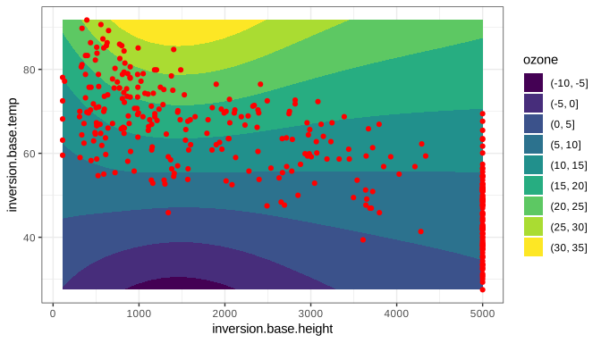

plot of chunk unnamed-chunk-20

**A basis of your own.** A seasonal cycle on a straight trend: two years
of daily values and a Fourier basis (`bs = "user"`, with no fixed part
of its own, `null = "none"`). The basis function is checked before the
fit: it must give the same row for the same day whatever data it is
given.

``` r

set.seed(3)
ds <- data.frame(day = 1:730)
ds$y <- 10 + 0.002*ds$day + 2*sin(2*pi*ds$day/365) + rnorm(730)
season <- function(d) cbind(sin(2*pi*d/365), cos(2*pi*d/365), sin(4*pi*d/365), cos(4*pi*d/365))
fs <- semireg(y ~ day + s(day, bs = "user", xt = list(basis = season, null = "none")),
              data = ds)
autoplot(semipred(fs, covariate = "day"))
```

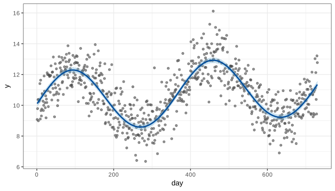

plot of chunk unnamed-chunk-21

## Examples from the semiparametric regression literature

The package has the data of M. P. Wand’s examples, which
[`semireg()`](https://dongwenluo.github.io/predictmeans/reference/semireg.md)
reproduces (`tests/testthat/test-semireg-golden.R`): `growthIndiana`
(above), `SBMDfem`, `ozoneCalif`, `scallop` (with `scallopKnots` and
`scallopBdry`), `wageTUnion` and `copper` (with `copperKnots`). Their
help pages have the analyses; a few here.

**Bone density by ethnic group** (`SBMDfem`): a curve over age,
ethnicity as a fixed effect and a random intercept per girl; the groups
compared at age 15:

``` r

data(SBMDfem)
SBMDfem$idnum <- factor(SBMDfem$idnum)
fsb <- semireg(spnbmd ~ s(age, bs = "os", k = 15) + ethnicity + (1 | idnum),
               data = SBMDfem)
pm_sb <- predictmeans(fsb, "ethnicity", covariate = c(age = 15), pairwise = TRUE, adj = "tukey")
pm_sb$means
#>   ethnicity  estimate  std.error       df  conf.low conf.high group
#> 1     Asian 0.9918785 0.01647278 274.8882 0.9594497  1.024307    A 
#> 2     Black 1.0980570 0.01440646 274.1369 1.0696956  1.126418     B
#> 3  Hispanic 1.0050416 0.01642609 289.7213 0.9727120  1.037371    A 
#> 4     White 1.0179401 0.01610810 264.8706 0.9862239  1.049656    A
```

**Scallop catches over the sea floor** (`scallop`): a thin-plate surface
with the knots of the original fit, drawn inside the boundary of the
survey area on the scale of the catch:

``` r

data(scallop); data(scallopKnots); data(scallopBdry)
fsc <- semireg(asinh(tot.catch) ~ s(longitude, latitude, bs = "ztps",
                                   xt = list(knots = as.matrix(scallopKnots))),
               data = scallop)
autoplot(semipred(fsc, covariate = c("longitude", "latitude"), boundary = scallopBdry,
                  trans = sinh))
```

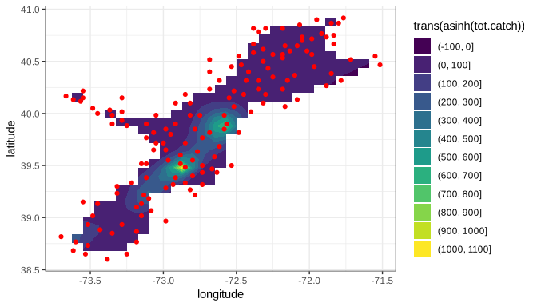

plot of chunk unnamed-chunk-23

**Union membership over the wage** (`wageTUnion`): penalised spline
logistic regression, the probability with its band:

``` r

data(wageTUnion)
fw <- semireg(unionMember ~ s(wage, bs = "os", k = 15), family = binomial,
              data = wageTUnion)
autoplot(semipred(fw, "wage", "wage"))
```

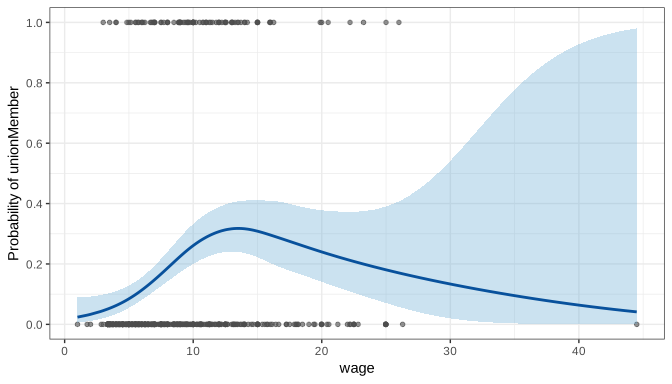

plot of chunk unnamed-chunk-24

## From 1.x

[`smZ()`](https://dongwenluo.github.io/predictmeans/reference/predictmeans-defunct.md)
and `smoothZ` were removed in 2.0:
[`vignette("migrating")`](https://dongwenluo.github.io/predictmeans/articles/migrating.md)
shows each 1.x form beside its formula form (they give the same fits)
and the 1.x models of the overview article beside their 2.0 code. Other
changes since 1.x: the optimizer is `nloptwrap`
(`control = lmerControl(optimizer = "bobyqa")` gives 1.x’s),
[`semipred()`](https://dongwenluo.github.io/predictmeans/reference/semipred.md)
limits are 95% (1.x: 90%), `anova(fit)` replaces lmerTest, and
generalized fits include the uncertainty of the smoothing parameters in
their bands.

## More

- [`?semireg`](https://dongwenluo.github.io/predictmeans/reference/semireg.md),
  [`?semipred`](https://dongwenluo.github.io/predictmeans/reference/semipred.md);
  [`semireg_tmb()`](https://dongwenluo.github.io/predictmeans/reference/semireg_tmb.md)
  fits the same models with glmmTMB, which also allows negative binomial
  and other families.
- The worked examples on the package website use larger data sets
  (apartment prices, school scores, respiratory infections, pollen
  counts and a spatial smooth of copper grades).

## References

Durban, M., Harezlak, J., Wand, M. P. and Carroll, R. J. (2005). Simple
fitting of subject-specific curves for longitudinal data. *Statistics in
Medicine*, 24, 1153-1167.

Harezlak, J., Ruppert, D. and Wand, M. P. (2018). *Semiparametric
Regression with R*. Springer.

Ruppert, D., Wand, M. P. and Carroll, R. J. (2003). *Semiparametric
Regression*. Cambridge University Press.

Wand, M. P. and Ormerod, J. T. (2008). On semiparametric regression with
O’Sullivan penalized splines. *Australian and New Zealand Journal of
Statistics*, 50, 179-198.
