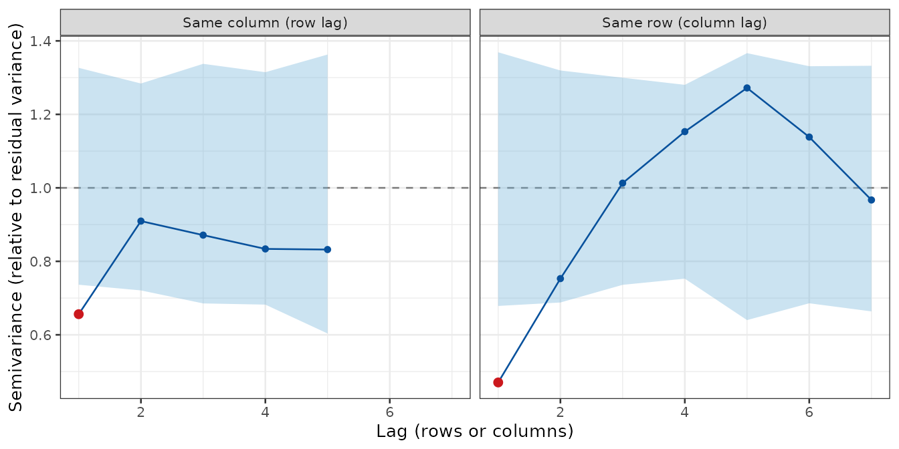
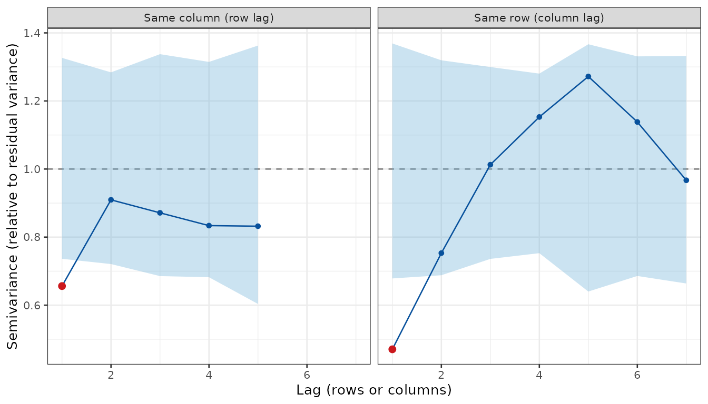
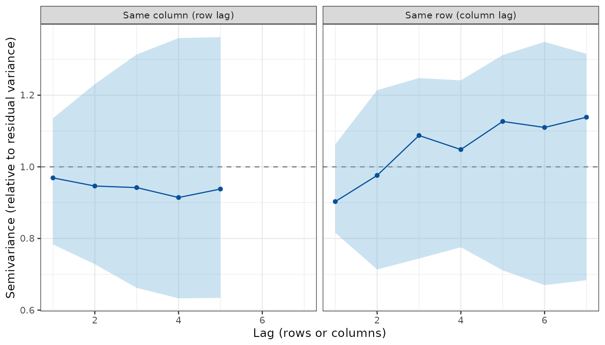

# Spatial analysis of a field trial

``` r

library(predictmeans)
library(nlme)
library(ggplot2)
```

Plots next to each other in a field are often more alike than plots far
apart. A model that ignores this gives standard errors that are wrong.
This article checks a trial for it with
[`residvariogram()`](https://dongwenluo.github.io/predictmeans/reference/residvariogram.md),
then fits the two usual spatial models: a separable AR1 x AR1
correlation
([`corAR1xAR1()`](https://dongwenluo.github.io/predictmeans/reference/corAR1xAR1.md))
and a smooth trend over the field (`t2(row, col)` in
[`semireg()`](https://dongwenluo.github.io/predictmeans/reference/semireg.md)).

The Slate Hall Farm trial (Genstat’s REML Guide, chapter 3): 25 wheat
varieties in 6 replicates, 150 plots on a grid of 10 field rows by 15
field columns.

``` r

d <- read.csv(system.file("extdata", "slatehall.csv", package = "predictmeans"))
d$variety <- factor(d$variety)
d$rep <- factor(d$replicates)
d$rowf <- factor(d$fieldrow)
d$colf <- factor(d$fieldcolumn)
```

## 1. The randomized complete block analysis and its variogram

``` r

m0 <- lm(yield ~ rep + variety, data = d)
v0 <- residvariogram(m0, row = "fieldrow", col = "fieldcolumn", data = d)
```



``` r

advice(v0)$text
```

    ## [1] "Plots next to each other in rows and columns are more alike than the model allows (the variogram is below the envelope at the shortest lag): the standard errors of the means ignore it. Fit a spatial covariance (gls() or lme() with corAR1xAR1(form = ~ row + col)) or a smooth surface t2(row, col) in semireg(), and check its variogram."

``` r

autoplot(v0)
```



The variogram is below its envelope at the shortest lags: neighbouring
plots are more alike than the block model allows, and the advice says
what to fit.

## 2. AR1 x AR1 over the field

``` r

fA <- gls(yield ~ variety, data = d, correlation = corAR1xAR1(form = ~ fieldrow + fieldcolumn))
coef(fA$modelStruct$corStruct, unconstrained = FALSE)
```

    ##   phi_row   phi_col 
    ## 0.4586104 0.6837671

``` r

fB <- gls(yield ~ variety, data = d,
          correlation = corAR1xAR1(form = ~ fieldrow + fieldcolumn, nugget = TRUE))
coef(fB$modelStruct$corStruct, unconstrained = FALSE)
```

    ##    phi_row    phi_col     nugget 
    ## 0.68269678 0.84379858 0.09596552

``` r

anova(fA, fB)
```

    ##    Model df      AIC      BIC    logLik   Test  L.Ratio p-value
    ## fA     1 28 535.0870 614.2798 -239.5435                        
    ## fB     2 29 530.0874 612.1085 -236.0437 1 vs 2 6.999567  0.0082

The nugget (an independent plot error besides the AR1 x AR1 part)
improves the fit (REML deviance 7.0 lower). Its variogram stays inside
the envelope:

``` r

vB <- residvariogram(fB, row = "fieldrow", col = "fieldcolumn", data = d, nsim = 39)
```



``` r

advice(vB)$text
```

    ## character(0)

``` r

autoplot(vB)
```


The variety means and their comparisons, with Kenward-Roger df:

``` r

pB <- predictmeans(fB, "variety")
head(pB$means[, c("variety", "estimate", "std.error", "df")])
```

    ##   variety estimate std.error       df
    ## 1       1 12.45582 0.9959761 4.601645
    ## 2       2 15.16234 0.9955372 4.629201
    ## 3       3 14.03984 1.0004145 4.607442
    ## 4       4 14.04918 0.9974440 4.633306
    ## 5       5 14.71612 1.0010578 4.661920
    ## 6       6 15.21937 0.9976045 4.570890

``` r

summary(pB$pairs$std.error)
```

    ##    Min. 1st Qu.  Median    Mean 3rd Qu.    Max. 
    ##  0.5791  0.6071  0.6180  0.6169  0.6250  0.6517

A single mean has a large SE with few df (about 1.0 on 4.6 df here):
with strong correlation along the field (phi 0.84 between columns) the
field’s overall level is poorly known. Comparisons do not depend on it,
and their SEDs (mean 0.62) are much smaller than those of the block
analysis (1.07, below).

Replicates can be added as random effects. In
[`lme()`](https://rdrr.io/pkg/nlme/man/lme.html) a correlation acts only
within the groups of the innermost random effect, so for an AR1 x AR1
over the whole field the replicate effects go in one group:

``` r

d$all <- factor(1)
fD <- lme(yield ~ variety, random = list(all = pdIdent(~ rep - 1)), data = d,
          correlation = corAR1xAR1(form = ~ fieldrow + fieldcolumn | all, nugget = TRUE))
VarCorr(fD)[1:2, ]
```

    ##      Variance       StdDev        
    ## rep1 "2.398928e-08" "0.0001548847"
    ## rep2 "2.398928e-08" "0.0001548847"

Here the replicate variance is estimated as 0 (Genstat, which allows
negative components, gives -0.078), so the model is the same as `fB`.

## 3. A smooth trend over the field

``` r

fT <- semireg(yield ~ variety + t2(fieldrow, fieldcolumn) + (1 | rowf) + (1 | colf), data = d)
pT <- predictmeans(fT, "variety")
```

A smooth surface over the field, as SpATS fits, with random row and
column effects: often as good as AR1 x AR1 in practice. On this trial
the AR1 x AR1 fit gives the more precise means:

``` r

sed <- function(p) mean(p$pairs$std.error)
data.frame(model = c("blocks (lm)", "AR1 x AR1 + nugget", "t2 trend"),
           mean_SED = c(sed(predictmeans(m0, "variety")), sed(pB), sed(pT)))
```

    ##                model  mean_SED
    ## 1        blocks (lm) 1.0749362
    ## 2 AR1 x AR1 + nugget 0.6169224
    ## 3           t2 trend 0.6675034

## Checks

[`corAR1xAR1()`](https://dongwenluo.github.io/predictmeans/reference/corAR1xAR1.md)
was checked against a Genstat run of these models
(`dev/genstat/ar1ar1-slatehall.gen`):

|  | predictmeans / nlme | Genstat |
|----|----|----|
| AR1 x AR1: phi row, column | 0.4586, 0.6838 | 0.4586, 0.6838 |
| with nugget: phi; units variance | 0.6827, 0.8438; 0.486 | 0.6827, 0.8438; 0.486 |
| REML deviance difference | 7.00 | 7.00 |
| 25 means and 300 SEDs of each model | within 1e-6 |  |
| variety F test d.d.f. (`df_method = "KR-average"`) | 79.99, 75.67 | 80.0, 75.7 |

The SEDs agree with `vcov_adjust = FALSE` (Genstat’s are not adjusted);
the default Kenward-Roger adjusted SEs are slightly larger. The tests
are in `tests/testthat/test-cor-ar1xar1.R`.

## References

- Gilmour, A. R., Cullis, B. R. and Verbyla, A. P. (1997). Accounting
  for natural and extraneous variation in the analysis of field
  experiments. *Journal of Agricultural, Biological, and Environmental
  Statistics*, 2, 269-293.
- Rodríguez-Álvarez, M. X., Boer, M. P., van Eeuwijk, F. A. and
  Eilers, P. H. C. (2018). Correcting for spatial heterogeneity in plant
  breeding experiments with P-splines. *Spatial Statistics*, 23, 52-71.
