# Experimental design and analysis for tree improvement

This article gives R code for the worked examples of the book
*Experimental Design and Analysis for Tree Improvement* (Williams,
Harwood and Matheson, 2023). The data sets come with the package
[eda4treeR](https://CRAN.R-project.org/package=eda4treeR) (Yaseen et
al., 2023). Each example follows the book: the data, the model, a check
of the residuals, the analysis of variance and the predicted means with
their pairwise comparisons, computed with predictmeans. Section titles
give the book’s example number and page. Where the analysis here differs
from the book’s, the text says why. The code of each step is folded:
click **Code** to see it.

Mixed models are fitted with
[`lme4::lmer()`](https://rdrr.io/pkg/lme4/man/lmer.html) (attached with
predictmeans). Their F tests
([`anova()`](https://rdrr.io/r/stats/anova.html)) and predicted means
use Kenward-Roger standard errors and degrees of freedom, as SAS PROC
MIXED `DDFM=KR` (Kenward and Roger, 1997); variance components are from
[`varcomp()`](https://dongwenluo.github.io/predictmeans/reference/varcomp.md).

Code

``` r

library(tidyverse)
library(predictmeans)
library(eda4treeR)
library(gridExtra)
library(car)
library(DT)
library(gt)
library(summarytools)
library(knitr)
```

## **2.1 Example 2.1 (Pg. 24)**

A field trial was planted to compare a seedlot derived from a seed
orchard (SO) with one collected from a routine plantation (P). There
were eight plots of each seedlot, thinned at seven years of age. Tree
diameters at breast height (dbh) were measured at 15 years and plot
means calculated.

### Data Info

- Structure
- Summary
- Plot

Code

``` r

data(DataExam2.1, package="eda4treeR")
str(DataExam2.1)
```

    ## 'data.frame':    16 obs. of  2 variables:
    ##  $ seedlot: Factor w/ 2 levels "SO","P": 1 1 1 1 1 1 1 1 2 2 ...
    ##  $ dbh    : num  30.4 27.9 28.1 31.4 30.1 ...

Code

``` r

print(dfSummary(DataExam2.1, 
                varnumbers   = FALSE, 
                valid.col    = FALSE, 
                graph.magnif = 0.76),
      method = 'render')
```

### Data Frame Summary

#### DataExam2.1

**Dimensions**: 16 x 2  
**Duplicates**: 0  

[TABLE]

Generated by [summarytools](https://github.com/dcomtois/summarytools)
1.1.5 ([R](https://www.r-project.org/) version 4.6.2)  
2026-11-25

Code

``` r

DataExam2.1 %>% 
  ggplot(aes(x=seedlot, y=dbh, col=seedlot, fill=seedlot))+
  geom_boxplot(width=0.3, alpha=0.4)+
  geom_jitter(size=2)+
  theme_bw(9)
```

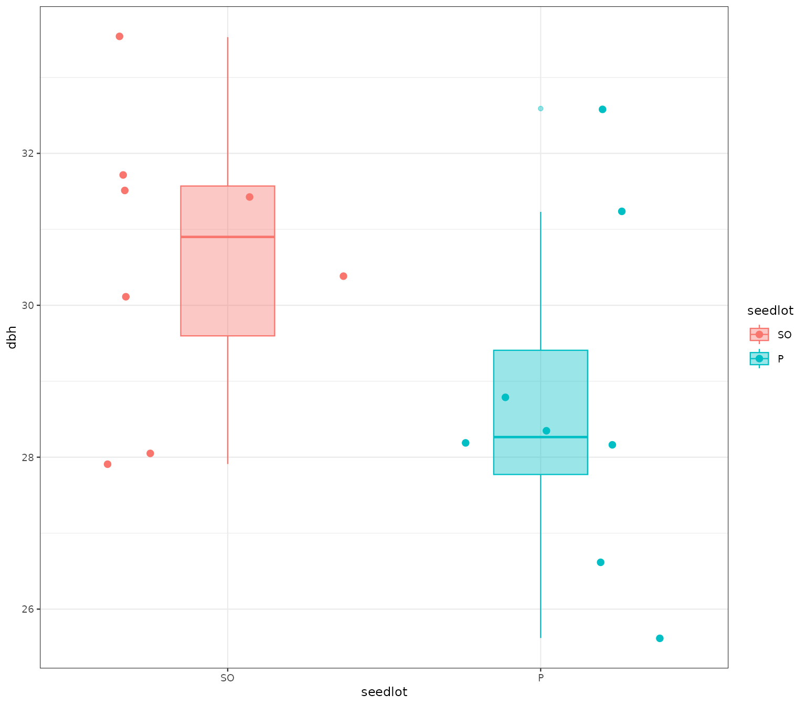

### Modelling

- Model
- Residual Plot
- Test

Code

``` r

fmtab2.3 <- lm(formula = dbh ~ seedlot , data = DataExam2.1)
summary(fmtab2.3)
```

    ## 
    ## Call:
    ## lm(formula = dbh ~ seedlot, data = DataExam2.1)
    ## 
    ## Residuals:
    ##     Min      1Q  Median      3Q     Max 
    ## -3.0725 -0.9200 -0.2769  0.9887  3.8975 
    ## 
    ## Coefficients:
    ##             Estimate Std. Error t value Pr(>|t|)    
    ## (Intercept)  30.5813     0.7405  41.300 4.98e-16 ***
    ## seedlotP     -1.8888     1.0472  -1.804   0.0928 .  
    ## ---
    ## Signif. codes:  0 '***' 0.001 '**' 0.01 '*' 0.05 '.' 0.1 ' ' 1
    ## 
    ## Residual standard error: 2.094 on 14 degrees of freedom
    ## Multiple R-squared:  0.1886, Adjusted R-squared:  0.1306 
    ## F-statistic: 3.253 on 1 and 14 DF,  p-value: 0.09284

Code

``` r

residplot(fmtab2.3) 
```

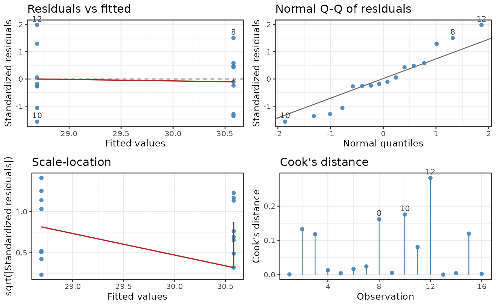

Code

``` r

#perform shapiro-wilk test
shapiro.test(resid(fmtab2.3))
```

    ## 
    ##  Shapiro-Wilk normality test
    ## 
    ## data:  resid(fmtab2.3)
    ## W = 0.95485, p-value = 0.5701

Code

``` r

#perform bartlett test
bartlett.test(dbh ~ seedlot , data = DataExam2.1)
```

    ## 
    ##  Bartlett test of homogeneity of variances
    ## 
    ## data:  dbh by seedlot
    ## Bartlett's K-squared = 0.20322, df = 1, p-value = 0.6521

Code

``` r

#perform levene test 
car::leveneTest(dbh ~ seedlot , data = DataExam2.1)
```

    ## Levene's Test for Homogeneity of Variance (center = median)
    ##       Df F value Pr(>F)
    ## group  1  0.0135 0.9091
    ##       14

### ANOVA

Code

``` r

kable(anova(fmtab2.3), digits = 4)
```

|           |  Df |  Sum Sq | Mean Sq | F value | Pr(\>F) |
|:----------|----:|--------:|--------:|--------:|--------:|
| seedlot   |   1 | 14.2695 | 14.2695 |  3.2531 |  0.0928 |
| Residuals |  14 | 61.4098 |  4.3864 |      NA |      NA |

### Predicted Means

- Mean Table
- Mean Plot

Code

``` r

predm_out <- predictmeans(fmtab2.3, "seedlot", meandecr=TRUE, adj="BH")
print(predm_out[1:4])
```

    ## $`Predicted Means`
    ## seedlot
    ##      SO       P 
    ## 30.5813 28.6925 
    ## 
    ## $`Standard Error of Means`
    ## All means have the same SE 
    ##                    0.74047 
    ## 
    ## $`Standard Error of Differences`
    ##  Max.SED  Min.SED Aveg.SED 
    ## 1.047189 1.047189 1.047189 
    ## 
    ## $LSD
    ##  Max.LSD  Min.LSD Aveg.LSD 
    ##    2.246    2.246    2.246 
    ## attr(,"Significant level")
    ## [1] 0.05
    ## attr(,"Degree of freedom")
    ## [1] 14
    ## attr(,"Note")
    ## [1] "These LSDs are not adjusted: 'BH' is a step-wise method and has no critical value for all pairs. Use the adjusted p-values for the comparisons."
    ## attr(,"equal")
    ## [1] TRUE

Code

``` r

gt(predm_out$mean_table$Table, 
   caption = "Group: Letter-based representation of pairwise comparisons at significant level '0.05'")
```

| seedlot | Mean    | SE      | Df  | LL(95%) | UL(95%) | LetterGrp |
|---------|---------|---------|-----|---------|---------|-----------|
| SO      | 30.5813 | 0.74047 | 14  | 28.9931 | 32.1694 | A         |
| P       | 28.6925 | 0.74047 | 14  | 27.1043 | 30.2807 | A         |

Group: Letter-based representation of pairwise comparisons at
significant level '0.05' {.table .gt_table
quarto-disable-processing="false" quarto-bootstrap="false"}

Code

``` r

autoplot(predm_out)
```

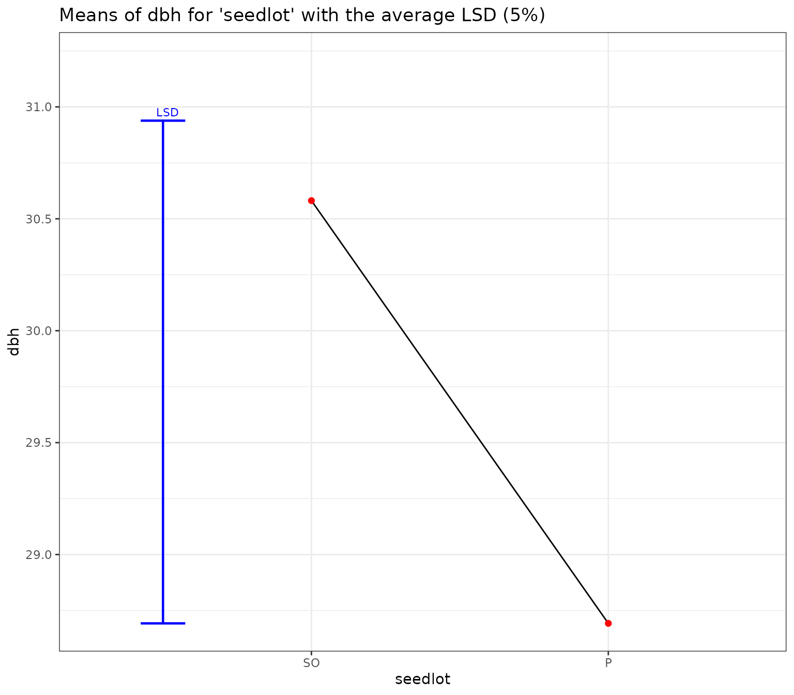

Code

``` r

autoplot(predm_out, type = "ci", data = TRUE)
```

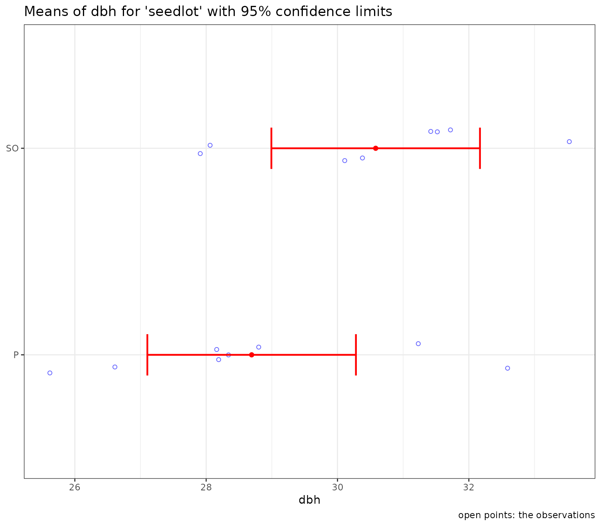

Code

``` r

autoplot(predm_out, type = "bar")
```


## **2.2 Example 2.2 (Pg. 26)**

### Data Info

- Structure
- Summary
- Plot

Code

``` r

data(DataExam2.2, package="eda4treeR")
str(DataExam2.2)
```

    ## 'data.frame':    16 obs. of  4 variables:
    ##  $ repl   : Factor w/ 2 levels "1","2": 1 2 1 2 1 2 1 2 1 2 ...
    ##  $ block  : Factor w/ 8 levels "1","2","3","4",..: 1 1 2 2 3 3 4 4 5 5 ...
    ##  $ seedlot: Factor w/ 2 levels "SO","P": 1 2 1 2 2 1 1 2 2 1 ...
    ##  $ dbh    : num  30.4 28.2 27.9 25.6 26.6 ...

Code

``` r

print(dfSummary(DataExam2.2, 
                varnumbers   = FALSE, 
                valid.col    = FALSE, 
                graph.magnif = 0.76),
      method = 'render')
```

### Data Frame Summary

#### DataExam2.2

**Dimensions**: 16 x 4  
**Duplicates**: 0  

[TABLE]

Generated by [summarytools](https://github.com/dcomtois/summarytools)
1.1.5 ([R](https://www.r-project.org/) version 4.6.2)  
2026-11-25

Code

``` r

DataExam2.2 %>% 
  ggplot(aes(x=seedlot, y=dbh, col=seedlot, fill=seedlot))+
  geom_boxplot(width=0.3, alpha=0.4)+
  geom_jitter(size=2)+
  theme_bw(9)
```

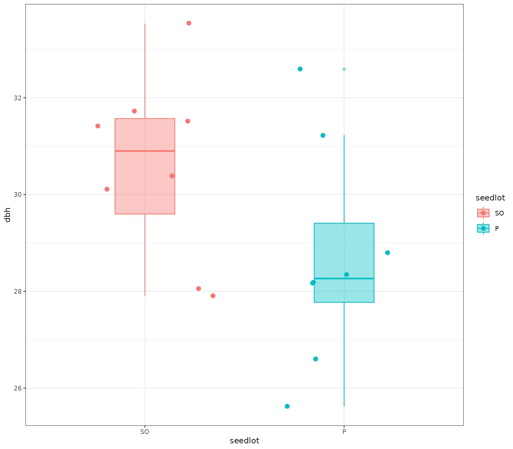

### Modelling

- Model
- Residual Plot
- Test

Code

``` r

fmtab2.5 <- lm(dbh ~ block + seedlot, data = DataExam2.2)
summary(fmtab2.5)
```

    ## 
    ## Call:
    ## lm(formula = dbh ~ block + seedlot, data = DataExam2.2)
    ## 
    ## Residuals:
    ##     Min      1Q  Median      3Q     Max 
    ## -1.6506 -0.3919  0.0000  0.3919  1.6506 
    ## 
    ## Coefficients:
    ##             Estimate Std. Error t value Pr(>|t|)    
    ## (Intercept)  30.2144     1.0040  30.095 1.15e-08 ***
    ## block2       -2.5050     1.3386  -1.871   0.1035    
    ## block3       -1.9350     1.3386  -1.446   0.1915    
    ## block4        2.7350     1.3386   2.043   0.0803 .  
    ## block5        0.1850     1.3386   0.138   0.8940    
    ## block6        0.5850     1.3386   0.437   0.6753    
    ## block7        2.2050     1.3386   1.647   0.1435    
    ## block8        1.6650     1.3386   1.244   0.2536    
    ## seedlotP     -1.8888     0.6693  -2.822   0.0257 *  
    ## ---
    ## Signif. codes:  0 '***' 0.001 '**' 0.01 '*' 0.05 '.' 0.1 ' ' 1
    ## 
    ## Residual standard error: 1.339 on 7 degrees of freedom
    ## Multiple R-squared:  0.8343, Adjusted R-squared:  0.6448 
    ## F-statistic: 4.404 on 8 and 7 DF,  p-value: 0.03296

Code

``` r

residplot(fmtab2.5) 
```

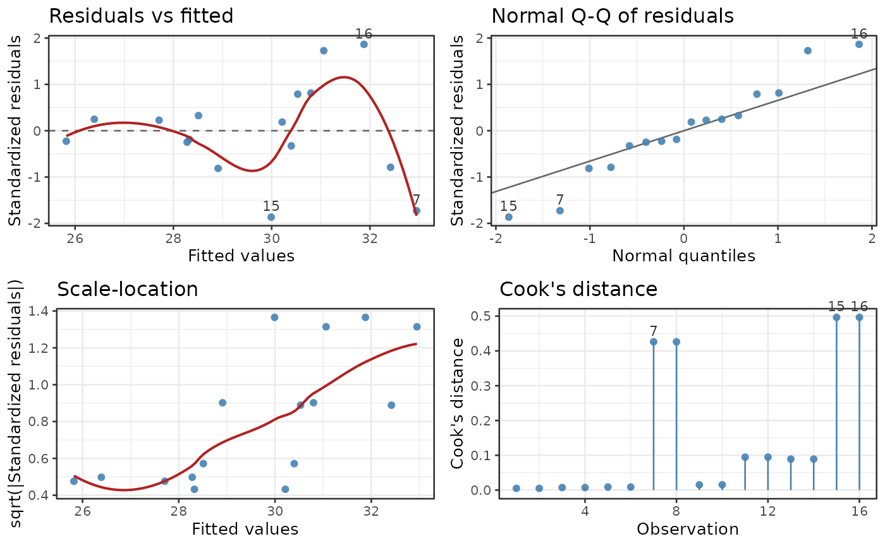

Code

``` r

#perform shapiro-wilk test
shapiro.test(resid(fmtab2.5))
```

    ## 
    ##  Shapiro-Wilk normality test
    ## 
    ## data:  resid(fmtab2.5)
    ## W = 0.95925, p-value = 0.6482

Code

``` r

#perform bartlett test
bartlett.test(dbh ~ seedlot, data = DataExam2.2)
```

    ## 
    ##  Bartlett test of homogeneity of variances
    ## 
    ## data:  dbh by seedlot
    ## Bartlett's K-squared = 0.20322, df = 1, p-value = 0.6521

Code

``` r

#perform levene test
car::leveneTest(dbh ~ seedlot, data = DataExam2.2)
```

    ## Levene's Test for Homogeneity of Variance (center = median)
    ##       Df F value Pr(>F)
    ## group  1  0.0135 0.9091
    ##       14

### ANOVA

Code

``` r

kable(anova(fmtab2.5), digits = 4)
```

|           |  Df |  Sum Sq | Mean Sq | F value | Pr(\>F) |
|:----------|----:|--------:|--------:|--------:|--------:|
| block     |   7 | 48.8668 |  6.9810 |  3.8959 |  0.0467 |
| seedlot   |   1 | 14.2695 | 14.2695 |  7.9635 |  0.0257 |
| Residuals |   7 | 12.5430 |  1.7919 |      NA |      NA |

### Predicted Means

- Mean Table
- Mean Plot

Code

``` r

predm_out <- predictmeans(fmtab2.5, "seedlot", adj="BH")
print(predm_out[1:4])
```

    ## $`Predicted Means`
    ## seedlot
    ##      SO       P 
    ## 30.5813 28.6925 
    ## 
    ## $`Standard Error of Means`
    ## All means have the same SE 
    ##                    0.47327 
    ## 
    ## $`Standard Error of Differences`
    ##   Max.SED   Min.SED  Aveg.SED 
    ## 0.6693025 0.6693025 0.6693025 
    ## 
    ## $LSD
    ##  Max.LSD  Min.LSD Aveg.LSD 
    ##  1.58265  1.58265  1.58265 
    ## attr(,"Significant level")
    ## [1] 0.05
    ## attr(,"Degree of freedom")
    ## [1] 7
    ## attr(,"Note")
    ## [1] "These LSDs are not adjusted: 'BH' is a step-wise method and has no critical value for all pairs. Use the adjusted p-values for the comparisons."
    ## attr(,"equal")
    ## [1] TRUE

Code

``` r

gt(predm_out$mean_table$Table, 
   caption = "Group: Letter-based representation of pairwise comparisons at significant level '0.05'")
```

| seedlot | Mean    | SE      | Df  | LL(95%) | UL(95%) | LetterGrp |
|---------|---------|---------|-----|---------|---------|-----------|
| SO      | 30.5813 | 0.47327 | 7   | 29.4621 | 31.7004 | A         |
| P       | 28.6925 | 0.47327 | 7   | 27.5734 | 29.8116 | B         |

Group: Letter-based representation of pairwise comparisons at
significant level '0.05' {.table .gt_table
quarto-disable-processing="false" quarto-bootstrap="false"}

Code

``` r

autoplot(predm_out)
```

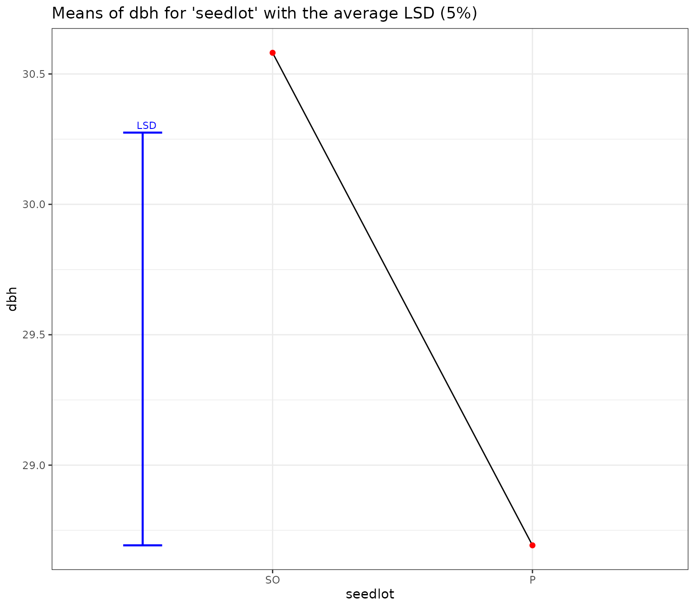

Code

``` r

autoplot(predm_out, type = "ci", data = TRUE)
```

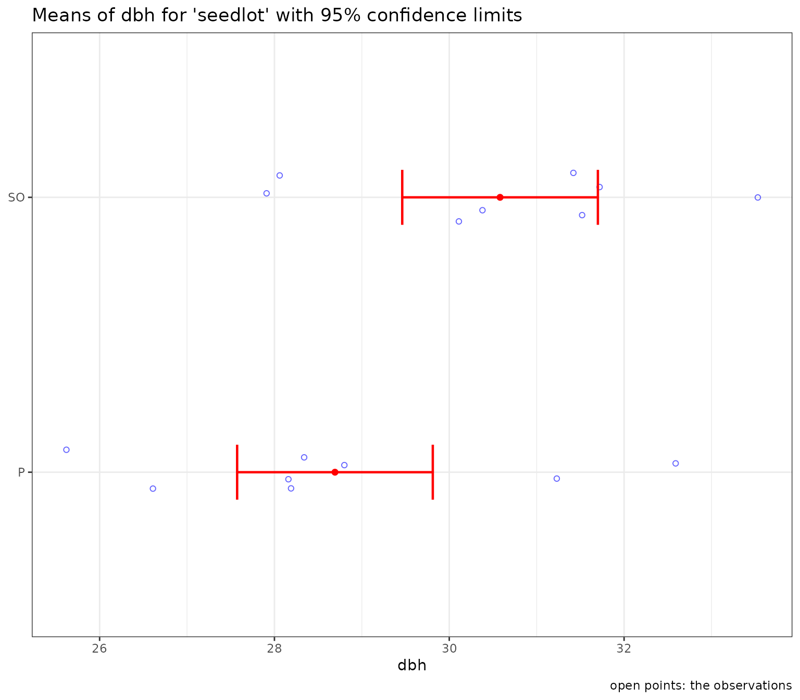

Code

``` r

autoplot(predm_out, type = "bar")
```

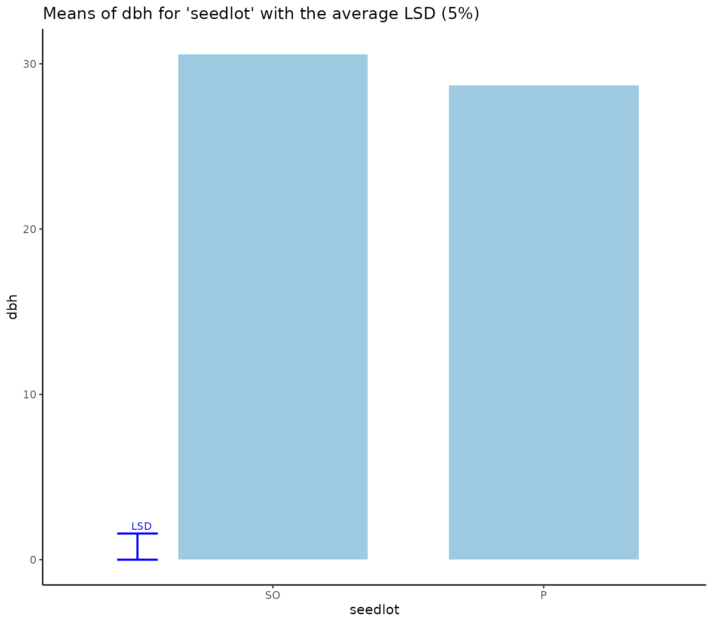

## **3.1 Example 3.1 (Pg. 30)**

We illustrate the recommended layout for data sheets with one of the
trials conducted by the Australian Centre for International Agricultural
Research (ACIAR) in Queensland, Australia (Experiment 309). This was a
species trial planted in 1985; survival was poor. For our example we
will examine only part of the data from this experiment. Five of the
species with good survival have been extracted at random, namely Acacia,
Angophora, Casuarina, Melaleuca and Petalostigma.

### Data Info

- Structure
- Summary

Code

``` r

data(DataExam3.1, package="eda4treeR")
str(DataExam3.1)
```

    ## 'data.frame':    80 obs. of  6 variables:
    ##  $ repl   : Factor w/ 2 levels "1","2": 1 1 1 1 1 1 1 1 1 1 ...
    ##  $ PlotNo : Factor w/ 5 levels "1","2","3","4",..: 1 1 1 1 1 1 1 1 2 2 ...
    ##  $ TreeNo : Factor w/ 8 levels "1","2","3","4",..: 1 2 3 4 5 6 7 8 1 2 ...
    ##  $ seedlot: Factor w/ 5 levels "Acacia","Angophora",..: 4 4 4 4 4 4 4 4 3 3 ...
    ##  $ ht     : num  5.6 5.8 4.9 4 5.6 5.3 5.5 6.9 4.8 4.5 ...
    ##  $ dgl    : num  20.2 20.9 13.2 14.7 23.4 13.3 18.2 21.2 12.9 9.6 ...

Code

``` r

print(dfSummary(DataExam3.1, 
                varnumbers   = FALSE, 
                valid.col    = FALSE, 
                graph.magnif = 0.76),
      method = 'render')
```

### Data Frame Summary

#### DataExam3.1

**Dimensions**: 80 x 6  
**Duplicates**: 0  

[TABLE]

Generated by [summarytools](https://github.com/dcomtois/summarytools)
1.1.5 ([R](https://www.r-project.org/) version 4.6.2)  
2026-11-25

### Modelling

- Model
- Residual Plot

Code

``` r

fmtab3.3 <- aov(ht ~ Error(repl/PlotNo)+seedlot, data = DataExam3.1)
summary(fmtab3.3)
```

    ## 
    ## Error: repl
    ##           Df Sum Sq Mean Sq F value Pr(>F)
    ## Residuals  1   20.3    20.3               
    ## 
    ## Error: repl:PlotNo
    ##           Df Sum Sq Mean Sq F value  Pr(>F)   
    ## seedlot    4  505.9  126.47    21.3 0.00585 **
    ## Residuals  4   23.7    5.94                   
    ## ---
    ## Signif. codes:  0 '***' 0.001 '**' 0.01 '*' 0.05 '.' 0.1 ' ' 1
    ## 
    ## Error: Within
    ##           Df Sum Sq Mean Sq F value Pr(>F)
    ## Residuals 70  175.6   2.509

Code

``` r

residplot(fmtab3.3) 
```

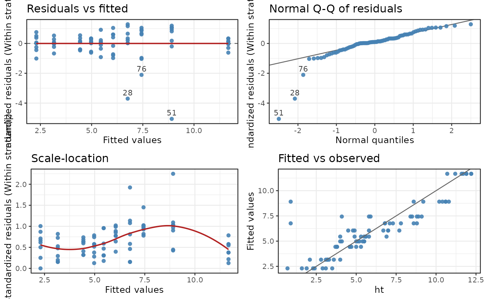

### Predicted Means

- Mean Table
- Mean Plot

- Mean

Code

``` r

predm_out <- predictmeans(fmtab3.3, "seedlot", adj="BH")
print(predm_out[1:4])
```

    ## $`Predicted Means`
    ## seedlot
    ##       Acacia    Angophora    Casuarina    Melaleuca Petalostigma 
    ##      10.2937       7.1000       5.5125       4.9437       2.7312 
    ## 
    ## $`Standard Error of Means`
    ## All means have the same SE 
    ##                    0.74201 
    ## 
    ## $`Standard Error of Differences`
    ##  Max.SED  Min.SED Aveg.SED 
    ## 0.861426 0.861426 0.861426 
    ## 
    ## $LSD
    ##  Max.LSD  Min.LSD Aveg.LSD 
    ##   2.3917   2.3917   2.3917 
    ## attr(,"Significant level")
    ## [1] 0.05
    ## attr(,"Degree of freedom")
    ## [1] 4
    ## attr(,"Note")
    ## [1] "These LSDs are not adjusted: 'BH' is a step-wise method and has no critical value for all pairs. Use the adjusted p-values for the comparisons."
    ## attr(,"equal")
    ## [1] TRUE

Code

``` r

gt(predm_out$mean_table$Table, 
   caption = "Group: Letter-based representation of pairwise comparisons at significant level '0.05'")
```

| seedlot      | Mean    | SE      | Df   | LL(95%) | UL(95%) | LetterGrp |
|--------------|---------|---------|------|---------|---------|-----------|
| Acacia       | 10.2937 | 0.74201 | 3.51 | 8.1151  | 12.4724 | A         |
| Angophora    | 7.1000  | 0.74201 | 3.51 | 4.9213  | 9.2787  | B         |
| Casuarina    | 5.5125  | 0.74201 | 3.51 | 3.3338  | 7.6912  | BC        |
| Melaleuca    | 4.9437  | 0.74201 | 3.51 | 2.7651  | 7.1224  | BC        |
| Petalostigma | 2.7312  | 0.74201 | 3.51 | 0.5526  | 4.9099  | C         |

Group: Letter-based representation of pairwise comparisons at
significant level '0.05' {.table .gt_table
quarto-disable-processing="false" quarto-bootstrap="false"}

- Pairwise p-values

Code

``` r

gt(data.frame(predm_out$`Pairwise p-value`, check.names=FALSE), 
   rownames_to_stub=TRUE, 
   caption = "The matrix has t-value above the diagonal, p-value (adjusted by 'BH' method) below the diagonal") %>% 
  cols_width(everything() ~ px(130))
```

|              | Acacia | Angophora | Casuarina | Melaleuca | Petalostigma |
|--------------|--------|-----------|-----------|-----------|--------------|
| Acacia       | 1.0000 | 3.7075    | 5.5504    | 6.2106    | 8.7790       |
| Angophora    | 0.0414 | 1.0000    | 1.8429    | 2.5031    | 5.0715       |
| Casuarina    | 0.0172 | 0.1546    | 1.0000    | 0.6602    | 3.2287       |
| Melaleuca    | 0.0171 | 0.0832    | 0.5452    | 1.0000    | 2.5684       |
| Petalostigma | 0.0093 | 0.0178    | 0.0534    | 0.0832    | 1.0000       |

The matrix has t-value above the diagonal, p-value (adjusted by 'BH'
method) below the diagonal {.table .gt_table
style="table-layout:fixed;width:0px;" quarto-disable-processing="false"
quarto-bootstrap="false"}

Code

``` r

autoplot(predm_out)
```

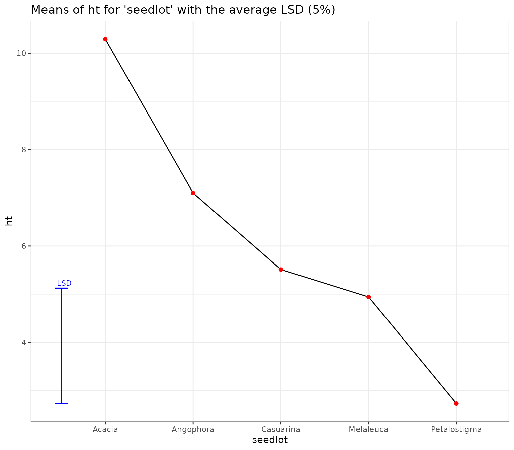

Code

``` r

autoplot(predm_out, type = "ci", data = TRUE)
```

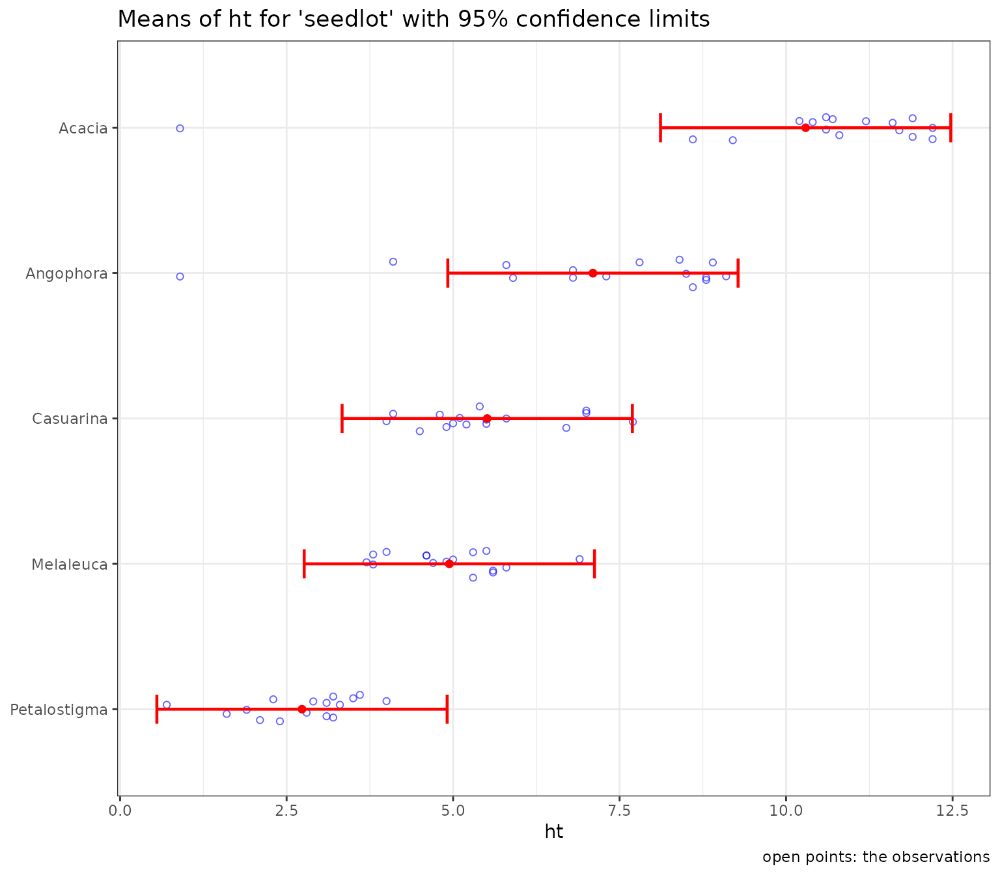

Code

``` r

autoplot(predm_out, type = "bar")
```


### Remove three outliers

- Outliers:

Code

``` r

DataExam3.1[c(28, 51, 76), ] %>% 
  gt(rownames_to_stub=TRUE)
```

|     | repl | PlotNo | TreeNo | seedlot   | ht  | dgl |
|-----|------|--------|--------|-----------|-----|-----|
| 28  | 1    | 4      | 4      | Angophora | 0.9 | 4.2 |
| 51  | 2    | 2      | 3      | Acacia    | 0.9 | 1.7 |
| 76  | 2    | 5      | 4      | Angophora | 4.1 | 7.5 |

- Model:

Code

``` r

fmtab3.3N <- aov(ht ~ Error(repl/PlotNo/TreeNo)+seedlot, data = DataExam3.1[-c(28, 51, 76), ])
summary(fmtab3.3N)
```

    ## 
    ## Error: repl
    ##         Df Sum Sq Mean Sq
    ## seedlot  1  18.88   18.88
    ## 
    ## Error: repl:PlotNo
    ##           Df Sum Sq Mean Sq F value  Pr(>F)    
    ## seedlot    4  588.7  147.17   81.24 0.00044 ***
    ## Residuals  4    7.2    1.81                    
    ## ---
    ## Signif. codes:  0 '***' 0.001 '**' 0.01 '*' 0.05 '.' 0.1 ' ' 1
    ## 
    ## Error: repl:PlotNo:TreeNo
    ##           Df Sum Sq Mean Sq F value Pr(>F)
    ## Residuals 67  50.23  0.7497

## **3.2 Example 3.1 (continued) (Pg. 39)**

### Data Info

The data in DataExam3.1 can be summarised to the plots level, we have

- Structure
- Summary

Code

``` r

data(DataExam3.1.1, package="eda4treeR")
str(DataExam3.1.1)
```

    ## tibble [10 × 6] (S3: tbl_df/tbl/data.frame)
    ##  $ repl     : Factor w/ 2 levels "1","2": 1 1 1 1 1 2 2 2 2 2
    ##  $ PlotNo   : Factor w/ 5 levels "1","2","3","4",..: 1 2 3 4 5 1 2 3 4 5
    ##  $ seedlot  : Factor w/ 5 levels "Acacia","Angophora",..: 4 3 5 2 1 4 1 3 5 2
    ##  $ ht       : num [1:10] 5.45 6.05 3.16 6.76 11.67 ...
    ##  $ Var      : num [1:10] 0.671 1.471 0.311 6.197 0.262 ...
    ##  $ TreeCount: int [1:10] 8 8 8 8 8 8 8 8 8 8

Code

``` r

print(dfSummary(DataExam3.1.1, 
                varnumbers   = FALSE, 
                valid.col    = FALSE, 
                graph.magnif = 0.76),
      method = 'render')
```

### Data Frame Summary

#### DataExam3.1.1

**Dimensions**: 10 x 6  
**Duplicates**: 0  

[TABLE]

Generated by [summarytools](https://github.com/dcomtois/summarytools)
1.1.5 ([R](https://www.r-project.org/) version 4.6.2)  
2026-11-25

### Modelling

- Model
- Residual Plot

Code

``` r

fmtab3.8 <- aov(ht ~ Error(repl)+seedlot, data = DataExam3.1.1)
summary(fmtab3.8)
```

    ## 
    ## Error: repl
    ##           Df Sum Sq Mean Sq F value Pr(>F)
    ## Residuals  1  2.538   2.538               
    ## 
    ## Error: Within
    ##           Df Sum Sq Mean Sq F value  Pr(>F)   
    ## seedlot    4  63.23  15.808    21.3 0.00585 **
    ## Residuals  4   2.97   0.742                   
    ## ---
    ## Signif. codes:  0 '***' 0.001 '**' 0.01 '*' 0.05 '.' 0.1 ' ' 1

Code

``` r

residplot(fmtab3.8) 
```

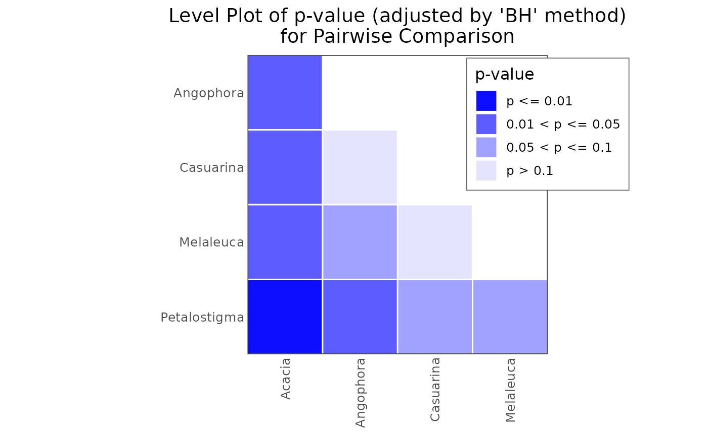

### Predicted Means

- Mean Table
- Mean Plot

- Mean

Code

``` r

predm_out <- predictmeans(fmtab3.8, "seedlot", adj="BH")
print(predm_out[1:4])
```

    ## $`Predicted Means`
    ## seedlot
    ##       Acacia    Angophora    Casuarina    Melaleuca Petalostigma 
    ##      10.2937       7.1000       5.5125       4.9437       2.7312 
    ## 
    ## $`Standard Error of Means`
    ## All means have the same SE 
    ##                    0.74201 
    ## 
    ## $`Standard Error of Differences`
    ##  Max.SED  Min.SED Aveg.SED 
    ## 0.861426 0.861426 0.861426 
    ## 
    ## $LSD
    ##  Max.LSD  Min.LSD Aveg.LSD 
    ##   2.3917   2.3917   2.3917 
    ## attr(,"Significant level")
    ## [1] 0.05
    ## attr(,"Degree of freedom")
    ## [1] 4
    ## attr(,"Note")
    ## [1] "These LSDs are not adjusted: 'BH' is a step-wise method and has no critical value for all pairs. Use the adjusted p-values for the comparisons."
    ## attr(,"equal")
    ## [1] TRUE

Code

``` r

gt(predm_out$mean_table$Table, 
   caption = "Group: Letter-based representation of pairwise comparisons at significant level '0.05'")
```

| seedlot      | Mean    | SE      | Df   | LL(95%) | UL(95%) | LetterGrp |
|--------------|---------|---------|------|---------|---------|-----------|
| Acacia       | 10.2937 | 0.74201 | 3.51 | 8.1151  | 12.4724 | A         |
| Angophora    | 7.1000  | 0.74201 | 3.51 | 4.9213  | 9.2787  | B         |
| Casuarina    | 5.5125  | 0.74201 | 3.51 | 3.3338  | 7.6912  | BC        |
| Melaleuca    | 4.9437  | 0.74201 | 3.51 | 2.7651  | 7.1224  | BC        |
| Petalostigma | 2.7312  | 0.74201 | 3.51 | 0.5526  | 4.9099  | C         |

Group: Letter-based representation of pairwise comparisons at
significant level '0.05' {.table .gt_table
quarto-disable-processing="false" quarto-bootstrap="false"}

- Pairwise p-values

Code

``` r

gt(data.frame(predm_out$`Pairwise p-value`, check.names=FALSE), 
   rownames_to_stub=TRUE, 
   caption = "The matrix has t-value above the diagonal, p-value (adjusted by 'BH' method) below the diagonal") %>% 
  cols_width(everything() ~ px(130))
```

|              | Acacia | Angophora | Casuarina | Melaleuca | Petalostigma |
|--------------|--------|-----------|-----------|-----------|--------------|
| Acacia       | 1.0000 | 3.7075    | 5.5504    | 6.2106    | 8.7790       |
| Angophora    | 0.0414 | 1.0000    | 1.8429    | 2.5031    | 5.0715       |
| Casuarina    | 0.0172 | 0.1546    | 1.0000    | 0.6602    | 3.2287       |
| Melaleuca    | 0.0171 | 0.0832    | 0.5452    | 1.0000    | 2.5684       |
| Petalostigma | 0.0093 | 0.0178    | 0.0534    | 0.0832    | 1.0000       |

The matrix has t-value above the diagonal, p-value (adjusted by 'BH'
method) below the diagonal {.table .gt_table
style="table-layout:fixed;width:0px;" quarto-disable-processing="false"
quarto-bootstrap="false"}

Code

``` r

autoplot(predm_out)
```


Code

``` r

autoplot(predm_out, type = "ci", data = TRUE)
```

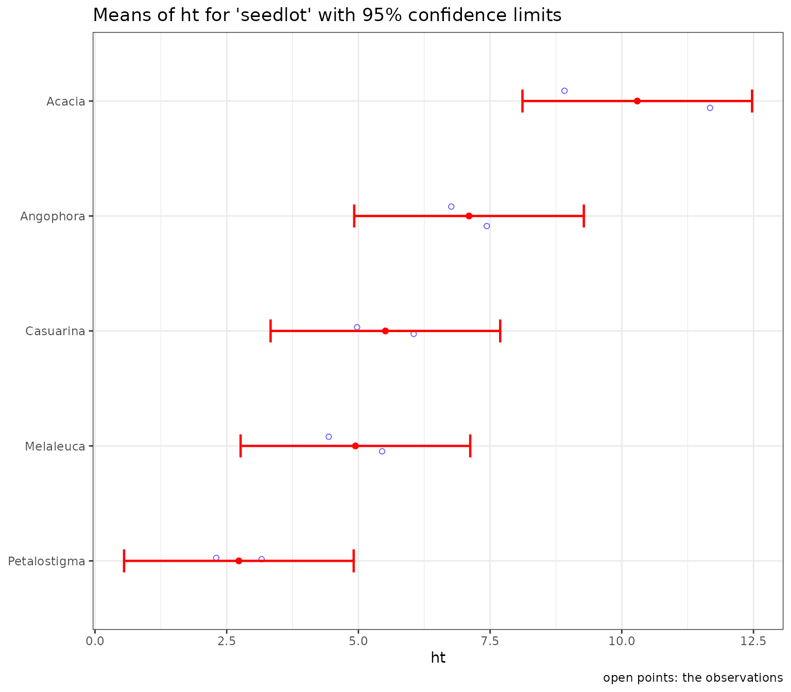

Code

``` r

autoplot(predm_out, type = "bar")
```

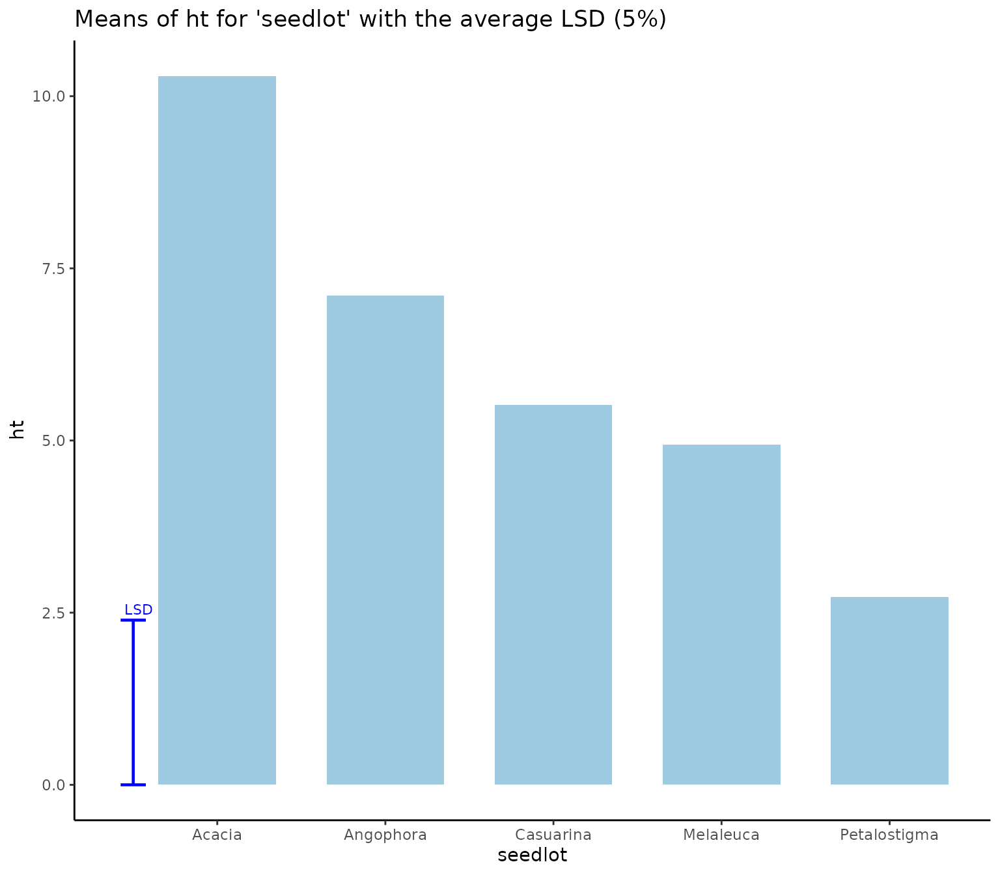

## **4.1 Example 4.3 (Pg. 53)**

### Data Info

Major seed distributors such as the Australian Tree Seed Centre (ATSC)
routinely conduct seed viability tests so that, when seed is dispatched,
the purchaser has an indication of the germination percentage of the
seed. As part of the ATSC research program, a series of experiments was
conducted in 1992 by Debbie Solomon on provenances of Acacia mangium to
investigate methods of pre-treatment and loss of viability of stored
seed. Each experiment involved six seedlots of Acacia mangium and four
seed pre-treatments in a factorial design with three replicates.

- Structure
- Summary

Code

``` r

data(DataExam4.3, package="eda4treeR")
DataExam4.3$treat <- factor(DataExam4.3$treat, levels =c("control", "nick", "bw&s", "bw1min"))
DataExam4.3$contcomp <- factor(DataExam4.3$contcomp, levels = c("control", "Treated"))
str(DataExam4.3)
```

    ## 'data.frame':    72 obs. of  8 variables:
    ##  $ repl    : Factor w/ 3 levels "1","2","3": 1 1 1 1 1 1 1 1 1 1 ...
    ##  $ row     : Factor w/ 6 levels "1","2","3","4",..: 1 1 1 1 2 2 2 2 3 3 ...
    ##  $ column  : Factor w/ 4 levels "1","2","3","4": 1 2 3 4 1 2 3 4 1 2 ...
    ##  $ seedlot : Factor w/ 6 levels "18211","18212",..: 1 5 3 2 2 1 5 3 6 4 ...
    ##  $ treat   : Factor w/ 4 levels "control","nick",..: 2 3 1 4 1 4 2 3 4 1 ...
    ##  $ count   : num  15 17 2 23 0 24 18 10 24 0 ...
    ##  $ percent : num  60 68 8 92 0 96 72 40 96 0 ...
    ##  $ contcomp: Factor w/ 2 levels "control","Treated": 2 2 1 2 1 2 2 2 2 1 ...

Code

``` r

print(dfSummary(DataExam4.3, 
                varnumbers   = FALSE, 
                valid.col    = FALSE, 
                graph.magnif = 0.76),
      method = 'render')
```

### Data Frame Summary

#### DataExam4.3

**Dimensions**: 72 x 8  
**Duplicates**: 0  

[TABLE]

Generated by [summarytools](https://github.com/dcomtois/summarytools)
1.1.5 ([R](https://www.r-project.org/) version 4.6.2)  
2026-11-25

### Modelling

- Model
- Residual Plot

Code

``` r

fm4.2 <- aov(percent ~ repl + contcomp + seedlot +
               treat/contcomp + contcomp/seedlot + treat/contcomp/seedlot
             , data = DataExam4.3)
kable(anova(fm4.2), digits = 4) 
```

|                        |  Df |     Sum Sq |    Mean Sq |  F value | Pr(\>F) |
|:-----------------------|----:|-----------:|-----------:|---------:|--------:|
| repl                   |   2 |    35.1111 |    17.5556 |   0.1804 |  0.8355 |
| contcomp               |   1 | 58542.2963 | 58542.2963 | 601.5217 |  0.0000 |
| seedlot                |   5 |  2894.4444 |   578.8889 |   5.9481 |  0.0003 |
| treat                  |   2 |  5300.1481 |  2650.0741 |  27.2295 |  0.0000 |
| contcomp:seedlot       |   5 |  1347.0370 |   269.4074 |   2.7682 |  0.0288 |
| contcomp:seedlot:treat |  10 |   961.1852 |    96.1185 |   0.9876 |  0.4675 |
| Residuals              |  46 |  4476.8889 |    97.3237 |       NA |      NA |

Code

``` r

residplot(fm4.2) 
```

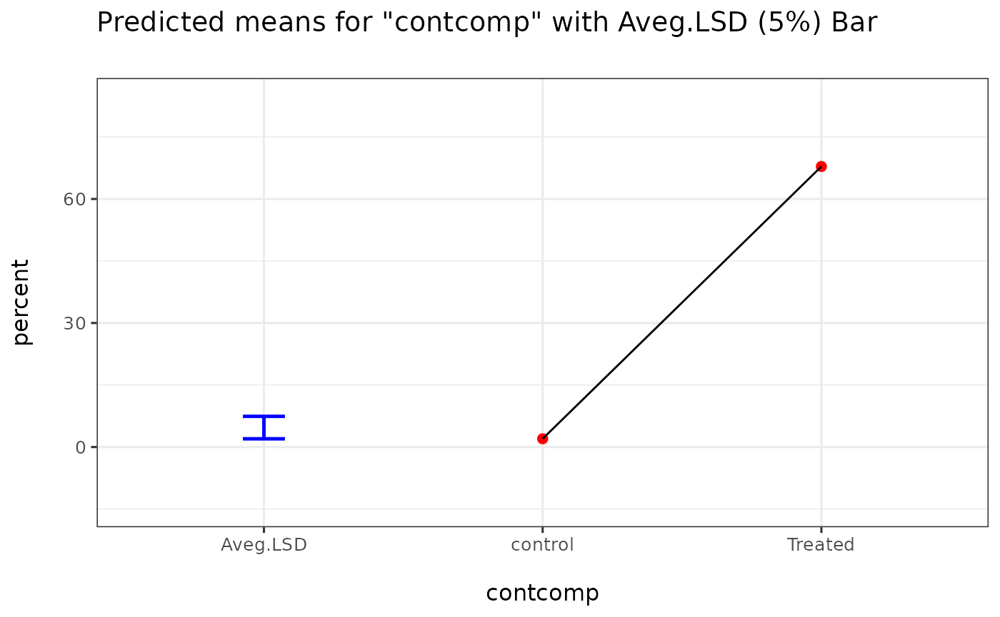

### Predicted Means

- contcomp

&nbsp;

- Mean Table
- Mean Plot
- Mean Table
- Mean Plot
- Mean Table
- Mean Plot
- Mean Table
- Mean Plot
- Mean Table
- Mean Plot

Code

``` r

predm_out <- predictmeans(fm4.2, "contcomp", adj="BH")
print(predm_out[1:4])
```

    ## $`Predicted Means`
    ## contcomp
    ## control Treated 
    ##  2.0000 67.8519 
    ## 
    ## $`Standard Error of Means`
    ## contcomp
    ## control Treated 
    ## 2.32527 1.34249 
    ## 
    ## $`Standard Error of Differences`
    ##  Max.SED  Min.SED Aveg.SED 
    ## 2.684988 2.684988 2.684988 
    ## 
    ## $LSD
    ##  Max.LSD  Min.LSD Aveg.LSD 
    ##   5.4046   5.4046   5.4046 
    ## attr(,"Significant level")
    ## [1] 0.05
    ## attr(,"Degree of freedom")
    ## [1] 46
    ## attr(,"Note")
    ## [1] "These LSDs are not adjusted: 'BH' is a step-wise method and has no critical value for all pairs. Use the adjusted p-values for the comparisons."
    ## attr(,"equal")
    ## [1] TRUE

Code

``` r

gt(predm_out$mean_table$Table, 
   caption = "Group: Letter-based representation of pairwise comparisons at significant level '0.05'")
```

| contcomp | Mean    | SE      | Df  | LL(95%) | UL(95%) | LetterGrp |
|----------|---------|---------|-----|---------|---------|-----------|
| control  | 2.0000  | 2.32527 | 46  | -2.6805 | 6.6805  | A         |
| Treated  | 67.8519 | 1.34249 | 46  | 65.1496 | 70.5542 | B         |

Group: Letter-based representation of pairwise comparisons at
significant level '0.05' {.table .gt_table
quarto-disable-processing="false" quarto-bootstrap="false"}

Code

``` r

autoplot(predm_out)
```

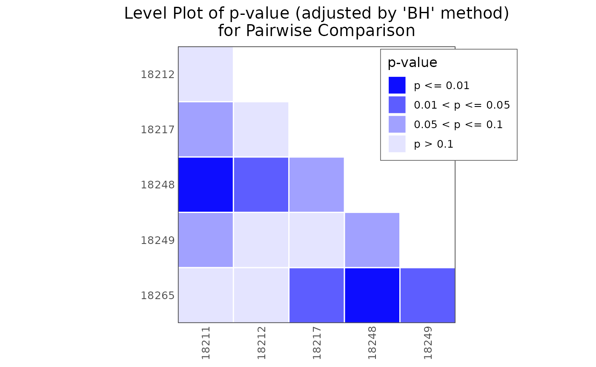

Code

``` r

autoplot(predm_out, type = "ci", data = TRUE)
```

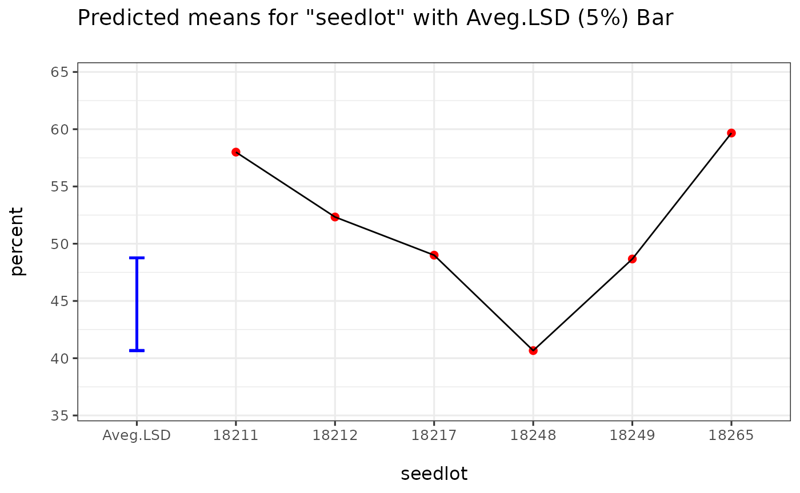

Code

``` r

autoplot(predm_out, type = "bar")
```

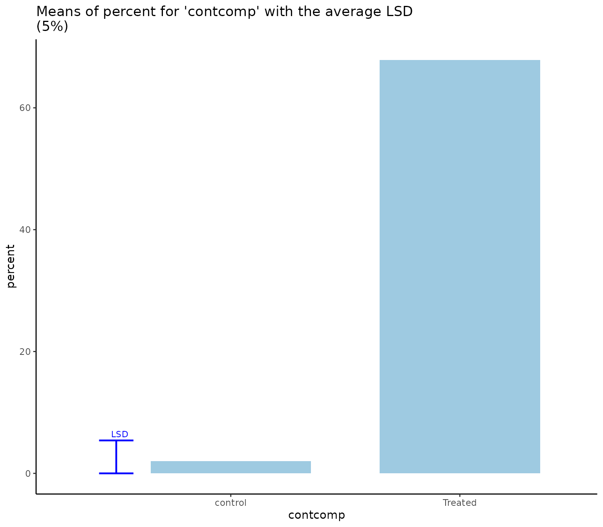

- seedlot

- Mean

Code

``` r

predm_out <- predictmeans(fm4.2, "seedlot", adj="BH")
print(predm_out[1:4])
```

    ## $`Predicted Means`
    ## seedlot
    ##   18211   18212   18217   18248   18249   18265 
    ## 58.0000 52.3333 49.0000 40.6667 48.6667 59.6667 
    ## 
    ## $`Standard Error of Means`
    ## All means have the same SE 
    ##                    2.84786 
    ## 
    ## $`Standard Error of Differences`
    ##  Max.SED  Min.SED Aveg.SED 
    ## 4.027482 4.027482 4.027482 
    ## 
    ## $LSD
    ##  Max.LSD  Min.LSD Aveg.LSD 
    ##   8.1069   8.1069   8.1069 
    ## attr(,"Significant level")
    ## [1] 0.05
    ## attr(,"Degree of freedom")
    ## [1] 46
    ## attr(,"Note")
    ## [1] "These LSDs are not adjusted: 'BH' is a step-wise method and has no critical value for all pairs. Use the adjusted p-values for the comparisons."
    ## attr(,"equal")
    ## [1] TRUE

Code

``` r

gt(predm_out$mean_table$Table, 
   caption = "Group: Letter-based representation of pairwise comparisons at significant level '0.05'")
```

| seedlot | Mean    | SE      | Df  | LL(95%) | UL(95%) | LetterGrp |
|---------|---------|---------|-----|---------|---------|-----------|
| 18211   | 58.0000 | 2.84786 | 46  | 52.2676 | 63.7324 | AB        |
| 18212   | 52.3333 | 2.84786 | 46  | 46.6009 | 58.0658 | AB        |
| 18217   | 49.0000 | 2.84786 | 46  | 43.2676 | 54.7324 | A C       |
| 18248   | 40.6667 | 2.84786 | 46  | 34.9342 | 46.3991 | C         |
| 18249   | 48.6667 | 2.84786 | 46  | 42.9342 | 54.3991 | A C       |
| 18265   | 59.6667 | 2.84786 | 46  | 53.9342 | 65.3991 | B         |

Group: Letter-based representation of pairwise comparisons at
significant level '0.05' {.table .gt_table
quarto-disable-processing="false" quarto-bootstrap="false"}

- Pairwise p-values

Code

``` r

gt(data.frame(predm_out$`Pairwise p-value`, check.names=FALSE), 
   rownames_to_stub=TRUE, 
   caption = "The matrix has t-value above the diagonal, p-value (adjusted by 'BH' method) below the diagonal") %>% 
  cols_width(everything() ~ px(100))
```

|       | 18211  | 18212  | 18217  | 18248  | 18249   | 18265   |
|-------|--------|--------|--------|--------|---------|---------|
| 18211 | 1.0000 | 1.4070 | 2.2346 | 4.3038 | 2.3174  | -0.4138 |
| 18212 | 0.2266 | 1.0000 | 0.8276 | 2.8968 | 0.9104  | -1.8208 |
| 18217 | 0.0650 | 0.4756 | 1.0000 | 2.0691 | 0.0828  | -2.6485 |
| 18248 | 0.0007 | 0.0288 | 0.0828 | 1.0000 | -1.9864 | -4.7176 |
| 18249 | 0.0625 | 0.4592 | 0.9344 | 0.0883 | 1.0000  | -2.7312 |
| 18265 | 0.7296 | 0.1127 | 0.0331 | 0.0003 | 0.0331  | 1.0000  |

The matrix has t-value above the diagonal, p-value (adjusted by 'BH'
method) below the diagonal {.table .gt_table
style="table-layout:fixed;width:0px;" quarto-disable-processing="false"
quarto-bootstrap="false"}

Code

``` r

autoplot(predm_out)
```

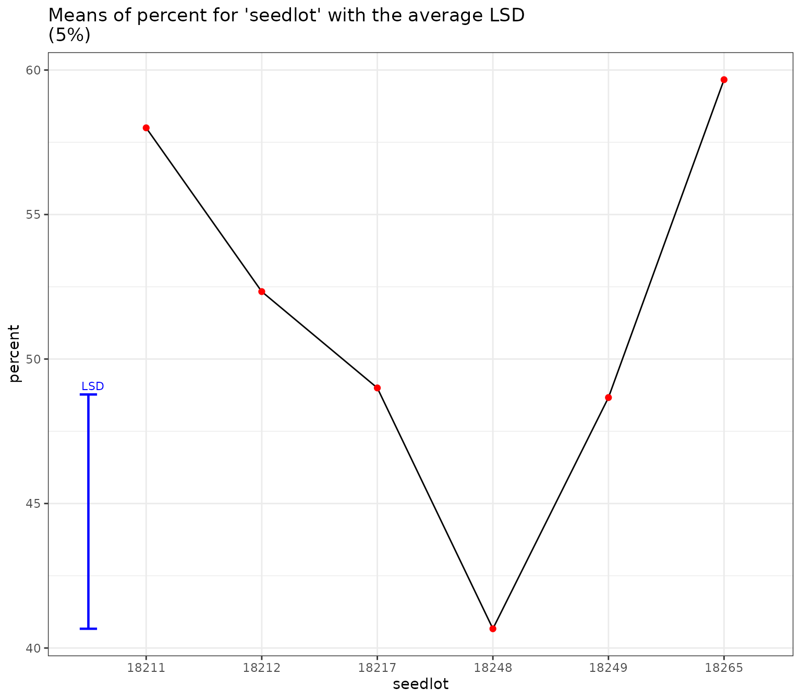

Code

``` r

autoplot(predm_out, type = "ci", data = TRUE)
```

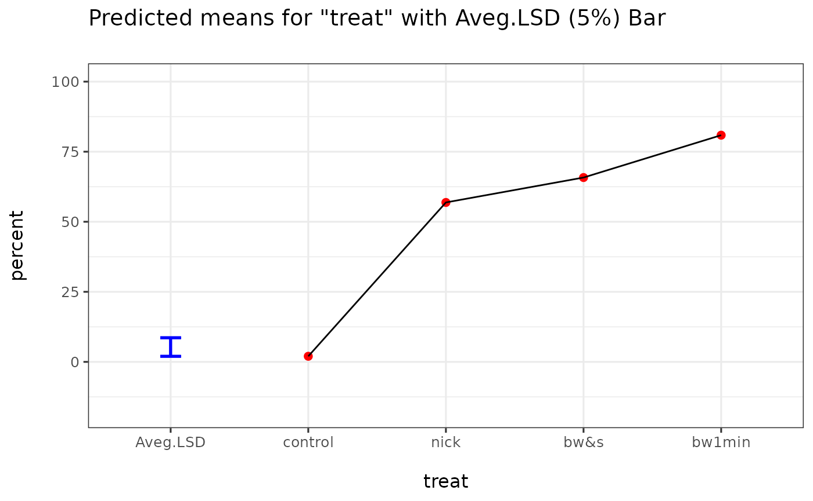

Code

``` r

autoplot(predm_out, type = "bar")
```

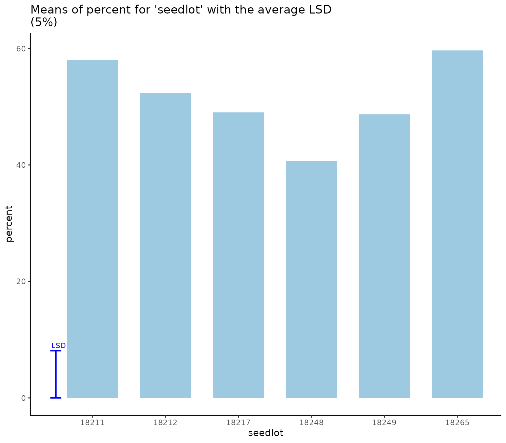

- treat/contcomp (treat)

- Mean

Code

``` r

predm_out <- predictmeans(fm4.2, "treat", adj="BH")
print(predm_out[1:4])
```

    ## $`Predicted Means`
    ## treat
    ## control    nick    bw&s  bw1min 
    ##  2.0000 56.8889 65.7778 80.8889 
    ## 
    ## $`Standard Error of Means`
    ## All means have the same SE 
    ##                    2.32527 
    ## 
    ## $`Standard Error of Differences`
    ##  Max.SED  Min.SED Aveg.SED 
    ## 3.288425 3.288425 3.288425 
    ## 
    ## $LSD
    ##  Max.LSD  Min.LSD Aveg.LSD 
    ##  6.61926  6.61926  6.61926 
    ## attr(,"Significant level")
    ## [1] 0.05
    ## attr(,"Degree of freedom")
    ## [1] 46
    ## attr(,"Note")
    ## [1] "These LSDs are not adjusted: 'BH' is a step-wise method and has no critical value for all pairs. Use the adjusted p-values for the comparisons."
    ## attr(,"equal")
    ## [1] TRUE

Code

``` r

gt(predm_out$mean_table$Table, 
   caption = "Group: Letter-based representation of pairwise comparisons at significant level '0.05'")
```

| treat   | Mean    | SE      | Df  | LL(95%) | UL(95%) | LetterGrp |
|---------|---------|---------|-----|---------|---------|-----------|
| control | 2.0000  | 2.32527 | 46  | -2.6805 | 6.6805  | A         |
| nick    | 56.8889 | 2.32527 | 46  | 52.2084 | 61.5694 | B         |
| bw&s    | 65.7778 | 2.32527 | 46  | 61.0973 | 70.4583 | C         |
| bw1min  | 80.8889 | 2.32527 | 46  | 76.2084 | 85.5694 | D         |

Group: Letter-based representation of pairwise comparisons at
significant level '0.05' {.table .gt_table
quarto-disable-processing="false" quarto-bootstrap="false"}

- Pairwise p-values

Code

``` r

gt(data.frame(predm_out$`Pairwise p-value`, check.names=FALSE), 
   rownames_to_stub=TRUE, 
   caption = "The matrix has t-value above the diagonal, p-value (adjusted by 'BH' method) below the diagonal") %>% 
  cols_width(everything() ~ px(80))
```

|         | control | nick     | bw&s     | bw1min   |
|---------|---------|----------|----------|----------|
| control | 1       | -16.6915 | -19.3946 | -23.9899 |
| nick    | 0       | 1.0000   | -2.7031  | -7.2983  |
| bw&s    | 0       | 0.0096   | 1.0000   | -4.5952  |
| bw1min  | 0       | 0.0000   | 0.0000   | 1.0000   |

The matrix has t-value above the diagonal, p-value (adjusted by 'BH'
method) below the diagonal {.table .gt_table
style="table-layout:fixed;width:0px;" quarto-disable-processing="false"
quarto-bootstrap="false"}

Code

``` r

autoplot(predm_out)
```

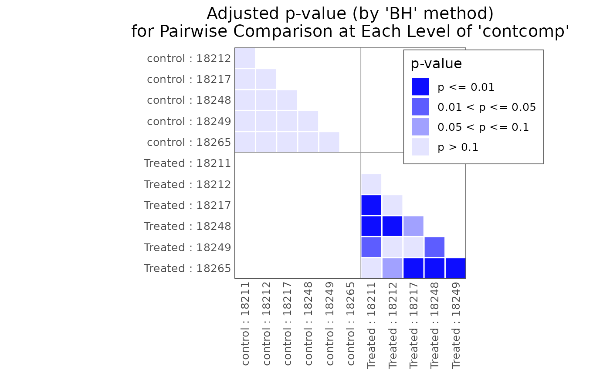

Code

``` r

autoplot(predm_out, type = "ci", data = TRUE)
```

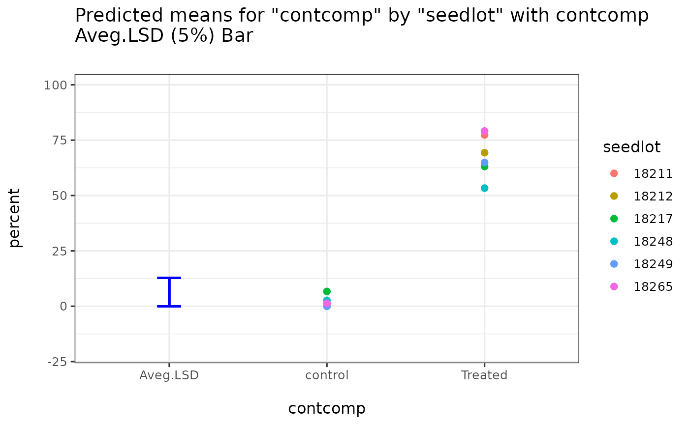

Code

``` r

autoplot(predm_out, type = "bar")
```

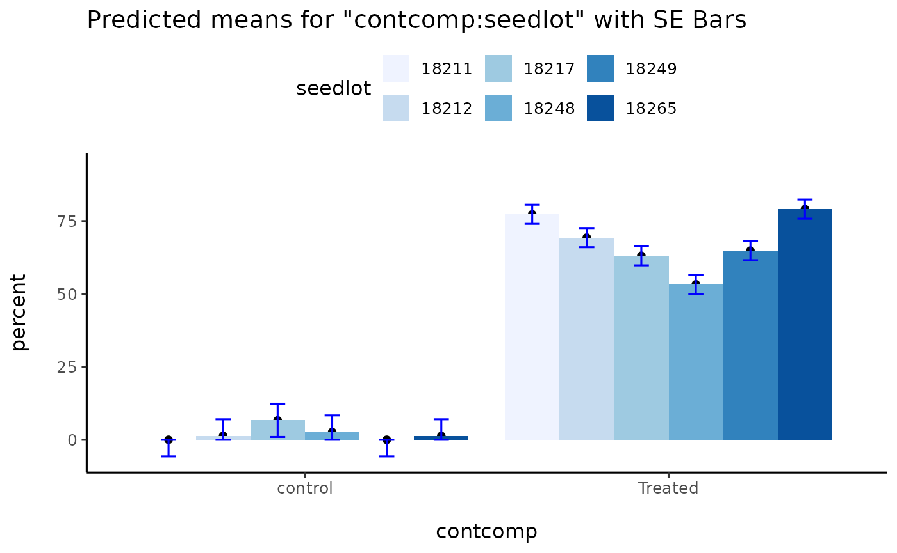

- contcomp/seedlot

- Mean

Code

``` r

predm_out <- predictmeans(fm4.2, "contcomp:seedlot", atvar="contcomp", adj="BH")
print(predm_out[1:4])
```

    ## $`Predicted Means`
    ##         contcomp control Treated
    ## seedlot                         
    ## 18211             0.0000 77.3333
    ## 18212             1.3333 69.3333
    ## 18217             6.6667 63.1111
    ## 18248             2.6667 53.3333
    ## 18249             0.0000 64.8889
    ## 18265             1.3333 79.1111
    ## 
    ## $`Standard Error of Means`
    ##         contcomp control Treated
    ## seedlot                         
    ## 18211            5.69572 3.28843
    ## 18212            5.69572 3.28843
    ## 18217            5.69572 3.28843
    ## 18248            5.69572 3.28843
    ## 18249            5.69572 3.28843
    ## 18265            5.69572 3.28843
    ## 
    ## $`Standard Error of Differences`
    ##  Max.SED  Min.SED Aveg.SED 
    ## 8.054964 4.650536 6.474987 
    ## attr(,"For the Same Level of Factor")
    ##          contcomp  seedlot
    ## Aveg.SED 6.352750 6.576851
    ## Min.SED  4.650536 6.576851
    ## Max.SED  8.054964 6.576851
    ## 
    ## $LSD
    ##  Max.LSD  Min.LSD Aveg.LSD 
    ## 16.21380  9.36104 12.78742 
    ## attr(,"For the Same Level of Factor")
    ##          contcomp  seedlot
    ## Aveg.LSD 12.78742 13.23851
    ## Min.LSD   9.36104 13.23851
    ## Max.LSD  16.21380 13.23851
    ## attr(,"Significant level")
    ## [1] 0.05
    ## attr(,"Degree of freedom")
    ## [1] 46
    ## attr(,"Note")
    ## [1] "These LSDs are not adjusted: 'BH' is a step-wise method and has no critical value for all pairs. Use the adjusted p-values for the comparisons. The LSDs differ between pairs (9.361 to 16.21): no single LSD tests every pair; use the p-values, or each pair's LSD (pairs$lsd)."
    ## attr(,"Within levels of atvar")
    ##        by pairs  min.SED  max.SED     crit   min.LSD  aveg.LSD   max.LSD
    ## 1 control    15 8.054964 8.054964 2.012896 16.213802 16.213802 16.213802
    ## 2 Treated    15 4.650536 4.650536 2.012896  9.361043  9.361043  9.361043
    ## attr(,"equal")
    ## [1] FALSE

Code

``` r

gt(predm_out$mean_table$Table, groupname_col ="contcomp",
   caption = "Group: Letter-based representation of pairwise comparisons at significant level '0.05'")
```

| seedlot | Mean    | SE      | Df  | LL(95%)  | UL(95%) | LetterGrp |
|---------|---------|---------|-----|----------|---------|-----------|
| control |         |         |     |          |         |           |
| 18211   | 0.0000  | 5.69572 | 46  | -11.4649 | 11.4649 | A         |
| 18212   | 1.3333  | 5.69572 | 46  | -10.1316 | 12.7982 | A         |
| 18217   | 6.6667  | 5.69572 | 46  | -4.7982  | 18.1316 | A         |
| 18248   | 2.6667  | 5.69572 | 46  | -8.7982  | 14.1316 | A         |
| 18249   | 0.0000  | 5.69572 | 46  | -11.4649 | 11.4649 | A         |
| 18265   | 1.3333  | 5.69572 | 46  | -10.1316 | 12.7982 | A         |
| Treated |         |         |     |          |         |           |
| 18211   | 77.3333 | 3.28843 | 46  | 70.7141  | 83.9526 | A         |
| 18212   | 69.3333 | 3.28843 | 46  | 62.7141  | 75.9526 | AB        |
| 18217   | 63.1111 | 3.28843 | 46  | 56.4919  | 69.7304 | BC        |
| 18248   | 53.3333 | 3.28843 | 46  | 46.7141  | 59.9526 | C         |
| 18249   | 64.8889 | 3.28843 | 46  | 58.2696  | 71.5081 | B         |
| 18265   | 79.1111 | 3.28843 | 46  | 72.4919  | 85.7304 | A         |

Group: Letter-based representation of pairwise comparisons at
significant level '0.05' {.table .gt_table
quarto-disable-processing="false" quarto-bootstrap="false"}

- Pairwise p-values

Code

``` r

for (i in 6:7){
  print(names(predm_out[i]))
  print(gt(as.data.frame.matrix(predm_out[[i]], check.names=FALSE), rownames_to_stub = TRUE))
}
```

\[1\] “control”

|       | 18211 | 18212 | 18217 | 18248 | 18249 | 18265 | Group |
|-------|-------|-------|-------|-------|-------|-------|-------|
| 18211 | 1     |       |       |       |       |       | A     |
| 18212 | 1     | 1     |       |       |       |       | A     |
| 18217 | 1     | 1     | 1     |       |       |       | A     |
| 18248 | 1     | 1     | 1     | 1     |       |       | A     |
| 18249 | 1     | 1     | 1     | 1     | 1     |       | A     |
| 18265 | 1     | 1     | 1     | 1     | 1     | 1     | A     |

\[1\] “Treated”

|       | 18211  | 18212  | 18217  | 18248  | 18249  | 18265 | Group |
|-------|--------|--------|--------|--------|--------|-------|-------|
| 18211 | 1      |        |        |        |        |       | A     |
| 18212 | 0.1256 | 1      |        |        |        |       | AB    |
| 18217 | 0.0093 | 0.2344 | 1      |        |        |       | BC    |
| 18248 | 0.0001 | 0.0047 | 0.0615 | 1      |        |       | C     |
| 18249 | 0.0221 | 0.3972 | 0.704  | 0.0312 | 1      |       | B     |
| 18265 | 0.704  | 0.0615 | 0.0047 | 0.0001 | 0.0093 | 1     | A     |

Code

``` r

autoplot(predm_out, lines = FALSE)
```

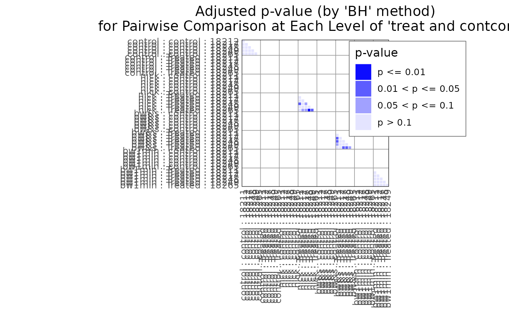

Code

``` r

autoplot(predm_out, type = "ci", data = TRUE)
```

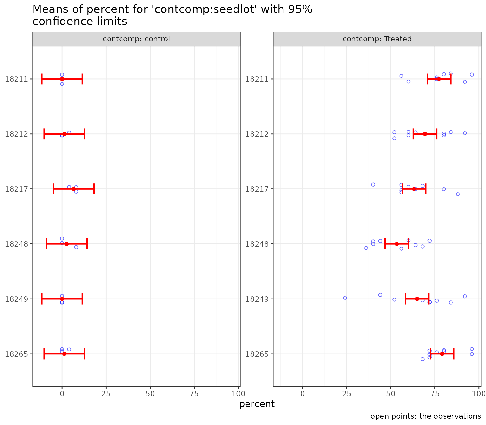

Code

``` r

autoplot(predm_out, type = "bar")
```

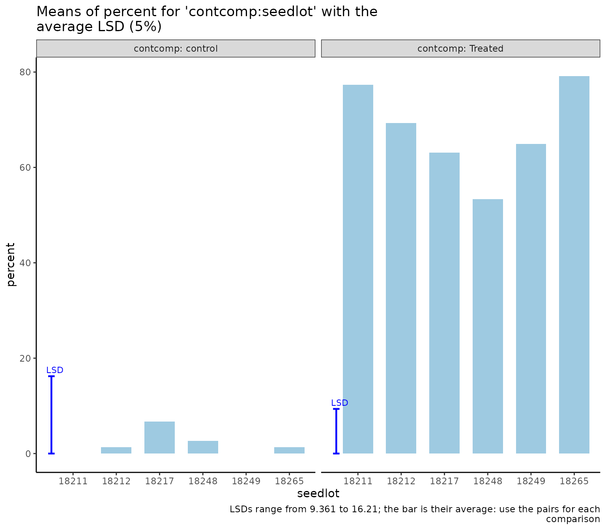

- treat/contcomp/seedlot

- Mean

Code

``` r

predm_out <- predictmeans(fm4.2, "contcomp:seedlot:treat", atvar=c("treat", "contcomp"), adj="BH")
print(predm_out[1:4])
```

    ## $`Predicted Means`
    ##         contcomp control                         Treated                        
    ##         treat    control    nick    bw&s  bw1min control    nick    bw&s  bw1min
    ## seedlot                                                                         
    ## 18211             0.0000      NA      NA      NA      NA 65.3333 78.6667 88.0000
    ## 18212             1.3333      NA      NA      NA      NA 54.6667 68.0000 85.3333
    ## 18217             6.6667      NA      NA      NA      NA 57.3333 54.6667 77.3333
    ## 18248             2.6667      NA      NA      NA      NA 40.0000 52.0000 68.0000
    ## 18249             0.0000      NA      NA      NA      NA 49.3333 61.3333 84.0000
    ## 18265             1.3333      NA      NA      NA      NA 74.6667 80.0000 82.6667
    ## 
    ## $`Standard Error of Means`
    ## All means have the same SE 
    ##                    5.69572 
    ## 
    ## $`Standard Error of Differences`
    ##  Max.SED  Min.SED Aveg.SED 
    ## 8.054964 8.054964 8.054964 
    ## attr(,"For the Same Level of Factor")
    ##          contcomp  seedlot    treat
    ## Aveg.SED 8.054964 8.054964 8.054964
    ## Min.SED  8.054964 8.054964 8.054964
    ## Max.SED  8.054964 8.054964 8.054964
    ## 
    ## $LSD
    ##  Max.LSD  Min.LSD Aveg.LSD 
    ##  16.2138  16.2138  16.2138 
    ## attr(,"For the Same Level of Factor")
    ##          contcomp seedlot   treat
    ## Aveg.LSD  16.2138 16.2138 16.2138
    ## Min.LSD   16.2138 16.2138 16.2138
    ## Max.LSD   16.2138 16.2138 16.2138
    ## attr(,"Significant level")
    ## [1] 0.05
    ## attr(,"Degree of freedom")
    ## [1] 46
    ## attr(,"Note")
    ## [1] "These LSDs are not adjusted: 'BH' is a step-wise method and has no critical value for all pairs. Use the adjusted p-values for the comparisons."
    ## attr(,"Within levels of atvar")
    ##                  by pairs  min.SED  max.SED     crit min.LSD aveg.LSD max.LSD
    ## 1 control : control    15 8.054964 8.054964 2.012896 16.2138  16.2138 16.2138
    ## 2    nick : Treated    15 8.054964 8.054964 2.012896 16.2138  16.2138 16.2138
    ## 3    bw&s : Treated    15 8.054964 8.054964 2.012896 16.2138  16.2138 16.2138
    ## 4  bw1min : Treated    15 8.054964 8.054964 2.012896 16.2138  16.2138 16.2138
    ## attr(,"equal")
    ## [1] TRUE

Code

``` r

gt(predm_out$mean_table$Table, groupname_col ="treat",
   caption = "Group: Letter-based representation of pairwise comparisons at significant level '0.05'")
```

| contcomp | seedlot | Mean    | SE      | Df  | LL(95%)  | UL(95%) | LetterGrp |
|----------|---------|---------|---------|-----|----------|---------|-----------|
| control  |         |         |         |     |          |         |           |
| control  | 18211   | 0.0000  | 5.69572 | 46  | -11.4649 | 11.4649 | A         |
| control  | 18212   | 1.3333  | 5.69572 | 46  | -10.1316 | 12.7982 | A         |
| control  | 18217   | 6.6667  | 5.69572 | 46  | -4.7982  | 18.1316 | A         |
| control  | 18248   | 2.6667  | 5.69572 | 46  | -8.7982  | 14.1316 | A         |
| control  | 18249   | 0.0000  | 5.69572 | 46  | -11.4649 | 11.4649 | A         |
| control  | 18265   | 1.3333  | 5.69572 | 46  | -10.1316 | 12.7982 | A         |
| nick     |         |         |         |     |          |         |           |
| Treated  | 18211   | 65.3333 | 5.69572 | 46  | 53.8684  | 76.7982 | AB        |
| Treated  | 18212   | 54.6667 | 5.69572 | 46  | 43.2018  | 66.1316 | ABC       |
| Treated  | 18217   | 57.3333 | 5.69572 | 46  | 45.8684  | 68.7982 | ABC       |
| Treated  | 18248   | 40.0000 | 5.69572 | 46  | 28.5351  | 51.4649 | C         |
| Treated  | 18249   | 49.3333 | 5.69572 | 46  | 37.8684  | 60.7982 | A C       |
| Treated  | 18265   | 74.6667 | 5.69572 | 46  | 63.2018  | 86.1316 | B         |
| bw&s     |         |         |         |     |          |         |           |
| Treated  | 18211   | 78.6667 | 5.69572 | 46  | 67.2018  | 90.1316 | A         |
| Treated  | 18212   | 68.0000 | 5.69572 | 46  | 56.5351  | 79.4649 | AB        |
| Treated  | 18217   | 54.6667 | 5.69572 | 46  | 43.2018  | 66.1316 | B         |
| Treated  | 18248   | 52.0000 | 5.69572 | 46  | 40.5351  | 63.4649 | B         |
| Treated  | 18249   | 61.3333 | 5.69572 | 46  | 49.8684  | 72.7982 | AB        |
| Treated  | 18265   | 80.0000 | 5.69572 | 46  | 68.5351  | 91.4649 | A         |
| bw1min   |         |         |         |     |          |         |           |
| Treated  | 18211   | 88.0000 | 5.69572 | 46  | 76.5351  | 99.4649 | A         |
| Treated  | 18212   | 85.3333 | 5.69572 | 46  | 73.8684  | 96.7982 | A         |
| Treated  | 18217   | 77.3333 | 5.69572 | 46  | 65.8684  | 88.7982 | A         |
| Treated  | 18248   | 68.0000 | 5.69572 | 46  | 56.5351  | 79.4649 | A         |
| Treated  | 18249   | 84.0000 | 5.69572 | 46  | 72.5351  | 95.4649 | A         |
| Treated  | 18265   | 82.6667 | 5.69572 | 46  | 71.2018  | 94.1316 | A         |

Group: Letter-based representation of pairwise comparisons at
significant level '0.05' {.table .gt_table
quarto-disable-processing="false" quarto-bootstrap="false"}

- Pairwise p-values

Code

``` r

for (i in c(6, 11:13)){
  print(names(predm_out[i]))
  print(gt(as.data.frame.matrix(predm_out[[i]], check.names=FALSE), rownames_to_stub = TRUE))
}
```

\[1\] “control : control”

|       | 18211 | 18212 | 18217 | 18248 | 18249 | 18265 | Group |
|-------|-------|-------|-------|-------|-------|-------|-------|
| 18211 | 1     |       |       |       |       |       | A     |
| 18212 | 1     | 1     |       |       |       |       | A     |
| 18217 | 1     | 1     | 1     |       |       |       | A     |
| 18248 | 1     | 1     | 1     | 1     |       |       | A     |
| 18249 | 1     | 1     | 1     | 1     | 1     |       | A     |
| 18265 | 1     | 1     | 1     | 1     | 1     | 1     | A     |

\[1\] “bw&s : Treated”

|       | 18211  | 18212  | 18217  | 18248  | 18249 | 18265 | Group |
|-------|--------|--------|--------|--------|-------|-------|-------|
| 18211 | 1      |        |        |        |       |       | A     |
| 18212 | 0.288  | 1      |        |        |       |       | AB    |
| 18217 | 0.0172 | 0.1963 | 1      |        |       |       | B     |
| 18248 | 0.0136 | 0.1135 | 0.7951 | 1      |       |       | B     |
| 18249 | 0.0917 | 0.4756 | 0.4756 | 0.3444 | 1     |       | AB    |
| 18265 | 0.8693 | 0.2385 | 0.0145 | 0.0136 | 0.075 | 1     | A     |

\[1\] “bw1min : control”

|       | 18211 | 18212 | 18217 | 18248 | 18249 | 18265 | Group |
|-------|-------|-------|-------|-------|-------|-------|-------|
| 18211 | 1     |       |       |       |       |       | NA    |
| 18212 | NA    | 1     |       |       |       |       | NA    |
| 18217 | NA    | NA    | 1     |       |       |       | NA    |
| 18248 | NA    | NA    | NA    | 1     |       |       | NA    |
| 18249 | NA    | NA    | NA    | NA    | 1     |       | NA    |
| 18265 | NA    | NA    | NA    | NA    | NA    | 1     | NA    |

\[1\] “bw1min : Treated”

|       | 18211  | 18212  | 18217  | 18248  | 18249  | 18265 | Group |
|-------|--------|--------|--------|--------|--------|-------|-------|
| 18211 | 1      |        |        |        |        |       | A     |
| 18212 | 0.8563 | 1      |        |        |        |       | A     |
| 18217 | 0.5759 | 0.6982 | 1      |        |        |       | A     |
| 18248 | 0.2511 | 0.2649 | 0.6314 | 1      |        |       | A     |
| 18249 | 0.848  | 0.8693 | 0.7668 | 0.2649 | 1      |       | A     |
| 18265 | 0.7668 | 0.8563 | 0.7668 | 0.2818 | 0.8693 | 1     | A     |

Code

``` r

autoplot(predm_out, lines = FALSE)
```

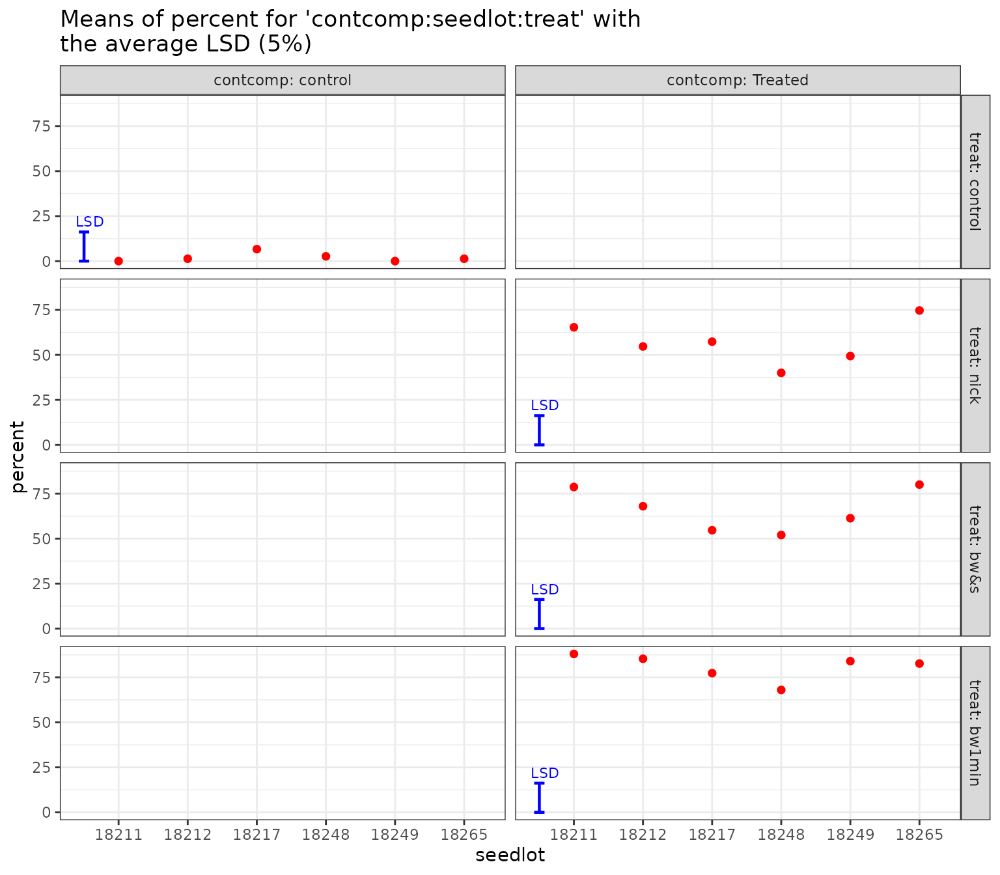

Code

``` r

autoplot(predm_out, type = "ci", data = TRUE)
```

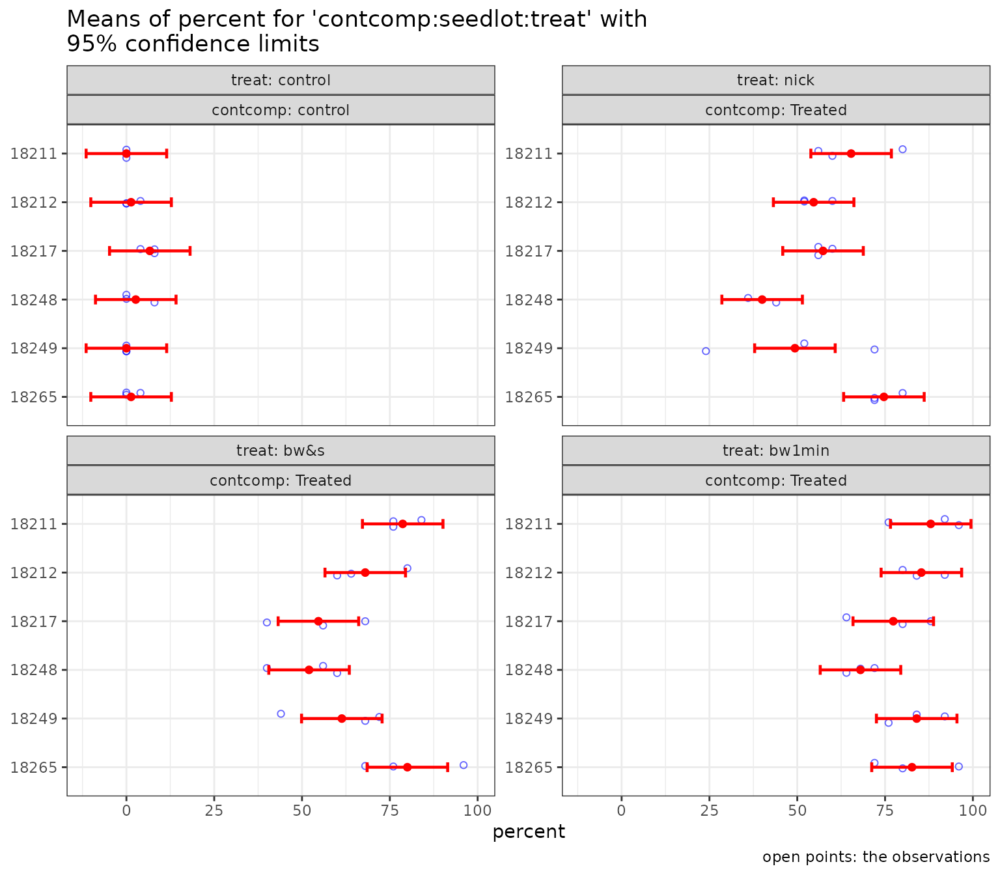

### Subset Data

Code

``` r

DataExam4.3N <- DataExam4.3 %>%
  filter(treat != "control") %>% 
  droplevels()
str(DataExam4.3N)
```

    ## 'data.frame':    54 obs. of  8 variables:
    ##  $ repl    : Factor w/ 3 levels "1","2","3": 1 1 1 1 1 1 1 1 1 1 ...
    ##  $ row     : Factor w/ 6 levels "1","2","3","4",..: 1 1 1 2 2 2 3 3 3 4 ...
    ##  $ column  : Factor w/ 4 levels "1","2","3","4": 1 2 4 2 3 4 1 3 4 1 ...
    ##  $ seedlot : Factor w/ 6 levels "18211","18212",..: 1 5 2 1 5 3 6 2 6 4 ...
    ##  $ treat   : Factor w/ 3 levels "nick","bw&s",..: 1 2 3 3 1 2 3 1 2 2 ...
    ##  $ count   : num  15 17 23 24 18 10 24 13 19 14 ...
    ##  $ percent : num  60 68 92 96 72 40 96 52 76 56 ...
    ##  $ contcomp: Factor w/ 1 level "Treated": 1 1 1 1 1 1 1 1 1 1 ...

### Subset Modelling

- Model
- Residual Plot

Code

``` r

fm4.4 <- aov(percent ~ repl + treat*seedlot, data = DataExam4.3N)
kable(anova(fm4.4), digits = 4) 
```

|               |  Df |    Sum Sq |   Mean Sq | F value | Pr(\>F) |
|:--------------|----:|----------:|----------:|--------:|--------:|
| repl          |   2 |   64.5926 |   32.2963 |  0.2511 |  0.7794 |
| treat         |   2 | 5300.1481 | 2650.0741 | 20.6055 |  0.0000 |
| seedlot       |   5 | 4148.1481 |  829.6296 |  6.4507 |  0.0003 |
| treat:seedlot |  10 |  961.1852 |   96.1185 |  0.7474 |  0.6760 |
| Residuals     |  34 | 4372.7407 |  128.6100 |      NA |      NA |

Code

``` r

residplot(fm4.4) 
```

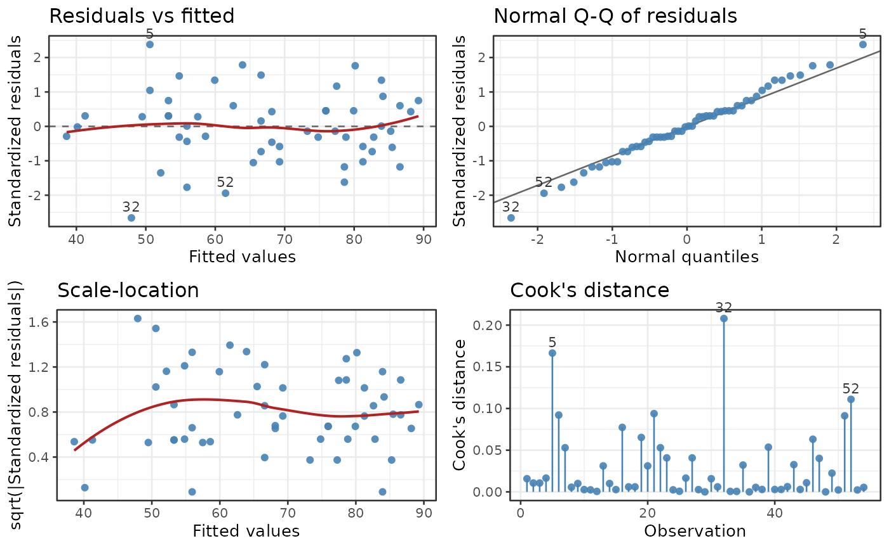

### Predicted Means

- treat

&nbsp;

- Mean Table
- p-value Table
- Mean Plot
- Mean Table
- p-value Table & Plot
- Mean Plot
- Mean Table
- p-value Table & Plot
- Mean Plot

Code

``` r

predm_out <- predictmeans(fm4.4, "treat", adj="BH")
print(predm_out[1:4])
```

    ## $`Predicted Means`
    ## treat
    ##    nick    bw&s  bw1min 
    ## 56.8889 65.7778 80.8889 
    ## 
    ## $`Standard Error of Means`
    ## All means have the same SE 
    ##                    2.67301 
    ## 
    ## $`Standard Error of Differences`
    ##  Max.SED  Min.SED Aveg.SED 
    ## 3.780212 3.780212 3.780212 
    ## 
    ## $LSD
    ##  Max.LSD  Min.LSD Aveg.LSD 
    ##  7.68231  7.68231  7.68231 
    ## attr(,"Significant level")
    ## [1] 0.05
    ## attr(,"Degree of freedom")
    ## [1] 34
    ## attr(,"Note")
    ## [1] "These LSDs are not adjusted: 'BH' is a step-wise method and has no critical value for all pairs. Use the adjusted p-values for the comparisons."
    ## attr(,"equal")
    ## [1] TRUE

Code

``` r

gt(predm_out$mean_table$Table, 
   caption = "Group: Letter-based representation of pairwise comparisons at significant level '0.05'")
```

| treat  | Mean    | SE      | Df  | LL(95%) | UL(95%) | LetterGrp |
|--------|---------|---------|-----|---------|---------|-----------|
| nick   | 56.8889 | 2.67301 | 34  | 51.4567 | 62.3211 | A         |
| bw&s   | 65.7778 | 2.67301 | 34  | 60.3456 | 71.2100 | B         |
| bw1min | 80.8889 | 2.67301 | 34  | 75.4567 | 86.3211 | C         |

Group: Letter-based representation of pairwise comparisons at
significant level '0.05' {.table .gt_table
quarto-disable-processing="false" quarto-bootstrap="false"}

Code

``` r

gt(data.frame(predm_out$`Pairwise p-value`, check.names=FALSE), 
   rownames_to_stub=TRUE, 
   caption = "The matrix has t-value above the diagonal, p-value (adjusted by 'BH' method) below the diagonal") %>% 
  cols_width(everything() ~ px(80))
```

|        | nick   | bw&s    | bw1min  |
|--------|--------|---------|---------|
| nick   | 1.0000 | -2.3514 | -6.3489 |
| bw&s   | 0.0246 | 1.0000  | -3.9974 |
| bw1min | 0.0000 | 0.0005  | 1.0000  |

The matrix has t-value above the diagonal, p-value (adjusted by 'BH'
method) below the diagonal {.table .gt_table
style="table-layout:fixed;width:0px;" quarto-disable-processing="false"
quarto-bootstrap="false"}

Code

``` r

autoplot(predm_out, lines = FALSE)
```

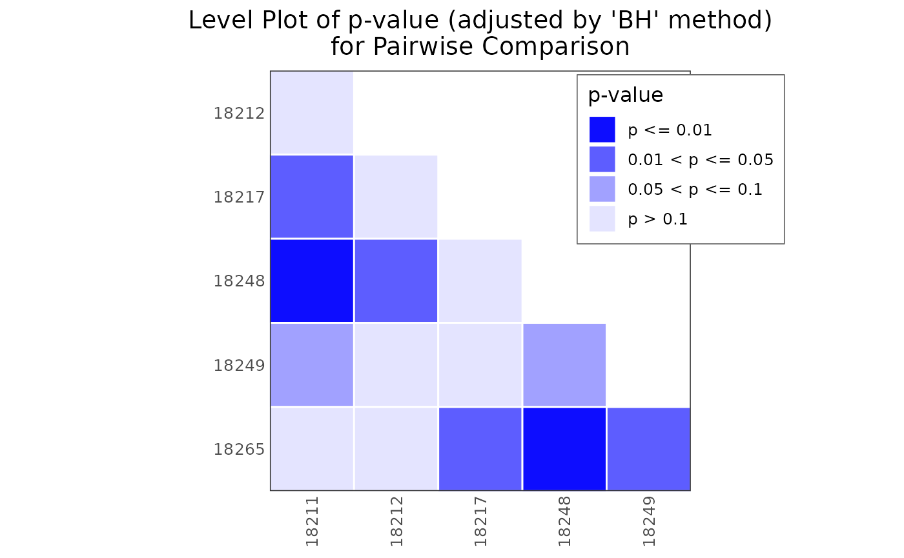

Code

``` r

autoplot(predm_out, type = "ci", data = TRUE)
```

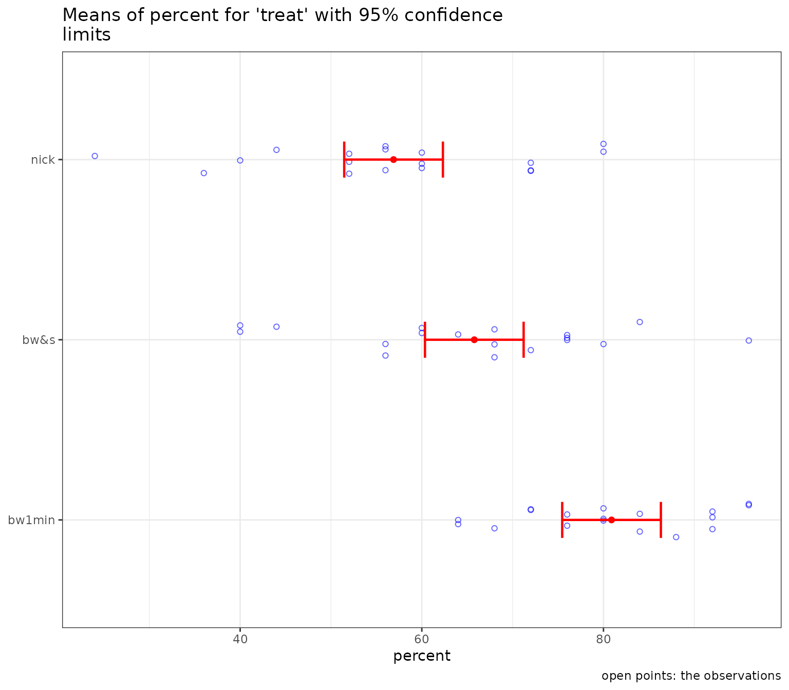

Code

``` r

autoplot(predm_out, type = "bar")
```

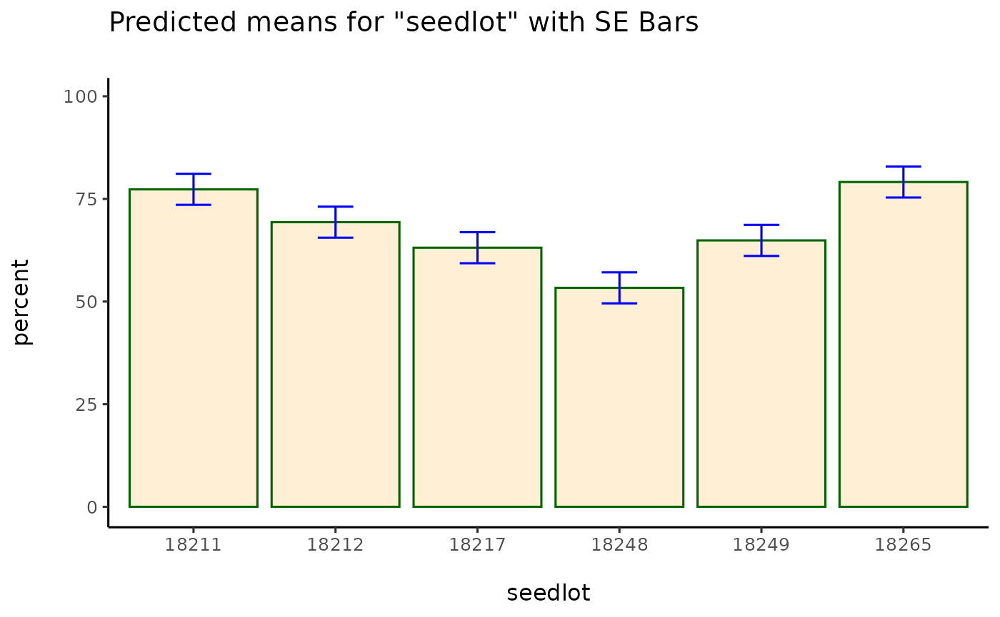

- seedlot

Code

``` r

predm_out <- predictmeans(fm4.4, "seedlot", adj="BH")
print(predm_out[1:4])
```

    ## $`Predicted Means`
    ## seedlot
    ##   18211   18212   18217   18248   18249   18265 
    ## 77.3333 69.3333 63.1111 53.3333 64.8889 79.1111 
    ## 
    ## $`Standard Error of Means`
    ## All means have the same SE 
    ##                    3.78021 
    ## 
    ## $`Standard Error of Differences`
    ##  Max.SED  Min.SED Aveg.SED 
    ## 5.346027 5.346027 5.346027 
    ## 
    ## $LSD
    ##  Max.LSD  Min.LSD Aveg.LSD 
    ## 10.86443 10.86443 10.86443 
    ## attr(,"Significant level")
    ## [1] 0.05
    ## attr(,"Degree of freedom")
    ## [1] 34
    ## attr(,"Note")
    ## [1] "These LSDs are not adjusted: 'BH' is a step-wise method and has no critical value for all pairs. Use the adjusted p-values for the comparisons."
    ## attr(,"equal")
    ## [1] TRUE

Code

``` r

gt(predm_out$mean_table$Table, 
   caption = "Group: Letter-based representation of pairwise comparisons at significant level '0.05'")
```

| seedlot | Mean    | SE      | Df  | LL(95%) | UL(95%) | LetterGrp |
|---------|---------|---------|-----|---------|---------|-----------|
| 18211   | 77.3333 | 3.78021 | 34  | 69.6510 | 85.0156 | AB        |
| 18212   | 69.3333 | 3.78021 | 34  | 61.6510 | 77.0156 | ABC       |
| 18217   | 63.1111 | 3.78021 | 34  | 55.4288 | 70.7934 | CD        |
| 18248   | 53.3333 | 3.78021 | 34  | 45.6510 | 61.0156 | D         |
| 18249   | 64.8889 | 3.78021 | 34  | 57.2066 | 72.5712 | A CD      |
| 18265   | 79.1111 | 3.78021 | 34  | 71.4288 | 86.7934 | B         |

Group: Letter-based representation of pairwise comparisons at
significant level '0.05' {.table .gt_table
quarto-disable-processing="false" quarto-bootstrap="false"}

Code

``` r

gt(data.frame(predm_out$`Pairwise p-value`, check.names=FALSE), 
   rownames_to_stub=TRUE, 
   caption = "The matrix has t-value above the diagonal, p-value (adjusted by 'BH' method) below the diagonal") %>% 
  cols_width(everything() ~ px(80))
```

|       | 18211  | 18212  | 18217  | 18248  | 18249   | 18265   |
|-------|--------|--------|--------|--------|---------|---------|
| 18211 | 1.0000 | 1.4964 | 2.6603 | 4.4893 | 2.3278  | -0.3325 |
| 18212 | 0.1960 | 1.0000 | 1.1639 | 2.9929 | 0.8314  | -1.8290 |
| 18217 | 0.0296 | 0.3157 | 1.0000 | 1.8290 | -0.3325 | -2.9929 |
| 18248 | 0.0006 | 0.0192 | 0.1143 | 1.0000 | -2.1615 | -4.8219 |
| 18249 | 0.0557 | 0.4749 | 0.7415 | 0.0708 | 1.0000  | -2.6603 |
| 18265 | 0.7415 | 0.1143 | 0.0192 | 0.0004 | 0.0296  | 1.0000  |

The matrix has t-value above the diagonal, p-value (adjusted by 'BH'
method) below the diagonal {.table .gt_table
style="table-layout:fixed;width:0px;" quarto-disable-processing="false"
quarto-bootstrap="false"}

Code

``` r

PMplot(predm_out$p_valueMatrix)
```

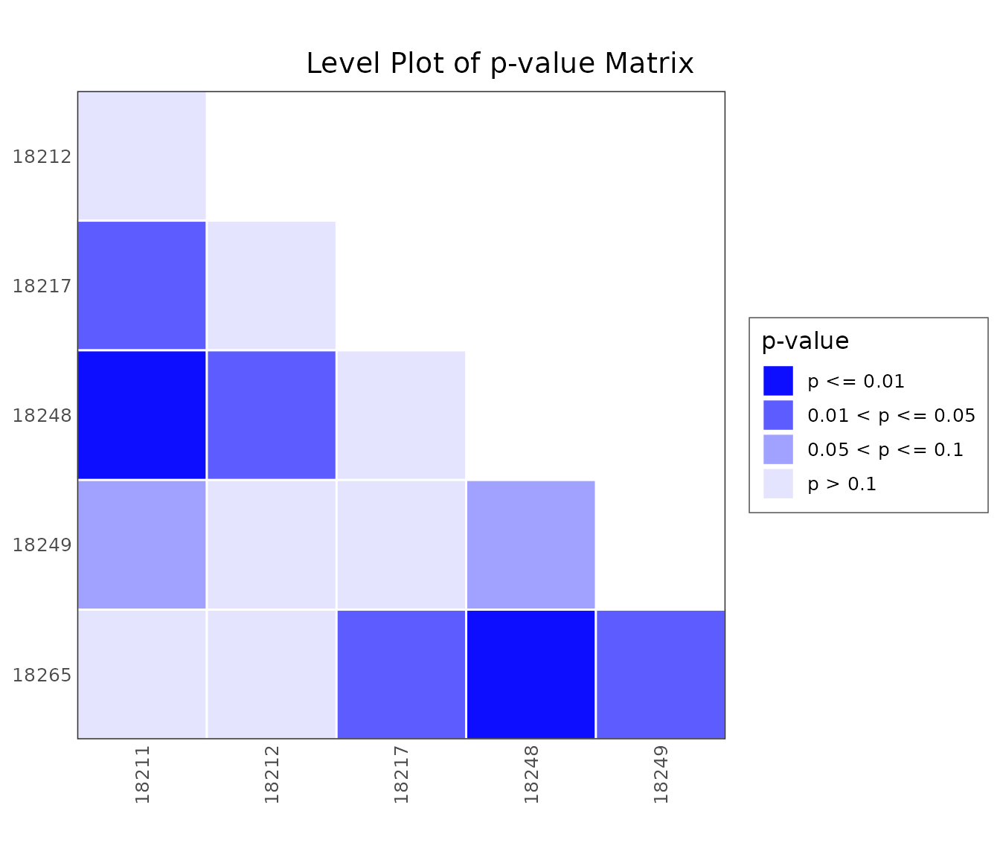

Code

``` r

autoplot(predm_out)
```

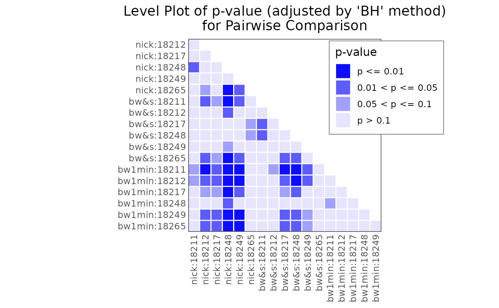

Code

``` r

autoplot(predm_out, type = "ci", data = TRUE)
```

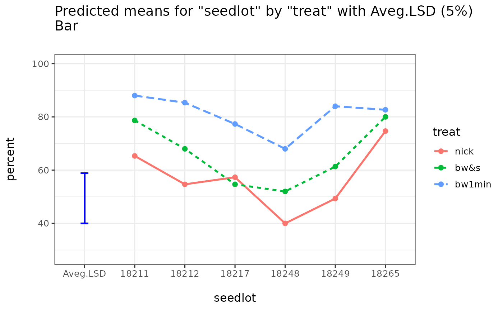

Code

``` r

autoplot(predm_out, type = "bar")
```

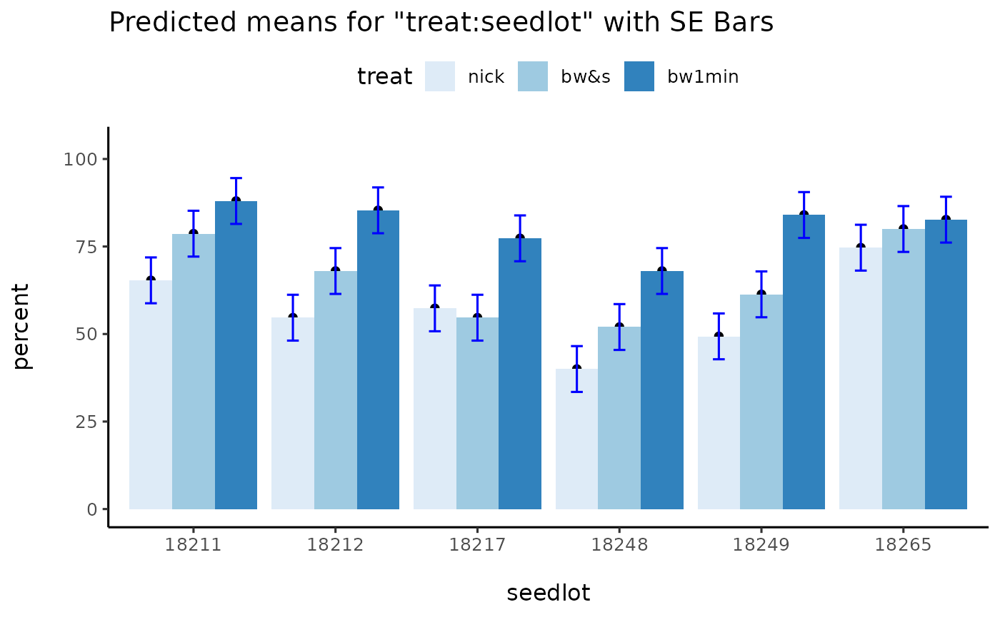

- treat:seedlot

Code

``` r

predm_out <- predictmeans(fm4.4, "treat:seedlot", adj="BH")
print(predm_out[1:4])
```

    ## $`Predicted Means`
    ##         treat    nick    bw&s  bw1min
    ## seedlot                              
    ## 18211         65.3333 78.6667 88.0000
    ## 18212         54.6667 68.0000 85.3333
    ## 18217         57.3333 54.6667 77.3333
    ## 18248         40.0000 52.0000 68.0000
    ## 18249         49.3333 61.3333 84.0000
    ## 18265         74.6667 80.0000 82.6667
    ## 
    ## $`Standard Error of Means`
    ## All means have the same SE 
    ##                    6.54752 
    ## 
    ## $`Standard Error of Differences`
    ##  Max.SED  Min.SED Aveg.SED 
    ##  9.25959  9.25959  9.25959 
    ## attr(,"For the Same Level of Factor")
    ##            treat seedlot
    ## Aveg.SED 9.25959 9.25959
    ## Min.SED  9.25959 9.25959
    ## Max.SED  9.25959 9.25959
    ## 
    ## $LSD
    ##  Max.LSD  Min.LSD Aveg.LSD 
    ## 18.81775 18.81775 18.81775 
    ## attr(,"For the Same Level of Factor")
    ##             treat  seedlot
    ## Aveg.LSD 18.81775 18.81775
    ## Min.LSD  18.81775 18.81775
    ## Max.LSD  18.81775 18.81775
    ## attr(,"Significant level")
    ## [1] 0.05
    ## attr(,"Degree of freedom")
    ## [1] 34
    ## attr(,"Note")
    ## [1] "These LSDs are not adjusted: 'BH' is a step-wise method and has no critical value for all pairs. Use the adjusted p-values for the comparisons."
    ## attr(,"equal")
    ## [1] TRUE

Code

``` r

gt(predm_out$mean_table$Table, 
   caption = "Group: Letter-based representation of pairwise comparisons at significant level '0.05'")
```

| treat  | seedlot | Mean    | SE      | Df  | LL(95%) | UL(95%)  | LetterGrp |
|--------|---------|---------|---------|-----|---------|----------|-----------|
| nick   | 18211   | 65.3333 | 6.54752 | 34  | 52.0272 | 78.6395  | ABCDEF    |
| nick   | 18212   | 54.6667 | 6.54752 | 34  | 41.3605 | 67.9728  | AB D G    |
| nick   | 18217   | 57.3333 | 6.54752 | 34  | 44.0272 | 70.6395  | ABCD G    |
| nick   | 18248   | 40.0000 | 6.54752 | 34  | 26.6938 | 53.3062  | G         |
| nick   | 18249   | 49.3333 | 6.54752 | 34  | 36.0272 | 62.6395  | A G       |
| nick   | 18265   | 74.6667 | 6.54752 | 34  | 61.3605 | 87.9728  | BCDEF     |
| bw&s   | 18211   | 78.6667 | 6.54752 | 34  | 65.3605 | 91.9728  | C EF      |
| bw&s   | 18212   | 68.0000 | 6.54752 | 34  | 54.6938 | 81.3062  | ABCDEF    |
| bw&s   | 18217   | 54.6667 | 6.54752 | 34  | 41.3605 | 67.9728  | AB D G    |
| bw&s   | 18248   | 52.0000 | 6.54752 | 34  | 38.6938 | 65.3062  | AB G      |
| bw&s   | 18249   | 61.3333 | 6.54752 | 34  | 48.0272 | 74.6395  | ABCDE G   |
| bw&s   | 18265   | 80.0000 | 6.54752 | 34  | 66.6938 | 93.3062  | C EF      |
| bw1min | 18211   | 88.0000 | 6.54752 | 34  | 74.6938 | 101.3062 | F         |
| bw1min | 18212   | 85.3333 | 6.54752 | 34  | 72.0272 | 98.6395  | F         |
| bw1min | 18217   | 77.3333 | 6.54752 | 34  | 64.0272 | 90.6395  | CDEF      |
| bw1min | 18248   | 68.0000 | 6.54752 | 34  | 54.6938 | 81.3062  | ABCDEF    |
| bw1min | 18249   | 84.0000 | 6.54752 | 34  | 70.6938 | 97.3062  | EF        |
| bw1min | 18265   | 82.6667 | 6.54752 | 34  | 69.3605 | 95.9728  | EF        |

Group: Letter-based representation of pairwise comparisons at
significant level '0.05' {.table .gt_table
quarto-disable-processing="false" quarto-bootstrap="false"}

Code

``` r

gt(data.frame(predm_out$`Pairwise p-value`, check.names=FALSE), 
   rownames_to_stub=TRUE, 
   caption = "The matrix has t-value above the diagonal, p-value (adjusted by 'BH' method) below the diagonal") %>% 
  cols_width(everything() ~ px(130))
```

|  | nick:18211 | nick:18212 | nick:18217 | nick:18248 | nick:18249 | nick:18265 | bw&s:18211 | bw&s:18212 | bw&s:18217 | bw&s:18248 | bw&s:18249 | bw&s:18265 | bw1min:18211 | bw1min:18212 | bw1min:18217 | bw1min:18248 | bw1min:18249 | bw1min:18265 |
|----|----|----|----|----|----|----|----|----|----|----|----|----|----|----|----|----|----|----|
| nick:18211 | 1.0000 | 1.1520 | 0.8640 | 2.7359 | 1.7279 | -1.0080 | -1.4399 | -0.2880 | 1.1520 | 1.4399 | 0.4320 | -1.5839 | -2.4479 | -2.1599 | -1.2960 | -0.2880 | -2.0159 | -1.8719 |
| nick:18212 | 0.3899 | 1.0000 | -0.2880 | 1.5839 | 0.5760 | -2.1599 | -2.5919 | -1.4399 | 0.0000 | 0.2880 | -0.7200 | -2.7359 | -3.5999 | -3.3119 | -2.4479 | -1.4399 | -3.1679 | -3.0239 |
| nick:18217 | 0.5330 | 0.8067 | 1.0000 | 1.8719 | 0.8640 | -1.8719 | -2.3039 | -1.1520 | 0.2880 | 0.5760 | -0.4320 | -2.4479 | -3.3119 | -3.0239 | -2.1599 | -1.1520 | -2.8799 | -2.7359 |
| nick:18248 | 0.0366 | 0.2342 | 0.1549 | 1.0000 | -1.0080 | -3.7439 | -4.1759 | -3.0239 | -1.5839 | -1.2960 | -2.3039 | -4.3198 | -5.1838 | -4.8958 | -4.0319 | -3.0239 | -4.7518 | -4.6078 |
| nick:18249 | 0.1899 | 0.6742 | 0.5330 | 0.4542 | 1.0000 | -2.7359 | -3.1679 | -2.0159 | -0.5760 | -0.2880 | -1.2960 | -3.3119 | -4.1759 | -3.8879 | -3.0239 | -2.0159 | -3.7439 | -3.5999 |
| nick:18265 | 0.4542 | 0.0983 | 0.1549 | 0.0085 | 0.0366 | 1.0000 | -0.4320 | 0.7200 | 2.1599 | 2.4479 | 1.4399 | -0.5760 | -1.4399 | -1.1520 | -0.2880 | 0.7200 | -1.0080 | -0.8640 |
| bw&s:18211 | 0.2765 | 0.0486 | 0.0793 | 0.0043 | 0.0198 | 0.7576 | 1.0000 | 1.1520 | 2.5919 | 2.8799 | 1.8719 | -0.1440 | -1.0080 | -0.7200 | 0.1440 | 1.1520 | -0.5760 | -0.4320 |
| bw&s:18212 | 0.8067 | 0.2765 | 0.3899 | 0.0226 | 0.1257 | 0.6025 | 0.3899 | 1.0000 | 1.4399 | 1.7279 | 0.7200 | -1.2960 | -2.1599 | -1.8719 | -1.0080 | 0.0000 | -1.7279 | -1.5839 |
| bw&s:18217 | 0.3899 | 1.0000 | 0.8067 | 0.2342 | 0.6742 | 0.0983 | 0.0486 | 0.2765 | 1.0000 | 0.2880 | -0.7200 | -2.7359 | -3.5999 | -3.3119 | -2.4479 | -1.4399 | -3.1679 | -3.0239 |
| bw&s:18248 | 0.2765 | 0.8067 | 0.6742 | 0.3352 | 0.8067 | 0.0602 | 0.0299 | 0.1899 | 0.8067 | 1.0000 | -1.0080 | -3.0239 | -3.8879 | -3.5999 | -2.7359 | -1.7279 | -3.4559 | -3.3119 |
| bw&s:18249 | 0.7576 | 0.6025 | 0.7576 | 0.0793 | 0.3352 | 0.2765 | 0.1549 | 0.6025 | 0.6025 | 0.4542 | 1.0000 | -2.0159 | -2.8799 | -2.5919 | -1.7279 | -0.7200 | -2.4479 | -2.3039 |
| bw&s:18265 | 0.2342 | 0.0366 | 0.0602 | 0.0039 | 0.0153 | 0.6742 | 0.8981 | 0.3352 | 0.0366 | 0.0226 | 0.1257 | 1.0000 | -0.8640 | -0.5760 | 0.2880 | 1.2960 | -0.4320 | -0.2880 |
| bw1min:18211 | 0.0602 | 0.0096 | 0.0153 | 0.0015 | 0.0043 | 0.2765 | 0.4542 | 0.0983 | 0.0096 | 0.0068 | 0.0299 | 0.5330 | 1.0000 | 0.2880 | 1.1520 | 2.1599 | 0.4320 | 0.5760 |
| bw1min:18212 | 0.0983 | 0.0153 | 0.0226 | 0.0018 | 0.0068 | 0.3899 | 0.6025 | 0.1549 | 0.0153 | 0.0096 | 0.0486 | 0.6742 | 0.8067 | 1.0000 | 0.8640 | 1.8719 | 0.1440 | 0.2880 |
| bw1min:18217 | 0.3352 | 0.0602 | 0.0983 | 0.0057 | 0.0226 | 0.8067 | 0.8981 | 0.4542 | 0.0602 | 0.0366 | 0.1899 | 0.8067 | 0.3899 | 0.5330 | 1.0000 | 1.0080 | -0.7200 | -0.5760 |
| bw1min:18248 | 0.8067 | 0.2765 | 0.3899 | 0.0226 | 0.1257 | 0.6025 | 0.3899 | 1.0000 | 0.2765 | 0.1899 | 0.6025 | 0.3352 | 0.0983 | 0.1549 | 0.4542 | 1.0000 | -1.7279 | -1.5839 |
| bw1min:18249 | 0.1257 | 0.0198 | 0.0299 | 0.0018 | 0.0085 | 0.4542 | 0.6742 | 0.1899 | 0.0198 | 0.0134 | 0.0602 | 0.7576 | 0.7576 | 0.8981 | 0.6025 | 0.1899 | 1.0000 | 0.1440 |
| bw1min:18265 | 0.1549 | 0.0226 | 0.0366 | 0.0021 | 0.0096 | 0.5330 | 0.7576 | 0.2342 | 0.0226 | 0.0153 | 0.0793 | 0.8067 | 0.6742 | 0.8067 | 0.6742 | 0.2342 | 0.8981 | 1.0000 |

The matrix has t-value above the diagonal, p-value (adjusted by 'BH'
method) below the diagonal {.table .gt_table
style="table-layout:fixed;width:0px;" quarto-disable-processing="false"
quarto-bootstrap="false"}

Code

``` r

PMplot(predm_out$p_valueMatrix)
```

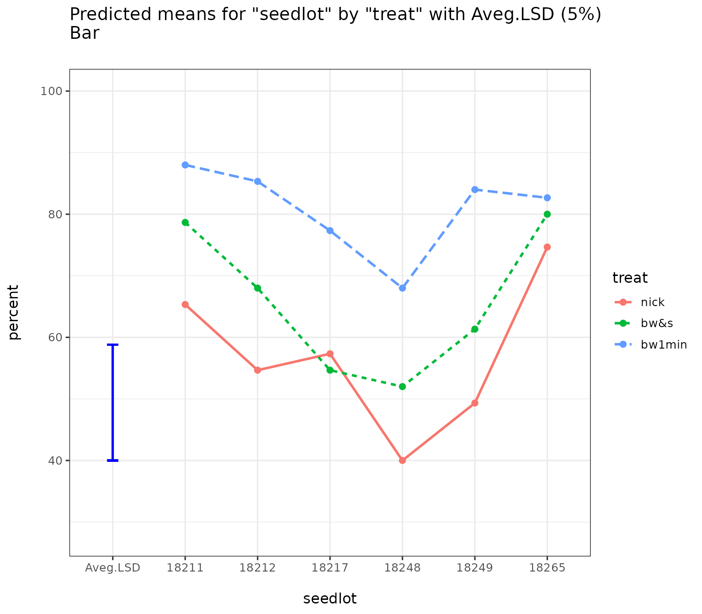

Code

``` r

autoplot(predm_out, x = "seedlot", group = "treat")
```

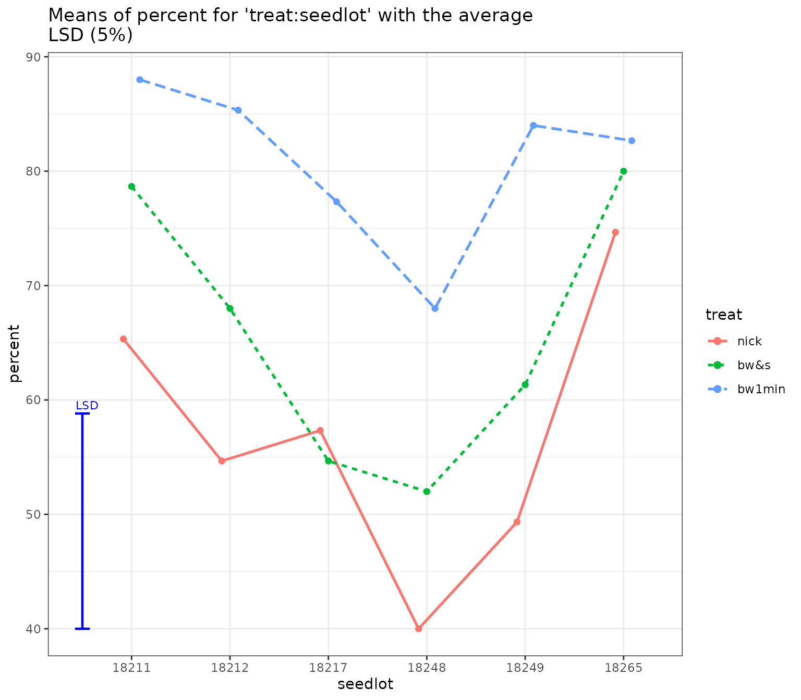

Code

``` r

autoplot(predm_out, type = "ci", data = TRUE)
```

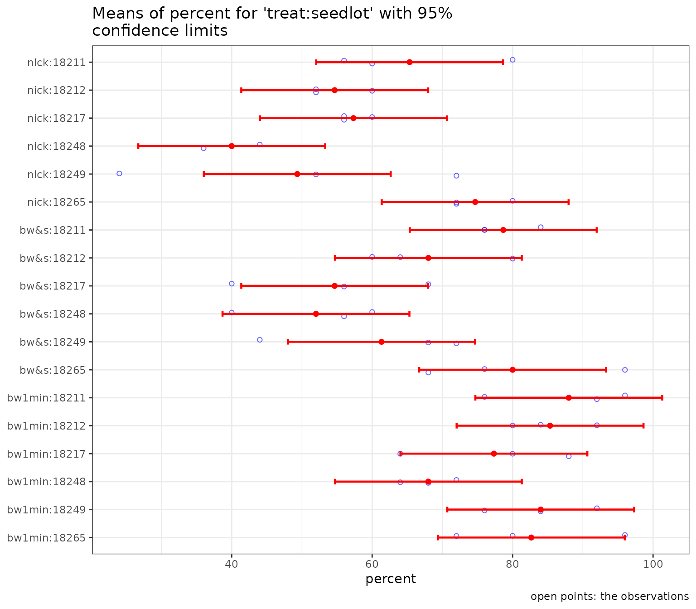

Code

``` r

autoplot(predm_out, type = "bar", x = "seedlot", group = "treat")
```

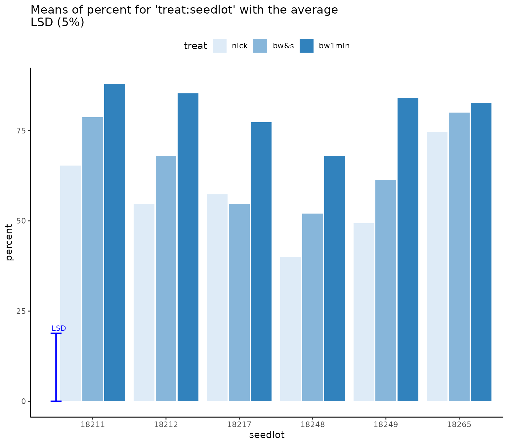

## **4.2 Example 4.4 (Pg. 61)**

### Data Info

An experiment supported by the Shell Company was planted at Toolara
Forest Reserve near Gympie, Queensland, in February 1987 to study the
effects of irrigation and fertiliser on four seedlots of Eucalyptus
grandis. Because of the difficulty in applying the irrigation and
fertiliser treatments individually to each 7 × 6 plot of trees, the
experiment was designed as a split-plot, with main-plot treatments,
irrig and fert. There were two replicates of four main-plots each with
four sub-plots.

- Structure
- Summary

Code

``` r

data(DataExam4.4, package="eda4treeR")
DataExam4.4$seedlot <- factor(as.character(DataExam4.4$seedlot))
str(DataExam4.4)
```

    ## 'data.frame':    32 obs. of  5 variables:
    ##  $ repl   : Factor w/ 2 levels "1","2": 1 1 1 1 1 1 1 1 1 1 ...
    ##  $ irrig  : Factor w/ 2 levels "none","plus": 1 1 1 1 1 1 1 1 2 2 ...
    ##  $ fert   : Factor w/ 2 levels "none","plus": 1 1 1 1 2 2 2 2 2 2 ...
    ##  $ seedlot: Factor w/ 4 levels "Atherton","Bulahdelah",..: 1 4 3 2 3 2 4 1 2 3 ...
    ##  $ height : num  4.71 6.23 7.46 6.39 16.36 ...

Code

``` r

print(dfSummary(DataExam4.4, 
                varnumbers   = FALSE, 
                valid.col    = FALSE, 
                graph.magnif = 0.76),
      method = 'render')
```

### Data Frame Summary

#### DataExam4.4

**Dimensions**: 32 x 5  
**Duplicates**: 0  

[TABLE]

Generated by [summarytools](https://github.com/dcomtois/summarytools)
1.1.5 ([R](https://www.r-project.org/) version 4.6.2)  
2026-11-25

### Modelling

- Model
- Residual Plot

Code

``` r

fm4.6 <- aov(height ~ repl + irrig*fert*seedlot +
Error(repl/irrig:fert), data = DataExam4.4)
summary(fm4.6)
```

    ## 
    ## Error: repl
    ##      Df Sum Sq Mean Sq
    ## repl  1 0.7564  0.7564
    ## 
    ## Error: repl:irrig:fert
    ##            Df Sum Sq Mean Sq F value Pr(>F)    
    ## irrig       1    0.1     0.1   0.154  0.721    
    ## fert        1  590.6   590.6 841.110  9e-05 ***
    ## irrig:fert  1    0.0     0.0   0.010  0.926    
    ## Residuals   3    2.1     0.7                   
    ## ---
    ## Signif. codes:  0 '***' 0.001 '**' 0.01 '*' 0.05 '.' 0.1 ' ' 1
    ## 
    ## Error: Within
    ##                    Df Sum Sq Mean Sq F value  Pr(>F)    
    ## seedlot             3  39.65  13.218  19.680 6.3e-05 ***
    ## irrig:seedlot       3   1.11   0.370   0.551  0.6572    
    ## fert:seedlot        3   9.95   3.317   4.938  0.0185 *  
    ## irrig:fert:seedlot  3   1.74   0.579   0.862  0.4874    
    ## Residuals          12   8.06   0.672                    
    ## ---
    ## Signif. codes:  0 '***' 0.001 '**' 0.01 '*' 0.05 '.' 0.1 ' ' 1

Code

``` r

residplot(fm4.6) 
```

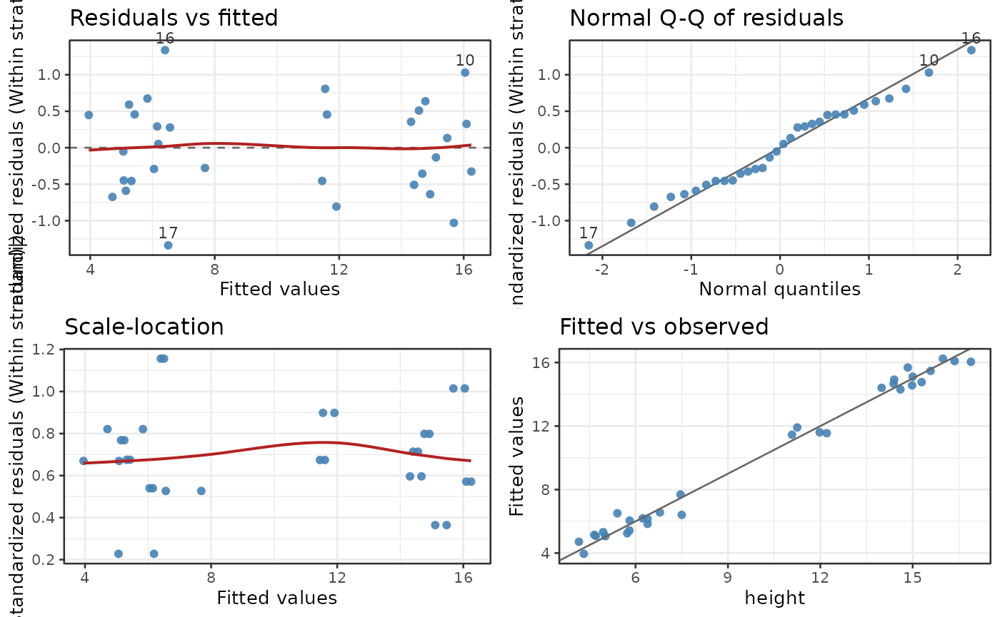

### Predicted Means

- irrig

&nbsp;

- Mean Table
- Mean Plot
- Mean Table
- Mean Plot
- Mean Table
- p-value Table
- Mean Plot
- Mean Table
- p-value Table & Plot
- Mean Plot

Code

``` r

predm_out <- predictmeans(fm4.6, "irrig", adj="BH")
print(predm_out[1:4])
```

    ## $`Predicted Means`
    ## irrig
    ##    none    plus 
    ##  9.9462 10.0625 
    ## 
    ## $`Standard Error of Means`
    ## All means have the same SE 
    ##                     0.2095 
    ## 
    ## $`Standard Error of Differences`
    ##   Max.SED   Min.SED  Aveg.SED 
    ## 0.2962737 0.2962737 0.2962737 
    ## 
    ## $LSD
    ##  Max.LSD  Min.LSD Aveg.LSD 
    ##  0.94288  0.94288  0.94288 
    ## attr(,"Significant level")
    ## [1] 0.05
    ## attr(,"Degree of freedom")
    ## [1] 3
    ## attr(,"Note")
    ## [1] "These LSDs are not adjusted: 'BH' is a step-wise method and has no critical value for all pairs. Use the adjusted p-values for the comparisons."
    ## attr(,"equal")
    ## [1] TRUE

Code

``` r

gt(predm_out$mean_table$Table, 
   caption = "Group: Letter-based representation of pairwise comparisons at significant level '0.05'")
```

| irrig | Mean    | SE     | Df  | LL(95%) | UL(95%) | LetterGrp |
|-------|---------|--------|-----|---------|---------|-----------|
| none  | 9.9462  | 0.2095 | 3   | 9.2795  | 10.6130 | A         |
| plus  | 10.0625 | 0.2095 | 3   | 9.3958  | 10.7292 | A         |

Group: Letter-based representation of pairwise comparisons at
significant level '0.05' {.table .gt_table
quarto-disable-processing="false" quarto-bootstrap="false"}

Code

``` r

autoplot(predm_out, lines = FALSE)
```

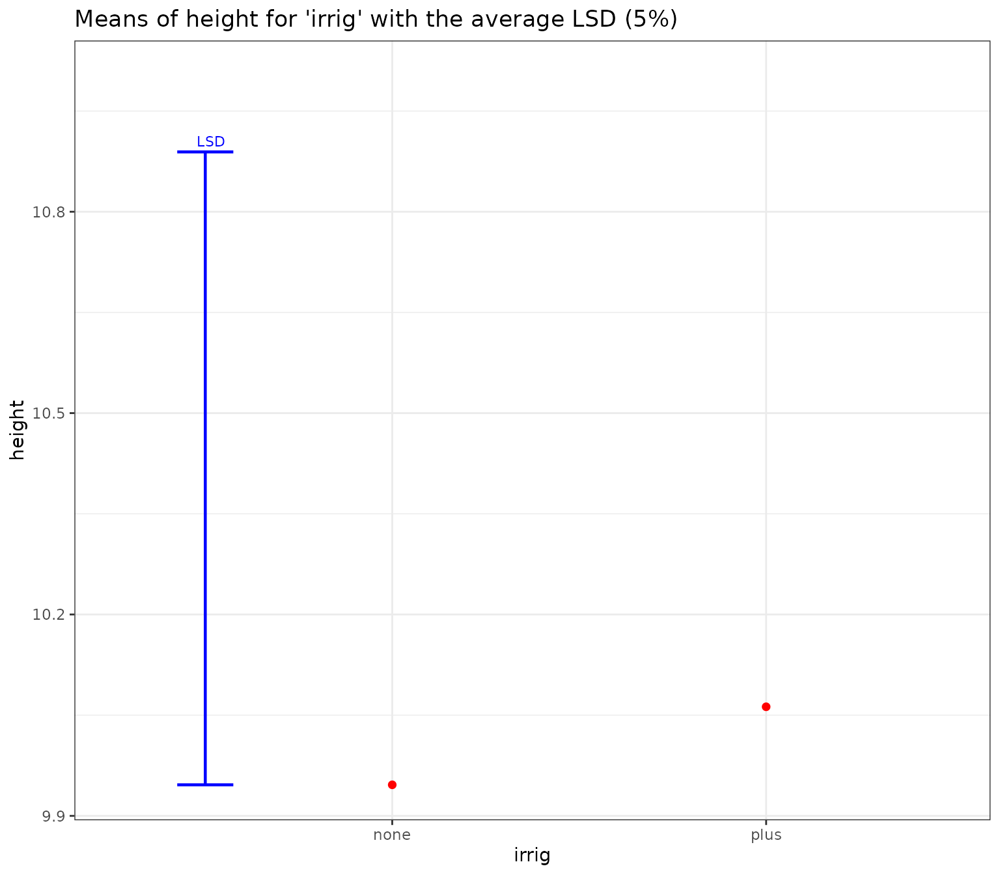

Code

``` r

autoplot(predm_out, type = "ci", data = TRUE)
```

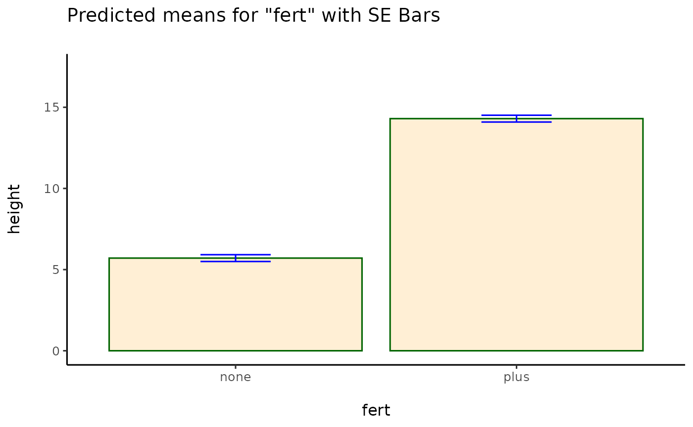

Code

``` r

autoplot(predm_out, type = "bar")
```

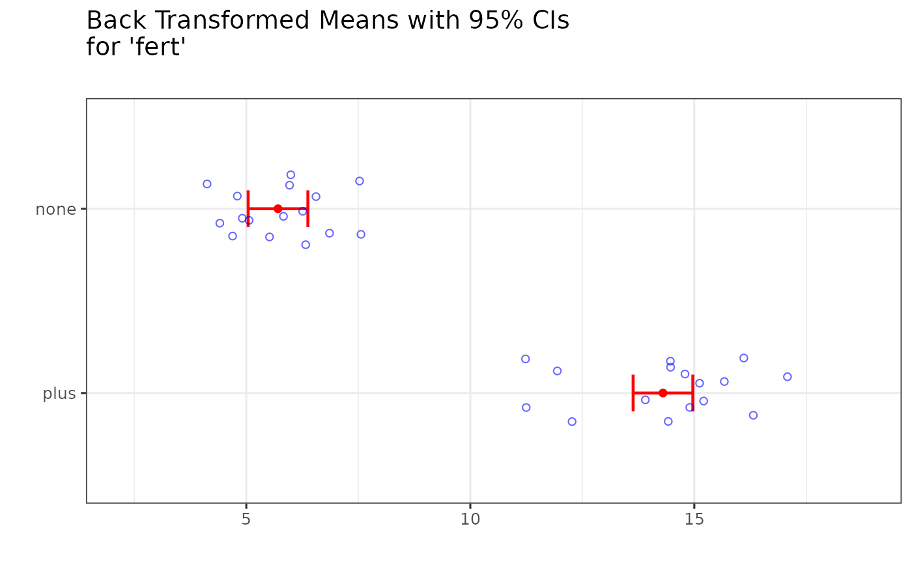

- fert

Code

``` r

predm_out <- predictmeans(fm4.6, "fert", adj="BH")
print(predm_out[1:4])
```

    ## $`Predicted Means`
    ## fert
    ##    none    plus 
    ##  5.7081 14.3006 
    ## 
    ## $`Standard Error of Means`
    ## All means have the same SE 
    ##                     0.2095 
    ## 
    ## $`Standard Error of Differences`
    ##   Max.SED   Min.SED  Aveg.SED 
    ## 0.2962737 0.2962737 0.2962737 
    ## 
    ## $LSD
    ##  Max.LSD  Min.LSD Aveg.LSD 
    ##  0.94288  0.94288  0.94288 
    ## attr(,"Significant level")
    ## [1] 0.05
    ## attr(,"Degree of freedom")
    ## [1] 3
    ## attr(,"Note")
    ## [1] "These LSDs are not adjusted: 'BH' is a step-wise method and has no critical value for all pairs. Use the adjusted p-values for the comparisons."
    ## attr(,"equal")
    ## [1] TRUE

Code

``` r

gt(predm_out$mean_table$Table, 
   caption = "Group: Letter-based representation of pairwise comparisons at significant level '0.05'")
```

| fert | Mean    | SE     | Df  | LL(95%) | UL(95%) | LetterGrp |
|------|---------|--------|-----|---------|---------|-----------|
| none | 5.7081  | 0.2095 | 3   | 5.0414  | 6.3748  | A         |
| plus | 14.3006 | 0.2095 | 3   | 13.6339 | 14.9673 | B         |

Group: Letter-based representation of pairwise comparisons at
significant level '0.05' {.table .gt_table
quarto-disable-processing="false" quarto-bootstrap="false"}

Code

``` r

autoplot(predm_out, lines = FALSE)
```

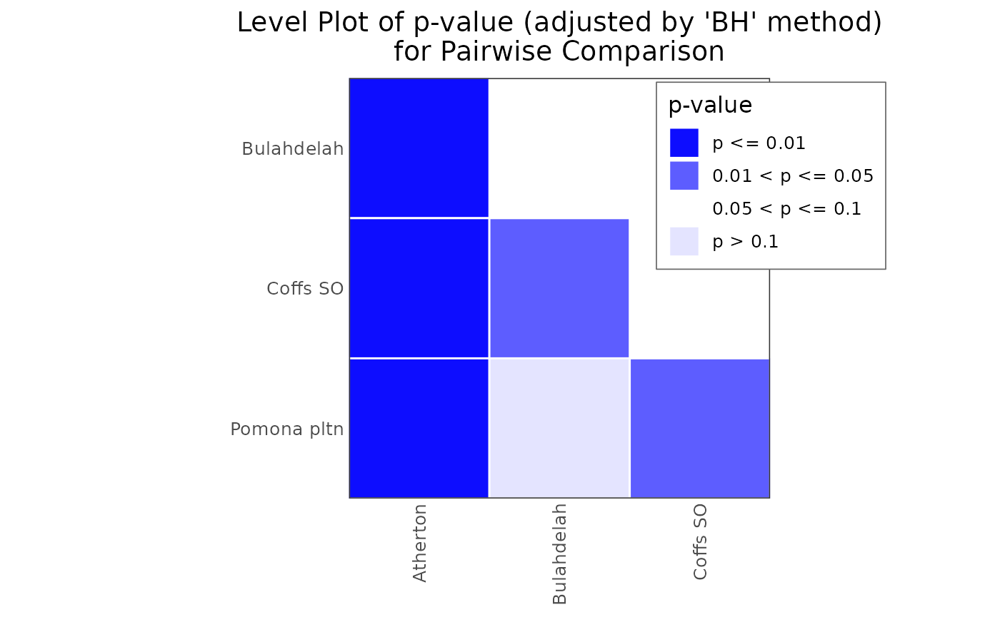

Code

``` r

autoplot(predm_out, type = "ci", data = TRUE)
```

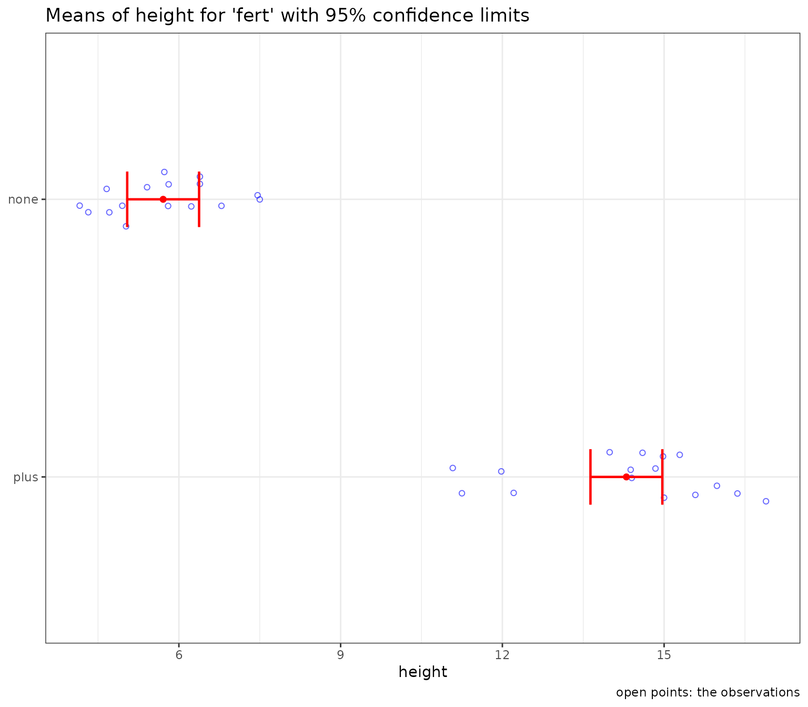

Code

``` r

autoplot(predm_out, type = "bar")
```

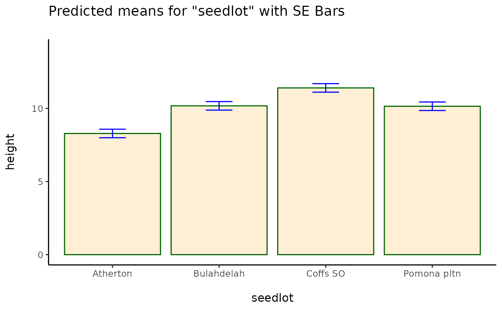

- seedlot

Code

``` r

predm_out <- predictmeans(fm4.6, "seedlot", adj="BH")
print(predm_out[1:4])
```

    ## $`Predicted Means`
    ## seedlot
    ##    Atherton  Bulahdelah    Coffs SO Pomona pltn 
    ##      8.2875     10.1775     11.4037     10.1487 
    ## 
    ## $`Standard Error of Means`
    ## All means have the same SE 
    ##                    0.29139 
    ## 
    ## $`Standard Error of Differences`
    ##   Max.SED   Min.SED  Aveg.SED 
    ## 0.4097656 0.4097656 0.4097656 
    ## 
    ## $LSD
    ##  Max.LSD  Min.LSD Aveg.LSD 
    ##   0.8928   0.8928   0.8928 
    ## attr(,"Significant level")
    ## [1] 0.05
    ## attr(,"Degree of freedom")
    ## [1] 12
    ## attr(,"Note")
    ## [1] "These LSDs are not adjusted: 'BH' is a step-wise method and has no critical value for all pairs. Use the adjusted p-values for the comparisons."
    ## attr(,"equal")
    ## [1] TRUE

Code

``` r

gt(predm_out$mean_table$Table, 
   caption = "Group: Letter-based representation of pairwise comparisons at significant level '0.05'")
```

| seedlot     | Mean    | SE      | Df    | LL(95%) | UL(95%) | LetterGrp |
|-------------|---------|---------|-------|---------|---------|-----------|
| Atherton    | 8.2875  | 0.29139 | 14.69 | 7.6653  | 8.9097  | A         |
| Bulahdelah  | 10.1775 | 0.29139 | 14.69 | 9.5553  | 10.7997 | B         |
| Coffs SO    | 11.4037 | 0.29139 | 14.69 | 10.7815 | 12.0260 | C         |
| Pomona pltn | 10.1487 | 0.29139 | 14.69 | 9.5265  | 10.7710 | B         |

Group: Letter-based representation of pairwise comparisons at
significant level '0.05' {.table .gt_table
quarto-disable-processing="false" quarto-bootstrap="false"}

Code

``` r

gt(data.frame(predm_out$`Pairwise p-value`, check.names=FALSE), 
   rownames_to_stub=TRUE, 
   caption = "The matrix has t-value above the diagonal, p-value (adjusted by 'BH' method) below the diagonal") %>% 
  cols_width(everything() ~ px(120))
```

|             | Atherton | Bulahdelah | Coffs SO | Pomona pltn |
|-------------|----------|------------|----------|-------------|
| Atherton    | 1.0000   | -4.6124    | -7.6050  | -4.5422     |
| Bulahdelah  | 0.0014   | 1.0000     | -2.9926  | 0.0702      |
| Coffs SO    | 0.0000   | 0.0135     | 1.0000   | 3.0627      |
| Pomona pltn | 0.0014   | 0.9452     | 0.0135   | 1.0000      |

The matrix has t-value above the diagonal, p-value (adjusted by 'BH'
method) below the diagonal {.table .gt_table
style="table-layout:fixed;width:0px;" quarto-disable-processing="false"
quarto-bootstrap="false"}

Code

``` r

autoplot(predm_out, lines = FALSE)
```

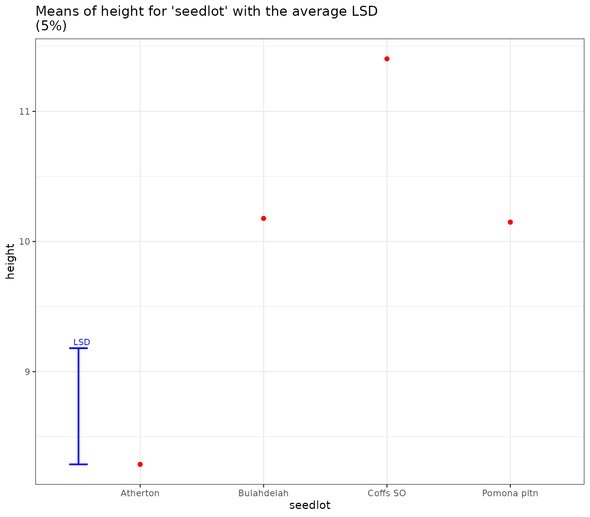

Code

``` r

autoplot(predm_out, type = "ci", data = TRUE)
```


Code

``` r

autoplot(predm_out, type = "bar")
```


- fert:seedlot

Code

``` r

predm_out <- predictmeans(fm4.6, "fert:seedlot", adj="BH")
print(predm_out[1:4])
```

    ## $`Predicted Means`
    ##             fert    none    plus
    ## seedlot                         
    ## Atherton          4.9450 11.6300
    ## Bulahdelah        5.6875 14.6675
    ## Coffs SO          6.7900 16.0175
    ## Pomona pltn       5.4100 14.8875
    ## 
    ## $`Standard Error of Means`
    ## All means have the same SE 
    ##                    0.41209 
    ## 
    ## $`Standard Error of Differences`
    ##   Max.SED   Min.SED  Aveg.SED 
    ## 0.5827863 0.5794960 0.5813762 
    ## attr(,"For the Same Level of Factor")
    ##              fert   seedlot
    ## Aveg.SED 0.579496 0.5827863
    ## Min.SED  0.579496 0.5827863
    ## Max.SED  0.579496 0.5827863
    ## 
    ## $LSD
    ##  Max.LSD  Min.LSD Aveg.LSD 
    ##  1.25399  1.24691  1.25096 
    ## attr(,"For the Same Level of Factor")
    ##             fert seedlot
    ## Aveg.LSD 1.24691 1.25399
    ## Min.LSD  1.24691 1.25399
    ## Max.LSD  1.24691 1.25399
    ## attr(,"Significant level")
    ## [1] 0.05
    ## attr(,"Degree of freedom")
    ## [1] 13.54
    ## attr(,"Note")
    ## [1] "These LSDs are not adjusted: 'BH' is a step-wise method and has no critical value for all pairs. Use the adjusted p-values for the comparisons. The LSDs differ between pairs (1.247 to 1.254): no single LSD tests every pair; use the p-values, or each pair's LSD (pairs$lsd)."
    ## attr(,"equal")
    ## [1] FALSE

Code

``` r

gt(predm_out$mean_table$Table, 
   caption = "Group: Letter-based representation of pairwise comparisons at significant level '0.05'")
```

| fert | seedlot     | Mean    | SE      | Df    | LL(95%) | UL(95%) | LetterGrp |
|------|-------------|---------|---------|-------|---------|---------|-----------|
| none | Atherton    | 4.9450  | 0.41209 | 14.69 | 4.0650  | 5.8250  | A         |
| none | Bulahdelah  | 5.6875  | 0.41209 | 14.69 | 4.8075  | 6.5675  | AB        |
| none | Coffs SO    | 6.7900  | 0.41209 | 14.69 | 5.9100  | 7.6700  | B         |
| none | Pomona pltn | 5.4100  | 0.41209 | 14.69 | 4.5300  | 6.2900  | A         |
| plus | Atherton    | 11.6300 | 0.41209 | 14.69 | 10.7500 | 12.5100 | C         |
| plus | Bulahdelah  | 14.6675 | 0.41209 | 14.69 | 13.7875 | 15.5475 | D         |
| plus | Coffs SO    | 16.0175 | 0.41209 | 14.69 | 15.1375 | 16.8975 | E         |
| plus | Pomona pltn | 14.8875 | 0.41209 | 14.69 | 14.0075 | 15.7675 | DE        |

Group: Letter-based representation of pairwise comparisons at
significant level '0.05' {.table .gt_table
quarto-disable-processing="false" quarto-bootstrap="false"}

Code

``` r

gt(data.frame(predm_out$`Pairwise p-value`, check.names=FALSE), 
   rownames_to_stub=TRUE, 
   caption = "The matrix has t-value above the diagonal, p-value (adjusted by 'BH' method) below the diagonal") %>% 
  cols_width(everything() ~ px(150))
```

|  | none:Atherton | none:Bulahdelah | none:Coffs SO | none:Pomona pltn | plus:Atherton | plus:Bulahdelah | plus:Coffs SO | plus:Pomona pltn |
|----|----|----|----|----|----|----|----|----|
| none:Atherton | 1.0000 | -1.2813 | -3.1838 | -0.8024 | -11.4708 | -16.6828 | -18.9992 | -17.0603 |
| none:Bulahdelah | 0.2512 | 1.0000 | -1.9025 | 0.4789 | -10.1967 | -15.4087 | -17.7252 | -15.7862 |
| none:Coffs SO | 0.0110 | 0.0949 | 1.0000 | 2.3814 | -8.3049 | -13.5170 | -15.8334 | -13.8945 |
| none:Pomona pltn | 0.4716 | 0.6644 | 0.0462 | 1.0000 | -10.6729 | -15.8849 | -18.2014 | -16.2624 |
| plus:Atherton | 0.0000 | 0.0000 | 0.0000 | 0.0000 | 1.0000 | -5.2416 | -7.5712 | -5.6213 |
| plus:Bulahdelah | 0.0000 | 0.0000 | 0.0000 | 0.0000 | 0.0003 | 1.0000 | -2.3296 | -0.3796 |
| plus:Coffs SO | 0.0000 | 0.0000 | 0.0000 | 0.0000 | 0.0000 | 0.0485 | 1.0000 | 1.9500 |
| plus:Pomona pltn | 0.0000 | 0.0000 | 0.0000 | 0.0000 | 0.0002 | 0.7108 | 0.0912 | 1.0000 |

The matrix has t-value above the diagonal, p-value (adjusted by 'BH'
method) below the diagonal {.table .gt_table
style="table-layout:fixed;width:0px;" quarto-disable-processing="false"
quarto-bootstrap="false"}

Code

``` r

PMplot(predm_out$p_valueMatrix)
```


Code

``` r

autoplot(predm_out, x = "seedlot", group = "fert")
```


Code

``` r

autoplot(predm_out, type = "ci", data = TRUE)
```


Code

``` r

autoplot(predm_out, type = "bar", x = "seedlot", group = "fert")
```


## **5.2 Example 5.1 (Pg. 68)**

### Data Info

In 1985 species/provenance trials were laid out at six sites in Thailand
as part of an ACIAR project extending over several years to investigate
Australian multi-purpose tree species. The experimental design in each
case was an RCB design with three replicates and the number of seedlots
ranged from 30 to 42. Plots consisted of 5 × 5 trees with a 2m × 2m
spacing. Plot summary files were constructed for the 24-month
measurement according to the methods described in Chapter 3. Analyses
were performed on the plot mean data at each site.

- Structure
- Summary

Code

``` r

data(DataExam5.1, package="eda4treeR")
str(DataExam5.1)
```

    ## 'data.frame':    108 obs. of  4 variables:
    ##  $ site    : Factor w/ 4 levels "Ratchaburi","Sai Thong",..: 1 2 3 4 1 2 3 4 1 2 ...
    ##  $ seedlot : Factor w/ 27 levels "13877","13866",..: 27 27 27 27 26 26 26 26 25 25 ...
    ##  $ ht      : num  218 319 363 191 216 116 97 63 490 475 ...
    ##  $ sitemean: num  462 628 494 370 462 ...

Code

``` r

print(dfSummary(DataExam5.1, 
                varnumbers   = FALSE, 
                valid.col    = FALSE, 
                graph.magnif = 0.76),
      method = 'render')
```

### Data Frame Summary

#### DataExam5.1

**Dimensions**: 108 x 4  
**Duplicates**: 0  

[TABLE]

Generated by [summarytools](https://github.com/dcomtois/summarytools)
1.1.5 ([R](https://www.r-project.org/) version 4.6.2)  
2026-11-25

### Modelling

- ANOVA One value per site and seedlot (a plot mean), so the full model
  leaves no residual: its F tests are empty (NaN) until the book’s
  pooled residual mean square is added below.

Code

``` r

fm5.2 <- lm(ht ~ site*seedlot, DataExam5.1)
kable(anova(fm5.2), digits = 4) 
```

|              |  Df |    Sum Sq |    Mean Sq | F value | Pr(\>F) |
|:-------------|----:|----------:|-----------:|--------:|--------:|
| site         |   3 |  919585.2 | 306528.407 |     NaN |     NaN |
| seedlot      |  26 | 3176288.9 | 122164.956 |     NaN |     NaN |
| site:seedlot |  78 |  707956.8 |   9076.369 |     NaN |     NaN |
| Residuals    |   0 |       0.0 |        NaN |      NA |      NA |

- Predicted Means

Site:

Code

``` r

site_mean <- Kmatrix(fm5.2, "site")$K%*%coef(fm5.2)
site_df <- data.frame(Site=rownames(site_mean), Mean=site_mean)
gt(site_df)
```

| Site       | Mean     |
|------------|----------|
| Ratchaburi | 461.6296 |
| Sai Thong  | 627.7037 |
| Si Sa Ket  | 494.0370 |
| Sakaerat   | 370.4815 |

Seedlot:

Code

``` r

seedlot_mean <- t(Kmatrix(fm5.2, "seedlot")$K%*%coef(fm5.2))
gt(data.frame(seedlot_mean[, 1:9, drop=FALSE], check.names = FALSE, row.names ="Mean"), rownames_to_stub = TRUE)
```

|      | 13877  | 13866  | 13689  | 13688 | 13861  | 13854 | 13684 | 13864 | 13863  |
|------|--------|--------|--------|-------|--------|-------|-------|-------|--------|
| Mean | 364.75 | 352.75 | 558.75 | 546.5 | 626.75 | 628   | 660   | 422.5 | 586.25 |

Code

``` r

gt(data.frame(seedlot_mean[, 10:18, drop=FALSE], check.names = FALSE, row.names ="Mean"), rownames_to_stub = TRUE)
```

|      | 13683  | 13681 | 14175 | 14660  | 13653 | 13846 | 13621  | 13871 | 13519 |
|------|--------|-------|-------|--------|-------|-------|--------|-------|-------|
| Mean | 769.75 | 695   | 438   | 521.25 | 591.5 | 440   | 383.75 | 271.5 | 422   |

Code

``` r

gt(data.frame(seedlot_mean[, 19:27, drop=FALSE], check.names = FALSE, row.names ="Mean"), rownames_to_stub = TRUE)
```

|      | 13514  | 13148  | 13990  | 14537  | 14106  | 12013  | 14130  | 14485 | 11935  |
|------|--------|--------|--------|--------|--------|--------|--------|-------|--------|
| Mean | 368.75 | 273.25 | 281.75 | 779.75 | 771.75 | 616.25 | 422.25 | 123   | 272.75 |

- ANOVA with Residual Mean_Sq 1040 and Df 208 (Table 5.3, page 71)

Code

``` r

fm5.2_aT <- anova(fm5.2)
fm5.2_aT["Residuals", c("Df", "Sum Sq", "Mean Sq")] <- c(208, 208* 1040, 1040)
fm5.2_aT$`F value`[3] <- fm5.2_aT$`Mean Sq`[3]/fm5.2_aT$`Mean Sq`[4]
fm5.2_aT$`Pr(>F)`[3] <- pf(fm5.2_aT$`F value`[3], fm5.2_aT$Df[3], fm5.2_aT$Df[4], lower.tail = FALSE)
kable(fm5.2_aT, digits = 4)
```

|              |  Df |    Sum Sq |    Mean Sq | F value | Pr(\>F) |
|:-------------|----:|----------:|-----------:|--------:|--------:|
| site         |   3 |  919585.2 | 306528.407 |     NaN |     NaN |
| seedlot      |  26 | 3176288.9 | 122164.956 |     NaN |     NaN |
| site:seedlot |  78 |  707956.8 |   9076.369 |  8.7273 |       0 |
| Residuals    | 208 |  216320.0 |   1040.000 |      NA |      NA |

### Example 5.1 (continued) Page 78

- Book Way
- My Way

- Fig. 5.1. Plot of mean height of two seedlots versus mean height of
  all seedlots at each of four sites.

Code

``` r

DataExam5.1 %>%
filter(seedlot %in% c("13653", "13871")) %>%
  ggplot(aes(x = sitemean, y = ht, color = seedlot, shape = seedlot)) +
    geom_point(size=3) +
    geom_smooth(method = lm, se = FALSE, fullrange = TRUE) +
    theme_classic(17) +
    labs(x = "\nSite Mean", y = "SeedLot Mean\n")
```


- Table 5.7 Estimated height means and regression coefficients for data
  from Table 5.2.

Code

``` r

Table_5.7 <- DataExam5.1 %>%
  summarise(Mean = mean(ht), .by = seedlot) %>%
  left_join(
    DataExam5.1 %>%
      nest_by(seedlot) %>%
      mutate(fm1 = list(lm(ht ~ sitemean , data = data))) %>%
      summarise(Slope = coef(fm1)[2]), 
    by = "seedlot") %>% 
  arrange(seedlot)
gt(Table_5.7)
```

| seedlot | Mean   | Slope      |
|---------|--------|------------|
| 13877   | 364.75 | 0.79221858 |
| 13866   | 352.75 | 0.61009734 |
| 13689   | 558.75 | 1.19475332 |
| 13688   | 546.50 | 1.72717652 |
| 13861   | 626.75 | 1.43784662 |
| 13854   | 628.00 | 1.62026853 |
| 13684   | 660.00 | 1.67860570 |
| 13864   | 422.50 | 0.61113857 |
| 13863   | 586.25 | 1.48034730 |
| 13683   | 769.75 | 1.79629735 |
| 13681   | 695.00 | 1.30937837 |
| 14175   | 438.00 | 1.33770745 |
| 14660   | 521.25 | 0.93353990 |
| 13653   | 591.50 | 1.59434380 |
| 13846   | 440.00 | 0.70691001 |
| 13621   | 383.75 | 1.20085607 |
| 13871   | 271.50 | 0.83048203 |
| 13519   | 422.00 | 0.29211648 |
| 13514   | 368.75 | 0.12307233 |
| 13148   | 273.25 | 0.05333546 |
| 13990   | 281.75 | 0.08298796 |
| 14537   | 779.75 | 0.96012145 |
| 14106   | 771.75 | 1.37751724 |
| 12013   | 616.25 | 2.06723798 |
| 14130   | 422.25 | 0.54976906 |
| 14485   | 123.00 | 0.10170020 |
| 11935   | 272.75 | 0.53017435 |

- Fig. 5.2. Plot of regression coefficients versus height means for
  individual seedlots.

Code

``` r

Table_5.7 %>% 
  ggplot(aes(x = Mean, y = Slope)) +
    geom_point(size=3) +
    theme_classic(17) +
    labs(x = "\nSeedLot Mean", y = "Regression Coefficients\n")
```


- Regression Deviance SS

Code

``` r

DevSS <- DataExam5.1 %>%
  nest_by(seedlot) %>%
  mutate(fm1 = list(lm(ht ~ sitemean , data = data))) %>%
  summarise(SSE = anova(fm1)[2, 2]) %>%
  ungroup () %>%
  summarise(Dev = sum(SSE)) %>%
  as.numeric()
print(DevSS)
```

    ## [1] 399453.7

- Model

Code

``` r

mod_5.1 <- lm(ht ~ site+sitemean*seedlot, DataExam5.1)
summary(mod_5.1)
```

    ## 
    ## Call:
    ## lm(formula = ht ~ site + sitemean * seedlot, data = DataExam5.1)
    ## 
    ## Residuals:
    ##      Min       1Q   Median       3Q      Max 
    ## -156.523  -39.666   -9.334   43.439  157.552 
    ## 
    ## Coefficients: (1 not defined because of singularities)
    ##                         Estimate Std. Error t value Pr(>|t|)    
    ## (Intercept)            343.49213   47.85622   7.178 2.58e-09 ***
    ## siteSai Thong          131.56697   80.98960   1.624   0.1103    
    ## siteSi Sa Ket           25.67375   28.23343   0.909   0.3674    
    ## siteSakaerat           -72.20926   48.71809  -1.482   0.1443    
    ## sitemean                      NA         NA      NA       NA    
    ## seedlot13866            76.95948  333.87064   0.231   0.8186    
    ## seedlot13689            -2.62331  333.87064  -0.008   0.9938    
    ## seedlot13688          -274.94232  333.87064  -0.823   0.4140    
    ## seedlot13861           -53.36538  333.87064  -0.160   0.8736    
    ## seedlot13854          -141.22173  333.87064  -0.423   0.6741    
    ## seedlot13684          -137.71728  333.87064  -0.412   0.6817    
    ## seedlot13864           146.20088  333.87064   0.438   0.6633    
    ## seedlot13863          -114.62539  333.87064  -0.343   0.7327    
    ## seedlot13683           -85.45529  333.87064  -0.256   0.7990    
    ## seedlot13681            77.63660  333.87064   0.233   0.8170    
    ## seedlot14175          -193.20111  333.87064  -0.579   0.5653    
    ## seedlot14660            87.46977  333.87064   0.262   0.7944    
    ## seedlot13653          -165.05846  333.87064  -0.494   0.6231    
    ## seedlot13846           116.92008  333.87064   0.350   0.7276    
    ## seedlot13621          -180.60428  333.87064  -0.541   0.5909    
    ## seedlot13871          -111.94028  333.87064  -0.335   0.7388    
    ## seedlot13519           301.53135  333.87064   0.903   0.3706    
    ## seedlot13514           330.85316  333.87064   0.991   0.3263    
    ## seedlot13148           269.41704  333.87064   0.807   0.4234    
    ## seedlot13990           263.43289  333.87064   0.789   0.4337    
    ## seedlot14537           332.98567  333.87064   0.997   0.3232    
    ## seedlot14106           121.10328  333.87064   0.363   0.7183    
    ## seedlot12013          -371.29975  333.87064  -1.112   0.2712    
    ## seedlot14130           175.92761  333.87064   0.527   0.6005    
    ## seedlot14485            95.54265  333.87064   0.286   0.7759    
    ## seedlot11935            35.99890  333.87064   0.108   0.9146    
    ## sitemean:seedlot13866   -0.18212    0.67163  -0.271   0.7873    
    ## sitemean:seedlot13689    0.40253    0.67163   0.599   0.5516    
    ## sitemean:seedlot13688    0.93496    0.67163   1.392   0.1698    
    ## sitemean:seedlot13861    0.64563    0.67163   0.961   0.3409    
    ## sitemean:seedlot13854    0.82805    0.67163   1.233   0.2232    
    ## sitemean:seedlot13684    0.88639    0.67163   1.320   0.1927    
    ## sitemean:seedlot13864   -0.18108    0.67163  -0.270   0.7885    
    ## sitemean:seedlot13863    0.68813    0.67163   1.025   0.3103    
    ## sitemean:seedlot13683    1.00408    0.67163   1.495   0.1410    
    ## sitemean:seedlot13681    0.51716    0.67163   0.770   0.4448    
    ## sitemean:seedlot14175    0.54549    0.67163   0.812   0.4204    
    ## sitemean:seedlot14660    0.14132    0.67163   0.210   0.8342    
    ## sitemean:seedlot13653    0.80213    0.67163   1.194   0.2378    
    ## sitemean:seedlot13846   -0.08531    0.67163  -0.127   0.8994    
    ## sitemean:seedlot13621    0.40864    0.67163   0.608   0.5456    
    ## sitemean:seedlot13871    0.03826    0.67163   0.057   0.9548    
    ## sitemean:seedlot13519   -0.50010    0.67163  -0.745   0.4599    
    ## sitemean:seedlot13514   -0.66915    0.67163  -0.996   0.3237    
    ## sitemean:seedlot13148   -0.73888    0.67163  -1.100   0.2763    
    ## sitemean:seedlot13990   -0.70923    0.67163  -1.056   0.2959    
    ## sitemean:seedlot14537    0.16790    0.67163   0.250   0.8036    
    ## sitemean:seedlot14106    0.58530    0.67163   0.871   0.3875    
    ## sitemean:seedlot12013    1.27502    0.67163   1.898   0.0632 .  
    ## sitemean:seedlot14130   -0.24245    0.67163  -0.361   0.7196    
    ## sitemean:seedlot14485   -0.69052    0.67163  -1.028   0.3087    
    ## sitemean:seedlot11935   -0.26204    0.67163  -0.390   0.6980    
    ## ---
    ## Signif. codes:  0 '***' 0.001 '**' 0.01 '*' 0.05 '.' 0.1 ' ' 1
    ## 
    ## Residual standard error: 87.65 on 52 degrees of freedom
    ## Multiple R-squared:  0.9168, Adjusted R-squared:  0.8289 
    ## F-statistic: 10.42 on 55 and 52 DF,  p-value: 6.321e-15

- ANOVA

Code

``` r

mod_5.1_aT <- anova(mod_5.1)
kable(mod_5.1_aT, digits = 4)
```

|                  |  Df |    Sum Sq |    Mean Sq | F value | Pr(\>F) |
|:-----------------|----:|----------:|-----------:|--------:|--------:|
| site             |   3 |  919585.2 | 306528.407 | 39.9032 |  0.0000 |
| seedlot          |  26 | 3176288.9 | 122164.956 | 15.9032 |  0.0000 |
| sitemean:seedlot |  26 |  308503.1 |  11865.504 |  1.5446 |  0.0908 |
| Residuals        |  52 |  399453.7 |   7681.801 |      NA |      NA |

- ANOVA in Table 5.3 (page 71)

Code

``` r

kable(fm5.2_aT, digits = 4)
```

|              |  Df |    Sum Sq |    Mean Sq | F value | Pr(\>F) |
|:-------------|----:|----------:|-----------:|--------:|--------:|
| site         |   3 |  919585.2 | 306528.407 |     NaN |     NaN |
| seedlot      |  26 | 3176288.9 | 122164.956 |     NaN |     NaN |
| site:seedlot |  78 |  707956.8 |   9076.369 |  8.7273 |       0 |
| Residuals    | 208 |  216320.0 |   1040.000 |      NA |      NA |

- Table 5.8 Joint regression analysis of variance for a complete
  site-by-seedlot table with pooled residual mean square added manually
  (Page 79)

Code

``` r

mod_5.1_aTN <- mod_5.1_aT[3:4,]
row.names(mod_5.1_aTN) <- c("regression", "deviations")
Table_5.8 <- fm5.2_aT[1:3,] %>% 
  bind_rows(mod_5.1_aTN) %>% 
  bind_rows(fm5.2_aT[4,])
Table_5.8$`F value`[5] <- Table_5.8$`Mean Sq`[5]/Table_5.8$`Mean Sq`[6]
Table_5.8$`Pr(>F)`[5] <- pf(Table_5.8$`F value`[5], Table_5.8$Df[5], Table_5.8$Df[6], lower.tail = FALSE)
kable(Table_5.8, digits = 4)
```

|              |  Df |    Sum Sq |    Mean Sq | F value | Pr(\>F) |
|:-------------|----:|----------:|-----------:|--------:|--------:|
| site         |   3 |  919585.2 | 306528.407 |     NaN |     NaN |
| seedlot      |  26 | 3176288.9 | 122164.956 |     NaN |     NaN |
| site:seedlot |  78 |  707956.8 |   9076.369 |  8.7273 |  0.0000 |
| regression   |  26 |  308503.1 |  11865.504 |  1.5446 |  0.0908 |
| deviations   |  52 |  399453.7 |   7681.801 |  7.3863 |  0.0000 |
| Residuals    | 208 |  216320.0 |   1040.000 |      NA |      NA |

- Table of seedlot mean and regression coefficients

Site means absorb the main slope on `sitemean` (it is constant within a
site), so the model estimates only the differences between the seedlots’
slopes (`sitemean:seedlot`). As in joint regression analysis, the slopes
are scaled to average 1. For this complete table they equal the book’s
Table 5.7.

Code

``` r

predm_seedlot <- predictmeans(mod_5.1, "seedlot", plot=FALSE)$mean_table
d <- c(0, coef(mod_5.1)[grep("^sitemean:seedlot", names(coef(mod_5.1)))])   # slope differences from the first seedlot
predm_seedlot$reg_coef <- 1 + d - mean(d)
gt(predm_seedlot)
```

| seedlot | Mean   | SE       | Df  | LL(95%)  | UL(95%)  | reg_coef   |
|---------|--------|----------|-----|----------|----------|------------|
| 13877   | 364.75 | 43.82294 | 52  | 276.8128 | 452.6872 | 0.79221858 |
| 13866   | 352.75 | 43.82294 | 52  | 264.8128 | 440.6872 | 0.61009734 |
| 13689   | 558.75 | 43.82294 | 52  | 470.8128 | 646.6872 | 1.19475332 |
| 13688   | 546.50 | 43.82294 | 52  | 458.5628 | 634.4372 | 1.72717652 |
| 13861   | 626.75 | 43.82294 | 52  | 538.8128 | 714.6872 | 1.43784662 |
| 13854   | 628.00 | 43.82294 | 52  | 540.0628 | 715.9372 | 1.62026853 |
| 13684   | 660.00 | 43.82294 | 52  | 572.0628 | 747.9372 | 1.67860570 |
| 13864   | 422.50 | 43.82294 | 52  | 334.5628 | 510.4372 | 0.61113857 |
| 13863   | 586.25 | 43.82294 | 52  | 498.3128 | 674.1872 | 1.48034730 |
| 13683   | 769.75 | 43.82294 | 52  | 681.8128 | 857.6872 | 1.79629735 |
| 13681   | 695.00 | 43.82294 | 52  | 607.0628 | 782.9372 | 1.30937837 |
| 14175   | 438.00 | 43.82294 | 52  | 350.0628 | 525.9372 | 1.33770745 |
| 14660   | 521.25 | 43.82294 | 52  | 433.3128 | 609.1872 | 0.93353990 |
| 13653   | 591.50 | 43.82294 | 52  | 503.5628 | 679.4372 | 1.59434380 |
| 13846   | 440.00 | 43.82294 | 52  | 352.0628 | 527.9372 | 0.70691001 |
| 13621   | 383.75 | 43.82294 | 52  | 295.8128 | 471.6872 | 1.20085607 |
| 13871   | 271.50 | 43.82294 | 52  | 183.5628 | 359.4372 | 0.83048203 |
| 13519   | 422.00 | 43.82294 | 52  | 334.0628 | 509.9372 | 0.29211648 |
| 13514   | 368.75 | 43.82294 | 52  | 280.8128 | 456.6872 | 0.12307233 |
| 13148   | 273.25 | 43.82294 | 52  | 185.3128 | 361.1872 | 0.05333546 |
| 13990   | 281.75 | 43.82294 | 52  | 193.8128 | 369.6872 | 0.08298796 |
| 14537   | 779.75 | 43.82294 | 52  | 691.8128 | 867.6872 | 0.96012145 |
| 14106   | 771.75 | 43.82294 | 52  | 683.8128 | 859.6872 | 1.37751724 |
| 12013   | 616.25 | 43.82294 | 52  | 528.3128 | 704.1872 | 2.06723798 |
| 14130   | 422.25 | 43.82294 | 52  | 334.3128 | 510.1872 | 0.54976906 |
| 14485   | 123.00 | 43.82294 | 52  | 35.0628  | 210.9372 | 0.10170020 |
| 11935   | 272.75 | 43.82294 | 52  | 184.8128 | 360.6872 | 0.53017435 |

- Joint regression lines: each seedlot’s line through its mean at the
  average site mean, with its slope.
  ([`covariatemeans()`](https://dongwenluo.github.io/predictmeans/reference/covariatemeans.md)
  is not used: with `site` in the model, a seedlot mean at any other
  value of `sitemean` is not estimable.)

Code

``` r

xm <- mean(unique(DataExam5.1[c("site", "sitemean")])$sitemean)
ggplot(predm_seedlot) +
  geom_abline(aes(intercept = Mean - reg_coef*xm, slope = reg_coef), alpha = 0.4) +
  scale_x_continuous(limits = range(DataExam5.1$sitemean)) +
  scale_y_continuous(limits = range(DataExam5.1$ht, na.rm = TRUE)) +
  theme_bw() +
  labs(x = "Site mean", y = "Predicted height")
```


- Plot of regression coefficients versus height means for individual
  seedlots.

Code

``` r

predm_seedlot %>% 
  ggplot(aes(x=Mean, y=reg_coef))+
  geom_point(size=3)+
  theme_classic(17)+
  labs(x = "\nSeedLot Mean", y = "Regression Coefficients\n")
```


## **5.3 Example 5.2 (Pg. 72)**

### Data

- Structure
- Summary

Code

``` r

data(DataExam5.2, package="eda4treeR")
str(DataExam5.2)
```

    ## tibble [222 × 4] (S3: tbl_df/tbl/data.frame)
    ##  $ site    : Factor w/ 6 levels "Ratchaburi","Sai Thong",..: 1 1 1 1 1 1 1 1 1 1 ...
    ##  $ seedlot : Factor w/ 37 levels "11935","12013",..: 24 21 14 13 18 17 12 11 20 19 ...
    ##  $ ht      : num [1:222] 334 348 424 439 465 428 567 520 326 416 ...
    ##   ..- attr(*, "problems")= tibble [30 × 4] (S3: tbl_df/tbl/data.frame)
    ##   .. ..$ row     : int [1:30] 21 24 37 60 71 73 74 81 88 118 ...
    ##   .. ..$ col     : int [1:30] NA NA NA NA NA NA NA NA NA NA ...
    ##   .. ..$ expected: chr [1:30] "a number" "a number" "a number" "a number" ...
    ##   .. ..$ actual  : chr [1:30] "*" "*" "*" "*" ...
    ##  $ sitemean: num [1:222] 462 462 462 462 462 ...

Code

``` r

print(dfSummary(DataExam5.2, 
                varnumbers   = FALSE, 
                valid.col    = FALSE, 
                graph.magnif = 0.76),
method = 'render')
```

### Data Frame Summary

#### DataExam5.2

**Dimensions**: 222 x 4  
**Duplicates**: 0  

[TABLE]

Generated by [summarytools](https://github.com/dcomtois/summarytools)
1.1.5 ([R](https://www.r-project.org/) version 4.6.2)  
2026-11-25

### Modelling

- Book Way
- My Way

- ANOVA

One value per site and seedlot (a plot mean), so the full model leaves
no residual: its F tests are empty (NaN) until the book’s pooled
residual mean square is added below.

Code

``` r

fm5.6 <- lm(ht ~ site*seedlot, DataExam5.2)
kable(anova(fm5.6), digits = 4) 
```

|              |  Df |  Sum Sq |    Mean Sq | F value | Pr(\>F) |
|:-------------|----:|--------:|-----------:|--------:|--------:|
| site         |   5 | 4157543 | 831508.599 |     NaN |     NaN |
| seedlot      |  36 | 4425296 | 122924.886 |     NaN |     NaN |
| site:seedlot | 150 | 1351054 |   9007.025 |     NaN |     NaN |
| Residuals    |   0 |       0 |        NaN |      NA |      NA |

- ANOVA with Residual Mean_Sq 964 and Df 384 (Table 5.6, page 74)

Code

``` r

fm5.6_aT <- anova(fm5.6)
fm5.6_aT["Residuals", c("Df", "Sum Sq", "Mean Sq")] <- c(384, 384*964, 964)
fm5.6_aT$`F value`[3] <- fm5.6_aT$`Mean Sq`[3]/fm5.6_aT$`Mean Sq`[4]
fm5.6_aT$`Pr(>F)`[3] <- pf(fm5.6_aT$`F value`[3], fm5.6_aT$Df[3], fm5.6_aT$Df[4], lower.tail = FALSE)
kable(fm5.6_aT, digits = 4)
```

|              |  Df |  Sum Sq |    Mean Sq | F value | Pr(\>F) |
|:-------------|----:|--------:|-----------:|--------:|--------:|
| site         |   5 | 4157543 | 831508.599 |     NaN |     NaN |
| seedlot      |  36 | 4425296 | 122924.886 |     NaN |     NaN |
| site:seedlot | 150 | 1351054 |   9007.025 |  9.3434 |       0 |
| Residuals    | 384 |  370176 |    964.000 |      NA |      NA |

- Table 5.9 Estimated height means and regression coefficients for data
  from Table 5.1 (Page 82)

Code

``` r

Tab5.9 <- DataExam5.2 %>%
  summarise(Mean = round(mean(ht, na.rm = TRUE), 0), .by = seedlot) %>%
  left_join(
    DataExam5.2 %>%
      nest_by(seedlot) %>%
      mutate(fm2 = list(lm(ht ~ sitemean , data = data))) %>%
      summarise(Slope = round(coef(fm2)[2], 2)), 
    by = "seedlot") %>%
  as.data.frame ()
gt(Tab5.9)
```

| seedlot | Mean | Slope |
|---------|------|-------|
| 13877   | 291  | 0.80  |
| 13866   | 302  | 0.56  |
| 13689   | 463  | 1.07  |
| 13688   | 458  | 1.20  |
| 13861   | 538  | 1.08  |
| 13854   | 536  | 1.16  |
| 13686   | 726  | 1.77  |
| 13684   | 549  | 1.34  |
| 13864   | 371  | 0.79  |
| 13863   | 586  | 1.19  |
| 13683   | 673  | 1.78  |
| 13681   | 610  | 1.33  |
| 13680   | 645  | 2.08  |
| 14623   | 652  | 0.49  |
| 14175   | 378  | 1.22  |
| 14660   | 445  | 0.88  |
| 13691   | 511  | 1.61  |
| 13653   | 477  | 1.35  |
| 13846   | 381  | 0.93  |
| 13621   | 304  | 0.98  |
| 14176   | 177  | 0.22  |
| 13871   | 220  | 0.64  |
| 14622   | 355  | 1.65  |
| 13876   | 240  | 0.77  |
| 13519   | 342  | 0.71  |
| 13514   | 290  | 0.66  |
| 13148   | 230  | 0.35  |
| 13990   | 260  | 0.29  |
| 14537   | 671  | 1.15  |
| 14106   | 673  | 1.18  |
| 12013   | 529  | 1.30  |
| 14130   | 390  | 0.45  |
| 14485   | 108  | 0.16  |
| 14166   | 210  | 0.61  |
| 11935   | 211  | 0.61  |
| 14170   | 244  | 0.59  |
| 14152   | 150  | 0.63  |

Site:

Code

``` r

fm5.6N <- lm(ht ~ site+seedlot, DataExam5.2)
predictmeans(fm5.6N, "site", plot=FALSE)$mean_table %>% 
gt()
```

| site        | Mean     | SE       | Df  | LL(95%)  | UL(95%)  |
|-------------|----------|----------|-----|----------|----------|
| Ratchaburi  | 446.1165 | 16.42180 | 150 | 413.6685 | 478.5644 |
| Sai Thong   | 624.5945 | 16.76215 | 150 | 591.4740 | 657.7149 |
| Si Sa Ket   | 482.6940 | 16.25894 | 150 | 450.5679 | 514.8201 |
| Sakaerat    | 354.5225 | 16.83848 | 150 | 321.2513 | 387.7938 |
| Chanthaburi | 255.3465 | 17.82936 | 150 | 220.1173 | 290.5756 |
| Huai Bong   | 215.2865 | 18.92234 | 150 | 177.8977 | 252.6752 |

- Fig. 5.3. Plot of regression coefficients versus height means for
  individual seedlots

Code

``` r

Tab5.9 %>% 
  ggplot(aes(x = Mean, y = Slope)) +
    geom_point(size=3) +
    theme_classic(17) +
    labs(x = "\nSeedLot Mean", y = "Regression Coefficients\n")
```


- Regression Deviance SS

Code

``` r

DevSSN <- DataExam5.2 %>%
  nest_by(seedlot) %>%
  mutate(fm1 = list(lm(ht ~ sitemean , data = data))) %>%
  summarise(SSE = anova(fm1)[2, 2]) %>%
  ungroup () %>%
  summarise(Dev = sum(SSE)) %>%
  as.numeric()
print(DevSSN)
```

    ## [1] 647850.5

- Model

Code

``` r

mod_5.2 <- lm(ht ~ site+sitemean*seedlot, DataExam5.2)
summary(mod_5.2)
```

    ## 
    ## Call:
    ## lm(formula = ht ~ site + sitemean * seedlot, data = DataExam5.2)
    ## 
    ## Residuals:
    ##     Min      1Q  Median      3Q     Max 
    ## -176.48  -34.81    0.00   35.05  199.47 
    ## 
    ## Coefficients: (1 not defined because of singularities)
    ##                         Estimate Std. Error t value Pr(>|t|)    
    ## (Intercept)            241.10000   35.27930   6.834 4.29e-10 ***
    ## siteSai Thong          112.98770   40.42339   2.795 0.006089 ** 
    ## siteSi Sa Ket           35.19016   18.43599   1.909 0.058805 .  
    ## siteSakaerat           -50.18146   31.21543  -1.608 0.110692    
    ## siteChanthaburi       -118.28494   46.61914  -2.537 0.012523 *  
    ## siteHuai Bong         -159.31147   55.65096  -2.863 0.005000 ** 
    ## sitemean                      NA         NA      NA       NA    
    ## seedlot12013            45.51182  119.95591   0.379 0.705093    
    ## seedlot13148           119.62901  119.95591   0.997 0.320743    
    ## seedlot13514            59.31432  119.95591   0.494 0.621927    
    ## seedlot13519            91.23064  119.95591   0.761 0.448505    
    ## seedlot13621           -53.07067  119.95591  -0.442 0.659025    
    ## seedlot13653           -27.34810  119.95591  -0.228 0.820067    
    ## seedlot13680          -281.25337  153.25393  -1.835 0.069081 .  
    ## seedlot13681            76.76701  131.65435   0.583 0.560981    
    ## seedlot13683           -83.15149  141.11615  -0.589 0.556865    
    ## seedlot13684            51.77449  119.95591   0.432 0.666838    
    ## seedlot13686          -199.43136  341.72902  -0.584 0.560646    
    ## seedlot13688            14.18482  119.95591   0.118 0.906077    
    ## seedlot13689            70.12345  119.95591   0.585 0.559987    
    ## seedlot13691          -107.03232  123.15039  -0.869 0.386608    
    ## seedlot13846            -8.40418  141.11615  -0.060 0.952614    
    ## seedlot13854           106.80123  119.95591   0.890 0.375160    
    ## seedlot13861           141.00786  119.95591   1.175 0.242245    
    ## seedlot13863             9.08363  189.56697   0.048 0.961866    
    ## seedlot13864            41.55042  141.11615   0.294 0.768956    
    ## seedlot13866           107.64248  119.95591   0.897 0.371423    
    ## seedlot13871            -3.99971  119.95591  -0.033 0.973459    
    ## seedlot13876           -25.56251  119.98834  -0.213 0.831675    
    ## seedlot13877             3.60735  119.95591   0.030 0.976062    
    ## seedlot13990           145.59158  141.11615   1.032 0.304390    
    ## seedlot14106           235.48624  119.95591   1.963 0.052069 .  
    ## seedlot14130           241.43678  119.95591   2.013 0.046502 *  
    ## seedlot14152             5.19724  145.46425   0.036 0.971561    
    ## seedlot14166            28.84057  154.48751   0.187 0.852239    
    ## seedlot14170            67.39749  154.48751   0.436 0.663470    
    ## seedlot14175          -138.79095  141.11615  -0.984 0.327433    
    ## seedlot14176           121.65068  119.98834   1.014 0.312799    
    ## seedlot14485            72.69055  119.95591   0.606 0.545735    
    ## seedlot14537           247.33877  119.95591   2.062 0.041489 *  
    ## seedlot14622          -358.39044  310.06872  -1.156 0.250162    
    ## seedlot14623           433.81830  341.72902   1.269 0.206855    
    ## seedlot14660           126.93897  119.95591   1.058 0.292195    
    ## sitemean:seedlot12013    0.69241    0.28501   2.429 0.016685 *  
    ## sitemean:seedlot13148   -0.25501    0.28501  -0.895 0.372806    
    ## sitemean:seedlot13514    0.05005    0.28501   0.176 0.860905    
    ## sitemean:seedlot13519    0.09985    0.28501   0.350 0.726740    
    ## sitemean:seedlot13621    0.37098    0.28501   1.302 0.195668    
    ## sitemean:seedlot13653    0.74503    0.28501   2.614 0.010157 *  
    ## sitemean:seedlot13680    1.48530    0.33450   4.440 2.09e-05 ***
    ## sitemean:seedlot13681    0.72151    0.30175   2.391 0.018436 *  
    ## sitemean:seedlot13683    1.20087    0.32024   3.750 0.000280 ***
    ## sitemean:seedlot13684    0.72819    0.28501   2.555 0.011938 *  
    ## sitemean:seedlot13686    1.13766    0.62547   1.819 0.071554 .  
    ## sitemean:seedlot13688    0.59196    0.28501   2.077 0.040051 *  
    ## sitemean:seedlot13689    0.46160    0.28501   1.620 0.108088    
    ## sitemean:seedlot13691    0.99580    0.28721   3.467 0.000743 ***
    ## sitemean:seedlot13846    0.35167    0.32024   1.098 0.274446    
    ## sitemean:seedlot13854    0.55564    0.28501   1.950 0.053686 .  
    ## sitemean:seedlot13861    0.47376    0.28501   1.662 0.099214 .  
    ## sitemean:seedlot13863    0.65148    0.39971   1.630 0.105886    
    ## sitemean:seedlot13864    0.21431    0.32024   0.669 0.504699    
    ## sitemean:seedlot13866   -0.04274    0.28501  -0.150 0.881064    
    ## sitemean:seedlot13871    0.03390    0.28501   0.119 0.905528    
    ## sitemean:seedlot13876    0.15960    0.28820   0.554 0.580822    
    ## sitemean:seedlot13877    0.19381    0.28501   0.680 0.497870    
    ## sitemean:seedlot13990   -0.28473    0.32024  -0.889 0.375814    
    ## sitemean:seedlot14106    0.57594    0.28501   2.021 0.045649 *  
    ## sitemean:seedlot14130   -0.15875    0.28501  -0.557 0.578616    
    ## sitemean:seedlot14152   -0.07208    0.41082  -0.175 0.861028    
    ## sitemean:seedlot14166   -0.04450    0.39217  -0.113 0.909863    
    ## sitemean:seedlot14170   -0.05553    0.39217  -0.142 0.887653    
    ## sitemean:seedlot14175    0.64694    0.32024   2.020 0.045709 *  
    ## sitemean:seedlot14176   -0.39418    0.28820  -1.368 0.174086    
    ## sitemean:seedlot14485   -0.44756    0.28501  -1.570 0.119110    
    ## sitemean:seedlot14537    0.53987    0.28501   1.894 0.060732 .  
    ## sitemean:seedlot14622    1.12499    0.72451   1.553 0.123252    
    ## sitemean:seedlot14623   -0.14492    0.62547  -0.232 0.817190    
    ## sitemean:seedlot14660    0.27264    0.28501   0.957 0.340798    
    ## ---
    ## Signif. codes:  0 '***' 0.001 '**' 0.01 '*' 0.05 '.' 0.1 ' ' 1
    ## 
    ## Residual standard error: 73.98 on 114 degrees of freedom
    ##   (30 observations deleted due to missingness)
    ## Multiple R-squared:  0.9372, Adjusted R-squared:  0.8948 
    ## F-statistic: 22.09 on 77 and 114 DF,  p-value: < 2.2e-16

- ANOVA

Code

``` r

mod_5.2_aT <- anova(mod_5.2)
kable(mod_5.2_aT, digits = 4)
```

|                  |  Df |    Sum Sq |    Mean Sq |  F value | Pr(\>F) |
|:-----------------|----:|----------:|-----------:|---------:|--------:|
| site             |   5 | 4157543.0 | 831508.599 | 151.9208 |       0 |
| seedlot          |  36 | 4425295.9 | 122924.886 |  22.4590 |       0 |
| sitemean:seedlot |  36 |  727097.1 |  20197.140 |   3.6901 |       0 |
| Residuals        | 114 |  623956.7 |   5473.305 |       NA |      NA |

- ANOVA in Table 5.6 (page 74)

Code

``` r

kable(fm5.6_aT, digits = 4)
```

|              |  Df |  Sum Sq |    Mean Sq | F value | Pr(\>F) |
|:-------------|----:|--------:|-----------:|--------:|--------:|
| site         |   5 | 4157543 | 831508.599 |     NaN |     NaN |
| seedlot      |  36 | 4425296 | 122924.886 |     NaN |     NaN |
| site:seedlot | 150 | 1351054 |   9007.025 |  9.3434 |       0 |
| Residuals    | 384 |  370176 |    964.000 |      NA |      NA |

- Table 5.10 Joint regression analysis of variance for an incomplete
  site-by-seedlot table with pooled residual mean square added manually.
  (Page 85)

Code

``` r

mod_5.2_aTN <- mod_5.2_aT[3:4,]
row.names(mod_5.2_aTN) <- c("regression", "deviations")
Table_5.10 <- fm5.6_aT[1:3,] %>% 
  bind_rows(mod_5.2_aTN) %>% 
  bind_rows(fm5.6_aT[4,])
Table_5.10$`F value`[5] <- Table_5.10$`Mean Sq`[5]/Table_5.10$`Mean Sq`[6]
Table_5.10$`Pr(>F)`[5] <- pf(Table_5.10$`F value`[5], Table_5.10$Df[5], Table_5.10$Df[6], lower.tail = FALSE)
kable(Table_5.10, digits = 4)
```

|              |  Df |    Sum Sq |    Mean Sq | F value | Pr(\>F) |
|:-------------|----:|----------:|-----------:|--------:|--------:|
| site         |   5 | 4157543.0 | 831508.599 |     NaN |     NaN |
| seedlot      |  36 | 4425295.9 | 122924.886 |     NaN |     NaN |
| site:seedlot | 150 | 1351053.8 |   9007.025 |  9.3434 |       0 |
| regression   |  36 |  727097.1 |  20197.140 |  3.6901 |       0 |
| deviations   | 114 |  623956.7 |   5473.305 |  5.6777 |       0 |
| Residuals    | 384 |  370176.0 |    964.000 |      NA |      NA |

- Table of seedlot mean and regression coefficients

Site means absorb the main slope on `sitemean` (it is constant within a
site), so the model estimates only the differences between the seedlots’
slopes (`sitemean:seedlot`). As in joint regression analysis, the slopes
are scaled to average 1. With the incomplete table the model adjusts
each slope for the sites the seedlot was not grown at, so they differ a
little from the separate regressions of Table 5.9.

Code

``` r

predm_seedlotN <- predictmeans(mod_5.2, "seedlot", plot=FALSE)$mean_table
d <- c(0, coef(mod_5.2)[grep("^sitemean:seedlot", names(coef(mod_5.2)))])   # slope differences from the first seedlot
predm_seedlotN$reg_coef <- 1 + d - mean(d)
gt(predm_seedlotN)
```

| seedlot | Mean     | SE        | Df  | LL(95%)  | UL(95%)  | reg_coef  |
|---------|----------|-----------|-----|----------|----------|-----------|
| 11935   | 211.1667 | 30.20294  | 114 | 151.3349 | 270.9985 | 0.6438986 |
| 12013   | 529.0000 | 30.20294  | 114 | 469.1682 | 588.8318 | 1.3363092 |
| 13148   | 230.5000 | 30.20294  | 114 | 170.6682 | 290.3318 | 0.3888846 |
| 13514   | 290.1667 | 30.20294  | 114 | 230.3349 | 349.9985 | 0.6939518 |
| 13519   | 341.6667 | 30.20294  | 114 | 281.8349 | 401.4985 | 0.7437457 |
| 13621   | 304.0000 | 30.20294  | 114 | 244.1682 | 363.8318 | 1.0148773 |
| 13653   | 476.8333 | 30.20294  | 114 | 417.0015 | 536.6651 | 1.3889243 |
| 13680   | 514.0722 | 40.88823  | 114 | 433.0729 | 595.0715 | 2.1291937 |
| 13681   | 571.7007 | 33.84571  | 114 | 504.6527 | 638.7488 | 1.3654108 |
| 13683   | 600.3130 | 34.60879  | 114 | 531.7532 | 668.8727 | 1.8447732 |
| 13684   | 549.3333 | 30.20294  | 114 | 489.5015 | 609.1651 | 1.3720855 |
| 13686   | 459.1712 | 107.65875 | 114 | 245.9001 | 672.4424 | 1.7815589 |
| 13688   | 458.1667 | 30.20294  | 114 | 398.3349 | 517.9985 | 1.2358595 |
| 13689   | 462.8333 | 30.20294  | 114 | 403.0015 | 522.6651 | 1.1054943 |
| 13691   | 495.7758 | 33.26176  | 114 | 429.8845 | 561.6671 | 1.6396946 |
| 13846   | 341.0743 | 34.60879  | 114 | 272.5145 | 409.6340 | 0.9955732 |
| 13854   | 536.5000 | 30.20294  | 114 | 476.6682 | 596.3318 | 1.1995430 |
| 13861   | 538.5000 | 30.20294  | 114 | 478.6682 | 598.3318 | 1.1176538 |
| 13863   | 476.4742 | 47.47848  | 114 | 382.4197 | 570.5287 | 1.2953790 |
| 13864   | 337.0059 | 34.60879  | 114 | 268.4461 | 405.5656 | 0.8582131 |
| 13866   | 302.0000 | 30.20294  | 114 | 242.1682 | 361.8318 | 0.6011593 |
| 13871   | 220.5000 | 30.20294  | 114 | 160.6682 | 280.3318 | 0.6777995 |
| 13876   | 248.3722 | 33.29857  | 114 | 182.4079 | 314.3364 | 0.8034939 |
| 13877   | 291.0000 | 30.20294  | 114 | 231.1682 | 350.8318 | 0.8377124 |
| 13990   | 244.7760 | 34.60879  | 114 | 176.2162 | 313.3357 | 0.3591701 |
| 14106   | 673.1667 | 30.20294  | 114 | 613.3349 | 732.9985 | 1.2198374 |
| 14130   | 390.1667 | 30.20294  | 114 | 330.3349 | 449.9985 | 0.4851455 |
| 14152   | 188.0143 | 46.81560  | 114 | 95.2730  | 280.7556 | 0.5718163 |
| 14166   | 222.5069 | 38.18642  | 114 | 146.8599 | 298.1539 | 0.5994020 |
| 14170   | 256.7255 | 38.18642  | 114 | 181.0785 | 332.3725 | 0.5883711 |
| 14175   | 326.8137 | 34.60879  | 114 | 258.2540 | 395.3735 | 1.2908382 |
| 14176   | 177.7888 | 33.29857  | 114 | 111.8246 | 243.7530 | 0.2497196 |
| 14485   | 107.8333 | 30.20294  | 114 | 48.0015  | 167.6651 | 0.1963365 |
| 14537   | 670.8333 | 30.20294  | 114 | 611.0015 | 730.6651 | 1.1837681 |
| 14622   | 295.2289 | 48.10097  | 114 | 199.9413 | 390.5166 | 1.7688884 |
| 14623   | 587.9892 | 107.65875 | 114 | 374.7181 | 801.2604 | 0.4989800 |
| 14660   | 445.3333 | 30.20294  | 114 | 385.5015 | 505.1651 | 0.9165380 |

- Joint regression lines: each seedlot’s line through its mean at the
  average site mean, with its slope.
  ([`covariatemeans()`](https://dongwenluo.github.io/predictmeans/reference/covariatemeans.md)
  is not used: with `site` in the model, a seedlot mean at any other
  value of `sitemean` is not estimable.)

Code

``` r

xm <- mean(unique(DataExam5.2[c("site", "sitemean")])$sitemean)
ggplot(predm_seedlotN) +
  geom_abline(aes(intercept = Mean - reg_coef*xm, slope = reg_coef), alpha = 0.4) +
  scale_x_continuous(limits = range(DataExam5.2$sitemean)) +
  scale_y_continuous(limits = range(DataExam5.2$ht, na.rm = TRUE)) +
  theme_bw() +
  labs(x = "Site mean", y = "Predicted height")
```


- Plot of regression coefficients versus height means for individual
  seedlots.

Code

``` r

predm_seedlotN %>% 
  ggplot(aes(x=Mean, y=reg_coef))+
  geom_point(size=3)+
  theme_classic(17)+
  labs(x = "\nSeedLot Mean", y = "Regression Coefficients\n")
```


## **6.2 Example 6.2 (Pg. 94)**

### Data Info

Open-pollinated families from three provenance regions (PNG, Sabah,
Queensland), 48 families in four replicates, one plot per family and
replicate. The data are plot means of diameter (`Dbh.mean`) with the
variance among the trees of each plot (`Dbh.variance`) and their number
(`Dbh.count`).

- Structure
- Summary

Code

``` r

data(DataExam6.2, package = "eda4treeR")
DataExam6.2.1 <- droplevels(subset(DataExam6.2, Province == "PNG"))
str(DataExam6.2)
```

    ## 'data.frame':    192 obs. of  9 variables:
    ##  $ Replication : Factor w/ 4 levels "1","2","3","4": 1 1 1 1 1 1 1 1 1 1 ...
    ##  $ Plot.number : Factor w/ 48 levels "1","2","3","4",..: 1 2 3 4 5 6 7 8 9 10 ...
    ##  $ Family      : Factor w/ 48 levels "1","2","3","4",..: 25 32 24 20 28 45 36 29 17 10 ...
    ##  $ Province    : Factor w/ 3 levels "PNG","Sabah",..: 1 1 2 1 3 1 1 1 1 1 ...
    ##  $ Dbh.mean    : num  14.5 14 15.3 13.8 10.5 ...
    ##  $ Dbh.variance: num  4.54 8.41 3.84 3.27 1.03 ...
    ##  $ Dbh.count   : int  5 5 5 5 4 5 5 5 4 4 ...
    ##  $ Ht.mean     : num  10.66 11.41 13.63 11.45 9.79 ...
    ##  $ Sum.means   : num  25.2 25.4 28.9 25.2 20.3 ...

Code

``` r

print(dfSummary(DataExam6.2,
                varnumbers   = FALSE,
                valid.col    = FALSE,
                graph.magnif = 0.76),
      method = 'render')
```

### Data Frame Summary

#### DataExam6.2

**Dimensions**: 192 x 9  
**Duplicates**: 0  

[TABLE]

Generated by [summarytools](https://github.com/dcomtois/summarytools)
1.1.5 ([R](https://www.r-project.org/) version 4.6.2)  
2026-11-25

### Modelling

- Model (PNG families)
- Residual Plot

Families are random; replicates fixed.

Code

``` r

fm6.3.1 <- lmer(Dbh.mean ~ Replication + (1 | Family), data = DataExam6.2.1)
gt(varcomp(fm6.3.1), rownames_to_stub = TRUE)
```

|                    | vcov   | SE     | 2.5 %  | 97.5 % |
|--------------------|--------|--------|--------|--------|
| Family.(Intercept) | 0.2584 | 0.1286 | 0.1182 | 0.9413 |
| residual           | 1.1667 | 0.1506 | 0.9198 | 1.5289 |

Code

``` r

residplot(fm6.3.1)
```


### Heritability

- Single tree (Pg. 104)
- Family means
- All provenances (Pg. 107)

Narrow-sense heritability of a single tree: the additive variance is the
family variance divided by the coefficient of relationship among members
of an open-pollinated family, taken as 0.3 in the book (between
half-sibs, 0.25, and full-sibs, 0.5). Plot means hold only 1/n of the
variance among trees within a plot, so the single-tree variance needs
that variance (`within_variance`) and the number of trees per plot
(`within_n`, harmonic mean):
$`\sigma^2_P = \sigma^2_f + \sigma^2_m + \sigma^2_w`$, with plot
variance $`\sigma^2_m = \sigma^2_e - \sigma^2_w/n`$.

Code

``` r

heritability(fm6.3.1, "Family", method = "family", relationship = 0.3,
             within_variance = "Dbh.variance", within_n = "Dbh.count")
```

    ## Narrow-sense heritability of a single plant (relationship 0.3) (95% limits)
    ## Variance of Family 0.2584; residual 1.167; within plots 3.921 (4.41 plants per plot)
    ## 
    ##  method estimate std.error conf.low conf.high
    ##  family   0.1933   0.09276  0.07393    0.4772

The heritability of family means (the precision of the family ranking in
this trial). The data are balanced, so the standard, Cullis, Piepho and
Oakey forms agree; the mean reliability is a little lower (it leaves out
the covariances of the prediction errors), and the simulated form
differs by its Monte Carlo error (printed below the table).

Code

``` r

heritability(fm6.3.1, "Family", method = "all", seed = 1)
```

    ## Heritability on a line-mean basis (95% limits)
    ## Variance of Family 0.2584; residual 1.167
    ## 
    ##       method estimate std.error conf.low conf.high
    ##     standard   0.4698    0.1369   0.2318    0.7224
    ##       cullis   0.4698        NA       NA        NA
    ##       piepho   0.4698        NA       NA        NA
    ##        oakey   0.4698        NA       NA        NA
    ##  reliability   0.4583        NA       NA        NA
    ##    simulated   0.4711        NA       NA        NA
    ## 
    ## Simulated form: Monte Carlo SE 0.0011 (10000 draws; nsim for more).

With all three provenances, provenance is a fixed effect, so the family
variance is that within provenances.

Code

``` r

fm6.4.1 <- lmer(Dbh.mean ~ Replication + Province + (1 | Family), data = DataExam6.2)
gt(varcomp(fm6.4.1), rownames_to_stub = TRUE)
```

|                    | vcov   | SE     | 2.5 %  | 97.5 % |
|--------------------|--------|--------|--------|--------|
| Family.(Intercept) | 0.3514 | 0.1358 | 0.1862 | 0.8961 |
| residual           | 1.0951 | 0.1304 | 0.8785 | 1.4034 |

Code

``` r

heritability(fm6.4.1, "Family", method = "family", relationship = 0.3,
             within_variance = "Dbh.variance", within_n = "Dbh.count")
```

    ## Narrow-sense heritability of a single plant (relationship 0.3) (95% limits)
    ## Variance of Family 0.3514; residual 1.095; within plots 3.86 (4.45 plants per plot)
    ## 
    ##  method estimate std.error conf.low conf.high
    ##  family   0.2638   0.09603    0.127     0.524

## **8.1 Example 8.1 (Pg. 139)**

### Data Info

In the early 1990s Khongsak Pinyopusarerk of CSIRO Forestry and Forest
Products initiated a far-reaching study of Casuarina equisetifolia. This
is a nitrogen-fixing tree of considerable social, economic and
environmental importance in tropical/subtropical littoral zones of Asia,
the Pacific and Africa. Provenance collections were obtained from 18
countries and, with this material, more than 40 trials were laid out in
20 countries. The number of seedlots included in each trial varied,
depending on the suitability and size of the planting sites for the
available material. One of the trials, in Weipa, northern Queensland,
contained all the available seedlots and is the example used here.

- Structure
- Summary

Code

``` r

data(DataExam8.1, package="eda4treeR")
DataExam8.1$inoc <- factor(DataExam8.1$inoc, levels=c("1 week", "7 weeks"))
DataExam8.1$country <- factor(as.character(DataExam8.1$country))
str(DataExam8.1)
```

    ## Classes 'tidytable', 'data.table' and 'data.frame':  236 obs. of  7 variables:
    ##  $ repl   : Factor w/ 4 levels "1","2","3","4": 1 1 1 1 1 1 1 1 1 1 ...
    ##  $ row    : Factor w/ 6 levels "1","2","3","4",..: 1 1 1 1 1 1 1 1 1 1 ...
    ##  $ col    : Factor w/ 10 levels "1","2","3","4",..: 1 2 3 4 5 6 7 8 9 10 ...
    ##  $ inoc   : Factor w/ 2 levels "1 week","7 weeks": 2 2 2 2 2 2 2 2 2 2 ...
    ##  $ prov   : Factor w/ 59 levels "1","2","3","4",..: 19 47 8 26 12 52 15 24 50 42 ...
    ##  $ country: Factor w/ 18 levels "Australia","Benin",..: 7 18 4 8 5 5 7 8 18 16 ...
    ##  $ dbh    : num  3.03 4.26 3.32 4.43 3.15 3.1 4.06 3.59 3.21 2.87 ...
    ##  - attr(*, ".internal.selfref")=<pointer: (nil)>

Code

``` r

print(dfSummary(DataExam8.1, 
                varnumbers   = FALSE, 
                valid.col    = FALSE, 
                graph.magnif = 0.76),
      method = 'render')
```

### Data Frame Summary

#### DataExam8.1

**Dimensions**: 236 x 7  
**Duplicates**: 0  

[TABLE]

Generated by [summarytools](https://github.com/dcomtois/summarytools)
1.1.5 ([R](https://www.r-project.org/) version 4.6.2)  
2026-11-25

### Modelling

- Model
- Residual Plot

Inoculation was applied to whole replicates, so it is tested in the
replicate stratum (2 df). Each row-by-column position within a replicate
is one plot, the residual unit, so `Error(repl)` gives the two strata
(`Error(repl/(row:col))` adds a stratum that is the residual itself).
The means and SEDs below are computed by strata and agree with Genstat.

Code

``` r

fm8.2 <- aov(dbh ~ inoc*(country/prov) + Error(repl), data = DataExam8.1)
summary(fm8.2)
```

    ## 
    ## Error: repl
    ##           Df Sum Sq Mean Sq F value Pr(>F)  
    ## inoc       1 11.542  11.542   11.46 0.0773 .
    ## Residuals  2  2.014   1.007                 
    ## ---
    ## Signif. codes:  0 '***' 0.001 '**' 0.01 '*' 0.05 '.' 0.1 ' ' 1
    ## 
    ## Error: Within
    ##                    Df Sum Sq Mean Sq F value   Pr(>F)    
    ## country            17  54.62   3.213   5.305 1.59e-08 ***
    ## country:prov       41  18.61   0.454   0.749    0.854    
    ## inoc:country       17  10.07   0.592   0.978    0.487    
    ## inoc:country:prov  41  21.46   0.523   0.864    0.698    
    ## Residuals         116  70.26   0.606                     
    ## ---
    ## Signif. codes:  0 '***' 0.001 '**' 0.01 '*' 0.05 '.' 0.1 ' ' 1

Code

``` r

residplot(fm8.2) 
```


### Predicted Means

- inoc

Code

``` r

predm_out <- predictmeans(fm8.2, "inoc", plot=FALSE)
print(predm_out[1:4])
```

    ## $`Predicted Means`
    ## inoc
    ##  1 week 7 weeks 
    ##  3.1830  3.6253 
    ## 
    ## $`Standard Error of Means`
    ## All means have the same SE 
    ##                    0.09238 
    ## 
    ## $`Standard Error of Differences`
    ##  Max.SED  Min.SED Aveg.SED 
    ##  0.13065  0.13065  0.13065 
    ## 
    ## $LSD
    ##  Max.LSD  Min.LSD Aveg.LSD 
    ##  0.56214  0.56214  0.56214 
    ## attr(,"Significant level")
    ## [1] 0.05
    ## attr(,"Degree of freedom")
    ## [1] 2
    ## attr(,"equal")
    ## [1] TRUE

Code

``` r

gt(predm_out$mean_table)
```

| inoc    | Mean   | SE      | Df  | LL(95%) | UL(95%) |
|---------|--------|---------|-----|---------|---------|
| 1 week  | 3.1830 | 0.09238 | 2   | 2.7855  | 3.5805  |
| 7 weeks | 3.6253 | 0.09238 | 2   | 3.2278  | 4.0227  |

- country

Code

``` r

predm_out <- predictmeans(fm8.2, "country", plot=FALSE)
print(predm_out[1:4])
```

    ## $`Predicted Means`
    ## country
    ##   Australia       Benin       China       Egypt        Fiji        Guam 
    ##      2.6313      3.3425      3.6858      2.4983      2.6117      2.3425 
    ##       India       Kenya    Malaysia   Mauritius Philippines         PNG 
    ##      3.5746      3.4913      4.0308      3.1225      3.6117      3.6500 
    ## Puerto Rico Solomon Is.   Sri Lanka    Thailand     Vanuatu     Vietnam 
    ##      3.3450      3.6987      3.2433      3.8412      2.7625      3.2765 
    ## 
    ## $`Standard Error of Means`
    ## country
    ##   Australia       Benin       China       Egypt        Fiji        Guam 
    ##     0.19888     0.39130     0.22841     0.22841     0.22841     0.39130 
    ##       India       Kenya    Malaysia   Mauritius Philippines         PNG 
    ##     0.16412     0.14362     0.13611     0.39130     0.22841     0.39130 
    ## Puerto Rico Solomon Is.   Sri Lanka    Thailand     Vanuatu     Vietnam 
    ##     0.39130     0.27822     0.22841     0.19888     0.39130     0.17884 
    ## 
    ## $`Standard Error of Differences`
    ##   Max.SED   Min.SED  Aveg.SED 
    ## 0.5502964 0.1890775 0.3831254 
    ## 
    ## $LSD
    ##  Max.LSD  Min.LSD Aveg.LSD 
    ##  1.08993  0.37449  0.75883 
    ## attr(,"Significant level")
    ## [1] 0.05
    ## attr(,"Degree of freedom")
    ## [1] 116
    ## attr(,"equal")
    ## [1] FALSE
    ## attr(,"Note")
    ## [1] "The LSDs differ between pairs (0.3745 to 1.09): no single LSD tests every pair; use the p-values, or each pair's LSD (pairs$lsd)."

Code

``` r

gt(predm_out$mean_table)
```

| country     | Mean   | SE      | Df     | LL(95%) | UL(95%) |
|-------------|--------|---------|--------|---------|---------|
| Australia   | 2.6313 | 0.19888 | 78.86  | 2.2354  | 3.0271  |
| Benin       | 3.3425 | 0.39130 | 117.16 | 2.5676  | 4.1174  |
| China       | 3.6858 | 0.22841 | 94.22  | 3.2323  | 4.1393  |
| Egypt       | 2.4983 | 0.22841 | 94.22  | 2.0448  | 2.9518  |
| Fiji        | 2.6117 | 0.22841 | 94.22  | 2.1582  | 3.0652  |
| Guam        | 2.3425 | 0.39130 | 117.16 | 1.5676  | 3.1174  |
| India       | 3.5746 | 0.16412 | 53.61  | 3.2455  | 3.9037  |
| Kenya       | 3.4913 | 0.14362 | 37.28  | 3.2003  | 3.7822  |
| Malaysia    | 4.0308 | 0.13611 | 31.61  | 3.7535  | 4.3082  |
| Mauritius   | 3.1225 | 0.39130 | 117.16 | 2.3476  | 3.8974  |
| Philippines | 3.6117 | 0.22841 | 94.22  | 3.1582  | 4.0652  |
| PNG         | 3.6500 | 0.39130 | 117.16 | 2.8751  | 4.4249  |
| Puerto Rico | 3.3450 | 0.39130 | 117.16 | 2.5701  | 4.1199  |
| Solomon Is. | 3.6987 | 0.27822 | 108.51 | 3.1473  | 4.2502  |
| Sri Lanka   | 3.2433 | 0.22841 | 94.22  | 2.7898  | 3.6968  |
| Thailand    | 3.8412 | 0.19888 | 78.86  | 3.4454  | 4.2371  |
| Vanuatu     | 2.7625 | 0.39130 | 117.16 | 1.9876  | 3.5374  |
| Vietnam     | 3.2765 | 0.17884 | 65.04  | 2.9193  | 3.6337  |

- inoc:country

Code

``` r

predm_out <- predictmeans(fm8.2, "inoc:country", plot=FALSE)
print(predm_out[1:4])
```

    ## $`Predicted Means`
    ##             inoc 1 week 7 weeks
    ## country                        
    ## Australia        2.3037  2.9588
    ## Benin            2.8150  3.8700
    ## China            3.3417  4.0300
    ## Egypt            2.2500  2.7467
    ## Fiji             2.2683  2.9550
    ## Guam             2.4400  2.2450
    ## India            3.4775  3.6717
    ## Kenya            3.3731  3.6094
    ## Malaysia         3.5594  4.5022
    ## Mauritius        2.8550  3.3900
    ## Philippines      3.6650  3.5583
    ## PNG              3.4500  3.8500
    ## Puerto Rico      3.1500  3.5400
    ## Solomon Is.      3.1975  4.2000
    ## Sri Lanka        2.7917  3.6950
    ## Thailand         4.0712  3.6112
    ## Vanuatu          2.8050  2.7200
    ## Vietnam          3.1100  3.4430
    ## 
    ## $`Standard Error of Means`
    ##             inoc  1 week 7 weeks
    ## country                         
    ## Australia        0.28126 0.28126
    ## Benin            0.55338 0.55338
    ## China            0.32302 0.32302
    ## Egypt            0.32302 0.32302
    ## Fiji             0.32302 0.32302
    ## Guam             0.55338 0.55338
    ## India            0.23211 0.23211
    ## Kenya            0.20311 0.20311
    ## Malaysia         0.19248 0.19248
    ## Mauritius        0.55338 0.55338
    ## Philippines      0.32302 0.32302
    ## PNG              0.55338 0.55338
    ## Puerto Rico      0.55338 0.55338
    ## Solomon Is.      0.39347 0.39347
    ## Sri Lanka        0.32302 0.32302
    ## Thailand         0.28126 0.28126
    ## Vanuatu          0.55338 0.55338
    ## Vietnam          0.25292 0.25292
    ## 
    ## $`Standard Error of Differences`
    ##   Max.SED   Min.SED  Aveg.SED 
    ## 0.7825959 0.2673960 0.5447851 
    ## attr(,"For the Same Level of Factor")
    ##               inoc   country
    ## Aveg.SED 0.5418211 0.5320586
    ## Min.SED  0.2673960 0.2722110
    ## Max.SED  0.7782366 0.7825959
    ## 
    ## $LSD
    ##  Max.LSD  Min.LSD Aveg.LSD 
    ##  1.55137  0.53007  1.07995 
    ## attr(,"For the Same Level of Factor")
    ##             inoc country
    ## Aveg.LSD 1.07407 1.05472
    ## Min.LSD  0.53007 0.53961
    ## Max.LSD  1.54273 1.55137
    ## attr(,"Significant level")
    ## [1] 0.05
    ## attr(,"Degree of freedom")
    ## [1] 107.23
    ## attr(,"equal")
    ## [1] FALSE
    ## attr(,"Note")
    ## [1] "The LSDs differ between pairs (0.5301 to 1.551): no single LSD tests every pair; use the p-values, or each pair's LSD (pairs$lsd)."

Code

``` r

gt(predm_out$mean_table)
```

| inoc    | country     | Mean   | SE      | Df     | LL(95%) | UL(95%) |
|---------|-------------|--------|---------|--------|---------|---------|
| 1 week  | Australia   | 2.3037 | 0.28126 | 78.86  | 1.7439  | 2.8636  |
| 1 week  | Benin       | 2.8150 | 0.55338 | 117.16 | 1.7191  | 3.9109  |
| 1 week  | China       | 3.3417 | 0.32302 | 94.22  | 2.7003  | 3.9830  |
| 1 week  | Egypt       | 2.2500 | 0.32302 | 94.22  | 1.6086  | 2.8914  |
| 1 week  | Fiji        | 2.2683 | 0.32302 | 94.22  | 1.6270  | 2.9097  |
| 1 week  | Guam        | 2.4400 | 0.55338 | 117.16 | 1.3441  | 3.5359  |
| 1 week  | India       | 3.4775 | 0.23211 | 53.61  | 3.0121  | 3.9429  |
| 1 week  | Kenya       | 3.3731 | 0.20311 | 37.28  | 2.9617  | 3.7846  |
| 1 week  | Malaysia    | 3.5594 | 0.19248 | 31.61  | 3.1672  | 3.9517  |
| 1 week  | Mauritius   | 2.8550 | 0.55338 | 117.16 | 1.7591  | 3.9509  |
| 1 week  | Philippines | 3.6650 | 0.32302 | 94.22  | 3.0236  | 4.3064  |
| 1 week  | PNG         | 3.4500 | 0.55338 | 117.16 | 2.3541  | 4.5459  |
| 1 week  | Puerto Rico | 3.1500 | 0.55338 | 117.16 | 2.0541  | 4.2459  |
| 1 week  | Solomon Is. | 3.1975 | 0.39347 | 108.51 | 2.4176  | 3.9774  |
| 1 week  | Sri Lanka   | 2.7917 | 0.32302 | 94.22  | 2.1503  | 3.4330  |
| 1 week  | Thailand    | 4.0712 | 0.28126 | 78.86  | 3.5114  | 4.6311  |
| 1 week  | Vanuatu     | 2.8050 | 0.55338 | 117.16 | 1.7091  | 3.9009  |
| 1 week  | Vietnam     | 3.1100 | 0.25292 | 65.04  | 2.6049  | 3.6151  |
| 7 weeks | Australia   | 2.9588 | 0.28126 | 78.86  | 2.3989  | 3.5186  |
| 7 weeks | Benin       | 3.8700 | 0.55338 | 117.16 | 2.7741  | 4.9659  |
| 7 weeks | China       | 4.0300 | 0.32302 | 94.22  | 3.3886  | 4.6714  |
| 7 weeks | Egypt       | 2.7467 | 0.32302 | 94.22  | 2.1053  | 3.3880  |
| 7 weeks | Fiji        | 2.9550 | 0.32302 | 94.22  | 2.3136  | 3.5964  |
| 7 weeks | Guam        | 2.2450 | 0.55338 | 117.16 | 1.1491  | 3.3409  |
| 7 weeks | India       | 3.6717 | 0.23211 | 53.61  | 3.2062  | 4.1371  |
| 7 weeks | Kenya       | 3.6094 | 0.20311 | 37.28  | 3.1979  | 4.0208  |
| 7 weeks | Malaysia    | 4.5022 | 0.19248 | 31.61  | 4.1100  | 4.8945  |
| 7 weeks | Mauritius   | 3.3900 | 0.55338 | 117.16 | 2.2941  | 4.4859  |
| 7 weeks | Philippines | 3.5583 | 0.32302 | 94.22  | 2.9170  | 4.1997  |
| 7 weeks | PNG         | 3.8500 | 0.55338 | 117.16 | 2.7541  | 4.9459  |
| 7 weeks | Puerto Rico | 3.5400 | 0.55338 | 117.16 | 2.4441  | 4.6359  |
| 7 weeks | Solomon Is. | 4.2000 | 0.39347 | 108.51 | 3.4201  | 4.9799  |
| 7 weeks | Sri Lanka   | 3.6950 | 0.32302 | 94.22  | 3.0536  | 4.3364  |
| 7 weeks | Thailand    | 3.6112 | 0.28126 | 78.86  | 3.0514  | 4.1711  |
| 7 weeks | Vanuatu     | 2.7200 | 0.55338 | 117.16 | 1.6241  | 3.8159  |
| 7 weeks | Vietnam     | 3.4430 | 0.25292 | 65.04  | 2.9379  | 3.9481  |

### Example 8.1a (Pg. 145)

- Model
- Residual Plot

Code

``` r

fm8.3 <- aov(terms(dbh ~ inoc+repl+col+repl:row+repl:col+prov+inoc:prov,              keep.order = TRUE), data = DataExam8.1)
kable(anova(fm8.3), digits = 4) 
```

|           |  Df |  Sum Sq | Mean Sq | F value | Pr(\>F) |
|:----------|----:|--------:|--------:|--------:|--------:|
| inoc      |   1 | 11.5415 | 11.5415 | 48.0538 |  0.0000 |
| repl      |   2 |  2.0142 |  1.0071 |  4.1931 |  0.0197 |
| col       |   9 | 65.2421 |  7.2491 | 30.1822 |  0.0000 |
| repl:row  |  20 | 16.5932 |  0.8297 |  3.4543 |  0.0001 |
| repl:col  |  27 | 16.4051 |  0.6076 |  2.5298 |  0.0014 |
| prov      |  58 | 53.8939 |  0.9292 |  3.8688 |  0.0000 |
| inoc:prov |  58 |  8.4698 |  0.1460 |  0.6080 |  0.9705 |
| Residuals |  60 | 14.4107 |  0.2402 |      NA |      NA |

Code

``` r

residplot(fm8.3)
```


### Example 8.1 (continued) (Pg. 147)

- Model
- Residual Plot
- ANOVA, adjusted $`R^2`$, Varcomp
- Predict Mean

Code

``` r

fm8.4 <- lmer(dbh ~ repl + col + prov+(1|repl:row)+(1|repl:col), data = DataExam8.1)
summary(fm8.4, cor=FALSE)
```

    ## Linear mixed model fit by REML ['lmerMod']
    ## Formula: dbh ~ repl + col + prov + (1 | repl:row) + (1 | repl:col)
    ##    Data: DataExam8.1
    ## 
    ## REML criterion at convergence: 358.1
    ## 
    ## Scaled residuals: 
    ##      Min       1Q   Median       3Q      Max 
    ## -2.63824 -0.50703  0.03747  0.54427  1.68254 
    ## 
    ## Random effects:
    ##  Groups   Name        Variance Std.Dev.
    ##  repl:col (Intercept) 0.04588  0.2142  
    ##  repl:row (Intercept) 0.06400  0.2530  
    ##  Residual             0.19514  0.4418  
    ## Number of obs: 236, groups:  repl:col, 40; repl:row, 24
    ## 
    ## Fixed effects:
    ##              Estimate Std. Error t value
    ## (Intercept)  2.883666   0.305730   9.432
    ## repl2       -0.627433   0.192742  -3.255
    ## repl3       -0.541527   0.192746  -2.810
    ## repl4       -0.252019   0.192748  -1.308
    ## col2        -0.005625   0.210844  -0.027
    ## col3         0.345604   0.207067   1.669
    ## col4         0.322729   0.207832   1.553
    ## col5         0.089455   0.206620   0.433
    ## col6         0.277650   0.209581   1.325
    ## col7        -0.199396   0.206122  -0.967
    ## col8         0.010573   0.207801   0.051
    ## col9        -0.327677   0.209385  -1.565
    ## col10       -1.575152   0.207976  -7.574
    ## prov2        0.720304   0.353182   2.039
    ## prov3        0.442395   0.343669   1.287
    ## prov4       -0.162344   0.353307  -0.459
    ## prov5        1.296661   0.336777   3.850
    ## prov6        1.122265   0.354857   3.163
    ## prov7        1.525122   0.346295   4.404
    ## prov8        0.324710   0.348768   0.931
    ## prov10       0.223656   0.346144   0.646
    ## prov11      -0.372546   0.346036  -1.077
    ## prov12       0.327426   0.341973   0.957
    ## prov13       0.561015   0.354442   1.583
    ## prov14       0.231169   0.348010   0.664
    ## prov15       1.023645   0.346754   2.952
    ## prov16       1.498665   0.354854   4.223
    ## prov17       1.007139   0.346936   2.903
    ## prov18       0.940159   0.352369   2.668
    ## prov19       1.231786   0.340314   3.620
    ## prov20       0.946282   0.354177   2.672
    ## prov21       0.798804   0.346589   2.305
    ## prov22       0.909297   0.352432   2.580
    ## prov23       0.823101   0.348737   2.360
    ## prov24       1.271084   0.352215   3.609
    ## prov25       1.423728   0.354976   4.011
    ## prov26       1.101060   0.352568   3.123
    ## prov27       1.104840   0.352896   3.131
    ## prov28       0.677909   0.337727   2.007
    ## prov29       1.477460   0.344801   4.285
    ## prov30       1.122460   0.353596   3.174
    ## prov31       1.707207   0.353952   4.823
    ## prov32       1.853306   0.346706   5.345
    ## prov33       1.320648   0.355512   3.715
    ## prov34       1.466804   0.342932   4.277
    ## prov35       1.695694   0.351548   4.824
    ## prov36       1.430389   0.347689   4.114
    ## prov37       1.031535   0.348865   2.957
    ## prov38       0.615648   0.342233   1.799
    ## prov39       1.108326   0.347659   3.188
    ## prov40       1.318918   0.348570   3.784
    ## prov41       1.319943   0.353662   3.732
    ## prov42       1.454260   0.348357   4.175
    ## prov45       1.790377   0.345294   5.185
    ## prov46       1.043810   0.343529   3.038
    ## prov47       2.046522   0.347475   5.890
    ## prov48       1.328076   0.335897   3.954
    ## prov50       0.134832   0.344079   0.392
    ## prov51       1.034902   0.345335   2.997
    ## prov52       0.900508   0.341405   2.638
    ## prov53       1.170370   0.348945   3.354
    ## prov54       1.111487   0.353711   3.142
    ## prov55       0.293422   0.351104   0.836
    ## prov56       0.347993   0.351742   0.989
    ## prov57       1.558271   0.341498   4.563
    ## prov58       0.574573   0.352726   1.629
    ## prov59       0.975518   0.341379   2.858
    ## prov60       0.589263   0.349085   1.688
    ## prov61       0.801596   0.353065   2.270
    ## prov62       0.859180   0.346940   2.476
    ## prov63       1.152886   0.356469   3.234

Code

``` r

residplot(fm8.4)
```


- ANOVA

Code

``` r

kable(anova(fm8.4, type = 1), digits = 4)
```

|      |  Sum Sq | Mean Sq | NumDF |    DenDF | F value | Pr(\>F) |
|:-----|--------:|--------:|------:|---------:|--------:|--------:|
| repl |  2.4255 |  0.8085 |     3 |  21.2490 |  4.1431 |  0.0185 |
| col  | 27.9360 |  3.1040 |     9 |  19.7291 | 15.9062 |  0.0000 |
| prov | 54.7784 |  0.9445 |    58 | 132.7325 |  4.8398 |  0.0000 |

- adjusted $`R^2`$

Code

``` r

R2_model(fm8.4)
```

    ## # Adjusted R2 for mixed models (Piepho)
    ##    Total    Fixed   Random repl:col repl:row 
    ##   75.93%   62.79%   13.14%    5.54%    7.60%

- Varcomp

Code

``` r

kable(varcomp(fm8.4), digits = 4)
```

|                      |   vcov |     SE |  2.5 % | 97.5 % |
|:---------------------|-------:|-------:|-------:|-------:|
| repl:col.(Intercept) | 0.0459 | 0.0258 | 0.0194 | 0.2110 |
| repl:row.(Intercept) | 0.0640 | 0.0300 | 0.0304 | 0.2114 |
| residual             | 0.1951 | 0.0255 | 0.1534 | 0.2567 |

- repl

Code

``` r

predm_out <- predictmeans(fm8.4, "repl", plot=FALSE)
print(predm_out[1:4])
```

    ## $`Predicted Means`
    ## repl
    ##      1      2      3      4 
    ## 3.7543 3.1269 3.2128 3.5023 
    ## 
    ## $`Standard Error of Means`
    ## All means have the same SE 
    ##                     0.1363 
    ## 
    ## $`Standard Error of Differences`
    ##   Max.SED   Min.SED  Aveg.SED 
    ## 0.1927592 0.1927506 0.1927563 
    ## 
    ## $LSD
    ##  Max.LSD  Min.LSD Aveg.LSD 
    ##  0.40058  0.40056  0.40057 
    ## attr(,"Significant level")
    ## [1] 0.05
    ## attr(,"Degree of freedom")
    ## [1] 21.25
    ## attr(,"equal")
    ## [1] FALSE
    ## attr(,"Note")
    ## [1] "The LSDs differ between pairs (0.4006 to 0.4006): no single LSD tests every pair; use the p-values, or each pair's LSD (pairs$lsd)."

Code

``` r

gt(predm_out$mean_table)
```

| repl | Mean   | SE     | Df    | LL(95%) | UL(95%) |
|------|--------|--------|-------|---------|---------|
| 1    | 3.7543 | 0.1363 | 21.26 | 3.4711  | 4.0376  |
| 2    | 3.1269 | 0.1363 | 21.26 | 2.8437  | 3.4101  |
| 3    | 3.2128 | 0.1363 | 21.26 | 2.9296  | 3.4960  |
| 4    | 3.5023 | 0.1363 | 21.26 | 3.2191  | 3.7855  |

- col

Code

``` r

predm_out <- predictmeans(fm8.4, "col", plot=FALSE)
print(predm_out[1:4])
```

    ## $`Predicted Means`
    ## col
    ##      1      2      3      4      5      6      7      8      9     10 
    ## 3.5053 3.4996 3.8509 3.8280 3.5947 3.7829 3.3059 3.5158 3.1776 1.9301 
    ## 
    ## $`Standard Error of Means`
    ## col
    ##       1       2       3       4       5       6       7       8       9      10 
    ## 0.15509 0.15661 0.15505 0.15505 0.15501 0.15742 0.15488 0.15717 0.15495 0.15660 
    ## 
    ## $`Standard Error of Differences`
    ##   Max.SED   Min.SED  Aveg.SED 
    ## 0.2135748 0.2062643 0.2088268 
    ## 
    ## $LSD
    ##  Max.LSD  Min.LSD Aveg.LSD 
    ##  0.44590  0.43063  0.43598 
    ## attr(,"Significant level")
    ## [1] 0.05
    ## attr(,"Degree of freedom")
    ## [1] 19.73
    ## attr(,"equal")
    ## [1] FALSE
    ## attr(,"Note")
    ## [1] "The LSDs differ between pairs (0.4306 to 0.4459): no single LSD tests every pair; use the p-values, or each pair's LSD (pairs$lsd)."

Code

``` r

gt(predm_out$mean_table)
```

| col | Mean   | SE      | Df    | LL(95%) | UL(95%) |
|-----|--------|---------|-------|---------|---------|
| 1   | 3.5053 | 0.15509 | 27.45 | 3.1873  | 3.8232  |
| 2   | 3.4996 | 0.15661 | 28.56 | 3.1791  | 3.8202  |
| 3   | 3.8509 | 0.15505 | 27.47 | 3.5330  | 4.1687  |
| 4   | 3.8280 | 0.15505 | 27.48 | 3.5101  | 4.1459  |
| 5   | 3.5947 | 0.15501 | 27.45 | 3.2769  | 3.9125  |
| 6   | 3.7829 | 0.15742 | 28.94 | 3.4609  | 4.1049  |
| 7   | 3.3059 | 0.15488 | 27.39 | 2.9883  | 3.6234  |
| 8   | 3.5158 | 0.15717 | 28.84 | 3.1943  | 3.8374  |
| 9   | 3.1776 | 0.15495 | 27.42 | 2.8599  | 3.4953  |
| 10  | 1.9301 | 0.15660 | 28.57 | 1.6096  | 2.2506  |

- prov

Code

``` r

predm_out <- predictmeans(fm8.4, "prov", plot=FALSE)
print(predm_out[1:4])
```

    ## $`Predicted Means`
    ## prov
    ##      1      2      3      4      5      6      7      8     10     11     12 
    ## 2.4222 3.1425 2.8646 2.2599 3.7189 3.5445 3.9474 2.7469 2.6459 2.0497 2.7497 
    ##     13     14     15     16     17     18     19     20     21     22     23 
    ## 2.9833 2.6534 3.4459 3.9209 3.4294 3.3624 3.6540 3.3685 3.2210 3.3315 3.2453 
    ##     24     25     26     27     28     29     30     31     32     33     34 
    ## 3.6933 3.8460 3.5233 3.5271 3.1001 3.8997 3.5447 4.1294 4.2755 3.7429 3.8890 
    ##     35     36     37     38     39     40     41     42     45     46     47 
    ## 4.1179 3.8526 3.4538 3.0379 3.5306 3.7412 3.7422 3.8765 4.2126 3.4660 4.4688 
    ##     48     50     51     52     53     54     55     56     57     58     59 
    ## 3.7503 2.5571 3.4571 3.3227 3.5926 3.5337 2.7157 2.7702 3.9805 2.9968 3.3978 
    ##     60     61     62     63 
    ## 3.0115 3.2238 3.2814 3.5751 
    ## 
    ## $`Standard Error of Means`
    ## prov
    ##       1       2       3       4       5       6       7       8      10      11 
    ## 0.25684 0.25782 0.25576 0.25779 0.25751 0.25954 0.25753 0.25656 0.25738 0.25563 
    ##      12      13      14      15      16      17      18      19      20      21 
    ## 0.25618 0.25767 0.25555 0.25522 0.25854 0.25636 0.25655 0.25619 0.25599 0.25489 
    ##      22      23      24      25      26      27      28      29      30      31 
    ## 0.25669 0.25675 0.25672 0.25629 0.25595 0.25595 0.25607 0.25650 0.25539 0.25640 
    ##      32      33      34      35      36      37      38      39      40      41 
    ## 0.25691 0.25699 0.25860 0.25658 0.25668 0.25663 0.25737 0.25722 0.25792 0.25742 
    ##      42      45      46      47      48      50      51      52      53      54 
    ## 0.25604 0.25559 0.25633 0.25625 0.25667 0.25670 0.25683 0.25678 0.25529 0.25631 
    ##      55      56      57      58      59      60      61      62      63 
    ## 0.25698 0.26009 0.25463 0.25629 0.25543 0.25618 0.25709 0.25575 0.25852 
    ## 
    ## $`Standard Error of Differences`
    ##   Max.SED   Min.SED  Aveg.SED 
    ## 0.3650974 0.3355653 0.3529432 
    ## 
    ## $LSD
    ##  Max.LSD  Min.LSD Aveg.LSD 
    ##  0.72140  0.66305  0.69739 
    ## attr(,"Significant level")
    ## [1] 0.05
    ## attr(,"Degree of freedom")
    ## [1] 149.82
    ## attr(,"equal")
    ## [1] FALSE
    ## attr(,"Note")
    ## [1] "The LSDs differ between pairs (0.663 to 0.7214): no single LSD tests every pair; use the p-values, or each pair's LSD (pairs$lsd)."

Code

``` r

gt(predm_out$mean_table)
```

| prov | Mean   | SE      | Df     | LL(95%) | UL(95%) |
|------|--------|---------|--------|---------|---------|
| 1    | 2.4222 | 0.25684 | 162.93 | 1.9151  | 2.9294  |
| 2    | 3.1425 | 0.25782 | 163.32 | 2.6334  | 3.6516  |
| 3    | 2.8646 | 0.25576 | 162.16 | 2.3596  | 3.3697  |
| 4    | 2.2599 | 0.25779 | 163.42 | 1.7509  | 2.7689  |
| 5    | 3.7189 | 0.25751 | 163.04 | 3.2104  | 4.2274  |
| 6    | 3.5445 | 0.25954 | 164.58 | 3.0320  | 4.0570  |
| 7    | 3.9474 | 0.25753 | 163.43 | 3.4388  | 4.4559  |
| 8    | 2.7469 | 0.25656 | 162.93 | 2.2403  | 3.2536  |
| 10   | 2.6459 | 0.25738 | 162.88 | 2.1377  | 3.1541  |
| 11   | 2.0497 | 0.25563 | 162.66 | 1.5449  | 2.5545  |
| 12   | 2.7497 | 0.25618 | 162.59 | 2.2438  | 3.2555  |
| 13   | 2.9833 | 0.25767 | 163.50 | 2.4745  | 3.4920  |
| 14   | 2.6534 | 0.25555 | 161.75 | 2.1488  | 3.1580  |
| 15   | 3.4459 | 0.25522 | 161.47 | 2.9419  | 3.9499  |
| 16   | 3.9209 | 0.25854 | 163.91 | 3.4104  | 4.4314  |
| 17   | 3.4294 | 0.25636 | 162.75 | 2.9232  | 3.9356  |
| 18   | 3.3624 | 0.25655 | 162.72 | 2.8558  | 3.8690  |
| 19   | 3.6540 | 0.25619 | 162.38 | 3.1481  | 4.1599  |
| 20   | 3.3685 | 0.25599 | 162.19 | 2.8630  | 3.8740  |
| 21   | 3.2210 | 0.25489 | 161.27 | 2.7177  | 3.7244  |
| 22   | 3.3315 | 0.25669 | 163.07 | 2.8247  | 3.8384  |
| 23   | 3.2453 | 0.25675 | 163.18 | 2.7383  | 3.7523  |
| 24   | 3.6933 | 0.25672 | 162.73 | 3.1864  | 4.2002  |
| 25   | 3.8460 | 0.25629 | 162.51 | 3.3399  | 4.3520  |
| 26   | 3.5233 | 0.25595 | 162.23 | 3.0179  | 4.0287  |
| 27   | 3.5271 | 0.25595 | 161.96 | 3.0216  | 4.0325  |
| 28   | 3.1001 | 0.25607 | 162.85 | 2.5945  | 3.6058  |
| 29   | 3.8997 | 0.25650 | 162.30 | 3.3932  | 4.4062  |
| 30   | 3.5447 | 0.25539 | 161.00 | 3.0404  | 4.0490  |
| 31   | 4.1294 | 0.25640 | 162.52 | 3.6231  | 4.6357  |
| 32   | 4.2755 | 0.25691 | 162.35 | 3.7682  | 4.7829  |
| 33   | 3.7429 | 0.25699 | 162.18 | 3.2354  | 4.2504  |
| 34   | 3.8890 | 0.25860 | 164.00 | 3.3784  | 4.3996  |
| 35   | 4.1179 | 0.25658 | 162.27 | 3.6113  | 4.6246  |
| 36   | 3.8526 | 0.25668 | 162.92 | 3.3458  | 4.3595  |
| 37   | 3.4538 | 0.25663 | 162.24 | 2.9470  | 3.9605  |
| 38   | 3.0379 | 0.25737 | 162.58 | 2.5297  | 3.5461  |
| 39   | 3.5306 | 0.25722 | 163.26 | 3.0227  | 4.0385  |
| 40   | 3.7412 | 0.25792 | 163.48 | 3.2319  | 4.2504  |
| 41   | 3.7422 | 0.25742 | 163.24 | 3.2339  | 4.2505  |
| 42   | 3.8765 | 0.25604 | 161.87 | 3.3709  | 4.3821  |
| 45   | 4.2126 | 0.25559 | 162.40 | 3.7079  | 4.7173  |
| 46   | 3.4660 | 0.25633 | 162.53 | 2.9599  | 3.9722  |
| 47   | 4.4688 | 0.25625 | 162.29 | 3.9627  | 4.9748  |
| 48   | 3.7503 | 0.25667 | 162.17 | 3.2435  | 4.2572  |
| 50   | 2.5571 | 0.25670 | 162.79 | 2.0502  | 3.0640  |
| 51   | 3.4571 | 0.25683 | 162.62 | 2.9500  | 3.9643  |
| 52   | 3.3227 | 0.25678 | 162.65 | 2.8157  | 3.8298  |
| 53   | 3.5926 | 0.25529 | 161.67 | 3.0885  | 4.0967  |
| 54   | 3.5337 | 0.25631 | 162.73 | 3.0276  | 4.0399  |
| 55   | 2.7157 | 0.25698 | 163.43 | 2.2082  | 3.2231  |
| 56   | 2.7702 | 0.26009 | 164.39 | 2.2567  | 3.2838  |
| 57   | 3.9805 | 0.25463 | 161.82 | 3.4777  | 4.4833  |
| 58   | 2.9968 | 0.25629 | 162.17 | 2.4907  | 3.5029  |
| 59   | 3.3978 | 0.25543 | 161.71 | 2.8933  | 3.9022  |
| 60   | 3.0115 | 0.25618 | 162.77 | 2.5056  | 3.5174  |
| 61   | 3.2238 | 0.25709 | 163.66 | 2.7162  | 3.7315  |
| 62   | 3.2814 | 0.25575 | 162.53 | 2.7764  | 3.7864  |
| 63   | 3.5751 | 0.25852 | 164.03 | 3.0647  | 4.0856  |

### Example 8.1 (continued) (Pg. 155)

- Model
- Residual Plot
- Predict Mean

Code

``` r

fm8.6 <- aov(dbh ~ country + country:prov, data = DataExam8.1)

fm8.6_aT <- anova(fm8.6)
fm8.6_aT["Residuals", c("Df", "Sum Sq", "Mean Sq")] <- c(119, 119* 0.1951, 0.1951)
fm8.6_aT$`F value`[1:2] <- fm8.6_aT$`Mean Sq`[1:2]/fm8.6_aT$`Mean Sq`[3]
fm8.6_aT$`Pr(>F)`[1:2] <- pf(fm8.6_aT$`F value`[1:2], fm8.6_aT$Df[1:2], rep(fm8.6_aT$Df[3], 2), lower.tail = FALSE)
kable(fm8.6_aT, digits = 4)
```

|              |  Df |  Sum Sq | Mean Sq | F value | Pr(\>F) |
|:-------------|----:|--------:|--------:|--------:|--------:|
| country      |  17 | 54.6185 |  3.2129 | 16.4677 |   0e+00 |
| country:prov |  41 | 18.6057 |  0.4538 |  2.3260 |   2e-04 |
| Residuals    | 119 | 23.2169 |  0.1951 |      NA |      NA |

Code

``` r

residplot(fm8.6)
```


- country

Code

``` r

predm_out <- predictmeans(fm8.6, "country", plot=FALSE)
print(predm_out[1:4])
```

    ## $`Predicted Means`
    ## country
    ##   Australia       Benin       China       Egypt        Fiji        Guam 
    ##      2.6313      3.3425      3.6858      2.4983      2.6117      2.3425 
    ##       India       Kenya    Malaysia   Mauritius Philippines         PNG 
    ##      3.5746      3.4913      4.0308      3.1225      3.6117      3.6500 
    ## Puerto Rico Solomon Is.   Sri Lanka    Thailand     Vanuatu     Vietnam 
    ##      3.3450      3.6988      3.2433      3.8413      2.7625      3.2765 
    ## 
    ## $`Standard Error of Means`
    ## country
    ##   Australia       Benin       China       Egypt        Fiji        Guam 
    ##     0.20182     0.40363     0.23304     0.23304     0.23304     0.40363 
    ##       India       Kenya    Malaysia   Mauritius Philippines         PNG 
    ##     0.16478     0.14271     0.13454     0.40363     0.23304     0.40363 
    ## Puerto Rico Solomon Is.   Sri Lanka    Thailand     Vanuatu     Vietnam 
    ##     0.40363     0.28541     0.23304     0.20182     0.40363     0.18051 
    ## 
    ## $`Standard Error of Differences`
    ##   Max.SED   Min.SED  Aveg.SED 
    ## 0.5708213 0.1961297 0.3974151 
    ## 
    ## $LSD
    ##  Max.LSD  Min.LSD Aveg.LSD 
    ##  1.12649  0.38705  0.78428 
    ## attr(,"Significant level")
    ## [1] 0.05
    ## attr(,"Degree of freedom")
    ## [1] 177
    ## attr(,"equal")
    ## [1] FALSE
    ## attr(,"Note")
    ## [1] "The LSDs differ between pairs (0.387 to 1.126): no single LSD tests every pair; use the p-values, or each pair's LSD (pairs$lsd)."

Code

``` r

gt(predm_out$mean_table)
```

| country     | Mean   | SE      | Df  | LL(95%) | UL(95%) |
|-------------|--------|---------|-----|---------|---------|
| Australia   | 2.6313 | 0.20182 | 177 | 2.2330  | 3.0295  |
| Benin       | 3.3425 | 0.40363 | 177 | 2.5460  | 4.1390  |
| China       | 3.6858 | 0.23304 | 177 | 3.2259  | 4.1457  |
| Egypt       | 2.4983 | 0.23304 | 177 | 2.0384  | 2.9582  |
| Fiji        | 2.6117 | 0.23304 | 177 | 2.1518  | 3.0716  |
| Guam        | 2.3425 | 0.40363 | 177 | 1.5460  | 3.1390  |
| India       | 3.5746 | 0.16478 | 177 | 3.2494  | 3.8998  |
| Kenya       | 3.4913 | 0.14271 | 177 | 3.2096  | 3.7729  |
| Malaysia    | 4.0308 | 0.13454 | 177 | 3.7653  | 4.2963  |
| Mauritius   | 3.1225 | 0.40363 | 177 | 2.3260  | 3.9190  |
| Philippines | 3.6117 | 0.23304 | 177 | 3.1518  | 4.0716  |
| PNG         | 3.6500 | 0.40363 | 177 | 2.8535  | 4.4465  |
| Puerto Rico | 3.3450 | 0.40363 | 177 | 2.5485  | 4.1415  |
| Solomon Is. | 3.6988 | 0.28541 | 177 | 3.1355  | 4.2620  |
| Sri Lanka   | 3.2433 | 0.23304 | 177 | 2.7834  | 3.7032  |
| Thailand    | 3.8413 | 0.20182 | 177 | 3.4430  | 4.2395  |
| Vanuatu     | 2.7625 | 0.40363 | 177 | 1.9660  | 3.5590  |
| Vietnam     | 3.2765 | 0.18051 | 177 | 2.9203  | 3.6327  |

## **8.5 Example 8.2 (Pg. 157)**

### Data Info

In Example 7.1 we discussed a Eucalyptus clone trial conducted in
Vietnam and described the experimental layout. The trial tested 56
hybrid clones of the interspecific hybrid combination E. urophylla × E.
pellita (UP). These candidates had been selected from progeny trials of
control-pollinated hybrid families; here we ignore the parental origins
of the different UP clones.

- Structure
- Summary

Code

``` r

data(DataExam8.2, package="eda4treeR")
DataExam8.2$standard <- factor(DataExam8.2$standard, levels=c("0", "PN14", "SSOseed", "U6", "UG323"))
str(DataExam8.2)
```

    ## tibble [300 × 13] (S3: tbl_df/tbl/data.frame)
    ##  $ repl     : Factor w/ 5 levels "1","2","3","4",..: 1 1 1 1 1 1 1 1 1 1 ...
    ##  $ row      : Factor w/ 10 levels "1","2","3","4",..: 1 1 1 1 1 1 2 2 2 2 ...
    ##  $ column   : Factor w/ 6 levels "1","2","3","4",..: 1 2 3 4 5 6 1 2 3 4 ...
    ##  $ clonenum : Factor w/ 60 levels "1","2","3","4",..: 29 4 45 37 43 6 33 56 48 51 ...
    ##  $ contcompf: Factor w/ 2 levels "0","1": 2 1 2 2 2 2 2 2 2 2 ...
    ##  $ standard : Factor w/ 5 levels "0","PN14","SSOseed",..: 1 5 1 1 1 1 1 1 1 1 ...
    ##  $ clone    : Factor w/ 57 levels "UP188","0","UP266",..: 1 2 3 4 5 6 7 8 9 10 ...
    ##  $ dbh      : num [1:300] 10.33 9.27 8.86 9.14 10.11 ...
    ##  $ dbhvar   : chr [1:300] "3.88" "2.2599999999999998" "2.11" "4.47" ...
    ##  $ ht       : num [1:300] 12.3 14.4 12.3 13.7 15.3 ...
    ##  $ htvar    : chr [1:300] "6.67" "2.11" "6.81" "4.45" ...
    ##  $ count    : num [1:300] 6 9 9 5 9 9 3 8 8 9 ...
    ##  $ contcompv: num [1:300] 2 1 2 2 2 2 2 2 2 2 ...

Code

``` r

print(dfSummary(DataExam8.2, 
                varnumbers   = FALSE, 
                valid.col    = FALSE, 
                graph.magnif = 0.76),
      method = 'render')
```

### Data Frame Summary

#### DataExam8.2

**Dimensions**: 300 x 13  
**Duplicates**: 0  

[TABLE]

Generated by [summarytools](https://github.com/dcomtois/summarytools)
1.1.5 ([R](https://www.r-project.org/) version 4.6.2)  
2026-11-25

### Modelling

- Model
- Residual Plot

Clone effects are random for the test clones only (`contcompf` = 1); the
four standards are fixed effects (`contcompf:standard`). This is
Genstat’s `contcompv.clone` with `contcompv` = 1 for test clones and 0
for standards. `(1 | contcompv:clone)` would instead add one more random
“clone” holding all 20 standard plots (their `clone` is `"0"`),
confounded with the fixed `contcompf` effect: it changes the test of
`contcompf` (F 4.8 on 43 df instead of 73 on 255).

Code

``` r

fm8.7 <- lmer(dbh ~ repl + column + contcompf + contcompf:standard + (1 | repl:row) + (1 | repl:column) +
                (0 + dummy(contcompf, "1") | clone), data = DataExam8.2)
summary(fm8.7, corr=FALSE)
```

    ## Linear mixed model fit by REML ['lmerMod']
    ## Formula: 
    ## dbh ~ repl + column + contcompf + contcompf:standard + (1 | repl:row) +  
    ##     (1 | repl:column) + (0 + dummy(contcompf, "1") | clone)
    ##    Data: DataExam8.2
    ## 
    ## REML criterion at convergence: 746.9
    ## 
    ## Scaled residuals: 
    ##      Min       1Q   Median       3Q      Max 
    ## -2.23202 -0.64149  0.03063  0.52920  3.00825 
    ## 
    ## Random effects:
    ##  Groups      Name                  Variance Std.Dev.
    ##  clone       dummy(contcompf, "1") 0.49500  0.7036  
    ##  repl:row    (Intercept)           0.08023  0.2833  
    ##  repl:column (Intercept)           0.05285  0.2299  
    ##  Residual                          0.39923  0.6318  
    ## Number of obs: 300, groups:  clone, 57; repl:row, 50; repl:column, 30
    ## 
    ## Fixed effects:
    ##                            Estimate Std. Error t value
    ## (Intercept)                 8.83333    0.36853  23.969
    ## repl2                       0.29583    0.21673   1.365
    ## repl3                       0.36733    0.21673   1.695
    ## repl4                       0.48483    0.21673   2.237
    ## repl5                       0.57083    0.21673   2.634
    ## column2                    -0.14971    0.20130  -0.744
    ## column3                    -0.12785    0.20203  -0.633
    ## column4                    -0.38835    0.20091  -1.933
    ## column5                    -0.45938    0.20177  -2.277
    ## column6                    -0.11143    0.20129  -0.554
    ## contcompf1                 -0.06341    0.32255  -0.197
    ## contcompf0:standardPN14    -1.26833    0.43030  -2.948
    ## contcompf0:standardSSOseed -2.88681    0.43623  -6.618
    ## contcompf0:standardU6      -2.41655    0.43250  -5.587
    ## fit warnings:
    ## fixed-effect model matrix is rank deficient so dropping 5 columns / coefficients

Code

``` r

residplot(fm8.7)
```


### ANOVA, adjusted $`R^2`$, Varcomp

- ANOVA

Sequential (Type I) tests with Kenward-Roger df, = SAS PROC MIXED
(`HTYPE=1`, `DDFM=KR`). Genstat’s “sequentially adding terms” tests the
same hypotheses for `repl` and `contcompf.standard` and different ones
for `column` and `contcompf`, because it builds them from the fitted
variances; it also uses an F without Kenward-Roger’s adjustment (see
[`?anova.lmerMod`](https://dongwenluo.github.io/predictmeans/reference/anova.lmerMod.md)).
Genstat’s Wald and F statistics:

Code

``` r

kable(anova(fm8.7, type = 1), digits = 4)
```

|                    |  Sum Sq | Mean Sq | NumDF |    DenDF | F value | Pr(\>F) |
|:-------------------|--------:|--------:|------:|---------:|--------:|--------:|
| repl               |  3.2720 |  0.8180 |     4 |  26.4669 |  2.0489 |  0.1163 |
| column             |  2.9620 |  0.5924 |     5 |  19.2581 |  1.4839 |  0.2409 |
| contcompf          | 29.2888 | 29.2888 |     1 | 254.7123 | 73.3632 |  0.0000 |
| contcompf:standard | 20.1957 |  6.7319 |     3 | 207.0214 | 16.8622 |  0.0000 |

Code

``` r

kable(anova(fm8.7, type = 1, type1_basis = "fitted", ddf = "KR-average"), digits = 4)
```

|                    |  Sum Sq | Mean Sq | NumDF |    DenDF | F value | Pr(\>F) |
|:-------------------|--------:|--------:|------:|---------:|--------:|--------:|
| repl               |  3.2720 |  0.8180 |     4 |  26.6373 |  2.0489 |  0.1161 |
| column             |  3.1911 |  0.6382 |     5 |  19.4252 |  1.5986 |  0.2074 |
| contcompf          | 29.0081 | 29.0081 |     1 | 254.0126 | 72.6601 |  0.0000 |
| contcompf:standard | 20.6587 |  6.8862 |     3 | 208.2031 | 17.2487 |  0.0000 |

- Adjusted $`R^2`$

Code

``` r

R2_model(fm8.7)
```

    ## # Adjusted R2 for mixed models (Piepho)
    ##                       Total                       Fixed 
    ##                      67.93%                      20.86% 
    ##                      Random clone.dummy(contcompf, "1") 
    ##                      47.07%                      36.61% 
    ##                    repl:row                 repl:column 
    ##                       6.34%                       4.12%

- Varcomp

Code

``` r

gt(varcomp(fm8.7), rownames_to_stub=TRUE)
```

|                             | vcov   | SE     | 2.5 %  | 97.5 % |
|-----------------------------|--------|--------|--------|--------|
| clone.dummy(contcompf, "1") | 0.4950 | 0.1126 | 0.3316 | 0.8182 |
| repl:row.(Intercept)        | 0.0802 | 0.0347 | 0.0400 | 0.2354 |
| repl:column.(Intercept)     | 0.0529 | 0.0329 | 0.0208 | 0.3063 |
| residual                    | 0.3992 | 0.0439 | 0.3255 | 0.5013 |

### Predicted Means

- repl

Code

``` r

predictmeans(fm8.7, "repl", plot=FALSE)
```

    ## $`Predicted Means`
    ## repl
    ##      1      2      3      4      5 
    ## 7.3002 7.5960 7.6675 7.7850 7.8710 
    ## 
    ## $`Standard Error of Means`
    ## All means have the same SE 
    ##                     0.1942 
    ## 
    ## $`Standard Error of Differences`
    ##   Max.SED   Min.SED  Aveg.SED 
    ## 0.2167312 0.2167312 0.2167312 
    ## 
    ## $LSD
    ##  Max.LSD  Min.LSD Aveg.LSD 
    ##  0.44512  0.44512  0.44512 
    ## attr(,"Significant level")
    ## [1] 0.05
    ## attr(,"Degree of freedom")
    ## [1] 26.47
    ## attr(,"equal")
    ## [1] TRUE
    ## 
    ## $mean_table
    ##   repl   Mean     SE    Df LL(95%) UL(95%)
    ## 1    1 7.3002 0.1942 62.56  6.9121  7.6883
    ## 2    2 7.5960 0.1942 62.56  7.2079  7.9841
    ## 3    3 7.6675 0.1942 62.56  7.2794  8.0556
    ## 4    4 7.7850 0.1942 62.56  7.3969  8.1731
    ## 5    5 7.8710 0.1942 62.56  7.4829  8.2591

- column

Code

``` r

predictmeans(fm8.7, "column", plot=FALSE)
```

    ## $`Predicted Means`
    ## column
    ##      1      2      3      4      5      6 
    ## 7.8501 7.7004 7.7222 7.4617 7.3907 7.7386 
    ## 
    ## $`Standard Error of Means`
    ## column
    ##       1       2       3       4       5       6 
    ## 0.18979 0.18529 0.18589 0.19236 0.19253 0.19045 
    ## 
    ## $`Standard Error of Differences`
    ##   Max.SED   Min.SED  Aveg.SED 
    ## 0.2028554 0.2007263 0.2017051 
    ## 
    ## $LSD
    ##  Max.LSD  Min.LSD Aveg.LSD 
    ##  0.42419  0.41973  0.42178 
    ## attr(,"Significant level")
    ## [1] 0.05
    ## attr(,"Degree of freedom")
    ## [1] 19.27
    ## attr(,"equal")
    ## [1] FALSE
    ## attr(,"Note")
    ## [1] "The LSDs differ between pairs (0.4197 to 0.4242): no single LSD tests every pair; use the p-values, or each pair's LSD (pairs$lsd)."
    ## 
    ## $mean_table
    ##   column   Mean      SE    Df LL(95%) UL(95%)
    ## 1      1 7.8501 0.18979 55.15  7.4697  8.2304
    ## 2      2 7.7004 0.18529 50.64  7.3283  8.0724
    ## 3      3 7.7222 0.18589 50.80  7.3490  8.0955
    ## 4      4 7.4617 0.19236 57.48  7.0766  7.8468
    ## 5      5 7.3907 0.19253 58.03  7.0053  7.7761
    ## 6      6 7.7386 0.19045 55.48  7.3570  8.1202

- standard\|contcompf

&nbsp;

- Mean
- Pairwise p-values

Code

``` r

predm_out <- predictmeans(fm8.7, "contcompf:standard", atvar="contcompf", plot=FALSE)
print(predm_out[1:4])
```

    ## $`Predicted Means`
    ##          contcompf      0      1
    ## standard                        
    ## 0                      NA 8.9076
    ## PN14               7.7026     NA
    ## SSOseed            6.0842     NA
    ## U6                 6.5544     NA
    ## UG323              8.9710     NA
    ## 
    ## $`Standard Error of Means`
    ##          contcompf       0       1
    ## standard                          
    ## 0                       NA 0.11684
    ## PN14               0.31456      NA
    ## SSOseed            0.31254      NA
    ## U6                 0.31341      NA
    ## UG323              0.31370      NA
    ## 
    ## $`Standard Error of Differences`
    ##   Max.SED   Min.SED  Aveg.SED 
    ## 0.4410032 0.3242189 0.3914386 
    ## attr(,"For the Same Level of Factor")
    ##          contcompf standard
    ## Aveg.SED 0.4355676       NA
    ## Min.SED  0.4283558       NA
    ## Max.SED  0.4410032       NA
    ## 
    ## $LSD
    ##  Max.LSD  Min.LSD Aveg.LSD 
    ##  0.86942  0.63919  0.77171 
    ## attr(,"For the Same Level of Factor")
    ##          contcompf standard
    ## Aveg.LSD   0.85871       NA
    ## Min.LSD    0.84449       NA
    ## Max.LSD    0.86942       NA
    ## attr(,"Significant level")
    ## [1] 0.05
    ## attr(,"Degree of freedom")
    ## [1] 207.42
    ## attr(,"equal")
    ## [1] FALSE
    ## attr(,"Note")
    ## [1] "The LSDs differ between pairs (0.6392 to 0.8694): no single LSD tests every pair; use the p-values, or each pair's LSD (pairs$lsd)."

Code

``` r

gt(predm_out$mean_table$Table, groupname_col = "contcompf")
```

| standard | Mean   | SE      | Df     | LL(95%) | UL(95%) | LetterGrp |
|----------|--------|---------|--------|---------|---------|-----------|
| 0        |        |         |        |         |         |           |
| PN14     | 7.7026 | 0.31456 | 221.48 | 7.0827  | 8.3226  | A         |
| SSOseed  | 6.0842 | 0.31254 | 223.91 | 5.4683  | 6.7001  | B         |
| U6       | 6.5544 | 0.31341 | 224.13 | 5.9368  | 7.1720  | B         |
| UG323    | 8.9710 | 0.31370 | 223.02 | 8.3528  | 9.5892  | C         |
| 1        |        |         |        |         |         |           |
| 0        | 8.9076 | 0.11684 | 63.56  | 8.6741  | 9.1410  | C         |

Code

``` r

gt(data.frame(predm_out$`Pairwise p-value`, check.names=FALSE), 
   rownames_to_stub=TRUE, 
   caption = "The matrix has t-value above the diagonal, p-value (adjusted by 'BH' method) below the diagonal") %>% 
  cols_width(everything() ~ px(120))
```

|           | 0:PN14 | 0:SSOseed | 0:U6    | 0:UG323 | 1:0     |
|-----------|--------|-----------|---------|---------|---------|
| 0:PN14    | 1.0000 | 3.7084    | 2.6266  | -2.9230 | -3.6931 |
| 0:SSOseed | 0.0003 | 1.0000    | -1.0978 | -6.5460 | -8.7083 |
| 0:U6      | 0.0093 | 0.2736    | 1.0000  | -5.5356 | -7.2358 |
| 0:UG323   | 0.0039 | 0.0000    | 0.0000  | 1.0000  | 0.1949  |
| 1:0       | 0.0003 | 0.0000    | 0.0000  | 0.8456  | 1.0000  |

The matrix has t-value above the diagonal, p-value (adjusted by 'BH'
method) below the diagonal {.table .gt_table
style="table-layout:fixed;width:0px;" quarto-disable-processing="false"
quarto-bootstrap="false"}

## **References**

- Williams, E. R., Harwood, C. E. and Matheson, A. C. (2023).
  *Experimental Design and Analysis for Tree Improvement*. CSIRO
  Publishing. <https://www.publish.csiro.au/book/3145/>.

- Yaseen, M., Ullah, S., Eskridge, K. M. and Williams, E. (2023).
  eda4treeR: Experimental Design and Analysis for Tree Improvement. R
  package. <https://CRAN.R-project.org/package=eda4treeR>.

- Cullis, B. R., Smith, A. B. and Coombes, N. E. (2006). On the design
  of early generation variety trials with correlated data. *Journal of
  Agricultural, Biological, and Environmental Statistics*, 11, 381–393.

- Piepho, H.-P. and Möhring, J. (2007). Computing heritability and
  selection response from unbalanced plant breeding trials. *Genetics*,
  177, 1881–1888.

- Schmidt, P., Hartung, J., Bennewitz, J. and Piepho, H.-P. (2019).
  Heritability in plant breeding on a genotype-difference basis.
  *Genetics*, 212(4), 991–1008 (August 2019).
  <https://doi.org/10.1534/genetics.119.302134>.

- Kenward, M. G. and Roger, J. H. (1997). Small sample inference for
  fixed effects from restricted maximum likelihood. *Biometrics*, 53,
  983–997. <https://doi.org/10.2307/2533558>.

- Benjamini, Y., and Hochberg, Y. (1995). Controlling the false
  discovery rate: a practical and powerful approach to multiple testing.
  Journal of the Royal Statistical Society Series B, 57, 289–300.
  <https://doi.org/10.1111/j.2517-6161.1995.tb02031.x>.
  <https://www.jstor.org/stable/2346101>.

- Cave, V. (2021). Confidence tricks: the 83.4% confidence interval for
  comparing means. <https://vsni.co.uk/blogs/confidence_trick>.

- Douglas Bates, Martin Maechler, Ben Bolker, Steve Walker (2015).
  Fitting Linear Mixed-Effects Models Using lme4. Journal of Statistical
  Software, 67(1), 1-48. <https://doi.org/10.18637/jss.v067.i01>.

- Luo, D., Ganesh, S. and Koolaard, J. (2026). predictmeans: predicted
  means for linear and semiparametric models. R package version 2.0.0.
  <https://CRAN.R-project.org/package=predictmeans>.

- Piepho HP. An adjusted coefficient of determination (R2 ) for
  generalized linear mixed models in one go. Biom J. 2023
  Oct;65(7):e2200290. <https://doi.org/10.1002/bimj.202200290>. Epub
  2023 May 1. PMID: 37127864.

- R Core Team (2022). R: A language and environment for statistical
  computing. R Foundation for Statistical Computing, Vienna, Austria.
  URL <https://www.R-project.org/>.
