# Experimental design and analysis for tree improvement

``` r

library(tidyverse)
library(predictmeans)
library(eda4treeR)
library(gridExtra)
library(car)
library(DT)
library(gt)
library(summarytools)
library(knitr)
```

## **2.1 Example 2.1 (Pg. 24)**

A field trial was planted to compare a seedlot derived from a seed
orchard (SO) with one collected from a routine plantation (P). There
were eight plots of each seedlot, thinned at seven years of age. Tree
diameters at breast height (dbh) were measured at 15 years and plot
means calculated.

### Data Info

- Structure
- Summary
- Plot

``` r

data(DataExam2.1, package="eda4treeR")
str(DataExam2.1)
```

    ## 'data.frame':    16 obs. of  2 variables:
    ##  $ seedlot: Factor w/ 2 levels "SO","P": 1 1 1 1 1 1 1 1 2 2 ...
    ##  $ dbh    : num  30.4 27.9 28.1 31.4 30.1 ...

``` r

print(dfSummary(DataExam2.1, 
                varnumbers   = FALSE, 
                valid.col    = FALSE, 
                graph.magnif = 0.76),
      method = 'render')
```

### Data Frame Summary

#### DataExam2.1

**Dimensions**: 16 x 2  
**Duplicates**: 0  

[TABLE]

Generated by [summarytools](https://github.com/dcomtois/summarytools)
1.1.5 ([R](https://www.r-project.org/) version 4.6.2)  
2026-11-12

``` r

DataExam2.1 %>% 
  ggplot(aes(x=seedlot, y=dbh, col=seedlot, fill=seedlot))+
  geom_boxplot(width=0.3, alpha=0.4)+
  geom_jitter(size=2)+
  theme_bw(9)
```

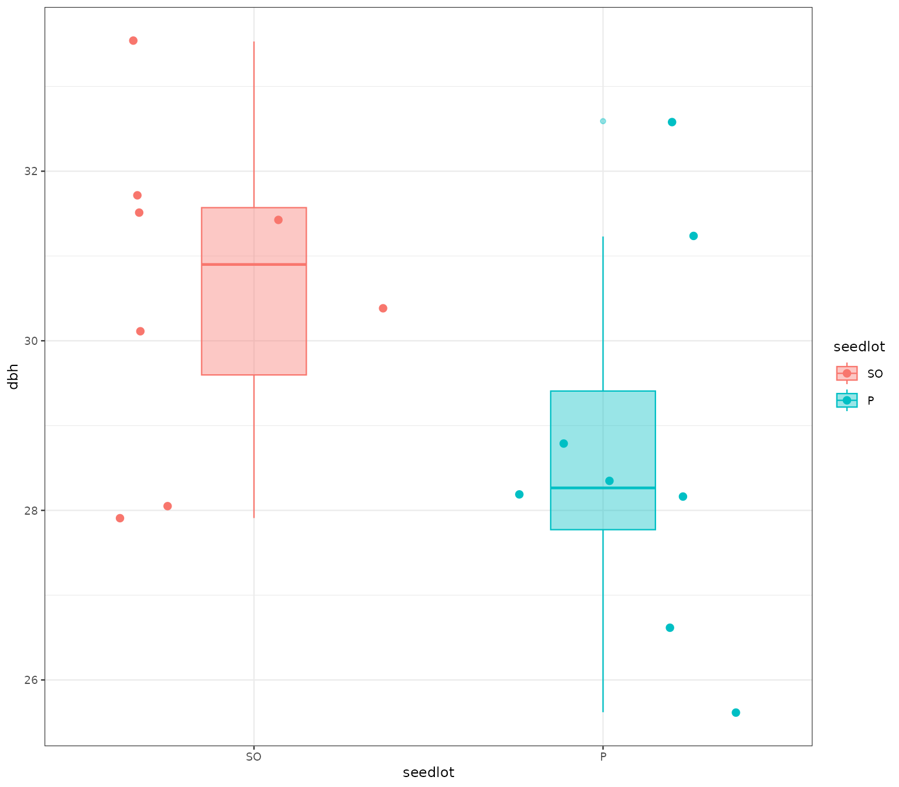

### Modelling

- Model
- Residual Plot
- Test

``` r

fmtab2.3 <- lm(formula = dbh ~ seedlot , data = DataExam2.1)
summary(fmtab2.3)
```

    ## 
    ## Call:
    ## lm(formula = dbh ~ seedlot, data = DataExam2.1)
    ## 
    ## Residuals:
    ##     Min      1Q  Median      3Q     Max 
    ## -3.0725 -0.9200 -0.2769  0.9887  3.8975 
    ## 
    ## Coefficients:
    ##             Estimate Std. Error t value Pr(>|t|)    
    ## (Intercept)  30.5813     0.7405  41.300 4.98e-16 ***
    ## seedlotP     -1.8888     1.0472  -1.804   0.0928 .  
    ## ---
    ## Signif. codes:  0 '***' 0.001 '**' 0.01 '*' 0.05 '.' 0.1 ' ' 1
    ## 
    ## Residual standard error: 2.094 on 14 degrees of freedom
    ## Multiple R-squared:  0.1886, Adjusted R-squared:  0.1306 
    ## F-statistic: 3.253 on 1 and 14 DF,  p-value: 0.09284

``` r

residplot(fmtab2.3) 
```

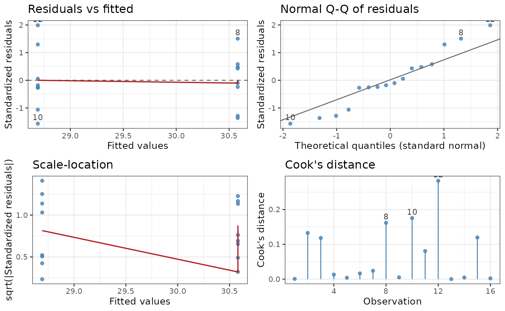

``` r

#perform shapiro-wilk test
shapiro.test(resid(fmtab2.3))
```

    ## 
    ##  Shapiro-Wilk normality test
    ## 
    ## data:  resid(fmtab2.3)
    ## W = 0.95485, p-value = 0.5701

``` r

#perform bartlett test
bartlett.test(dbh ~ seedlot , data = DataExam2.1)
```

    ## 
    ##  Bartlett test of homogeneity of variances
    ## 
    ## data:  dbh by seedlot
    ## Bartlett's K-squared = 0.20322, df = 1, p-value = 0.6521

``` r

#perform levene test 
car::leveneTest(dbh ~ seedlot , data = DataExam2.1)
```

    ## Levene's Test for Homogeneity of Variance (center = median)
    ##       Df F value Pr(>F)
    ## group  1  0.0135 0.9091
    ##       14

### ANOVA

``` r

kable(anova(fmtab2.3), digits = 4)
```

|           |  Df |  Sum Sq | Mean Sq | F value | Pr(\>F) |
|:----------|----:|--------:|--------:|--------:|--------:|
| seedlot   |   1 | 14.2695 | 14.2695 |  3.2531 |  0.0928 |
| Residuals |  14 | 61.4098 |  4.3864 |      NA |      NA |

### Predicted Means

- Mean Table
- Mean Plot

``` r

predm_out <- predictmeans(fmtab2.3, "seedlot", meandecr=TRUE, bar=TRUE, adj="BH", prtplt=FALSE)
print(predm_out[1:4])
```

    ## $`Predicted Means`
    ## seedlot
    ##      SO       P 
    ## 30.5813 28.6925 
    ## 
    ## $`Standard Error of Means`
    ## All means have the same SE 
    ##                    0.74047 
    ## 
    ## $`Standard Error of Differences`
    ##  Max.SED  Min.SED Aveg.SED 
    ## 1.047189 1.047189 1.047189 
    ## 
    ## $LSD
    ##  Max.LSD  Min.LSD Aveg.LSD 
    ##    2.246    2.246    2.246 
    ## attr(,"Significant level")
    ## [1] 0.05
    ## attr(,"Degree of freedom")
    ## [1] 14

``` r

gt(predm_out$mean_table$Table, 
   caption = "Group: Letter-based representation of pairwise comparisons at significant level '0.05'")
```

| seedlot | Mean    | SE      | Df  | LL(95%) | UL(95%) | LetterGrp |
|---------|---------|---------|-----|---------|---------|-----------|
| SO      | 30.5813 | 0.74047 | 14  | 28.9931 | 32.1694 | A         |
| P       | 28.6925 | 0.74047 | 14  | 27.1043 | 30.2807 | A         |

Group: Letter-based representation of pairwise comparisons at
significant level '0.05' {.table .gt_table
quarto-disable-processing="false" quarto-bootstrap="false"}

``` r

predm_out$predictmeansPlot$meanPlot
```


``` r

predm_out$predictmeansPlot$ciPlot
```

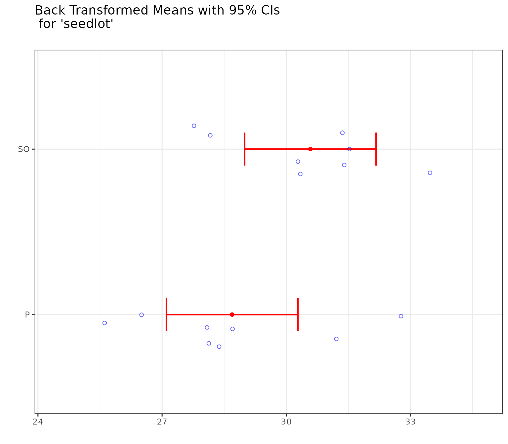

``` r

predm_out$predictmeansBarPlot
```

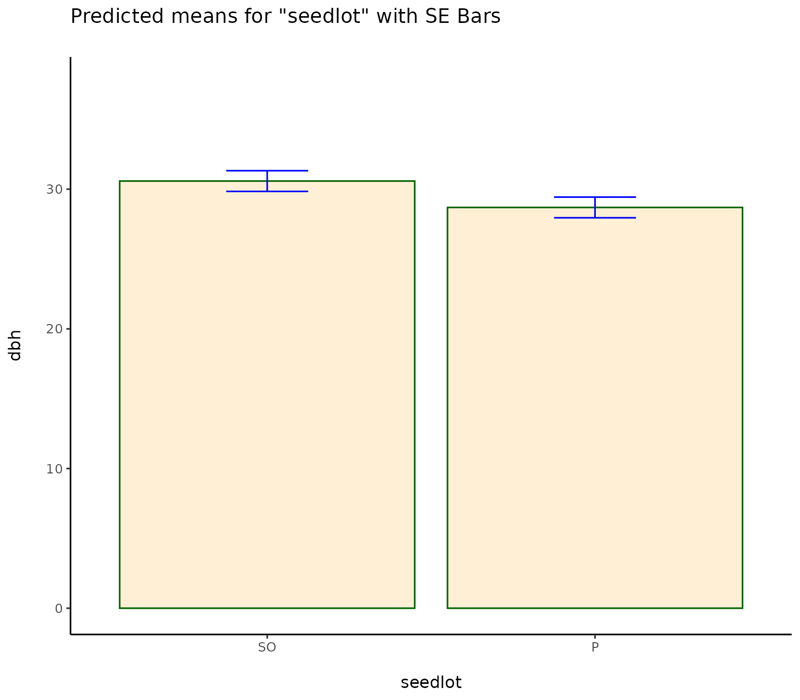

## **2.2 Example 2.2 (Pg. 26)**

### Data Info

- Structure
- Summary
- Plot

``` r

data(DataExam2.2, package="eda4treeR")
str(DataExam2.2)
```

    ## 'data.frame':    16 obs. of  4 variables:
    ##  $ repl   : Factor w/ 2 levels "1","2": 1 2 1 2 1 2 1 2 1 2 ...
    ##  $ block  : Factor w/ 8 levels "1","2","3","4",..: 1 1 2 2 3 3 4 4 5 5 ...
    ##  $ seedlot: Factor w/ 2 levels "SO","P": 1 2 1 2 2 1 1 2 2 1 ...
    ##  $ dbh    : num  30.4 28.2 27.9 25.6 26.6 ...

``` r

print(dfSummary(DataExam2.2, 
                varnumbers   = FALSE, 
                valid.col    = FALSE, 
                graph.magnif = 0.76),
      method = 'render')
```

### Data Frame Summary

#### DataExam2.2

**Dimensions**: 16 x 4  
**Duplicates**: 0  

[TABLE]

Generated by [summarytools](https://github.com/dcomtois/summarytools)
1.1.5 ([R](https://www.r-project.org/) version 4.6.2)  
2026-11-12

``` r

DataExam2.2 %>% 
  ggplot(aes(x=seedlot, y=dbh, col=seedlot, fill=seedlot))+
  geom_boxplot(width=0.3, alpha=0.4)+
  geom_jitter(size=2)+
  theme_bw(9)
```

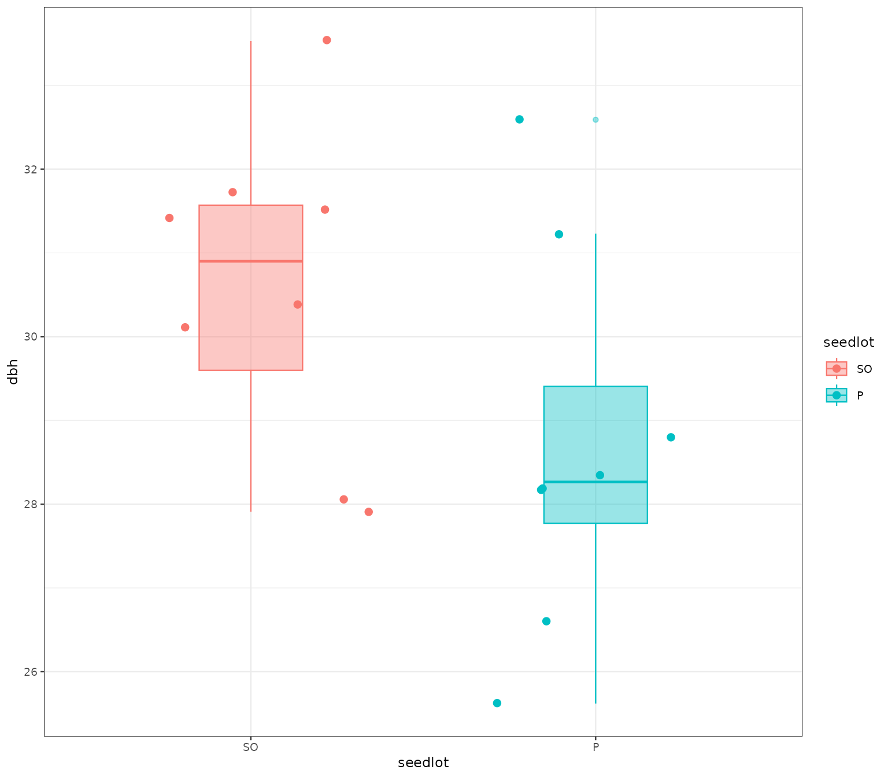

### Modelling

- Model
- Residual Plot
- Test

``` r

fmtab2.5 <- lm(dbh ~ block + seedlot, data = DataExam2.2)
summary(fmtab2.5)
```

    ## 
    ## Call:
    ## lm(formula = dbh ~ block + seedlot, data = DataExam2.2)
    ## 
    ## Residuals:
    ##     Min      1Q  Median      3Q     Max 
    ## -1.6506 -0.3919  0.0000  0.3919  1.6506 
    ## 
    ## Coefficients:
    ##             Estimate Std. Error t value Pr(>|t|)    
    ## (Intercept)  30.2144     1.0040  30.095 1.15e-08 ***
    ## block2       -2.5050     1.3386  -1.871   0.1035    
    ## block3       -1.9350     1.3386  -1.446   0.1915    
    ## block4        2.7350     1.3386   2.043   0.0803 .  
    ## block5        0.1850     1.3386   0.138   0.8940    
    ## block6        0.5850     1.3386   0.437   0.6753    
    ## block7        2.2050     1.3386   1.647   0.1435    
    ## block8        1.6650     1.3386   1.244   0.2536    
    ## seedlotP     -1.8888     0.6693  -2.822   0.0257 *  
    ## ---
    ## Signif. codes:  0 '***' 0.001 '**' 0.01 '*' 0.05 '.' 0.1 ' ' 1
    ## 
    ## Residual standard error: 1.339 on 7 degrees of freedom
    ## Multiple R-squared:  0.8343, Adjusted R-squared:  0.6448 
    ## F-statistic: 4.404 on 8 and 7 DF,  p-value: 0.03296

``` r

residplot(fmtab2.5) 
```

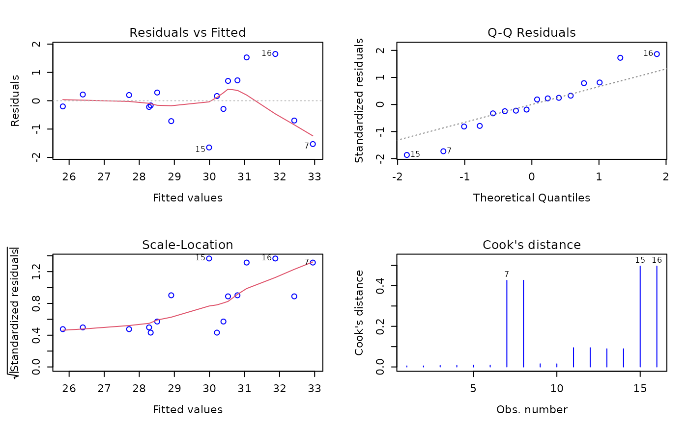

``` r

#perform shapiro-wilk test
shapiro.test(resid(fmtab2.5))
```

    ## 
    ##  Shapiro-Wilk normality test
    ## 
    ## data:  resid(fmtab2.5)
    ## W = 0.95925, p-value = 0.6482

``` r

#perform bartlett test
bartlett.test(dbh ~ seedlot, data = DataExam2.2)
```

    ## 
    ##  Bartlett test of homogeneity of variances
    ## 
    ## data:  dbh by seedlot
    ## Bartlett's K-squared = 0.20322, df = 1, p-value = 0.6521

``` r

#perform levene test
car::leveneTest(dbh ~ seedlot, data = DataExam2.2)
```

    ## Levene's Test for Homogeneity of Variance (center = median)
    ##       Df F value Pr(>F)
    ## group  1  0.0135 0.9091
    ##       14

### ANOVA

``` r

kable(anova(fmtab2.5), digits = 4)
```

|           |  Df |  Sum Sq | Mean Sq | F value | Pr(\>F) |
|:----------|----:|--------:|--------:|--------:|--------:|
| block     |   7 | 48.8668 |  6.9810 |  3.8959 |  0.0467 |
| seedlot   |   1 | 14.2695 | 14.2695 |  7.9635 |  0.0257 |
| Residuals |   7 | 12.5430 |  1.7919 |      NA |      NA |

### Predicted Means

- Mean Table
- Mean Plot

``` r

predm_out <- predictmeans(fmtab2.5, "seedlot", adj="BH", bar=TRUE, prtplt=FALSE)
print(predm_out[1:4])
```

    ## $`Predicted Means`
    ## seedlot
    ##      SO       P 
    ## 30.5813 28.6925 
    ## 
    ## $`Standard Error of Means`
    ## All means have the same SE 
    ##                    0.47327 
    ## 
    ## $`Standard Error of Differences`
    ##   Max.SED   Min.SED  Aveg.SED 
    ## 0.6693025 0.6693025 0.6693025 
    ## 
    ## $LSD
    ##  Max.LSD  Min.LSD Aveg.LSD 
    ##  1.58265  1.58265  1.58265 
    ## attr(,"Significant level")
    ## [1] 0.05
    ## attr(,"Degree of freedom")
    ## [1] 7

``` r

gt(predm_out$mean_table$Table, 
   caption = "Group: Letter-based representation of pairwise comparisons at significant level '0.05'")
```

| seedlot | Mean    | SE      | Df  | LL(95%) | UL(95%) | LetterGrp |
|---------|---------|---------|-----|---------|---------|-----------|
| SO      | 30.5813 | 0.47327 | 7   | 29.4621 | 31.7004 | A         |
| P       | 28.6925 | 0.47327 | 7   | 27.5734 | 29.8116 | B         |

Group: Letter-based representation of pairwise comparisons at
significant level '0.05' {.table .gt_table
quarto-disable-processing="false" quarto-bootstrap="false"}

``` r

predm_out$predictmeansPlot$meanPlot
```

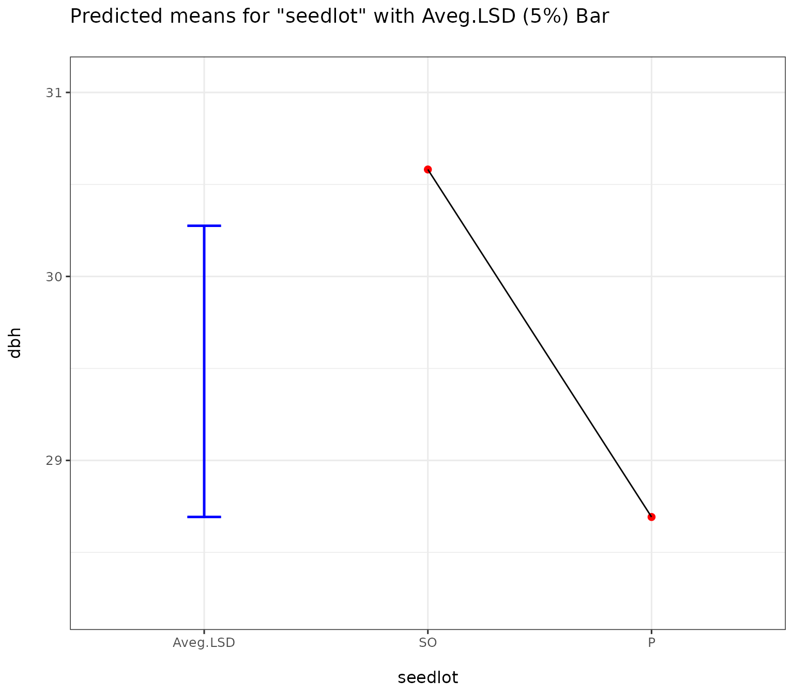

``` r

predm_out$predictmeansPlot$ciPlot
```

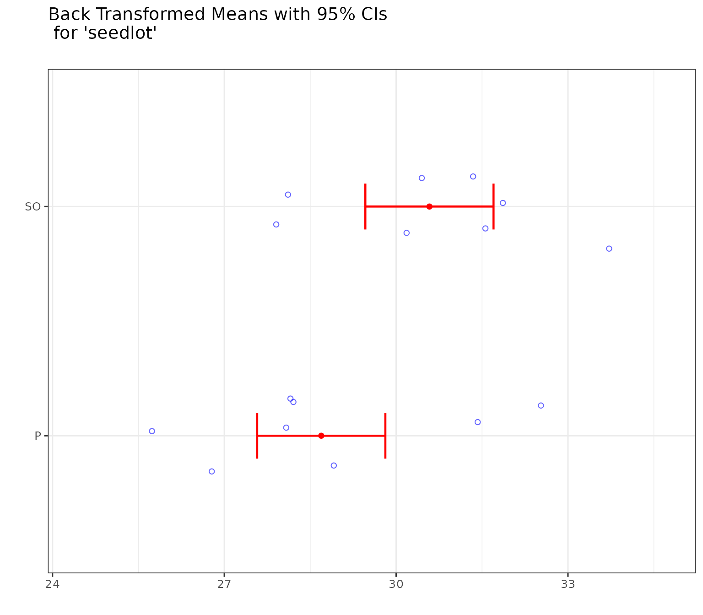

``` r

predm_out$predictmeansBarPlot
```

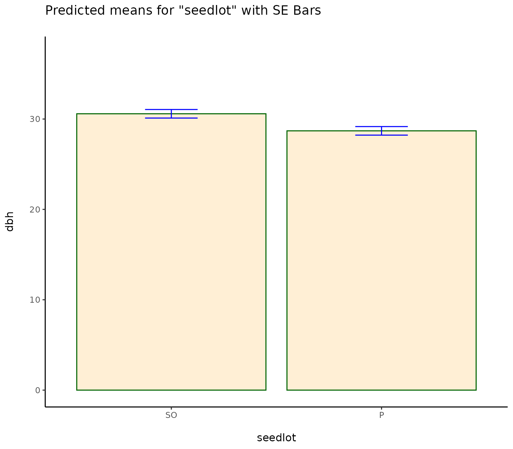

## **3.1 Example 3.1 (Pg. 30)**

We illustrate the recommended layout for data sheets with one of the
trials conducted by the Australian Centre for International Agricultural
Research (ACIAR) in Queensland, Australia (Experiment 309). This was a
species trial planted in 1985; survival was poor. For our example we
will examine only part of the data from this experiment. Five of the
species with good survival have been extracted at random, namely Acacia,
Angophora, Casuarina, Melaleuca and Petalostigma.

### Data Info

- Structure
- Summary

``` r

data(DataExam3.1, package="eda4treeR")
str(DataExam3.1)
```

    ## 'data.frame':    80 obs. of  6 variables:
    ##  $ repl   : Factor w/ 2 levels "1","2": 1 1 1 1 1 1 1 1 1 1 ...
    ##  $ PlotNo : Factor w/ 5 levels "1","2","3","4",..: 1 1 1 1 1 1 1 1 2 2 ...
    ##  $ TreeNo : Factor w/ 8 levels "1","2","3","4",..: 1 2 3 4 5 6 7 8 1 2 ...
    ##  $ seedlot: Factor w/ 5 levels "Acacia","Angophora",..: 4 4 4 4 4 4 4 4 3 3 ...
    ##  $ ht     : num  5.6 5.8 4.9 4 5.6 5.3 5.5 6.9 4.8 4.5 ...
    ##  $ dgl    : num  20.2 20.9 13.2 14.7 23.4 13.3 18.2 21.2 12.9 9.6 ...

``` r

print(dfSummary(DataExam3.1, 
                varnumbers   = FALSE, 
                valid.col    = FALSE, 
                graph.magnif = 0.76),
      method = 'render')
```

### Data Frame Summary

#### DataExam3.1

**Dimensions**: 80 x 6  
**Duplicates**: 0  

[TABLE]

Generated by [summarytools](https://github.com/dcomtois/summarytools)
1.1.5 ([R](https://www.r-project.org/) version 4.6.2)  
2026-11-12

### Modelling

- Model
- Residual Plot

``` r

fmtab3.3 <- aov(ht ~ Error(repl/PlotNo)+seedlot, data = DataExam3.1)
summary(fmtab3.3)
```

    ## 
    ## Error: repl
    ##           Df Sum Sq Mean Sq F value Pr(>F)
    ## Residuals  1   20.3    20.3               
    ## 
    ## Error: repl:PlotNo
    ##           Df Sum Sq Mean Sq F value  Pr(>F)   
    ## seedlot    4  505.9  126.47    21.3 0.00585 **
    ## Residuals  4   23.7    5.94                   
    ## ---
    ## Signif. codes:  0 '***' 0.001 '**' 0.01 '*' 0.05 '.' 0.1 ' ' 1
    ## 
    ## Error: Within
    ##           Df Sum Sq Mean Sq F value Pr(>F)
    ## Residuals 70  175.6   2.509

``` r

residplot(fmtab3.3) 
```

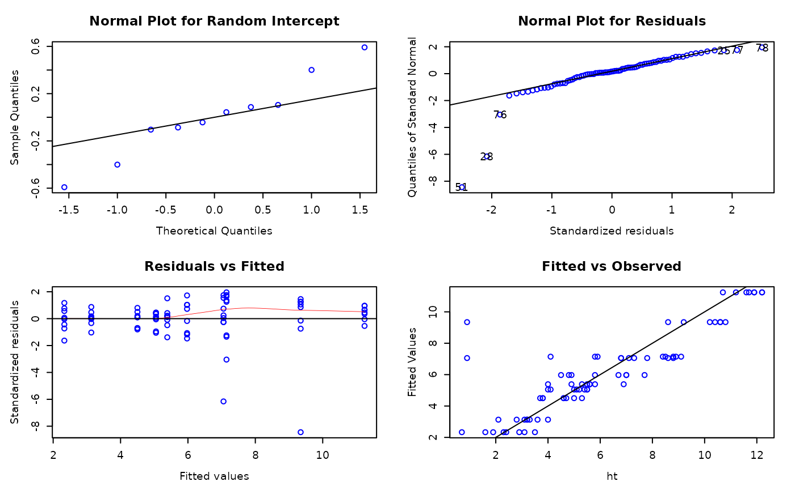

### Predicted Means

- Mean Table
- Mean Plot

- Mean

``` r

predm_out <- predictmeans(fmtab3.3, "seedlot", adj="BH", bar=TRUE, prtplt=FALSE)
print(predm_out[1:4])
```

    ## $`Predicted Means`
    ## seedlot
    ##       Acacia    Angophora    Casuarina    Melaleuca Petalostigma 
    ##      10.2938       7.1000       5.5125       4.9437       2.7312 
    ## 
    ## $`Standard Error of Means`
    ## All means have the same SE 
    ##                    0.74201 
    ## 
    ## $`Standard Error of Differences`
    ##   Max.SED   Min.SED  Aveg.SED 
    ## 0.8614261 0.8614261 0.8614261 
    ## 
    ## $LSD
    ##  Max.LSD  Min.LSD Aveg.LSD 
    ##   2.3917   2.3917   2.3917 
    ## attr(,"Significant level")
    ## [1] 0.05
    ## attr(,"Degree of freedom")
    ## [1] 4

``` r

gt(predm_out$mean_table$Table, 
   caption = "Group: Letter-based representation of pairwise comparisons at significant level '0.05'")
```

| seedlot      | Mean    | SE      | Df   | LL(95%) | UL(95%) | LetterGrp |
|--------------|---------|---------|------|---------|---------|-----------|
| Acacia       | 10.2938 | 0.74201 | 3.51 | 8.1151  | 12.4724 | A         |
| Angophora    | 7.1000  | 0.74201 | 3.51 | 4.9213  | 9.2787  | B         |
| Casuarina    | 5.5125  | 0.74201 | 3.51 | 3.3338  | 7.6912  | BC        |
| Melaleuca    | 4.9437  | 0.74201 | 3.51 | 2.7651  | 7.1224  | BC        |
| Petalostigma | 2.7312  | 0.74201 | 3.51 | 0.5526  | 4.9099  | C         |

Group: Letter-based representation of pairwise comparisons at
significant level '0.05' {.table .gt_table
quarto-disable-processing="false" quarto-bootstrap="false"}

- Pairwise p-values

``` r

gt(data.frame(predm_out$`Pairwise p-value`, check.names=FALSE), 
   rownames_to_stub=TRUE, 
   caption = "The matrix has t-value above the diagonal, p-value (adjusted by 'BH' method) below the diagonal") %>% 
  cols_width(everything() ~ px(130))
```

|              | Acacia | Angophora | Casuarina | Melaleuca | Petalostigma |
|--------------|--------|-----------|-----------|-----------|--------------|
| Acacia       | 1.0000 | 3.7075    | 5.5504    | 6.2106    | 8.7790       |
| Angophora    | 0.0414 | 1.0000    | 1.8429    | 2.5031    | 5.0715       |
| Casuarina    | 0.0172 | 0.1546    | 1.0000    | 0.6602    | 3.2287       |
| Melaleuca    | 0.0171 | 0.0832    | 0.5452    | 1.0000    | 2.5684       |
| Petalostigma | 0.0093 | 0.0178    | 0.0534    | 0.0832    | 1.0000       |

The matrix has t-value above the diagonal, p-value (adjusted by 'BH'
method) below the diagonal {.table .gt_table
style="table-layout:fixed;width:0px;" quarto-disable-processing="false"
quarto-bootstrap="false"}

``` r

predm_out$predictmeansPlot$meanPlot
```


``` r

predm_out$predictmeansPlot$ciPlot
```

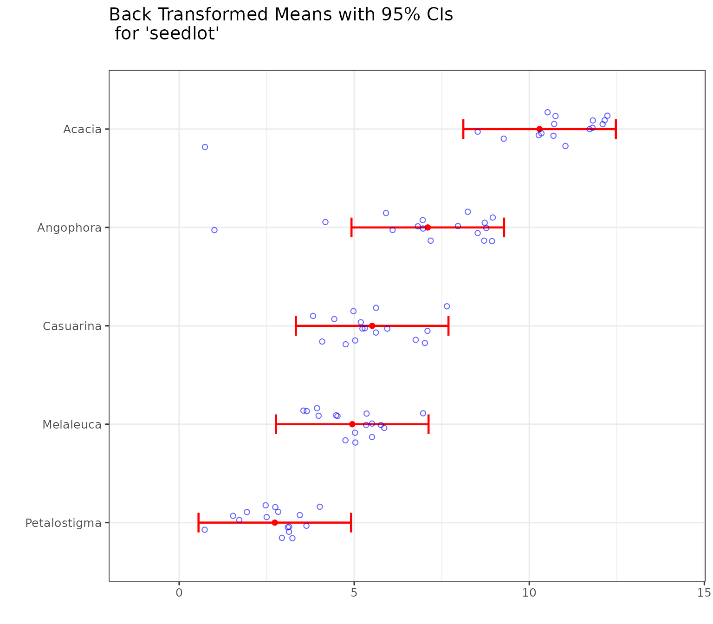

``` r

predm_out$predictmeansBarPlot
```


### Remove three outliers

- Outliers:

``` r

DataExam3.1[c(28, 51, 76), ] %>% 
  gt(rownames_to_stub=TRUE)
```

|     | repl | PlotNo | TreeNo | seedlot   | ht  | dgl |
|-----|------|--------|--------|-----------|-----|-----|
| 28  | 1    | 4      | 4      | Angophora | 0.9 | 4.2 |
| 51  | 2    | 2      | 3      | Acacia    | 0.9 | 1.7 |
| 76  | 2    | 5      | 4      | Angophora | 4.1 | 7.5 |

- Model:

``` r

fmtab3.3N <- aov(ht ~ Error(repl/PlotNo/TreeNo)+seedlot, data = DataExam3.1[-c(28, 51, 76), ])
summary(fmtab3.3N)
```

    ## 
    ## Error: repl
    ##         Df Sum Sq Mean Sq
    ## seedlot  1  18.88   18.88
    ## 
    ## Error: repl:PlotNo
    ##           Df Sum Sq Mean Sq F value  Pr(>F)    
    ## seedlot    4  588.7  147.17   81.24 0.00044 ***
    ## Residuals  4    7.2    1.81                    
    ## ---
    ## Signif. codes:  0 '***' 0.001 '**' 0.01 '*' 0.05 '.' 0.1 ' ' 1
    ## 
    ## Error: repl:PlotNo:TreeNo
    ##           Df Sum Sq Mean Sq F value Pr(>F)
    ## Residuals 67  50.23  0.7497

## **3.2 Example 3.1 (continued) (Pg. 39)**

### Data Info

The data in DataExam3.1 can be summarised to the plots level, we have

- Structure
- Summary

``` r

data(DataExam3.1.1, package="eda4treeR")
str(DataExam3.1.1)
```

    ## tibble [10 × 6] (S3: tbl_df/tbl/data.frame)
    ##  $ repl     : Factor w/ 2 levels "1","2": 1 1 1 1 1 2 2 2 2 2
    ##  $ PlotNo   : Factor w/ 5 levels "1","2","3","4",..: 1 2 3 4 5 1 2 3 4 5
    ##  $ seedlot  : Factor w/ 5 levels "Acacia","Angophora",..: 4 3 5 2 1 4 1 3 5 2
    ##  $ ht       : num [1:10] 5.45 6.05 3.16 6.76 11.67 ...
    ##  $ Var      : num [1:10] 0.671 1.471 0.311 6.197 0.262 ...
    ##  $ TreeCount: int [1:10] 8 8 8 8 8 8 8 8 8 8

``` r

print(dfSummary(DataExam3.1.1, 
                varnumbers   = FALSE, 
                valid.col    = FALSE, 
                graph.magnif = 0.76),
      method = 'render')
```

### Data Frame Summary

#### DataExam3.1.1

**Dimensions**: 10 x 6  
**Duplicates**: 0  

[TABLE]

Generated by [summarytools](https://github.com/dcomtois/summarytools)
1.1.5 ([R](https://www.r-project.org/) version 4.6.2)  
2026-11-12

### Modelling

- Model
- Residual Plot

``` r

fmtab3.8 <- aov(ht ~ Error(repl)+seedlot, data = DataExam3.1.1)
summary(fmtab3.8)
```

    ## 
    ## Error: repl
    ##           Df Sum Sq Mean Sq F value Pr(>F)
    ## Residuals  1  2.538   2.538               
    ## 
    ## Error: Within
    ##           Df Sum Sq Mean Sq F value  Pr(>F)   
    ## seedlot    4  63.23  15.808    21.3 0.00585 **
    ## Residuals  4   2.97   0.742                   
    ## ---
    ## Signif. codes:  0 '***' 0.001 '**' 0.01 '*' 0.05 '.' 0.1 ' ' 1

``` r

residplot(fmtab3.8) 
```

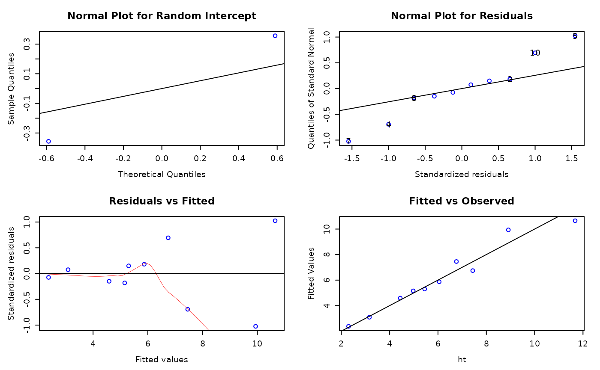

### Predicted Means

- Mean Table
- Mean Plot

- Mean

``` r

predm_out <- predictmeans(fmtab3.8, "seedlot", adj="BH", bar=TRUE, prtplt=FALSE)
print(predm_out[1:4])
```

    ## $`Predicted Means`
    ## seedlot
    ##       Acacia    Angophora    Casuarina    Melaleuca Petalostigma 
    ##      10.2938       7.1000       5.5125       4.9438       2.7313 
    ## 
    ## $`Standard Error of Means`
    ## All means have the same SE 
    ##                    0.74201 
    ## 
    ## $`Standard Error of Differences`
    ##  Max.SED  Min.SED Aveg.SED 
    ## 0.861426 0.861426 0.861426 
    ## 
    ## $LSD
    ##  Max.LSD  Min.LSD Aveg.LSD 
    ##   2.3917   2.3917   2.3917 
    ## attr(,"Significant level")
    ## [1] 0.05
    ## attr(,"Degree of freedom")
    ## [1] 4

``` r

gt(predm_out$mean_table$Table, 
   caption = "Group: Letter-based representation of pairwise comparisons at significant level '0.05'")
```

| seedlot      | Mean    | SE      | Df   | LL(95%) | UL(95%) | LetterGrp |
|--------------|---------|---------|------|---------|---------|-----------|
| Acacia       | 10.2938 | 0.74201 | 3.51 | 8.1151  | 12.4724 | A         |
| Angophora    | 7.1000  | 0.74201 | 3.51 | 4.9213  | 9.2787  | B         |
| Casuarina    | 5.5125  | 0.74201 | 3.51 | 3.3338  | 7.6912  | BC        |
| Melaleuca    | 4.9438  | 0.74201 | 3.51 | 2.7651  | 7.1224  | BC        |
| Petalostigma | 2.7313  | 0.74201 | 3.51 | 0.5526  | 4.9099  | C         |

Group: Letter-based representation of pairwise comparisons at
significant level '0.05' {.table .gt_table
quarto-disable-processing="false" quarto-bootstrap="false"}

- Pairwise p-values

``` r

gt(data.frame(predm_out$`Pairwise p-value`, check.names=FALSE), 
   rownames_to_stub=TRUE, 
   caption = "The matrix has t-value above the diagonal, p-value (adjusted by 'BH' method) below the diagonal") %>% 
  cols_width(everything() ~ px(130))
```

|              | Acacia | Angophora | Casuarina | Melaleuca | Petalostigma |
|--------------|--------|-----------|-----------|-----------|--------------|
| Acacia       | 1.0000 | 3.7075    | 5.5504    | 6.2106    | 8.7790       |
| Angophora    | 0.0414 | 1.0000    | 1.8429    | 2.5031    | 5.0715       |
| Casuarina    | 0.0172 | 0.1546    | 1.0000    | 0.6602    | 3.2287       |
| Melaleuca    | 0.0171 | 0.0832    | 0.5452    | 1.0000    | 2.5684       |
| Petalostigma | 0.0093 | 0.0178    | 0.0534    | 0.0832    | 1.0000       |

The matrix has t-value above the diagonal, p-value (adjusted by 'BH'
method) below the diagonal {.table .gt_table
style="table-layout:fixed;width:0px;" quarto-disable-processing="false"
quarto-bootstrap="false"}

``` r

predm_out$predictmeansPlot$meanPlot
```


``` r

predm_out$predictmeansPlot$ciPlot
```

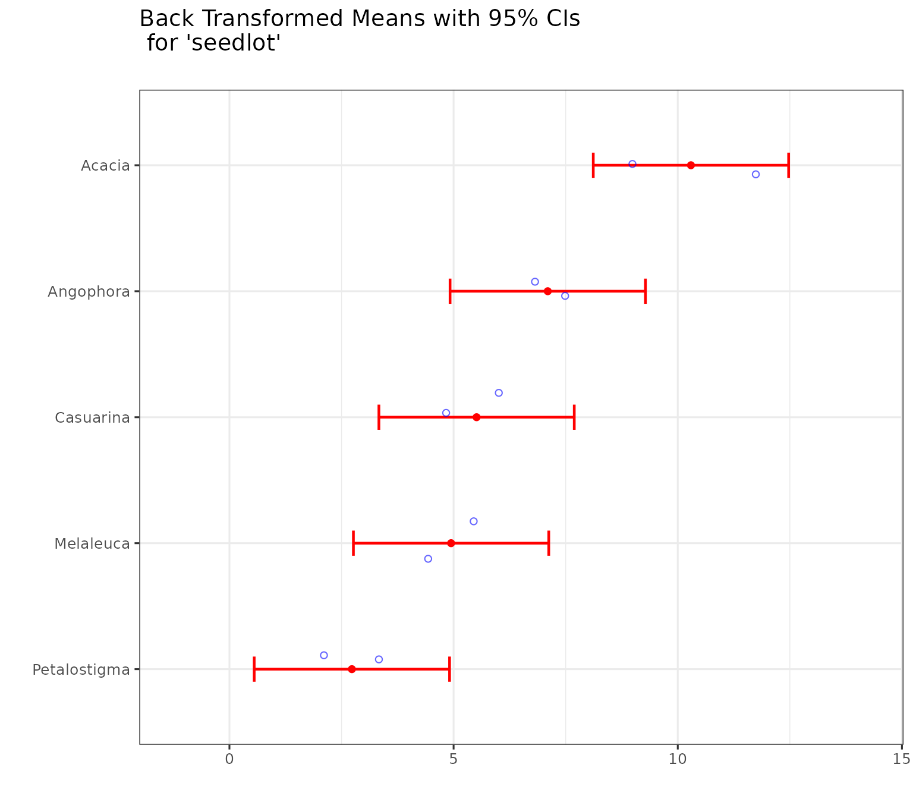

``` r

predm_out$predictmeansBarPlot
```

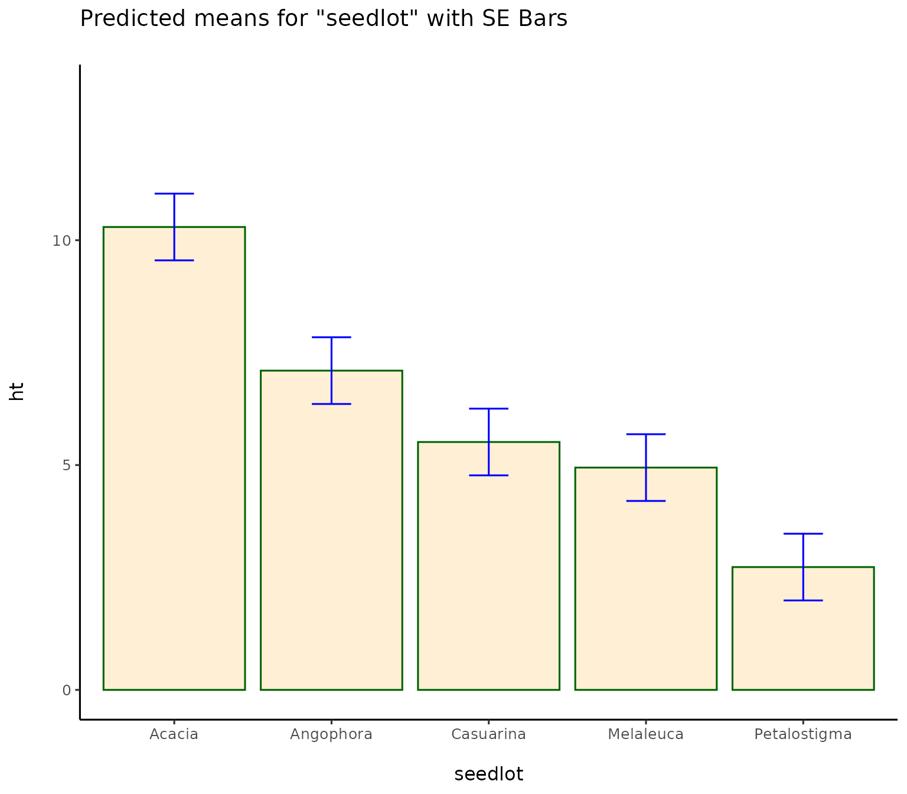

## **4.1 Example 4.3 (Pg. 53)**

### Data Info

Major seed distributors such as the Australian Tree Seed Centre (ATSC)
routinely conduct seed viability tests so that, when seed is dispatched,
the purchaser has an indication of the germination percentage of the
seed. As part of the ATSC research program, a series of experiments was
conducted in 1992 by Debbie Solomon on provenances of Acacia mangium to
investigate methods of pre-treatment and loss of viability of stored
seed. Each experiment involved six seedlots of Acacia mangium and four
seed pre-treatments in a factorial design with three replicates.

- Structure
- Summary

``` r

data(DataExam4.3, package="eda4treeR")
DataExam4.3$treat <- factor(DataExam4.3$treat, levels =c("control", "nick", "bw&s", "bw1min"))
DataExam4.3$contcomp <- factor(DataExam4.3$contcomp, levels = c("control", "Treated"))
str(DataExam4.3)
```

    ## 'data.frame':    72 obs. of  8 variables:
    ##  $ repl    : Factor w/ 3 levels "1","2","3": 1 1 1 1 1 1 1 1 1 1 ...
    ##  $ row     : Factor w/ 6 levels "1","2","3","4",..: 1 1 1 1 2 2 2 2 3 3 ...
    ##  $ column  : Factor w/ 4 levels "1","2","3","4": 1 2 3 4 1 2 3 4 1 2 ...
    ##  $ seedlot : Factor w/ 6 levels "18211","18212",..: 1 5 3 2 2 1 5 3 6 4 ...
    ##  $ treat   : Factor w/ 4 levels "control","nick",..: 2 3 1 4 1 4 2 3 4 1 ...
    ##  $ count   : num  15 17 2 23 0 24 18 10 24 0 ...
    ##  $ percent : num  60 68 8 92 0 96 72 40 96 0 ...
    ##  $ contcomp: Factor w/ 2 levels "control","Treated": 2 2 1 2 1 2 2 2 2 1 ...

``` r

print(dfSummary(DataExam4.3, 
                varnumbers   = FALSE, 
                valid.col    = FALSE, 
                graph.magnif = 0.76),
      method = 'render')
```

### Data Frame Summary

#### DataExam4.3

**Dimensions**: 72 x 8  
**Duplicates**: 0  

[TABLE]

Generated by [summarytools](https://github.com/dcomtois/summarytools)
1.1.5 ([R](https://www.r-project.org/) version 4.6.2)  
2026-11-12

### Modelling

- Model
- Residual Plot

``` r

fm4.2 <- aov(percent ~ repl + contcomp + seedlot +
               treat/contcomp + contcomp/seedlot + treat/contcomp/seedlot
             , data = DataExam4.3)
kable(anova(fm4.2), digits = 4) 
```

|                        |  Df |     Sum Sq |    Mean Sq |  F value | Pr(\>F) |
|:-----------------------|----:|-----------:|-----------:|---------:|--------:|
| repl                   |   2 |    35.1111 |    17.5556 |   0.1804 |  0.8355 |
| contcomp               |   1 | 58542.2963 | 58542.2963 | 601.5217 |  0.0000 |
| seedlot                |   5 |  2894.4444 |   578.8889 |   5.9481 |  0.0003 |
| treat                  |   2 |  5300.1481 |  2650.0741 |  27.2295 |  0.0000 |
| contcomp:seedlot       |   5 |  1347.0370 |   269.4074 |   2.7682 |  0.0288 |
| contcomp:seedlot:treat |  10 |   961.1852 |    96.1185 |   0.9876 |  0.4675 |
| Residuals              |  46 |  4476.8889 |    97.3237 |       NA |      NA |

``` r

residplot(fm4.2) 
```

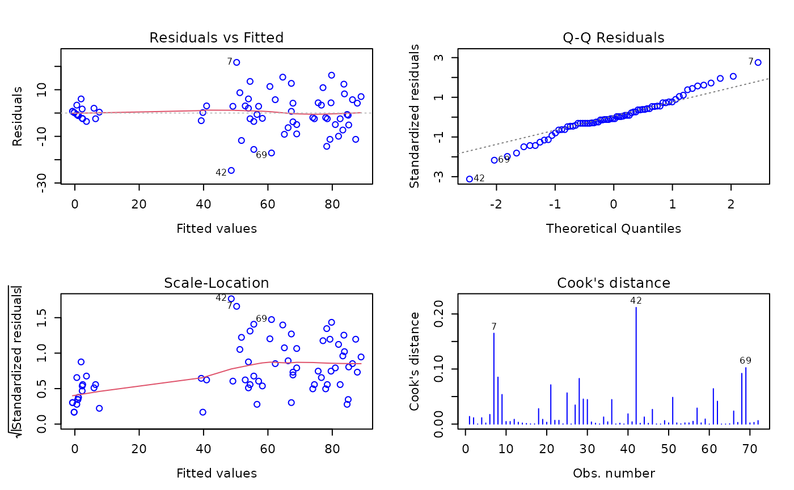

### Predicted Means

- contcomp

&nbsp;

- Mean Table
- Mean Plot
- Mean Table
- Mean Plot
- Mean Table
- Mean Plot
- Mean Table
- Mean Plot
- Mean Table
- Mean Plot

``` r

predm_out <- predictmeans(fm4.2, "contcomp", adj="BH", bar=TRUE, prtplt=FALSE)
print(predm_out[1:4])
```

    ## $`Predicted Means`
    ## contcomp
    ## control Treated 
    ##  2.0000 67.8519 
    ## 
    ## $`Standard Error of Means`
    ## contcomp
    ## control Treated 
    ## 2.32527 1.34249 
    ## 
    ## $`Standard Error of Differences`
    ##  Max.SED  Min.SED Aveg.SED 
    ## 2.684988 2.684988 2.684988 
    ## 
    ## $LSD
    ##  Max.LSD  Min.LSD Aveg.LSD 
    ##   5.4046   5.4046   5.4046 
    ## attr(,"Significant level")
    ## [1] 0.05
    ## attr(,"Degree of freedom")
    ## [1] 46

``` r

gt(predm_out$mean_table$Table, 
   caption = "Group: Letter-based representation of pairwise comparisons at significant level '0.05'")
```

| contcomp | Mean    | SE      | Df  | LL(95%) | UL(95%) | LetterGrp |
|----------|---------|---------|-----|---------|---------|-----------|
| control  | 2.0000  | 2.32527 | 46  | -2.6805 | 6.6805  | A         |
| Treated  | 67.8519 | 1.34249 | 46  | 65.1496 | 70.5542 | B         |

Group: Letter-based representation of pairwise comparisons at
significant level '0.05' {.table .gt_table
quarto-disable-processing="false" quarto-bootstrap="false"}

``` r

predm_out$predictmeansPlot$meanPlot
```

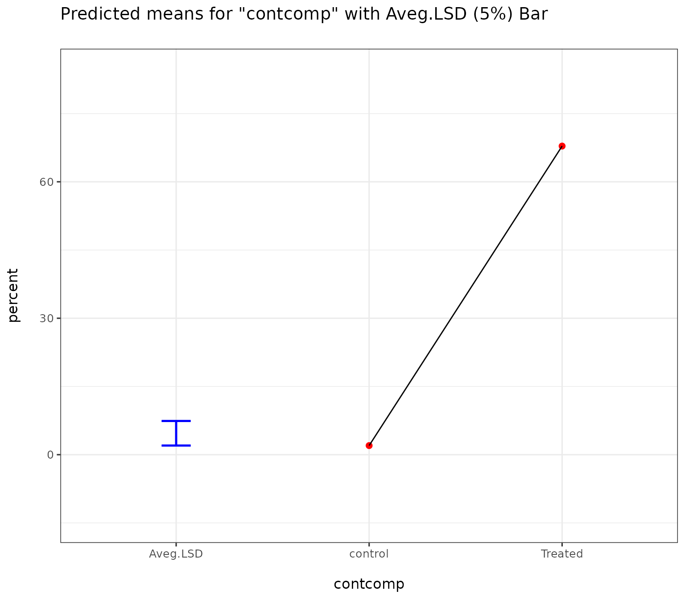

``` r

predm_out$predictmeansPlot$ciPlot
```

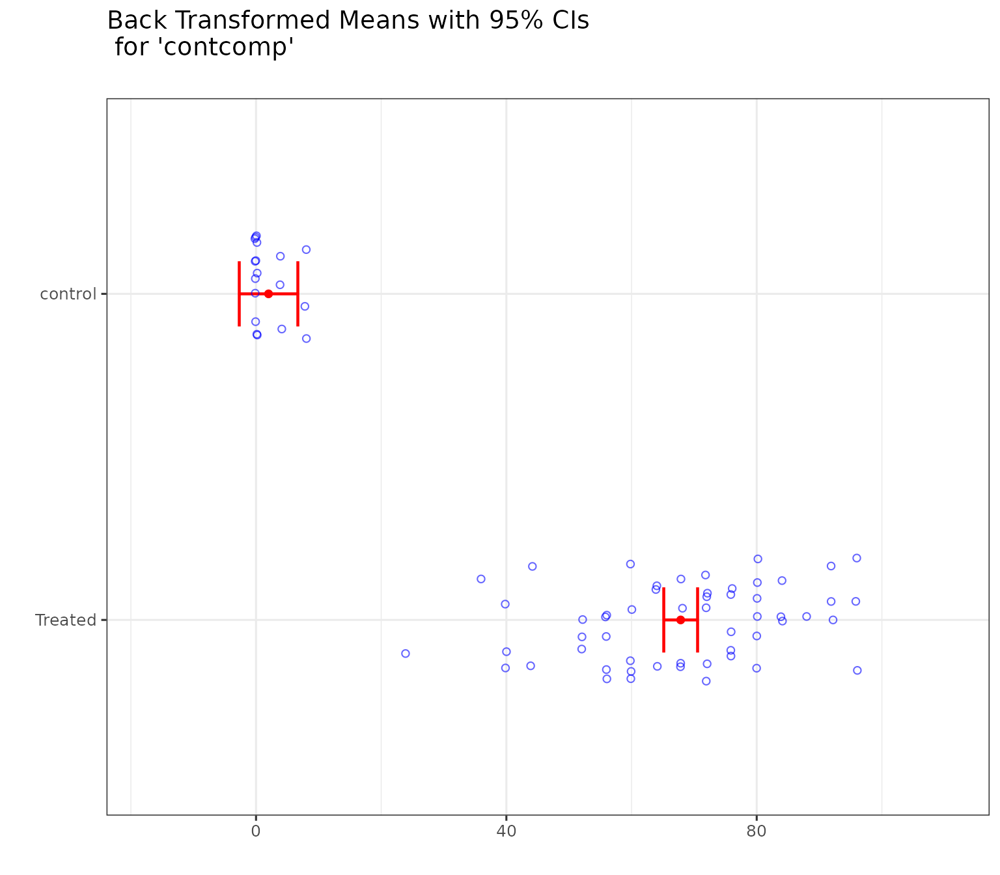

``` r

predm_out$predictmeansBarPlot
```

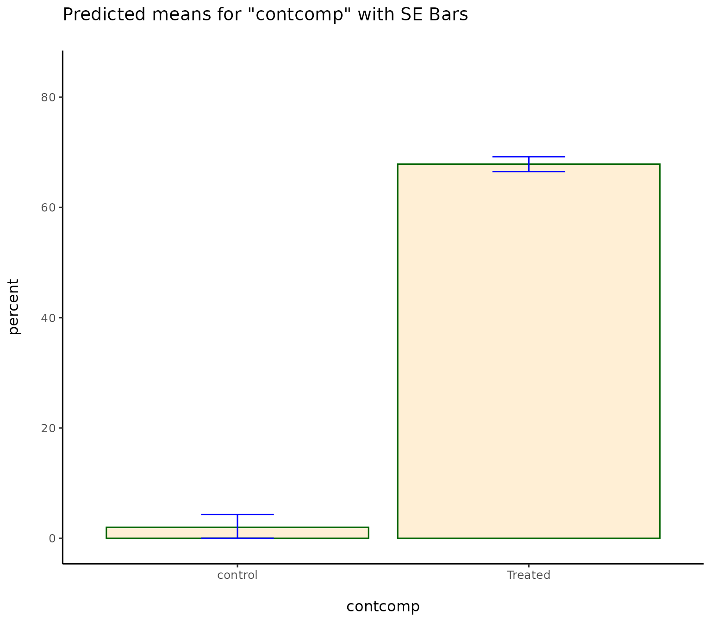

- seedlot

- Mean

``` r

predm_out <- predictmeans(fm4.2, "seedlot", adj="BH", bar=TRUE, prtplt=FALSE)
print(predm_out[1:4])
```

    ## $`Predicted Means`
    ## seedlot
    ##   18211   18212   18217   18248   18249   18265 
    ## 58.0000 52.3333 49.0000 40.6667 48.6667 59.6667 
    ## 
    ## $`Standard Error of Means`
    ## All means have the same SE 
    ##                    2.84786 
    ## 
    ## $`Standard Error of Differences`
    ##  Max.SED  Min.SED Aveg.SED 
    ## 4.027482 4.027482 4.027482 
    ## 
    ## $LSD
    ##  Max.LSD  Min.LSD Aveg.LSD 
    ##   8.1069   8.1069   8.1069 
    ## attr(,"Significant level")
    ## [1] 0.05
    ## attr(,"Degree of freedom")
    ## [1] 46

``` r

gt(predm_out$mean_table$Table, 
   caption = "Group: Letter-based representation of pairwise comparisons at significant level '0.05'")
```

| seedlot | Mean    | SE      | Df  | LL(95%) | UL(95%) | LetterGrp |
|---------|---------|---------|-----|---------|---------|-----------|
| 18211   | 58.0000 | 2.84786 | 46  | 52.2676 | 63.7324 | AB        |
| 18212   | 52.3333 | 2.84786 | 46  | 46.6009 | 58.0658 | AB        |
| 18217   | 49.0000 | 2.84786 | 46  | 43.2676 | 54.7324 | A C       |
| 18248   | 40.6667 | 2.84786 | 46  | 34.9342 | 46.3991 | C         |
| 18249   | 48.6667 | 2.84786 | 46  | 42.9342 | 54.3991 | A C       |
| 18265   | 59.6667 | 2.84786 | 46  | 53.9342 | 65.3991 | B         |

Group: Letter-based representation of pairwise comparisons at
significant level '0.05' {.table .gt_table
quarto-disable-processing="false" quarto-bootstrap="false"}

- Pairwise p-values

``` r

gt(data.frame(predm_out$`Pairwise p-value`, check.names=FALSE), 
   rownames_to_stub=TRUE, 
   caption = "The matrix has t-value above the diagonal, p-value (adjusted by 'BH' method) below the diagonal") %>% 
  cols_width(everything() ~ px(100))
```

|       | 18211  | 18212  | 18217  | 18248  | 18249   | 18265   |
|-------|--------|--------|--------|--------|---------|---------|
| 18211 | 1.0000 | 1.4070 | 2.2346 | 4.3038 | 2.3174  | -0.4138 |
| 18212 | 0.2266 | 1.0000 | 0.8276 | 2.8968 | 0.9104  | -1.8208 |
| 18217 | 0.0650 | 0.4756 | 1.0000 | 2.0691 | 0.0828  | -2.6485 |
| 18248 | 0.0007 | 0.0288 | 0.0828 | 1.0000 | -1.9864 | -4.7176 |
| 18249 | 0.0625 | 0.4592 | 0.9344 | 0.0883 | 1.0000  | -2.7312 |
| 18265 | 0.7296 | 0.1127 | 0.0331 | 0.0003 | 0.0331  | 1.0000  |

The matrix has t-value above the diagonal, p-value (adjusted by 'BH'
method) below the diagonal {.table .gt_table
style="table-layout:fixed;width:0px;" quarto-disable-processing="false"
quarto-bootstrap="false"}

``` r

predm_out$predictmeansPlot$meanPlot
```

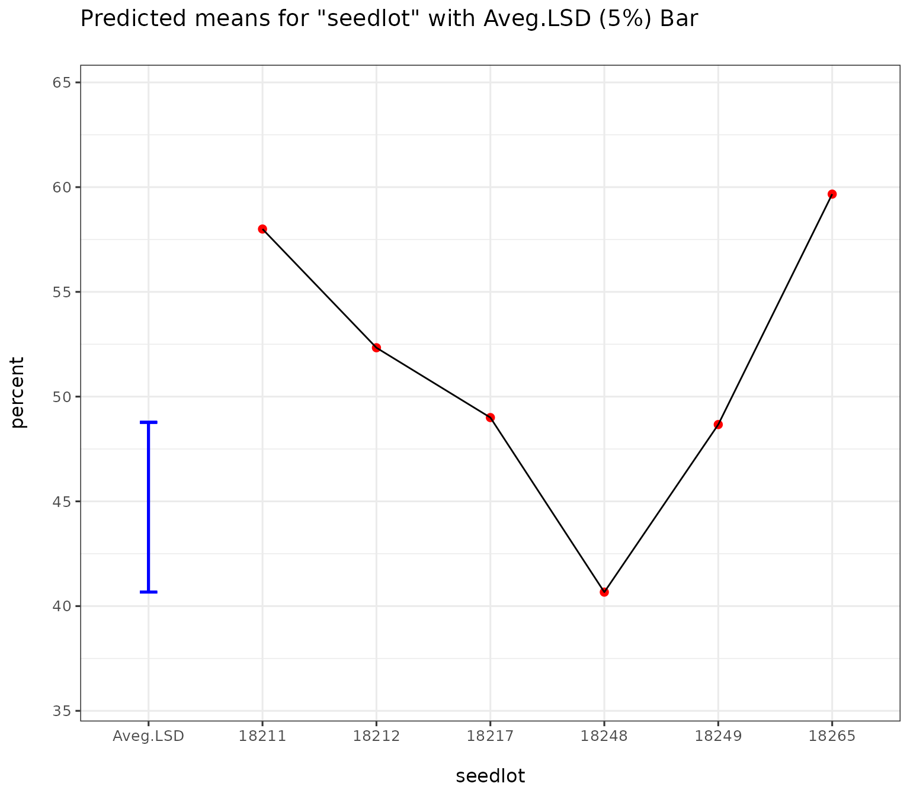

``` r

predm_out$predictmeansPlot$ciPlot
```

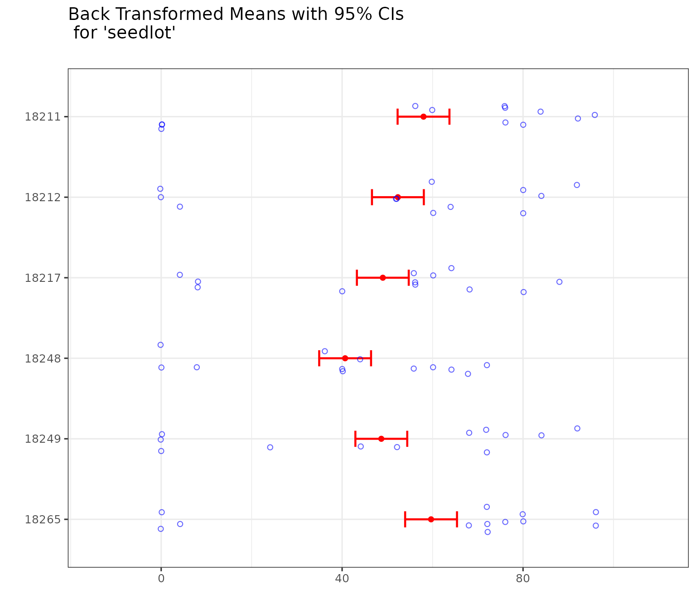

``` r

predm_out$predictmeansBarPlot
```

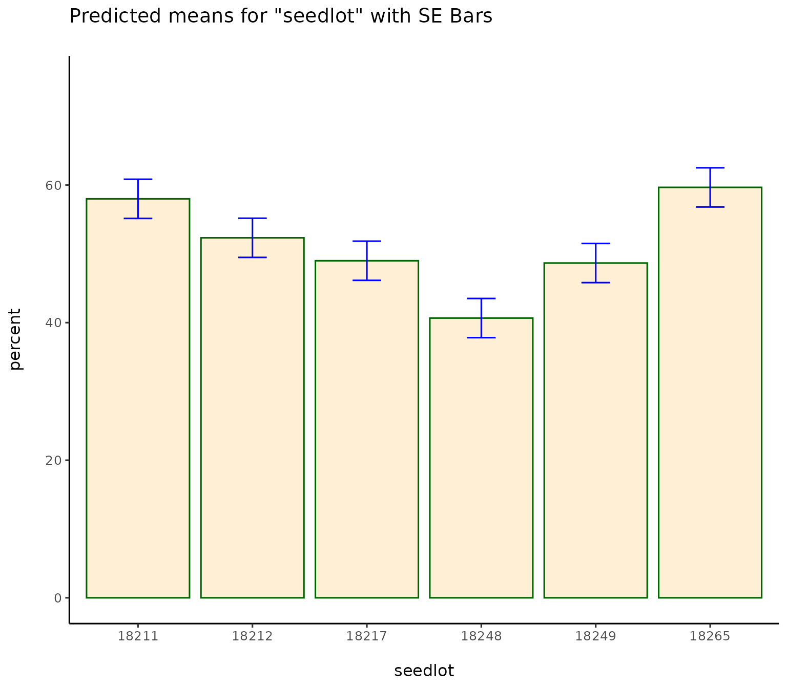

- treat/contcomp (treat)

- Mean

``` r

predm_out <- predictmeans(fm4.2, "treat", adj="BH", bar=TRUE, prtplt=FALSE)
print(predm_out[1:4])
```

    ## $`Predicted Means`
    ## treat
    ## control    nick    bw&s  bw1min 
    ##  2.0000 56.8889 65.7778 80.8889 
    ## 
    ## $`Standard Error of Means`
    ## All means have the same SE 
    ##                    2.32527 
    ## 
    ## $`Standard Error of Differences`
    ##  Max.SED  Min.SED Aveg.SED 
    ## 3.288425 3.288425 3.288425 
    ## 
    ## $LSD
    ##  Max.LSD  Min.LSD Aveg.LSD 
    ##  6.61926  6.61926  6.61926 
    ## attr(,"Significant level")
    ## [1] 0.05
    ## attr(,"Degree of freedom")
    ## [1] 46

``` r

gt(predm_out$mean_table$Table, 
   caption = "Group: Letter-based representation of pairwise comparisons at significant level '0.05'")
```

| treat   | Mean    | SE      | Df  | LL(95%) | UL(95%) | LetterGrp |
|---------|---------|---------|-----|---------|---------|-----------|
| control | 2.0000  | 2.32527 | 46  | -2.6805 | 6.6805  | A         |
| nick    | 56.8889 | 2.32527 | 46  | 52.2084 | 61.5694 | B         |
| bw&s    | 65.7778 | 2.32527 | 46  | 61.0973 | 70.4583 | C         |
| bw1min  | 80.8889 | 2.32527 | 46  | 76.2084 | 85.5694 | D         |

Group: Letter-based representation of pairwise comparisons at
significant level '0.05' {.table .gt_table
quarto-disable-processing="false" quarto-bootstrap="false"}

- Pairwise p-values

``` r

gt(data.frame(predm_out$`Pairwise p-value`, check.names=FALSE), 
   rownames_to_stub=TRUE, 
   caption = "The matrix has t-value above the diagonal, p-value (adjusted by 'BH' method) below the diagonal") %>% 
  cols_width(everything() ~ px(80))
```

|         | control | nick     | bw&s     | bw1min   |
|---------|---------|----------|----------|----------|
| control | 1       | -16.6915 | -19.3946 | -23.9899 |
| nick    | 0       | 1.0000   | -2.7031  | -7.2983  |
| bw&s    | 0       | 0.0096   | 1.0000   | -4.5952  |
| bw1min  | 0       | 0.0000   | 0.0000   | 1.0000   |

The matrix has t-value above the diagonal, p-value (adjusted by 'BH'
method) below the diagonal {.table .gt_table
style="table-layout:fixed;width:0px;" quarto-disable-processing="false"
quarto-bootstrap="false"}

``` r

predm_out$predictmeansPlot$meanPlot
```

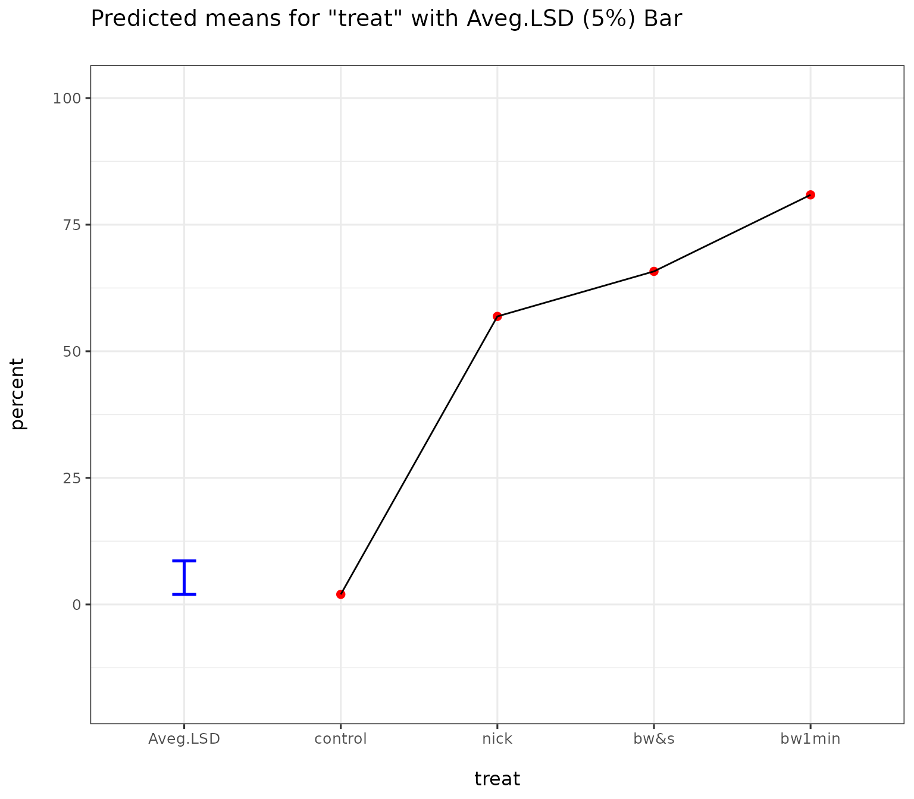

``` r

predm_out$predictmeansPlot$ciPlot
```

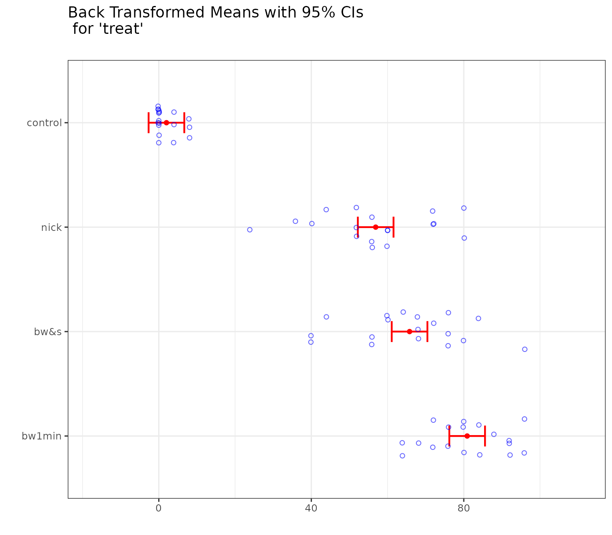

``` r

predm_out$predictmeansBarPlot
```

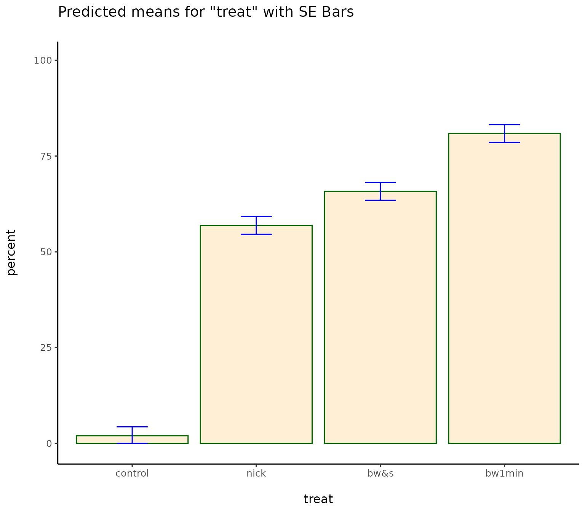

- contcomp/seedlot

- Mean

``` r

predm_out <- predictmeans(fm4.2, "contcomp:seedlot", atvar="contcomp", adj="BH", lineplot=FALSE, bar=TRUE, prtplt=FALSE)
print(predm_out[1:4])
```

    ## $`Predicted Means`
    ##         contcomp control Treated
    ## seedlot                         
    ## 18211             0.0000 77.3333
    ## 18212             1.3333 69.3333
    ## 18217             6.6667 63.1111
    ## 18248             2.6667 53.3333
    ## 18249             0.0000 64.8889
    ## 18265             1.3333 79.1111
    ## 
    ## $`Standard Error of Means`
    ##         contcomp control Treated
    ## seedlot                         
    ## 18211            5.69572 3.28843
    ## 18212            5.69572 3.28843
    ## 18217            5.69572 3.28843
    ## 18248            5.69572 3.28843
    ## 18249            5.69572 3.28843
    ## 18265            5.69572 3.28843
    ## 
    ## $`Standard Error of Differences`
    ##  Max.SED  Min.SED Aveg.SED 
    ## 8.054964 4.650536 6.474987 
    ## attr(,"For the Same Level of Factor")
    ##          contcomp  seedlot
    ## Aveg.SED 6.352750 6.576851
    ## Min.SED  4.650536 6.576851
    ## Max.SED  8.054964 6.576851
    ## 
    ## $LSD
    ##  Max.LSD  Min.LSD Aveg.LSD 
    ## 16.21380  9.36104 13.03347 
    ## attr(,"For the Same Level of Factor")
    ##          contcomp  seedlot
    ## Aveg.LSD 12.78742 13.23851
    ## Min.LSD   9.36104 13.23851
    ## Max.LSD  16.21380 13.23851
    ## attr(,"Significant level")
    ## [1] 0.05
    ## attr(,"Degree of freedom")
    ## [1] 46

``` r

gt(predm_out$mean_table$Table, groupname_col ="contcomp",
   caption = "Group: Letter-based representation of pairwise comparisons at significant level '0.05'")
```

| seedlot | Mean    | SE      | Df  | LL(95%)  | UL(95%) | LetterGrp |
|---------|---------|---------|-----|----------|---------|-----------|
| control |         |         |     |          |         |           |
| 18211   | 0.0000  | 5.69572 | 46  | -11.4649 | 11.4649 | A         |
| 18212   | 1.3333  | 5.69572 | 46  | -10.1316 | 12.7982 | A         |
| 18217   | 6.6667  | 5.69572 | 46  | -4.7982  | 18.1316 | A         |
| 18248   | 2.6667  | 5.69572 | 46  | -8.7982  | 14.1316 | A         |
| 18249   | 0.0000  | 5.69572 | 46  | -11.4649 | 11.4649 | A         |
| 18265   | 1.3333  | 5.69572 | 46  | -10.1316 | 12.7982 | A         |
| Treated |         |         |     |          |         |           |
| 18211   | 77.3333 | 3.28843 | 46  | 70.7141  | 83.9526 | A         |
| 18212   | 69.3333 | 3.28843 | 46  | 62.7141  | 75.9526 | AB        |
| 18217   | 63.1111 | 3.28843 | 46  | 56.4919  | 69.7304 | BC        |
| 18248   | 53.3333 | 3.28843 | 46  | 46.7141  | 59.9526 | C         |
| 18249   | 64.8889 | 3.28843 | 46  | 58.2696  | 71.5081 | B         |
| 18265   | 79.1111 | 3.28843 | 46  | 72.4919  | 85.7304 | A         |

Group: Letter-based representation of pairwise comparisons at
significant level '0.05' {.table .gt_table
quarto-disable-processing="false" quarto-bootstrap="false"}

- Pairwise p-values

``` r

for (i in 6:7){
  print(names(predm_out[i]))
  print(gt(as.data.frame.matrix(predm_out[[i]], check.names=FALSE), rownames_to_stub = TRUE))
}
```

\[1\] “control”

|       | 18211 | 18212 | 18217 | 18248 | 18249 | 18265 | Group |
|-------|-------|-------|-------|-------|-------|-------|-------|
| 18211 | 1     |       |       |       |       |       | A     |
| 18212 | 1     | 1     |       |       |       |       | A     |
| 18217 | 1     | 1     | 1     |       |       |       | A     |
| 18248 | 1     | 1     | 1     | 1     |       |       | A     |
| 18249 | 1     | 1     | 1     | 1     | 1     |       | A     |
| 18265 | 1     | 1     | 1     | 1     | 1     | 1     | A     |

\[1\] “Treated”

|       | 18211  | 18212  | 18217  | 18248  | 18249  | 18265 | Group |
|-------|--------|--------|--------|--------|--------|-------|-------|
| 18211 | 1      |        |        |        |        |       | A     |
| 18212 | 0.1256 | 1      |        |        |        |       | AB    |
| 18217 | 0.0093 | 0.2344 | 1      |        |        |       | BC    |
| 18248 | 0.0001 | 0.0047 | 0.0615 | 1      |        |       | C     |
| 18249 | 0.0221 | 0.3972 | 0.704  | 0.0312 | 1      |       | B     |
| 18265 | 0.704  | 0.0615 | 0.0047 | 0.0001 | 0.0093 | 1     | A     |

``` r

predm_out$predictmeansPlot$meanPlot
```


``` r

predm_out$predictmeansPlot$ciPlot
```

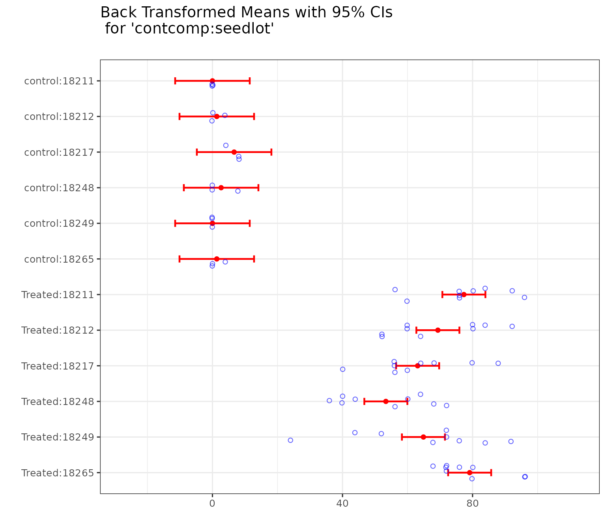

``` r

predm_out$predictmeansBarPlot
```

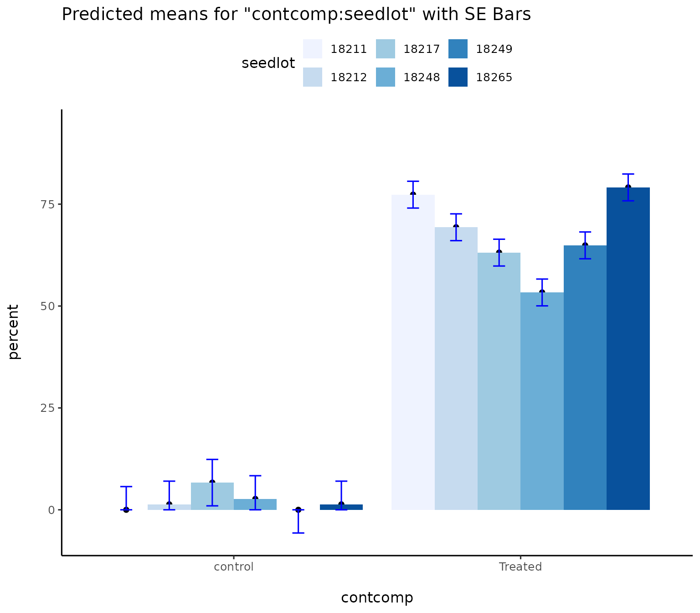

- treat/contcomp/seedlot

- Mean

``` r

predm_out <- predictmeans(fm4.2, "contcomp:seedlot:treat", atvar=c("treat", "contcomp"), adj="BH", lineplot=FALSE, bar=TRUE, prtplt=FALSE)
print(predm_out[1:4])
```

    ## $`Predicted Means`
    ##         contcomp control                         Treated                        
    ##         treat    control    nick    bw&s  bw1min control    nick    bw&s  bw1min
    ## seedlot                                                                         
    ## 18211             0.0000      NA      NA      NA      NA 65.3333 78.6667 88.0000
    ## 18212             1.3333      NA      NA      NA      NA 54.6667 68.0000 85.3333
    ## 18217             6.6667      NA      NA      NA      NA 57.3333 54.6667 77.3333
    ## 18248             2.6667      NA      NA      NA      NA 40.0000 52.0000 68.0000
    ## 18249             0.0000      NA      NA      NA      NA 49.3333 61.3333 84.0000
    ## 18265             1.3333      NA      NA      NA      NA 74.6667 80.0000 82.6667
    ## 
    ## $`Standard Error of Means`
    ## All means have the same SE 
    ##                    5.69572 
    ## 
    ## $`Standard Error of Differences`
    ##  Max.SED  Min.SED Aveg.SED 
    ## 8.054964 8.054964 8.054964 
    ## attr(,"For the Same Level of Factor")
    ##          contcomp  seedlot    treat
    ## Aveg.SED 8.054964 8.054964 8.054964
    ## Min.SED  8.054964 8.054964 8.054964
    ## Max.SED  8.054964 8.054964 8.054964
    ## 
    ## $LSD
    ##  Max.LSD  Min.LSD Aveg.LSD 
    ##  16.2138  16.2138  16.2138 
    ## attr(,"For the Same Level of Factor")
    ##          contcomp seedlot   treat
    ## Aveg.LSD  16.2138 16.2138 16.2138
    ## Min.LSD   16.2138 16.2138 16.2138
    ## Max.LSD   16.2138 16.2138 16.2138
    ## attr(,"Significant level")
    ## [1] 0.05
    ## attr(,"Degree of freedom")
    ## [1] 46

``` r

gt(predm_out$mean_table$Table, groupname_col ="treat",
   caption = "Group: Letter-based representation of pairwise comparisons at significant level '0.05'")
```

| contcomp | seedlot | Mean    | SE      | Df  | LL(95%)  | UL(95%) | LetterGrp |
|----------|---------|---------|---------|-----|----------|---------|-----------|
| control  |         |         |         |     |          |         |           |
| control  | 18211   | 0.0000  | 5.69572 | 46  | -11.4649 | 11.4649 | A         |
| control  | 18212   | 1.3333  | 5.69572 | 46  | -10.1316 | 12.7982 | A         |
| control  | 18217   | 6.6667  | 5.69572 | 46  | -4.7982  | 18.1316 | A         |
| control  | 18248   | 2.6667  | 5.69572 | 46  | -8.7982  | 14.1316 | A         |
| control  | 18249   | 0.0000  | 5.69572 | 46  | -11.4649 | 11.4649 | A         |
| control  | 18265   | 1.3333  | 5.69572 | 46  | -10.1316 | 12.7982 | A         |
| nick     |         |         |         |     |          |         |           |
| Treated  | 18211   | 65.3333 | 5.69572 | 46  | 53.8684  | 76.7982 | AB        |
| Treated  | 18212   | 54.6667 | 5.69572 | 46  | 43.2018  | 66.1316 | ABC       |
| Treated  | 18217   | 57.3333 | 5.69572 | 46  | 45.8684  | 68.7982 | ABC       |
| Treated  | 18248   | 40.0000 | 5.69572 | 46  | 28.5351  | 51.4649 | C         |
| Treated  | 18249   | 49.3333 | 5.69572 | 46  | 37.8684  | 60.7982 | A C       |
| Treated  | 18265   | 74.6667 | 5.69572 | 46  | 63.2018  | 86.1316 | B         |
| bw&s     |         |         |         |     |          |         |           |
| Treated  | 18211   | 78.6667 | 5.69572 | 46  | 67.2018  | 90.1316 | A         |
| Treated  | 18212   | 68.0000 | 5.69572 | 46  | 56.5351  | 79.4649 | AB        |
| Treated  | 18217   | 54.6667 | 5.69572 | 46  | 43.2018  | 66.1316 | B         |
| Treated  | 18248   | 52.0000 | 5.69572 | 46  | 40.5351  | 63.4649 | B         |
| Treated  | 18249   | 61.3333 | 5.69572 | 46  | 49.8684  | 72.7982 | AB        |
| Treated  | 18265   | 80.0000 | 5.69572 | 46  | 68.5351  | 91.4649 | A         |
| bw1min   |         |         |         |     |          |         |           |
| Treated  | 18211   | 88.0000 | 5.69572 | 46  | 76.5351  | 99.4649 | A         |
| Treated  | 18212   | 85.3333 | 5.69572 | 46  | 73.8684  | 96.7982 | A         |
| Treated  | 18217   | 77.3333 | 5.69572 | 46  | 65.8684  | 88.7982 | A         |
| Treated  | 18248   | 68.0000 | 5.69572 | 46  | 56.5351  | 79.4649 | A         |
| Treated  | 18249   | 84.0000 | 5.69572 | 46  | 72.5351  | 95.4649 | A         |
| Treated  | 18265   | 82.6667 | 5.69572 | 46  | 71.2018  | 94.1316 | A         |

Group: Letter-based representation of pairwise comparisons at
significant level '0.05' {.table .gt_table
quarto-disable-processing="false" quarto-bootstrap="false"}

- Pairwise p-values

``` r

for (i in c(6, 11:13)){
  print(names(predm_out[i]))
  print(gt(as.data.frame.matrix(predm_out[[i]], check.names=FALSE), rownames_to_stub = TRUE))
}
```

\[1\] “control : control”

|       | 18211 | 18212 | 18217 | 18248 | 18249 | 18265 | Group |
|-------|-------|-------|-------|-------|-------|-------|-------|
| 18211 | 1     |       |       |       |       |       | A     |
| 18212 | 1     | 1     |       |       |       |       | A     |
| 18217 | 1     | 1     | 1     |       |       |       | A     |
| 18248 | 1     | 1     | 1     | 1     |       |       | A     |
| 18249 | 1     | 1     | 1     | 1     | 1     |       | A     |
| 18265 | 1     | 1     | 1     | 1     | 1     | 1     | A     |

\[1\] “bw&s : Treated”

|       | 18211  | 18212  | 18217  | 18248  | 18249 | 18265 | Group |
|-------|--------|--------|--------|--------|-------|-------|-------|
| 18211 | 1      |        |        |        |       |       | A     |
| 18212 | 0.288  | 1      |        |        |       |       | AB    |
| 18217 | 0.0172 | 0.1963 | 1      |        |       |       | B     |
| 18248 | 0.0136 | 0.1135 | 0.7951 | 1      |       |       | B     |
| 18249 | 0.0917 | 0.4756 | 0.4756 | 0.3444 | 1     |       | AB    |
| 18265 | 0.8693 | 0.2385 | 0.0145 | 0.0136 | 0.075 | 1     | A     |

\[1\] “bw1min : control”

|       | 18211 | 18212 | 18217 | 18248 | 18249 | 18265 | Group |
|-------|-------|-------|-------|-------|-------|-------|-------|
| 18211 | 1     |       |       |       |       |       | NA    |
| 18212 | NA    | 1     |       |       |       |       | NA    |
| 18217 | NA    | NA    | 1     |       |       |       | NA    |
| 18248 | NA    | NA    | NA    | 1     |       |       | NA    |
| 18249 | NA    | NA    | NA    | NA    | 1     |       | NA    |
| 18265 | NA    | NA    | NA    | NA    | NA    | 1     | NA    |

\[1\] “bw1min : Treated”

|       | 18211  | 18212  | 18217  | 18248  | 18249  | 18265 | Group |
|-------|--------|--------|--------|--------|--------|-------|-------|
| 18211 | 1      |        |        |        |        |       | A     |
| 18212 | 0.8563 | 1      |        |        |        |       | A     |
| 18217 | 0.5759 | 0.6982 | 1      |        |        |       | A     |
| 18248 | 0.2511 | 0.2649 | 0.6314 | 1      |        |       | A     |
| 18249 | 0.848  | 0.8693 | 0.7668 | 0.2649 | 1      |       | A     |
| 18265 | 0.7668 | 0.8563 | 0.7668 | 0.2818 | 0.8693 | 1     | A     |

``` r

predm_out$predictmeansPlot$meanPlot
```

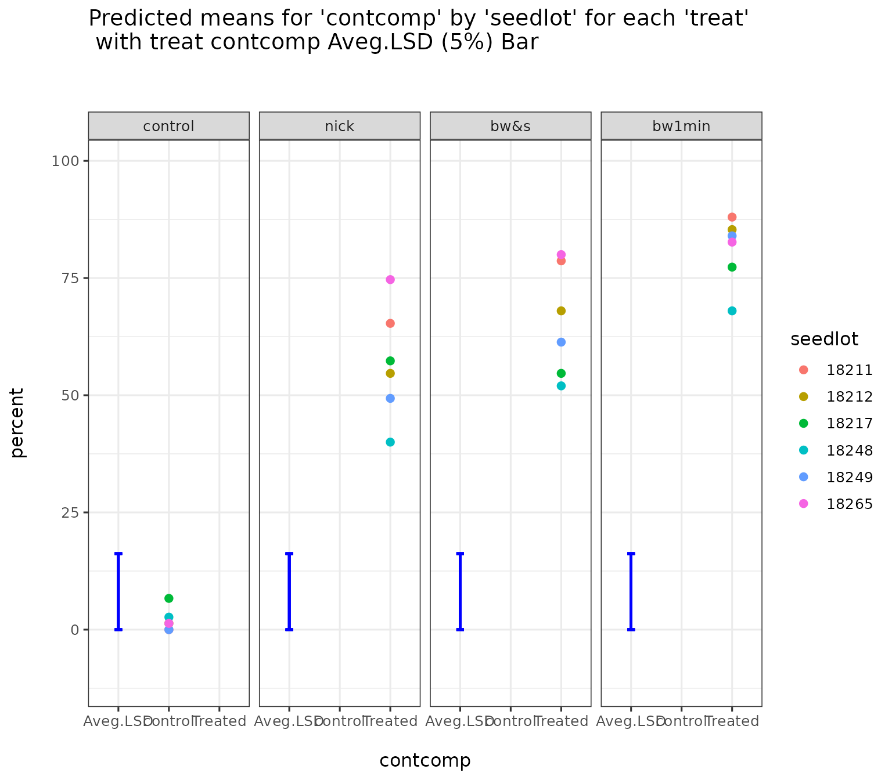

``` r

predm_out$predictmeansPlot$ciPlot
```

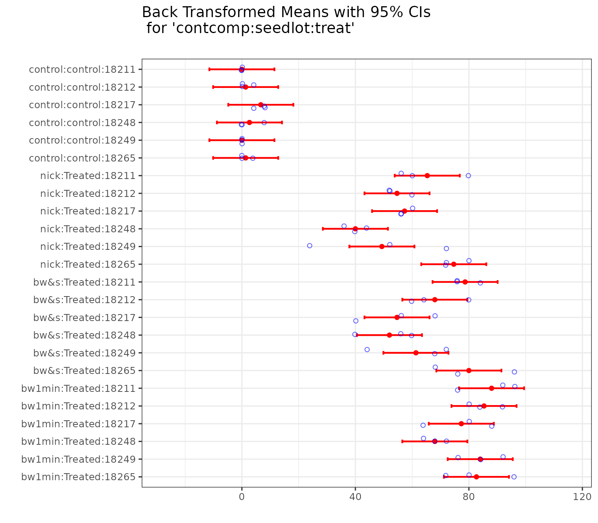

### Subset Data

``` r

DataExam4.3N <- DataExam4.3 %>%
  filter(treat != "control") %>% 
  droplevels()
str(DataExam4.3N)
```

    ## 'data.frame':    54 obs. of  8 variables:
    ##  $ repl    : Factor w/ 3 levels "1","2","3": 1 1 1 1 1 1 1 1 1 1 ...
    ##  $ row     : Factor w/ 6 levels "1","2","3","4",..: 1 1 1 2 2 2 3 3 3 4 ...
    ##  $ column  : Factor w/ 4 levels "1","2","3","4": 1 2 4 2 3 4 1 3 4 1 ...
    ##  $ seedlot : Factor w/ 6 levels "18211","18212",..: 1 5 2 1 5 3 6 2 6 4 ...
    ##  $ treat   : Factor w/ 3 levels "nick","bw&s",..: 1 2 3 3 1 2 3 1 2 2 ...
    ##  $ count   : num  15 17 23 24 18 10 24 13 19 14 ...
    ##  $ percent : num  60 68 92 96 72 40 96 52 76 56 ...
    ##  $ contcomp: Factor w/ 1 level "Treated": 1 1 1 1 1 1 1 1 1 1 ...

### Subset Modelling

- Model
- Residual Plot

``` r

fm4.4 <- aov(percent ~ repl + treat*seedlot, data = DataExam4.3N)
kable(anova(fm4.4), digits = 4) 
```

|               |  Df |    Sum Sq |   Mean Sq | F value | Pr(\>F) |
|:--------------|----:|----------:|----------:|--------:|--------:|
| repl          |   2 |   64.5926 |   32.2963 |  0.2511 |  0.7794 |
| treat         |   2 | 5300.1481 | 2650.0741 | 20.6055 |  0.0000 |
| seedlot       |   5 | 4148.1481 |  829.6296 |  6.4507 |  0.0003 |
| treat:seedlot |  10 |  961.1852 |   96.1185 |  0.7474 |  0.6760 |
| Residuals     |  34 | 4372.7407 |  128.6100 |      NA |      NA |

``` r

residplot(fm4.4) 
```

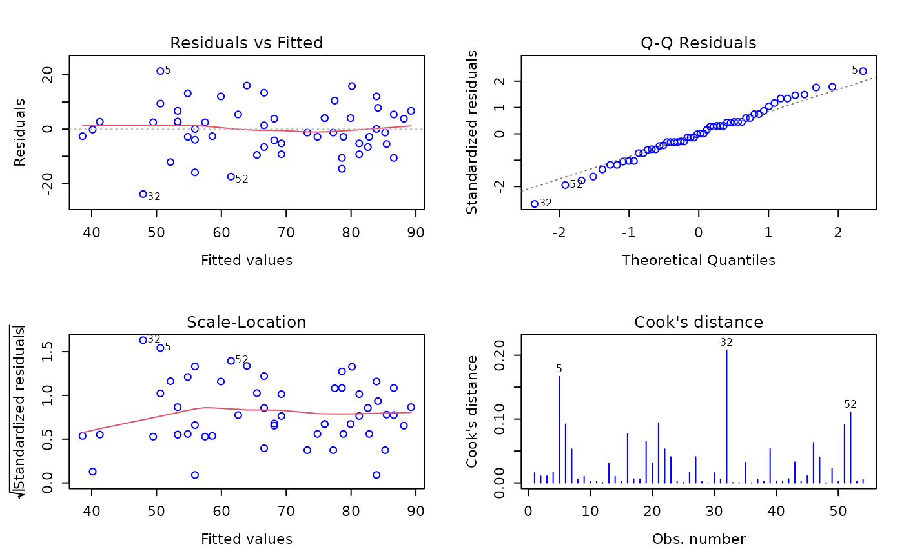

### Predicted Means

- treat

&nbsp;

- Mean Table
- p-value Table
- Mean Plot
- Mean Table
- p-value Table & Plot
- Mean Plot
- Mean Table
- p-value Table & Plot
- Mean Plot

``` r

predm_out <- predictmeans(fm4.4, "treat", adj="BH", lineplot = FALSE, bar=TRUE, prtplt=FALSE)
print(predm_out[1:4])
```

    ## $`Predicted Means`
    ## treat
    ##    nick    bw&s  bw1min 
    ## 56.8889 65.7778 80.8889 
    ## 
    ## $`Standard Error of Means`
    ## All means have the same SE 
    ##                    2.67301 
    ## 
    ## $`Standard Error of Differences`
    ##  Max.SED  Min.SED Aveg.SED 
    ## 3.780212 3.780212 3.780212 
    ## 
    ## $LSD
    ##  Max.LSD  Min.LSD Aveg.LSD 
    ##  7.68231  7.68231  7.68231 
    ## attr(,"Significant level")
    ## [1] 0.05
    ## attr(,"Degree of freedom")
    ## [1] 34

``` r

gt(predm_out$mean_table$Table, 
   caption = "Group: Letter-based representation of pairwise comparisons at significant level '0.05'")
```

| treat  | Mean    | SE      | Df  | LL(95%) | UL(95%) | LetterGrp |
|--------|---------|---------|-----|---------|---------|-----------|
| nick   | 56.8889 | 2.67301 | 34  | 51.4567 | 62.3211 | A         |
| bw&s   | 65.7778 | 2.67301 | 34  | 60.3456 | 71.2100 | B         |
| bw1min | 80.8889 | 2.67301 | 34  | 75.4567 | 86.3211 | C         |

Group: Letter-based representation of pairwise comparisons at
significant level '0.05' {.table .gt_table
quarto-disable-processing="false" quarto-bootstrap="false"}

``` r

gt(data.frame(predm_out$`Pairwise p-value`, check.names=FALSE), 
   rownames_to_stub=TRUE, 
   caption = "The matrix has t-value above the diagonal, p-value (adjusted by 'BH' method) below the diagonal") %>% 
  cols_width(everything() ~ px(80))
```

|        | nick   | bw&s    | bw1min  |
|--------|--------|---------|---------|
| nick   | 1.0000 | -2.3514 | -6.3489 |
| bw&s   | 0.0246 | 1.0000  | -3.9974 |
| bw1min | 0.0000 | 0.0005  | 1.0000  |

The matrix has t-value above the diagonal, p-value (adjusted by 'BH'
method) below the diagonal {.table .gt_table
style="table-layout:fixed;width:0px;" quarto-disable-processing="false"
quarto-bootstrap="false"}

``` r

predm_out$predictmeansPlot$meanPlot
```


``` r

predm_out$predictmeansPlot$ciPlot
```

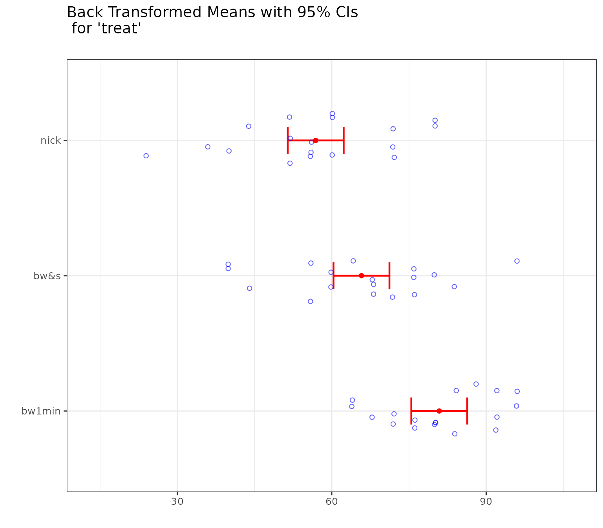

``` r

predm_out$predictmeansBarPlot
```

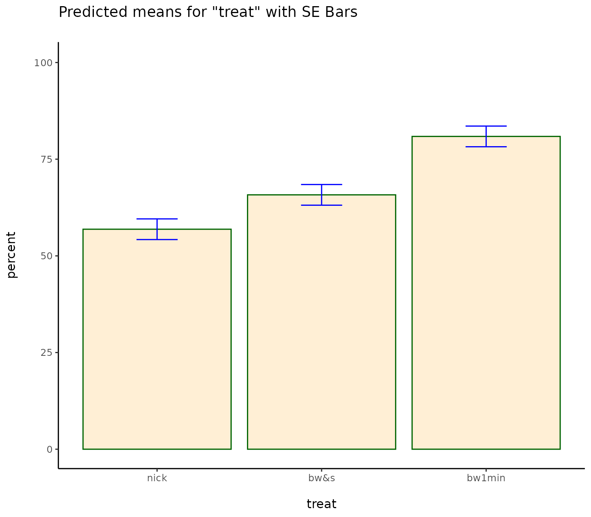

- seedlot

``` r

predm_out <- predictmeans(fm4.4, "seedlot", adj="BH", bar=TRUE, prtplt=FALSE)
print(predm_out[1:4])
```

    ## $`Predicted Means`
    ## seedlot
    ##   18211   18212   18217   18248   18249   18265 
    ## 77.3333 69.3333 63.1111 53.3333 64.8889 79.1111 
    ## 
    ## $`Standard Error of Means`
    ## All means have the same SE 
    ##                    3.78021 
    ## 
    ## $`Standard Error of Differences`
    ##  Max.SED  Min.SED Aveg.SED 
    ## 5.346027 5.346027 5.346027 
    ## 
    ## $LSD
    ##  Max.LSD  Min.LSD Aveg.LSD 
    ## 10.86443 10.86443 10.86443 
    ## attr(,"Significant level")
    ## [1] 0.05
    ## attr(,"Degree of freedom")
    ## [1] 34

``` r

gt(predm_out$mean_table$Table, 
   caption = "Group: Letter-based representation of pairwise comparisons at significant level '0.05'")
```

| seedlot | Mean    | SE      | Df  | LL(95%) | UL(95%) | LetterGrp |
|---------|---------|---------|-----|---------|---------|-----------|
| 18211   | 77.3333 | 3.78021 | 34  | 69.6510 | 85.0156 | AB        |
| 18212   | 69.3333 | 3.78021 | 34  | 61.6510 | 77.0156 | ABC       |
| 18217   | 63.1111 | 3.78021 | 34  | 55.4288 | 70.7934 | CD        |
| 18248   | 53.3333 | 3.78021 | 34  | 45.6510 | 61.0156 | D         |
| 18249   | 64.8889 | 3.78021 | 34  | 57.2066 | 72.5712 | A CD      |
| 18265   | 79.1111 | 3.78021 | 34  | 71.4288 | 86.7934 | B         |

Group: Letter-based representation of pairwise comparisons at
significant level '0.05' {.table .gt_table
quarto-disable-processing="false" quarto-bootstrap="false"}

``` r

gt(data.frame(predm_out$`Pairwise p-value`, check.names=FALSE), 
   rownames_to_stub=TRUE, 
   caption = "The matrix has t-value above the diagonal, p-value (adjusted by 'BH' method) below the diagonal") %>% 
  cols_width(everything() ~ px(80))
```

|       | 18211  | 18212  | 18217  | 18248  | 18249   | 18265   |
|-------|--------|--------|--------|--------|---------|---------|
| 18211 | 1.0000 | 1.4964 | 2.6603 | 4.4893 | 2.3278  | -0.3325 |
| 18212 | 0.1960 | 1.0000 | 1.1639 | 2.9929 | 0.8314  | -1.8290 |
| 18217 | 0.0296 | 0.3157 | 1.0000 | 1.8290 | -0.3325 | -2.9929 |
| 18248 | 0.0006 | 0.0192 | 0.1143 | 1.0000 | -2.1615 | -4.8219 |
| 18249 | 0.0557 | 0.4749 | 0.7415 | 0.0708 | 1.0000  | -2.6603 |
| 18265 | 0.7415 | 0.1143 | 0.0192 | 0.0004 | 0.0296  | 1.0000  |

The matrix has t-value above the diagonal, p-value (adjusted by 'BH'
method) below the diagonal {.table .gt_table
style="table-layout:fixed;width:0px;" quarto-disable-processing="false"
quarto-bootstrap="false"}

``` r

PMplot(predm_out$p_valueMatrix, newwd = FALSE)
```

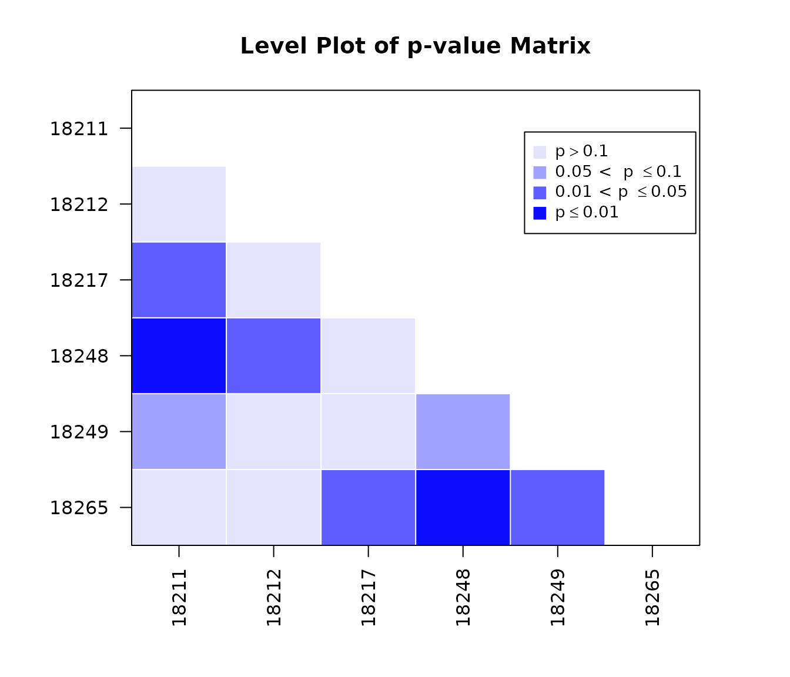

``` r

predm_out$predictmeansPlot$meanPlot
```

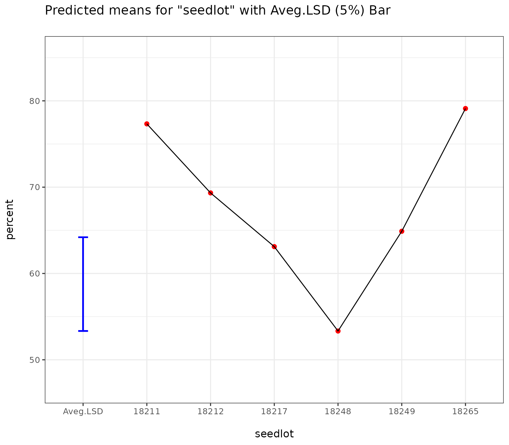

``` r

predm_out$predictmeansPlot$ciPlot
```

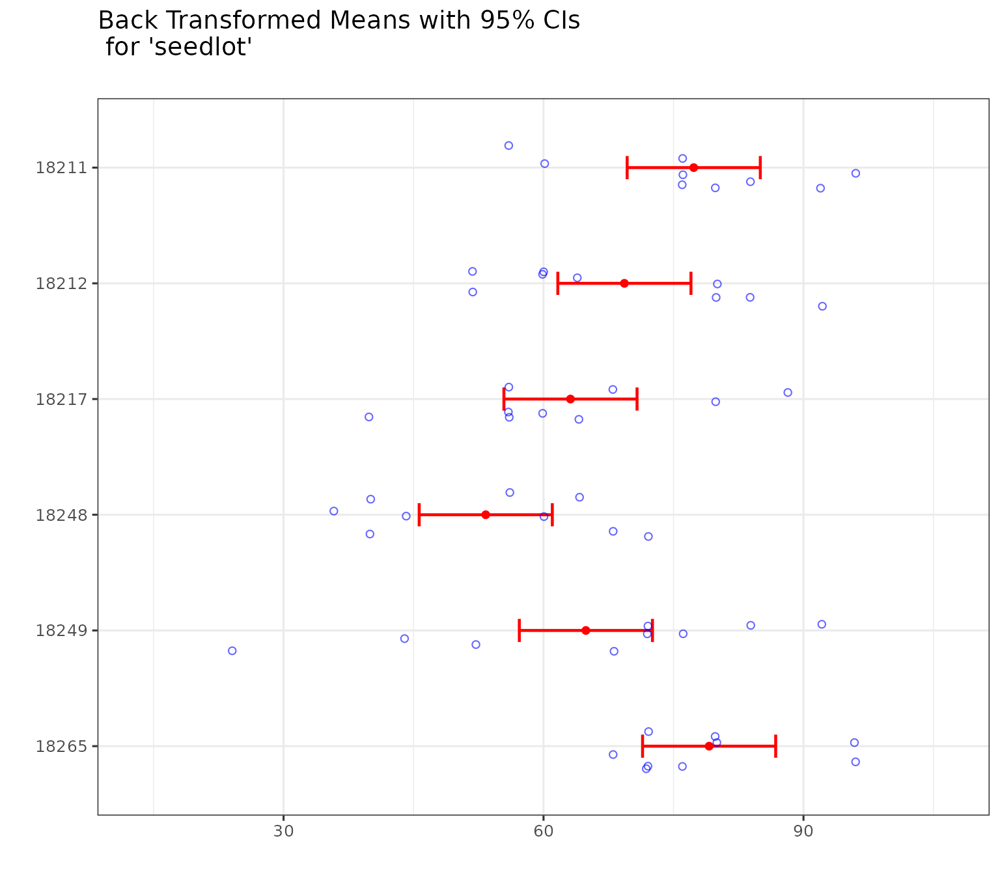

``` r

predm_out$predictmeansBarPlot
```

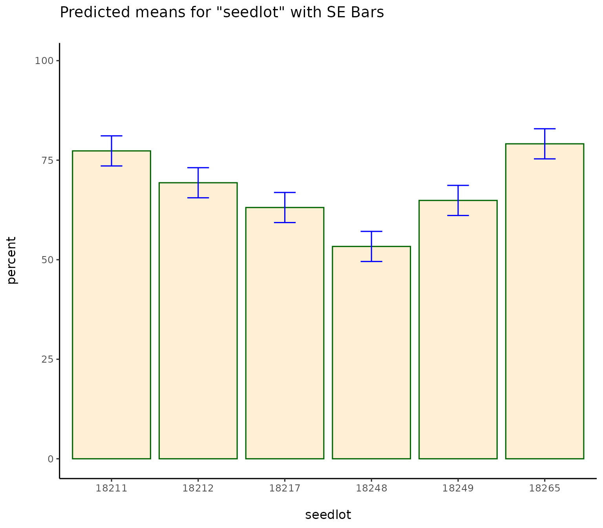

- treat:seedlot

``` r

predm_out <- predictmeans(fm4.4, "treat:seedlot", adj="BH", bar=TRUE, prtplt=FALSE, plotord = c("seedlot", "treat"))
print(predm_out[1:4])
```

    ## $`Predicted Means`
    ##         treat    nick    bw&s  bw1min
    ## seedlot                              
    ## 18211         65.3333 78.6667 88.0000
    ## 18212         54.6667 68.0000 85.3333
    ## 18217         57.3333 54.6667 77.3333
    ## 18248         40.0000 52.0000 68.0000
    ## 18249         49.3333 61.3333 84.0000
    ## 18265         74.6667 80.0000 82.6667
    ## 
    ## $`Standard Error of Means`
    ## All means have the same SE 
    ##                    6.54752 
    ## 
    ## $`Standard Error of Differences`
    ##  Max.SED  Min.SED Aveg.SED 
    ##  9.25959  9.25959  9.25959 
    ## attr(,"For the Same Level of Factor")
    ##            treat seedlot
    ## Aveg.SED 9.25959 9.25959
    ## Min.SED  9.25959 9.25959
    ## Max.SED  9.25959 9.25959
    ## 
    ## $LSD
    ##  Max.LSD  Min.LSD Aveg.LSD 
    ## 18.81775 18.81775 18.81775 
    ## attr(,"For the Same Level of Factor")
    ##             treat  seedlot
    ## Aveg.LSD 18.81775 18.81775
    ## Min.LSD  18.81775 18.81775
    ## Max.LSD  18.81775 18.81775
    ## attr(,"Significant level")
    ## [1] 0.05
    ## attr(,"Degree of freedom")
    ## [1] 34

``` r

gt(predm_out$mean_table$Table, 
   caption = "Group: Letter-based representation of pairwise comparisons at significant level '0.05'")
```

| treat  | seedlot | Mean    | SE      | Df  | LL(95%) | UL(95%)  | LetterGrp |
|--------|---------|---------|---------|-----|---------|----------|-----------|
| nick   | 18211   | 65.3333 | 6.54752 | 34  | 52.0272 | 78.6395  | ABCDEF    |
| nick   | 18212   | 54.6667 | 6.54752 | 34  | 41.3605 | 67.9728  | AB D G    |
| nick   | 18217   | 57.3333 | 6.54752 | 34  | 44.0272 | 70.6395  | ABCD G    |
| nick   | 18248   | 40.0000 | 6.54752 | 34  | 26.6938 | 53.3062  | G         |
| nick   | 18249   | 49.3333 | 6.54752 | 34  | 36.0272 | 62.6395  | A G       |
| nick   | 18265   | 74.6667 | 6.54752 | 34  | 61.3605 | 87.9728  | BCDEF     |
| bw&s   | 18211   | 78.6667 | 6.54752 | 34  | 65.3605 | 91.9728  | C EF      |
| bw&s   | 18212   | 68.0000 | 6.54752 | 34  | 54.6938 | 81.3062  | ABCDEF    |
| bw&s   | 18217   | 54.6667 | 6.54752 | 34  | 41.3605 | 67.9728  | AB D G    |
| bw&s   | 18248   | 52.0000 | 6.54752 | 34  | 38.6938 | 65.3062  | AB G      |
| bw&s   | 18249   | 61.3333 | 6.54752 | 34  | 48.0272 | 74.6395  | ABCDE G   |
| bw&s   | 18265   | 80.0000 | 6.54752 | 34  | 66.6938 | 93.3062  | C EF      |
| bw1min | 18211   | 88.0000 | 6.54752 | 34  | 74.6938 | 101.3062 | F         |
| bw1min | 18212   | 85.3333 | 6.54752 | 34  | 72.0272 | 98.6395  | F         |
| bw1min | 18217   | 77.3333 | 6.54752 | 34  | 64.0272 | 90.6395  | CDEF      |
| bw1min | 18248   | 68.0000 | 6.54752 | 34  | 54.6938 | 81.3062  | ABCDEF    |
| bw1min | 18249   | 84.0000 | 6.54752 | 34  | 70.6938 | 97.3062  | EF        |
| bw1min | 18265   | 82.6667 | 6.54752 | 34  | 69.3605 | 95.9728  | EF        |

Group: Letter-based representation of pairwise comparisons at
significant level '0.05' {.table .gt_table
quarto-disable-processing="false" quarto-bootstrap="false"}

``` r

gt(data.frame(predm_out$`Pairwise p-value`, check.names=FALSE), 
   rownames_to_stub=TRUE, 
   caption = "The matrix has t-value above the diagonal, p-value (adjusted by 'BH' method) below the diagonal") %>% 
  cols_width(everything() ~ px(130))
```

|  | nick:18211 | nick:18212 | nick:18217 | nick:18248 | nick:18249 | nick:18265 | bw&s:18211 | bw&s:18212 | bw&s:18217 | bw&s:18248 | bw&s:18249 | bw&s:18265 | bw1min:18211 | bw1min:18212 | bw1min:18217 | bw1min:18248 | bw1min:18249 | bw1min:18265 |
|----|----|----|----|----|----|----|----|----|----|----|----|----|----|----|----|----|----|----|
| nick:18211 | 1.0000 | 1.1520 | 0.8640 | 2.7359 | 1.7279 | -1.0080 | -1.4399 | -0.2880 | 1.1520 | 1.4399 | 0.4320 | -1.5839 | -2.4479 | -2.1599 | -1.2960 | -0.2880 | -2.0159 | -1.8719 |
| nick:18212 | 0.3899 | 1.0000 | -0.2880 | 1.5839 | 0.5760 | -2.1599 | -2.5919 | -1.4399 | 0.0000 | 0.2880 | -0.7200 | -2.7359 | -3.5999 | -3.3119 | -2.4479 | -1.4399 | -3.1679 | -3.0239 |
| nick:18217 | 0.5330 | 0.8067 | 1.0000 | 1.8719 | 0.8640 | -1.8719 | -2.3039 | -1.1520 | 0.2880 | 0.5760 | -0.4320 | -2.4479 | -3.3119 | -3.0239 | -2.1599 | -1.1520 | -2.8799 | -2.7359 |
| nick:18248 | 0.0366 | 0.2342 | 0.1549 | 1.0000 | -1.0080 | -3.7439 | -4.1759 | -3.0239 | -1.5839 | -1.2960 | -2.3039 | -4.3198 | -5.1838 | -4.8958 | -4.0319 | -3.0239 | -4.7518 | -4.6078 |
| nick:18249 | 0.1899 | 0.6742 | 0.5330 | 0.4542 | 1.0000 | -2.7359 | -3.1679 | -2.0159 | -0.5760 | -0.2880 | -1.2960 | -3.3119 | -4.1759 | -3.8879 | -3.0239 | -2.0159 | -3.7439 | -3.5999 |
| nick:18265 | 0.4542 | 0.0983 | 0.1549 | 0.0085 | 0.0366 | 1.0000 | -0.4320 | 0.7200 | 2.1599 | 2.4479 | 1.4399 | -0.5760 | -1.4399 | -1.1520 | -0.2880 | 0.7200 | -1.0080 | -0.8640 |
| bw&s:18211 | 0.2765 | 0.0486 | 0.0793 | 0.0043 | 0.0198 | 0.7576 | 1.0000 | 1.1520 | 2.5919 | 2.8799 | 1.8719 | -0.1440 | -1.0080 | -0.7200 | 0.1440 | 1.1520 | -0.5760 | -0.4320 |
| bw&s:18212 | 0.8067 | 0.2765 | 0.3899 | 0.0226 | 0.1257 | 0.6025 | 0.3899 | 1.0000 | 1.4399 | 1.7279 | 0.7200 | -1.2960 | -2.1599 | -1.8719 | -1.0080 | 0.0000 | -1.7279 | -1.5839 |
| bw&s:18217 | 0.3899 | 1.0000 | 0.8067 | 0.2342 | 0.6742 | 0.0983 | 0.0486 | 0.2765 | 1.0000 | 0.2880 | -0.7200 | -2.7359 | -3.5999 | -3.3119 | -2.4479 | -1.4399 | -3.1679 | -3.0239 |
| bw&s:18248 | 0.2765 | 0.8067 | 0.6742 | 0.3352 | 0.8067 | 0.0602 | 0.0299 | 0.1899 | 0.8067 | 1.0000 | -1.0080 | -3.0239 | -3.8879 | -3.5999 | -2.7359 | -1.7279 | -3.4559 | -3.3119 |
| bw&s:18249 | 0.7576 | 0.6025 | 0.7576 | 0.0793 | 0.3352 | 0.2765 | 0.1549 | 0.6025 | 0.6025 | 0.4542 | 1.0000 | -2.0159 | -2.8799 | -2.5919 | -1.7279 | -0.7200 | -2.4479 | -2.3039 |
| bw&s:18265 | 0.2342 | 0.0366 | 0.0602 | 0.0039 | 0.0153 | 0.6742 | 0.8981 | 0.3352 | 0.0366 | 0.0226 | 0.1257 | 1.0000 | -0.8640 | -0.5760 | 0.2880 | 1.2960 | -0.4320 | -0.2880 |
| bw1min:18211 | 0.0602 | 0.0096 | 0.0153 | 0.0015 | 0.0043 | 0.2765 | 0.4542 | 0.0983 | 0.0096 | 0.0068 | 0.0299 | 0.5330 | 1.0000 | 0.2880 | 1.1520 | 2.1599 | 0.4320 | 0.5760 |
| bw1min:18212 | 0.0983 | 0.0153 | 0.0226 | 0.0018 | 0.0068 | 0.3899 | 0.6025 | 0.1549 | 0.0153 | 0.0096 | 0.0486 | 0.6742 | 0.8067 | 1.0000 | 0.8640 | 1.8719 | 0.1440 | 0.2880 |
| bw1min:18217 | 0.3352 | 0.0602 | 0.0983 | 0.0057 | 0.0226 | 0.8067 | 0.8981 | 0.4542 | 0.0602 | 0.0366 | 0.1899 | 0.8067 | 0.3899 | 0.5330 | 1.0000 | 1.0080 | -0.7200 | -0.5760 |
| bw1min:18248 | 0.8067 | 0.2765 | 0.3899 | 0.0226 | 0.1257 | 0.6025 | 0.3899 | 1.0000 | 0.2765 | 0.1899 | 0.6025 | 0.3352 | 0.0983 | 0.1549 | 0.4542 | 1.0000 | -1.7279 | -1.5839 |
| bw1min:18249 | 0.1257 | 0.0198 | 0.0299 | 0.0018 | 0.0085 | 0.4542 | 0.6742 | 0.1899 | 0.0198 | 0.0134 | 0.0602 | 0.7576 | 0.7576 | 0.8981 | 0.6025 | 0.1899 | 1.0000 | 0.1440 |
| bw1min:18265 | 0.1549 | 0.0226 | 0.0366 | 0.0021 | 0.0096 | 0.5330 | 0.7576 | 0.2342 | 0.0226 | 0.0153 | 0.0793 | 0.8067 | 0.6742 | 0.8067 | 0.6742 | 0.2342 | 0.8981 | 1.0000 |

The matrix has t-value above the diagonal, p-value (adjusted by 'BH'
method) below the diagonal {.table .gt_table
style="table-layout:fixed;width:0px;" quarto-disable-processing="false"
quarto-bootstrap="false"}

``` r

PMplot(predm_out$p_valueMatrix, newwd = FALSE)
```

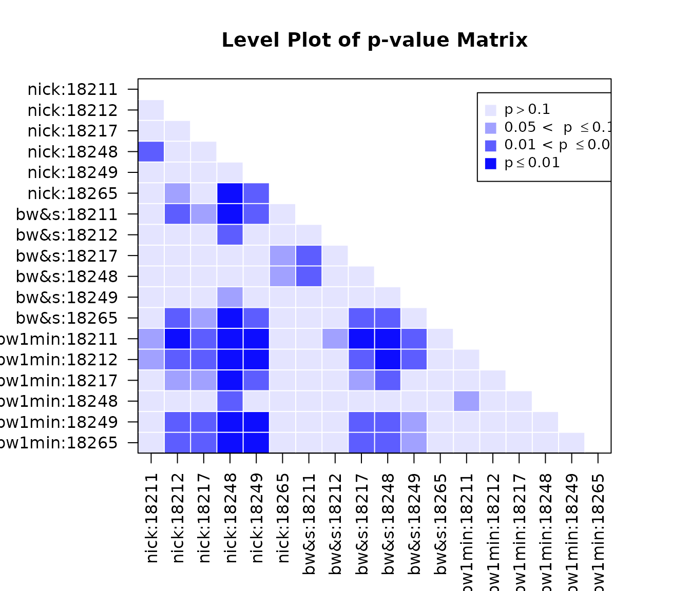

``` r

predm_out$predictmeansPlot$meanPlot
```

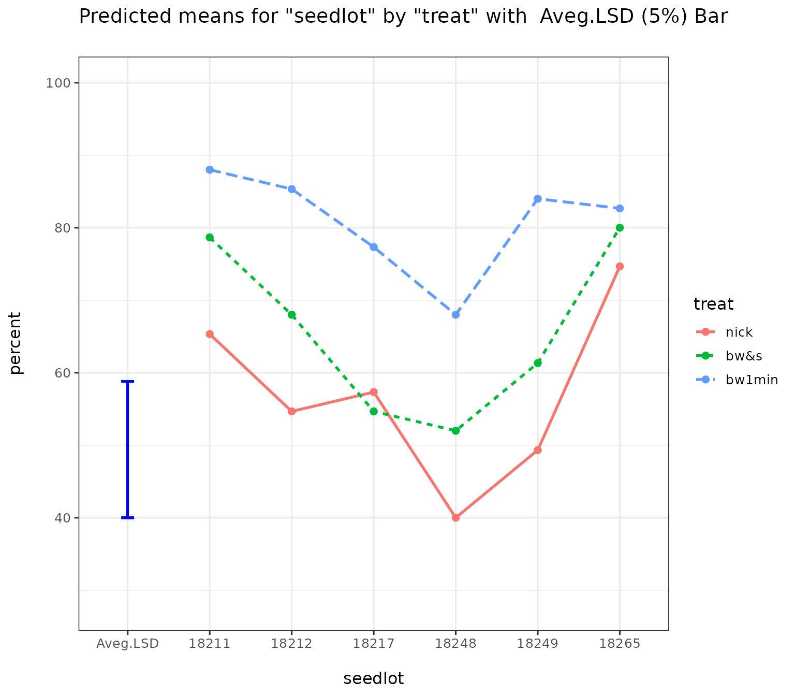

``` r

predm_out$predictmeansPlot$ciPlot
```


``` r

predm_out$predictmeansBarPlot
```

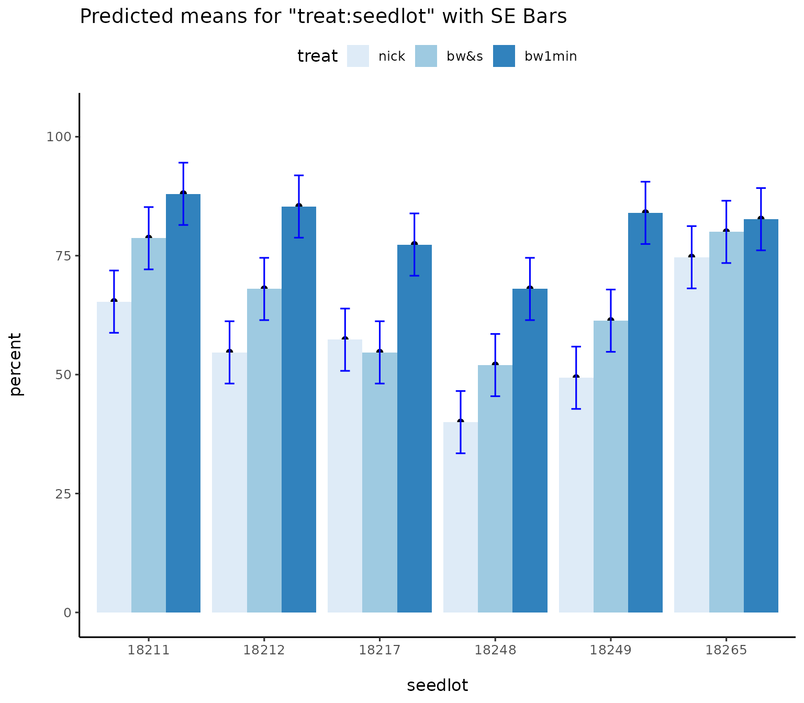

## **4.2 Example 4.4 (Pg. 61)**

### Data Info

An experiment supported by the Shell Company was planted at Toolara
Forest Reserve near Gympie, Queensland, in February 1987 to study the
effects of irrigation and fertiliser on four seedlots of Eucalyptus
grandis. Because of the difficulty in applying the irrigation and
fertiliser treatments individually to each 7 × 6 plot of trees, the
experiment was designed as a split-plot, with main-plot treatments,
irrig and fert. There were two replicates of four main-plots each with
four sub-plots.

- Structure
- Summary

``` r

data(DataExam4.4, package="eda4treeR")
DataExam4.4$seedlot <- factor(as.character(DataExam4.4$seedlot))
str(DataExam4.4)
```

    ## 'data.frame':    32 obs. of  5 variables:
    ##  $ repl   : Factor w/ 2 levels "1","2": 1 1 1 1 1 1 1 1 1 1 ...
    ##  $ irrig  : Factor w/ 2 levels "none","plus": 1 1 1 1 1 1 1 1 2 2 ...
    ##  $ fert   : Factor w/ 2 levels "none","plus": 1 1 1 1 2 2 2 2 2 2 ...
    ##  $ seedlot: Factor w/ 4 levels "Atherton","Bulahdelah",..: 1 4 3 2 3 2 4 1 2 3 ...
    ##  $ height : num  4.71 6.23 7.46 6.39 16.36 ...

``` r

print(dfSummary(DataExam4.4, 
                varnumbers   = FALSE, 
                valid.col    = FALSE, 
                graph.magnif = 0.76),
      method = 'render')
```

### Data Frame Summary

#### DataExam4.4

**Dimensions**: 32 x 5  
**Duplicates**: 0  

[TABLE]

Generated by [summarytools](https://github.com/dcomtois/summarytools)
1.1.5 ([R](https://www.r-project.org/) version 4.6.2)  
2026-11-12

### Modelling

- Model
- Residual Plot

``` r

fm4.6 <- aov(height ~ repl + irrig*fert*seedlot +
Error(repl/irrig:fert), data = DataExam4.4)
summary(fm4.6)
```

    ## 
    ## Error: repl
    ##      Df Sum Sq Mean Sq
    ## repl  1 0.7564  0.7564
    ## 
    ## Error: repl:irrig:fert
    ##            Df Sum Sq Mean Sq F value Pr(>F)    
    ## irrig       1    0.1     0.1   0.154  0.721    
    ## fert        1  590.6   590.6 841.110  9e-05 ***
    ## irrig:fert  1    0.0     0.0   0.010  0.926    
    ## Residuals   3    2.1     0.7                   
    ## ---
    ## Signif. codes:  0 '***' 0.001 '**' 0.01 '*' 0.05 '.' 0.1 ' ' 1
    ## 
    ## Error: Within
    ##                    Df Sum Sq Mean Sq F value  Pr(>F)    
    ## seedlot             3  39.65  13.218  19.680 6.3e-05 ***
    ## irrig:seedlot       3   1.11   0.370   0.551  0.6572    
    ## fert:seedlot        3   9.95   3.317   4.938  0.0185 *  
    ## irrig:fert:seedlot  3   1.74   0.579   0.862  0.4874    
    ## Residuals          12   8.06   0.672                    
    ## ---
    ## Signif. codes:  0 '***' 0.001 '**' 0.01 '*' 0.05 '.' 0.1 ' ' 1

``` r

residplot(fm4.6) 
```

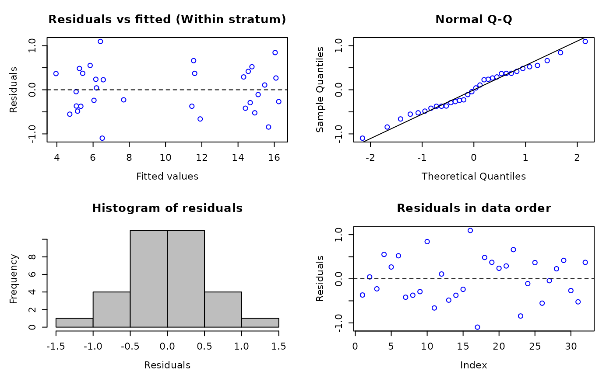

### Predicted Means

- irrig

&nbsp;

- Mean Table
- Mean Plot
- Mean Table
- Mean Plot
- Mean Table
- p-value Table
- Mean Plot
- Mean Table
- p-value Table & Plot
- Mean Plot

``` r

predm_out <- predictmeans(fm4.6, "irrig", adj="BH", lineplot = FALSE, bar=TRUE, prtplt=FALSE)
print(predm_out[1:4])
```

    ## $`Predicted Means`
    ## irrig
    ##    none    plus 
    ##  9.9463 10.0625 
    ## 
    ## $`Standard Error of Means`
    ## All means have the same SE 
    ##                    0.21757 
    ## 
    ## $`Standard Error of Differences`
    ##   Max.SED   Min.SED  Aveg.SED 
    ## 0.2962765 0.2962765 0.2962765 
    ## 
    ## $LSD
    ##  Max.LSD  Min.LSD Aveg.LSD 
    ##  0.94288  0.94288  0.94288 
    ## attr(,"Significant level")
    ## [1] 0.05
    ## attr(,"Degree of freedom")
    ## [1] 3

``` r

gt(predm_out$mean_table$Table, 
   caption = "Group: Letter-based representation of pairwise comparisons at significant level '0.05'")
```

| irrig | Mean    | SE      | Df   | LL(95%) | UL(95%) | LetterGrp |
|-------|---------|---------|------|---------|---------|-----------|
| none  | 9.9463  | 0.21757 | 3.49 | 9.3057  | 10.5868 | A         |
| plus  | 10.0625 | 0.21757 | 3.49 | 9.4220  | 10.7030 | A         |

Group: Letter-based representation of pairwise comparisons at
significant level '0.05' {.table .gt_table
quarto-disable-processing="false" quarto-bootstrap="false"}

``` r

predm_out$predictmeansPlot$meanPlot
```

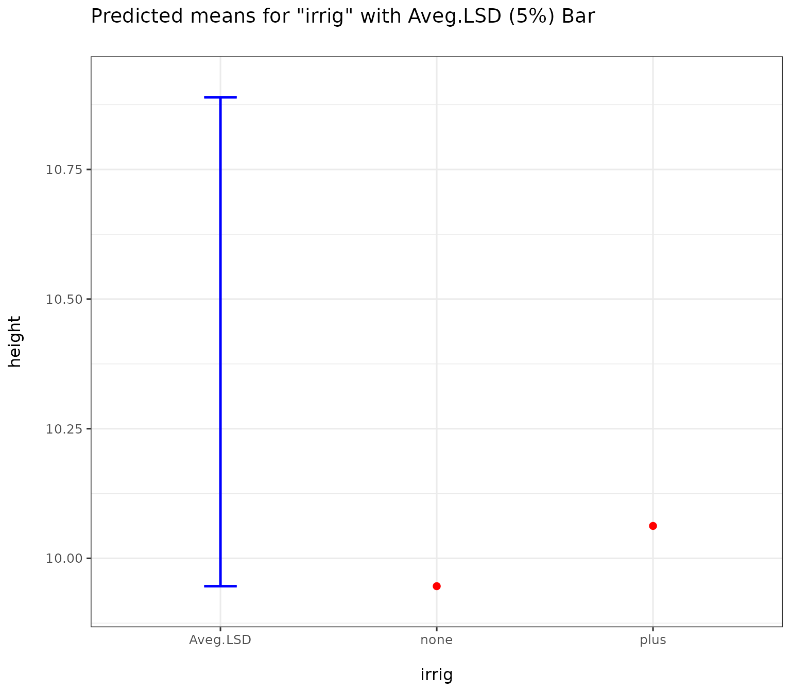

``` r

predm_out$predictmeansPlot$ciPlot
```

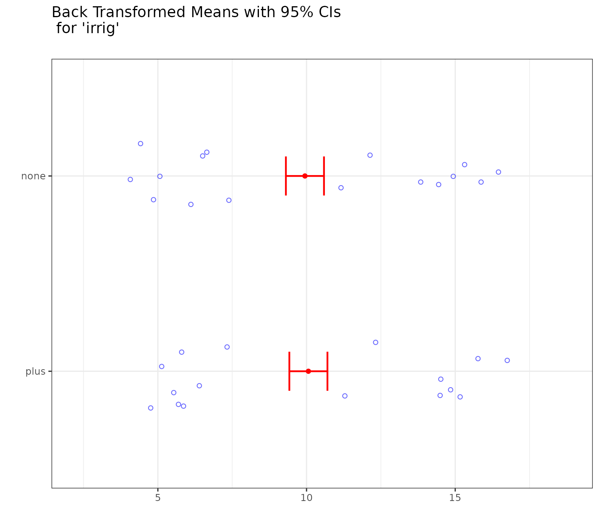

``` r

predm_out$predictmeansBarPlot
```

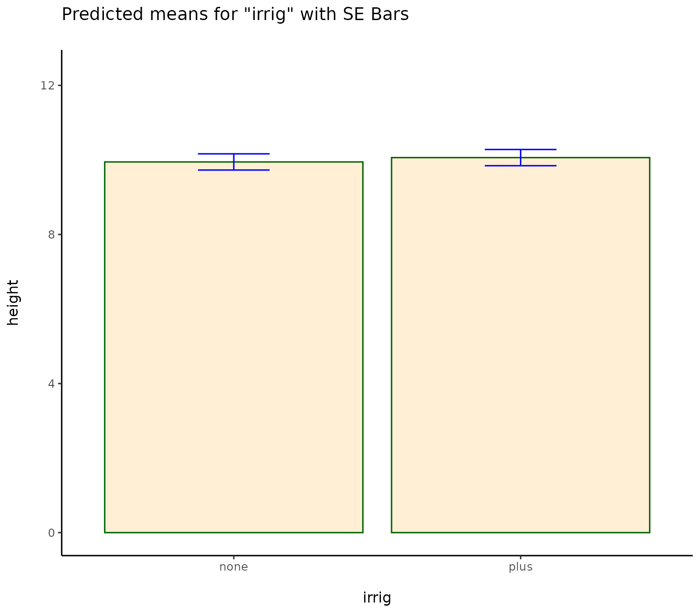

- fert

``` r

predm_out <- predictmeans(fm4.6, "fert", adj="BH", lineplot = FALSE, bar=TRUE, prtplt=FALSE)
print(predm_out[1:4])
```

    ## $`Predicted Means`
    ## fert
    ##    none    plus 
    ##  5.7081 14.3006 
    ## 
    ## $`Standard Error of Means`
    ## All means have the same SE 
    ##                    0.21757 
    ## 
    ## $`Standard Error of Differences`
    ##   Max.SED   Min.SED  Aveg.SED 
    ## 0.2962765 0.2962765 0.2962765 
    ## 
    ## $LSD
    ##  Max.LSD  Min.LSD Aveg.LSD 
    ##  0.94288  0.94288  0.94288 
    ## attr(,"Significant level")
    ## [1] 0.05
    ## attr(,"Degree of freedom")
    ## [1] 3

``` r

gt(predm_out$mean_table$Table, 
   caption = "Group: Letter-based representation of pairwise comparisons at significant level '0.05'")
```

| fert | Mean    | SE      | Df   | LL(95%) | UL(95%) | LetterGrp |
|------|---------|---------|------|---------|---------|-----------|
| none | 5.7081  | 0.21757 | 3.49 | 5.0676  | 6.3486  | A         |
| plus | 14.3006 | 0.21757 | 3.49 | 13.6601 | 14.9411 | B         |

Group: Letter-based representation of pairwise comparisons at
significant level '0.05' {.table .gt_table
quarto-disable-processing="false" quarto-bootstrap="false"}

``` r

predm_out$predictmeansPlot$meanPlot
```

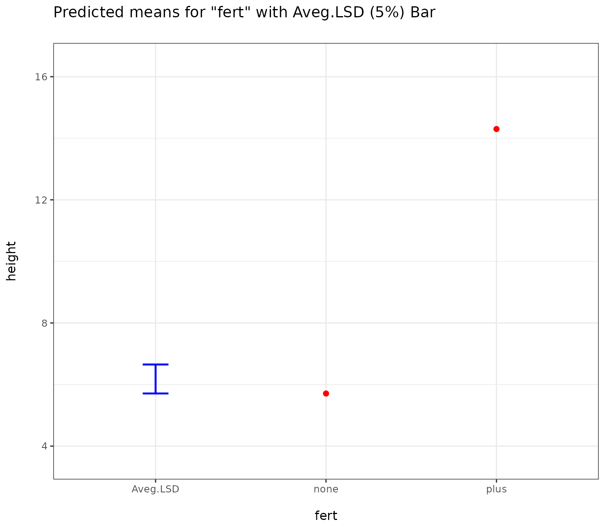

``` r

predm_out$predictmeansPlot$ciPlot
```

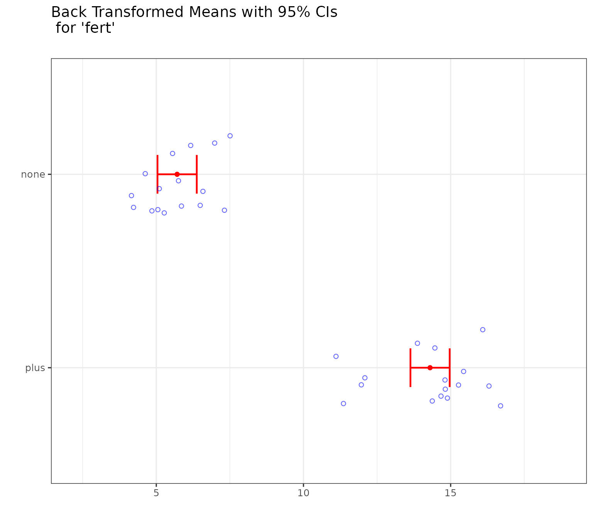

``` r

predm_out$predictmeansBarPlot
```

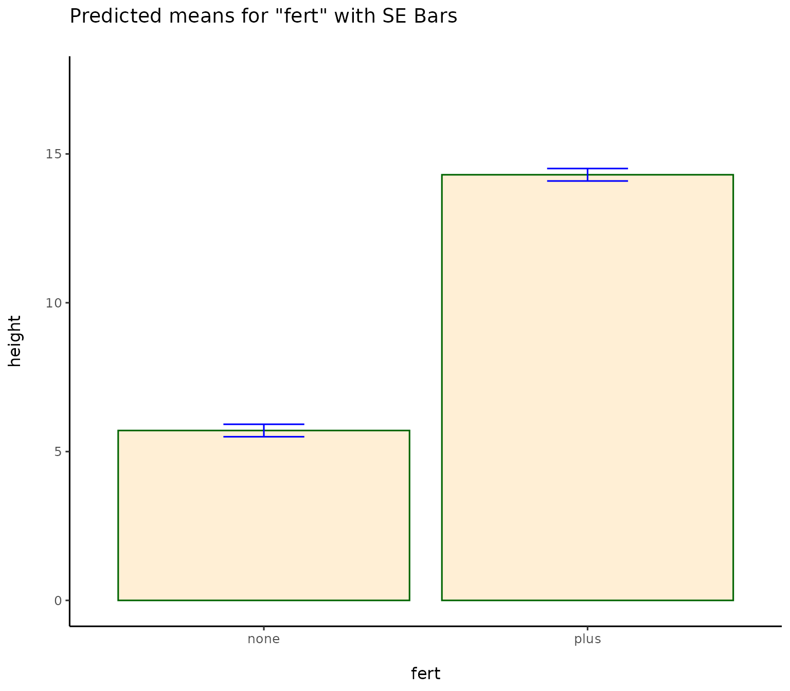

- seedlot

``` r

predm_out <- predictmeans(fm4.6, "seedlot", adj="BH", bar=TRUE, lineplot = FALSE, prtplt=FALSE)
print(predm_out[1:4])
```

    ## $`Predicted Means`
    ## seedlot
    ##    Atherton  Bulahdelah    Coffs SO Pomona pltn 
    ##      8.2875     10.1775     11.4038     10.1488 
    ## 
    ## $`Standard Error of Means`
    ## All means have the same SE 
    ##                    0.29725 
    ## 
    ## $`Standard Error of Differences`
    ##   Max.SED   Min.SED  Aveg.SED 
    ## 0.4097646 0.4097646 0.4097646 
    ## 
    ## $LSD
    ##  Max.LSD  Min.LSD Aveg.LSD 
    ##   0.8928   0.8928   0.8928 
    ## attr(,"Significant level")
    ## [1] 0.05
    ## attr(,"Degree of freedom")
    ## [1] 12

``` r

gt(predm_out$mean_table$Table, 
   caption = "Group: Letter-based representation of pairwise comparisons at significant level '0.05'")
```

| seedlot     | Mean    | SE      | Df   | LL(95%) | UL(95%) | LetterGrp |
|-------------|---------|---------|------|---------|---------|-----------|
| Atherton    | 8.2875  | 0.29725 | 15.9 | 7.6570  | 8.9180  | A         |
| Bulahdelah  | 10.1775 | 0.29725 | 15.9 | 9.5470  | 10.8080 | B         |
| Coffs SO    | 11.4038 | 0.29725 | 15.9 | 10.7733 | 12.0342 | C         |
| Pomona pltn | 10.1488 | 0.29725 | 15.9 | 9.5183  | 10.7792 | B         |

Group: Letter-based representation of pairwise comparisons at
significant level '0.05' {.table .gt_table
quarto-disable-processing="false" quarto-bootstrap="false"}

``` r

gt(data.frame(predm_out$`Pairwise p-value`, check.names=FALSE), 
   rownames_to_stub=TRUE, 
   caption = "The matrix has t-value above the diagonal, p-value (adjusted by 'BH' method) below the diagonal") %>% 
  cols_width(everything() ~ px(120))
```

|             | Atherton | Bulahdelah | Coffs SO | Pomona pltn |
|-------------|----------|------------|----------|-------------|
| Atherton    | 1.0000   | -4.6124    | -7.6050  | -4.5422     |
| Bulahdelah  | 0.0014   | 1.0000     | -2.9926  | 0.0702      |
| Coffs SO    | 0.0000   | 0.0135     | 1.0000   | 3.0627      |
| Pomona pltn | 0.0014   | 0.9452     | 0.0135   | 1.0000      |

The matrix has t-value above the diagonal, p-value (adjusted by 'BH'
method) below the diagonal {.table .gt_table
style="table-layout:fixed;width:0px;" quarto-disable-processing="false"
quarto-bootstrap="false"}

``` r

predm_out$predictmeansPlot$meanPlot
```

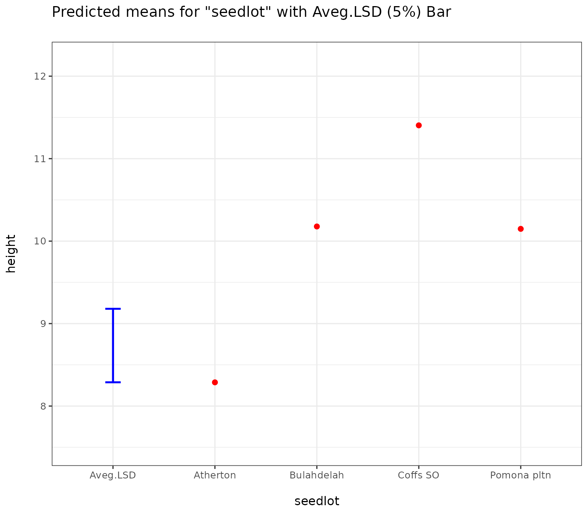

``` r

predm_out$predictmeansPlot$ciPlot
```

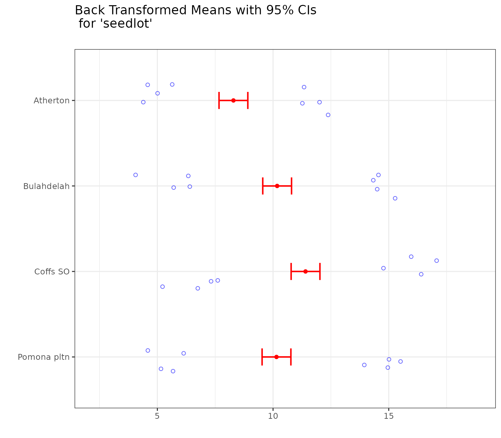

``` r

predm_out$predictmeansBarPlot
```

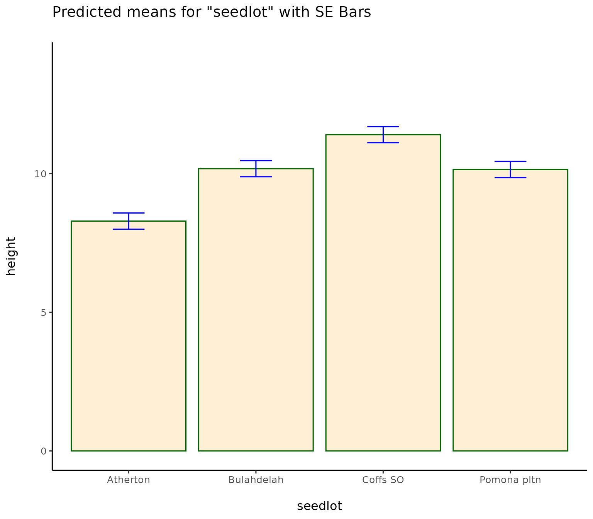

- fert:seedlot

``` r

predm_out <- predictmeans(fm4.6, "fert:seedlot", adj="BH", bar=TRUE, prtplt=FALSE, plotord = c("seedlot", "fert"))
print(predm_out[1:4])
```

    ## $`Predicted Means`
    ##             fert    none    plus
    ## seedlot                         
    ## Atherton          4.9450 11.6300
    ## Bulahdelah        5.6875 14.6675
    ## Coffs SO          6.7900 16.0175
    ## Pomona pltn       5.4100 14.8875
    ## 
    ## $`Standard Error of Means`
    ## All means have the same SE 
    ##                    0.41625 
    ## 
    ## $`Standard Error of Differences`
    ##   Max.SED   Min.SED  Aveg.SED 
    ## 0.5827867 0.5794947 0.5813758 
    ## attr(,"For the Same Level of Factor")
    ##               fert   seedlot
    ## Aveg.SED 0.5794947 0.5827867
    ## Min.SED  0.5794947 0.5827867
    ## Max.SED  0.5794947 0.5827867
    ## 
    ## $LSD
    ##  Max.LSD  Min.LSD Aveg.LSD 
    ##  1.26978  1.26261  1.26671 
    ## attr(,"For the Same Level of Factor")
    ##             fert seedlot
    ## Aveg.LSD 1.26261 1.26978
    ## Min.LSD  1.26261 1.26978
    ## Max.LSD  1.26261 1.26978
    ## attr(,"Significant level")
    ## [1] 0.05
    ## attr(,"Degree of freedom")
    ## [1] 12

``` r

gt(predm_out$mean_table$Table, 
   caption = "Group: Letter-based representation of pairwise comparisons at significant level '0.05'")
```

| fert | seedlot     | Mean    | SE      | Df    | LL(95%) | UL(95%) | LetterGrp |
|------|-------------|---------|---------|-------|---------|---------|-----------|
| none | Atherton    | 4.9450  | 0.41625 | 15.29 | 4.0592  | 5.8308  | A         |
| none | Bulahdelah  | 5.6875  | 0.41625 | 15.29 | 4.8017  | 6.5733  | AB        |
| none | Coffs SO    | 6.7900  | 0.41625 | 15.29 | 5.9042  | 7.6758  | B         |
| none | Pomona pltn | 5.4100  | 0.41625 | 15.29 | 4.5242  | 6.2958  | A         |
| plus | Atherton    | 11.6300 | 0.41625 | 15.29 | 10.7442 | 12.5158 | C         |
| plus | Bulahdelah  | 14.6675 | 0.41625 | 15.29 | 13.7817 | 15.5533 | D         |
| plus | Coffs SO    | 16.0175 | 0.41625 | 15.29 | 15.1317 | 16.9033 | E         |
| plus | Pomona pltn | 14.8875 | 0.41625 | 15.29 | 14.0017 | 15.7733 | DE        |

Group: Letter-based representation of pairwise comparisons at
significant level '0.05' {.table .gt_table
quarto-disable-processing="false" quarto-bootstrap="false"}

``` r

gt(data.frame(predm_out$`Pairwise p-value`, check.names=FALSE), 
   rownames_to_stub=TRUE, 
   caption = "The matrix has t-value above the diagonal, p-value (adjusted by 'BH' method) below the diagonal") %>% 
  cols_width(everything() ~ px(150))
```

|  | none:Atherton | none:Bulahdelah | none:Coffs SO | none:Pomona pltn | plus:Atherton | plus:Bulahdelah | plus:Coffs SO | plus:Pomona pltn |
|----|----|----|----|----|----|----|----|----|
| none:Atherton | 1.0000 | -1.2813 | -3.1838 | -0.8024 | -11.4707 | -16.6828 | -18.9992 | -17.0603 |
| none:Bulahdelah | 0.2512 | 1.0000 | -1.9025 | 0.4789 | -10.1967 | -15.4087 | -17.7252 | -15.7862 |
| none:Coffs SO | 0.0110 | 0.0949 | 1.0000 | 2.3814 | -8.3049 | -13.5170 | -15.8334 | -13.8944 |
| none:Pomona pltn | 0.4716 | 0.6644 | 0.0462 | 1.0000 | -10.6729 | -15.8849 | -18.2013 | -16.2624 |
| plus:Atherton | 0.0000 | 0.0000 | 0.0000 | 0.0000 | 1.0000 | -5.2416 | -7.5713 | -5.6213 |
| plus:Bulahdelah | 0.0000 | 0.0000 | 0.0000 | 0.0000 | 0.0003 | 1.0000 | -2.3296 | -0.3796 |
| plus:Coffs SO | 0.0000 | 0.0000 | 0.0000 | 0.0000 | 0.0000 | 0.0485 | 1.0000 | 1.9500 |
| plus:Pomona pltn | 0.0000 | 0.0000 | 0.0000 | 0.0000 | 0.0002 | 0.7108 | 0.0912 | 1.0000 |

The matrix has t-value above the diagonal, p-value (adjusted by 'BH'
method) below the diagonal {.table .gt_table
style="table-layout:fixed;width:0px;" quarto-disable-processing="false"
quarto-bootstrap="false"}

``` r

PMplot(predm_out$p_valueMatrix, newwd = FALSE)
```

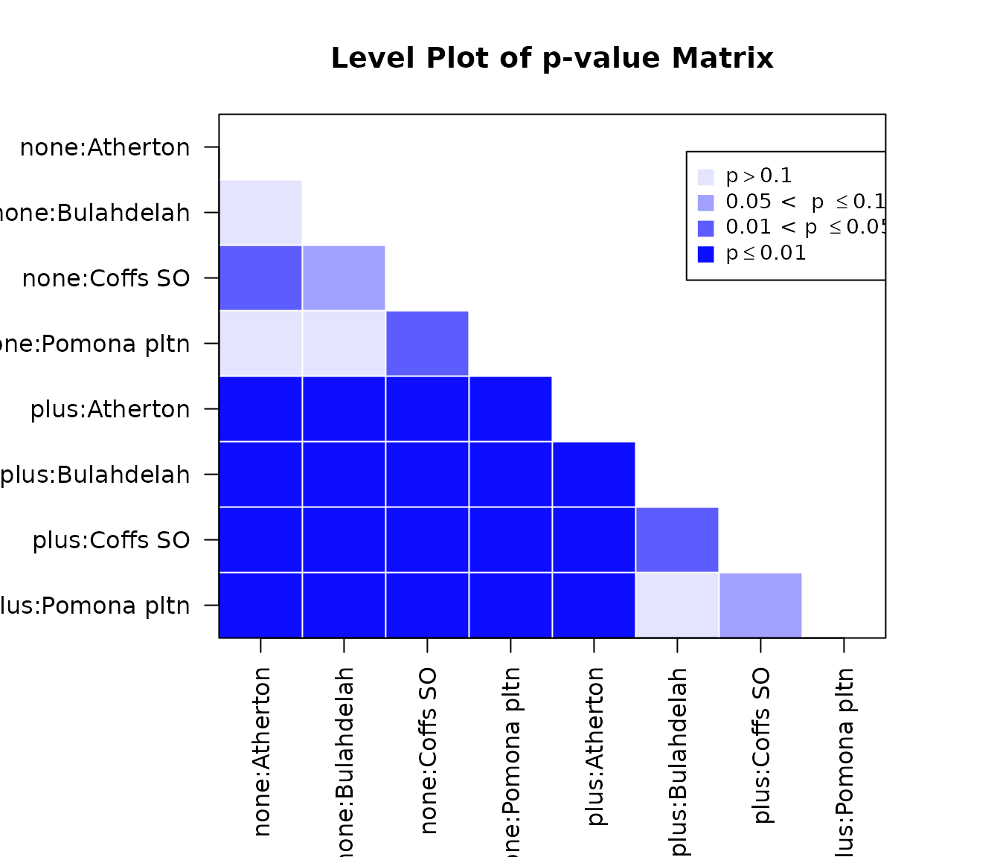

``` r

predm_out$predictmeansPlot$meanPlot
```

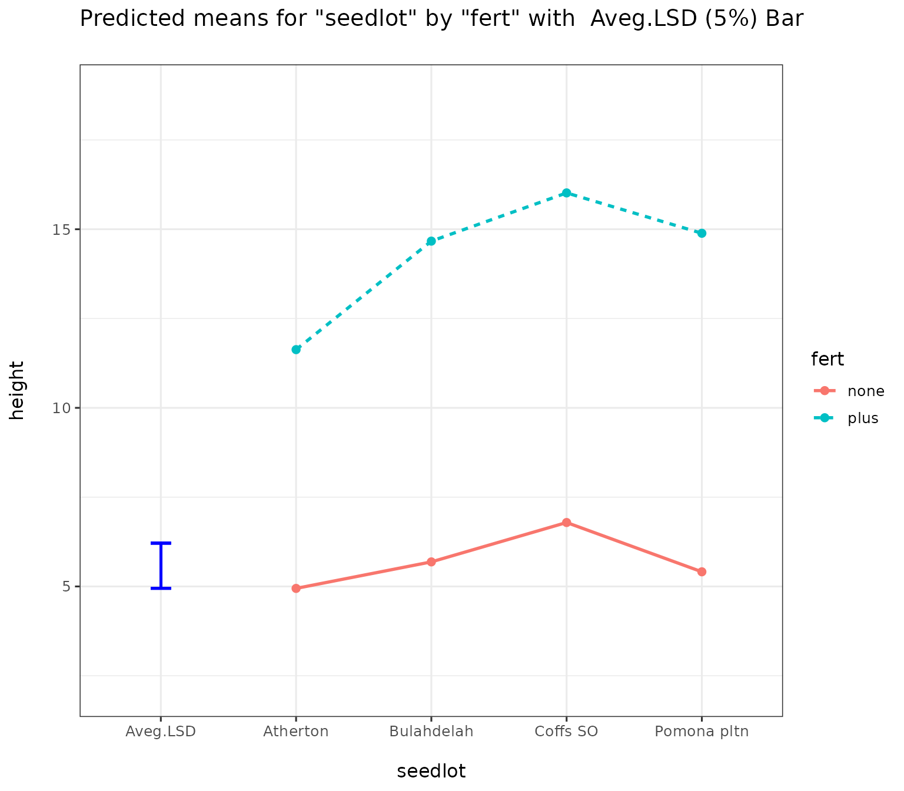

``` r

predm_out$predictmeansPlot$ciPlot
```


``` r

predm_out$predictmeansBarPlot
```


## **5.2 Example 5.1 (Pg. 68)**

### Data Info

In 1985 species/provenance trials were laid out at six sites in Thailand
as part of an ACIAR project extending over several years to investigate
Australian multi-purpose tree species. The experimental design in each
case was an RCB design with three replicates and the number of seedlots
ranged from 30 to 42. Plots consisted of 5 × 5 trees with a 2m × 2m
spacing. Plot summary files were constructed for the 24-month
measurement according to the methods described in Chapter 3. Analyses
were performed on the plot mean data at each site.

- Structure
- Summary

``` r

data(DataExam5.1, package="eda4treeR")
str(DataExam5.1)
```

    ## 'data.frame':    108 obs. of  4 variables:
    ##  $ site    : Factor w/ 4 levels "Ratchaburi","Sai Thong",..: 1 2 3 4 1 2 3 4 1 2 ...
    ##  $ seedlot : Factor w/ 27 levels "13877","13866",..: 27 27 27 27 26 26 26 26 25 25 ...
    ##  $ ht      : num  218 319 363 191 216 116 97 63 490 475 ...
    ##  $ sitemean: num  462 628 494 370 462 ...

``` r

print(dfSummary(DataExam5.1, 
                varnumbers   = FALSE, 
                valid.col    = FALSE, 
                graph.magnif = 0.76),
      method = 'render')
```

### Data Frame Summary

#### DataExam5.1

**Dimensions**: 108 x 4  
**Duplicates**: 0  

[TABLE]

Generated by [summarytools](https://github.com/dcomtois/summarytools)
1.1.5 ([R](https://www.r-project.org/) version 4.6.2)  
2026-11-12

### Modelling

- ANOVA

``` r

fm5.2 <- lm(ht ~ site*seedlot, DataExam5.1)
kable(anova(fm5.2), digits = 4) 
```

|              |  Df |    Sum Sq |    Mean Sq | F value | Pr(\>F) |
|:-------------|----:|----------:|-----------:|--------:|--------:|
| site         |   3 |  919585.2 | 306528.407 |     NaN |     NaN |
| seedlot      |  26 | 3176288.9 | 122164.956 |     NaN |     NaN |
| site:seedlot |  78 |  707956.8 |   9076.369 |     NaN |     NaN |
| Residuals    |   0 |       0.0 |        NaN |      NA |      NA |

- Predicted Means

Site:

``` r

site_mean <- Kmatrix(fm5.2, "site")$K%*%coef(fm5.2)
site_df <- data.frame(Site=rownames(site_mean), Mean=site_mean)
gt(site_df)
```

| Site       | Mean     |
|------------|----------|
| Ratchaburi | 461.6296 |
| Sai Thong  | 627.7037 |
| Si Sa Ket  | 494.0370 |
| Sakaerat   | 370.4815 |

Seedlot:

``` r

seedlot_mean <- t(Kmatrix(fm5.2, "seedlot")$K%*%coef(fm5.2))
gt(data.frame(seedlot_mean[, 1:9, drop=FALSE], check.names = FALSE, row.names ="Mean"), rownames_to_stub = TRUE)
```

|      | 13877  | 13866  | 13689  | 13688 | 13861  | 13854 | 13684 | 13864 | 13863  |
|------|--------|--------|--------|-------|--------|-------|-------|-------|--------|
| Mean | 364.75 | 352.75 | 558.75 | 546.5 | 626.75 | 628   | 660   | 422.5 | 586.25 |

``` r

gt(data.frame(seedlot_mean[, 10:18, drop=FALSE], check.names = FALSE, row.names ="Mean"), rownames_to_stub = TRUE)
```

|      | 13683  | 13681 | 14175 | 14660  | 13653 | 13846 | 13621  | 13871 | 13519 |
|------|--------|-------|-------|--------|-------|-------|--------|-------|-------|
| Mean | 769.75 | 695   | 438   | 521.25 | 591.5 | 440   | 383.75 | 271.5 | 422   |

``` r

gt(data.frame(seedlot_mean[, 19:27, drop=FALSE], check.names = FALSE, row.names ="Mean"), rownames_to_stub = TRUE)
```

|      | 13514  | 13148  | 13990  | 14537  | 14106  | 12013  | 14130  | 14485 | 11935  |
|------|--------|--------|--------|--------|--------|--------|--------|-------|--------|
| Mean | 368.75 | 273.25 | 281.75 | 779.75 | 771.75 | 616.25 | 422.25 | 123   | 272.75 |

- ANOVA with Residual Mean_Sq 1040 and Df 208 (Table 5.3, page 71)

``` r

fm5.2_aT <- anova(fm5.2)
fm5.2_aT["Residuals", c("Df", "Sum Sq", "Mean Sq")] <- c(208, 208* 1040, 1040)
fm5.2_aT$`F value`[3] <- fm5.2_aT$`Mean Sq`[3]/fm5.2_aT$`Mean Sq`[4]
fm5.2_aT$`Pr(>F)`[3] <- df(fm5.2_aT$`F value`[3], fm5.2_aT$Df[3]
, fm5.2_aT$Df[4])
kable(fm5.2_aT, digits = 4)
```

|              |  Df |    Sum Sq |    Mean Sq | F value | Pr(\>F) |
|:-------------|----:|----------:|-----------:|--------:|--------:|
| site         |   3 |  919585.2 | 306528.407 |     NaN |     NaN |
| seedlot      |  26 | 3176288.9 | 122164.956 |     NaN |     NaN |
| site:seedlot |  78 |  707956.8 |   9076.369 |  8.7273 |       0 |
| Residuals    | 208 |  216320.0 |   1040.000 |      NA |      NA |

### Example 5.1 (continued) Page 78

- Book Way
- My Way

- Fig. 5.1. Plot of mean height of two seedlots versus mean height of
  all seedlots at each of four sites.

``` r

DataExam5.1 %>%
filter(seedlot %in% c("13653", "13871")) %>%
  ggplot(aes(x = sitemean, y = ht, color = seedlot, shape = seedlot)) +
    geom_point(size=3) +
    geom_smooth(method = lm, se = FALSE, fullrange = TRUE) +
    theme_classic(17) +
    labs(x = "\nSite Mean", y = "SeedLot Mean\n")
```


- Table 5.7 Estimated height means and regression coefficients for data
  from Table 5.2.

``` r

Table_5.7 <- DataExam5.1 %>%
  summarise(Mean = mean(ht), .by = seedlot) %>%
  left_join(
    DataExam5.1 %>%
      nest_by(seedlot) %>%
      mutate(fm1 = list(lm(ht ~ sitemean , data = data))) %>%
      summarise(Slope = coef(fm1)[2]), 
    by = "seedlot") %>% 
  arrange(seedlot)
gt(Table_5.7)
```

| seedlot | Mean   | Slope      |
|---------|--------|------------|
| 13877   | 364.75 | 0.79221858 |
| 13866   | 352.75 | 0.61009734 |
| 13689   | 558.75 | 1.19475332 |
| 13688   | 546.50 | 1.72717652 |
| 13861   | 626.75 | 1.43784662 |
| 13854   | 628.00 | 1.62026853 |
| 13684   | 660.00 | 1.67860570 |
| 13864   | 422.50 | 0.61113857 |
| 13863   | 586.25 | 1.48034730 |
| 13683   | 769.75 | 1.79629735 |
| 13681   | 695.00 | 1.30937837 |
| 14175   | 438.00 | 1.33770745 |
| 14660   | 521.25 | 0.93353990 |
| 13653   | 591.50 | 1.59434380 |
| 13846   | 440.00 | 0.70691001 |
| 13621   | 383.75 | 1.20085607 |
| 13871   | 271.50 | 0.83048203 |
| 13519   | 422.00 | 0.29211648 |
| 13514   | 368.75 | 0.12307233 |
| 13148   | 273.25 | 0.05333546 |
| 13990   | 281.75 | 0.08298796 |
| 14537   | 779.75 | 0.96012145 |
| 14106   | 771.75 | 1.37751724 |
| 12013   | 616.25 | 2.06723798 |
| 14130   | 422.25 | 0.54976906 |
| 14485   | 123.00 | 0.10170020 |
| 11935   | 272.75 | 0.53017435 |

- Fig. 5.2. Plot of regression coefficients versus height means for
  individual seedlots.

``` r

Table_5.7 %>% 
  ggplot(aes(x = Mean, y = Slope)) +
    geom_point(size=3) +
    theme_classic(17) +
    labs(x = "\nSeedLot Mean", y = "Regression Coefficients\n")
```


- Regression Deviance SS

``` r

DevSS <- DataExam5.1 %>%
  nest_by(seedlot) %>%
  mutate(fm1 = list(lm(ht ~ sitemean , data = data))) %>%
  summarise(SSE = anova(fm1)[2, 2]) %>%
  ungroup () %>%
  summarise(Dev = sum(SSE)) %>%
  as.numeric()
print(DevSS)
```

    ## [1] 399453.7

- Model

``` r

mod_5.1 <- lm(ht ~ site+sitemean*seedlot, DataExam5.1)
summary(mod_5.1)
```

    ## 
    ## Call:
    ## lm(formula = ht ~ site + sitemean * seedlot, data = DataExam5.1)
    ## 
    ## Residuals:
    ##      Min       1Q   Median       3Q      Max 
    ## -156.523  -39.666   -9.334   43.439  157.552 
    ## 
    ## Coefficients: (1 not defined because of singularities)
    ##                         Estimate Std. Error t value Pr(>|t|)    
    ## (Intercept)            343.49213   47.85622   7.178 2.58e-09 ***
    ## siteSai Thong          131.56697   80.98960   1.624   0.1103    
    ## siteSi Sa Ket           25.67375   28.23343   0.909   0.3674    
    ## siteSakaerat           -72.20926   48.71809  -1.482   0.1443    
    ## sitemean                      NA         NA      NA       NA    
    ## seedlot13866            76.95948  333.87064   0.231   0.8186    
    ## seedlot13689            -2.62331  333.87064  -0.008   0.9938    
    ## seedlot13688          -274.94232  333.87064  -0.823   0.4140    
    ## seedlot13861           -53.36538  333.87064  -0.160   0.8736    
    ## seedlot13854          -141.22173  333.87064  -0.423   0.6741    
    ## seedlot13684          -137.71728  333.87064  -0.412   0.6817    
    ## seedlot13864           146.20088  333.87064   0.438   0.6633    
    ## seedlot13863          -114.62539  333.87064  -0.343   0.7327    
    ## seedlot13683           -85.45529  333.87064  -0.256   0.7990    
    ## seedlot13681            77.63660  333.87064   0.233   0.8170    
    ## seedlot14175          -193.20111  333.87064  -0.579   0.5653    
    ## seedlot14660            87.46977  333.87064   0.262   0.7944    
    ## seedlot13653          -165.05846  333.87064  -0.494   0.6231    
    ## seedlot13846           116.92008  333.87064   0.350   0.7276    
    ## seedlot13621          -180.60428  333.87064  -0.541   0.5909    
    ## seedlot13871          -111.94028  333.87064  -0.335   0.7388    
    ## seedlot13519           301.53135  333.87064   0.903   0.3706    
    ## seedlot13514           330.85316  333.87064   0.991   0.3263    
    ## seedlot13148           269.41704  333.87064   0.807   0.4234    
    ## seedlot13990           263.43289  333.87064   0.789   0.4337    
    ## seedlot14537           332.98567  333.87064   0.997   0.3232    
    ## seedlot14106           121.10328  333.87064   0.363   0.7183    
    ## seedlot12013          -371.29975  333.87064  -1.112   0.2712    
    ## seedlot14130           175.92761  333.87064   0.527   0.6005    
    ## seedlot14485            95.54265  333.87064   0.286   0.7759    
    ## seedlot11935            35.99890  333.87064   0.108   0.9146    
    ## sitemean:seedlot13866   -0.18212    0.67163  -0.271   0.7873    
    ## sitemean:seedlot13689    0.40253    0.67163   0.599   0.5516    
    ## sitemean:seedlot13688    0.93496    0.67163   1.392   0.1698    
    ## sitemean:seedlot13861    0.64563    0.67163   0.961   0.3409    
    ## sitemean:seedlot13854    0.82805    0.67163   1.233   0.2232    
    ## sitemean:seedlot13684    0.88639    0.67163   1.320   0.1927    
    ## sitemean:seedlot13864   -0.18108    0.67163  -0.270   0.7885    
    ## sitemean:seedlot13863    0.68813    0.67163   1.025   0.3103    
    ## sitemean:seedlot13683    1.00408    0.67163   1.495   0.1410    
    ## sitemean:seedlot13681    0.51716    0.67163   0.770   0.4448    
    ## sitemean:seedlot14175    0.54549    0.67163   0.812   0.4204    
    ## sitemean:seedlot14660    0.14132    0.67163   0.210   0.8342    
    ## sitemean:seedlot13653    0.80213    0.67163   1.194   0.2378    
    ## sitemean:seedlot13846   -0.08531    0.67163  -0.127   0.8994    
    ## sitemean:seedlot13621    0.40864    0.67163   0.608   0.5456    
    ## sitemean:seedlot13871    0.03826    0.67163   0.057   0.9548    
    ## sitemean:seedlot13519   -0.50010    0.67163  -0.745   0.4599    
    ## sitemean:seedlot13514   -0.66915    0.67163  -0.996   0.3237    
    ## sitemean:seedlot13148   -0.73888    0.67163  -1.100   0.2763    
    ## sitemean:seedlot13990   -0.70923    0.67163  -1.056   0.2959    
    ## sitemean:seedlot14537    0.16790    0.67163   0.250   0.8036    
    ## sitemean:seedlot14106    0.58530    0.67163   0.871   0.3875    
    ## sitemean:seedlot12013    1.27502    0.67163   1.898   0.0632 .  
    ## sitemean:seedlot14130   -0.24245    0.67163  -0.361   0.7196    
    ## sitemean:seedlot14485   -0.69052    0.67163  -1.028   0.3087    
    ## sitemean:seedlot11935   -0.26204    0.67163  -0.390   0.6980    
    ## ---
    ## Signif. codes:  0 '***' 0.001 '**' 0.01 '*' 0.05 '.' 0.1 ' ' 1
    ## 
    ## Residual standard error: 87.65 on 52 degrees of freedom
    ## Multiple R-squared:  0.9168, Adjusted R-squared:  0.8289 
    ## F-statistic: 10.42 on 55 and 52 DF,  p-value: 6.321e-15

- ANOVA

``` r

mod_5.1_aT <- anova(mod_5.1)
kable(mod_5.1_aT, digits = 4)
```

|                  |  Df |    Sum Sq |    Mean Sq | F value | Pr(\>F) |
|:-----------------|----:|----------:|-----------:|--------:|--------:|
| site             |   3 |  919585.2 | 306528.407 | 39.9032 |  0.0000 |
| seedlot          |  26 | 3176288.9 | 122164.956 | 15.9032 |  0.0000 |
| sitemean:seedlot |  26 |  308503.1 |  11865.504 |  1.5446 |  0.0908 |
| Residuals        |  52 |  399453.7 |   7681.801 |      NA |      NA |

- ANOVA in Table 5.3 (page 71)

``` r

kable(fm5.2_aT, digits = 4)
```

|              |  Df |    Sum Sq |    Mean Sq | F value | Pr(\>F) |
|:-------------|----:|----------:|-----------:|--------:|--------:|
| site         |   3 |  919585.2 | 306528.407 |     NaN |     NaN |
| seedlot      |  26 | 3176288.9 | 122164.956 |     NaN |     NaN |
| site:seedlot |  78 |  707956.8 |   9076.369 |  8.7273 |       0 |
| Residuals    | 208 |  216320.0 |   1040.000 |      NA |      NA |

- Table 5.8 Joint regression analysis of variance for a complete
  site-by-seedlot table with pooled residual mean square added manually
  (Page 79)

``` r

mod_5.1_aTN <- mod_5.1_aT[3:4,]
row.names(mod_5.1_aTN) <- c("regression", "deviations")
Table_5.8 <- fm5.2_aT[1:3,] %>% 
  bind_rows(mod_5.1_aTN) %>% 
  bind_rows(fm5.2_aT[4,])
Table_5.8$`F value`[5] <- Table_5.8$`Mean Sq`[5]/Table_5.8$`Mean Sq`[6]
Table_5.8$`Pr(>F)`[5] <- df(Table_5.8$`F value`[5], Table_5.8$Df[5]
, Table_5.8$Df[6])
kable(Table_5.8, digits = 4)
```

|              |  Df |    Sum Sq |    Mean Sq | F value | Pr(\>F) |
|:-------------|----:|----------:|-----------:|--------:|--------:|
| site         |   3 |  919585.2 | 306528.407 |     NaN |     NaN |
| seedlot      |  26 | 3176288.9 | 122164.956 |     NaN |     NaN |
| site:seedlot |  78 |  707956.8 |   9076.369 |  8.7273 |  0.0000 |
| regression   |  26 |  308503.1 |  11865.504 |  1.5446 |  0.0908 |
| deviations   |  52 |  399453.7 |   7681.801 |  7.3863 |  0.0000 |
| Residuals    | 208 |  216320.0 |   1040.000 |      NA |      NA |

- Regression Plot

``` r

covariatemeans(mod_5.1, "seedlot", "sitemean", trellis = FALSE, ci=FALSE)
```


- Table of seedlot mean and regression coefficients

``` r

predm_seedlot <- predictmeans(mod_5.1, "seedlot", plot=FALSE, prtnum=FALSE)$mean_table
predm_seedlot$reg_coef <- c(NA, coef(mod_5.1)[-1:-31])
gt(predm_seedlot)
```

| seedlot | Mean   | SE       | Df  | LL(95%)  | UL(95%)  | reg_coef    |
|---------|--------|----------|-----|----------|----------|-------------|
| 13877   | 364.75 | 43.82294 | 52  | 276.8128 | 452.6872 | NA          |
| 13866   | 352.75 | 43.82294 | 52  | 264.8128 | 440.6872 | -0.18212124 |
| 13689   | 558.75 | 43.82294 | 52  | 470.8128 | 646.6872 | 0.40253474  |
| 13688   | 546.50 | 43.82294 | 52  | 458.5628 | 634.4372 | 0.93495793  |
| 13861   | 626.75 | 43.82294 | 52  | 538.8128 | 714.6872 | 0.64562803  |
| 13854   | 628.00 | 43.82294 | 52  | 540.0628 | 715.9372 | 0.82804995  |
| 13684   | 660.00 | 43.82294 | 52  | 572.0628 | 747.9372 | 0.88638712  |
| 13864   | 422.50 | 43.82294 | 52  | 334.5628 | 510.4372 | -0.18108001 |
| 13863   | 586.25 | 43.82294 | 52  | 498.3128 | 674.1872 | 0.68812872  |
| 13683   | 769.75 | 43.82294 | 52  | 681.8128 | 857.6872 | 1.00407877  |
| 13681   | 695.00 | 43.82294 | 52  | 607.0628 | 782.9372 | 0.51715979  |
| 14175   | 438.00 | 43.82294 | 52  | 350.0628 | 525.9372 | 0.54548887  |
| 14660   | 521.25 | 43.82294 | 52  | 433.3128 | 609.1872 | 0.14132132  |
| 13653   | 591.50 | 43.82294 | 52  | 503.5628 | 679.4372 | 0.80212522  |
| 13846   | 440.00 | 43.82294 | 52  | 352.0628 | 527.9372 | -0.08530857 |
| 13621   | 383.75 | 43.82294 | 52  | 295.8128 | 471.6872 | 0.40863749  |
| 13871   | 271.50 | 43.82294 | 52  | 183.5628 | 359.4372 | 0.03826345  |
| 13519   | 422.00 | 43.82294 | 52  | 334.0628 | 509.9372 | -0.50010210 |
| 13514   | 368.75 | 43.82294 | 52  | 280.8128 | 456.6872 | -0.66914625 |
| 13148   | 273.25 | 43.82294 | 52  | 185.3128 | 361.1872 | -0.73888312 |
| 13990   | 281.75 | 43.82294 | 52  | 193.8128 | 369.6872 | -0.70923062 |
| 14537   | 779.75 | 43.82294 | 52  | 691.8128 | 867.6872 | 0.16790287  |
| 14106   | 771.75 | 43.82294 | 52  | 683.8128 | 859.6872 | 0.58529866  |
| 12013   | 616.25 | 43.82294 | 52  | 528.3128 | 704.1872 | 1.27501940  |
| 14130   | 422.25 | 43.82294 | 52  | 334.3128 | 510.1872 | -0.24244952 |
| 14485   | 123.00 | 43.82294 | 52  | 35.0628  | 210.9372 | -0.69051838 |
| 11935   | 272.75 | 43.82294 | 52  | 184.8128 | 360.6872 | -0.26204423 |

- Plot of regression coefficients versus height means for individual
  seedlots.

``` r

predm_seedlot %>% 
  ggplot(aes(x=Mean, y=reg_coef))+
  geom_point(size=3)+
  theme_classic(17)+
  labs(x = "\nSeedLot Mean", y = "Regression Coefficients\n")
```


## **5.3 Example 5.2 (Pg. 72)**

### Data

- Structure
- Summary

``` r

data(DataExam5.2, package="eda4treeR")
str(DataExam5.2)
```

    ## tibble [222 × 4] (S3: tbl_df/tbl/data.frame)
    ##  $ site    : Factor w/ 6 levels "Ratchaburi","Sai Thong",..: 1 1 1 1 1 1 1 1 1 1 ...
    ##  $ seedlot : Factor w/ 37 levels "11935","12013",..: 24 21 14 13 18 17 12 11 20 19 ...
    ##  $ ht      : num [1:222] 334 348 424 439 465 428 567 520 326 416 ...
    ##   ..- attr(*, "problems")= tibble [30 × 4] (S3: tbl_df/tbl/data.frame)
    ##   .. ..$ row     : int [1:30] 21 24 37 60 71 73 74 81 88 118 ...
    ##   .. ..$ col     : int [1:30] NA NA NA NA NA NA NA NA NA NA ...
    ##   .. ..$ expected: chr [1:30] "a number" "a number" "a number" "a number" ...
    ##   .. ..$ actual  : chr [1:30] "*" "*" "*" "*" ...
    ##  $ sitemean: num [1:222] 462 462 462 462 462 ...

``` r

print(dfSummary(DataExam5.2, 
                varnumbers   = FALSE, 
                valid.col    = FALSE, 
                graph.magnif = 0.76),
method = 'render')
```

### Data Frame Summary

#### DataExam5.2

**Dimensions**: 222 x 4  
**Duplicates**: 0  

[TABLE]

Generated by [summarytools](https://github.com/dcomtois/summarytools)
1.1.5 ([R](https://www.r-project.org/) version 4.6.2)  
2026-11-12

### Modelling

- Book Way
- My Way

- ANOVA

``` r

fm5.6 <- lm(ht ~ site*seedlot, DataExam5.2)
kable(anova(fm5.6), digits = 4) 
```

|              |  Df |  Sum Sq |    Mean Sq | F value | Pr(\>F) |
|:-------------|----:|--------:|-----------:|--------:|--------:|
| site         |   5 | 4157543 | 831508.599 |     NaN |     NaN |
| seedlot      |  36 | 4425296 | 122924.886 |     NaN |     NaN |
| site:seedlot | 150 | 1351054 |   9007.025 |     NaN |     NaN |
| Residuals    |   0 |       0 |        NaN |      NA |      NA |

- ANOVA with Residual Mean_Sq 964 and Df 384 (Table 5.6, page 74)

``` r

fm5.6_aT <- anova(fm5.6)
fm5.6_aT["Residuals", c("Df", "Sum Sq", "Mean Sq")] <- c(384, 384*964, 964)
fm5.6_aT$`F value`[3] <- fm5.6_aT$`Mean Sq`[3]/fm5.6_aT$`Mean Sq`[4]
fm5.6_aT$`Pr(>F)`[3] <- df(fm5.6_aT$`F value`[3], fm5.6_aT$Df[3]
, fm5.6_aT$Df[4])
kable(fm5.6_aT, digits = 4)
```

|              |  Df |  Sum Sq |    Mean Sq | F value | Pr(\>F) |
|:-------------|----:|--------:|-----------:|--------:|--------:|
| site         |   5 | 4157543 | 831508.599 |     NaN |     NaN |
| seedlot      |  36 | 4425296 | 122924.886 |     NaN |     NaN |
| site:seedlot | 150 | 1351054 |   9007.025 |  9.3434 |       0 |
| Residuals    | 384 |  370176 |    964.000 |      NA |      NA |

- Table 5.9 Estimated height means and regression coefficients for data
  from Table 5.1 (Page 82)

``` r

Tab5.9 <- DataExam5.2 %>%
  summarise(Mean = round(mean(ht, na.rm = TRUE), 0), .by = seedlot) %>%
  left_join(
    DataExam5.2 %>%
      nest_by(seedlot) %>%
      mutate(fm2 = list(lm(ht ~ sitemean , data = data))) %>%
      summarise(Slope = round(coef(fm2)[2], 2)), 
    by = "seedlot") %>%
  as.data.frame ()
gt(Tab5.9)
```

| seedlot | Mean | Slope |
|---------|------|-------|
| 13877   | 291  | 0.80  |
| 13866   | 302  | 0.56  |
| 13689   | 463  | 1.07  |
| 13688   | 458  | 1.20  |
| 13861   | 538  | 1.08  |
| 13854   | 536  | 1.16  |
| 13686   | 726  | 1.77  |
| 13684   | 549  | 1.34  |
| 13864   | 371  | 0.79  |
| 13863   | 586  | 1.19  |
| 13683   | 673  | 1.78  |
| 13681   | 610  | 1.33  |
| 13680   | 645  | 2.08  |
| 14623   | 652  | 0.49  |
| 14175   | 378  | 1.22  |
| 14660   | 445  | 0.88  |
| 13691   | 511  | 1.61  |
| 13653   | 477  | 1.35  |
| 13846   | 381  | 0.93  |
| 13621   | 304  | 0.98  |
| 14176   | 177  | 0.22  |
| 13871   | 220  | 0.64  |
| 14622   | 355  | 1.65  |
| 13876   | 240  | 0.77  |
| 13519   | 342  | 0.71  |
| 13514   | 290  | 0.66  |
| 13148   | 230  | 0.35  |
| 13990   | 260  | 0.29  |
| 14537   | 671  | 1.15  |
| 14106   | 673  | 1.18  |
| 12013   | 529  | 1.30  |
| 14130   | 390  | 0.45  |
| 14485   | 108  | 0.16  |
| 14166   | 210  | 0.61  |
| 11935   | 211  | 0.61  |
| 14170   | 244  | 0.59  |
| 14152   | 150  | 0.63  |

Site:

``` r

fm5.6N <- lm(ht ~ site+seedlot, DataExam5.2)
predictmeans(fm5.6N, "site", plot=FALSE)$mean_table %>% 
gt()
```

| site        | Mean     | SE       | Df  | LL(95%)  | UL(95%)  |
|-------------|----------|----------|-----|----------|----------|
| Ratchaburi  | 446.1165 | 16.42180 | 150 | 413.6685 | 478.5644 |
| Sai Thong   | 624.5945 | 16.76215 | 150 | 591.4740 | 657.7149 |
| Si Sa Ket   | 482.6940 | 16.25894 | 150 | 450.5679 | 514.8201 |
| Sakaerat    | 354.5225 | 16.83848 | 150 | 321.2513 | 387.7938 |
| Chanthaburi | 255.3465 | 17.82936 | 150 | 220.1173 | 290.5756 |
| Huai Bong   | 215.2865 | 18.92234 | 150 | 177.8977 | 252.6752 |

- Fig. 5.3. Plot of regression coefficients versus height means for
  individual seedlots

``` r

Tab5.9 %>% 
  ggplot(aes(x = Mean, y = Slope)) +
    geom_point(size=3) +
    theme_classic(17) +
    labs(x = "\nSeedLot Mean", y = "Regression Coefficients\n")
```


- Regression Deviance SS

``` r

DevSSN <- DataExam5.2 %>%
  nest_by(seedlot) %>%
  mutate(fm1 = list(lm(ht ~ sitemean , data = data))) %>%
  summarise(SSE = anova(fm1)[2, 2]) %>%
  ungroup () %>%
  summarise(Dev = sum(SSE)) %>%
  as.numeric()
print(DevSSN)
```

    ## [1] 647850.5

- Model

``` r

mod_5.2 <- lm(ht ~ site+sitemean*seedlot, DataExam5.2)
summary(mod_5.2)
```

    ## 
    ## Call:
    ## lm(formula = ht ~ site + sitemean * seedlot, data = DataExam5.2)
    ## 
    ## Residuals:
    ##     Min      1Q  Median      3Q     Max 
    ## -176.48  -34.81    0.00   35.05  199.47 
    ## 
    ## Coefficients: (1 not defined because of singularities)
    ##                         Estimate Std. Error t value Pr(>|t|)    
    ## (Intercept)            241.10000   35.27930   6.834 4.29e-10 ***
    ## siteSai Thong          112.98770   40.42339   2.795 0.006089 ** 
    ## siteSi Sa Ket           35.19016   18.43599   1.909 0.058805 .  
    ## siteSakaerat           -50.18146   31.21543  -1.608 0.110692    
    ## siteChanthaburi       -118.28494   46.61914  -2.537 0.012523 *  
    ## siteHuai Bong         -159.31147   55.65096  -2.863 0.005000 ** 
    ## sitemean                      NA         NA      NA       NA    
    ## seedlot12013            45.51182  119.95591   0.379 0.705093    
    ## seedlot13148           119.62901  119.95591   0.997 0.320743    
    ## seedlot13514            59.31432  119.95591   0.494 0.621927    
    ## seedlot13519            91.23064  119.95591   0.761 0.448505    
    ## seedlot13621           -53.07067  119.95591  -0.442 0.659025    
    ## seedlot13653           -27.34810  119.95591  -0.228 0.820067    
    ## seedlot13680          -281.25337  153.25393  -1.835 0.069081 .  
    ## seedlot13681            76.76701  131.65435   0.583 0.560981    
    ## seedlot13683           -83.15149  141.11615  -0.589 0.556865    
    ## seedlot13684            51.77449  119.95591   0.432 0.666838    
    ## seedlot13686          -199.43136  341.72902  -0.584 0.560646    
    ## seedlot13688            14.18482  119.95591   0.118 0.906077    
    ## seedlot13689            70.12345  119.95591   0.585 0.559987    
    ## seedlot13691          -107.03232  123.15039  -0.869 0.386608    
    ## seedlot13846            -8.40418  141.11615  -0.060 0.952614    
    ## seedlot13854           106.80123  119.95591   0.890 0.375160    
    ## seedlot13861           141.00786  119.95591   1.175 0.242245    
    ## seedlot13863             9.08363  189.56697   0.048 0.961866    
    ## seedlot13864            41.55042  141.11615   0.294 0.768956    
    ## seedlot13866           107.64248  119.95591   0.897 0.371423    
    ## seedlot13871            -3.99971  119.95591  -0.033 0.973459    
    ## seedlot13876           -25.56251  119.98834  -0.213 0.831675    
    ## seedlot13877             3.60735  119.95591   0.030 0.976062    
    ## seedlot13990           145.59158  141.11615   1.032 0.304390    
    ## seedlot14106           235.48624  119.95591   1.963 0.052069 .  
    ## seedlot14130           241.43678  119.95591   2.013 0.046502 *  
    ## seedlot14152             5.19724  145.46425   0.036 0.971561    
    ## seedlot14166            28.84057  154.48751   0.187 0.852239    
    ## seedlot14170            67.39749  154.48751   0.436 0.663470    
    ## seedlot14175          -138.79095  141.11615  -0.984 0.327433    
    ## seedlot14176           121.65068  119.98834   1.014 0.312799    
    ## seedlot14485            72.69055  119.95591   0.606 0.545735    
    ## seedlot14537           247.33877  119.95591   2.062 0.041489 *  
    ## seedlot14622          -358.39044  310.06872  -1.156 0.250162    
    ## seedlot14623           433.81830  341.72902   1.269 0.206855    
    ## seedlot14660           126.93897  119.95591   1.058 0.292195    
    ## sitemean:seedlot12013    0.69241    0.28501   2.429 0.016685 *  
    ## sitemean:seedlot13148   -0.25501    0.28501  -0.895 0.372806    
    ## sitemean:seedlot13514    0.05005    0.28501   0.176 0.860905    
    ## sitemean:seedlot13519    0.09985    0.28501   0.350 0.726740    
    ## sitemean:seedlot13621    0.37098    0.28501   1.302 0.195668    
    ## sitemean:seedlot13653    0.74503    0.28501   2.614 0.010157 *  
    ## sitemean:seedlot13680    1.48530    0.33450   4.440 2.09e-05 ***
    ## sitemean:seedlot13681    0.72151    0.30175   2.391 0.018436 *  
    ## sitemean:seedlot13683    1.20087    0.32024   3.750 0.000280 ***
    ## sitemean:seedlot13684    0.72819    0.28501   2.555 0.011938 *  
    ## sitemean:seedlot13686    1.13766    0.62547   1.819 0.071554 .  
    ## sitemean:seedlot13688    0.59196    0.28501   2.077 0.040051 *  
    ## sitemean:seedlot13689    0.46160    0.28501   1.620 0.108088    
    ## sitemean:seedlot13691    0.99580    0.28721   3.467 0.000743 ***
    ## sitemean:seedlot13846    0.35167    0.32024   1.098 0.274446    
    ## sitemean:seedlot13854    0.55564    0.28501   1.950 0.053686 .  
    ## sitemean:seedlot13861    0.47376    0.28501   1.662 0.099214 .  
    ## sitemean:seedlot13863    0.65148    0.39971   1.630 0.105886    
    ## sitemean:seedlot13864    0.21431    0.32024   0.669 0.504699    
    ## sitemean:seedlot13866   -0.04274    0.28501  -0.150 0.881064    
    ## sitemean:seedlot13871    0.03390    0.28501   0.119 0.905528    
    ## sitemean:seedlot13876    0.15960    0.28820   0.554 0.580822    
    ## sitemean:seedlot13877    0.19381    0.28501   0.680 0.497870    
    ## sitemean:seedlot13990   -0.28473    0.32024  -0.889 0.375814    
    ## sitemean:seedlot14106    0.57594    0.28501   2.021 0.045649 *  
    ## sitemean:seedlot14130   -0.15875    0.28501  -0.557 0.578616    
    ## sitemean:seedlot14152   -0.07208    0.41082  -0.175 0.861028    
    ## sitemean:seedlot14166   -0.04450    0.39217  -0.113 0.909863    
    ## sitemean:seedlot14170   -0.05553    0.39217  -0.142 0.887653    
    ## sitemean:seedlot14175    0.64694    0.32024   2.020 0.045709 *  
    ## sitemean:seedlot14176   -0.39418    0.28820  -1.368 0.174086    
    ## sitemean:seedlot14485   -0.44756    0.28501  -1.570 0.119110    
    ## sitemean:seedlot14537    0.53987    0.28501   1.894 0.060732 .  
    ## sitemean:seedlot14622    1.12499    0.72451   1.553 0.123252    
    ## sitemean:seedlot14623   -0.14492    0.62547  -0.232 0.817190    
    ## sitemean:seedlot14660    0.27264    0.28501   0.957 0.340798    
    ## ---
    ## Signif. codes:  0 '***' 0.001 '**' 0.01 '*' 0.05 '.' 0.1 ' ' 1
    ## 
    ## Residual standard error: 73.98 on 114 degrees of freedom
    ##   (30 observations deleted due to missingness)
    ## Multiple R-squared:  0.9372, Adjusted R-squared:  0.8948 
    ## F-statistic: 22.09 on 77 and 114 DF,  p-value: < 2.2e-16

- ANOVA

``` r

mod_5.2_aT <- anova(mod_5.2)
kable(mod_5.2_aT, digits = 4)
```

|                  |  Df |    Sum Sq |    Mean Sq |  F value | Pr(\>F) |
|:-----------------|----:|----------:|-----------:|---------:|--------:|
| site             |   5 | 4157543.0 | 831508.599 | 151.9208 |       0 |
| seedlot          |  36 | 4425295.9 | 122924.886 |  22.4590 |       0 |
| sitemean:seedlot |  36 |  727097.1 |  20197.140 |   3.6901 |       0 |
| Residuals        | 114 |  623956.7 |   5473.305 |       NA |      NA |

- ANOVA in Table 5.6 (page 74)

``` r

kable(fm5.6_aT, digits = 4)
```

|              |  Df |  Sum Sq |    Mean Sq | F value | Pr(\>F) |
|:-------------|----:|--------:|-----------:|--------:|--------:|
| site         |   5 | 4157543 | 831508.599 |     NaN |     NaN |
| seedlot      |  36 | 4425296 | 122924.886 |     NaN |     NaN |
| site:seedlot | 150 | 1351054 |   9007.025 |  9.3434 |       0 |
| Residuals    | 384 |  370176 |    964.000 |      NA |      NA |

- Table 5.10 Joint regression analysis of variance for an incomplete
  site-by-seedlot table with pooled residual mean square added manually.
  (Page 85)

``` r

mod_5.2_aTN <- mod_5.2_aT[3:4,]
row.names(mod_5.2_aTN) <- c("regression", "deviations")
Table_5.10 <- fm5.6_aT[1:3,] %>% 
  bind_rows(mod_5.2_aTN) %>% 
  bind_rows(fm5.6_aT[4,])
Table_5.10$`F value`[5] <- Table_5.10$`Mean Sq`[5]/Table_5.10$`Mean Sq`[6]
Table_5.10$`Pr(>F)`[5] <- df(Table_5.10$`F value`[5], Table_5.10$Df[5]
, Table_5.10$Df[6])
kable(Table_5.10, digits = 4)
```

|              |  Df |    Sum Sq |    Mean Sq | F value | Pr(\>F) |
|:-------------|----:|----------:|-----------:|--------:|--------:|
| site         |   5 | 4157543.0 | 831508.599 |     NaN |     NaN |
| seedlot      |  36 | 4425295.9 | 122924.886 |     NaN |     NaN |
| site:seedlot | 150 | 1351053.8 |   9007.025 |  9.3434 |       0 |
| regression   |  36 |  727097.1 |  20197.140 |  3.6901 |       0 |
| deviations   | 114 |  623956.7 |   5473.305 |  5.6777 |       0 |
| Residuals    | 384 |  370176.0 |    964.000 |      NA |      NA |

- Regression Plot

``` r

covariatemeans(mod_5.2, "seedlot", "sitemean", trellis = FALSE, ci=FALSE)
```


- Table of seedlot mean and regression coefficients

``` r

predm_seedlotN <- predictmeans(mod_5.2, "seedlot", plot=FALSE, prtnum=FALSE)$mean_table
predm_seedlotN$reg_coef <- c(NA, coef(mod_5.2)[-1:-43])
gt(predm_seedlotN)
```

| seedlot | Mean | SE  | Df  | LL(95%) | UL(95%) | reg_coef    |
|---------|------|-----|-----|---------|---------|-------------|
| 11935   | NA   | NA  | 114 | NA      | NA      | NA          |
| 12013   | NA   | NA  | 114 | NA      | NA      | 0.69241056  |
| 13148   | NA   | NA  | 114 | NA      | NA      | -0.25501395 |
| 13514   | NA   | NA  | 114 | NA      | NA      | 0.05005325  |
| 13519   | NA   | NA  | 114 | NA      | NA      | 0.09984713  |
| 13621   | NA   | NA  | 114 | NA      | NA      | 0.37097867  |
| 13653   | NA   | NA  | 114 | NA      | NA      | 0.74502568  |
| 13680   | NA   | NA  | 114 | NA      | NA      | 1.48529508  |
| 13681   | NA   | NA  | 114 | NA      | NA      | 0.72151225  |
| 13683   | NA   | NA  | 114 | NA      | NA      | 1.20087460  |
| 13684   | NA   | NA  | 114 | NA      | NA      | 0.72818692  |
| 13686   | NA   | NA  | 114 | NA      | NA      | 1.13766026  |
| 13688   | NA   | NA  | 114 | NA      | NA      | 0.59196089  |
| 13689   | NA   | NA  | 114 | NA      | NA      | 0.46159570  |
| 13691   | NA   | NA  | 114 | NA      | NA      | 0.99579596  |
| 13846   | NA   | NA  | 114 | NA      | NA      | 0.35167458  |
| 13854   | NA   | NA  | 114 | NA      | NA      | 0.55564445  |
| 13861   | NA   | NA  | 114 | NA      | NA      | 0.47375518  |
| 13863   | NA   | NA  | 114 | NA      | NA      | 0.65148036  |
| 13864   | NA   | NA  | 114 | NA      | NA      | 0.21431446  |
| 13866   | NA   | NA  | 114 | NA      | NA      | -0.04273930 |
| 13871   | NA   | NA  | 114 | NA      | NA      | 0.03390087  |
| 13876   | NA   | NA  | 114 | NA      | NA      | 0.15959527  |
| 13877   | NA   | NA  | 114 | NA      | NA      | 0.19381383  |
| 13990   | NA   | NA  | 114 | NA      | NA      | -0.28472854 |
| 14106   | NA   | NA  | 114 | NA      | NA      | 0.57593878  |
| 14130   | NA   | NA  | 114 | NA      | NA      | -0.15875311 |
| 14152   | NA   | NA  | 114 | NA      | NA      | -0.07208231 |
| 14166   | NA   | NA  | 114 | NA      | NA      | -0.04449663 |
| 14170   | NA   | NA  | 114 | NA      | NA      | -0.05552753 |
| 14175   | NA   | NA  | 114 | NA      | NA      | 0.64693956  |
| 14176   | NA   | NA  | 114 | NA      | NA      | -0.39417895 |
| 14485   | NA   | NA  | 114 | NA      | NA      | -0.44756213 |
| 14537   | NA   | NA  | 114 | NA      | NA      | 0.53986948  |
| 14622   | NA   | NA  | 114 | NA      | NA      | 1.12498983  |
| 14623   | NA   | NA  | 114 | NA      | NA      | -0.14491861 |
| 14660   | NA   | NA  | 114 | NA      | NA      | 0.27263945  |

- Plot of regression coefficients versus height means for individual
  seedlots.

``` r

predm_seedlotN %>% 
  ggplot(aes(x=Mean, y=reg_coef))+
  geom_point(size=3)+
  theme_classic(17)+
  labs(x = "\nSeedLot Mean", y = "Regression Coefficients\n")
```


## **8.1 Example 8.1 (Pg. 139)**

### Data Info

In the early 1990s Khongsak Pinyopusarerk of CSIRO Forestry and Forest
Products initiated a far-reaching study of Casuarina equisetifolia. This
is a nitrogen-fixing tree of considerable social, economic and
environmental importance in tropical/subtropical littoral zones of Asia,
the Pacific and Africa. Provenance collections were obtained from 18
countries and, with this material, more than 40 trials were laid out in
20 countries. The number of seedlots included in each trial varied,
depending on the suitability and size of the planting sites for the
available material. One of the trials, in Weipa, northern Queensland,
contained all the available seedlots and is the example used here.

- Structure
- Summary

``` r

data(DataExam8.1, package="eda4treeR")
DataExam8.1$inoc <- factor(DataExam8.1$inoc, levels=c("1 week", "7 weeks"))
DataExam8.1$country <- factor(as.character(DataExam8.1$country))
str(DataExam8.1)
```

    ## Classes 'tidytable', 'data.table' and 'data.frame':  236 obs. of  7 variables:
    ##  $ repl   : Factor w/ 4 levels "1","2","3","4": 1 1 1 1 1 1 1 1 1 1 ...
    ##  $ row    : Factor w/ 6 levels "1","2","3","4",..: 1 1 1 1 1 1 1 1 1 1 ...
    ##  $ col    : Factor w/ 10 levels "1","2","3","4",..: 1 2 3 4 5 6 7 8 9 10 ...
    ##  $ inoc   : Factor w/ 2 levels "1 week","7 weeks": 2 2 2 2 2 2 2 2 2 2 ...
    ##  $ prov   : Factor w/ 59 levels "1","2","3","4",..: 19 47 8 26 12 52 15 24 50 42 ...
    ##  $ country: Factor w/ 18 levels "Australia","Benin",..: 7 18 4 8 5 5 7 8 18 16 ...
    ##  $ dbh    : num  3.03 4.26 3.32 4.43 3.15 3.1 4.06 3.59 3.21 2.87 ...
    ##  - attr(*, ".internal.selfref")=<pointer: (nil)>

``` r

print(dfSummary(DataExam8.1, 
                varnumbers   = FALSE, 
                valid.col    = FALSE, 
                graph.magnif = 0.76),
      method = 'render')
```

### Data Frame Summary

#### DataExam8.1

**Dimensions**: 236 x 7  
**Duplicates**: 0  

[TABLE]

Generated by [summarytools](https://github.com/dcomtois/summarytools)
1.1.5 ([R](https://www.r-project.org/) version 4.6.2)  
2026-11-12

### Modelling

- Model
- Residual Plot

``` r

fm8.2 <- aov(dbh ~ inoc*(country/prov) + Error(repl/(row:col))
, data = DataExam8.1)
summary(fm8.2)
```

    ## 
    ## Error: repl
    ##           Df Sum Sq Mean Sq F value Pr(>F)  
    ## inoc       1 11.542  11.542   11.46 0.0773 .
    ## Residuals  2  2.014   1.007                 
    ## ---
    ## Signif. codes:  0 '***' 0.001 '**' 0.01 '*' 0.05 '.' 0.1 ' ' 1
    ## 
    ## Error: repl:row:col
    ##                    Df Sum Sq Mean Sq F value   Pr(>F)    
    ## country            17  54.62   3.213   5.305 1.59e-08 ***
    ## country:prov       41  18.61   0.454   0.749    0.854    
    ## inoc:country       17  10.07   0.592   0.978    0.487    
    ## inoc:country:prov  41  21.46   0.523   0.864    0.698    
    ## Residuals         116  70.26   0.606                     
    ## ---
    ## Signif. codes:  0 '***' 0.001 '**' 0.01 '*' 0.05 '.' 0.1 ' ' 1

``` r

fm8.2 <- lmer(dbh ~ inoc*(country/prov) + (1|repl/(row:col)), 
              control=lmerControl(check.nobs.vs.nlev = "ignore",
                                  check.nobs.vs.rankZ = "ignore",
                                  check.nobs.vs.nRE="ignore",
                                  optimizer ="Nelder_Mead"),
              data = DataExam8.1)
residplot(fm8.2) 
```


### Predicted Means

- inoc

``` r

predm_out <- predictmeans(fm8.2, "inoc", plot=FALSE)
print(predm_out[1:4])
```

    ## $`Predicted Means`
    ## inoc
    ##  1 week 7 weeks 
    ##  3.1830  3.6253 
    ## 
    ## $`Standard Error of Means`
    ## All means have the same SE 
    ##                    0.09238 
    ## 
    ## $`Standard Error of Differences`
    ##   Max.SED   Min.SED  Aveg.SED 
    ## 0.1306499 0.1306499 0.1306499 
    ## 
    ## $LSD
    ##  Max.LSD  Min.LSD Aveg.LSD 
    ##  0.56214  0.56214  0.56214 
    ## attr(,"Significant level")
    ## [1] 0.05
    ## attr(,"Degree of freedom")
    ## [1] 2

``` r

gt(predm_out$mean_table)
```

| inoc    | Mean   | SE      | Df  | LL(95%) | UL(95%) |
|---------|--------|---------|-----|---------|---------|
| 1 week  | 3.1830 | 0.09238 | 2   | 2.7855  | 3.5805  |
| 7 weeks | 3.6253 | 0.09238 | 2   | 3.2278  | 4.0227  |

- country

``` r

predm_out <- predictmeans(fm8.2, "country", plot=FALSE)
print(predm_out[1:4])
```

    ## $`Predicted Means`
    ## country
    ##   Australia       Benin       China       Egypt        Fiji        Guam 
    ##      2.6313      3.3425      3.6858      2.4983      2.6117      2.3425 
    ##       India       Kenya    Malaysia   Mauritius Philippines         PNG 
    ##      3.5746      3.4913      4.0308      3.1225      3.6117      3.6500 
    ## Puerto Rico Solomon Is.   Sri Lanka    Thailand     Vanuatu     Vietnam 
    ##      3.3450      3.6988      3.2433      3.8413      2.7625      3.2765 
    ## 
    ## $`Standard Error of Means`
    ## country
    ##   Australia       Benin       China       Egypt        Fiji        Guam 
    ##     0.19888     0.39130     0.22841     0.22841     0.22841     0.39130 
    ##       India       Kenya    Malaysia   Mauritius Philippines         PNG 
    ##     0.16412     0.14362     0.13611     0.39130     0.22841     0.39130 
    ## Puerto Rico Solomon Is.   Sri Lanka    Thailand     Vanuatu     Vietnam 
    ##     0.39130     0.27822     0.22841     0.19888     0.39130     0.17884 
    ## 
    ## $`Standard Error of Differences`
    ##   Max.SED   Min.SED  Aveg.SED 
    ## 0.5502964 0.1890775 0.3831254 
    ## 
    ## $LSD
    ##  Max.LSD  Min.LSD Aveg.LSD 
    ##  1.08993  0.37449  0.75883 
    ## attr(,"Significant level")
    ## [1] 0.05
    ## attr(,"Degree of freedom")
    ## [1] 116

``` r

gt(predm_out$mean_table)
```

| country     | Mean   | SE      | Df     | LL(95%) | UL(95%) |
|-------------|--------|---------|--------|---------|---------|
| Australia   | 2.6313 | 0.19888 | 78.86  | 2.2354  | 3.0271  |
| Benin       | 3.3425 | 0.39130 | 117.16 | 2.5676  | 4.1174  |
| China       | 3.6858 | 0.22841 | 94.22  | 3.2323  | 4.1393  |
| Egypt       | 2.4983 | 0.22841 | 94.22  | 2.0448  | 2.9518  |
| Fiji        | 2.6117 | 0.22841 | 94.22  | 2.1582  | 3.0652  |
| Guam        | 2.3425 | 0.39130 | 117.16 | 1.5676  | 3.1174  |
| India       | 3.5746 | 0.16412 | 53.61  | 3.2455  | 3.9037  |
| Kenya       | 3.4913 | 0.14362 | 37.28  | 3.2003  | 3.7822  |
| Malaysia    | 4.0308 | 0.13611 | 31.61  | 3.7535  | 4.3082  |
| Mauritius   | 3.1225 | 0.39130 | 117.16 | 2.3476  | 3.8974  |
| Philippines | 3.6117 | 0.22841 | 94.22  | 3.1582  | 4.0652  |
| PNG         | 3.6500 | 0.39130 | 117.16 | 2.8751  | 4.4249  |
| Puerto Rico | 3.3450 | 0.39130 | 117.16 | 2.5701  | 4.1199  |
| Solomon Is. | 3.6988 | 0.27822 | 108.51 | 3.1473  | 4.2502  |
| Sri Lanka   | 3.2433 | 0.22841 | 94.22  | 2.7898  | 3.6968  |
| Thailand    | 3.8413 | 0.19888 | 78.86  | 3.4454  | 4.2371  |
| Vanuatu     | 2.7625 | 0.39130 | 117.16 | 1.9876  | 3.5374  |
| Vietnam     | 3.2765 | 0.17884 | 65.04  | 2.9193  | 3.6337  |

- inoc:country

``` r

predm_out <- predictmeans(fm8.2, "inoc:country", plot=FALSE)
print(predm_out[1:4])
```

    ## $`Predicted Means`
    ##             inoc 1 week 7 weeks
    ## country                        
    ## Australia        2.3038  2.9587
    ## Benin            2.8150  3.8700
    ## China            3.3417  4.0300
    ## Egypt            2.2500  2.7467
    ## Fiji             2.2683  2.9550
    ## Guam             2.4400  2.2450
    ## India            3.4775  3.6717
    ## Kenya            3.3731  3.6094
    ## Malaysia         3.5594  4.5022
    ## Mauritius        2.8550  3.3900
    ## Philippines      3.6650  3.5583
    ## PNG              3.4500  3.8500
    ## Puerto Rico      3.1500  3.5400
    ## Solomon Is.      3.1975  4.2000
    ## Sri Lanka        2.7917  3.6950
    ## Thailand         4.0713  3.6113
    ## Vanuatu          2.8050  2.7200
    ## Vietnam          3.1100  3.4430
    ## 
    ## $`Standard Error of Means`
    ##             inoc  1 week 7 weeks
    ## country                         
    ## Australia        0.28126 0.28126
    ## Benin            0.55338 0.55338
    ## China            0.32302 0.32302
    ## Egypt            0.32302 0.32302
    ## Fiji             0.32302 0.32302
    ## Guam             0.55338 0.55338
    ## India            0.23211 0.23211
    ## Kenya            0.20311 0.20311
    ## Malaysia         0.19248 0.19248
    ## Mauritius        0.55338 0.55338
    ## Philippines      0.32302 0.32302
    ## PNG              0.55338 0.55338
    ## Puerto Rico      0.55338 0.55338
    ## Solomon Is.      0.39347 0.39347
    ## Sri Lanka        0.32302 0.32302
    ## Thailand         0.28126 0.28126
    ## Vanuatu          0.55338 0.55338
    ## Vietnam          0.25292 0.25292
    ## 
    ## $`Standard Error of Differences`
    ##   Max.SED   Min.SED  Aveg.SED 
    ## 0.7825959 0.2673960 0.5447850 
    ## attr(,"For the Same Level of Factor")
    ##               inoc   country
    ## Aveg.SED 0.5418211 0.5320586
    ## Min.SED  0.2673960 0.2722110
    ## Max.SED  0.7782366 0.7825959
    ## 
    ## $LSD
    ##  Max.LSD  Min.LSD Aveg.LSD 
    ##  1.55003  0.52961  1.07902 
    ## attr(,"For the Same Level of Factor")
    ##             inoc country
    ## Aveg.LSD 1.07314 1.05381
    ## Min.LSD  0.52961 0.53915
    ## Max.LSD  1.54140 1.55003
    ## attr(,"Significant level")
    ## [1] 0.05
    ## attr(,"Degree of freedom")
    ## [1] 116

``` r

gt(predm_out$mean_table)
```

| inoc    | country     | Mean   | SE      | Df     | LL(95%) | UL(95%) |
|---------|-------------|--------|---------|--------|---------|---------|
| 1 week  | Australia   | 2.3038 | 0.28126 | 78.86  | 1.7439  | 2.8636  |
| 1 week  | Benin       | 2.8150 | 0.55338 | 117.16 | 1.7191  | 3.9109  |
| 1 week  | China       | 3.3417 | 0.32302 | 94.22  | 2.7003  | 3.9830  |
| 1 week  | Egypt       | 2.2500 | 0.32302 | 94.22  | 1.6086  | 2.8914  |
| 1 week  | Fiji        | 2.2683 | 0.32302 | 94.22  | 1.6270  | 2.9097  |
| 1 week  | Guam        | 2.4400 | 0.55338 | 117.16 | 1.3441  | 3.5359  |
| 1 week  | India       | 3.4775 | 0.23211 | 53.61  | 3.0121  | 3.9429  |
| 1 week  | Kenya       | 3.3731 | 0.20311 | 37.28  | 2.9617  | 3.7846  |
| 1 week  | Malaysia    | 3.5594 | 0.19248 | 31.61  | 3.1672  | 3.9517  |
| 1 week  | Mauritius   | 2.8550 | 0.55338 | 117.16 | 1.7591  | 3.9509  |
| 1 week  | Philippines | 3.6650 | 0.32302 | 94.22  | 3.0236  | 4.3064  |
| 1 week  | PNG         | 3.4500 | 0.55338 | 117.16 | 2.3541  | 4.5459  |
| 1 week  | Puerto Rico | 3.1500 | 0.55338 | 117.16 | 2.0541  | 4.2459  |
| 1 week  | Solomon Is. | 3.1975 | 0.39347 | 108.51 | 2.4176  | 3.9774  |
| 1 week  | Sri Lanka   | 2.7917 | 0.32302 | 94.22  | 2.1503  | 3.4330  |
| 1 week  | Thailand    | 4.0713 | 0.28126 | 78.86  | 3.5114  | 4.6311  |
| 1 week  | Vanuatu     | 2.8050 | 0.55338 | 117.16 | 1.7091  | 3.9009  |
| 1 week  | Vietnam     | 3.1100 | 0.25292 | 65.04  | 2.6049  | 3.6151  |
| 7 weeks | Australia   | 2.9587 | 0.28126 | 78.86  | 2.3989  | 3.5186  |
| 7 weeks | Benin       | 3.8700 | 0.55338 | 117.16 | 2.7741  | 4.9659  |
| 7 weeks | China       | 4.0300 | 0.32302 | 94.22  | 3.3886  | 4.6714  |
| 7 weeks | Egypt       | 2.7467 | 0.32302 | 94.22  | 2.1053  | 3.3880  |
| 7 weeks | Fiji        | 2.9550 | 0.32302 | 94.22  | 2.3136  | 3.5964  |
| 7 weeks | Guam        | 2.2450 | 0.55338 | 117.16 | 1.1491  | 3.3409  |
| 7 weeks | India       | 3.6717 | 0.23211 | 53.61  | 3.2062  | 4.1371  |
| 7 weeks | Kenya       | 3.6094 | 0.20311 | 37.28  | 3.1979  | 4.0208  |
| 7 weeks | Malaysia    | 4.5022 | 0.19248 | 31.61  | 4.1100  | 4.8945  |
| 7 weeks | Mauritius   | 3.3900 | 0.55338 | 117.16 | 2.2941  | 4.4859  |
| 7 weeks | Philippines | 3.5583 | 0.32302 | 94.22  | 2.9170  | 4.1997  |
| 7 weeks | PNG         | 3.8500 | 0.55338 | 117.16 | 2.7541  | 4.9459  |
| 7 weeks | Puerto Rico | 3.5400 | 0.55338 | 117.16 | 2.4441  | 4.6359  |
| 7 weeks | Solomon Is. | 4.2000 | 0.39347 | 108.51 | 3.4201  | 4.9799  |
| 7 weeks | Sri Lanka   | 3.6950 | 0.32302 | 94.22  | 3.0536  | 4.3364  |
| 7 weeks | Thailand    | 3.6113 | 0.28126 | 78.86  | 3.0514  | 4.1711  |
| 7 weeks | Vanuatu     | 2.7200 | 0.55338 | 117.16 | 1.6241  | 3.8159  |
| 7 weeks | Vietnam     | 3.4430 | 0.25292 | 65.04  | 2.9379  | 3.9481  |

### Example 8.1a (Pg. 145)

- Model
- Residual Plot

``` r

fm8.3 <- aov(terms(dbh ~ inoc+repl+col+repl:row+repl:col+prov+inoc:prov,              keep.order = TRUE), data = DataExam8.1)
kable(anova(fm8.3), digits = 4) 
```

|           |  Df |  Sum Sq | Mean Sq | F value | Pr(\>F) |
|:----------|----:|--------:|--------:|--------:|--------:|
| inoc      |   1 | 11.5415 | 11.5415 | 48.0538 |  0.0000 |
| repl      |   2 |  2.0142 |  1.0071 |  4.1931 |  0.0197 |
| col       |   9 | 65.2421 |  7.2491 | 30.1822 |  0.0000 |
| repl:row  |  20 | 16.5932 |  0.8297 |  3.4543 |  0.0001 |
| repl:col  |  27 | 16.4051 |  0.6076 |  2.5298 |  0.0014 |
| prov      |  58 | 53.8939 |  0.9292 |  3.8688 |  0.0000 |
| inoc:prov |  58 |  8.4698 |  0.1460 |  0.6080 |  0.9705 |
| Residuals |  60 | 14.4107 |  0.2402 |      NA |      NA |

``` r

residplot(fm8.3)
```


### Example 8.1 (continued) (Pg. 147)

- Model
- Residual Plot
- ANOVA, adjusted $`R^2`$, Varcomp
- Predict Mean

``` r

fm8.4 <- lmer(dbh ~ repl + col + prov+(1|repl:row)+(1|repl:col), data = DataExam8.1)
summary(fm8.4, cor=FALSE)
```

    ## Linear mixed model fit by REML. t-tests use Satterthwaite's method [
    ## lmerModLmerTest]
    ## Formula: dbh ~ repl + col + prov + (1 | repl:row) + (1 | repl:col)
    ##    Data: DataExam8.1
    ## 
    ## REML criterion at convergence: 358.1
    ## 
    ## Scaled residuals: 
    ##      Min       1Q   Median       3Q      Max 
    ## -2.63824 -0.50703  0.03747  0.54427  1.68254 
    ## 
    ## Random effects:
    ##  Groups   Name        Variance Std.Dev.
    ##  repl:col (Intercept) 0.04588  0.2142  
    ##  repl:row (Intercept) 0.06400  0.2530  
    ##  Residual             0.19514  0.4418  
    ## Number of obs: 236, groups:  repl:col, 40; repl:row, 24
    ## 
    ## Fixed effects:
    ##               Estimate Std. Error         df t value Pr(>|t|)    
    ## (Intercept)   2.883666   0.305730 111.973032   9.432 6.78e-16 ***
    ## repl2        -0.627433   0.192742  21.256086  -3.255 0.003742 ** 
    ## repl3        -0.541527   0.192746  21.256971  -2.810 0.010425 *  
    ## repl4        -0.252019   0.192748  21.257213  -1.308 0.205009    
    ## col2         -0.005625   0.210844  24.864438  -0.027 0.978929    
    ## col3          0.345604   0.207067  23.139343   1.669 0.108585    
    ## col4          0.322729   0.207832  23.486859   1.553 0.133836    
    ## col5          0.089455   0.206620  22.901818   0.433 0.669105    
    ## col6          0.277650   0.209581  24.215704   1.325 0.197609    
    ## col7         -0.199396   0.206122  22.734705  -0.967 0.343539    
    ## col8          0.010573   0.207801  23.430519   0.051 0.959852    
    ## col9         -0.327677   0.209385  24.204539  -1.565 0.130576    
    ## col10        -1.575152   0.207976  23.611653  -7.574 9.13e-08 ***
    ## prov2         0.720304   0.353182 154.099587   2.039 0.043111 *  
    ## prov3         0.442395   0.343669 143.441834   1.287 0.200073    
    ## prov4        -0.162344   0.353307 155.799789  -0.459 0.646518    
    ## prov5         1.296661   0.336777 141.194267   3.850 0.000178 ***
    ## prov6         1.122265   0.354857 157.938266   3.163 0.001876 ** 
    ## prov7         1.525122   0.346295 149.372789   4.404 2.01e-05 ***
    ## prov8         0.324710   0.348768 148.452118   0.931 0.353354    
    ## prov10        0.223656   0.346144 148.883124   0.646 0.519186    
    ## prov11       -0.372546   0.346036 147.259035  -1.077 0.283415    
    ## prov12        0.327426   0.341973 144.504671   0.957 0.339934    
    ## prov13        0.561015   0.354442 156.361904   1.583 0.115485    
    ## prov14        0.231169   0.348010 148.668798   0.664 0.507554    
    ## prov15        1.023645   0.346754 147.369979   2.952 0.003674 ** 
    ## prov16        1.498665   0.354854 156.461429   4.223 4.07e-05 ***
    ## prov17        1.007139   0.346936 149.289671   2.903 0.004258 ** 
    ## prov18        0.940159   0.352369 151.460631   2.668 0.008458 ** 
    ## prov19        1.231786   0.340314 142.169773   3.620 0.000409 ***
    ## prov20        0.946282   0.354177 155.625123   2.672 0.008348 ** 
    ## prov21        0.798804   0.346589 145.787631   2.305 0.022592 *  
    ## prov22        0.909297   0.352432 154.390241   2.580 0.010810 *  
    ## prov23        0.823101   0.348737 148.604321   2.360 0.019562 *  
    ## prov24        1.271084   0.352215 154.217892   3.609 0.000415 ***
    ## prov25        1.423728   0.354976 152.680735   4.011 9.45e-05 ***
    ## prov26        1.101060   0.352568 153.384675   3.123 0.002141 ** 
    ## prov27        1.104840   0.352896 150.529732   3.131 0.002095 ** 
    ## prov28        0.677909   0.337727 142.438419   2.007 0.046613 *  
    ## prov29        1.477460   0.344801 148.629375   4.285 3.27e-05 ***
    ## prov30        1.122460   0.353596 151.271601   3.174 0.001819 ** 
    ## prov31        1.707207   0.353952 155.023615   4.823 3.35e-06 ***
    ## prov32        1.853306   0.346706 146.538687   5.345 3.38e-07 ***
    ## prov33        1.320648   0.355512 151.786270   3.715 0.000285 ***
    ## prov34        1.466804   0.342932 149.689916   4.277 3.36e-05 ***
    ## prov35        1.695694   0.351548 150.160980   4.824 3.43e-06 ***
    ## prov36        1.430389   0.347689 149.406692   4.114 6.40e-05 ***
    ## prov37        1.031535   0.348865 148.468642   2.957 0.003617 ** 
    ## prov38        0.615648   0.342233 143.580621   1.799 0.074133 .  
    ## prov39        1.108326   0.347659 151.291614   3.188 0.001741 ** 
    ## prov40        1.318918   0.348570 151.502050   3.784 0.000222 ***
    ## prov41        1.319943   0.353662 154.718010   3.732 0.000266 ***
    ## prov42        1.454260   0.348357 146.928183   4.175 5.09e-05 ***
    ## prov45        1.790377   0.345294 149.599758   5.185 6.90e-07 ***
    ## prov46        1.043810   0.343529 143.158116   3.038 0.002827 ** 
    ## prov47        2.046522   0.347475 150.740671   5.890 2.43e-08 ***
    ## prov48        1.328076   0.335897 139.169178   3.954 0.000122 ***
    ## prov50        0.134832   0.344079 145.493773   0.392 0.695733    
    ## prov51        1.034902   0.345335 144.618769   2.997 0.003212 ** 
    ## prov52        0.900508   0.341405 144.264316   2.638 0.009264 ** 
    ## prov53        1.170370   0.348945 149.816634   3.354 0.001009 ** 
    ## prov54        1.111487   0.353711 153.509225   3.142 0.002012 ** 
    ## prov55        0.293422   0.351104 154.434543   0.836 0.404608    
    ## prov56        0.347993   0.351742 152.516484   0.989 0.324063    
    ## prov57        1.558271   0.341498 140.659447   4.563 1.09e-05 ***
    ## prov58        0.574573   0.352726 153.731136   1.629 0.105371    
    ## prov59        0.975518   0.341379 144.583051   2.858 0.004899 ** 
    ## prov60        0.589263   0.349085 148.285534   1.688 0.093509 .  
    ## prov61        0.801596   0.353065 157.164271   2.270 0.024543 *  
    ## prov62        0.859180   0.346940 150.275280   2.476 0.014378 *  
    ## prov63        1.152886   0.356469 154.147491   3.234 0.001493 ** 
    ## ---
    ## Signif. codes:  0 '***' 0.001 '**' 0.01 '*' 0.05 '.' 0.1 ' ' 1

``` r

residplot(fm8.4)
```


- ANOVA

``` r

kable(anova(fm8.4, type=1, ddf = "Kenward-Roger"), digits = 4)
```

|      |  Sum Sq | Mean Sq | NumDF |    DenDF | F value | Pr(\>F) |
|:-----|--------:|--------:|------:|---------:|--------:|--------:|
| repl |  2.4255 |  0.8085 |     3 |  22.6138 |  4.1431 |  0.0176 |
| col  | 27.9361 |  3.1040 |     9 |  19.0820 | 15.9062 |  0.0000 |
| prov | 54.7946 |  0.9447 |    58 | 133.8522 |  4.8396 |  0.0000 |

- adjusted $`R^2`$

``` r

R2_glmm(fm8.4)
```

    ## # Adjusted R2 for Mixed Models

    ##    Total    Fixed   Random repl:col repl:row 
    ## "75.93%" "62.79%" "13.14%"  "5.54%"   "7.6%"

- Varcomp

``` r

kable(varcomp(fm8.4), digits = 4)
```

|                      |   vcov |     SE |  2.5 % | 97.5 % |
|:---------------------|-------:|-------:|-------:|-------:|
| repl:col.(Intercept) | 0.0459 | 0.0262 | 0.0000 | 0.0565 |
| repl:row.(Intercept) | 0.0640 | 0.0294 | 0.0210 | 0.1161 |
| residual             | 0.1951 | 0.0253 | 0.1126 | 0.1782 |

- repl

``` r

predm_out <- predictmeans(fm8.4, "repl", plot=FALSE)
print(predm_out[1:4])
```

    ## $`Predicted Means`
    ## repl
    ##      1      2      3      4 
    ## 3.7543 3.1269 3.2128 3.5023 
    ## 
    ## $`Standard Error of Means`
    ## All means have the same SE 
    ##                     0.1363 
    ## 
    ## $`Standard Error of Differences`
    ##   Max.SED   Min.SED  Aveg.SED 
    ## 0.1927592 0.1927506 0.1927563 
    ## 
    ## $LSD
    ##  Max.LSD  Min.LSD Aveg.LSD 
    ##  0.39913  0.39911  0.39912 
    ## attr(,"Significant level")
    ## [1] 0.05
    ## attr(,"Degree of freedom")
    ## [1] 22.61

``` r

gt(predm_out$mean_table)
```

| repl | Mean   | SE     | Df    | LL(95%) | UL(95%) |
|------|--------|--------|-------|---------|---------|
| 1    | 3.7543 | 0.1363 | 22.62 | 3.4721  | 4.0365  |
| 2    | 3.1269 | 0.1363 | 22.62 | 2.8447  | 3.4091  |
| 3    | 3.2128 | 0.1363 | 22.62 | 2.9306  | 3.4950  |
| 4    | 3.5023 | 0.1363 | 22.62 | 3.2201  | 3.7845  |

- col

``` r

predm_out <- predictmeans(fm8.4, "col", plot=FALSE)
print(predm_out[1:4])
```

    ## $`Predicted Means`
    ## col
    ##      1      2      3      4      5      6      7      8      9     10 
    ## 3.5053 3.4996 3.8509 3.8280 3.5947 3.7829 3.3059 3.5158 3.1776 1.9301 
    ## 
    ## $`Standard Error of Means`
    ## col
    ##       1       2       3       4       5       6       7       8       9      10 
    ## 0.15508 0.15661 0.15504 0.15505 0.15501 0.15741 0.15488 0.15717 0.15495 0.15659 
    ## 
    ## $`Standard Error of Differences`
    ##   Max.SED   Min.SED  Aveg.SED 
    ## 0.2135673 0.2062622 0.2088226 
    ## 
    ## $LSD
    ##  Max.LSD  Min.LSD Aveg.LSD 
    ##  0.44687  0.43158  0.43694 
    ## attr(,"Significant level")
    ## [1] 0.05
    ## attr(,"Degree of freedom")
    ## [1] 19.09

``` r

gt(predm_out$mean_table)
```

| col | Mean   | SE      | Df    | LL(95%) | UL(95%) |
|-----|--------|---------|-------|---------|---------|
| 1   | 3.5053 | 0.15508 | 27.10 | 3.1871  | 3.8234  |
| 2   | 3.4996 | 0.15661 | 28.18 | 3.1789  | 3.8203  |
| 3   | 3.8509 | 0.15504 | 27.11 | 3.5328  | 4.1689  |
| 4   | 3.8280 | 0.15505 | 27.12 | 3.5099  | 4.1461  |
| 5   | 3.5947 | 0.15501 | 27.09 | 3.2767  | 3.9127  |
| 6   | 3.7829 | 0.15741 | 28.57 | 3.4608  | 4.1051  |
| 7   | 3.3059 | 0.15488 | 27.03 | 2.9881  | 3.6236  |
| 8   | 3.5158 | 0.15717 | 28.47 | 3.1941  | 3.8375  |
| 9   | 3.1776 | 0.15495 | 27.06 | 2.8597  | 3.4955  |
| 10  | 1.9301 | 0.15659 | 28.18 | 1.6094  | 2.2508  |

- prov

``` r

predm_out <- predictmeans(fm8.4, "prov", plot=FALSE)
print(predm_out[1:4])
```

    ## $`Predicted Means`
    ## prov
    ##      1      2      3      4      5      6      7      8     10     11     12 
    ## 2.4222 3.1425 2.8646 2.2599 3.7189 3.5445 3.9474 2.7469 2.6459 2.0497 2.7497 
    ##     13     14     15     16     17     18     19     20     21     22     23 
    ## 2.9833 2.6534 3.4459 3.9209 3.4294 3.3624 3.6540 3.3685 3.2210 3.3315 3.2453 
    ##     24     25     26     27     28     29     30     31     32     33     34 
    ## 3.6933 3.8460 3.5233 3.5271 3.1001 3.8997 3.5447 4.1294 4.2755 3.7429 3.8890 
    ##     35     36     37     38     39     40     41     42     45     46     47 
    ## 4.1179 3.8526 3.4538 3.0379 3.5306 3.7412 3.7422 3.8765 4.2126 3.4660 4.4688 
    ##     48     50     51     52     53     54     55     56     57     58     59 
    ## 3.7503 2.5571 3.4571 3.3227 3.5926 3.5337 2.7157 2.7702 3.9805 2.9968 3.3978 
    ##     60     61     62     63 
    ## 3.0115 3.2238 3.2814 3.5751 
    ## 
    ## $`Standard Error of Means`
    ## prov
    ##       1       2       3       4       5       6       7       8      10      11 
    ## 0.25684 0.25782 0.25575 0.25779 0.25750 0.25954 0.25753 0.25656 0.25737 0.25563 
    ##      12      13      14      15      16      17      18      19      20      21 
    ## 0.25618 0.25767 0.25554 0.25521 0.25854 0.25636 0.25655 0.25619 0.25598 0.25488 
    ##      22      23      24      25      26      27      28      29      30      31 
    ## 0.25669 0.25675 0.25671 0.25628 0.25594 0.25594 0.25607 0.25649 0.25537 0.25640 
    ##      32      33      34      35      36      37      38      39      40      41 
    ## 0.25690 0.25698 0.25860 0.25657 0.25668 0.25662 0.25736 0.25722 0.25791 0.25742 
    ##      42      45      46      47      48      50      51      52      53      54 
    ## 0.25603 0.25559 0.25632 0.25625 0.25666 0.25670 0.25682 0.25677 0.25529 0.25631 
    ##      55      56      57      58      59      60      61      62      63 
    ## 0.25699 0.26009 0.25463 0.25628 0.25542 0.25618 0.25709 0.25575 0.25853 
    ## 
    ## $`Standard Error of Differences`
    ##   Max.SED   Min.SED  Aveg.SED 
    ## 0.3650819 0.3356334 0.3529375 
    ## 
    ## $LSD
    ##  Max.LSD  Min.LSD Aveg.LSD 
    ##  0.72134  0.66315  0.69734 
    ## attr(,"Significant level")
    ## [1] 0.05
    ## attr(,"Degree of freedom")
    ## [1] 150.73

``` r

gt(predm_out$mean_table)
```

| prov | Mean   | SE      | Df     | LL(95%) | UL(95%) |
|------|--------|---------|--------|---------|---------|
| 1    | 2.4222 | 0.25684 | 163.00 | 1.9151  | 2.9294  |
| 2    | 3.1425 | 0.25782 | 163.37 | 2.6335  | 3.6516  |
| 3    | 2.8646 | 0.25575 | 162.29 | 2.3596  | 3.3697  |
| 4    | 2.2599 | 0.25779 | 163.46 | 1.7509  | 2.7689  |
| 5    | 3.7189 | 0.25750 | 163.10 | 3.2104  | 4.2274  |
| 6    | 3.5445 | 0.25954 | 164.59 | 3.0320  | 4.0570  |
| 7    | 3.9474 | 0.25753 | 163.49 | 3.4388  | 4.4559  |
| 8    | 2.7469 | 0.25656 | 163.00 | 2.2403  | 3.2536  |
| 10   | 2.6459 | 0.25737 | 162.98 | 2.1377  | 3.1541  |
| 11   | 2.0497 | 0.25563 | 162.80 | 1.5449  | 2.5545  |
| 12   | 2.7497 | 0.25618 | 162.70 | 2.2438  | 3.2555  |
| 13   | 2.9833 | 0.25767 | 163.54 | 2.4745  | 3.4920  |
| 14   | 2.6534 | 0.25554 | 161.89 | 2.1488  | 3.1580  |
| 15   | 3.4459 | 0.25521 | 161.62 | 2.9419  | 3.9499  |
| 16   | 3.9209 | 0.25854 | 163.93 | 3.4104  | 4.4314  |
| 17   | 3.4294 | 0.25636 | 162.83 | 2.9232  | 3.9356  |
| 18   | 3.3624 | 0.25655 | 162.81 | 2.8558  | 3.8690  |
| 19   | 3.6540 | 0.25619 | 162.49 | 3.1481  | 4.1599  |
| 20   | 3.3685 | 0.25598 | 162.29 | 2.8630  | 3.8740  |
| 21   | 3.2210 | 0.25488 | 161.42 | 2.7177  | 3.7244  |
| 22   | 3.3315 | 0.25669 | 163.16 | 2.8247  | 3.8384  |
| 23   | 3.2453 | 0.25675 | 163.26 | 2.7384  | 3.7523  |
| 24   | 3.6933 | 0.25671 | 162.81 | 3.1864  | 4.2002  |
| 25   | 3.8460 | 0.25628 | 162.62 | 3.3399  | 4.3520  |
| 26   | 3.5233 | 0.25594 | 162.35 | 3.0179  | 4.0287  |
| 27   | 3.5271 | 0.25594 | 162.06 | 3.0217  | 4.0325  |
| 28   | 3.1001 | 0.25607 | 162.95 | 2.5945  | 3.6058  |
| 29   | 3.8997 | 0.25649 | 162.38 | 3.3932  | 4.4062  |
| 30   | 3.5447 | 0.25537 | 161.14 | 3.0404  | 4.0490  |
| 31   | 4.1294 | 0.25640 | 162.65 | 3.6231  | 4.6357  |
| 32   | 4.2755 | 0.25690 | 162.43 | 3.7682  | 4.7828  |
| 33   | 3.7429 | 0.25698 | 162.28 | 3.2354  | 4.2503  |
| 34   | 3.8890 | 0.25860 | 164.05 | 3.3784  | 4.3997  |
| 35   | 4.1179 | 0.25657 | 162.36 | 3.6113  | 4.6246  |
| 36   | 3.8526 | 0.25668 | 163.03 | 3.3458  | 4.3595  |
| 37   | 3.4538 | 0.25662 | 162.34 | 2.9470  | 3.9605  |
| 38   | 3.0379 | 0.25736 | 162.62 | 2.5297  | 3.5461  |
| 39   | 3.5306 | 0.25722 | 163.32 | 3.0227  | 4.0385  |
| 40   | 3.7412 | 0.25791 | 163.53 | 3.2319  | 4.2504  |
| 41   | 3.7422 | 0.25742 | 163.32 | 3.2339  | 4.2505  |
| 42   | 3.8765 | 0.25603 | 161.97 | 3.3709  | 4.3821  |
| 45   | 4.2126 | 0.25559 | 162.55 | 3.7079  | 4.7173  |
| 46   | 3.4660 | 0.25632 | 162.62 | 2.9599  | 3.9722  |
| 47   | 4.4688 | 0.25625 | 162.40 | 3.9628  | 4.9748  |
| 48   | 3.7503 | 0.25666 | 162.25 | 3.2435  | 4.2571  |
| 50   | 2.5571 | 0.25670 | 162.90 | 2.0502  | 3.0640  |
| 51   | 3.4571 | 0.25682 | 162.72 | 2.9500  | 3.9643  |
| 52   | 3.3227 | 0.25677 | 162.73 | 2.8157  | 3.8298  |
| 53   | 3.5926 | 0.25529 | 161.80 | 3.0885  | 4.0967  |
| 54   | 3.5337 | 0.25631 | 162.84 | 3.0276  | 4.0399  |
| 55   | 2.7157 | 0.25699 | 163.52 | 2.2082  | 3.2231  |
| 56   | 2.7702 | 0.26009 | 164.39 | 2.2567  | 3.2838  |
| 57   | 3.9805 | 0.25463 | 161.99 | 3.4777  | 4.4833  |
| 58   | 2.9968 | 0.25628 | 162.29 | 2.4907  | 3.5029  |
| 59   | 3.3978 | 0.25542 | 161.84 | 2.8934  | 3.9021  |
| 60   | 3.0115 | 0.25618 | 162.88 | 2.5056  | 3.5174  |
| 61   | 3.2238 | 0.25709 | 163.74 | 2.7162  | 3.7315  |
| 62   | 3.2814 | 0.25575 | 162.66 | 2.7764  | 3.7864  |
| 63   | 3.5751 | 0.25853 | 164.08 | 3.0647  | 4.0856  |

### Example 8.1 (continued) (Pg. 155)

- Model
- Residual Plot
- Predict Mean

``` r

fm8.6 <- aov(dbh ~ country + country:prov, data = DataExam8.1)

fm8.6_aT <- anova(fm8.6)
fm8.6_aT["Residuals", c("Df", "Sum Sq", "Mean Sq")] <- c(119, 119* 0.1951, 0.1951)
fm8.6_aT$`F value`[1:2] <- fm8.6_aT$`Mean Sq`[1:2]/fm8.6_aT$`Mean Sq`[3]
fm8.6_aT$`Pr(>F)`[1:2] <- df(fm8.6_aT$`F value`[1:2], fm8.6_aT$Df[1:2]
, rep(fm8.6_aT$Df[3], 2))
kable(fm8.6_aT, digits = 4)
```

|              |  Df |  Sum Sq | Mean Sq | F value | Pr(\>F) |
|:-------------|----:|--------:|--------:|--------:|--------:|
| country      |  17 | 54.6185 |  3.2129 | 16.4677 |  0.0000 |
| country:prov |  41 | 18.6057 |  0.4538 |  2.3260 |  0.0015 |
| Residuals    | 119 | 23.2169 |  0.1951 |      NA |      NA |

``` r

residplot(fm8.6)
```


- country

``` r

predm_out <- predictmeans(fm8.6, "country", plot=FALSE)
print(predm_out[1:4])
```

    ## $`Predicted Means`
    ## country
    ##   Australia       Benin       China       Egypt        Fiji        Guam 
    ##      2.6313      3.3425      3.6858      2.4983      2.6117      2.3425 
    ##       India       Kenya    Malaysia   Mauritius Philippines         PNG 
    ##      3.5746      3.4913      4.0308      3.1225      3.6117      3.6500 
    ## Puerto Rico Solomon Is.   Sri Lanka    Thailand     Vanuatu     Vietnam 
    ##      3.3450      3.6988      3.2433      3.8413      2.7625      3.2765 
    ## 
    ## $`Standard Error of Means`
    ## country
    ##   Australia       Benin       China       Egypt        Fiji        Guam 
    ##     0.20182     0.40363     0.23304     0.23304     0.23304     0.40363 
    ##       India       Kenya    Malaysia   Mauritius Philippines         PNG 
    ##     0.16478     0.14271     0.13454     0.40363     0.23304     0.40363 
    ## Puerto Rico Solomon Is.   Sri Lanka    Thailand     Vanuatu     Vietnam 
    ##     0.40363     0.28541     0.23304     0.20182     0.40363     0.18051 
    ## 
    ## $`Standard Error of Differences`
    ##   Max.SED   Min.SED  Aveg.SED 
    ## 0.5708213 0.1961297 0.3974151 
    ## 
    ## $LSD
    ##  Max.LSD  Min.LSD Aveg.LSD 
    ##  1.12649  0.38705  0.78428 
    ## attr(,"Significant level")
    ## [1] 0.05
    ## attr(,"Degree of freedom")
    ## [1] 177

``` r

gt(predm_out$mean_table)
```

| country     | Mean   | SE      | Df  | LL(95%) | UL(95%) |
|-------------|--------|---------|-----|---------|---------|
| Australia   | 2.6313 | 0.20182 | 177 | 2.2330  | 3.0295  |
| Benin       | 3.3425 | 0.40363 | 177 | 2.5460  | 4.1390  |
| China       | 3.6858 | 0.23304 | 177 | 3.2259  | 4.1457  |
| Egypt       | 2.4983 | 0.23304 | 177 | 2.0384  | 2.9582  |
| Fiji        | 2.6117 | 0.23304 | 177 | 2.1518  | 3.0716  |
| Guam        | 2.3425 | 0.40363 | 177 | 1.5460  | 3.1390  |
| India       | 3.5746 | 0.16478 | 177 | 3.2494  | 3.8998  |
| Kenya       | 3.4913 | 0.14271 | 177 | 3.2096  | 3.7729  |
| Malaysia    | 4.0308 | 0.13454 | 177 | 3.7653  | 4.2963  |
| Mauritius   | 3.1225 | 0.40363 | 177 | 2.3260  | 3.9190  |
| Philippines | 3.6117 | 0.23304 | 177 | 3.1518  | 4.0716  |
| PNG         | 3.6500 | 0.40363 | 177 | 2.8535  | 4.4465  |
| Puerto Rico | 3.3450 | 0.40363 | 177 | 2.5485  | 4.1415  |
| Solomon Is. | 3.6988 | 0.28541 | 177 | 3.1355  | 4.2620  |
| Sri Lanka   | 3.2433 | 0.23304 | 177 | 2.7834  | 3.7032  |
| Thailand    | 3.8413 | 0.20182 | 177 | 3.4430  | 4.2395  |
| Vanuatu     | 2.7625 | 0.40363 | 177 | 1.9660  | 3.5590  |
| Vietnam     | 3.2765 | 0.18051 | 177 | 2.9203  | 3.6327  |

## **8.5 Example 8.2 (Pg. 157)**

### Data Info

In Example 7.1 we discussed a Eucalyptus clone trial conducted in
Vietnam and described the experimental layout. The trial tested 56
hybrid clones of the interspecific hybrid combination E. urophylla × E.
pellita (UP). These candidates had been selected from progeny trials of
control-pollinated hybrid families; here we ignore the parental origins
of the different UP clones.

- Structure
- Summary

``` r

data(DataExam8.2, package="eda4treeR")
DataExam8.2$standard <- factor(DataExam8.2$standard, levels=c("0", "PN14", "SSOseed", "U6", "UG323"))
str(DataExam8.2)
```

    ## tibble [300 × 13] (S3: tbl_df/tbl/data.frame)
    ##  $ repl     : Factor w/ 5 levels "1","2","3","4",..: 1 1 1 1 1 1 1 1 1 1 ...
    ##  $ row      : Factor w/ 10 levels "1","2","3","4",..: 1 1 1 1 1 1 2 2 2 2 ...
    ##  $ column   : Factor w/ 6 levels "1","2","3","4",..: 1 2 3 4 5 6 1 2 3 4 ...
    ##  $ clonenum : Factor w/ 60 levels "1","2","3","4",..: 29 4 45 37 43 6 33 56 48 51 ...
    ##  $ contcompf: Factor w/ 2 levels "0","1": 2 1 2 2 2 2 2 2 2 2 ...
    ##  $ standard : Factor w/ 5 levels "0","PN14","SSOseed",..: 1 5 1 1 1 1 1 1 1 1 ...
    ##  $ clone    : Factor w/ 57 levels "UP188","0","UP266",..: 1 2 3 4 5 6 7 8 9 10 ...
    ##  $ dbh      : num [1:300] 10.33 9.27 8.86 9.14 10.11 ...
    ##  $ dbhvar   : chr [1:300] "3.88" "2.2599999999999998" "2.11" "4.47" ...
    ##  $ ht       : num [1:300] 12.3 14.4 12.3 13.7 15.3 ...
    ##  $ htvar    : chr [1:300] "6.67" "2.11" "6.81" "4.45" ...
    ##  $ count    : num [1:300] 6 9 9 5 9 9 3 8 8 9 ...
    ##  $ contcompv: num [1:300] 2 1 2 2 2 2 2 2 2 2 ...

``` r

print(dfSummary(DataExam8.2, 
                varnumbers   = FALSE, 
                valid.col    = FALSE, 
                graph.magnif = 0.76),
      method = 'render')
```

### Data Frame Summary

#### DataExam8.2

**Dimensions**: 300 x 13  
**Duplicates**: 0  

[TABLE]

Generated by [summarytools](https://github.com/dcomtois/summarytools)
1.1.5 ([R](https://www.r-project.org/) version 4.6.2)  
2026-11-12

### Modelling

- Model
- Residual Plot

``` r

fm8.7 <- lmer(dbh ~ repl + column +
contcompf + contcompf:standard + (1| repl:row) + (1| repl:column) +(1| contcompv:clone), data = DataExam8.2)
summary(fm8.7, corr=FALSE)
```

    ## Linear mixed model fit by REML. t-tests use Satterthwaite's method [
    ## lmerModLmerTest]
    ## Formula: 
    ## dbh ~ repl + column + contcompf + contcompf:standard + (1 | repl:row) +  
    ##     (1 | repl:column) + (1 | contcompv:clone)
    ##    Data: DataExam8.2
    ## 
    ## REML criterion at convergence: 746.9
    ## 
    ## Scaled residuals: 
    ##      Min       1Q   Median       3Q      Max 
    ## -2.23203 -0.64148  0.03063  0.52920  3.00825 
    ## 
    ## Random effects:
    ##  Groups          Name        Variance Std.Dev.
    ##  contcompv:clone (Intercept) 0.49500  0.7036  
    ##  repl:row        (Intercept) 0.08023  0.2833  
    ##  repl:column     (Intercept) 0.05286  0.2299  
    ##  Residual                    0.39923  0.6318  
    ## Number of obs: 300, groups:  contcompv:clone, 57; repl:row, 50; repl:column, 30
    ## 
    ## Fixed effects:
    ##                             Estimate Std. Error        df t value Pr(>|t|)    
    ## (Intercept)                  8.83333    0.79424  62.18781  11.122  < 2e-16 ***
    ## repl2                        0.29583    0.21673  26.46685   1.365  0.18375    
    ## repl3                        0.36733    0.21673  26.46685   1.695  0.10184    
    ## repl4                        0.48483    0.21673  26.46685   2.237  0.03392 *  
    ## repl5                        0.57083    0.21673  26.46685   2.634  0.01392 *  
    ## column2                     -0.14971    0.20130  19.48102  -0.744  0.46592    
    ## column3                     -0.12785    0.20203  19.76496  -0.633  0.53411    
    ## column4                     -0.38835    0.20092  19.31846  -1.933  0.06804 .  
    ## column5                     -0.45938    0.20177  19.66151  -2.277  0.03414 *  
    ## column6                     -0.11143    0.20129  19.46805  -0.554  0.58615    
    ## contcompf1                  -0.06341    0.77398  55.06464  -0.082  0.93501    
    ## contcompf0:standardPN14     -1.26833    0.43030 206.89019  -2.948  0.00357 ** 
    ## contcompf0:standardSSOseed  -2.88681    0.43623 214.43394  -6.618 2.87e-10 ***
    ## contcompf0:standardU6       -2.41655    0.43250 207.04353  -5.587 7.21e-08 ***
    ## ---
    ## Signif. codes:  0 '***' 0.001 '**' 0.01 '*' 0.05 '.' 0.1 ' ' 1
    ## fit warnings:
    ## fixed-effect model matrix is rank deficient so dropping 5 columns / coefficients

``` r

residplot(fm8.7)
```


### ANOVA, adjusted $`R^2`$, Varcomp

- ANOVA

``` r

kable(anova(fm8.7, type=1), digits=4)
```

|                    |  Sum Sq | Mean Sq | NumDF |    DenDF | F value | Pr(\>F) |
|:-------------------|--------:|--------:|------:|---------:|--------:|--------:|
| repl               |  3.2720 |  0.8180 |     4 |  26.4669 |  2.0489 |  0.1163 |
| column             |  2.8853 |  0.5771 |     5 |  19.9035 |  1.4454 |  0.2517 |
| contcompf          |  1.9177 |  1.9177 |     1 |  42.7605 |  4.8034 |  0.0339 |
| contcompf:standard | 20.6587 |  6.8862 |     3 | 207.2843 | 17.2488 |  0.0000 |

- Adjusted $`R^2`$

``` r

R2_glmm(fm8.7)
```

    ## # Adjusted R2 for Mixed Models

    ##           Total           Fixed          Random contcompv:clone        repl:row 
    ##        "67.93%"        "18.38%"        "49.55%"         "39.1%"         "6.34%" 
    ##     repl:column 
    ##         "4.12%"

- Varcomp

``` r

gt(varcomp(fm8.7), rownames_to_stub=TRUE)
```

|                             | vcov   | SE     | 2.5 %  | 97.5 % |
|-----------------------------|--------|--------|--------|--------|
| contcompv:clone.(Intercept) | 0.4950 | 0.1126 | 0.3057 | 0.7422 |
| repl:row.(Intercept)        | 0.0802 | 0.0351 | 0.0173 | 0.1458 |
| repl:column.(Intercept)     | 0.0529 | 0.0326 | 0.0000 | 0.0783 |
| residual                    | 0.3992 | 0.0435 | 0.3245 | 0.5024 |

### Predicted Means

- repl

&nbsp;

    ## $`Predicted Means`
    ## repl
    ##      1      2      3      4      5 
    ## 7.3002 7.5960 7.6675 7.7850 7.8710 
    ## 
    ## $`Standard Error of Means`
    ## All means have the same SE 
    ##                    0.59541 
    ## 
    ## $`Standard Error of Differences`
    ##  Max.SED  Min.SED Aveg.SED 
    ## 0.216732 0.216732 0.216732 
    ## 
    ## $LSD
    ##  Max.LSD  Min.LSD Aveg.LSD 
    ##  0.44487  0.44487  0.44487 
    ## attr(,"Significant level")
    ## [1] 0.05
    ## attr(,"Degree of freedom")
    ## [1] 26.78
    ## 
    ## $mean_table
    ##   repl   Mean      SE    Df LL(95%) UL(95%)
    ## 1    1 7.3002 0.59541 48.03  6.1031  8.4973
    ## 2    2 7.5960 0.59541 48.03  6.3989  8.7932
    ## 3    3 7.6675 0.59541 48.03  6.4704  8.8647
    ## 4    4 7.7850 0.59541 48.03  6.5879  8.9822
    ## 5    5 7.8710 0.59541 48.03  6.6739  9.0682

- column

&nbsp;

    ## $`Predicted Means`
    ## column
    ##      1      2      3      4      5      6 
    ## 7.8501 7.7004 7.7222 7.4617 7.3907 7.7386 
    ## 
    ## $`Standard Error of Means`
    ## column
    ##       1       2       3       4       5       6 
    ## 0.59399 0.59257 0.59275 0.59481 0.59487 0.59420 
    ## 
    ## $`Standard Error of Differences`
    ##   Max.SED   Min.SED  Aveg.SED 
    ## 0.2028535 0.2007249 0.2017036 
    ## 
    ## $LSD
    ##  Max.LSD  Min.LSD Aveg.LSD 
    ##  0.42271  0.41828  0.42032 
    ## attr(,"Significant level")
    ## [1] 0.05
    ## attr(,"Degree of freedom")
    ## [1] 20.32
    ## 
    ## $mean_table
    ##   column   Mean      SE    Df LL(95%) UL(95%)
    ## 1      1 7.8501 0.59399 47.53  6.6555  9.0447
    ## 2      2 7.7004 0.59257 47.08  6.5083  8.8924
    ## 3      3 7.7222 0.59275 47.12  6.5298  8.9146
    ## 4      4 7.4617 0.59481 47.77  6.2656  8.6578
    ## 5      5 7.3907 0.59487 47.79  6.1945  8.5869
    ## 6      6 7.7386 0.59420 47.58  6.5436  8.9336

- standard\|contcompf

&nbsp;

- [`predictmeans`](https://dongwenluo.github.io/predictmeans/reference/predictmeans.md)`(``fm8.7``, ``"repl"``, plot``=``FALSE``)`
- [`predictmeans`](https://dongwenluo.github.io/predictmeans/reference/predictmeans.md)`(``fm8.7``, ``"column"``, plot``=``FALSE``)`
- Mean
- Pairwise p-values

``` r

predm_out <- predictmeans(fm8.7, "contcompf:standard", atvar="contcompf", plot=FALSE)
print(predm_out[1:4])
```

    ## $`Predicted Means`
    ##          contcompf      0      1
    ## standard                        
    ## 0                      NA 8.9076
    ## PN14               7.7026     NA
    ## SSOseed            6.0842     NA
    ## U6                 6.5544     NA
    ## UG323              8.9710     NA
    ## 
    ## $`Standard Error of Means`
    ##          contcompf       0       1
    ## standard                          
    ## 0                       NA 0.11684
    ## PN14               0.77068      NA
    ## SSOseed            0.76985      NA
    ## U6                 0.77021      NA
    ## UG323              0.77033      NA
    ## 
    ## $`Standard Error of Differences`
    ##   Max.SED   Min.SED  Aveg.SED 
    ## 0.7755345 0.4283519 0.5713734 
    ## attr(,"For the Same Level of Factor")
    ##          contcompf standard
    ## Aveg.SED 0.4355546       NA
    ## Min.SED  0.4283519       NA
    ## Max.SED  0.4409840       NA
    ## 
    ## $LSD
    ##  Max.LSD  Min.LSD Aveg.LSD 
    ##  1.52884  0.84443  1.12637 
    ## attr(,"For the Same Level of Factor")
    ##          contcompf standard
    ## Aveg.LSD   0.85863       NA
    ## Min.LSD    0.84443       NA
    ## Max.LSD    0.86933       NA
    ## attr(,"Significant level")
    ## [1] 0.05
    ## attr(,"Degree of freedom")
    ## [1] 209.73

``` r

gt(predm_out$mean_table$Table, groupname_col = "contcompf")
```

| standard | Mean   | SE      | Df    | LL(95%) | UL(95%) | LetterGrp |
|----------|--------|---------|-------|---------|---------|-----------|
| 0        |        |         |       |         |         |           |
| PN14     | 7.7026 | 0.77068 | 55.75 | 6.1586  | 9.2467  | A         |
| SSOseed  | 6.0842 | 0.76985 | 55.45 | 4.5416  | 7.6267  | B         |
| U6       | 6.5544 | 0.77021 | 55.55 | 5.0112  | 8.0976  | B         |
| UG323    | 8.9710 | 0.77033 | 55.61 | 7.4276  | 10.5144 | C         |
| 1        |        |         |       |         |         |           |
| 0        | 8.9076 | 0.11684 | 65.86 | 8.6743  | 9.1409  | A C       |

``` r

gt(data.frame(predm_out$`Pairwise p-value`, check.names=FALSE), 
   rownames_to_stub=TRUE, 
   caption = "The matrix has t-value above the diagonal, p-value (adjusted by 'BH' method) below the diagonal") %>% 
  cols_width(everything() ~ px(120))
```

|           | 0:PN14 | 0:SSOseed | 0:U6    | 0:UG323 | 1:0     |
|-----------|--------|-----------|---------|---------|---------|
| 0:PN14    | 1.0000 | 3.7086    | 2.6267  | -2.9229 | -1.5537 |
| 0:SSOseed | 0.0003 | 1.0000    | -1.0978 | -6.5463 | -3.6447 |
| 0:U6      | 0.0093 | 0.2736    | 1.0000  | -5.5359 | -3.0360 |
| 0:UG323   | 0.0038 | 0.0000    | 0.0000  | 1.0000  | 0.0818  |
| 1:0       | 0.1260 | 0.0006    | 0.0037  | 0.9351  | 1.0000  |

The matrix has t-value above the diagonal, p-value (adjusted by 'BH'
method) below the diagonal {.table .gt_table
style="table-layout:fixed;width:0px;" quarto-disable-processing="false"
quarto-bootstrap="false"}

## **Reference**

- Benjamini, Y., and Hochberg, Y. (1995). Controlling the false
  discovery rate: a practical and powerful approach to multiple testing.
  Journal of the Royal Statistical Society Series B, 57, 289–300.
  <doi:10.1111/j.2517-6161.1995.tb02031.x>.
  <https://www.jstor.org/stable/2346101>.

- Cave, V. (2021). Confidence tricks: the 83.4% confidence interval for
  comparing means. <https://vsni.co.uk/blogs/confidence_trick>.

- Douglas Bates, Martin Maechler, Ben Bolker, Steve Walker (2015).
  Fitting Linear Mixed-Effects Models Using lme4. Journal of Statistical
  Software, 67(1), 1-48. <doi:10.18637/jss.v067.i01>.

- Luo, D., Ganesh, S., & Koolaard, J. (2022). Predictmeans: calculate
  predicted means for linear models \[R package version 1.0.8\].
  <https://CRAN.R-project.org/package=predictmeans>.

- Piepho HP. An adjusted coefficient of determination (R2 ) for
  generalized linear mixed models in one go. Biom J. 2023
  Oct;65(7):e2200290. doi: 10.1002/bimj.202200290. Epub 2023 May 1.
  PMID: 37127864.

- R Core Team (2022). R: A language and environment for statistical
  computing. R Foundation for Statistical Computing, Vienna, Austria.
  URL <https://www.R-project.org/>.
