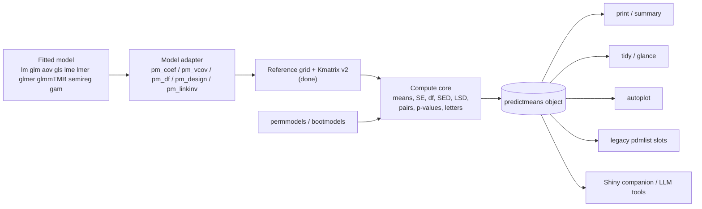

# predictmeans 2.0 — Modernisation Plan

*First drafted 2026-11-01 from the source at commit `7f398a5` (v1.1.1), the
"Overview of R Package predictmeans" deck and slides, and the proposed
seven-pillar blueprint. Revised the same day after testing in R 4.3.3 with
lme4 1.1-35, glmmTMB 1.1.8, mgcv 1.9-1, emmeans 1.10.0 and marginaleffects
0.18.0. Statements marked **(measured)** come from running code; the rest come
from reading it.*

---

## 0. Aims and summary

predictmeans 2.0 has three aims, with equal weight:

1. **Match SAS on the numbers, and run fast.** For the same model and options,
   estimates, SEs, df and p-values should agree with SAS PROC MIXED / GLIMMIX /
   GLM (LSMEANS, DIFF, SLICE, ESTIMATE, LSMESTIMATE) to stated tolerances.
   Speed should come from algorithms, not hardware.
2. **Add the features that make emmeans and marginaleffects popular**, while
   keeping what is unique to predictmeans: SED/LSD summaries, the pairwise
   p-value matrix and letters, multi-stratum permutation, semiparametric
   mixed models, Piepho R², and diagnostics.
3. **Depend on as few other packages as possible.** Model-class packages are
   only needed by users who fit those models, so they belong in Suggests.
   Small helpers are re-implemented, and heavy chains are avoided.

### Status

| Item | Status |
|---|---|
| Kmatrix v2 (reference grid, complex covariates, gam, estimability, `semipred` integration) | **Done** — commit `a7084b6` (§11) |
| Test suite: 43 cases frozen from 1.1.1, new cases checked against emmeans and mgcv | **Done** — `tests/testthat` |
| Dependencies step 1: 112 → 76 installed packages | **Done** — `a7084b6` (§6) |
| Phase 0 bug fixes (B1–B3, B5, B11–B14), options/interactive hygiene, packaging, CI | **Done** — commit `364d733` |
| Speed fixes that don't change numbers (KR in refits, R² memory, sparse Cholesky) | **Done** — `364d733` (§1.3) |
| Frozen reference extended to permutation, R², variance components, contrasts (58 cases) | **Done** |
| Phase 1, part 1: stable result tables (`means`, `pairs`, `settings`, `tidy()`), vectorised and cached Kenward–Roger df, `vcov_adjust`, `cov_reduce`/`exclude` pass-through; B6, B15–B17 fixed | **Done** — commits `a763b7d`, `83d287a` |
| Phase 1, part 2: `weights =` (SAS OM; matches emmeans), `specify_contrast()`, model adapter (`?pm_coef`); B18 fixed | **Done** — commits `2986851`, `1f8b4f4`, and the adapter commit |
| `autoplot()` (means, p-value heatmap, back-transformed) and `summary()` with a self-describing footer | **Done** |
| Own Type II/III tests (`pm_anova()`, equal to `car::Anova()`); car → Suggests; 76 → 68 packages | **Done** |
| Own Kenward–Roger (`pm_vcov_kr()`, `pm_kr_ftest()`, equal to pbkrtest); pbkrtest → Suggests; 68 → 56 packages | **Done** |
| KR-adjusted SEs default (D6); glmmTMB → Imports (D2); `permmodels()` tables independent of lme4/lmerTest fits | **Done** |
| Low-rank (Woodbury) Kenward–Roger: n = 3,000 21.5 s → < 0.05 s; n = 20,000 0.3 s; same results as pbkrtest | **Done** |
| Own vectorised Satterthwaite (equal to lmerTest, ~25x faster); lmerTest now only needed for its model class in `semireg()` and `permmodels()` tables | **Done** |
| `predictmeans()` split into seven stages (setup, estimate, compare, mean_table, backtransform, plots, assemble); all graphics after the statistics; output bit-for-bit identical on 32 option combinations (`dev/snapshot-predictmeans.R`) | **Done** |
| Containment df for lmer (`df_method = "containment"`), tested on the SAS rule; SAS script to export reference CSVs (`dev/sas/`) | **Done** |
| Stages to pure functions, part 1: mean table (`pm_mean_table()`), back-transform (`pm_back_transform()`, `pm_final_mean_table()`), compare-stage label helpers; snapshot extended to 36 calls (count data, glm `atvar`, letterCI on the response scale, ":" in levels), all identical | **Done** |
| Stages to pure functions, part 2: estimate (`pm_model_parms()`, `pm_estimate_means()`), compare (five functions), plots (`pm_make_plots()`), assemble (`pm_legacy_output()`); only setup still works on the call's state (it rewrites the arguments); direct tests of the functions; all 36 snapshot calls identical | **Done** |
| `ranova()` on `semireg()` fits: refits go through `semireg()` with the smooth bases (class `semerLmerTest`, `update()` method); `copper` data added | **Done** |
| Ideas from 1.1.2 (CRAN zip, `master` branch, July 2025 tarball), reviewed function by function. Steps: (1) `trans` kept for identity links, `glmer` Poisson counts, `transOff` in plotted data, James Curran credited — **done**; (2) glmmTMB random-effect covariance from `VarCorr()` (`R/re-terms.R`) for `R2_glmm()` (correlated terms, zero-inflation random effects, aliased columns, per-component breakdown) and `semireg_tmb()`, `nearPD` fallback — **done**; (3) `varcomp()` for glmmTMB (delta-method SEs, Wald CIs, lmer layout) — **done**; (4) `residplot()` with aliased glmmTMB coefficients (and Z-ordered random effects), `ci_mcp()` LL = UL, `model.matrix.lme(data =)` — **done**; (5) clear `adj` check, "did you mean" for `modelterm` (`R/checks.R`) — **done**; (6) SE of `glmer` variance components (`vcov_glmerMod()` sd-to-variance Jacobian; `varcomp()` for correlated glmer terms), `letterCI` help note — **done**. Then R CMD check and PR. Optional items, done after the PR: `letterCI` with `atvar` and a note giving the CI and approximate test level (`level` keeps setting the CIs, so scripts don't change) — **done**; faster `multcompLetters()` (identical letters, 200 means 103 s -> 2.1 s) — **done**; `seq_along()` clean-up — **done**. Not taken: plot helpers / `.data[[ ]]` (plotting is already in `pm_make_plots()`; `.data[[ ]]` would break responses such as `log(yield)` that `eval(parse())` evaluates). Not taken: `predictmeansN()`, `pm()`/`predmeans()`, `combinat`, `PMplot()` as ggplot, `permmodels()` nperm 999, exporting the lme/gls `model.frame`/`terms` methods | In progress |
| Tidy/LLM polish — `options(predictmeans.plot = FALSE)` to turn plots off in pipelines, `glance()`, `llms.txt` on the pkgdown site (pkgdown builds it), help pages and vignettes leading with `$means`/`$pairs`/`tidy()` — **done** (2026-11-12). Earlier note: deferred until the functions are refined one by one. While refining, put new output into the stable tables and avoid argument names that partially match old ones (e.g. `bar` → `barplot`) | Deferred |
| Phase 2 in steps (after the 1.1.2 leftovers): (1) `coef()`/`vcov()` of the means (equal to emmeans; `marginaleffects::hypotheses()` works) — **done**; (2) multiplicity: Sidak, Scheffe, single-step multivariate t (`"mvt"`, = SAS `ADJUST=SIMULATE`; mvtnorm in Suggests), in `predictmeans()` (overall and within `atvar`) and `contrastmeans()`, equal to emmeans — **done**; (3) contrast families: `contrast_family()` (pairwise, revpairwise, trt.vs.ctrl, consec, poly, eff, del.eff; `by` groups), equal to emmeans — **done**; (4) joint tests / slices: `pm_joint()` (`by` = SAS `SLICE`, or a `ctrmatrix`; KR equal to pbkrtest, Satterthwaite equal to lmerTest) — **done**; (5) response-scale SEs (delta method) in `means`, ratios / odds ratios in `pairs`, equal to emmeans — **done** (GLMM bias adjustment and response-scale averaging later); (6) slopes by group: `pm_slopes()`, equal to `emtrends()` — **done**; (7) `R2_model()`: Piepho as numbers, Nakagawa option (gaussian, binomial; Johnson's random slopes) — **done**; (8) `predictmeans()` on `semireg` fits (means with the smooth, as `semipred()`; pairs, letters) — **done**; simultaneous bands in `semipred()` (and its limits fixed to two-sided: 95% by default, was 90%) — **done**; (9) `bootmodels()` (parametric bootstrap under the global null for lmer/glmer; usable as `permlist`) — **done**; Freedman–Lane permutations: simulation study done, `permmodels(method = "freedman-lane")` for `lm`/`aov` (batched QR, no refits) — **done**. SAS validation suite waits for the CSVs | In progress |
| Phase 3 (documentation) in steps: (1) vignette "Contrasts, joint tests and slopes" — **done**; (2) "Link and response scale" (GLMs/GLMMs, ratios, `R2_model()`) — **done**; (3) "Permutation and bootstrap tests" — **done**; (4) "Smooth curves in mixed models" (`semireg`, `semipred`, simultaneous bands, `predictmeans()` on the fit) — **done**; (5) missing cells and non-estimable means — **done**; (6) `inst/llms-context.md` (result schema, defaults, recipes; a test keeps its column list complete) and a full README, from which pkgdown builds the site's `llms.txt` — **done**. "Matching SAS" waits for the SAS CSVs | In progress |
| Steps after the maintainer's rule "statistically right defaults, one decision in one place" (2026-11-13): (1) `pm_inference()` (`R/inference.R`): covariance, df and labels decided once for `predictmeans()`, `contrastmeans()`, `pm_joint()`, `pm_slopes()`, `covariatemeans()`; four copies of the df branching and three of the covariance rules removed; snapshots unchanged apart from `settings$vcov_adjust`; differences between the functions resolved (NEWS) — **done**; (2) df simulations (lmer with missing plots; lme/gls with CS, AR(1), UN; `dev/sim-df/README.md`) — **done**: Kenward–Roger holds 5% everywhere, the observed information also with missing values; the gls residual df reach 16–27% in F tests; (2b) nlme Satterthwaite/KR with a sparse block-diagonal covariance (n = 2000 unstructured gls 70 s → 3 s; same results) — **done**; (3) GLMM df simulation — **done**: residual df 9–15% for between-cluster effects, nlme's df by coefficient 4–8%; (2c) one Kenward–Roger: the observed information (as SAS) for lmer, lme, gls; `"KR-expected"` for pbkrtest's (maintainer's decision 2026-11-13) — **done**; (2d) Kenward–Roger the default for REML lme/gls (and `covariatemeans()` gains `df_method`, `vcov_adjust`; `"containment"` = nlme's/residual df, 1.x) — **done**; nested designs pinned by `test-nested.R` (emmeans is not the reference there); (3b) GLMM df by grouping level (`df_method = "inner-outer"`, default for glmer/glmmTMB; equal to nlme's fixDF when nested, extended to crossed random effects and checked by simulation; `"residual"` = 1.x) — **done**; (3c) tests from the tree-improvement examples (SAS and Genstat runs supplied 2026-11-13; `test-tree-examples.R`: Exam 4.3 nested = Genstat, not SAS/emmeans; 4.4 split plot = Genstat incl. 14.69 df across strata; 5.2 incomplete site x seedlot = SAS LS-means; 6.2 families random = SAS PROC MIXED) — **done**; Exam 3.1 (trees within plots) = Genstat for height; for diameter the plot-stratum variance is negative by ANOVA and the lmer refit of the aov (REML, bounded at zero) gives SED 1.5 on 75 df where Genstat's stratum test gives 1.074 on 4 df — fixed by (3d); Exam 8.1 (inoc on whole replicates x (country/prov), by strata) = Genstat; Exam 8.2 (clone trial, random rows, columns, clones) = SAS DDFM=KR (means, SEs, df, F) — **done**; no missing-combination warning for nested factors; (3e) SAS AR(1) run and Genstat run 1 (2026-11-13): Kenward-Roger = SAS KR(FIRSTORDER); Satterthwaite several-df F tests in SAS's basis (`pm_joint()`); Genstat's REML df use the average information (8.7) with unadjusted SEDs; Genstat AR(1) script fixed — **done**; (3f) Genstat run 2 (AR(1)): its REML df are Kenward–Roger with the average information (25.8; observed 26.62, expected 25.04), SEDs unadjusted; `df_method = "KR-average"` added as an option (maintainer's decision 2026-11-13; default unchanged) — **done**; (4) means over empty cells: the 1.x average of the observed cells with a warning stays the default (maintainer's decision 2026-11-13, replacing "NA by default"); (3d) aov `Error()` models analysed by strata (stratum mean squares, Satterthwaite across strata, as Genstat; `R/aovlist.R`), no lmer refit; fixes Exam 3.1 diameter (SED 1.074 on 4 df) — **done**; (5) edge-case data in SAS and Genstat; (6) review of every default against the evidence (`dev/review-defaults.md`; empty-cell simulation `dev/sim-empty-cells.R`: comparing means that average over different cells rejects 8–78% of true nulls, comparing on the common cells 4–6%) — **done**; its steps 1–5 proposed; (7) step 1: means over empty cells compared on common cells (`R/empty-cells.R`; column `over`; `predictmeans()`, `contrastmeans()`, `pm_joint()`; snapshots unchanged except the missing-margin case) — **done** (maintainer's yes 2026-11-13); (8) step 2: `df_term()` decides through `pm_df_method()`; the empty-cell rule in one place (`pm_empty_rule()`, `pm_empty_cells()` in `R/empty-cells.R`); snapshots identical — **done**; (9) step 3: ML `lme`/`gls` fits get Satterthwaite df from the ML log-likelihood, as ML `lmer` (`dev/sim-df-ml/`: unstructured F tests 6.3–8.8% against 9.3–11.7% with the residual df) — **done**; (10) step 4: `pm_anova()` (the `permmodels()` tables) Kenward–Roger with the observed information (`kr_information = "expected"` for `car::Anova()` parity, used by the tests) — **done**; (11) step 5: `glm` with a known dispersion (Poisson, binomial, negative binomial): z tests (`dev/sim-df-glm/`: t with the residual df 0.3–4.5%, z 3.6–5.7%); `"residual"` = 1.x — **done** | Next |
| Earlier: Phase 2 items that do not wait for SAS, one at a time: (1) `vcov =` in `predictmeans()`, `contrastmeans()`, `pm_slopes()`, `pm_joint()` (HC0–HC3 and cluster-robust CR1 for lm/glm, own code equal to `car::hccm()`/sandwich's definitions; a matrix or function for any model; df stay the model's; equal to emmeans with `vcov. =`) — **done**; then, after the first real SAS run (`dev/sas/README.md`: balanced split plot and unstructured repeated measures agree everywhere; with a plot missing KR df differ by about 1% because SAS uses the observed information): (2) `df_method = "between-within"` for lmer, lme, gls, equal to SAS — **done**; (3) KR with the observed information, as SAS, as an option: `df_method = "KR-SAS"` (closed form) — **done**; every df of the SAS run now agrees; (4) Satterthwaite df for `gls`/`lme` with any correlation and variance structure (SAS ≈ 10 where predictmeans used 30) — **done**; every LS-mean and difference df of the SAS run agrees; KR for `gls`/`lme` (`"Kenward-Roger"`, `"KR-SAS"`; first-order KR, so parameterisation-free and equal to SAS for linear structures) — **done**, SAS's KR F tests reproduced; then equivalence tests (TOST: `equivalence =` in `predictmeans()` and `contrastmeans()`, equal to emmeans) — **done**; then GLMM bias adjustment and response-scale averaging (`bias_adjust`, `sigma`, `average`, equal to emmeans) — **done**; a calibration study of `bootmodels()` (`dev/sim-boot.R`) — **done**: right where the model is right (whole-plot factor 6–7% like KR, GLMMs 4.6–5.4%), 37% with overdispersed counts fitted as Poisson (like the LRT). Earlier Next row: finish Phase 1 in two steps: (1) examples of the permutation and semiparametric functions run again (99 permutations on one core, slow parts in `\donttest{}`, HRW examples only when HRW is installed); found and fixed a `semipred()` error with numeric variables outside the grid — **done**; (2) help blocks moved next to their functions (data sets in `R/data.R`, package page in `R/predictmeans-package.R`; blocks unchanged, so the help pages are the same) — **done**. Between-within df and SAS-matched non-integer values once CSVs from a real SAS run are available (see `dev/sas/README.md`) | **Done** |

### What changed from the blueprint

- **The blueprint's direction is right, but several premises were already
  true or wrong** (§1.1): the result object is already classed, most plots are
  already ggplot, `refit()` is already used, and R² is Piepho, not Nakagawa.
- **The gaps that matter most were elsewhere:**
  - there were no tests;
  - `predictmeans()` is one 1,035-line function;
  - Kenward–Roger df is recomputed on every permutation refit;
  - Kmatrix failed on most complex covariates (§11);
  - there are a few bugs (§1.2).
- **Order:** safety net → engine and result object → new statistics →
  docs/AI → Shiny and outreach.
- **Releases:** 1.2.0 (hygiene, no intended result changes), 2.0.0 (engine
  and object), 2.1.0 (statistics), then a Shiny companion and a paper.

---

## 1. Where the code is today

### 1.1 Blueprint claims checked against the source

| Blueprint says | What the code does | What it means |
|---|---|---|
| `predictmeans()` returns an unclassed list | Class `pdmlist` with a print method (`R/misc.R:514`). | Keep `pdmlist` as a secondary class. |
| Slots are title-cased `xtabs` arrays | `mean_table` is already a flat data frame. But with `atvar`, **slot names are factor levels** (`R/predictmeans.R:1015-1021`). `mean_table` is a data frame or `list(Table, Note)` depending on `pairwise`. Columns carry the level, e.g. `"LL(95%)"`. | A stable schema is the core fix. |
| Plots need to become ggplot | Mean, bar, back-transformed, covariate and semipred plots already are. Base graphics remain only in `PMplot()`, `residplot()`, `CookD()` and `permlmer(plot = TRUE)`. | The Shiny work is narrower than described. |
| Use `lme4::refit()` for speed | Already used (`R/permmodels.R:194-222`, `R/permlmer.R:94,100`). | The real costs are elsewhere (§1.3). |
| Add Johnson (2014) random-slope trace to R² | `R2_glmm()` is **Piepho (2023)** with the full tr(P·Z·G·Zᵀ), which already covers random slopes. | Keep Piepho; add Nakagawa as an option. |
| Add semiparametric/GAM support | `smZ` + `semireg` + `semipred` already exist; gam support is now added (§11). | Build on both. |
| Restricted permutation strata | `permindex()` already does block/group shuffling. | `permute::how()` would generalise it, but adds a dependency (§6). |
| Studentised statistics | `permmodels()` already compares t and F. | Freedman–Lane added for `lm`/`aov` (`method = "freedman-lane"`). |

Your slides' own future-plan items are included: `vglm`, predictions that
include specified random effects, and glmmTMB with complex variance
structures.

### 1.2 Bugs

| # | Where | Problem | Status |
|---|---|---|---|
| B1 | `R/predictmeans.R:43,46` | Passing two or more legacy plot args (`mplot`, …) errors: `vars` resolves to `ggplot2::vars`. | **Fixed** |
| B2 | `R/predictmeans.R:821` vs `:969` | `trans = NULL` errors at return. | **Fixed** |
| B3 | `R/contrastmeans.R:87,89` vs `R/predictmeans.R:369` | Permutation p-values count `>` in `contrastmeans()` but `>=` in `predictmeans()`. | **Fixed** (both use `>=`) |
| B4 | `R/predictmeans.R:238,251,472` | Factor levels containing `":"` corrupt the pairwise tables. | **Fixed** (labels from the label table; compare-stage helpers `pm_pair_index()`, `pm_label_matrix()`) |
| B5 | `R/permmodels.R:13,165-189` | Dead glmer branch; tests `"gamma"` instead of `"Gamma"`. | **Fixed** (typo); branch revived by `bootmodels()` in Phase 2 |
| B6 | `R/predictmeans.R:465` | Tukey within `atvar` uses one averaged df for lmer. | **Fixed** (per-pair df; matches emmeans) |
| B15 | `predictmeans()` | Failed for every lmer model with a missing cell ("replacement has 12 rows, data has 11"). | **Fixed** |
| B16 | `predictmeans()` | Failed for lmer models fitted by ML. | **Fixed** (Satterthwaite df for ML fits) |
| B17 | `predictmeans()` | Tukey within `atvar` used the number of pairs as the number of means: 0.350 instead of 0.197 in the Oats example **(measured)**. | **Fixed**; matches emmeans |
| B18 | `contrastmeans()` | Failed ("non-conformable arguments") for every model with a missing cell. | **Fixed** |
| B7 | `R/Kmatrix.R` 1.1.1 | Missing cells relied on `merge(sort = FALSE)` row order. | **Not reproduced; removed** (Kmatrix v2 matches by key) |
| B8 | Kmatrix 1.1.1 | A matrix `covariateV` (documented as prediction points) was silently ignored. | **Fixed** |
| B9 | Kmatrix 1.1.1 | 16 of 22 complex-covariate cases failed (§11). | **Fixed** |
| B10 | `HRW::pointsInPoly` | Adds a spurious vertex when a polygon's last vertex doesn't repeat the first. | **Fixed** (internal version) |
| B11 | `CookD()` | Failed for every lmer model: ML refit, then Kenward–Roger df (needs REML). | **Fixed**; agrees with `lme` to 4e-7 **(measured)** |
| B12 | `permmodels()`, `CookD()` | Refitted lme/gls models from package code, so local data weren't found. Worse, a same-named data set on the search path was used silently: a local `Oats` with `nitro` as a factor was replaced by `nlme::Oats` (numeric `nitro`; 6 of 12 coefficients tested) **(measured)**. | **Fixed** (`pm_refit()` checks the coefficients) |
| B13 | `permmodels()` | Failed for gls models without a correlation structure. | **Fixed** |
| B14 | `R2_glmm()` | glmmTMB: data only found in the global environment. `over_disp = TRUE`: cryptic error without an observation-level random effect. | **Fixed** |

### 1.3 Performance hot spots

| Where | Cost | Fix | Status |
|---|---|---|---|
| `R/mymodelparm.R:45-47` | Every lmer fit computes Kenward–Roger df for every term (`pbkrtest::vcovAdj`, O(n³)). `permmodels()` does this on every refit, then discards it. | Refits skip df. | **Done**: 99 permutations on Oats 21.8 s → 2.2 s, same p-values **(measured)** |
| `predictmeans()` | KR computed separately for terms, means and every pairwise contrast, one contrast at a time. | Adjusted covariance computed once per call; KR df for all contrasts at once (identical to `pbkrtest::Lb_ddf`). | **Done**: Oats 0.96 s → 0.09 s; 780 pairs 5.3 s → 0.1 s **(measured)** |
| `R/permmodels.R:161`, `R/permlmer.R:54` | Dense n×n V, dense Cholesky, `solve()`. | Sparse Cholesky and triangular solves. | **Done** |
| `R/R2_glmm.R:71-72` | Dense n×n `V` and `P`; ~800 MB each at n = 10,000. | Traces without n×n matrices. | **Done**: n = 4,000 4.4 s / 529 MB → 0.01 s; n = 100,000 in 0.02 s **(measured)** |
| `permmodels()` lm branch | `update()` per permutation. | QR fast path; all permutations at once. | Phase 2 |
| Kmatrix | Slower on large data. | Rewritten: 0.37 s → 0.08 s (term `A`) and 1.14 s → 0.08 s (`A:B:C`) on 20,000 rows / 360 cells **(measured)**. | **Done** |

### 1.4 Engineering and CRAN hygiene

- **Tests:** a testthat suite now exists (38 tests, 167 checks). The examples
  for permutation and semiparametric functions run again (slow parts in
  `\donttest{}`).
- **Global side effects:** `options(scipen = 6)` is never restored
  (`predictmeans`, `contrastmeans`, `permmodels`). `cat()` is used in
  `R2_glmm`; the Kmatrix one now uses `message()`. `set.seed()` is called
  inside functions.
- **Parallel:** `ncore = 3` default, with hand-rolled `makeCluster` /
  `mclapply`.
- **Interactive code** in `contrastmeans()` (`readline()` / `edit()`).
- **Packaging:**
  - hand-written Rd;
  - conditional `import()` in NAMESPACE;
  - unregistered internal S3 methods;
  - `NeedsCompilation: yes` with no `src/`;
  - CRAN-generated DESCRIPTION fields;
  - `which.plots` undocumented (an R CMD check WARNING);
  - `LICENSE` file not mentioned (an R CMD check NOTE).

---

## 2. Guiding principles

1. **Numbers don't change by accident.** Results are frozen as tests before
   refactoring. Every change in a number is a documented fix or an opt-in.
2. **Statistically right first, then SAS-verifiable.** Defaults are the most
   reliable method on the evidence (simulation studies in `dev/sim-study/`,
   literature); SAS- and Genstat-matching methods stay available as options.
   Every statistic has a documented formula and a test against an external
   reference (SAS output, emmeans, mgcv, pbkrtest).
3. **Fast by construction.** Compute once and reuse: means covariance,
   df ingredients, factorisations. Never form n×n or (pairs × p) matrices
   that aren't needed. Skip work that full-rank or balanced cases don't need.
4. **One engine, many views.** A pure compute core returns one object;
   print, tidy, autoplot, gt and Shiny are views of it.
5. **Headless core.** No devices, printing, `readline()` or `options()` in
   computation.
6. **Few dependencies.** A package goes in Imports only if most users need it
   and re-implementing it would be unreasonable. Everything else goes in
   Suggests with a clear message (§6).
7. **Deprecate, don't break.** Legacy arguments and slots work through 2.x.
8. **Easy to extend to new model classes.** Everything predictmeans needs
   from a model goes through a few exported generics with sensible
   defaults (§7.1). Supporting a new class means writing those methods
   only, never editing `predictmeans()`, `Kmatrix()` or `contrastmeans()`.
   Each built-in class is just a set of these methods, and a test fits
   made-up classes to keep the contract honest.
9. **One decision, one place.** Each statistical choice (df method, which
   covariance, estimability, back-transformation) is made by one function
   and used by every front end (`predictmeans()`, `contrastmeans()`,
   `pm_joint()`, `pm_slopes()`), so the logic stays clear and a default can
   be changed in one line.

---

## 3. What to take from emmeans, marginaleffects and SAS

Checked against emmeans 1.10.0 and marginaleffects 0.18.0 (installed);
SAS from the PROC MIXED/GLIMMIX documentation.

| Capability | emmeans | marginaleffects | SAS | predictmeans 1.1.1 | Plan |
|---|---|---|---|---|---|
| Reference grid, covariate values, weights | `ref_grid(at, cov.reduce, cov.keep, nuisance, counterfactuals)`; weights equal/proportional/outer/cells/flat | `datagrid()`, `newdata = "balanced"`, `by` | `AT`, `OM` (observed margins), `BYLEVEL` | Equal weights; covariates at mean | **Done:** `cov_reduce` (function or `"average"`); `weights` equal/proportional (= SAS `OM`)/outer/cells/flat, matching emmeans |
| Non-estimable means | Flagged (estimability package) | — | "Non-est" | Silent | **Done** in K (`attr(K, "estimable")`); show in tables — Phase 1 |
| Complex covariates (`poly`, `ns`, interactions only, smooths) | Yes | Yes | Via pre-computed variables | Mostly failed | **Done** (§11) |
| Contrast families | pairwise, revpairwise, trt.vs.ctrl, dunnett, poly, consec, eff, del.eff, mean_chg; interaction contrasts; `by` | `hypothesis = ~pairwise / ~reference / ~sequential`, string equations, ratios | `DIFF=ALL/CONTROL`, `LSMESTIMATE`, `SLICEDIFF` | All pairwise; custom matrix; `atvar` ≈ `by` | **Done:** `specify_contrast()` (named contrasts, like `LSMESTIMATE`); `contrast_family()` (emmeans' families, `by`); interaction contrasts later |
| Joint tests / slices | `joint_tests()`, `test(joint = TRUE)` | `hypotheses(joint = )` | `SLICE`, `CONTRAST` | — | **Done:** `pm_joint()` slice F-tests with chosen df |
| Multiplicity | tukey, scheffe, sidak, bonferroni, dunnettx, mvt | `p_adjust` (p.adjust methods) | TUKEY(-Kramer), BON, SCHEFFE, SIDAK, DUNNETT, SIMULATE | p.adjust methods + Tukey | **Done:** sidak, scheffe, single-step multivariate t (`"mvt"`, exact counterpart of SAS `SIMULATE`); Dunnett comes with treatment-vs-control contrasts (step 3) |
| df for mixed models | KR, Satterthwaite, asymptotic | KR/Satterthwaite only for unit-level predictions; refused for averaged means **(measured)** | CONTAIN, BETWITHIN, RESIDUAL, SATTERTHWAITE, KR, KR2 | KR (falls back to Satterthwaite) for lmer; nlme inner–outer for lme | Explicit `df_method`, adding containment and between-within for lmer (rare in R) — Phase 2 |
| SE paired with KR df | KR-adjusted covariance | (unit level) | KR-adjusted covariance | **Unadjusted** covariance with KR df: SE 7.8868 vs 7.8962 on unbalanced Oats **(measured)** | **Done as an option** (`vcov_adjust = TRUE`; matches emmeans); default per decision D6 |
| Response scale | `regrid()`, `type = "response"`, `bias.adjust` | `type = "response"`, `transform`, ratio/lnor comparisons | `ILINK` | Back-transformed means and CIs; no response-scale SEs | Delta-method SEs, ratio/odds-ratio contrasts, GLMM bias adjustment — Phase 2 |
| Averaged (counterfactual) predictions, AME | `counterfactuals` | `avg_predictions`, `avg_comparisons`, `avg_slopes` | `OM` (link scale) | — | **Done** on the link scale (`cov_reduce = "average"`); response-scale averaging and AME — Phase 2 |
| Slopes by group | `emtrends()` | `slopes()` | `ESTIMATE` on slope terms | Plots only | **Done:** `pm_slopes()` |
| Robust / clustered vcov | `vcov.` argument | `vcov = "HC3"`, `~cluster` | `EMPIRICAL` | — | **Done:** `vcov =` (`"HC0"`–`"HC3"`, `~cluster`, matrix or function) |
| Equivalence tests | `test(delta, side)` | `equivalence =` | TOST via `ESTIMATE` | — | Phase 2 |
| Tidy, stable output | `as.data.frame` | Consistent data frames | ODS tables with stable names | Title-case list; dynamic names | **Done**: `means`, `pairs`, `settings`; `tidy()`, `as.data.frame()`; checked against emmeans |
| Model coverage | Many classes, extension API | 100+ classes via insight | — | 9 classes; gam added | **Adapter contract done** (§7.1, `?pm_coef`); vglm, ordinal later |

**What only predictmeans offers** (none of the three has all of it):

- SED/LSD summaries (min/mean/max, per factor);
- the pairwise p-value matrix with heatmap, and letters, including CI-based
  letters;
- multi-stratum permutation tests for mixed models;
- mixed-model semiparametric regression (`semireg`, `semipred`);
- Piepho R²;
- variance components and diagnostics in one package.

**API direction:**

- `predictmeans()` stays the one-call biometric summary, like a SAS LSMEANS
  statement.
- A small set of composable verbs sits underneath:
  - `pm_grid()` (Kmatrix v2);
  - `pm_means()`;
  - `pm_contrast()`;
  - `pm_joint()`;
  - `pm_slopes()`.
- The means object gets `coef()` and `vcov()` methods (**done**). Then
  `marginaleffects::hypotheses()` and `multcomp::glht()` work on it directly,
  instead of predictmeans re-implementing them.

---

## 4. Matching SAS on the numbers

**Target tolerances** (same model and options):

| Quantity | Tolerance |
|---|---|
| Estimates and SEs | 1e-6 relative |
| df | 1e-3 (KR implementations differ slightly) |
| p-values | 1e-4 |

**Reference values.** Sources, in order of preference:

1. Published SAS output with data:
   - SAS/STAT documentation examples for MIXED and GLIMMIX;
   - *SAS for Mixed Models* (Littell et al. 2006; Stroup et al. 2018);
   - Milliken & Johnson, *Analysis of Messy Data* (missing cells).
2. If AgResearch has SAS: a `validation/sas/` folder of `.sas` scripts that
   export ODS tables to CSV, re-run each release.
3. GenStat or ASReml for SED/LSD (optional).

Each reference goes in `tests/testthat/_data/sas/` with its provenance
(source, table, SAS version, options), tested like the 1.1.1 reference.

**Gaps to close:**

| Gap | Phase |
|---|---|
| KR-adjusted SEs (measured above) | 1 |
| Non-estimable means shown, not averaged silently | 1 |
| Containment and between-within df for lmer; `ADJDFE=ROW` (per-row df in adjusted p-values) | 2 — **done** (between-within also for lme/gls; adjusted p-values already used per-row df, now tested). `ADJDFE=SOURCE` (SAS's default) as an option waits for a SAS run with `ADJUST=TUKEY` |
| Tukey–Kramer per-row df for lmer; Dunnett, Scheffé, Šidák, simulate/multivariate-t adjustments | 2 |
| SAS definitions of LSD in unbalanced designs; documented differences from GenStat | 2 |
| Singular fits (lme4 boundary vs SAS "G matrix not positive definite"): warn and record in results | 1 — **done** (message, `settings$singular`) |

**Determinism and traceability:**

- Stored seed and RNG kind; the same result on 1 core or N cores.
- Package versions stored in each result.
- A per-release validation report mapping each requirement to its tests and
  its reference source (R Validation Hub style).

---

## 5. Speed

Measured so far: Kmatrix v2 is 4–15× faster on large data and equal on small
data.

| Technique | Where | Phase |
|---|---|---|
| Skip KR df in permutation refits; t values from the refit's covariance instead of `summary()` | `mymodelparm`, `permmodels` | **Done** |
| Sparse Cholesky (no fill-reducing permutation, so numbers are unchanged), triangular solves | `permmodels`, `permlmer` | **Done** |
| R² traces without n×n matrices | `R2_glmm` | **Done** |
| Means covariance V_m = K V Kᵀ once; SEDs from V_m. Never build the m(m−1)/2 × p pairwise matrix (1,000 levels → ~500,000 rows) | `predictmeans` | 1 |
| KR/Satterthwaite ingredients once per model (adjusted vcov, Jacobian of vcov(β) wrt θ), then vectorised over contrasts; per-model cache for Shiny re-renders | df code | 1 |
| lm and fixed-θ GLS: all permutations in one matrix solve (`qr.coef(Q, Y)`); balanced multi-stratum ANOVA through projections | `permmodels` | 2 |
| Analytic link-function Jacobians for the delta method (exact and fast); numeric fallback only for user transforms | response scale | 2 |
| Parallel backend: base `parallel` with chunked work, no extra dependency (§6) | permutations | 2 |
| Benchmarks in CI with performance budgets, set after Phase 0 measurements | all | 0 |

---

## 6. Dependencies

Measured on the installed package database (non-base packages pulled in by
Depends + Imports, recursively):

| Step | What | Installed packages |
|---|---|---|
| 1.1.1 | — | 112 |
| **Step 1 (done)** | Drop plyr; HRW, lmeInfo, lmeSplines, plotly, splines2 → Suggests | **76** |
| Step 2a (done) | Own Type II/III tests (`pm_anova()`, replaces `car::Anova`); car → Suggests | **68** |
| Step 2b (done) | Own Kenward–Roger (replaces pbkrtest; needed for SAS parity anyway); pbkrtest → Suggests as a test oracle | **56** |
| Step 3 | Own Satterthwaite (the package already holds the Jacobian code copied from lmerTest); glmmTMB and lmerTest → Suggests | 53 |
| Floor | lme4, nlme, Matrix, MASS, numDeriv, ggplot2 | 53 (42 without ggplot2) |

Per package:

| Package | Used for | Action |
|---|---|---|
| plotly | One 3-D plot; alone brings 29 packages | **Suggests (done)** |
| car | `Anova()` in `permmodels`; brings 8 packages and also pulls in pbkrtest | Own Type II/III tests (step 2) |
| pbkrtest | KR df; imports dplyr and broom | Own KR (step 2) |
| HRW | `pointsInPoly`, example data; current release needs R ≥ 4.5 | **Internal copy; Suggests (done)** |
| lmeInfo, lmeSplines, splines2 | One function each | **Suggests (done)** |
| plyr | Old Kmatrix only | **Removed (done)** |
| glmmTMB, lmerTest | Model classes, Satterthwaite | Suggests in 2.0 (D2); users who fit glmmTMB have it installed |
| numDeriv | Hessian/Jacobian for variance parameters | Keep (pure R, no dependencies), or ~20 lines of finite differences later |
| future.apply, permute, estimability, generics, lifecycle | Proposed in the first draft | **Not added.** Base `parallel` and existing `permindex()` instead; estimability is done internally. Only `generics` (tiny, no dependencies) is worth adding when `tidy()` arrives |
| ggplot2 | All plots | Keep in Imports for 2.0 (plots are core); revisit (D7) |

---

## 7. Target architecture



### 7.1 Model adapter contract

**Done** (`R/adapter.R`, `?pm_coef`). Six exported generics; the defaults
work for any class with the usual `coef`, `vcov`, `terms`, `df.residual` and
`family` methods:

| Generic | Returns | Default |
|---|---|---|
| `pm_coef(model)` | Named fixed-effect estimates (NA if aliased) | `coef()`; methods for lme, merMod, glmmTMB |
| `pm_vcov(model)` | Their covariance | `vcov()`; glmmTMB method |
| `pm_basis(model, newdata, ...)` | Design matrix for new data | `model.matrix()` with stored `predvars`, contrasts and levels; gam method (lpmatrix) |
| `pm_data(model)` | The fitting data | `NULL`: built-in search |
| `pm_df(model, L, ...)` | df per contrast row | `NULL`: model's residual df, else `Inf` |
| `pm_linkinv(model)` | Inverse link | `family()` inverse link unless identity; glm, glmer, glmmTMB methods |

Tests fit three made-up classes (only `coef`/`vcov`/`terms`/`df.residual`;
`pm_data` + `pm_df`; `pm_linkinv`) and check that the results equal `lm`/`glm`.
Still class-specific inside the code and worth moving behind generics later:
Kenward–Roger for lmer, nlme df rules, gam smooth exclusion, `semireg`.

### 7.2 The result object

```r
pm <- predictmeans(mod, "nitro:Variety")
class(pm)        # c("predictmeans", "pdmlist", "list")
pm$means         # one row per level combination
pm$pairs         # one row per pairwise comparison
pm$sed; pm$lsd   # data frames: scope, min, mean, max
pm$K             # with estimability
pm$settings      # level, adjustment, df method, covariate values, seed, versions
# legacy slots unchanged through 2.x
```

- **`pm$means` columns:** factor columns, `estimate`, `std.error`, `df`,
  `conf.low`, `conf.high`, `response`, `response.conf.low`,
  `response.conf.high`, `group`, `estimable`, `n`.
- **`pm$pairs` columns:** `level1`, `level2`, `by`, `estimate`, `std.error`,
  `df`, `statistic`, `p.value`, `p.adj`, `lsd`, `p.method`.

---

## 8. Roadmap

Sizes: **S** ≤ 2 days, **M** 1–2 weeks, **L** several weeks (rough, one
part-time person).

### Phase 0 — Safety net and hygiene → 1.2.0

| Task | Size | Status |
|---|---|---|
| testthat suite; 1.1.1 results frozen; emmeans/mgcv cross-checks | M | **Done** (43 + 34 checks) |
| Fix B1, B2, B3, B5, B11–B14; guard `readline`/`edit` with `interactive()`; restore `options()` | S | **Done** |
| DESCRIPTION hygiene, `which.plots` docs, LICENSE note | S | **Done** (R CMD check: no package warnings or notes) |
| Speed fixes that don't change numbers (§1.3) | S | **Done** |
| Extend frozen reference to `permmodels`, `permlmer`, `R2_glmm`, `varcomp`, `contrastmeans` | S | **Done** (58 cases) |
| CI on three OSes (GitHub Actions) | S | **Done** |
| roxygen2 migration; uncomment examples | M | Migration **done** (help sources next to their functions; rendered pages identical); examples **done** |
| Benchmarks script | S | **Done** (`dev/benchmarks.R`) |

### Phase 1 — Engine and object → 2.0.0

| Task | Size | Status |
|---|---|---|
| Kmatrix v2 (reference grid, complex covariates, estimability, weights) | L | **Done** |
| Split `predictmeans()` into compute steps; plot builders | L | **Done** (seven stages; pure functions; `pm_make_plots()`) |
| Model adapter; KR-adjusted SEs (D6); KR/Satterthwaite cached and vectorised | M | **Done** |
| New result object with `print`, `summary`, `tidy`, `autoplot` | M | **Done** |
| Stable internal level keys (fixes B4); B6 | M | **Done** |
| Non-estimable means shown as NA with a note | S | **Done** |
| `specify_contrast()` | S | **Done** |
| Pass `cov_reduce`/`exclude` through `predictmeans()`/`covariatemeans()` | S | **Done** |
| pkgdown site, "Getting started", "Migrating from 1.x" | M | **Done** (3 vignettes, 2 site articles, pkgdown workflow) |

### Phase 2 — Statistics → 2.1.0

| Task | Size | Status |
|---|---|---|
| Own Type II/III tests and KR; car and pbkrtest → Suggests (§6 step 2) | L | **Done** |
| Own Satterthwaite; containment and between-within df | M | **Done**, all three checked against the SAS run (`dev/sas/`) |
| Contrast families, joint tests, multiplicity methods (§3) | L | **Done** (`contrast_family()`, `pm_joint()`, Sidak/Scheffe/mvt; permutation max-|t| and Westfall–Young) |
| Response scale: delta-method SEs, ratios, bias adjustment, averaged predictions, slopes | L | **Done** (bias adjustment and response-scale averaging equal to emmeans) |
| Freedman–Lane permutation + simulation study; batched lm permutations | L | Simulation study **done** (`dev/sim-freedman-lane.md`): the current scheme keeps 5% except with a correlated covariate with extreme values (6.3–6.7%), where Freedman–Lane keeps 5%; no difference between the schemes for the two `lmer` designs (with an extreme covariate both are slightly liberal in one of three cells). `permmodels(method = "freedman-lane")` for `lm`/`aov` (batched QR projections, no refits; tests against direct refits) — **done**. lmer confirmation (1000 sets, extreme covariate): raw 6.3%, Freedman–Lane 5.0%, F 4.6%; help advises the KR/Satterthwaite F test for mixed models there — **done** |
| Robust permutation framework: the most robust scheme per model class; `permlmer()` for GLMMs (working-scale permutation) | L | Review, theory checks and a 37-case simulation study (`dev/permutation-plan.md`, `dev/sim-study/`): Lee–Braun robust in LMMs; working-scale GLMM tests keep the level for counts and binomial data but fail for rare binary events; the maintainer's fixed-effect scheme mostly fine. Step 1a done: the excess under the LMM global null came from Cholesky whitening (symmetric root: 5.2–5.3%); route B / bootstrap fix binary GLMMs; tie bug in `permlmer()` fixed. Step 2b done: order-invariant whitening in `permmodels()`/`permlmer()` (confirmed by simulation; much faster with crossed random effects). Steps 2–9 done (one PR): one permutation engine; Freedman–Lane by default for every class (`method = "auto"`), with refits for mixed models and on the working scale for GLMs/GLMMs; pairs and contrasts by Freedman–Lane; `permlmer()` for GLMMs (`permglmer()`, `permglmmTMB()`); `permindex()` fixed and usable through `perms`; study 1b (pairs; term tests with the package code). Step 10 done: Westfall–Young max-|t| (`adj = "tukey"`/`"mvt"`/`"westfall"` with a permlist). `contrastmeans(joint = TRUE)` done. Step 11 done: permutation-t confidence limits of pairs and contrasts. Step 12 done: `permmodels(robust = TRUE)` (HC3 statistics with sign flips of the Freedman–Lane residuals, for lm/glm with unequal variances). Step 13 done: `refit = TRUE` stays the default; `refit = FALSE` is enough when the tested terms' error df exceed about 100 (simulation with 6–48 blocks). Step 14 done in part: `permstats()` (effect sizes, check of the parametric test), `permcombine()` (NPC over responses, min-p adjustment); cluster tests over curves and FDP bounds left for a use case |
| `bootmodels()` (parametric bootstrap for GLMMs) | M | **Done** (global-null bootstrap for lmer/glmer; calibrated in `dev/sim-boot/`) |
| `R2_model()` (Piepho default, Nakagawa option, numeric result) | M | **Done** (Nakagawa for gaussian and binomial) |
| mgcv adapter | L | **Done** in Kmatrix and `predictmeans()` |
| `predictmeans()` accepting `semireg` objects; simultaneous bands in `semipred` | M | **Done** |
| SAS validation suite (§4) | L | **Done**: `tests/testthat/test-sas-reference.R` checks all 16 PROC MIXED runs of `dev/sas/pm-reference.sas` (2,600+ values; `_data/sas/`, provenance in its README) |

### Phase 3 — Documentation and AI readiness (alongside Phases 1–2)

- Vignettes:
  1. split-plot and missing cells;
  2. GLMM link vs response scale;
  3. permutation;
  4. smooth/spatial adjustment;
  5. matching SAS (worked comparisons);
  6. Shiny and AI agents.
- `llms.txt` and `inst/llms-context.md` with the result schema and recipes.

### Phase 4 — Shiny companion and outreach

- Separate `predictmeansShiny` package.
- Software paper after 2.1, including the SAS validation and the permutation
  simulation study.
- CRAN Task Views; demo app.

---

## 9. Backward compatibility

- Every 1.x call keeps working and returns the same legacy slots with the same
  numbers, except documented fixes. The frozen 1.1.1 reference enforces this.
- New behaviour is opt-in. Defaults change only with a NEWS entry and one
  minor version of warnings.
- The "Migrating from 1.x" vignette maps every legacy slot.

---

## 10. Decisions for the maintainer

| # | Decision | Recommendation |
|---|---|---|
| D1 | Default permutation method in 2.1 | Decide from the simulation study |
| D2 | glmmTMB and lmerTest out of Depends? | glmmTMB → Suggests in 2.0. lmerTest: removing it changes what `summary(lmer())` prints for users who don't load it — announce in 2.0, move in 2.1 |
| D3 | Shiny modules in core or companion | Companion package |
| D4 | When to stop auto-printing plots | Option in 2.0, default off in 2.1 |
| D5 | Paper timing | After 2.1 |
| D6 (decided: adjusted is the default; done) | SEs with KR df: adjusted (SAS, emmeans) or unadjusted (1.1.1)? | Adjusted by default in 2.0, `vcov_adjust = FALSE` restores 1.1.1; NEWS entry |
| D7 | ggplot2 in Imports or Suggests | Imports for 2.0; reconsider once plots are built only by `autoplot()` |
| D8 | Version numbering | Development versions as `1.1.1.9000`, release 1.2.0 after Phase 0 |

---

## 11. Appendix: Kmatrix v2 (done)

**Design** (`R/refgrid.R`, `R/Kmatrix.R`):

1. Recover the raw data used in the fit. The sources, tried lazily in this
   order, are `data`, `getData()`, the call's `data`, the model frame and the
   formula environment. The rows are then restricted to those used in fitting.
2. Build a reference grid of all factor levels × covariate values (fixed,
   varied, joint points, or observed profiles for `"average"`).
3. Evaluate the model's own basis on the grid, using stored `predvars` and
   levels: `model.matrix` for most classes, `predict.gam(type = "lpmatrix")`
   for gam.
4. Average the grid rows with a sparse weight matrix W: K = W·X.
   `semipred()` averages its smooth basis with the same W.

**Validation (measured):**

| Check | Result |
|---|---|
| 43 calls supported by 1.1.1 (K, `predictmeans`, `covariatemeans`, `semipred`) | Identical to 1.1.1 (tolerance 1e-10) |
| `poly`, `ns`, `log`, `scale`, `I()`, `A:x`, `x:z`, character, `factor(x)`, offset, lmer/lme/glmmTMB, varied covariates, `cov_reduce = median` | Equal to emmeans linear functions (max difference 0) |
| gam: K vs lpmatrix; `"average"` vs averaged lpmatrix; `predictmeans(gam)` vs `predict.gam(se.fit)` | Max difference 0, 7e-16, and 0 |
| Estimability flags on a missing-cell design | Same as emmeans |
| `semipred` with a smooth `by` factor averaged over | Equals the mean of the per-level curves (1e-13) |

Before the rewrite, 16 of the 22 probe cases failed.

**Remaining Kmatrix work (Phase 1):**

- `weights = "proportional"/"cells"` (SAS `OM`);
- `specify_contrast()`;
- show estimability in `predictmeans()` tables;
- pass `cov_reduce`/`exclude` through `predictmeans()` and `covariatemeans()`.
