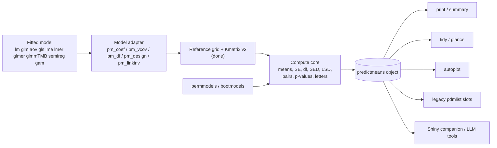

# predictmeans 2.0 — Modernisation Plan

*First drafted 2026-11-01 from the source at commit `7f398a5` (v1.1.1), the
"Overview of R Package predictmeans" deck and slides, and the proposed
seven-pillar blueprint. Revised the same day after testing in R 4.3.3 with
lme4 1.1-35, glmmTMB 1.1.8, mgcv 1.9-1, emmeans 1.10.0 and marginaleffects
0.18.0. Statements marked **(measured)** come from running code; the rest come
from reading it.*

---

## 0. Aims and summary

predictmeans 2.0 has three aims, with equal weight:

1. **Match SAS on the numbers, and run fast.** For the same model and options,
   estimates, SEs, df and p-values should agree with SAS PROC MIXED / GLIMMIX /
   GLM (LSMEANS, DIFF, SLICE, ESTIMATE, LSMESTIMATE) to stated tolerances.
   Speed should come from algorithms, not hardware.
2. **Add the features that make emmeans and marginaleffects popular**, while
   keeping what is unique to predictmeans: SED/LSD summaries, the pairwise
   p-value matrix and letters, multi-stratum permutation, semiparametric
   mixed models, Piepho R², and diagnostics.
3. **Depend on as few other packages as possible.** Model-class packages are
   only needed by users who fit those models, so they belong in Suggests.
   Small helpers are re-implemented, and heavy chains are avoided.

### Status

| Item | Status |
|---|---|
| Kmatrix v2 (reference grid, complex covariates, gam, estimability, `semipred` integration) | **Done** — commit `a7084b6` (§11) |
| Test suite: 43 cases frozen from 1.1.1, new cases checked against emmeans and mgcv | **Done** — `tests/testthat` |
| Dependencies step 1: 112 → 76 installed packages | **Done** — `a7084b6` (§6) |
| Phase 0 bug fixes (B1–B3, B5, B11–B14), options/interactive hygiene, packaging, CI | **Done** — commit `364d733` |
| Speed fixes that don't change numbers (KR in refits, R² memory, sparse Cholesky) | **Done** — `364d733` (§1.3) |
| Frozen reference extended to permutation, R², variance components, contrasts (58 cases) | **Done** |
| Phase 1, part 1: stable result tables (`means`, `pairs`, `settings`, `tidy()`), vectorised and cached Kenward–Roger df, `vcov_adjust`, `cov_reduce`/`exclude` pass-through; B6, B15–B17 fixed | **Done** — commits `a763b7d`, `83d287a` |
| Phase 1, part 2: `weights =` (SAS OM; matches emmeans), `specify_contrast()`, model adapter (`?pm_coef`); B18 fixed | **Done** — commits `2986851`, `1f8b4f4`, and the adapter commit |
| `autoplot()` (means, p-value heatmap, back-transformed) and `summary()` with a self-describing footer | **Done** |
| Own Type II/III tests (`pm_anova()`, equal to `car::Anova()`); car → Suggests; 76 → 68 packages | **Done** |
| Own Kenward–Roger (`pm_vcov_kr()`, `pm_kr_ftest()`, equal to pbkrtest); pbkrtest → Suggests; 68 → 56 packages | **Done** |
| KR-adjusted SEs default (D6); glmmTMB → Imports (D2); `permmodels()` tables independent of lme4/lmerTest fits | **Done** |
| Low-rank (Woodbury) Kenward–Roger: n = 3,000 21.5 s → < 0.05 s; n = 20,000 0.3 s; same results as pbkrtest | **Done** |
| Own vectorised Satterthwaite (equal to lmerTest, ~25x faster); lmerTest now only needed for its model class in `semireg()` and `permmodels()` tables | **Done** |
| `predictmeans()` split into seven stages (setup, estimate, compare, mean_table, backtransform, plots, assemble); all graphics after the statistics; output bit-for-bit identical on 32 option combinations (`dev/snapshot-predictmeans.R`) | **Done** |
| Containment df for lmer (`df_method = "containment"`), tested on the SAS rule; SAS script to export reference CSVs (`dev/sas/`) | **Done** |
| Stages to pure functions, part 1: mean table (`pm_mean_table()`), back-transform (`pm_back_transform()`, `pm_final_mean_table()`), compare-stage label helpers; snapshot extended to 36 calls (count data, glm `atvar`, letterCI on the response scale, ":" in levels), all identical | **Done** |
| Stages to pure functions, part 2: estimate (`pm_model_parms()`, `pm_estimate_means()`), compare (five functions), plots (`pm_make_plots()`), assemble (`pm_legacy_output()`); only setup still works on the call's state (it rewrites the arguments); direct tests of the functions; all 36 snapshot calls identical | **Done** |
| `ranova()` on `semireg()` fits: refits go through `semireg()` with the smooth bases (class `semerLmerTest`, `update()` method); `copper` data added | **Done** |
| Ideas from 1.1.2 (CRAN zip, `master` branch, July 2025 tarball), reviewed function by function. Steps: (1) `trans` kept for identity links, `glmer` Poisson counts, `transOff` in plotted data, James Curran credited — **done**; (2) glmmTMB random-effect covariance from `VarCorr()` (`R/re-terms.R`) for `R2_glmm()` (correlated terms, zero-inflation random effects, aliased columns, per-component breakdown) and `semireg_tmb()`, `nearPD` fallback — **done**; (3) `varcomp()` for glmmTMB (delta-method SEs, Wald CIs, lmer layout) — **done**; (4) `residplot()` with aliased glmmTMB coefficients (and Z-ordered random effects), `ci_mcp()` LL = UL, `model.matrix.lme(data =)` — **done**; (5) clear `adj` check, "did you mean" for `modelterm` (`R/checks.R`) — **done**; (6) SE of `glmer` variance components (`vcov_glmerMod()` sd-to-variance Jacobian; `varcomp()` for correlated glmer terms), `letterCI` help note — **done**. Then R CMD check and PR. Optional items, done after the PR: `letterCI` with `atvar` and a note giving the CI and approximate test level (`level` keeps setting the CIs, so scripts don't change) — **done**; faster `multcompLetters()` (identical letters, 200 means 103 s -> 2.1 s) — **done**; `seq_along()` clean-up — **done**. Not taken: plot helpers / `.data[[ ]]` (plotting is already in `pm_make_plots()`; `.data[[ ]]` would break responses such as `log(yield)` that `eval(parse())` evaluates). Not taken: `predictmeansN()`, `pm()`/`predmeans()`, `combinat`, `PMplot()` as ggplot, `permmodels()` nperm 999, exporting the lme/gls `model.frame`/`terms` methods | **Done** |
| Tidy/LLM polish — `options(predictmeans.plot = FALSE)` to turn plots off in pipelines, `glance()`, `llms.txt` on the pkgdown site (pkgdown builds it), help pages and vignettes leading with `$means`/`$pairs`/`tidy()` — **done** (2026-11-12). Earlier note: deferred until the functions are refined one by one. While refining, put new output into the stable tables and avoid argument names that partially match old ones (e.g. `bar` → `barplot`) | **Done** |
| Phase 2 in steps (after the 1.1.2 leftovers): (1) `coef()`/`vcov()` of the means (equal to emmeans; `marginaleffects::hypotheses()` works) — **done**; (2) multiplicity: Sidak, Scheffe, single-step multivariate t (`"mvt"`, = SAS `ADJUST=SIMULATE`; mvtnorm in Suggests), in `predictmeans()` (overall and within `atvar`) and `contrastmeans()`, equal to emmeans — **done**; (3) contrast families: `contrast_family()` (pairwise, revpairwise, trt.vs.ctrl, consec, poly, eff, del.eff; `by` groups), equal to emmeans — **done**; (4) joint tests / slices: `pm_joint()` (`by` = SAS `SLICE`, or a `ctrmatrix`; KR equal to pbkrtest, Satterthwaite equal to lmerTest) — **done**; (5) response-scale SEs (delta method) in `means`, ratios / odds ratios in `pairs`, equal to emmeans — **done** (GLMM bias adjustment and response-scale averaging later); (6) slopes by group: `pm_slopes()`, equal to `emtrends()` — **done**; (7) `R2_model()`: Piepho as numbers, Nakagawa option (gaussian, binomial; Johnson's random slopes) — **done**; (8) `predictmeans()` on `semireg` fits (means with the smooth, as `semipred()`; pairs, letters) — **done**; simultaneous bands in `semipred()` (and its limits fixed to two-sided: 95% by default, was 90%) — **done**; (9) `bootmodels()` (parametric bootstrap under the global null for lmer/glmer; usable as `permlist`) — **done**; Freedman–Lane permutations: simulation study done, `permmodels(method = "freedman-lane")` for `lm`/`aov` (batched QR, no refits) — **done**. SAS validation suite — **done** (real SAS runs of 2026-11-12 to 2026-11-17 in `dev/sas/`: 16 PROC MIXED runs, Tukey-Kramer with `ADJDFE`, AR(1), variance components, `COVTEST`; tested in `test-sas-reference.R`, `test-sas-adjust.R`, `test-sas-ar1.R`, `test-kr-sas.R`; Genstat in `test-genstat-reference.R`) | **Done** |
| Phase 3 (documentation) in steps: (1) vignette "Contrasts, joint tests and slopes" — **done**; (2) "Link and response scale" (GLMs/GLMMs, ratios, `R2_model()`) — **done**; (3) "Permutation and bootstrap tests" — **done**; (4) "Smooth curves in mixed models" (`semireg`, `semipred`, simultaneous bands, `predictmeans()` on the fit) — **done**; (5) missing cells and non-estimable means — **done**; (6) `inst/llms-context.md` (result schema, defaults, recipes; a test keeps its column list complete) and a full README, from which pkgdown builds the site's `llms.txt` — **done**. (7) "Matching SAS PROC MIXED" (`vignette("sas")`, from the real SAS runs) — **done** | **Done** |
| Steps after the maintainer's rule "statistically right defaults, one decision in one place" (2026-11-13): (1) `pm_inference()` (`R/inference.R`): covariance, df and labels decided once for `predictmeans()`, `contrastmeans()`, `pm_joint()`, `pm_slopes()`, `covariatemeans()`; four copies of the df branching and three of the covariance rules removed; snapshots unchanged apart from `settings$vcov_adjust`; differences between the functions resolved (NEWS) — **done**; (2) df simulations (lmer with missing plots; lme/gls with CS, AR(1), UN; `dev/sim-df/README.md`) — **done**: Kenward–Roger holds 5% everywhere, the observed information also with missing values; the gls residual df reach 16–27% in F tests; (2b) nlme Satterthwaite/KR with a sparse block-diagonal covariance (n = 2000 unstructured gls 70 s → 3 s; same results) — **done**; (3) GLMM df simulation — **done**: residual df 9–15% for between-cluster effects, nlme's df by coefficient 4–8%; (2c) one Kenward–Roger: the observed information (as SAS) for lmer, lme, gls; `"KR-expected"` for pbkrtest's (maintainer's decision 2026-11-13) — **done**; (2d) Kenward–Roger the default for REML lme/gls (and `covariatemeans()` gains `df_method`, `vcov_adjust`; `"containment"` = nlme's/residual df, 1.x) — **done**; nested designs pinned by `test-nested.R` (emmeans is not the reference there); (3b) GLMM df by grouping level (`df_method = "inner-outer"`, default for glmer/glmmTMB; equal to nlme's fixDF when nested, extended to crossed random effects and checked by simulation; `"residual"` = 1.x) — **done**; (3c) tests from the tree-improvement examples (SAS and Genstat runs supplied 2026-11-13; `test-tree-examples.R`: Exam 4.3 nested = Genstat, not SAS/emmeans; 4.4 split plot = Genstat incl. 14.69 df across strata; 5.2 incomplete site x seedlot = SAS LS-means; 6.2 families random = SAS PROC MIXED) — **done**; Exam 3.1 (trees within plots) = Genstat for height; for diameter the plot-stratum variance is negative by ANOVA and the lmer refit of the aov (REML, bounded at zero) gives SED 1.5 on 75 df where Genstat's stratum test gives 1.074 on 4 df — fixed by (3d); Exam 8.1 (inoc on whole replicates x (country/prov), by strata) = Genstat; Exam 8.2 (clone trial, random rows, columns, clones) = SAS DDFM=KR (means, SEs, df, F) — **done**; no missing-combination warning for nested factors; (3e) SAS AR(1) run and Genstat run 1 (2026-11-13): Kenward-Roger = SAS KR(FIRSTORDER); Satterthwaite several-df F tests in SAS's basis (`pm_joint()`); Genstat's REML df use the average information (8.7) with unadjusted SEDs; Genstat AR(1) script fixed — **done**; (3f) Genstat run 2 (AR(1)): its REML df are Kenward–Roger with the average information (25.8; observed 26.62, expected 25.04), SEDs unadjusted; `df_method = "KR-average"` added as an option (maintainer's decision 2026-11-13; default unchanged) — **done**; (4) means over empty cells: the 1.x average of the observed cells with a warning stays the default (maintainer's decision 2026-11-13, replacing "NA by default"); (3d) aov `Error()` models analysed by strata (stratum mean squares, Satterthwaite across strata, as Genstat; `R/aovlist.R`), no lmer refit; fixes Exam 3.1 diameter (SED 1.074 on 4 df) — **done**; (5) edge-case data in SAS and Genstat; (6) review of every default against the evidence (`dev/review-defaults.md`; empty-cell simulation `dev/sim-empty-cells.R`: comparing means that average over different cells rejects 8–78% of true nulls, comparing on the common cells 4–6%) — **done**; its steps 1–5 proposed; (7) step 1: means over empty cells compared on common cells (`R/empty-cells.R`; column `over`; `predictmeans()`, `contrastmeans()`, `pm_joint()`; snapshots unchanged except the missing-margin case) — **done** (maintainer's yes 2026-11-13); (8) step 2: `df_term()` decides through `pm_df_method()`; the empty-cell rule in one place (`pm_empty_rule()`, `pm_empty_cells()` in `R/empty-cells.R`); snapshots identical — **done**; (9) step 3: ML `lme`/`gls` fits get Satterthwaite df from the ML log-likelihood, as ML `lmer` (`dev/sim-df-ml/`: unstructured F tests 6.3–8.8% against 9.3–11.7% with the residual df) — **done**; (10) step 4: `pm_anova()` (the `permmodels()` tables) Kenward–Roger with the observed information (`kr_information = "expected"` for `car::Anova()` parity, used by the tests) — **done**; (11) step 5: `glm` with a known dispersion (Poisson, binomial, negative binomial): z tests (`dev/sim-df-glm/`: t with the residual df 0.3–4.5%, z 3.6–5.7%); `"residual"` = 1.x — **done**; (12) SAS Tukey–Kramer run: `adj = "tukey"` = SAS `ADJDFE=ROW` in all 69 differences (`test-sas-adjust.R`) — **done**; (13) the maintainer's edge-case data rechecked (DataExam4.3, mod_df, count_df: 1.1.1 failed on 5 of 11 calls, 2.0 on none but one invalid term): fixed a stop with per-pair df when pairs are not estimable, and common-cell matching now only on factors with shared effects (mod_df: no NA pairs across dates) — **done**; (14) A: Type III tests independent of the contrasts (sum-to-zero hypotheses mapped onto the model's coefficients; = SAS Type 3, = `car::Anova()` with sum-to-zero contrasts) — **done**; (15) B: `residplot()` in ggplot2 for every model class (randomized quantile residuals for Poisson/binomial/negative binomial, plotly with `interactive = TRUE`; `rsplot.lme`/`rsplot.gls` removed) — **done**; (16) C: `pm_check()` (fit, outliers, influence, normality, equal variances, overdispersion, interactions, straight line for numeric-level factors, aliasing; notes, no automatic decisions) — **done**; (17) Genstat runs of 2026-11-14 as reference tests (`test-genstat-reference.R`: 6 REML analyses agree except one df in the empty-cell model; Genstat's F = KR scaling x Wald/df); (18) `aov(... Error())` with missing values: estimated as Genstat's ANOVA (lowest-stratum residual SS, then the next stratum up), exact SEDs, message recommending REML (maintainer's decision 2026-11-14) — **done**; (19) speed check against main before today's work (`dev/benchmarks.R`, now with permutation tests and empty cells): nothing slower except `permmodels(type = "III")` for `lm` (2.3 → 3.3 s for 999 permutations), fixed by computing the Type III map once (1.9 s) — **done**; (20) adjusted confidence limits `adj.conf.low`/`adj.conf.high` in `pairs` (tukey, bonferroni, sidak, scheffe, mvt; permutation max-|t|), = SAS AdjLower/AdjUpper and emmeans; `conf.low`/`conf.high` always per comparison; fixed `level` without `letterCI` stopping — **done**; (21) vignette "Checking the model" and the df table in the main vignette — **done**; (22) the same adjusted limits in `contrastmeans()` (`adj.lower.CL`, `adj.upper.CL`; Scheffé with the rank of `ctrmatrix`), = emmeans — **done**; (23) release preparation for 2.0.0, without releasing (maintainer, 2026-11-13: more improvements first): decisions D2, D4, D7, D8 recorded; NEWS "In short" and "Planned for 2.1" (lmerTest to Suggests, `plot = FALSE` default); `cran-comments.md` draft; CI job with the tests as on CRAN (140 s locally; slowest example `semireg_tmb` 3.0 s); reverse dependency check workflow (`workflow_dispatch`, runs once on main; CRAN is not reachable from the development container) — **done**. At release: Version 2.0.0, NEWS heading, run revdep-check and win-builder, fill `cran-comments.md`; (24) one computation of the pair statistics (`pm_pair_table()`; families and adjustments in `R/p-adjust.R` for `predictmeans()`, `contrastmeans()`, `pm_slopes()`, semireg means; `level` no longer overwritten: `lsd_level`, `ci_level`); snapshot (52 calls, 13 new) unchanged except the disagreements it removes (permlist letters at `level`; Tukey k and Scheffe rank with non-estimable means) — **done**; (25) review of the week's additions with edge-case batteries (22 model classes through `pm_check()`/`residplot()`, 20 empty-cell designs, 8 aov designs): fixed `subset` rows taken as missing values, aov missing values without n x n matrices (n = 2000: 11 s → 0.2 s), a dead check, empty-cell warning labels with covariates, loess and equal-variance warnings; not changed: `contrastmeans()` stops when a contrast uses a cell without data (clear message), `aov()` itself fails with NA in an Error() factor — **done**; (26) GLMMs with rare binary events: no change needed (random effects: route B, the default for 0/1, 6.2%; fixed effects: refits 4.1%, `refit = FALSE` 3.1%, LRT 7.1%; `dev/sim-perm-fixed/`); timing check in CI against the base branch — **done**; (27) maintainer's decisions of 2026-11-14 on D2/D4: (A) `permmodels()` lmer tables from own Satterthwaite (`pm_lmer_tables()`; type I rows unit-diagonal as lmerTest; snapshot of the permutation functions identical) — **done**; (B) lmerTest from Depends to Imports in 2.0 (class imported for `semireg()`; examples call `lmerTest::ranova()`); `plot = FALSE` the default in 2.0, plots named by `which.plots` etc. still drawn — **done**; (28) `varcomp()` for every class (lm/glm/aov error terms, aov strata, gls/lme structures, glmer, glmmTMB structured terms, gam, semireg): delta method from the observed information, `information = "average"` = Genstat's s.e. (17/17), Satterthwaite intervals (SAS COVTEST CL), boundary rule; estimates = SAS (17 values) and Genstat; lmer, lme, aov, glmmTMB agree on balanced data; lmer 7.6 s -> 0.06 s; merDeriv code (350 lines) and lmeInfo dropped; SAS and Genstat programs with edge cases for reference SEs (`dev/sas/pm-reference-varcomp.sas`, `dev/genstat/pm-reference-3.gen`) — **done**; (29) their runs (2026-11-14) as reference tests: SAS 10 designs (estimates, observed-information SEs, Satterthwaite limits, UN covariance SEs by the delta method; 110 values) and Genstat 5 designs (average-information s.e., Dyestuff2's negative component = `aov` estimate; 26 values) agree to the printed digits; SAS's covariance/correlation limits are Wald, ours Fisher z (by design) — **done**; (30) review of `predictmeans()`, first part (2026-11-14): several hundred means (breeding lines): above 100 means and no comparison asked for, SED and LSD summaries from the covariance of the means, no pair table (`pm_sed_summary()`, `pm_max_means()`; 200 lines 47 s -> 0.7 s, same results; no letter groups above 100 means); SEDs of the pairs without the pairs' covariance matrix; one Tukey quantile per distinct df; snapshot of 52 calls unchanged (1e-10) — **done**; (31) `PMplot()` in ggplot2 (the maintainer's code, tidied): square level plot, `values`, blocks for lists; `autoplot(type = "pvalue")` draws the same plot (`pm_ptile_plot()`) — **done**; (32) `Kmatrix()` review (maintainer's yes of 2026-11-14): covariate values by name (`pm_cov_values()`; names were ignored, values recycled); any combination of fixed-effect variables as `modelterm` (covariates too; `predictmeans()` takes factor combinations that are not a term, with a note, df by `pm_term_df()`, estimable combinations without data shown); averaging by groups of interacting variables (`pm_average_by_groups()`: 324,000 grid rows 3.6 s -> 0.14 s; equal to the full grid in 592 of 592 cases); cells per interaction term and no 0/1 exemption (`pm_empty_rule()`); `pm_contrasts()` generic, no model matrix of the data for names; `aov` with `Error()`; snapshot of 52 `predictmeans()` calls unchanged — **done**. Kept for the maintainer's decision: nesting that is only in the data (`y ~ G + T`) stays NA with a note, because the same rule would make the spray-trial example (vol 400 only with fine droplets) estimable; (33) maintainer's yes of 2026-11-15 to three proposals: (a) the printed LSDs take the critical value that goes with `adj` and its family (`pm_lsd_crit()`; tukey = HSD, bonferroni/sidak, scheffe, mvt; step-wise methods unadjusted with a note; Bonferroni with `atvar` within levels) — **done**; (b) comparison intervals (`R/comparison.R`: mean +- c SE, c = crit x SED/(SE1 + SE2) averaged over the pairs; exact with equal SEDs, disagreeing pairs counted; `means$comparison.low/high`, `settings$comparison`, `summary()`, `autoplot(interval = "comparison")`) and `letterCI` reading its letters from them with `level` the test level — **done**; bands for the difference between curves in `covariatemeans()`/`semipred()` not yet (help note only); long plot titles broken into lines in every plot (`pm_wrap_title()`, `R/plot-title.R`; maintainer's request 2026-11-15) — **done**; (c) back-transformation (`R/back-transform.R`): a transformed response in the formula is back-transformed by default (`pm_response_trans()`; log, powers, reciprocal, logit, `pm_boxcox()`, `pm_yeojohnson()`); `bias_adjust = TRUE` is the mean by Gauss-Hermite quadrature (exact for log and sqrt; `"taylor"` = emmeans); `settings$back_transform` says what the back-transformed mean is; `pm_check()` gives the Box-Cox power; `covariatemeans()` no longer adds SE/2 inside `exp()` — **done**; nesting only in the data: NA with the hint to write `G/T` or use `weights = "cells"` (maintainer's decision A, 2026-11-15) — **done**; (34) structure of `predictmeans()` (maintainer's yes, 2026-11-15): the stages are functions with named results (`opt <- pm_setup()`, `est <- pm_estimate(opt)`, `cmp <- pm_compare(opt, est)`, `tab <- pm_tables(opt, est, cmp)`, `pm_flat()`, `pm_make_plots()`, `pm_assemble()`), no quoted code evaluated in the call's environment; `plot_args` holds the eleven plot settings (1.x names still accepted through `...`; `mplot`, `barplot`, `pplot`, `bkplot` no longer formals, still honoured with the warning); snapshot of 52 calls identical at tolerance 0 — **done**; (35) `covariatemeans(contr = )`: the difference between two levels along the covariate with its band (`pm_cov_difference()`; `semipred()` had `contr`) — **done**; merged as PR #34; (36) review of the other functions, step 1 (2026-11-15): every main function run on 13 model classes; `covariatemeans(contr = )` band on both scales (model scale with ratio / odds ratio; response scale by the delta method; = emmeans for GLM, glmer, glmmTMB; simulated coverage 94% against 100% for the difference of the lines' limits); `aov` with `Error()` and a covariate works in `covariatemeans()` (by strata; = lmer in a balanced repeated-measures example; the maintainer's correction of 2026-11-15: such models can have covariates) — **done**; `R2_model()` for every class of `predictmeans()` (`R/r2-classes.R`: one Piepho calculation, each class gives its parts; lm = adjusted R2, lme and aov with `Error()` = lmer, glm = glmmTMB without random effects; `R2_glmm()` unchanged, the maintainer's decision of 2026-11-15) — **done**; `covariatemeans(contr = )`: the maintainer's decisions of 2026-11-16: the plot is on the model scale by default (ratio / odds ratio where exact), the response-scale difference is an option (`contr_scale`) that describes size and is not a second test; `band = "simultaneous"` (Scheffe through `pm_adjust_crit()`; Working-Hotelling for lines), the joint F test (`pm_inference()$ftest`) and the significant ranges of the covariate are returned and printed; reasoning in `?covariatemeans` ("Comparing two lines") and `vignette("response-scale")` — **done**; `covariatemeans(bias_adjust =, sigma =)` (the code of `predictmeans()`: `pm_cov_back()`), and `semipred(contr = )` on the same difference code as `covariatemeans()` (`pm_diff_table()`, `pm_diff_plot()`, `pm_diff_report()`; this corrected the band of a generalized model's difference, which used a weight evaluated at the difference of the means) — **done**; covariance behind the difference bands checked (maintainer's request of 2026-11-16): `covariatemeans()` = emmeans (Kenward-Roger SE and df for lmer); `semireg()`'s covariance = `vcov(model, use.hessian = FALSE)` after a fix for 0/1 responses (it used 3/pi^2 as weight; SEs 15-25% too small); coverage simulation in `dev/sim-curve-difference.R` (linear 0.96; Poisson/binary 0.92-0.94 pointwise, 0.87 simultaneous) — **done**; open: `semireg()` centres every numeric variable but the first of the response, so `cbind(successes, failures)` responses fail ("Response is constant"), for the `semireg()` upgrade; GLMM bands of `semipred()` are conditional on the smoothing parameters (a correction, as mgcv's `unconditional = TRUE`, would raise coverage); `semipred()` means of a generalized model use symmetric limits mean ± c·SE on the response scale (clipped for binomial) with a weight that is the delta-method one only for canonical links — back-transformed limits would be better, to decide; gaps left, to decide: `CookD()` for `lm`/`glm`/GLMMs, `bootmodels()` beyond lmer/glmer, `permmodels()` for `aov` with `Error()` (all closed by PR #35; open questions in section 10.1) | **Done** |
| Earlier: Phase 2 items that do not wait for SAS, one at a time: (1) `vcov =` in `predictmeans()`, `contrastmeans()`, `pm_slopes()`, `pm_joint()` (HC0–HC3 and cluster-robust CR1 for lm/glm, own code equal to `car::hccm()`/sandwich's definitions; a matrix or function for any model; df stay the model's; equal to emmeans with `vcov. =`) — **done**; then, after the first real SAS run (`dev/sas/README.md`: balanced split plot and unstructured repeated measures agree everywhere; with a plot missing KR df differ by about 1% because SAS uses the observed information): (2) `df_method = "between-within"` for lmer, lme, gls, equal to SAS — **done**; (3) KR with the observed information, as SAS, as an option: `df_method = "KR-SAS"` (closed form) — **done**; every df of the SAS run now agrees; (4) Satterthwaite df for `gls`/`lme` with any correlation and variance structure (SAS ≈ 10 where predictmeans used 30) — **done**; every LS-mean and difference df of the SAS run agrees; KR for `gls`/`lme` (`"Kenward-Roger"`, `"KR-SAS"`; first-order KR, so parameterisation-free and equal to SAS for linear structures) — **done**, SAS's KR F tests reproduced; then equivalence tests (TOST: `equivalence =` in `predictmeans()` and `contrastmeans()`, equal to emmeans) — **done**; then GLMM bias adjustment and response-scale averaging (`bias_adjust`, `sigma`, `average`, equal to emmeans) — **done**; a calibration study of `bootmodels()` (`dev/sim-boot.R`) — **done**: right where the model is right (whole-plot factor 6–7% like KR, GLMMs 4.6–5.4%), 37% with overdispersed counts fitted as Poisson (like the LRT). Earlier Next row: finish Phase 1 in two steps: (1) examples of the permutation and semiparametric functions run again (99 permutations on one core, slow parts in `\donttest{}`, HRW examples only when HRW is installed); found and fixed a `semipred()` error with numeric variables outside the grid — **done**; (2) help blocks moved next to their functions (data sets in `R/data.R`, package page in `R/predictmeans-package.R`; blocks unchanged, so the help pages are the same) — **done**. Between-within df and SAS-matched non-integer values once CSVs from a real SAS run are available (see `dev/sas/README.md`) | **Done** |
| Semi-parametric upgrade (maintainer's request of 2026-11-17; decisions: smooths in the formula with automatic fixed terms, `s(x, f1*f2)` as an ANOVA-like split, mgcv bases + own O'Sullivan/Ztps). Steps in `dev/review-semireg.md` section 6: (1) review note — **done**; (2) one fitting engine for `semireg()`/`semireg_tmb()` — **done** (same fits, one fit instead of two; fixed: Satterthwaite df and `varcomp()` SEs of gaussian fits used the placeholder model's deviance; zero smoothing variance; `cbind()` responses; data kept out of the caller's frame); (3) formula smooths — **done** (`R/semireg-smooth.R`: mgcv set-up + `smooth2random()`, fixed terms added automatically, own bases `os`/`ztps` as mgcv smooth classes; equal to `gam(REML)` and `predict.gam()`; fixed: `semireg_tmb()` SEs scaled by theta for negative binomial; tensor products `t2()` later, O14 (5)); (4) crossed-factor syntax — **done** (`s(x, f)`, `s(x, f1:f2)`, `s(x, f1*f2)`, `s(x1, x2, f)`: common curve + deviation curves per factor term, a variance each; equal to the lme form); (5) smoothing-parameter correction (O5) — **done** (`pm_sr_uncond()`; default on for generalized fits after the coverage simulation: Poisson/binary 0.93 -> 0.956 pointwise, 0.89-0.91 -> 0.94-0.95 whole curve); KR/Satterthwaite without lmerTest: own KR df equal to `lme` on semireg fits, lmerTest dropped (maintainer, 2026-11-17): `anova.lmerMod()` (KR/Satterthwaite/Type I-III, lme4 comparisons unchanged), `anova.semireg()` (fixed effects + LRT of each smooth, boundary-halved), class `semerMod`; KR leaves zero variance components out (as SAS) — **done**; prediction of the `smoothZ` form kept by re-evaluating its call (drops `k`, safe); (6) HRW reproduction — **done** with the maintainer's golden lme scripts (`dev/semireg-golden/`, data in `inst/extdata/semireg/`, `test-semireg-golden.R`): 7 lme fits reproduced exactly (log-likelihood, fitted values to 2e-5 SD), gamm/gam examples equal `gam(REML)`; added random curves `(s(x) | g)` (HRW's group-specific curves in formula form), `xt = list(knots, range)` for `os`/`ztps`; fixed: the basis-to-random map failed for covariates with few distinct values and for `fs` with small subjects; O10: optimizer `nloptwrap` (decided, done); (7) only-predictmeans cases — **done** (`test-semireg-cases.R`, vignette section "What predictmeans adds"; new: Satterthwaite df for `predictmeans()` on gaussian semireg fits (fixed + smooth coefficients), Type I error 4.6% vs 5.2-6.8% for z (`dev/sim-semireg-df.R`); smooth-variance LRT conservative, 1-3% at 5% (`dev/sim-semireg-lrt.R`); df for `semipred()` bands and the exact RLRT later, O14 (1) and O12); (8) docs — **done** (`vignette("smooth")` in the formula form with a migration table from `smoothZ`, help, `inst/llms-context.md`; found and fixed: smooth blocks scaled as random intercepts so lme4 starts near the optimum (an `id = 1` fit had stopped at a worse local optimum; growth curves 18 s -> 8 s)); (9) check and PR — **done** (PR #36; the follow-up work of O12–O15 in PR #37, merged 2026-11-17) | **Done** |
| `semiboundary()` (maintainer's request of 2026-11-17: a boundary from longitude and latitude for `semipred(boundary = )`, following the density of the data): closing of the data with d = 2 x the 95th percentile of nearest-neighbour distances (median-based d gave spurious holes and pieces on random designs), rings with holes (even-odd), `semipred(boundary = TRUE)`; `test-semiboundary.R` | **Done** |
| What remains (2026-11-17): (1) release 2.0.0 when the maintainer decides (D8; `cran-comments.md` drafted: version and NEWS heading, win-builder and mac-builder, reverse dependencies); (2) items marked "later": more classes through the adapters (`vglm`, `ordinal`; §3 table), class-specific code behind the adapter generics (Kenward–Roger for lmer, nlme df rules, gam smooth exclusion, `semireg`; §7.1), numDeriv kept (checked 2026-11-17: glmmTMB, in Imports, imports it, so dropping it saves no package; lmerTest-equal Satterthwaite; adapters for new classes need numerical derivatives) — instead: (a) exact observed information for gls/lme — **done** (`pm_nlme_info()`: same df to 1e-7, unstructured gls of 2000 rows 13.5 s -> 2.7 s); (b) one helper file for the package's own finite differences — **done** (`R/deriv.R`: one step rule by derivative order, five copies replaced, one h' for back-transformations); (3) the paper after 2.1 (D5) | Open (maintainer to choose) |
| Empty cells under rule no. 1 (maintainer's request of 2026-11-17): review found (a) comparison intervals and `letterCI` contradicting the common-cell tests for means over empty cells, with `disagree` = 0; (b) the shown means not labelled; (c) `anova()` Type III and `permmodels(type = "III")` stopping on an empty cell (aliased coefficients); (d) long warnings. Kept: the 1.x mean (maintainer's decision; means over the cells common to all levels rejected: they change complete levels' means and shrink to nothing with scattered empty cells). Steps: (1) `means$over`, no comparison interval for such means, `letterCI` letters from the p-values, LSD note, `autoplot()` open points, `disagree` from the means shown — **done**; (2) `anova()` on the cells with data (`pm_type3_map_cells()`: interaction contrasts without empty cells, main effects = `pm_joint()`; complete data unchanged; `lm` interaction = model comparison; SAS run of 2026-11-18 (GLM contrasts = Type IV, MIXED KR/Satterthwaite) and Genstat's interaction Wald test agree: reference tests) — **done**; (3) shorter warnings (confounding warning from about 450 characters to one sentence; pointers to the vignette) — **done** | **Done** |
| Clean options for 2.0 (maintainer's request of 2026-11-18: remove unnecessary options, break 1.1.1 code where needed, with a full migration guide): step 0, inventory of every argument of 1.1.1 (CRAN tarball) and `main` in `dev/review-options.md` — keep / rename / merge / remove, 2.0 spelling, decisions D1–D10 — **done** (maintainer: yes to all, 2026-11-18); step 1, `R/defunct.R` (one table, `pm_defunct()`, `pm_defunct_fun()`, tests) — **done**; step 2a, `predictmeans()`, `contrastmeans()`, `pm_slopes()`, `Kmatrix()`, `df_term()` (`conf.level`, `df_method = <number>`, `plot = c(...)`, `at`; tests, vignettes and articles rewritten by a parser-based script; snapshot of 52 calls identical except `transOff`) — **done**; step 2b, `covariatemeans()` (`plot_args` for its plot settings, `as.is` kept; `dev/snapshot-covariatemeans.R`: 15 calls identical except `transOff`) — **done**; step 3a, `semipred()` (`model`, `at`, `conf.level`, `band`, plot settings in `plot_args`; `dev/snapshot-semipred.R`: 13 calls identical) — **done**; steps 3b (`semireg(engine =)`), 3c (`smZ()`, `smoothZ`), 4–7 (`R/defunct.R`: removed arguments and functions stop with the 2.0 spelling; means functions; semireg; permutation; plots and small functions; `vignette("migrating")`; release checks) after the maintainer's decisions | **Next**: step 3b, `semireg(engine =)` |
| One result layout (recommendation 2 of the package review, maintainer's request of 2026-11-17): every function's tables in the layout of `predictmeans()` (`estimate`, `std.error`, `df`, `conf.low`, `conf.high`, `response` columns, the covariate under its own name), classed results with `tidy()`, `as.data.frame()`, `autoplot()`, `print()`, no plot drawn unless asked, the 1.x fields kept. Steps: (1) `covariatemeans()` (`R/curves.R`: `means`, `pairs` with `contr` (pointwise limits; Scheffé `p.adj` and `adj.conf.*` with `band = "simultaneous"`), `settings`; class `c("covariatemeans", "pm_curves")`; `plot = ` argument; `test-curves.R`) — **done**; (2) `semipred()` on the same classes (`means`, `slopes` for `deriv`, `pairs` for `contr`; the simulated simultaneous band in `adj.conf.*` with `p.adj` from the same draws, `pm_sim_crit(draws = TRUE)`, `pm_sim_padj()`; `plot =`, `prt` kept as the 1.x name; messages replaced by the printed summary) — **done**; (3) the contrast and slope tables: `contrastmeans()` (class, `contrasts` with unadjusted `p.value` and `p.adj` apart, `adj.conf.*`, ratios; 1.x elements in their places), `pm_slopes()` (`estimate`, limits of the pairs, `settings`), pairs of `predictmeans()` on `semireg` fits (limits, ratios), F tests named as `pm_joint()`; help pages, vignettes, `inst/llms-context.md` — **done**. Left as they are: `pm_joint()` (already a data frame with the F-test names), `varcomp()`, `R2_model()` (their own tables, not comparisons); then the duplications removed under the maintainer's rule no. 1 (recorded in `CLAUDE.md`): one `pm_result_table()` for every `tidy()`/`as.data.frame()`, `contrastmeans()`'s 1.x table read from its new table (identical at tolerance 0) | **Done** |

### What changed from the blueprint

- **The blueprint's direction is right, but several premises were already
  true or wrong** (§1.1): the result object is already classed, most plots are
  already ggplot, `refit()` is already used, and R² is Piepho, not Nakagawa.
- **The gaps that matter most were elsewhere:**
  - there were no tests;
  - `predictmeans()` is one 1,035-line function;
  - Kenward–Roger df is recomputed on every permutation refit;
  - Kmatrix failed on most complex covariates (§11);
  - there are a few bugs (§1.2).
- **Order:** safety net → engine and result object → new statistics →
  docs/AI → Shiny and outreach.
- **Releases:** 1.2.0 (hygiene, no intended result changes), 2.0.0 (engine
  and object), 2.1.0 (statistics), then a Shiny companion and a paper.

---

## 1. Where the code is today

### 1.1 Blueprint claims checked against the source

| Blueprint says | What the code does | What it means |
|---|---|---|
| `predictmeans()` returns an unclassed list | Class `pdmlist` with a print method (`R/misc.R:514`). | Keep `pdmlist` as a secondary class. |
| Slots are title-cased `xtabs` arrays | `mean_table` is already a flat data frame. But with `atvar`, **slot names are factor levels** (`R/predictmeans.R:1015-1021`). `mean_table` is a data frame or `list(Table, Note)` depending on `pairwise`. Columns carry the level, e.g. `"LL(95%)"`. | A stable schema is the core fix. |
| Plots need to become ggplot | Mean, bar, back-transformed, covariate and semipred plots already are. Base graphics remain only in `PMplot()`, `residplot()`, `CookD()` and `permlmer(plot = TRUE)`. | The Shiny work is narrower than described. |
| Use `lme4::refit()` for speed | Already used (`R/permmodels.R:194-222`, `R/permlmer.R:94,100`). | The real costs are elsewhere (§1.3). |
| Add Johnson (2014) random-slope trace to R² | `R2_glmm()` is **Piepho (2023)** with the full tr(P·Z·G·Zᵀ), which already covers random slopes. | Keep Piepho; add Nakagawa as an option. |
| Add semiparametric/GAM support | `smZ` + `semireg` + `semipred` already exist; gam support is now added (§11). | Build on both. |
| Restricted permutation strata | `permindex()` already does block/group shuffling. | `permute::how()` would generalise it, but adds a dependency (§6). |
| Studentised statistics | `permmodels()` already compares t and F. | Freedman–Lane added for `lm`/`aov` (`method = "freedman-lane"`). |

Your slides' own future-plan items are included: `vglm`, predictions that
include specified random effects, and glmmTMB with complex variance
structures.

### 1.2 Bugs

| # | Where | Problem | Status |
|---|---|---|---|
| B1 | `R/predictmeans.R:43,46` | Passing two or more legacy plot args (`mplot`, …) errors: `vars` resolves to `ggplot2::vars`. | **Fixed** |
| B2 | `R/predictmeans.R:821` vs `:969` | `trans = NULL` errors at return. | **Fixed** |
| B3 | `R/contrastmeans.R:87,89` vs `R/predictmeans.R:369` | Permutation p-values count `>` in `contrastmeans()` but `>=` in `predictmeans()`. | **Fixed** (both use `>=`) |
| B4 | `R/predictmeans.R:238,251,472` | Factor levels containing `":"` corrupt the pairwise tables. | **Fixed** (labels from the label table; compare-stage helpers `pm_pair_index()`, `pm_label_matrix()`) |
| B5 | `R/permmodels.R:13,165-189` | Dead glmer branch; tests `"gamma"` instead of `"Gamma"`. | **Fixed** (typo); branch revived by `bootmodels()` in Phase 2 |
| B6 | `R/predictmeans.R:465` | Tukey within `atvar` uses one averaged df for lmer. | **Fixed** (per-pair df; matches emmeans) |
| B15 | `predictmeans()` | Failed for every lmer model with a missing cell ("replacement has 12 rows, data has 11"). | **Fixed** |
| B16 | `predictmeans()` | Failed for lmer models fitted by ML. | **Fixed** (Satterthwaite df for ML fits) |
| B17 | `predictmeans()` | Tukey within `atvar` used the number of pairs as the number of means: 0.350 instead of 0.197 in the Oats example **(measured)**. | **Fixed**; matches emmeans |
| B18 | `contrastmeans()` | Failed ("non-conformable arguments") for every model with a missing cell. | **Fixed** |
| B7 | `R/Kmatrix.R` 1.1.1 | Missing cells relied on `merge(sort = FALSE)` row order. | **Not reproduced; removed** (Kmatrix v2 matches by key) |
| B8 | Kmatrix 1.1.1 | A matrix `covariateV` (documented as prediction points) was silently ignored. | **Fixed** |
| B9 | Kmatrix 1.1.1 | 16 of 22 complex-covariate cases failed (§11). | **Fixed** |
| B10 | `HRW::pointsInPoly` | Adds a spurious vertex when a polygon's last vertex doesn't repeat the first. | **Fixed** (internal version) |
| B11 | `CookD()` | Failed for every lmer model: ML refit, then Kenward–Roger df (needs REML). | **Fixed**; agrees with `lme` to 4e-7 **(measured)** |
| B12 | `permmodels()`, `CookD()` | Refitted lme/gls models from package code, so local data weren't found. Worse, a same-named data set on the search path was used silently: a local `Oats` with `nitro` as a factor was replaced by `nlme::Oats` (numeric `nitro`; 6 of 12 coefficients tested) **(measured)**. | **Fixed** (`pm_refit()` checks the coefficients) |
| B13 | `permmodels()` | Failed for gls models without a correlation structure. | **Fixed** |
| B14 | `R2_glmm()` | glmmTMB: data only found in the global environment. `over_disp = TRUE`: cryptic error without an observation-level random effect. | **Fixed** |

### 1.3 Performance hot spots

| Where | Cost | Fix | Status |
|---|---|---|---|
| `R/mymodelparm.R:45-47` | Every lmer fit computes Kenward–Roger df for every term (`pbkrtest::vcovAdj`, O(n³)). `permmodels()` does this on every refit, then discards it. | Refits skip df. | **Done**: 99 permutations on Oats 21.8 s → 2.2 s, same p-values **(measured)** |
| `predictmeans()` | KR computed separately for terms, means and every pairwise contrast, one contrast at a time. | Adjusted covariance computed once per call; KR df for all contrasts at once (identical to `pbkrtest::Lb_ddf`). | **Done**: Oats 0.96 s → 0.09 s; 780 pairs 5.3 s → 0.1 s **(measured)** |
| `R/permmodels.R:161`, `R/permlmer.R:54` | Dense n×n V, dense Cholesky, `solve()`. | Sparse Cholesky and triangular solves. | **Done** |
| `R/R2_glmm.R:71-72` | Dense n×n `V` and `P`; ~800 MB each at n = 10,000. | Traces without n×n matrices. | **Done**: n = 4,000 4.4 s / 529 MB → 0.01 s; n = 100,000 in 0.02 s **(measured)** |
| `permmodels()` lm branch | `update()` per permutation. | QR fast path; all permutations at once. | Phase 2 |
| Kmatrix | Slower on large data. | Rewritten: 0.37 s → 0.08 s (term `A`) and 1.14 s → 0.08 s (`A:B:C`) on 20,000 rows / 360 cells **(measured)**. | **Done** |

### 1.4 Engineering and CRAN hygiene

- **Tests:** a testthat suite now exists (38 tests, 167 checks). The examples
  for permutation and semiparametric functions run again (slow parts in
  `\donttest{}`).
- **Global side effects:** `options(scipen = 6)` is never restored
  (`predictmeans`, `contrastmeans`, `permmodels`). `cat()` is used in
  `R2_glmm`; the Kmatrix one now uses `message()`. `set.seed()` is called
  inside functions.
- **Parallel:** `ncore = 3` default, with hand-rolled `makeCluster` /
  `mclapply`.
- **Interactive code** in `contrastmeans()` (`readline()` / `edit()`).
- **Packaging:**
  - hand-written Rd;
  - conditional `import()` in NAMESPACE;
  - unregistered internal S3 methods;
  - `NeedsCompilation: yes` with no `src/`;
  - CRAN-generated DESCRIPTION fields;
  - `which.plots` undocumented (an R CMD check WARNING);
  - `LICENSE` file not mentioned (an R CMD check NOTE).

---

## 2. Guiding principles

1. **Numbers don't change by accident.** Results are frozen as tests before
   refactoring. Every change in a number is a documented fix or an opt-in.
2. **Statistically right first, then SAS-verifiable.** Defaults are the most
   reliable method on the evidence (simulation studies in `dev/sim-study/`,
   literature); SAS- and Genstat-matching methods stay available as options.
   Every statistic has a documented formula and a test against an external
   reference (SAS output, emmeans, mgcv, pbkrtest).
3. **Fast by construction.** Compute once and reuse: means covariance,
   df ingredients, factorisations. Never form n×n or (pairs × p) matrices
   that aren't needed. Skip work that full-rank or balanced cases don't need.
4. **One engine, many views.** A pure compute core returns one object;
   print, tidy, autoplot, gt and Shiny are views of it.
5. **Headless core.** No devices, printing, `readline()` or `options()` in
   computation.
6. **Few dependencies.** A package goes in Imports only if most users need it
   and re-implementing it would be unreasonable. Everything else goes in
   Suggests with a clear message (§6).
7. **Deprecate, don't break.** Legacy arguments and slots work through 2.x.
8. **Easy to extend to new model classes.** Everything predictmeans needs
   from a model goes through a few exported generics with sensible
   defaults (§7.1). Supporting a new class means writing those methods
   only, never editing `predictmeans()`, `Kmatrix()` or `contrastmeans()`.
   Each built-in class is just a set of these methods, and a test fits
   made-up classes to keep the contract honest.
9. **One decision, one place.** Each statistical choice (df method, which
   covariance, estimability, back-transformation) is made by one function
   and used by every front end (`predictmeans()`, `contrastmeans()`,
   `pm_joint()`, `pm_slopes()`), so the logic stays clear and a default can
   be changed in one line.

---

## 3. What to take from emmeans, marginaleffects and SAS

Checked against emmeans 1.10.0 and marginaleffects 0.18.0 (installed);
SAS from the PROC MIXED/GLIMMIX documentation.

| Capability | emmeans | marginaleffects | SAS | predictmeans 1.1.1 | Plan |
|---|---|---|---|---|---|
| Reference grid, covariate values, weights | `ref_grid(at, cov.reduce, cov.keep, nuisance, counterfactuals)`; weights equal/proportional/outer/cells/flat | `datagrid()`, `newdata = "balanced"`, `by` | `AT`, `OM` (observed margins), `BYLEVEL` | Equal weights; covariates at mean | **Done:** `cov_reduce` (function or `"average"`); `weights` equal/proportional (= SAS `OM`)/outer/cells/flat, matching emmeans |
| Non-estimable means | Flagged (estimability package) | — | "Non-est" | Silent | **Done** in K (`attr(K, "estimable")`); show in tables — Phase 1 |
| Complex covariates (`poly`, `ns`, interactions only, smooths) | Yes | Yes | Via pre-computed variables | Mostly failed | **Done** (§11) |
| Contrast families | pairwise, revpairwise, trt.vs.ctrl, dunnett, poly, consec, eff, del.eff, mean_chg; interaction contrasts; `by` | `hypothesis = ~pairwise / ~reference / ~sequential`, string equations, ratios | `DIFF=ALL/CONTROL`, `LSMESTIMATE`, `SLICEDIFF` | All pairwise; custom matrix; `atvar` ≈ `by` | **Done:** `specify_contrast()` (named contrasts, like `LSMESTIMATE`); `contrast_family()` (emmeans' families, `by`); interaction contrasts later |
| Joint tests / slices | `joint_tests()`, `test(joint = TRUE)` | `hypotheses(joint = )` | `SLICE`, `CONTRAST` | — | **Done:** `pm_joint()` slice F-tests with chosen df |
| Multiplicity | tukey, scheffe, sidak, bonferroni, dunnettx, mvt | `p_adjust` (p.adjust methods) | TUKEY(-Kramer), BON, SCHEFFE, SIDAK, DUNNETT, SIMULATE | p.adjust methods + Tukey | **Done:** sidak, scheffe, single-step multivariate t (`"mvt"`, exact counterpart of SAS `SIMULATE`); Dunnett comes with treatment-vs-control contrasts (step 3) |
| df for mixed models | KR, Satterthwaite, asymptotic | KR/Satterthwaite only for unit-level predictions; refused for averaged means **(measured)** | CONTAIN, BETWITHIN, RESIDUAL, SATTERTHWAITE, KR, KR2 | KR (falls back to Satterthwaite) for lmer; nlme inner–outer for lme | Explicit `df_method`, adding containment and between-within for lmer (rare in R) — Phase 2 |
| SE paired with KR df | KR-adjusted covariance | (unit level) | KR-adjusted covariance | **Unadjusted** covariance with KR df: SE 7.8868 vs 7.8962 on unbalanced Oats **(measured)** | **Done as an option** (`vcov_adjust = TRUE`; matches emmeans); default per decision D6 |
| Response scale | `regrid()`, `type = "response"`, `bias.adjust` | `type = "response"`, `transform`, ratio/lnor comparisons | `ILINK` | Back-transformed means and CIs; no response-scale SEs | Delta-method SEs, ratio/odds-ratio contrasts, GLMM bias adjustment — Phase 2 |
| Averaged (counterfactual) predictions, AME | `counterfactuals` | `avg_predictions`, `avg_comparisons`, `avg_slopes` | `OM` (link scale) | — | **Done** on the link scale (`cov_reduce = "average"`); response-scale averaging and AME — Phase 2 |
| Slopes by group | `emtrends()` | `slopes()` | `ESTIMATE` on slope terms | Plots only | **Done:** `pm_slopes()` |
| Robust / clustered vcov | `vcov.` argument | `vcov = "HC3"`, `~cluster` | `EMPIRICAL` | — | **Done:** `vcov =` (`"HC0"`–`"HC3"`, `~cluster`, matrix or function) |
| Equivalence tests | `test(delta, side)` | `equivalence =` | TOST via `ESTIMATE` | — | Phase 2 |
| Tidy, stable output | `as.data.frame` | Consistent data frames | ODS tables with stable names | Title-case list; dynamic names | **Done**: `means`, `pairs`, `settings`; `tidy()`, `as.data.frame()`; checked against emmeans |
| Model coverage | Many classes, extension API | 100+ classes via insight | — | 9 classes; gam added | **Adapter contract done** (§7.1, `?pm_coef`); vglm, ordinal later |

**What only predictmeans offers** (none of the three has all of it):

- SED/LSD summaries (min/mean/max, per factor);
- the pairwise p-value matrix with heatmap, and letters, including CI-based
  letters;
- multi-stratum permutation tests for mixed models;
- mixed-model semiparametric regression (`semireg`, `semipred`);
- Piepho R²;
- variance components and diagnostics in one package.

**API direction:**

- `predictmeans()` stays the one-call biometric summary, like a SAS LSMEANS
  statement.
- A small set of composable verbs sits underneath:
  - `pm_grid()` (Kmatrix v2);
  - `pm_means()`;
  - `pm_contrast()`;
  - `pm_joint()`;
  - `pm_slopes()`.
- The means object gets `coef()` and `vcov()` methods (**done**). Then
  `marginaleffects::hypotheses()` and `multcomp::glht()` work on it directly,
  instead of predictmeans re-implementing them.

---

## 4. Matching SAS on the numbers

**Target tolerances** (same model and options):

| Quantity | Tolerance |
|---|---|
| Estimates and SEs | 1e-6 relative |
| df | 1e-3 (KR implementations differ slightly) |
| p-values | 1e-4 |

**Reference values.** Sources, in order of preference:

1. Published SAS output with data:
   - SAS/STAT documentation examples for MIXED and GLIMMIX;
   - *SAS for Mixed Models* (Littell et al. 2006; Stroup et al. 2018);
   - Milliken & Johnson, *Analysis of Messy Data* (missing cells).
2. If AgResearch has SAS: a `validation/sas/` folder of `.sas` scripts that
   export ODS tables to CSV, re-run each release.
3. GenStat or ASReml for SED/LSD (optional).

Each reference goes in `tests/testthat/_data/sas/` with its provenance
(source, table, SAS version, options), tested like the 1.1.1 reference.

**Gaps to close:**

| Gap | Phase |
|---|---|
| KR-adjusted SEs (measured above) | 1 |
| Non-estimable means shown, not averaged silently | 1 |
| Containment and between-within df for lmer; `ADJDFE=ROW` (per-row df in adjusted p-values) | 2 — **done** (between-within also for lme/gls; adjusted p-values already used per-row df, now tested). `ADJDFE=SOURCE` (SAS's default): the SAS run with `ADJUST=TUKEY` (2026-11-13, `dev/sas/README.md`) gives the term's F-test df to every pair, too liberal for pairs across whole plots; predictmeans keeps the row df (decided, no option) |
| Tukey–Kramer per-row df for lmer; Dunnett, Scheffé, Šidák, simulate/multivariate-t adjustments | 2 |
| SAS definitions of LSD in unbalanced designs; documented differences from GenStat | 2 |
| Singular fits (lme4 boundary vs SAS "G matrix not positive definite"): warn and record in results | 1 — **done** (message, `settings$singular`) |

**Determinism and traceability:**

- Stored seed and RNG kind; the same result on 1 core or N cores.
- Package versions stored in each result.
- A per-release validation report mapping each requirement to its tests and
  its reference source (R Validation Hub style).

---

## 5. Speed

Measured so far: Kmatrix v2 is 4–15× faster on large data and equal on small
data.

| Technique | Where | Phase |
|---|---|---|
| Skip KR df in permutation refits; t values from the refit's covariance instead of `summary()` | `mymodelparm`, `permmodels` | **Done** |
| Sparse Cholesky (no fill-reducing permutation, so numbers are unchanged), triangular solves | `permmodels`, `permlmer` | **Done** |
| R² traces without n×n matrices | `R2_glmm` | **Done** |
| Means covariance V_m = K V Kᵀ once; SEDs from V_m. Never build the m(m−1)/2 × p pairwise matrix (1,000 levels → ~500,000 rows) | `predictmeans` | 1 |
| KR/Satterthwaite ingredients once per model (adjusted vcov, Jacobian of vcov(β) wrt θ), then vectorised over contrasts; per-model cache for Shiny re-renders | df code | 1 |
| lm and fixed-θ GLS: all permutations in one matrix solve (`qr.coef(Q, Y)`); balanced multi-stratum ANOVA through projections | `permmodels` | 2 |
| Analytic link-function Jacobians for the delta method (exact and fast); numeric fallback only for user transforms | response scale | 2 |
| Parallel backend: base `parallel` with chunked work, no extra dependency (§6) | permutations | 2 |
| Benchmarks in CI: each pull request timed against its base branch on the same runner (`dev/benchmarks-ci.R`, `.github/workflows/benchmarks.yaml`; fails at > 1.5x and >= 0.1 s) | all | **Done** |

---

## 6. Dependencies

Measured on the installed package database (non-base packages pulled in by
Depends + Imports, recursively):

| Step | What | Installed packages |
|---|---|---|
| 1.1.1 | — | 112 |
| **Step 1 (done)** | Drop plyr; HRW, lmeInfo, lmeSplines, plotly, splines2 → Suggests | **76** |
| Step 2a (done) | Own Type II/III tests (`pm_anova()`, replaces `car::Anova`); car → Suggests | **68** |
| Step 2b (done) | Own Kenward–Roger (replaces pbkrtest; needed for SAS parity anyway); pbkrtest → Suggests as a test oracle | **56** |
| Step 3 | Own Satterthwaite (the package already holds the Jacobian code copied from lmerTest); glmmTMB and lmerTest → Suggests | 53 |
| Floor | lme4, nlme, Matrix, MASS, numDeriv, ggplot2 | 53 (42 without ggplot2) |

Per package:

| Package | Used for | Action |
|---|---|---|
| plotly | One 3-D plot; alone brings 29 packages | **Suggests (done)** |
| car | `Anova()` in `permmodels`; brings 8 packages and also pulls in pbkrtest | Own Type II/III tests (step 2) |
| pbkrtest | KR df; imports dplyr and broom | Own KR (step 2) |
| HRW | `pointsInPoly`, example data; current release needs R ≥ 4.5 | **Internal copy; Suggests (done)** |
| lmeInfo, lmeSplines, splines2 | One function each | **Suggests (done)** |
| plyr | Old Kmatrix only | **Removed (done)** |
| glmmTMB, lmerTest | Model classes, Satterthwaite | Suggests in 2.0 (D2); users who fit glmmTMB have it installed |
| numDeriv | Hessian/Jacobian for variance parameters | Keep (decided 2026-11-17: pure R, glmmTMB imports it anyway; the gls/lme observed information now from its formula, see the status table) |
| future.apply, permute, estimability, generics, lifecycle | Proposed in the first draft | **Not added.** Base `parallel` and existing `permindex()` instead; estimability is done internally. Only `generics` (tiny, no dependencies) is worth adding when `tidy()` arrives |
| ggplot2 | All plots | Keep in Imports for 2.0 (plots are core); revisit (D7) |

---

## 7. Target architecture



### 7.1 Model adapter contract

**Done** (`R/adapter.R`, `?pm_coef`). Six exported generics; the defaults
work for any class with the usual `coef`, `vcov`, `terms`, `df.residual` and
`family` methods:

| Generic | Returns | Default |
|---|---|---|
| `pm_coef(model)` | Named fixed-effect estimates (NA if aliased) | `coef()`; methods for lme, merMod, glmmTMB |
| `pm_vcov(model)` | Their covariance | `vcov()`; glmmTMB method |
| `pm_basis(model, newdata, ...)` | Design matrix for new data | `model.matrix()` with stored `predvars`, contrasts and levels; gam method (lpmatrix) |
| `pm_data(model)` | The fitting data | `NULL`: built-in search |
| `pm_df(model, L, ...)` | df per contrast row | `NULL`: model's residual df, else `Inf` |
| `pm_linkinv(model)` | Inverse link | `family()` inverse link unless identity; glm, glmer, glmmTMB methods |

Tests fit three made-up classes (only `coef`/`vcov`/`terms`/`df.residual`;
`pm_data` + `pm_df`; `pm_linkinv`) and check that the results equal `lm`/`glm`.
Still class-specific inside the code and worth moving behind generics later:
Kenward–Roger for lmer, nlme df rules, gam smooth exclusion, `semireg`.

### 7.2 The result object

```r
pm <- predictmeans(mod, "nitro:Variety")
class(pm)        # c("predictmeans", "pdmlist", "list")
pm$means         # one row per level combination
pm$pairs         # one row per pairwise comparison
pm$sed; pm$lsd   # data frames: scope, min, mean, max
pm$K             # with estimability
pm$settings      # level, adjustment, df method, covariate values, seed, versions
# legacy slots unchanged through 2.x
```

- **`pm$means` columns:** factor columns, `estimate`, `std.error`, `df`,
  `conf.low`, `conf.high`, `response`, `response.conf.low`,
  `response.conf.high`, `group`, `estimable`, `n`.
- **`pm$pairs` columns:** `level1`, `level2`, `by`, `estimate`, `std.error`,
  `df`, `statistic`, `p.value`, `p.adj`, `lsd`, `p.method`.

---

## 8. Roadmap

Sizes: **S** ≤ 2 days, **M** 1–2 weeks, **L** several weeks (rough, one
part-time person).

### Phase 0 — Safety net and hygiene → 1.2.0

| Task | Size | Status |
|---|---|---|
| testthat suite; 1.1.1 results frozen; emmeans/mgcv cross-checks | M | **Done** (43 + 34 checks) |
| Fix B1, B2, B3, B5, B11–B14; guard `readline`/`edit` with `interactive()`; restore `options()` | S | **Done** |
| DESCRIPTION hygiene, `which.plots` docs, LICENSE note | S | **Done** (R CMD check: no package warnings or notes) |
| Speed fixes that don't change numbers (§1.3) | S | **Done** |
| Extend frozen reference to `permmodels`, `permlmer`, `R2_glmm`, `varcomp`, `contrastmeans` | S | **Done** (58 cases) |
| CI on three OSes (GitHub Actions) | S | **Done** |
| roxygen2 migration; uncomment examples | M | Migration **done** (help sources next to their functions; rendered pages identical); examples **done** |
| Benchmarks script | S | **Done** (`dev/benchmarks.R`) |

### Phase 1 — Engine and object → 2.0.0

| Task | Size | Status |
|---|---|---|
| Kmatrix v2 (reference grid, complex covariates, estimability, weights) | L | **Done** |
| Split `predictmeans()` into compute steps; plot builders | L | **Done** (seven stages; pure functions; `pm_make_plots()`) |
| Model adapter; KR-adjusted SEs (D6); KR/Satterthwaite cached and vectorised | M | **Done** |
| New result object with `print`, `summary`, `tidy`, `autoplot` | M | **Done** |
| Stable internal level keys (fixes B4); B6 | M | **Done** |
| Non-estimable means shown as NA with a note | S | **Done** |
| `specify_contrast()` | S | **Done** |
| Pass `cov_reduce`/`exclude` through `predictmeans()`/`covariatemeans()` | S | **Done** |
| pkgdown site, "Getting started", "Migrating from 1.x" | M | **Done** (3 vignettes, 2 site articles, pkgdown workflow) |

### Phase 2 — Statistics → 2.1.0

| Task | Size | Status |
|---|---|---|
| Own Type II/III tests and KR; car and pbkrtest → Suggests (§6 step 2) | L | **Done** |
| Own Satterthwaite; containment and between-within df | M | **Done**, all three checked against the SAS run (`dev/sas/`) |
| Contrast families, joint tests, multiplicity methods (§3) | L | **Done** (`contrast_family()`, `pm_joint()`, Sidak/Scheffe/mvt; permutation max-|t| and Westfall–Young) |
| Response scale: delta-method SEs, ratios, bias adjustment, averaged predictions, slopes | L | **Done** (bias adjustment and response-scale averaging equal to emmeans) |
| Freedman–Lane permutation + simulation study; batched lm permutations | L | Simulation study **done** (`dev/sim-freedman-lane.md`): the current scheme keeps 5% except with a correlated covariate with extreme values (6.3–6.7%), where Freedman–Lane keeps 5%; no difference between the schemes for the two `lmer` designs (with an extreme covariate both are slightly liberal in one of three cells). `permmodels(method = "freedman-lane")` for `lm`/`aov` (batched QR projections, no refits; tests against direct refits) — **done**. lmer confirmation (1000 sets, extreme covariate): raw 6.3%, Freedman–Lane 5.0%, F 4.6%; help advises the KR/Satterthwaite F test for mixed models there — **done** |
| Robust permutation framework: the most robust scheme per model class; `permlmer()` for GLMMs (working-scale permutation) | L | Review, theory checks and a 37-case simulation study (`dev/permutation-plan.md`, `dev/sim-study/`): Lee–Braun robust in LMMs; working-scale GLMM tests keep the level for counts and binomial data but fail for rare binary events; the maintainer's fixed-effect scheme mostly fine. Step 1a done: the excess under the LMM global null came from Cholesky whitening (symmetric root: 5.2–5.3%); route B / bootstrap fix binary GLMMs; tie bug in `permlmer()` fixed. Step 2b done: order-invariant whitening in `permmodels()`/`permlmer()` (confirmed by simulation; much faster with crossed random effects). Steps 2–9 done (one PR): one permutation engine; Freedman–Lane by default for every class (`method = "auto"`), with refits for mixed models and on the working scale for GLMs/GLMMs; pairs and contrasts by Freedman–Lane; `permlmer()` for GLMMs (`permglmer()`, `permglmmTMB()`); `permindex()` fixed and usable through `perms`; study 1b (pairs; term tests with the package code). Step 10 done: Westfall–Young max-|t| (`adj = "tukey"`/`"mvt"`/`"westfall"` with a permlist). `contrastmeans(joint = TRUE)` done. Step 11 done: permutation-t confidence limits of pairs and contrasts. Step 12 done: `permmodels(robust = TRUE)` (HC3 statistics with sign flips of the Freedman–Lane residuals, for lm/glm with unequal variances). Step 13 done: `refit = TRUE` stays the default; `refit = FALSE` is enough when the tested terms' error df exceed about 100 (simulation with 6–48 blocks). Step 14 done in part: `permstats()` (effect sizes, check of the parametric test), `permcombine()` (NPC over responses, min-p adjustment); cluster tests over curves and FDP bounds left for a use case |
| `bootmodels()` (parametric bootstrap for GLMMs) | M | **Done** (global-null bootstrap for lmer/glmer; calibrated in `dev/sim-boot/`) |
| `R2_model()` (Piepho default, Nakagawa option, numeric result) | M | **Done** (Nakagawa for gaussian and binomial) |
| mgcv adapter | L | **Done** in Kmatrix and `predictmeans()` |
| `predictmeans()` accepting `semireg` objects; simultaneous bands in `semipred` | M | **Done** |
| SAS validation suite (§4) | L | **Done**: `tests/testthat/test-sas-reference.R` checks all 16 PROC MIXED runs of `dev/sas/pm-reference.sas` (2,600+ values; `_data/sas/`, provenance in its README) |

### Phase 3 — Documentation and AI readiness (alongside Phases 1–2)

- Vignettes:
  1. split-plot and missing cells;
  2. GLMM link vs response scale;
  3. permutation;
  4. smooth/spatial adjustment;
  5. matching SAS (worked comparisons);
  6. Shiny and AI agents.
- `llms.txt` and `inst/llms-context.md` with the result schema and recipes.

### Phase 4 — Shiny companion and outreach

- Separate `predictmeansShiny` package.
- Software paper after 2.1, including the SAS validation and the permutation
  simulation study.
- CRAN Task Views; demo app.

---

## 9. Backward compatibility

- Every 1.x call keeps working and returns the same legacy slots with the same
  numbers, except documented fixes. The frozen 1.1.1 reference enforces this.
- New behaviour is opt-in. Defaults change only with a NEWS entry and one
  minor version of warnings.
- The "Migrating from 1.x" vignette maps every legacy slot.

---

## 10. Decisions for the maintainer

| # | Decision | Recommendation |
|---|---|---|
| D1 | Default permutation method in 2.1 | Decide from the simulation study |
| D2 (decided 2026-11-14, replacing 2026-11-13) | glmmTMB and lmerTest out of Depends? | lmerTest moves from Depends to Imports in 2.0 (no longer attached; still installed for `semireg()` fits). predictmeans' own code does not use it (`permmodels()` tables from own Satterthwaite). Whether to drop it entirely is decided after `semireg()` is upgraded. glmmTMB is in Imports |
| D3 | Shiny modules in core or companion | Companion package |
| D4 (decided 2026-11-14, replacing 2026-11-13) | When to stop auto-printing plots | `plot = FALSE` is the default in 2.0 (plots took 0.19 of 0.22 s per call and drew pages in scripts); `plot = TRUE`, `options(predictmeans.plot = TRUE)` or naming plots (`which.plots`, ...) draws them; `autoplot()` draws from the result |
| D5 | Paper timing | After 2.1 |
| D6 (decided: adjusted is the default; done) | SEs with KR df: adjusted (SAS, emmeans) or unadjusted (1.1.1)? | Adjusted by default in 2.0, `vcov_adjust = FALSE` restores 1.1.1; NEWS entry |
| D7 (decided 2026-11-13) | ggplot2 in Imports or Suggests | Imports for 2.0; reconsider once plots are built only by `autoplot()` |
| D8 (decided 2026-11-13) | Version numbering | The next release is 2.0.0 (not 1.2.0). Development stays `1.1.1.9000` until the release; the maintainer decides when (more improvements first) |

### 10.1 Open questions (kept 2026-11-16)

Not decided yet; each needs the maintainer's answer or waits for the step named.

| # | Question | State |
|---|---|---|
| O1 | Empty cells are those of each interaction term (`y ~ date/farm + date*trt`: a date-farm-treatment combination without data is not an empty cell when farm and treatment do not interact; the mean is over all farms). Re-run on the maintainer's pasture data 2026-11-16 (before `831532b` against now): in `Sample_date/Farm + Sample_date/(ExForest + Pasture)^2` each pasture is on one farm (Farm and Pasture confounded, not interacting in the model; 46 of 88 columns dropped; the fit without Farm has the same likelihood). Before: 12 means, 66 pairs, none NA (average over the Farm-Pasture combinations that exist). Now: 9 of 12 means NA and 60 of 66 pairs NA (the mean over the full Farm x Pasture cross is not estimable; nesting only in the data, decision of 2026-11-15). The old numbers come back with the model without Farm, or with `Sample_date/Farm/Pasture` in the formula; `weights = "cells"` gives other (frequency-weighted) means. | **Decided 2026-11-16 (second answer, replacing "keep NA" of the same day and "NA with a note" of 2026-11-15): the per-term cells stay, and when factors that do not interact are confounded in the data the means average over the combinations that exist, with a warning naming the factors and the three ways (nesting in the formula, leave out the aliased factor, `weights = "cells"`).** Done: `pm_confounded_pairs()` and the tries in `Kmatrix()`; the pasture data give the means and pairs of before `831532b` exactly (differences 0); tests in `test-empty-cells.R`; `vignette("missing-cells")` |
| O2 | `covariatemeans()` back-transforms a log response as exp(fitted), not 1.x's exp(fitted + SE/2); `bias_adjust = TRUE` gives the mean. | **Decided 2026-11-17: keep exp(fitted)**; `bias_adjust = TRUE` gives the mean |
| O3 | `semipred()` means of a generalized model: symmetric limits mean ± c·SE on the response scale (clipped for binomial), with a weight that is the delta-method one only for canonical links. Back-transformed limits would be better; changes output. | **Decided 2026-11-17, done**: back-transformed limits h(eta -+ c SE) and delta-method `SE_mu`, = `predictmeans()` on the fit |
| O4 | `semireg()` centres every numeric variable except the first of the response: `cbind(successes, failures)` responses fail ("Response is constant"). | **Done 2026-11-17** (semireg step 2: response columns are never centred) |
| O5 | GLMM bands of `semipred()` are conditional on the smoothing parameters (coverage 0.92-0.94 pointwise, 0.87 simultaneous in `dev/sim-curve-difference.R`); a correction as mgcv's `unconditional = TRUE` would raise it. | **Done 2026-11-17** (`unconditional`, default on for generalized semireg fits; coverage 0.956 / 0.94-0.95) |
| O6 | `covariatemeans(band = "simultaneous")` uses Scheffe (slightly conservative over a limited range); an exact sup-t band (as `pm_sim_crit()` for `semipred()`, with t instead of normal draws) is possible. | **Decided 2026-11-17: keep both** (Working-Hotelling for parametric lines, simulation for smooths) |
| O7 | `semipred()` says `simultaneous = TRUE`, `covariatemeans()` says `band = "simultaneous"`. | **Decided 2026-11-17, done**: `band =` in both, `simultaneous = TRUE` kept in `semipred()` |
| O8 | `R2_model(method = "nakagawa")` only for lmer, glmer, glmmTMB. | **Decided 2026-11-17, done**: added for `lme` (= lmer); not for models without random effects |
| O9 | Class gaps: `CookD()` (only lme, lmer, gls), `bootmodels()` (only lmer, glmer), `permmodels()` (no aov with `Error()`); the 13-class check is not yet a test. | **Done 2026-11-17**: `CookD()` and `bootmodels()` for every class (refused with a message: `aov` with `Error()`; `bootmodels()` also quasi families and `gam`, `permmodels()` covers those); `tests/testthat/test-model-classes.R` runs 15 functions on 13 classes; `pm_fit_env()` finds the data of a `gam` fitted in a function |
| O10 | `semireg()` uses `bobyqa` (1.x default); lme4's own default `nloptwrap` is 3-4 times faster on the golden examples (growth curves of 2257 rows: 53 s -> 18 s; `lme` 31 s) with log-likelihoods equal to 2e-7. Switch the default? | **Decided 2026-11-16 (maintainer), done**: `nloptwrap` for all `semireg()` fits (GLMMs checked: same optimum, 1.3-4 times faster) |
| O11 | `semireg_tmb()` turned glmmTMB covariance structures (`ar1()`, `ou()`, `cs()`, ...) next to formula smooths into unstructured terms without a message (found 2026-11-16 in the review of engines). | **Fixed 2026-11-16**: kept as written (`pm_special_terms()`, `pm_random_terms()` in `R/misc.R`; also `anova()` refits, `bootmodels()` null model, `permglmer()` nesting check); covariance solve scaled to unit diagonal (AR1 with `dispformula = ~0`); `semireg()` refuses them; `test-semireg-covstruct.R`. Next: Satterthwaite df for gaussian `semireg_tmb()` fits |
| O12 | Tests of variance components (maintainer, 2026-11-16: `varcomp(test = TRUE)`, a p-value per row; `rantest()` dropped). Steps: (1) engine: each row's hypothesis as a model one would fit (drop a term; `(x \| g)` -> `(1 \| g)`; covariances 0 by `\|\|`/`diag()`; ar1/ou/cs correlation 0 by `homdiag()`/`diag()`; residual and residual structures with `dispformula = ~0` not tested), refits, LRT — **done** (`R/vc-test.R`, `test-vc-test.R`: equal to hand refits and `lmerTest::ranova()`; checked against real SAS (PROC MIXED, GLIMMIX COVTEST) and Genstat runs of 2026-11-17: every LRT agrees); (2) p-values — **done** (`pm_vc_pvalues()`, `pm_rlrt_null()`; default `method = "auto"`, one rule for most cases (maintainer, 2026-11-17): one variance by the exact restricted LRT when it is the only random effect of a gaussian lme4 REML fit (Crainiceanu & Ruppert 2004; level 4.3%, where the mixture gave 2-3%), otherwise 0.5 chi2(0) + 0.5 chi2(1) (with other random effects the exact distribution is not exact: Greven et al.'s model with only the tested term, or the others at their null estimates, rejected 6.7-7.3% in a crossed design and 0.5-4% for `s(x, f1*f2)` deviations, the mixture 5.0% and 0-2%; `dev/sim-vc-test.R`); a `note` where the reference may be off: fewer than 6 levels, binary data with clusters under 5 (Laplace), to become one warning with guidance in `varcomp(test = TRUE)`; run time 0.01-0.6 s on usual models, 2 s for the 2257-row growth model; slope 0.5 chi2(k-1) + 0.5 chi2(k); whole multi-parameter term chi2(npar), conservative (as SAS); covariance / correlation chi2(npar); mixtures equal SAS GLIMMIX COVTEST (0.0747, 0.0128, 0.0028); null mass at 0 equals P(F < 1) for the balanced one-way design); (3) `varcomp(test = TRUE)` — **done** (columns LRT, p.value; hypotheses and distributions printed; one warning naming the rows with notes and how to check them; message and no tests for classes without random effects; `anova.semireg()` smooth tests from the engine); (4) parametric bootstrap — **done** (`test_method = "bootstrap"`, `pm_vc_boot()`: simulation from the null fit, `lme4::refit()` (keeps semireg bases; binomial with trials needs `cbind()`), glmmTMB by `fitTMB()` on the fit's structure, `lm.wfit`/`glm.fit` without random terms; Besag-Clifford stopping at 20 exceedances; one seed per draw, the same with `ncore`; 4 cores: Orthodont 9.5 s, cbpp 28 s, semireg 8 s, glmmTMB AR(1) 33 s for 199 draws); (5) simulation — **done** (`dev/sim-vc-defaults.R`, 7 scenarios: the default is never liberal (0-4.5% at 5%; one-way with 4 levels 5.4% on 1000 data sets); where it is conservative (GLMMs: binary 0.5%, Poisson 4%, negative binomial 0%; crossed 2.5%) the bootstrap is nearer 5% (1.5-6%) with 5-7 points more power; `s(x, f1*f2)` deviation curves 0% for both, power 100%. Decision: default unchanged (fast, never liberal); the docs recommend the bootstrap for GLMMs and small data; the warning stays for the cases where a reference may be off); (6) docs — **done** (`?varcomp`: section Tests with which method to use, references, bootstrap example; `vignette("resampling")`; `inst/llms-context.md`) | **Done** |
| O14 | Gaps before the next pull request (2026-11-17, maintainer: close gaps first): (1) `semipred()` bands of gaussian fits normal-based; (2) generalized `semireg()` fits z while `glmer` gets inner-outer df; (3) stale notes in `dev/review-semireg.md`; (4) `smZ()` internal tidy-up; (5) `te()`/`t2()`/`ti()`. | (1) **done**: t with Satterthwaite df per point, simultaneous multivariate t (`pm_sim_crit(df = )`); the df hold the smoothing parameters (both engines: the ratio to the residual variance) and count the design's variance components; coverage of curves in a split plot 0.91 (normal) -> 0.94-0.97 (`dev/sim-semipred-df.R`); found on the way: gaussian `semireg()` fits moved 1-3% with each df / `varcomp()` call (lme4 maps theta into the kept deviance function; fixed, tested); (3) **done** with (1); (2) **done**: generalized fits take the inner-outer df of the design's strata (smooth blocks left out; z without strata), `pm_sr_ddf()` the one rule for `predictmeans()` and `semipred()` on semireg fits, the row rule `pm_io_row_df()` shared with `pm_inference()`; Poisson split plot: z 5.8-9.2% / curve bands 0.91-0.93, t 3.1-5.9% / 0.955-0.970 (`dev/sim-semireg-glmm-df.R`); (4) helpers **done** (`pm_smz_na()`, `pm_smz_by()`; 114 `smZ()` cases identical), `smZ()` superseded (row O15); (5) **done**: `t2()` set up without mgcv's constraint on the whole product (fixed part exactly `x1 + x2 + x1:x2`; equal to `gam()` with that basis via `paraPen`, and to `gam()`'s `t2()` without other random effects), `te()` fitted as `t2()` with a message, `ti()` refused (`test-semireg-tensor.R`) |
| O15 | Formula syntax for what only `smZ()` had (maintainer, 2026-11-17: derivatives of the O'Sullivan basis, own design matrices; "O'Sullivan basis is powerful and often used"). (1) derivatives; (2) `bs = "user"` (own basis function, iid coefficients); then the decision on `smZ()` (keep as superseded / deprecate / remove). | (1) **done**: `semipred(deriv = 1, 2)`, central differences of the whole design (`pm_semi_deriv()`), equal to `ZOSull(drv = )` to 1e-8, bands as for the curves, `contr` for slopes, ranges where a slope is above / below zero; coverage 0.97-1.00 (`dev/sim-semipred-deriv.R`); (2) **done**: `bs = "user"` (smooth class `user`, `R/semireg-smooth.R`), fixed part linear / constant / none, checks before the fit (`pm_user_basis_check()`: runs, numeric matrix with a row per value also for one value, finite, repeatable, rows independent of the data given, full rank alone and with the fixed part; warning when it fails just beyond the data's ends), values re-checked at prediction; equal to `os` / `ztps` fits (both engines; `test-semireg-user.R`); (3) decision (maintainer, 2026-11-17): **option A**, `smZ()` superseded (kept, no warning, no new features); all help, vignettes and articles in the formula syntax with more examples; the golden examples' data as package data sets with their analyses (`dev/semireg-golden/make-data.R`) — **done**; on the way: df of large semireg fits 4-8 times faster (central differences, the used block of M^-1, cached Hessian) |
| O13 | Satterthwaite df for gaussian `semireg_tmb()` fits (AR(1) residuals with smooths; maintainer, 2026-11-17). | **Done**: `pm_sr_satt_ddf_tmb()` (glmmTMB's parameters, `vcov(full = TRUE)`), equal to the lme4 engine to 1e-4; zero variance components left out in both engines; AR(1) simulation 5.0% (t; df 18-49) vs 5.5% (z), 400 data sets. Found: `semireg_tmb()` gaussian fits were ML since 1.x (the `REML = TRUE` default never reached glmmTMB): now REML for gaussian, ML for other families |

---

## 11. Appendix: Kmatrix v2 (done)

**Design** (`R/refgrid.R`, `R/Kmatrix.R`):

1. Recover the raw data used in the fit. The sources, tried lazily in this
   order, are `data`, `getData()`, the call's `data`, the model frame and the
   formula environment. The rows are then restricted to those used in fitting.
2. Build a reference grid of all factor levels × covariate values (fixed,
   varied, joint points, or observed profiles for `"average"`).
3. Evaluate the model's own basis on the grid, using stored `predvars` and
   levels: `model.matrix` for most classes, `predict.gam(type = "lpmatrix")`
   for gam.
4. Average the grid rows with a sparse weight matrix W: K = W·X.
   `semipred()` averages its smooth basis with the same W.

**Validation (measured):**

| Check | Result |
|---|---|
| 43 calls supported by 1.1.1 (K, `predictmeans`, `covariatemeans`, `semipred`) | Identical to 1.1.1 (tolerance 1e-10) |
| `poly`, `ns`, `log`, `scale`, `I()`, `A:x`, `x:z`, character, `factor(x)`, offset, lmer/lme/glmmTMB, varied covariates, `cov_reduce = median` | Equal to emmeans linear functions (max difference 0) |
| gam: K vs lpmatrix; `"average"` vs averaged lpmatrix; `predictmeans(gam)` vs `predict.gam(se.fit)` | Max difference 0, 7e-16, and 0 |
| Estimability flags on a missing-cell design | Same as emmeans |
| `semipred` with a smooth `by` factor averaged over | Equals the mean of the per-level curves (1e-13) |

Before the rewrite, 16 of the 22 probe cases failed.

**Remaining Kmatrix work (Phase 1):**

- `weights = "proportional"/"cells"` (SAS `OM`);
- `specify_contrast()`;
- show estimability in `predictmeans()` tables;
- pass `cov_reduce`/`exclude` through `predictmeans()` and `covariatemeans()`.
