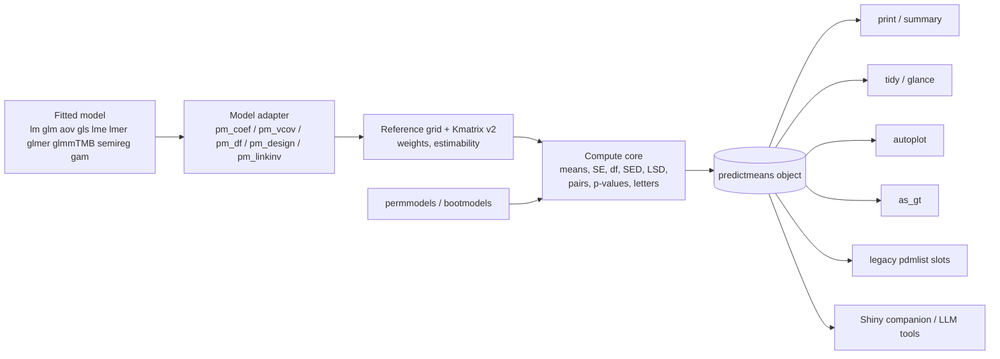

# predictmeans 2.0 — Modernisation Plan

*Drafted 2026-11-01 from a read of the source at commit `7f398a5` (v1.1.1), the
"Overview of R Package predictmeans" Quarto deck and slides, and the proposed
seven-pillar blueprint. R was not available while drafting, so performance
claims below are from reading the code and should be confirmed by the Phase 0
benchmarks.*

---

## 0. Summary

- **The blueprint's direction is right.** Keep the biometric strengths (SED/LSD
  summaries, transparent `Kmatrix` algebra, multi-stratum permutation, all-in-one
  diagnostics) and modernise the result objects, engines and documentation.
- **Several of its premises are already true of the code, and a few are wrong**
  (§1.1). The gaps that matter most are elsewhere:
  1. There are **no tests**, and the examples for the permutation and
     semiparametric functions are commented out. Any refactor is currently blind.
  2. `predictmeans()` is one 1,035-line function that computes, plots and prints.
  3. There are hidden performance costs, the largest being Kenward–Roger df
     recomputed on every permutation refit (§1.3).
  4. There are a few bugs and CRAN-policy issues (§1.2, §1.4).
- **The plan reorders the blueprint:** safety net → engine and result object →
  new statistics → docs/AI → Shiny and outreach. LLM-readiness and Shiny both
  depend on a stable result object, so that object comes first.
- **Five phases, three CRAN releases:** 1.2.0 (hygiene, no intended result
  changes), 2.0.0 (new object and engine), 2.1.0 (statistics expansion), then a
  companion Shiny package and a software paper.

| Blueprint phase | Where it lands here |
|---|---|
| — (missing) | **Phase 0**: tests, CI, bug fixes, CRAN hygiene → 1.2.0 |
| Phase 1: core refactor & tidy S3 API | **Phase 1** → 2.0.0 (also takes Kmatrix v2, because the new object carries estimability) |
| Phase 2: Kmatrix + mgcv + R² | **Phase 2** → 2.1.0 (permutation, bootstrap, R², semireg/mgcv) |
| Phase 3: pkgdown + llms.txt + vignettes | **Phase 3**, run alongside Phases 1–2 |
| Phase 4: visibility & community | **Phase 4**, after 2.1 |

---

## 1. Where the code is today

### 1.1 Blueprint claims checked against the source

| Blueprint says | What the code does | What it means for the plan |
|---|---|---|
| `predictmeans()` returns an unclassed list | It returns class `pdmlist` with a print method (`R/misc.R:514`). | Keep `pdmlist` as a secondary class for compatibility. |
| Slots are title-cased `xtabs` arrays | True for `Predicted Means` and `Standard Error of Means`, but `mean_table` is already a flat data frame. Two worse problems: with `atvar`, **slot names are factor levels** (`R/predictmeans.R:1015-1021`), so the schema changes with the data; and `mean_table` is a data frame when `pairwise = FALSE` but `list(Table, Note)` when `pairwise = TRUE`. Column names carry the level (`"LL(95%)"`). | A stable, documented schema is the core fix. |
| Plots open devices and need to become ggplot | Mean, bar, back-transformed, covariate and semipred plots are **already ggplot objects** returned in the list. `prtplt = FALSE, newwd = FALSE` already gives headless runs. Base graphics remain in `PMplot()` (called automatically from `predictmeans()` at `R/predictmeans.R:440,533`), `residplot()`/`rsplot.*()`, `CookD()` and `permlmer(plot = TRUE)`. | The Shiny work is narrower than described: the p-value heatmap and the diagnostics. |
| Use `lme4::refit()` instead of re-parsing for 5–10x speed | `permmodels()` and `permlmer()` **already use `refit()`** for lmer (`R/permmodels.R:194-222`, `R/permlmer.R:94,100`). | The real speed costs are elsewhere (§1.3). |
| Add Johnson (2014) random-slope trace to R² | `R2_glmm()` implements **Piepho (2023)** with the full tr(P·Z·G·Zᵀ), which already covers random slopes. | Keep Piepho as the flagship; add Nakagawa as an option, not a replacement. |
| Add semiparametric/GAM support | The package already has its own engine: `smZ()` + `semireg()`/`semireg_tmb()` (mixed-model penalised splines) + `semipred()`, including group-difference curves (`contr =`). | Build on `semireg` first; add mgcv as an adapter. |
| Add restricted permutation strata | `permindex()` already does block/group restricted shuffling. | `permute::how()` generalises it; keep `permindex()` as a wrapper. |
| Add studentised (pivotal) permutation statistics | `permmodels()` already compares t and F statistics, not raw coefficients. | Already done; Freedman–Lane is the real gap (§5, Pillar 4). |

Your own "future plan" slides add three items the blueprint doesn't cover:
`vglm` support, **predictions that include specified random effects**, and
**glmmTMB with complex variance structures**. They are in Phase 2 below.

### 1.2 Bugs found while reading (fix in Phase 0, each with a failing test first)

| # | Where | Problem |
|---|---|---|
| B1 | `R/predictmeans.R:43,46` | The deprecated-argument warning uses `vars` before it is defined, so it resolves to `ggplot2::vars` (a function). Passing two or more of `mplot`/`barplot`/`pplot`/`bkplot` errors with "object of type 'closure' is not subsettable". It should be `notnull`. Passing all four also fails, because `x[-integer(0)]` is empty. |
| B2 | `R/predictmeans.R:821` vs `:969` | `predictmeansPlot` and the letter-group table are only built inside `if (!is.null(trans))`. Calling with `trans = NULL` errors at return. |
| B3 | `R/contrastmeans.R:87,89` vs `R/predictmeans.R:369,373` | Permutation p-values count `>` in `contrastmeans()` but `>=` (after rounding) in `predictmeans()`. `>=` is the standard. With `>`, the two functions give different p-values for the same contrast, and `contrastmeans()` is slightly anti-conservative. |
| B4 | `R/predictmeans.R:238,251,472` and Kmatrix row names | Level combinations are joined with `":"` and split back with `strsplit(":")`. A factor level containing `":"` (e.g. a time like `"10:30"`) silently corrupts the pairwise tables. |
| B5 | `R/permmodels.R:13` vs `:165-189` | glmer is rejected up front, so the glmer branch is dead code. It also tests for `"gamma"`, but the family name is `"Gamma"`. |
| B6 | `R/predictmeans.R:465` | Tukey within `atvar` uses one averaged `Df` for lmer models instead of per-contrast df (the code's own comment says "Df need to be updated"). |
| B7 (verify) | `R/Kmatrix.R:152-153,168` | Missing cells are flagged with `X[ndf$Freq == 0, ] <- NA`, where `ndf` comes from `merge(grid, ndf, sort = FALSE)`. R doesn't guarantee row order for `sort = FALSE`, so the NA rows could be misaligned with `grid`. Needs a test with an unbalanced missing-cell design. |

### 1.3 Performance hot spots

| Where | Cost | Fix |
|---|---|---|
| `R/mymodelparm.R:45-47` | For every lmer fit, computes Kenward–Roger df for **every model term** (`pbkrtest::vcovAdj`, O(n³)). `permmodels()` calls it on each refit (`R/permmodels.R:196,211,222`), then keeps only coef/vcov and discards the df. With `nperm = 4999`, that's 4,999 KR computations nobody uses. | Add a `df = FALSE` path for refits and compute df once on the original fit. This is probably the biggest speed-up available; Phase 0 benchmarks will measure it. |
| `predictmeans()` → `mymodelparm()` + `df_term()` ×2 | KR is computed separately for the terms, the means and every pairwise contrast. | Cache `vcovAdj` once per call. |
| `R/permmodels.R:161`, `R/permlmer.R:54` | V = ZΛΛᵀZᵀ + a **dense** n×n identity, then a dense Cholesky and `solve()`. That's O(n³) time and O(n²) memory. | Sparse Cholesky (`Matrix::Cholesky`) with triangular solves; never form the inverse. |
| `R/R2_glmm.R:71-72` | Builds dense n×n `V` and `P = I − J/n`. At n = 10,000 that's about 800 MB per matrix. | Use tr(VP) = tr(V) − 1ᵀV1/n and centred cross-products; no n×n matrices. |
| `permmodels()` lm/glm branch | `update()` re-parses the formula and model frame on every permutation. | lm fast path: reuse the QR of X (`qr.coef`, `qr.resid`). |

### 1.4 Engineering and CRAN hygiene

- **Missing tests and examples.** There is no `tests/`, `vignettes/` or `inst/`.
  The examples for `permmodels`, `permlmer`, `permanova.lmer`, `semireg`,
  `semireg_tmb` and `semipred` are fully commented out, and those for
  `contrastmeans` and `df_term` mostly. R CMD check never runs the permutation
  or semiparametric code.
- **Global side effects.** `options(scipen = 6)` is set and never restored
  (`R/predictmeans.R:10`, `R/contrastmeans.R:2`, `R/permmodels.R:5`), which
  CRAN policy forbids. `cat()` output comes from `Kmatrix()` (`R/Kmatrix.R:139`,
  on by default through `prtnum = TRUE`) and `R2_glmm()` (`R/R2_glmm.R:113`).
  `set.seed()` is called inside functions.
- **Parallel defaults.** `ncore = 3` is the default in five functions, but CRAN
  allows at most 2 cores during checks. Clusters are hand-rolled with
  `makeCluster` on Windows and `mclapply` elsewhere.
- **Interactive code in the compute path.** `contrastmeans()` falls back to
  `readline()`/`edit()` when `ctrmatrix` is missing (`R/contrastmeans.R:15,19`).
  That hangs a Shiny server or an AI agent.
- **Packaging.**
  - Help pages are hand-written Rd, with no roxygen.
  - NAMESPACE uses conditional `if (requireNamespace(...)) import(...)`.
  - Internal S3 methods (`terms.lme`, `model.frame.gls`, …) are not registered.
  - DESCRIPTION says `NeedsCompilation: yes` but there is no `src/`.
  - CRAN-generated fields (`Packaged`, `Repository`, `Date/Publication`) are
    committed to the source.
- **Heavy dependencies.** Four packages in Depends (glmmTMB, lme4, nlme,
  lmerTest) and 17 Imports (including plotly, HRW, lmeSplines, plyr,
  splines2).
- **`"NULL"` string sentinels.** Many arguments accept the strings `"NULL"` or
  `""` (`!unique(x %in% c("NULL", ""))`), probably for an old GUI. One small
  helper should replace them.

---

## 2. Guiding principles

1. **Numbers don't change by accident.** Every 1.x result is frozen as a
   snapshot test before refactoring. Any change in a number is either a
   documented bug fix or a new opt-in option.
2. **One engine, many views.** A pure compute core returns one object. `print`,
   `summary`, `tidy`, `autoplot`, `as_gt` and Shiny are all views of that
   object, and no view computes statistics.
3. **Headless core.** No `dev.new()`, plot printing, `cat()`, `readline()` or
   `options()` inside computation. Messages go through `message()` so they can
   be silenced.
4. **Light core, optional extras.** Anything presentation- or app-specific (gt,
   shiny, ellmer, jsonlite, plotly) goes in Suggests or a companion package.
5. **Deprecate, don't break.** Legacy arguments and slot names keep working
   through 2.x with `lifecycle` warnings. Removals only happen in 3.0.
6. **Interoperate rather than re-implement.** Use `generics` (not `broom`) for
   `tidy`/`glance`, `estimability` for non-estimability, `future.apply` for
   parallelism, `permute` for strata, and emmeans as a test oracle.

---

## 3. Target architecture



### 3.1 Model adapter contract

`mymodelparm()` becomes a family of small internal S3 generics. Supporting a
new model class (gam, vglm, …) then means writing these methods and nothing
else:

| Method | Returns |
|---|---|
| `pm_coef(model)` | Fixed-effect estimates (estimable columns only) |
| `pm_vcov(model)` | Their covariance matrix |
| `pm_df(model, L, method)` | Denominator df for contrast rows `L` (Kenward–Roger, Satterthwaite, residual, containment, asymptotic) |
| `pm_design(model)` | Terms with `predvars`, contrasts, xlevels, model frame |
| `pm_linkinv(model)` | Inverse link and family, for back-transformation |

### 3.2 The result object

```r
pm <- predictmeans(mod, "nitro:Variety")
class(pm)        # c("predictmeans", "pdmlist", "list")

# New stable slots: snake_case, fixed names, flat data frames
pm$means         # one row per level combination
pm$pairs         # one row per pairwise comparison
pm$sed           # data frame: scope ("overall" or a factor name), min, mean, max
pm$lsd           # same shape as sed
pm$K             # the "kmatrix" used, with an estimability attribute
pm$settings      # modelterm, level, adj, df method, trans, covariate values,
                 # nperm, seed, package versions, call

# Legacy slots kept unchanged through 2.x:
# "Predicted Means", "Standard Error of Means", "Standard Error of Differences",
# "LSD", "Pairwise p-value", mean_table, p_valueMatrix, predictmeansPlot, ...
```

- **`pm$means` columns:** the factor columns, `estimate`, `std.error`, `df`,
  `conf.low`, `conf.high`, then `response`, `response.conf.low`,
  `response.conf.high` (only when back-transformed), `group` (compact letter
  display), `estimable`, `n`.
- **`pm$pairs` columns:** `level1`, `level2`, `by` (the `atvar` slice, `NA` if
  none), `estimate`, `std.error`, `df`, `statistic`, `p.value`, `p.adj`, `lsd`,
  `p.method` (`"t"`, `"tukey"`, `"permutation"`, `"bootstrap"`).
- **Names follow broom conventions.** `tidy(pm)` is essentially `pm$means` and
  `tidy(pm, "pairs")` is `pm$pairs`. The confidence level and adjustment
  method go in `settings`, not in column names.
- **Plots are built on request** by `autoplot()` from these tables. In 2.x the
  legacy `predictmeansPlot` slots are still filled by the same builders, so
  old scripts keep working.
- **New slots are added, legacy slots aren't aliased.** Aliasing every legacy
  slot (the blueprint's `$predicted_means` and so on) would double the printed
  output and leave two names for each thing.

---

## 4. Roadmap

Sizes: **S** ≈ up to 2 days, **M** ≈ 1–2 weeks, **L** ≈ several weeks, for one
part-time person. These are rough guesses; adjust them to your capacity.

### Phase 0 — Safety net and hygiene → CRAN 1.2.0 (no intended result changes)

| Task | Size |
|---|---|
| testthat 3e. Snapshot current outputs for ~15 canonical scenarios: Oats split-plot (aov, lme, lmer); ATP repeated measures with and without `atvar`; Drug glm with covariate; a missing-cell factorial; glmmTMB Poisson; glmer binomial; semireg (WarsawApts); `permmodels`/`permlmer` with a fixed seed and small `nperm` | M |
| Cross-check means and SEs against emmeans for balanced designs (emmeans in Suggests, used in tests only) | S |
| GitHub Actions: R-CMD-check on Linux/macOS/Windows, plus test coverage | S |
| Migrate Rd → roxygen2 (`Rd2roxygen` gives a first pass), generate NAMESPACE, register S3 methods | M |
| Uncomment examples; wrap slow ones in `\donttest{}`; use small `nperm` | S |
| Fix B1–B7. Replace `options()` with local formatting, `cat()` with `message()`, guard `readline`/`edit` with `interactive()`, default `ncore` to 1 | S |
| Clean DESCRIPTION (`NeedsCompilation: no`, drop CRAN fields, add `URL`/`BugReports`, `Config/testthat/edition: 3`); start `NEWS.md` | S |
| Benchmark script (`bench`) for `predictmeans`, `permmodels`, `R2_glmm` at small, medium and large n, as a baseline for Phase 1 | S |

**Exit criteria:** R CMD check is clean on three OSes, coverage is at least 70%
for `predictmeans`/`Kmatrix`/`contrastmeans`/`permmodels`, and all snapshots
pass.

### Phase 1 — Engine and object → CRAN 2.0.0

| Task | Size |
|---|---|
| Split `predictmeans()` into internal steps: `pm_compute()` → `pm_pairs()` → `pm_letters()` → `pm_backtransform()` → `pm_assemble()`. Plots move into builder functions | L |
| Model adapter layer (§3.1). Move df logic out of `mymodelparm()`, add `df = FALSE` for refits, cache the KR `vcovAdj` | M |
| New S3 object (§3.2) with `print`, `summary`, `tidy`, `glance` (from `generics`) and `autoplot` (types `"means"`, `"bar"`, `"pvalue"`, `"back"`). The `summary` footer lists the SED/LSD range, df method, covariate values, adjustment and `nperm` | M |
| `contrastmeans()` returns class `pm_contrast` with a `tidy` method; `covariatemeans()` and `semipred()` return classed objects with `autoplot` | M |
| ggplot p-value heatmap replaces the automatic call to base `PMplot()`; `PMplot()` stays exported | S |
| Internal stable level keys (row indices) instead of `":"` splitting, which fixes B4 for good | M |
| Kmatrix v2 (Pillar 3 in §5), behind `engine = "v2"` until the snapshots match, then made the default | L |
| `specify_contrast()` named-contrast builder | S |
| Sparse Cholesky in `permmodels`/`permlmer`; O(n) R² traces | M |
| Plot printing: add `options(predictmeans.print_plots = TRUE)`, keep it on by default in 2.0, document the plan to turn it off (decision D4) | S |
| `lifecycle` deprecations for `mplot`/`barplot`/`pplot`/`bkplot` (already soft-deprecated), `newwd`, `prtnum`, `ncore` and the `"NULL"` strings | S |
| pkgdown site skeleton, a "Getting started" article and a "Migrating from 1.x" vignette | M |

**Exit criteria:** all Phase 0 snapshots still pass (legacy slots identical),
and `?predictmeans` documents the full column schema of the new object.

### Phase 2 — Statistics expansion → CRAN 2.1.0

| Task | Size |
|---|---|
| `permmodels(method = c("raw", "freedman-lane"))`, strata through `permute::how()`, `future.apply` backend with `future.seed = TRUE` | L |
| Simulation study of Type I error and power for raw vs Freedman–Lane permutation on split-plot, repeated-measures and unbalanced factorial designs. It decides the default and feeds the paper | M |
| GLMM inference with `bootmodels()`: a parametric bootstrap under the reduced model (simulate + refit). It returns a permlist-compatible object, so `predictmeans(permlist =)` and `contrastmeans(permlist =)` work unchanged | M |
| `R2_model()` generic. Piepho is the default; `method = "nakagawa"` adds the delta/lognormal/trigamma variants; GLM extras (McFadden, Nagelkerke, Tjur); for gam, deviance explained, adjusted R² and the parametric vs smooth split. It returns numbers in a classed object, and `R2_glmm()` becomes a wrapper | M |
| `predictmeans()` and `contrastmeans()` accept `semireg` objects directly, giving factor means adjusted for the smooths | M |
| mgcv adapter: `predict(type = "lpmatrix")` on the reference grid. Smooths are either averaged over observed covariates or fixed at reference values; option for the `unconditional = TRUE` vcov; gamm through its lme part | L |
| `smoothmeans()`, generalising `covariatemeans()`/`semipred()`: a fine covariate grid, pointwise and simultaneous bands (simulated from the coefficient MVN), and the regions where two curves differ (where the difference-curve band excludes 0) | M |
| glmmTMB with dispersion and zero-inflation formulas: conditional-model means first, with documentation of what is and isn't covered | M |
| Predictions that include specified random effects: a `re_form`-style argument for lmer and glmmTMB | M |
| Later (2.2+): `vglm` support, which is harder because there are several linear predictors | L |

### Phase 3 — Documentation and AI readiness (runs alongside Phases 1–2)

| Task | Size |
|---|---|
| Vignettes: (1) split-plot and missing cells, (2) GLMM link vs response scale, (3) multi-stratum permutation and bootstrap, (4) spatial/smooth adjustment with semireg and mgcv, (5) predictmeans in Shiny and AI agents. Plus "Migrating from 1.x" | L |
| `llms.txt` at the pkgdown site root (recent pkgdown versions can generate it; otherwise write it by hand) and `inst/llms-context.md`: function signatures, the result schema and 8–10 canonical recipes | S |
| Optional `predictmeans_tools()` returning ellmer tool definitions (ellmer in Suggests) for `predictmeans`, `contrastmeans`, `permmodels`, `varcomp` and `R2_model`. MCP servers built on ellmer tools (e.g. mcptools) can serve them directly | S |
| JSON and Markdown output documented as `tidy()` + `jsonlite` / `knitr::kable` recipes, not as new print formats | S |
| Optional: an `emmeans` support method for `semireg`, so semireg fits also work in the emmeans ecosystem | S |

### Phase 4 — Shiny companion and outreach

| Task | Size |
|---|---|
| A separate package `predictmeansShiny` (bslib): model fitting, means and LSD tables (gt), p-value heatmap (plotly through `ggplotly`), a contrast builder from `Kmatrix` (missing cells locked to 0, weights must sum to 0), and permutations through `shiny::ExtendedTask` + future | L |
| Software paper (JSS or The R Journal) built around the Phase 2 simulation study and the semiparametric adapters | L |
| Apply to the CRAN Task Views (ExperimentalDesign, MixedModels, Agriculture) | S |
| Public demo app (Posit Connect Cloud or shinyapps.io) | S |

---

## 5. Pillar-by-pillar decisions

### Pillar 1 — LLM and agent ready

- **Keep:** stable snake_case schema, `tidy`/`glance`, `llms.txt`, vignettes.
- **Change:** the schema lives in new slots of the object itself (§3.2)
  instead of aliases for every legacy slot.
- **Change:** drop `print(format = "json"/"markdown"/"gt")`. Use `tidy()` with
  existing tools, plus `as_gt()`. A single print method is easier to keep
  correct.
- **Why:** LLMs write good emmeans code mainly because of years of public
  examples with stable names. Vignettes and consistent naming will help more
  than tool definitions, so tool definitions come last.

### Pillar 2 — Shiny ready

- **Keep:** headless core, ggplot everywhere, `autoplot()`, `as_gt()`.
- **Change:** base graphics remain only in legacy functions (`PMplot`,
  `residplot`, `CookD`). Add `autoplot()` methods for the `residplot()` and
  `CookD()` results.
- **Change:** Shiny modules go in a companion package, not the core. Otherwise
  shiny, bslib and friends become dependencies of every predictmeans user and
  every CRAN check.
- **Cut:** `as_reactable()` and DT formatters. `tidy()` output already feeds
  both.

### Pillar 3 — Bulletproof Kmatrix

Keep all four items:

- **Reference grid.** Build it from the model frame plus `xlev`/`predvars`, so
  `poly()`, `ns()`, `bs()`, `I()` and `offset()` evaluate with the stored
  basis. Compute `K = W %*% X_grid` with an explicit weight matrix `W` instead
  of `plyr::alply`, which also drops plyr.
- **Estimability.** Run `estimability::nonest.basis()` on the model matrix and
  set `attr(K, "estimable")`. Non-estimable means are reported as `NA` with a
  clear message. Today, `R/Kmatrix.R:168` sets missing cells to `NA` and then
  averages the remaining cells, which quietly changes what the marginal mean
  represents.
- **Weights and covariates.** Add `weights = c("equal", "proportional",
  "cells")`. `cov_at = list(...)` replaces `covariate`/`covariateV`, which stay
  as deprecated aliases.
- **`specify_contrast()`.** It evaluates the user's expression in an
  environment where each (backticked) level name is a unit vector over the rows
  of K. It checks that the weights sum to zero, and the result plugs into
  `contrastmeans(ctrmatrix =)`.

### Pillar 4 — Permutation engine

- **Keep:** Freedman–Lane, `permute::how()`, `future.apply`.
- **Already done:** `refit()` for lmer; studentised t and F statistics.
- **Why Freedman–Lane matters:** today's mixed-model scheme permutes fitted
  values and whitened residuals together (`R/permmodels.R:173-189`), which is
  permutation under the global null. That's exact for the overall test, but not
  for individual terms when other terms have real effects (e.g. testing an
  interaction when the main effects are strong). Freedman–Lane fixes this, at
  the cost of one permutation set per tested term, so more refits. The lm path
  permutes the raw response and has the same limitation.
- **Change:** for GLMMs, use a parametric bootstrap (`bootmodels()`), which is
  well established, rather than the proposed randomised-quantile-residual
  hybrid, whose validity isn't established. It gets its own name because it
  isn't a permutation test.
- **Cut:** "C++ refitting". No compiled code is needed; skipping KR in refits
  and the lm QR fast path deliver the speed.

### Pillar 5 — R² suite

- **Keep** Piepho (2023) as the default. It's distinctive and already handles
  random slopes.
- **Add** the Nakagawa variants and the GLM/gam measures as options in
  `R2_model()`.
- **Change** the return value to numbers. Today `R2_glmm()` returns character
  strings like `"75.81%"` and prints a header with `cat()`.
- **Fix** the n×n memory use (§1.3).

### Pillar 6 — Semiparametric and GAMM

- **Order:**
  1. Make `predictmeans()`/`contrastmeans()` work on existing `semireg` objects.
  2. Add the mgcv adapter through `lpmatrix`.
  3. Add `smoothmeans()` with simultaneous bands. `semipred(contr =)` already
     computes group-difference curves, so this extends existing code.
- **Note on "zeroing" smooth columns:** mgcv smooths are centred over the
  data, so zeroing them is the same as averaging the smooth over the observed
  covariate values. Expose this as the `"proportional"` option, with fixed
  reference values as the alternative.

### Pillar 7 — Documentation and outreach

- **Keep** the deliverables.
- **Change** the timing: the paper should follow 2.1, so it can report the
  permutation simulation study and the semiparametric adapters.

---

## 6. Backward-compatibility policy

- In 2.x, every 1.x call that worked still works and returns the same legacy
  slots with the same numbers. The only exceptions are the documented bug fixes
  B1–B7.
- New features are opt-in arguments. A default only changes with a NEWS entry
  and one minor version of warnings.
- Deprecations go `lifecycle::deprecate_soft()` in 2.0 → `deprecate_warn()` in
  2.1 → removal no earlier than 3.0.
- The "Migrating from 1.x" vignette maps every legacy slot to its new
  equivalent.

---

## 7. Dependency plan

| | 1.1.1 | Target 2.x |
|---|---|---|
| Depends | R ≥ 3.5.0, glmmTMB, lme4, nlme, lmerTest | R ≥ 4.1, lme4, nlme (+ lmerTest until decision D2) |
| Imports | car, ggplot2, graphics, grDevices, HRW, lmeInfo, lmeSplines, Matrix, MASS, methods, numDeriv, parallel, pbkrtest, plotly, plyr, splines2, stats, utils | Add generics, estimability, lifecycle, future.apply. Move glmmTMB down from Depends. Drop plyr and parallel. Move plotly to Suggests (only 3-D `semipred` uses it) |
| Suggests | — | testthat, emmeans, mgcv, permute, gt, jsonlite, ellmer, knitr, rmarkdown, future, bench |

R ≥ 4.1 gives the native pipe (`|>`) used in the docs.

---

## 8. Risks

| Risk | Mitigation |
|---|---|
| The refactor silently changes published numbers | Phase 0 snapshots; CI compares legacy slots exactly |
| Freedman–Lane changes p-values users have already reported | Opt-in until the simulation study; document the difference |
| Scope creep (seven pillars at once) | Three releases with exit criteria; Shiny and the paper only after 2.1 |
| Upstream API churn (lme4, glmmTMB, pbkrtest, lmerTest) | Monthly CI against CRAN and development versions. Avoid legacy APIs, e.g. replace `lmerTest::calcSatterth()` with `contest1D()`, which the package already imports |
| One maintainer's bandwidth | The phases are separable enough for contributors; one issue label per phase |

---

## 9. Decisions for the maintainer

| # | Decision | Recommendation |
|---|---|---|
| D1 | Default permutation method in 2.1 | Decide from the simulation study; Freedman–Lane is likely right for term tests |
| D2 | Keep glmmTMB, lme4, nlme and lmerTest in Depends? | Keep lme4 and nlme for 2.x, because user scripts call `lmer()`/`lme()` after `library(predictmeans)`. Move glmmTMB to Imports. lmerTest is trickier: removing it from Depends changes what `summary(lmer(...))` and `anova()` print for users who don't load it themselves. Keep it in 2.0 and revisit in 3.0 |
| D3 | Shiny modules in the core or a companion package | Companion package |
| D4 | When to stop printing plots automatically (`prtplt = TRUE`) | Keep it in 2.0 behind an option; turn it off in 2.1 after a warning cycle |
| D5 | Paper timing | After 2.1 |

---

## 10. First two weeks

1. Add testthat and the GitHub Actions R-CMD-check workflow.
2. Write snapshot tests for the 15 scenarios against v1.1.1, saving outputs
   with `expect_snapshot_value()`.
3. Fix B1–B3, each with a failing test first; write the B7 test.
4. Remove `options(scipen)`, switch `cat()` to `message()`, default `ncore` to 1.
5. Clean DESCRIPTION, draft `NEWS.md`, prepare a 1.2.0 release candidate.
6. Benchmark `permmodels()` on Oats with and without KR df in the refits, to
   confirm the size of the §1.3 win before Phase 1 starts.
