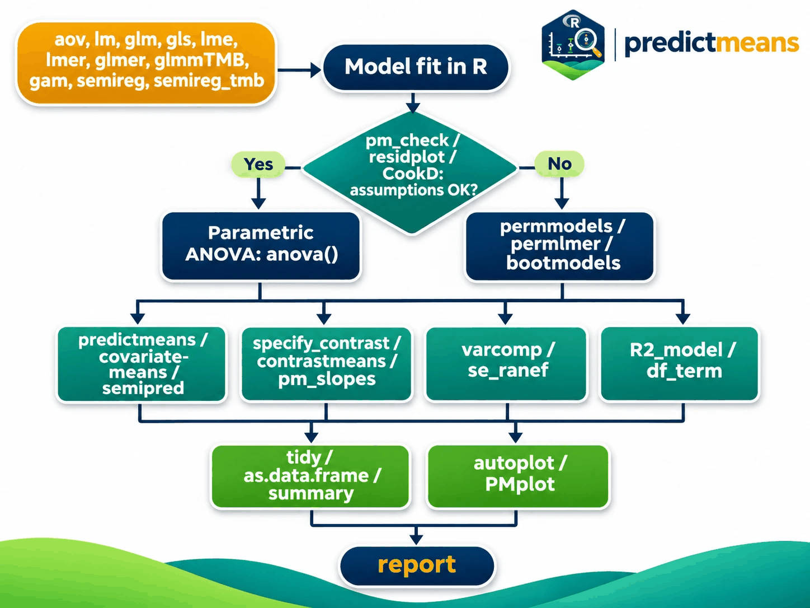

```{r, include = FALSE}
knitr::opts_chunk$set(echo = TRUE, warning = FALSE, message = FALSE, fig.align = "center")
```

```{r, include = FALSE}
# show code folded: click 'Code' to open it
local({
  hook <- knitr::knit_hooks$get("source")
  knitr::knit_hooks$set(source = function(x, options) {
    paste0("\n<details class=\"code-fold\"><summary>Code</summary>\n\n", hook(x, options), "\n\n</details>\n")
  })
})
```


```{r}
#| label: setup
library(tidyverse)
library(predictmeans)
library(lmerTest)   # t tests in summary(); predictmeans alone gives anova() F tests for lmer fits
library(HRW)
library(gridExtra)
library(car)
library(DT)
library(gt)
library(knitr)

data(copper, package = "predictmeans")

# an HTML table with a CSV download button (choose 'All' entries to download every row)
DT_df <- function(df){
  stopifnot(is.data.frame(df))
  
  df |>
    DT::datatable(
      extensions = 'Buttons',
      options = list(
        dom = 'Blfrtip', # set DOM
        buttons = c('csv'),
        lengthMenu = list(
          c(10, 20, -1), # declare values
          c(10, 20, "All") # declare titles
        ), # end of lengthMenu customization
        pageLength = 10
      ), rownames= FALSE)
}
```

## **Motivation**

::: {style="font-size: 150%;"}

-   **Mixed-effects models** are needed for split-plot experiments, repeated measurements, meta-analysis and many other designs. The packages that fit them ('nlme', 'lme4', 'glmmTMB') give the model coefficients and an ANOVA table, but not the inference a study usually reports: predicted means, their standard errors, confidence intervals and multiple comparisons.

-   **Permutation tests** need no distributional assumption: they suit small samples and data that are not normal, where the assumptions of parametric tests are in doubt.

-   **Semiparametric regression** combines parametric terms with smooth curves and surfaces, for relationships whose shape is not known in advance. It is used widely, from biology and medicine to economics.

-   **predictmeans** provides diagnostics and inference for models fitted by `aov`, `lm`, `glm`, `gls`, `lme`, `lmer`, `glmer`, `glmmTMB` and `gam`, and its own semiparametric models (`semireg()`): predicted means with standard errors and confidence intervals, contrasts, multiple comparisons, permutation tests, adjusted R-squared, and plots. Its defaults are chosen on the statistical evidence (e.g. Kenward-Roger degrees of freedom for REML fits), its results are checked against SAS and Genstat in the package tests, and it adds a one-line note when this fit and data call for care (`advice()`). <https://CRAN.R-project.org/package=predictmeans>
::: 

## **Overview**

### **Main Functions Flowchart**

{width=1031px style="max-width:100%"}

## Example 1: split-plot design (Oats data)

The treatments are three oat varieties (Victory, Golden Rain and Marvellous) and four rates of nitrogen (0, 0.2, 0.4 and 0.6 cwt per acre). Fertiliser can be applied to smaller plots than a variety can be sown in, so each of the six blocks was split into three whole plots, and each whole plot into four subplots. The varieties were randomized to the whole plots within each block, and the nitrogen rates to the subplots within each whole plot. The model therefore has two error strata: blocks, and whole plots within blocks.

### Data Info {.tabset .tabset-pills}

#### Structure

```{r}
data(Oats, package="nlme")
Oats$Block <- factor(Oats$Block, levels=unique(Oats$Block), ordered = TRUE)
Oats <- data.frame(Oats)
str(Oats)
```

#### Plot

```{r}
#| fig-width: 8
#| fig-height: 7
Oats %>% 
  ggplot(aes(x=nitro, y=yield, col=Variety))+
  geom_point(size=2)+
  geom_line(linewidth=1)+
  facet_wrap(vars(Block))+
  theme_bw(9)
```


### Modelling {.tabset .tabset-pills}

#### Model

```{r}
Oats$nitro <- factor(Oats$nitro)
Oats$Whole_plot <- Oats$Variety
mod <- lmer(yield ~ nitro*Variety+(1|Block/Whole_plot), data=Oats)
summary(mod, corr=FALSE)
```

#### Residual Plot

```{r}
residplot(mod, group = "nitro")
```

#### Highlights

Options of `residplot()`:

-   `id = 3` (the default) labels the three most extreme points with their row numbers in the data, so outliers can be found; `interactive = TRUE` shows every point's row on hover.

-   `group = "nitro"` colours the points by nitrogen rate, to show whether the spread differs between groups.

#### Test

Formal tests of the assumptions, for reference; with small samples they have little power, and with large ones they flag departures too small to matter, so read them with the plots. `pm_check(mod)` gives a table of checks with advice.

```{r}
# Shapiro-Wilk test of normality of the residuals
shapiro.test(resid(mod))

# Bartlett and Levene tests of equal variance across treatment combinations
bartlett.test(yield ~ interaction(nitro, Variety), data = Oats)
car::leveneTest(yield ~ nitro:Variety, data = Oats)
```


### ANOVA and $R^2$

-   **ANOVA**
```{r}
kable(anova(mod))
```

-   **$R^2$**
```{r}
R2_model(mod)
```

### Predicted Means

#### Predicted Means for "nitro" {.tabset .tabset-pills}


##### Mean Table

```{r}
#| fig.show: hide
predm_out <- predictmeans(mod, "nitro", meandecr=TRUE, adj="BH")
predm_out
gt(predm_out$mean_table$Table, 
   caption = "Means sharing a letter are not significantly different (BH-adjusted p-values, 5% level)")
```

##### Mean Plot

```{r}
#| fig-width: 8
#| fig-height: 7
autoplot(predm_out)
autoplot(predm_out, type = "ci", data = TRUE)
autoplot(predm_out, type = "bar")
```

##### p-value Table & Plot

```{r}
gt(data.frame(predm_out$`Pairwise p-value`, check.names=FALSE), 
   rownames_to_stub=TRUE, 
   caption = "t values above the diagonal; BH-adjusted p-values below") %>% 
  cols_width(everything() ~ px(130))
```

```{r}
#| fig-width: 7
#| fig-height: 6
PMplot(predm_out$p_valueMatrix)
```


#### Predicted Means for "nitro:Variety" {.tabset .tabset-pills}


##### Mean Table

```{r}
#| fig.show: hide
predm_out <- predictmeans(mod, "nitro:Variety", meandecr=TRUE, adj="BH")
predm_out
gt(predm_out$mean_table$Table, 
   caption = "Means sharing a letter are not significantly different (BH-adjusted p-values, 5% level)")
```

##### Mean Plot

```{r}
#| fig-width: 8
#| fig-height: 7
autoplot(predm_out)
autoplot(predm_out, type = "ci", data = TRUE)
autoplot(predm_out, type = "bar")
```

##### p-value Table & Plot

```{r}
gt(data.frame(predm_out$`Pairwise p-value`, check.names=FALSE), 
   rownames_to_stub=TRUE,
   caption = "t values above the diagonal; BH-adjusted p-values below") %>% 
  cols_width(everything() ~ px(130))
```

```{r}
#| fig-width: 9
#| fig-height: 8
PMplot(predm_out$p_valueMatrix)
```


#### Highlights

Options of `predictmeans()`:

-   `pairwise = TRUE` compares every pair of means with unadjusted p-values (`adj = "none"`, the default).

-   `adj = "BH"` compares the pairs with p-values adjusted by the Benjamini-Hochberg method (false discovery rate); any `adj` other than `"none"` turns the comparisons on. `"tukey"`, `"holm"`, `"bonferroni"` and others are available.

-   `meandecr = TRUE` sorts `mean_table` by decreasing mean, `FALSE` by increasing mean.

-   Plots are drawn from the result: `autoplot(predm_out)` (means with one LSD bar), `type = "bar"`, `type = "ci"` (each mean with its confidence limits; `data = TRUE` adds the observations) and `type = "pvalue"`. `plot(predm_out)` draws the first.

-   The LSD is the least significant difference at the chosen adjustment; when the standard errors of the differences are not all equal it is shown as a range.

### Permutation Test {.tabset .tabset-pills}


#### For Model Term
```{r}
# permutation tests of the model terms (999 permutations; the seed makes them repeatable)
permlme <- permmodels(model = mod, nperm = 999, seed = 3581)
permlme
```

#### For Multiple Comparisons
```{r}
# permutation p-values for the pairwise comparisons of nitrogen within each variety
predictmeans(model = mod, modelterm = "nitro:Variety", atvar = "Variety", adj = "BH", permlist = permlme)
```

#### For Contrasts
```{r}
# permutation p-values for two contrasts of the 12 nitro:Variety means
cm <- rbind(c(-1, 0, 1, 0, 0, 0, 0, 0, 0, 0, 0, 0),
            c(0, 0, 1, 0, 0, 0, 0, -1, 0, 0, 0, 0))
contrastmeans(model=mod, modelterm="nitro:Variety", ctrmatrix=cm, permlist=permlme)
```


## Example 2: repeated measurements (ATP data)

The ATP data come from an experiment on the effect of preserving liquids on the enzyme content of dog hearts. Twenty-three hearts were assigned to the combinations of two treatment factors, A and B, each with two levels. ATP, as a percentage of the total enzyme in the heart, was measured at one- and two-hour intervals over the twelve hours after preservation.

### Data Info {.tabset .tabset-pills}

#### Structure

```{r}
data(ATP, package="predictmeans")
ATP$time.v <- as.numeric(as.character(ATP$time))
str(ATP)
```

#### Plot

```{r}
#| fig-width: 8
#| fig-height: 7
ATP %>% 
  ggplot(aes(x=time.v, y=ATP, col=A:B))+
  geom_point(size=2)+
  geom_line(linewidth=1)+
  facet_wrap(vars(heart))
```

```{r}
#| fig-width: 8
#| fig-height: 7
ATP %>% 
  ggplot(aes(x=time.v, y=ATP, col=A:B))+
  geom_point()+
  geom_smooth()+
  facet_grid(vars(A), vars(B))
```


### Modelling {.tabset .tabset-pills}

#### Model

```{r}
mod <- lmer(ATP^1.5 ~ A*B*time+(1| heart), ATP)
summary(mod)
```

#### Residual Plot

```{r}
residplot(mod, group = "A")
```

#### Test

```{r}
# Shapiro-Wilk test of normality of the residuals
shapiro.test(resid(mod))

# Bartlett and Levene tests of equal variance across the A:B groups
bartlett.test(ATP^1.5 ~ interaction(A, B), data = ATP)
car::leveneTest(ATP^1.5 ~ A:B, data = ATP)
```


### ANOVA and $R^2$

-   **ANOVA**
```{r}
kable(anova(mod))
```

-   **$R^2$**
```{r}
R2_model(mod)
```

### Predicted Means

#### Predicted Means for "A:time" {.tabset .tabset-pills}

##### Mean Table

```{r}
#| fig.show: hide
predm_out <- predictmeans(mod, "A:time", 
                          atvar="time", adj="BH", 
                          trans=function(x) x^(1/1.5))
predm_out
gt(predm_out$mean_table$Table, 
   caption = "Within each time, means sharing a letter are not significantly different (BH-adjusted p-values, 5% level)")
```

##### Mean Plot

```{r}
#| fig-width: 8
#| fig-height: 7
autoplot(predm_out)
autoplot(predm_out, type = "ci", data = TRUE)
autoplot(predm_out, type = "bar")
```

##### Pairwise Comparisons

The pairwise comparisons within each time, one row per pair (`by` is the time; `p.adj` is BH-adjusted within each time):

```{r}
as.data.frame(predm_out, what = "pairs") %>%
  select(by, level1, level2, estimate, std.error, df, p.value, p.adj) %>%
  mutate(across(where(is.numeric), ~ round(.x, 4))) %>%
  DT_df()
```


#### Predicted Means for "B:time" {.tabset .tabset-pills}

##### Mean Table

```{r}
#| fig.show: hide
predm_out <- predictmeans(mod, "B:time", 
                          atvar="time", adj="BH", 
                          trans=function(x) x^(1/1.5))
predm_out
gt(predm_out$mean_table$Table, 
   caption = "Within each time, means sharing a letter are not significantly different (BH-adjusted p-values, 5% level)")
```

##### Mean Plot

```{r}
#| fig-width: 8
#| fig-height: 7
autoplot(predm_out)
autoplot(predm_out, type = "ci", data = TRUE)
autoplot(predm_out, type = "bar")
```

##### Pairwise Comparisons

The pairwise comparisons within each time, one row per pair (`by` is the time; `p.adj` is BH-adjusted within each time):

```{r}
as.data.frame(predm_out, what = "pairs") %>%
  select(by, level1, level2, estimate, std.error, df, p.value, p.adj) %>%
  mutate(across(where(is.numeric), ~ round(.x, 4))) %>%
  DT_df()
```


#### Predicted Means for "A:B:time" {.tabset .tabset-pills}

##### Mean Table

```{r}
#| fig.show: hide
predm_out <- predictmeans(mod, "A:B:time", 
                          atvar="time", adj="BH", 
                          trans=function(x) x^(1/1.5))
predm_out
gt(predm_out$mean_table$Table, 
   caption = "Within each time, means sharing a letter are not significantly different (BH-adjusted p-values, 5% level)")
```

##### Mean Plot

```{r}
#| fig-width: 8
#| fig-height: 7
autoplot(predm_out)
autoplot(predm_out, type = "ci", data = TRUE)
```

##### Pairwise Comparisons

The pairwise comparisons within each time, one row per pair (`by` is the time; `p.adj` is BH-adjusted within each time):

```{r}
as.data.frame(predm_out, what = "pairs") %>%
  select(by, level1, level2, estimate, std.error, df, p.value, p.adj) %>%
  mutate(across(where(is.numeric), ~ round(.x, 4))) %>%
  DT_df()
```

##### p-value Plot

```{r}
#| fig-width: 9
#| fig-height: 8
PMplot(predm_out$p_valueMatrix)
```


#### Highlights

Options of `predictmeans()`:

-   `atvar = "time"` compares the means only within each time, and the p-values are adjusted within each time. It also arranges `mean_table` and the plots by time (one panel per time). Giving `atvar` turns the comparisons on. Try `atvar = c("A", "B")` or `atvar = c("B", "A")` with `"A:B:time"` to see the effect.

-   `trans = function(x) x^(1/1.5)` back-transforms the means of the transformed response `ATP^1.5` to the ATP scale (e.g. `trans = exp` after `log()`, `trans = function(x) x^2` after `sqrt()`). For a response transformed in the model formula, such as `log(y)` or `sqrt(y)`, and for any GLM, the back-transformation is found automatically.


## Example 3: a GLM with a covariate (Drug data)

The effectiveness of three analgesic drugs was compared with that of a standard drug, morphine (Finney, *Probit Analysis*, 3rd edition, 1971, p. 103). Fourteen groups of mice were given the drugs at a range of doses; `N` is the number of mice in each group and `R` the number that responded.

### Data Info {.tabset .tabset-pills}

#### Structure

```{r}
data(Drug, package="predictmeans")
str(Drug)
```

#### Summary

```{r}
summary(Drug)
```


### Modelling {.tabset .tabset-pills}

#### Model

```{r}
mod <- glm(cbind(R, N-R) ~ log10Dose*Drug, 
           family=binomial(link = "probit"), 
           data=Drug)
summary(mod)
```

#### Residual Plot

```{r}
residplot(mod) 
```


### ANOVA

```{r}
kable(car::Anova(mod))
```

### Covariate Means

#### Predicted Probabilities for "Drug" {.tabset .tabset-pills}

##### Mean Table

```{r}
covariate_out <- covariatemeans(model=mod, modelterm="Drug", covariate="log10Dose")
as.data.frame(covariate_out) %>%
  select(Drug, log10Dose, response, std.error, response.conf.low, response.conf.high) %>% 
  mutate_if(is.numeric, round, digits = 4) %>% 
  rename(Probability=response, LL=response.conf.low, UL=response.conf.high) %>% 
  arrange(log10Dose, Drug) %>% 
  DT_df()
```

Letters for the drugs at a single dose come from comparison intervals, whose overlap agrees with the pairwise tests (the overlap of 95% or 83.4% confidence intervals does not; Cave, 2021):

```{r}
predictmeans(mod, "Drug", covariate = c(log10Dose = 1), pairwise = TRUE, letter_ci = TRUE)$mean_table
```

##### Mean Plot

```{r}
#| fig-width: 8
#| fig-height: 7
# one panel per drug (the default)
autoplot(covariate_out)
# all drugs in one panel
autoplot(covariate_out, panel = character(0))
# on the probit (model) scale, without the bands
autoplot(covariate_out, scale = "model", panel = character(0), interval = "none")
```


### Highlights

Options of `covariatemeans()`:

-   The plots are drawn from the result by `autoplot()`: `panel` and `group` choose which factor makes the panels and which the colours, `scale = "model"` shows the probit scale, and `interval = "none"` drops the bands.

-   The confidence bands are for each line on its own: whether two bands overlap is not a test
    of the two drugs. `predictmeans(mod, "Drug", covariate = c(log10Dose = ), letter_ci = TRUE)` gives letters
    at a dose that agree with the pairwise tests, and `contr = c("Morphine", "Amidone")` in `covariatemeans()`
    gives the difference of two drugs along the dose with its band.

`DT_df()` (defined at the top of this article) shows a data frame as an HTML table with a CSV download button; choose 'All' entries to download every row.


## Example 4: semiparametric regression with groups (WarsawApts data)

`WarsawApts` (package HRW) is a subset of the data set `apartments` in the package PBImisc: the prices of apartments sold in Warsaw, Poland, from 2007 to 2009, with their construction dates and districts.

### Data Info {.tabset .tabset-pills}


#### Structure

```{r}
data(WarsawApts, package="HRW")
WarsawApts$district <- factor(WarsawApts$district)
names(WarsawApts)[c(6)] <- c("apartment.price")
str(WarsawApts)
```

#### Plot

```{r}
#| fig-width: 9
#| fig-height: 7
ggplot(WarsawApts, aes(x=construction.date, y=apartment.price, color=district))+
  geom_point(size=1.6)+
  theme_bw(15)
```


### Smooth without Group {.tabset .tabset-pills}

#### Model

```{r}
# an O'Sullivan spline with 25 interior knots for the non-linear relationship;
# its straight line (construction.date) is added to the fixed effects
mod1 <- semireg(apartment.price ~ s(construction.date, bs = "os", k = 25),
                data = WarsawApts)
```

#### Residual Plot

```{r}
residplot(mod1$semer)  
```


### ANOVA, Smooth Tests and $R^2$

-   **ANOVA**

```{r}
kable(anova(mod1$semer))
```

-   **Tests of the smooth terms**

```{r}
kable(anova(mod1)$smooth)
```

-   **$R^2$**

```{r}
R2_model(mod1$semer)
```

### Prediction {.tabset .tabset-pills}

#### Predict Table

```{r}
pred_out1 <- semipred(mod1, covariate="construction.date")
DT_df(pred_out1$pred_df %>% 
        mutate_if(is.numeric, round, digits = 4))
```

#### Predict Plot

```{r}
#| fig-width: 9
#| fig-height: 7
autoplot(pred_out1)
```


### Smooth with Group {.tabset .tabset-pills}

#### Model

```{r}
# a curve per district, each with its own smoothing variance; district and the
# district slopes (district + district:construction.date) are added automatically
mod2 <- semireg(apartment.price ~ s(construction.date, by = district, bs = "os", k = 10),
                data = WarsawApts)
```

#### Residual Plot

```{r}
residplot(mod2$semer, group="district")  
```


### ANOVA, Smooth Tests and $R^2$

-   **ANOVA**

```{r}
kable(anova(mod2$semer))
```

-   **Tests of the smooth terms**

```{r}
kable(anova(mod2)$smooth)
```

-   **$R^2$**

```{r}
R2_model(mod2$semer)
```

### Prediction with Group {.tabset .tabset-pills}

#### Predict Table

```{r}
pred_out2_1 <- semipred(mod2, "district", "construction.date")
DT_df(pred_out2_1$pred_df %>% 
        mutate_if(is.numeric, round, digits = 4))
```

#### Predict Plot

```{r}
#| fig-width: 9
#| fig-height: 7
autoplot(pred_out2_1)
# all districts in one panel
autoplot(pred_out2_1, panel = character(0), data = FALSE)
```

#### Contrast Table

The difference between the districts Mokotow and Srodmiescie along the construction date, with its 95% confidence band (`significant` marks the dates where the band excludes zero):

```{r}
pred_out2_2 <- semipred(mod2, "district", "construction.date", contr=c('Mokotow', 'Srodmiescie'))
as.data.frame(pred_out2_2, what = "pairs") %>% 
  mutate(across(where(is.numeric), ~ round(.x, 4))) %>% 
  DT_df()
```

#### Contrast Plot

```{r}
#| fig-width: 8
#| fig-height: 7
autoplot(pred_out2_2)
```


## Example 5: semiparametric regression with several covariates (Caschool data)

The `Caschool` data are a cross-section of 420 Californian school districts in 1998-1999: county, grade span of the district, percentage of pupils qualifying for CalWORKs (income assistance), computers per student, average district income and average mathematics score.

### Data Info {.tabset .tabset-pills}

#### Structure

```{r}
data(Caschool, package="predictmeans")
Caschool <- Caschool %>% 
  select(county, grspan, calwpct, compstu, avginc, mathscr) %>% 
  mutate(log.avginc = log(Caschool$avginc))
str(Caschool)
```

#### Summary

```{r}
summary(Caschool)
```


### Smooth Modelling {.tabset .tabset-pills}

#### Model

```{r}
mod <- semireg_tmb(mathscr ~ s(calwpct, bs = "os", k = 12) + s(log.avginc, bs = "os", k = 5) +
                     s(compstu, bs = "os", k = 12) + (1 | county) + (1 | grspan),
                   data = Caschool)
```

#### Residual Plot

```{r}
residplot(mod$semer)  
```


### ANOVA and $R^2$

-   **ANOVA**

```{r}
kable(Anova(mod$semer))
```


-   **$R^2$**

```{r}
R2_model(mod$semer)
```

### Prediction {.tabset .tabset-pills}

#### calwpct

```{r}
pred_out1 <- semipred(mod, covariate = "calwpct")
DT_df(pred_out1$pred_df %>% 
        mutate_if(is.numeric, round, digits = 4))
autoplot(pred_out1)
```

#### log.avginc

```{r}
pred_out2 <- semipred(mod, covariate = "log.avginc")
DT_df(pred_out2$pred_df %>% 
        mutate_if(is.numeric, round, digits = 4))
autoplot(pred_out2)
```

#### compstu

```{r}
pred_out3 <- semipred(mod, covariate = "compstu")
DT_df(pred_out3$pred_df %>% 
        mutate_if(is.numeric, round, digits = 4))
autoplot(pred_out3)
```

#### Joint Plot

```{r}
#| fig-width: 9
#| fig-height: 8
gridExtra::grid.arrange(autoplot(pred_out1), autoplot(pred_out2), autoplot(pred_out3), nrow = 1)
```


## Example 6: semiparametric regression with a binary response (indonRespir data)

The Indonesian Children's Health Study followed a cohort of 275 children for respiratory infections. The data are longitudinal: each child was examined between one and six times. The curves below are the probability of infection for a typical child (random effect zero); the pink ticks mark the ages of the children without (bottom) and with (top) an infection.

### Data Info {.tabset .tabset-pills}

#### Structure

```{r}
data(indonRespir, package="HRW")
indonRespir[, c(1,5)] <- lapply(indonRespir[, c(1,5)], factor)
indonRespir$sex <- indonRespir$female
levels(indonRespir$sex) <- c("male", "female")
str(indonRespir)
```

#### Summary

```{r}
summary(indonRespir)
```


### Smooth without Group {.tabset .tabset-pills}

#### Model

```{r}
mod1 <- semireg_tmb(respirInfec ~ s(age, bs = "os", k = 25) + vitAdefic + sex + height + stunted +
                      visit2 + visit3 + visit4 + visit5 + visit6 + (1 | idnum),
                    family = binomial, data = indonRespir)
```

#### Residual Plot

```{r}
residplot(mod1$semer)  
```


### ANOVA and $R^2$

-   **ANOVA**

```{r}
kable(car::Anova(mod1$semer))
```

-   **$R^2$**

```{r}
R2_model(mod1$semer)
```

### Prediction {.tabset .tabset-pills}

#### Predict Table

```{r}
pred_out1 <- semipred(mod1, covariate = "age")
DT_df(pred_out1$pred_df %>% 
        mutate_if(is.numeric, round, digits = 4))
```

#### Predict Plot

```{r}
#| fig-width: 8
#| fig-height: 7
autoplot(pred_out1, data = FALSE) +
  geom_rug(data = subset(indonRespir, respirInfec==0), sides = "b", col="deeppink")+
  geom_rug(data = subset(indonRespir, respirInfec==1), sides = "t", col="deeppink")+
  coord_cartesian(ylim = c(0, 0.18))
```


### Smooth with Group {.tabset .tabset-pills}

#### Model

```{r}
# a curve of age for each sex (sex and sex:age are added to the fixed effects)
mod2 <- semireg_tmb(respirInfec ~ s(age, by = sex, bs = "os", k = 25) + vitAdefic + height + stunted +
                      visit2 + visit3 + visit4 + visit5 + visit6 + (1 | idnum),
                    family = binomial, data = indonRespir)
```

#### Residual Plot

```{r}
residplot(mod2$semer)  
```


### ANOVA and $R^2$

-   **ANOVA**

```{r}
kable(Anova(mod2$semer))
```

-   **$R^2$**

```{r}
R2_model(mod2$semer)
```

### Prediction with Group {.tabset .tabset-pills}

#### Predict Table

```{r}
pred_out2_1 <- semipred(mod2, "sex", "age")
DT_df(pred_out2_1$pred_df %>% 
        mutate_if(is.numeric, round, digits = 4))
```

#### Predict Plot

```{r}
#| fig-width: 8
#| fig-height: 7
autoplot(pred_out2_1, data = FALSE) +
  geom_rug(data = subset(indonRespir, respirInfec==0), sides = "b", col="deeppink") +
  geom_rug(data = subset(indonRespir, respirInfec==1), sides = "t", col="deeppink")+
  coord_cartesian(ylim = c(0, 0.24))
```

#### Contrast Table

The difference in the probability of infection between boys and girls along age, with its 95% confidence band:

```{r}
pred_out2_2 <- semipred(mod2, "sex", "age", contr=c('male', 'female'))
as.data.frame(pred_out2_2, what = "pairs") %>% 
  mutate(across(where(is.numeric), ~ round(.x, 4))) %>% 
  DT_df()
```

#### Contrast Plot

```{r}
#| fig-width: 8
#| fig-height: 7
autoplot(pred_out2_2)
```


## Example 7: semiparametric regression with a negative binomial response (ragweed data)

The `ragweed` data (package HRW) give daily ragweed pollen counts and weather measurements for 334 days in Kalamazoo, Michigan, USA, over four years. The counts are overdispersed, so a negative binomial model is used.

### Data Info {.tabset .tabset-pills}

#### Structure

```{r}
data(ragweed, package="HRW")
ragweed$year <- factor(ragweed$year)
str(ragweed)
```

#### Summary

```{r}
summary(ragweed)
```


### Smooth Modelling {.tabset .tabset-pills}

#### Model

```{r}
# a seasonal curve for each year (with year and year:dayInSeason as fixed terms),
# and curves in temperature and wind speed
mod <- semireg_tmb(pollenCount ~ rain + s(dayInSeason, by = year, bs = "os") +
                     s(temperatureResidual, bs = "os") + s(windSpeed, bs = "os"),
                   family = nbinom1, data = ragweed)
```

#### Residual Plot

```{r}
residplot(mod$semer)  
```


### ANOVA and $R^2$

-   **ANOVA**

```{r}
kable(car::Anova(mod$semer))
```

-   **$R^2$**

```{r}
R2_model(mod$semer)
```

### Prediction by Day in Season {.tabset .tabset-pills}

#### Predict Table

```{r}
pred_out1_1 <- semipred(mod, "year", "dayInSeason")   # other covariates at their means
DT_df(pred_out1_1$pred_df %>% 
        mutate_if(is.numeric, round, digits = 4))
```

#### Predict Plot

```{r}
#| fig-width: 8
#| fig-height: 7
autoplot(pred_out1_1, data = FALSE)
```


## Example 8: semiparametric regression with a spatial surface (copper data)

The `copper` data give the copper grade of ore samples with the X, Y and Z coordinates of each sampling point in a mining area. The model has a curve in depth and a surface over the plane, on the log scale; the predictions are back-transformed with `trans = exp` (medians on the grade scale).

### Data Info {.tabset .tabset-pills}

#### Structure

```{r}
str(copper)
```

#### Summary

```{r}
summary(copper)
```

#### Data

```{r}
DT_df(copper)
```


### Modelling {.tabset .tabset-pills}

#### Model

```{r}
# an O'Sullivan spline in depth, a thin-plate surface over the plane (their linear
# terms are added to the fixed effects), and the pairwise interactions of the coordinates
mod <- semireg(log(grade) ~ s(zcoord, bs = "os") + s(xcoord, ycoord, bs = "ztps", k = 6) +
                 xcoord:ycoord + xcoord:zcoord + ycoord:zcoord,
               data = copper)
```

#### Residual Plot

```{r}
residplot(mod$semer)  
```


### ANOVA, Smooth Tests and $R^2$

-   **ANOVA**

```{r}
kable(anova(mod$semer))
```

-   **Tests of the smooth terms**

```{r}
kable(anova(mod)$smooth)
```

-   **$R^2$**

```{r}
R2_model(mod$semer)
```


### Semiparametric prediction {.tabset .tabset-pills}

#### Z Table

```{r}
pred_out1 <- semipred(mod, covariate="zcoord", trans=exp)
DT_df(pred_out1$pred_df %>% 
        mutate_if(is.numeric, round, digits = 4))
```

#### Z Plot

```{r}
#| fig-width: 8
#| fig-height: 7
autoplot(pred_out1)
```

#### X, Y Table

```{r}
pred_out2 <- semipred(mod, covariate = c("xcoord", "ycoord"), trans = exp)
DT_df(pred_out2$pred_df %>% 
        mutate_if(is.numeric, round, digits = 4))
```

#### X, Y 2D Plot

```{r}
autoplot(pred_out2)
```

#### X, Y 3D Plot

```{r}
# the same surface in 3-D (plotly; drag to rotate)
autoplot(pred_out2, type = "3d", data = FALSE)
```


## **References**

-   Benjamini, Y., and Hochberg, Y. (1995). Controlling the false
discovery rate: a practical and powerful approach to multiple
testing. Journal of the Royal Statistical Society Series B, 57,
289--300. <https://doi.org/10.1111/j.2517-6161.1995.tb02031.x>.
<https://www.jstor.org/stable/2346101>.

-   Cave, V. (2021). Confidence tricks: the 83.4% confidence interval for comparing means. https://vsni.co.uk/blogs/confidence_trick.

-   Douglas Bates, Martin Maechler, Ben Bolker, Steve Walker (2015).
Fitting Linear Mixed-Effects Models Using lme4. Journal of
Statistical Software, 67(1), 1-48. <https://doi.org/10.18637/jss.v067.i01>.

-   Harezlak J., Ruppert, D. & Wand, M.P. (2018). Semiparametric Regression with R. Springer; ISBN: 978-1-4939-8851-8.

-   Kenward, M. G., and Roger, J. H. (1997). Small sample inference for fixed effects from restricted maximum likelihood. Biometrics, 53, 983-997. <https://doi.org/10.2307/2533558>.

-   Luo, D., Ganesh, S., and Koolaard, J. predictmeans: predicted means for linear and semiparametric models. R package. <https://CRAN.R-project.org/package=predictmeans>.

-   Piepho, H.-P. (2023). An adjusted coefficient of determination (R2) for generalized linear mixed models in one go. Biometrical Journal, 65(7), e2200290. <https://doi.org/10.1002/bimj.202200290>.

-   R Core Team (2025). R: A language and environment for statistical
computing. R Foundation for Statistical Computing, Vienna, Austria.
URL <https://www.R-project.org/>.
